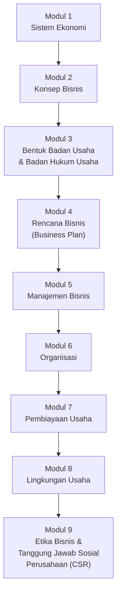

# Pengantar Bisnis (EMBS4102)

**Program Studi Manajemen — Program Sarjana — Universitas Terbuka**

| | |
|---|---|
| **Kode Mata Kuliah** | EMBS4102 |
| **Bobot SKS** | 3 SKS |
| **Nama Pengembang** | Dr. Muhammad Istan, SE, M.Pd, MM |
| **Nama Penelaah** | Devi Ayuni, SE., M.Si |
| **Tahun Pengembangan** | 2023 |

> Dokumen ini disusun berdasarkan **Rancangan Aktivitas Tutorial (RAT)** mata kuliah sebagai gambaran umum/preview materi yang dibahas di setiap pertemuan tutorial.

---

## Deskripsi Singkat Mata Kuliah

Mata kuliah Pengantar Bisnis/EMBS4102 merupakan mata kuliah prasyarat yang memberikan **kerangka dasar** bagi mahasiswa untuk mempelajari mata kuliah lanjutan dan inti di Program Studi Manajemen. Mata kuliah ini bertujuan memberikan pemahaman kepada mahasiswa tentang bisnis, bagaimana operasi bisnis dijalankan, dan bagaimana bisnis dikelola.

Cakupan materi meliputi keterkaitan antara **sistem ekonomi** suatu negara dengan pelaksanaan kegiatan bisnis, serta berbagai instrumen yang menunjang kegiatan bisnis: perencanaan bisnis, pemilihan bentuk badan usaha, pengelolaan bisnis, sumber permodalan, pelaksanaan fungsi organisasi, penyesuaian bisnis terhadap tuntutan lingkungan, etika, dan tanggung jawab sosial.

## Capaian Pembelajaran Mata Kuliah

Setelah mempelajari mata kuliah ini, mahasiswa mampu **menjelaskan keterkaitan antara sistem ekonomi suatu negara dengan pelaksanaan kegiatan bisnis** serta berbagai instrumen penunjangnya — mulai dari perencanaan bisnis, pemilihan bentuk badan usaha, pengelolaan bisnis, sumber permodalan, fungsi organisasi, penyesuaian terhadap lingkungan bisnis, hingga etika dan tanggung jawab sosial perusahaan.

---

## Peta Kompetensi

> **Capaian Pembelajaran Umum:** mahasiswa mampu menjelaskan sistem ekonomi dan pengaruhnya terhadap bisnis, memahami konsep dan bentuk-bentuk bisnis, merancang rencana bisnis, menjalankan fungsi-fungsi manajemen dalam organisasi, mengidentifikasi sumber pembiayaan usaha, menganalisis lingkungan bisnis beserta pemangku kepentingannya, serta memahami etika dan tanggung jawab sosial perusahaan.

---

## Rancangan Aktivitas Tutorial (RAT)

| Tutorial Ke- | Pokok Bahasan | Sub Pokok Bahasan | Tugas Tutorial | Daftar Pustaka |
|---|---|---|---|---|
| [1](pertemuan-01/README.md) | Sistem Ekonomi | KB 1. Pengertian Ekonomi dan Sistem Ekonomi; KB 2. Sistem Ekonomi dalam Suatu Negara | — | [1], [2], [3], [4], [5] |
| [2](pertemuan-02/README.md) | Konsep Bisnis | KB 1. Pengertian, Fungsi dan Jenis Bisnis; KB 2. Tren Bisnis di Era Disrupsi | — | [1], [2], [6], [7] |
| [3](pertemuan-03/README.md) | Bentuk Badan Usaha dan Badan Hukum Usaha | KB 1. Bentuk Badan Usaha; KB 2. Bentuk Badan Hukum Usaha | √ (Tugas 1) | [1], [2], [8] |
| [4](pertemuan-04/README.md) | Rencana Bisnis (Business Plan) | KB 1. Elemen Perencanaan Strategik dalam Business Plan; KB 2. Pengertian, Isi dan Fungsi Business Plan | — | [1], [2], [9] |
| [5](pertemuan-05/README.md) | Manajemen Bisnis | KB 1. Konsep Manajemen Bisnis; KB 2. Fungsi-fungsi Manajemen dan Peran Manajer | √ (Tugas 2) | [1], [2], [10] |
| [6](pertemuan-06/README.md) | Organisasi | KB 1. Organisasi dalam Manajemen; KB 2. Bidang Manajemen Bisnis dalam Menjalankan Bisnis | — | [1], [2], [11] |
| [7](pertemuan-07/README.md) | Pembiayaan Usaha | KB 1. Konsep Pembiayaan Usaha; KB 2. Sumber Pembiayaan | √ (Tugas 3) | [1], [2], [12] |
| [8](pertemuan-08/README.md) | Lingkungan Usaha & Etika Bisnis dan Tanggung Jawab Sosial Perusahaan | KB 1. Lingkungan Umum dan Lingkungan Khusus Bisnis; KB 2. Para Pemangku Kepentingan Bisnis; KB 3. Etika Bisnis; KB 4. Tanggung Jawab Sosial Perusahaan | — | [1], [2], [13] |

> Modus tutorial menggunakan **Tuton**. Tugas Tutorial diberikan pada pertemuan ke-3, ke-5, dan ke-7 — masing-masing mencakup materi Modul 1–3 (Tugas 1), Modul 4–5 (Tugas 2), dan Modul 6–7 (Tugas 3) untuk mata kuliah berbobot 3 SKS.

### Rincian Capaian Pembelajaran Khusus per Pertemuan

#### Pertemuan 1 — Sistem Ekonomi
1. Menjelaskan tujuan sistem ekonomi.
2. Menjelaskan indikator kesehatan ekonomi.
3. Menjelaskan indeks daya saing global (*Global Competitiveness Index*).
4. Membedakan sistem ekonomi di dunia: sistem ekonomi sosialis (*command economy*), campuran, dan syariah.
5. Menjelaskan sistem ekonomi di Indonesia.
6. Menganalisis pengaruh sistem ekonomi terhadap pelaksanaan bisnis dalam suatu negara.

#### Pertemuan 2 — Konsep Bisnis
1. Menjelaskan pengertian bisnis.
2. Menjelaskan fungsi bisnis.
3. Mengklasifikasikan bisnis domestik dan bisnis internasional.
4. Menjelaskan ruang lingkup/entitas bisnis.
5. Menjelaskan tujuan bisnis.
6. Memahami konsep bisnis di era disrupsi.
7. Mengidentifikasi ancaman dan peluang bisnis di era Revolusi Industri 4.0.
8. Menjelaskan perkembangan bisnis online di Indonesia.

#### Pertemuan 3 — Bentuk Badan Usaha dan Badan Hukum Usaha
1. Menjelaskan pengertian perusahaan, usaha, dan pengusaha.
2. Menjelaskan pengertian dan jenis-jenis badan usaha.
3. Menjelaskan pengertian, jenis, dan tujuan badan hukum usaha.
4. Membedakan berbagai bentuk badan hukum usaha: Perseroan Terbatas (PT), Perusahaan Jawatan (Perjan), Perusahaan Umum (Perum), Persero, Perusahaan Daerah, Koperasi, dan Yayasan.
5. Menjelaskan fungsi badan usaha/badan hukum usaha.
6. Menganalisis kelebihan dan kelemahan masing-masing bentuk badan usaha.

#### Pertemuan 4 — Rencana Bisnis (Business Plan)
1. Menjelaskan pengertian perencanaan.
2. Menjelaskan hierarki rencana dalam perencanaan strategik.
3. Menjelaskan pengertian perencanaan strategik.
4. Menjelaskan elemen-elemen aktivitas entrepreneurial (*entrepreneurial activity*) dalam rencana bisnis.
5. Menjelaskan komponen-komponen aktivitas entrepreneurial.
6. Menjelaskan pengertian *business plan*.
7. Menjelaskan konsep-konsep pendukung *business plan*.
8. Menjelaskan isi *business plan* secara umum.

#### Pertemuan 5 — Manajemen Bisnis
1. Menjelaskan keahlian manajerial (*managerial skill*).
2. Menjelaskan sumber daya organisasi (*organization resources*).
3. Mengidentifikasi dalam organisasi apa saja manajemen dibutuhkan.
4. Menjelaskan fungsi-fungsi manajemen bisnis.
5. Menjelaskan proses pemberian motivasi (*motivating*).
6. Menjelaskan konsep komunikasi (*communication*) dalam manajemen.
7. Menjelaskan fungsi pengendalian.
8. Menjelaskan peran manajerial (*managerial roles*).

#### Pertemuan 6 — Organisasi
1. Menjelaskan pengertian organisasi dalam manajemen.
2. Menjelaskan proses pengorganisasian.
3. Mengidentifikasi tahap-tahap dalam proses pengorganisasian.
4. Menjelaskan manajemen pemasaran.
5. Menjelaskan manajemen operasi.
6. Menjelaskan manajemen sumber daya manusia.
7. Menjelaskan manajemen keuangan dan akuntansi.

#### Pertemuan 7 — Pembiayaan Usaha
1. Menjelaskan pengertian pembiayaan dan investasi saham.
2. Menjelaskan tujuan pembiayaan usaha.
3. Mengidentifikasi sumber pembiayaan dari modal sendiri (*equity*).
4. Menjelaskan sumber pembiayaan dari bank.
5. Menjelaskan sumber pembiayaan dari pasar modal.
6. Menjelaskan sumber pembiayaan dari lembaga keuangan bukan bank.
7. Menjelaskan sumber pembiayaan dari Angel Investor.
8. Menjelaskan sumber pembiayaan dari *Financial Technology* (Fintech).

#### Pertemuan 8 — Lingkungan Usaha & Etika Bisnis dan CSR
1. Menjelaskan lingkungan umum perusahaan dan lingkungan khusus.
2. Menjelaskan pengertian dan klasifikasi pemangku kepentingan (*stakeholders*).
3. Membedakan stakeholders berdasarkan kedudukan dalam pengelolaan perusahaan.
4. Membedakan stakeholders berdasarkan aktivitas perusahaan.
5. Menjelaskan manajemen para pemangku kepentingan.
6. Menjelaskan pengertian norma, moralitas, dan etika bisnis.
7. Menjelaskan mengapa bisnis harus etis.
8. Mengidentifikasi isu-isu etika dalam bisnis.
9. Menjelaskan standar etika bisnis.
10. Menjelaskan pengertian dan dimensi tanggung jawab sosial perusahaan (CSR).

---

## Daftar Pustaka/OER

1. Solihin, Ismail. Edisi-4. *Pengantar Bisnis*. Tangerang Selatan: Universitas Terbuka.
2. Griffin, R.W. dan Elbert, R.J. 2015. *Business Essentials*. Pearson Education, Inc.
3. Sistem Ekonomi — [YouTube](https://www.youtube.com/watch?v=Wx01i3EvlaU&t=1s)
4. Sistem Ekonomi dan Reformasi Ekonomi — [YouTube](https://www.youtube.com/watch?v=3RTeK9EqhDs)
5. Apa Itu Ekonomi? | Memahami Ekonomi dalam 10 Menit — [YouTube](https://www.youtube.com/watch?v=1RDG528VbRE)
6. Konsep Bisnis — [YouTube](https://www.youtube.com/watch?v=1RDG528VbRE)
7. Bisnis dan Lingkungannya — [YouTube](https://www.youtube.com/watch?v=kxxlpHbWBRY)
8. Bentuk Badan Usaha dan Badan Hukum Usaha — [YouTube](https://www.youtube.com/watch?v=MJHEEJN5AAI)
9. Rencana Bisnis (Business Plan) — [YouTube](https://www.youtube.com/watch?v=gbVKpBSPqGo)
10. Manajemen Bisnis — [YouTube](https://www.youtube.com/watch?v=x3q9CQRVs5g)
11. Organisasi — [YouTube](https://www.youtube.com/watch?v=22Vki2xngt0)
12. Pembiayaan Usaha — [YouTube](https://www.youtube.com/watch?v=veSXCqpjLSE)
13. Lingkungan Bisnis — [YouTube](https://www.youtube.com/watch?v=1SJ0TFeUbLc&t=525s)
