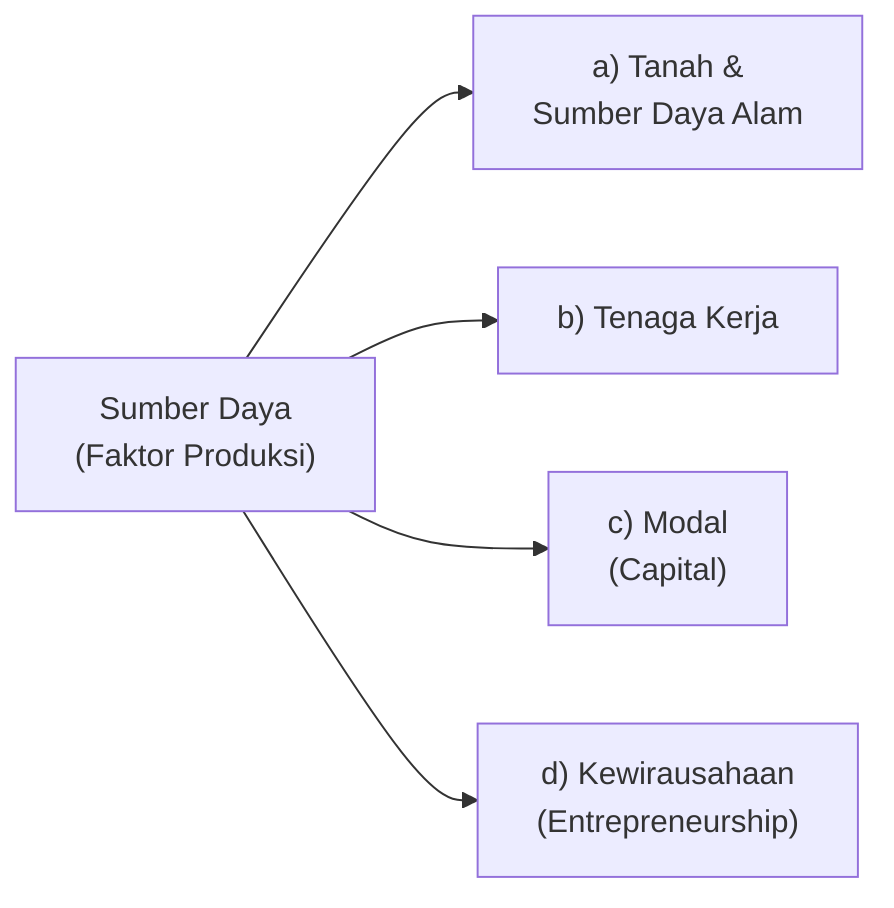
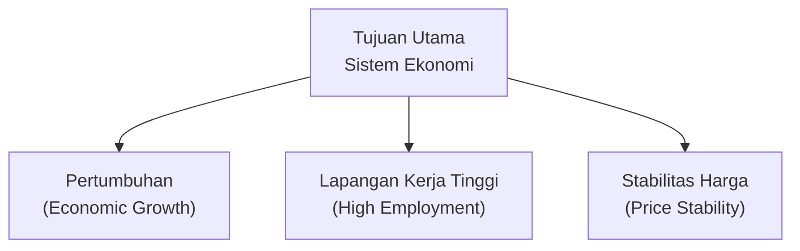
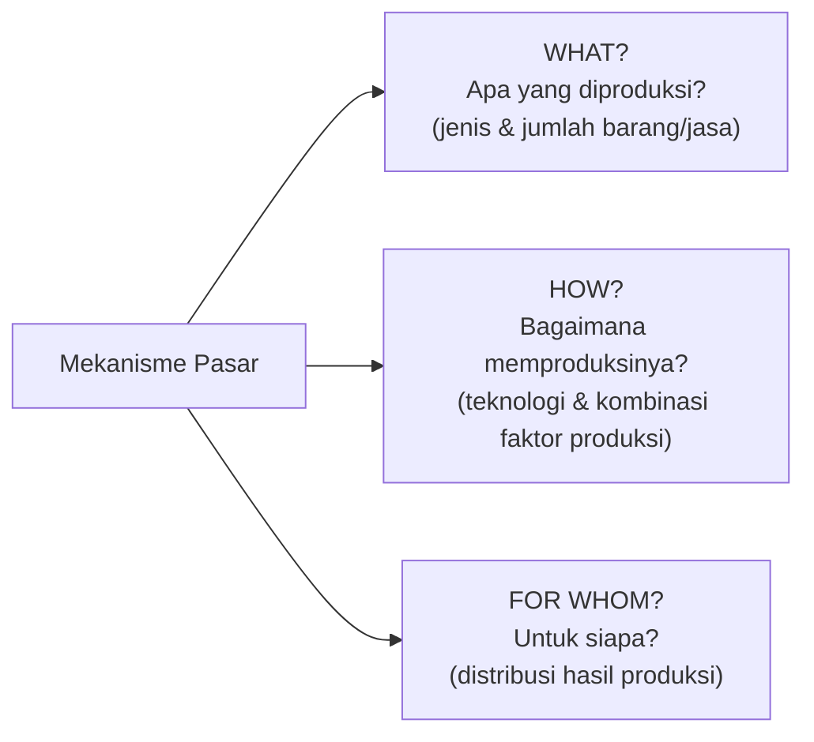
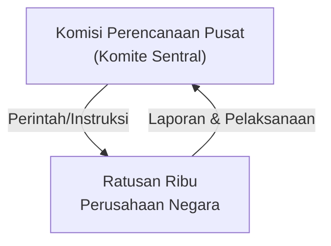
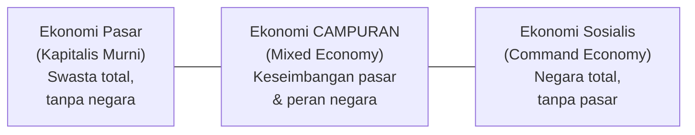
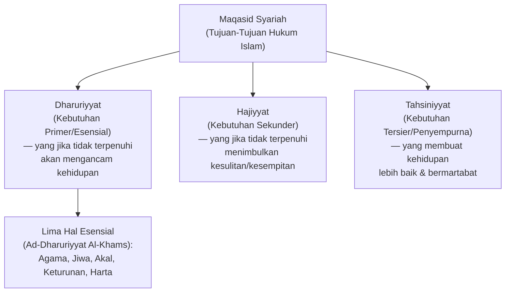
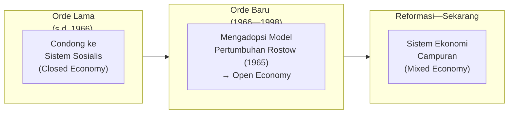
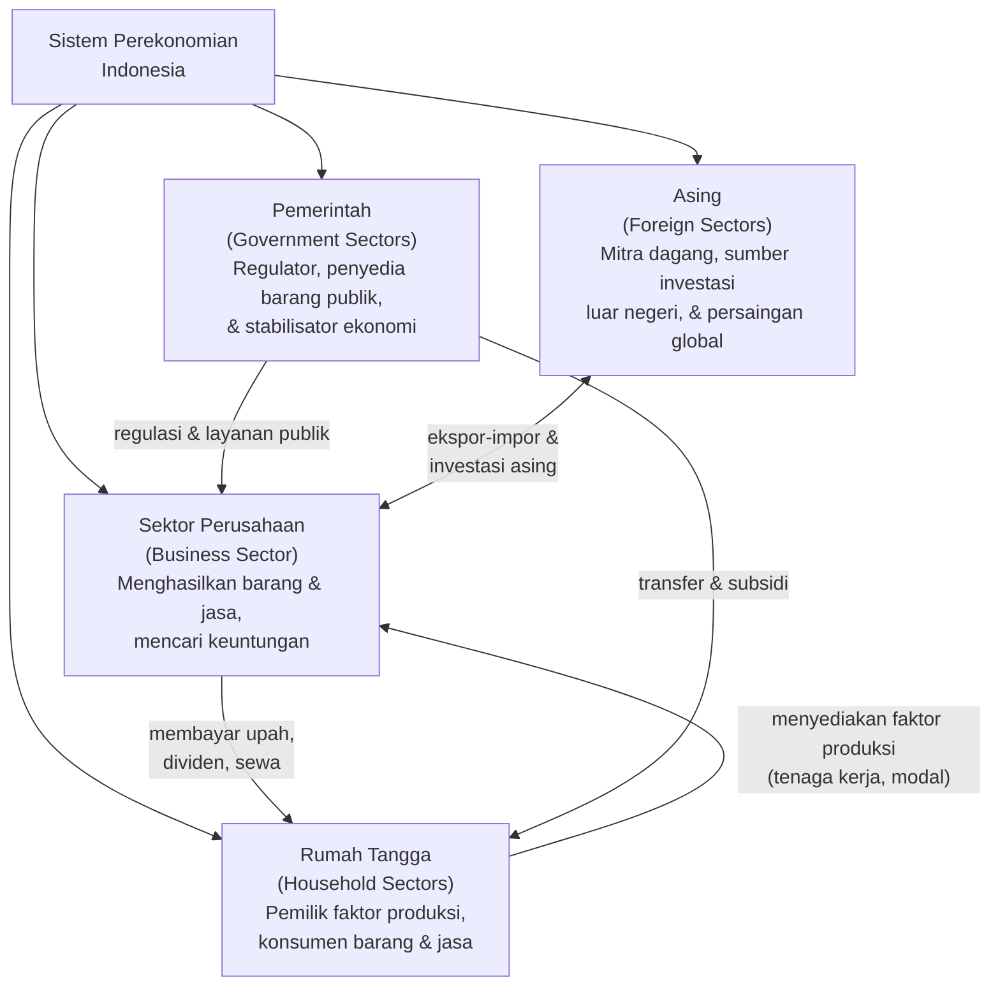
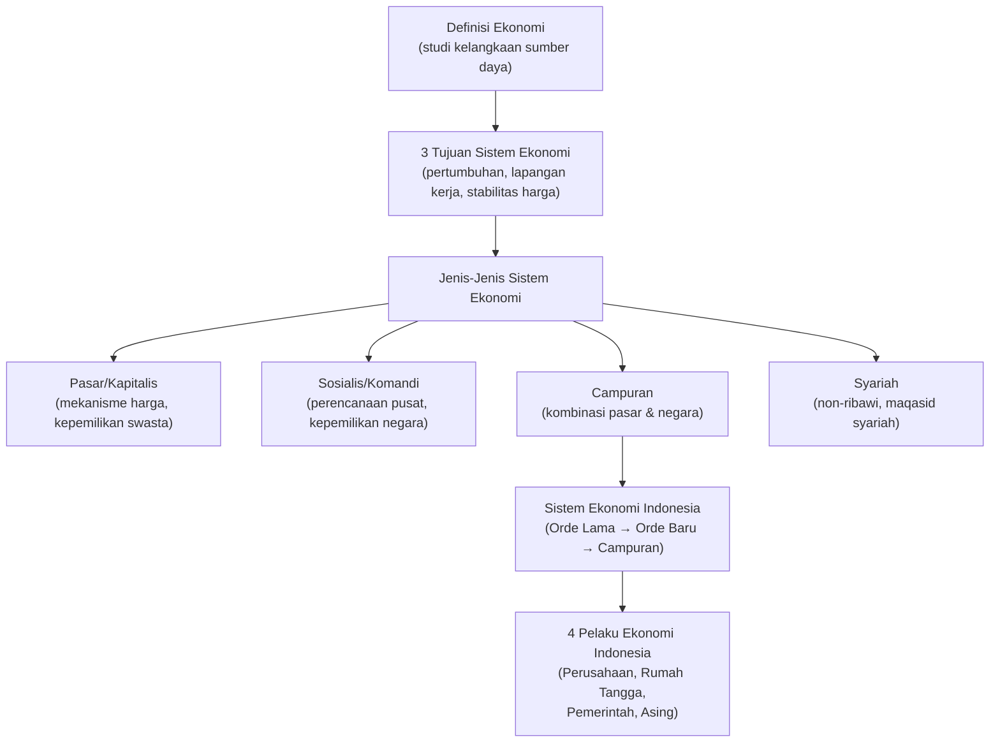

# Sesi 1 — Sistem Ekonomi

**EMBS4102 Pengantar Bisnis**
Program Studi Sistem Informasi — Universitas Terbuka

> Catatan: dokumen ini merupakan ekstraksi sekaligus elaborasi dari materi *Inisiasi 1 — Modul 1: Sistem Ekonomi*. Setiap poin dijelaskan lebih dalam dengan konteks dan contoh agar lebih mudah dipahami secara utuh. Diagram konseptual digambarkan ulang menggunakan mermaid.

---

## 1. Pengertian Ekonomi dan Sistem Ekonomi

### Definisi Ekonomi

> **Ekonomi** adalah studi tentang bagaimana sumber daya yang langka digunakan untuk menghasilkan keluaran — barang dan jasa — untuk didistribusikan di antara manusia.

Kata kunci dalam definisi ini adalah **kelangkaan** (*scarcity*): sumber daya yang tersedia selalu terbatas, sementara kebutuhan manusia tidak terbatas. Inilah yang membuat ilmu ekonomi menjadi penting — ia mempelajari bagaimana membuat keputusan terbaik di bawah keterbatasan tersebut.

### Faktor-Faktor Produksi (Sumber Daya)

Sumber daya ekonomi mencakup salah satu atau semua dari:

| Faktor | Penjelasan |
|---|---|
| **Tanah & SDA** | Lahan, hutan, tambang, air, dan semua yang disediakan alam secara alami. |
| **Tenaga Kerja** | Kemampuan fisik dan mental manusia yang digunakan dalam proses produksi. |
| **Modal** | Alat, mesin, gedung, dan aset buatan manusia yang digunakan untuk menghasilkan barang/jasa. Modal bukan uang, melainkan *barang modal*. |
| **Kewirausahaan** | Kemampuan mengorganisasi ketiga faktor di atas, menanggung risiko, dan berinovasi untuk menciptakan nilai. |

> Faktor kewirausahaan (*entrepreneurship*) sering disebut sebagai faktor produksi keempat yang membedakan ekonomi modern: tanpa pengusaha yang berani mengambil risiko, ketiga faktor lainnya tidak akan produktif.

### Tiga Tujuan Utama Sistem Ekonomi

Setiap sistem ekonomi pada dasarnya dirancang untuk mencapai tiga tujuan besar:

| Tujuan | Indikator | Penjelasan |
|---|---|---|
| **Pertumbuhan** | GDP/PDB | Peningkatan kemampuan ekonomi menghasilkan barang & jasa dari waktu ke waktu. |
| **Lapangan Kerja Tinggi** | Tingkat pengangguran | Meminimalkan pengangguran agar sebagian besar angkatan kerja produktif. |
| **Stabilitas Harga** | Tingkat inflasi | Menjaga harga tetap stabil agar daya beli masyarakat tidak tergerus inflasi. |

> Ketiga tujuan ini sering kali saling bertarik-ulur (*trade-off*). Misalnya, pertumbuhan yang terlalu cepat bisa memicu inflasi (mengorbankan stabilitas harga), sementara kebijakan meredam inflasi bisa memperlambat pertumbuhan dan meningkatkan pengangguran. Inilah mengapa kebijakan ekonomi selalu penuh tantangan.

---

## 2. Sistem Ekonomi Pasar (Kapitalis)

> **Sistem ekonomi pasar** adalah suatu mekanisme di mana pembeli dan penjual berinteraksi untuk menentukan harga dan pertukaran barang dan jasa. *(Samuelson, 2002: 27)*

Dalam sistem ini, keputusan ekonomi diserahkan kepada **mekanisme pasar** — kekuatan permintaan (*demand*) dan penawaran (*supply*) yang berinteraksi secara bebas menentukan apa yang diproduksi, bagaimana memproduksinya, dan untuk siapa.

### Tiga Masalah Ekonomi Mendasar

Setiap sistem ekonomi harus menjawab tiga pertanyaan fundamental:

Mekanisme pasar memecahkan ketiga masalah ini secara **simultan**: harga pasar menjadi sinyal yang mengkoordinasikan jutaan keputusan individual tanpa perlu perencanaan terpusat.

### Ciri-Ciri Sistem Ekonomi Pasar (Kapitalis)

- **Kepemilikan swasta** atas alat-alat/faktor produksi — individu dan perusahaan berhak memiliki properti dan aset produktif.
- **Kebebasan berusaha dan bersaing** — siapapun bebas mendirikan bisnis dan bersaing di pasar.
- **Harga ditentukan pasar** — para produsen menjual hasil produksinya di pasar yang bersaing; harga muncul dari interaksi penawaran dan permintaan.
- **Motif keuntungan** — perusahaan melakukan aktivitas usaha dengan tujuan utama memperoleh keuntungan (*profit motive*).

> Sistem ini identik dengan **kapitalisme** yang berkembang di negara-negara Barat seperti Amerika Serikat. Kelebihannya adalah efisiensi dan inovasi yang didorong persaingan; kelemahannya adalah potensi ketimpangan distribusi kekayaan dan kegagalan pasar (*market failure*) pada barang-barang publik.

---

## 3. Sistem Ekonomi Sosialis (*Command Economy*)

> Dalam sistem ekonomi komandi, **struktur perekonomian berbentuk piramida**: puncak piramida ditempati oleh komisi perencanaan pusat (komite sentral), dan pada tingkat paling bawah terdapat ratusan ribu perusahaan milik negara yang bertugas melaksanakan perintah dari atas. *(Partadiredja, 1982: 207)*

### Ciri-Ciri Sistem Ekonomi Sosialis

- **Pemilikan negara** atas alat-alat dan sumber produksi — tanah, mesin-mesin, pabrik-pabrik, dan lain-lain dimiliki dan dikelola oleh negara.
- **Pengambilan keputusan terpusat** — apa yang diproduksi, berapa banyak, bagaimana cara produksinya, kapan, di mana, dan dengan harga berapa, semuanya ditentukan oleh negara.
- **Perencanaan pusat menggantikan mekanisme pasar** — tidak ada harga pasar bebas; alokasi sumber daya ditentukan melalui rencana yang disusun pemerintah.
- **Produksi, distribusi, konsumsi, dan alokasi sumber daya** ditetapkan oleh negara melalui **perencanaan berjangka** (5 tahun, 8 tahun, dan sebagainya).

> Uni Soviet adalah contoh paling terkenal sistem ekonomi sosialis murni, dengan rencana lima tahun (*pyatiletka*) yang mengatur seluruh sektor ekonomi. Sistem ini runtuh pada 1991 karena ketidakmampuannya merespons perubahan dengan cepat dan inefisiensi akibat kurangnya insentif pasar.

---

## 4. Sistem Ekonomi Campuran

> **Sistem ekonomi campuran** adalah sistem yang berada di antara dua kutub: tidak menyerahkan seluruh penyelesaian masalah ekonomi kepada mekanisme pasar tanpa campur tangan negara, dan tidak pula merencanakan seluruh ekonomi oleh negara tanpa mekanisme pasar dan tanpa kepemilikan faktor produksi oleh masyarakat.

Sistem campuran adalah yang **paling banyak diterapkan** di dunia saat ini — termasuk Indonesia. Tidak ada negara yang benar-benar murni kapitalis atau murni sosialis.

### Ciri-Ciri Sistem Ekonomi Campuran

- **Hak milik individu diakui**, namun dengan **batasan dari pemerintah** — kepemilikan swasta atas faktor produksi diperbolehkan, tetapi negara bisa mengatur atau membatasinya demi kepentingan umum.
- **Kebebasan individu untuk berusaha** tetap ada — setiap individu berhak mengembangkan kreativitas sesuai kemampuan.
- **Kepentingan umum lebih diutamakan** — ketika kepentingan individu bertentangan dengan kepentingan masyarakat, kepentingan umum didahulukan.
- **Campur tangan pemerintah melalui kebijakan ekonomi** — pemerintah aktif menggunakan kebijakan fiskal (pajak & belanja), kebijakan moneter (suku bunga), dan regulasi untuk mengarahkan ekonomi.
- **Campur tangan pemerintah terbatas pada sektor yang menguasai hajat hidup orang banyak** — misalnya energi, air, pendidikan, dan kesehatan.

---

## 5. Sistem Ekonomi Syariah

> **Sistem ekonomi syariah** merupakan penerapan prinsip ekonomi **non-ribawi** dalam kegiatan ekonomi.

Pengembangan ekonomi Islam/ekonomi syariah tidak terlepas dari prinsip-prinsip yang dikembangkan dalam **maqasid syariah** *(Rahman dan Ahmad, 2010)*.

### Maqasid Syariah

Menurut Wan Jemizan, maqasid syariah dapat dibagi menjadi **tiga tingkatan kebutuhan**:

| Tingkatan | Penjelasan | Contoh |
|---|---|---|
| **Dharuriyyat** | Kebutuhan paling mendasar yang jika tidak terpenuhi akan menyebabkan kerusakan atau kehancuran kehidupan manusia. | Makan, tempat tinggal, keamanan, perlindungan hak harta. |
| **Hajiyyat** | Kebutuhan yang jika tidak terpenuhi tidak menyebabkan kehancuran, tetapi menimbulkan kesulitan dan kesempitan. | Kontrak jual beli yang fleksibel, asuransi syariah. |
| **Tahsiniyyat** | Kebutuhan penyempurna/pelengkap yang menjadikan kehidupan lebih baik, indah, dan bermartabat. | Etika dalam berpakaian, etiket dalam bermuamalah. |

> Prinsip non-ribawi (*tidak mengandung riba/bunga*) adalah pembeda utama sistem ekonomi syariah dari sistem kapitalis. Riba dilarang karena dianggap mengeksploitasi pihak yang membutuhkan dan menciptakan ketidakadilan dalam distribusi kekayaan. Sebagai gantinya, sistem syariah mendorong **bagi hasil** (*mudharabah*), **kemitraan** (*musyarakah*), dan akad-akad halal lainnya.

---

## 6. Sistem Ekonomi di Indonesia

Indonesia mengalami **pergeseran sistem ekonomi** yang signifikan sepanjang sejarahnya:

| Era | Karakteristik |
|---|---|
| **Orde Lama** | Ekonomi lebih condong ke sistem sosialis, bersifat **tertutup** (*Closed Economy*) — perdagangan dan investasi luar negeri sangat dibatasi. |
| **Orde Baru** | Perubahan orientasi pembangunan ekonomi mengadopsi **model pertumbuhan Rostow (1965)** — ekonomi terbuka (*Open Economy*) dengan mendorong investasi asing dan orientasi ekspor. |
| **Sekarang** | Dapat dikategorikan sebagai **sistem ekonomi campuran** *(Partadiredja, 1982: 208)* — mekanisme pasar aktif namun negara tetap berperan mengatur sektor-sektor vital. |

> **Teori Tahapan Pertumbuhan Rostow (1965)** membagi perkembangan ekonomi menjadi 5 tahap: masyarakat tradisional → prakondisi tinggal landas → tinggal landas (*take-off*) → menuju kedewasaan → era konsumsi massal tinggi. Orde Baru menggunakannya sebagai kerangka arah pembangunan Indonesia, dengan Pelita (Pembangunan Lima Tahun) sebagai instrumen perencanaan.

---

## 7. Para Pelaku Ekonomi dalam Sistem Perekonomian Indonesia

Sistem perekonomian Indonesia melibatkan **empat sektor/pelaku utama**:

| Pelaku | Peran Utama |
|---|---|
| **Sektor Perusahaan (*Business Sector*)** | Mengorganisir faktor-faktor produksi untuk menghasilkan barang dan jasa, dengan tujuan memperoleh keuntungan. Mencakup perusahaan swasta, BUMN, koperasi. |
| **Rumah Tangga (*Household Sectors*)** | Sebagai **pemilik faktor produksi** (menyediakan tenaga kerja, lahan, dan modal), sekaligus sebagai **konsumen akhir** barang dan jasa yang dihasilkan perusahaan. |
| **Pemerintah (*Government Sectors*)** | Berperan sebagai **regulator** (menetapkan aturan main), **produsen barang publik** (pertahanan, jalan, pendidikan), dan **stabilisator ekonomi** (melalui kebijakan fiskal & moneter). |
| **Asing (*Foreign Sectors*)** | Mencakup negara lain, perusahaan multinasional, dan lembaga internasional yang berinteraksi melalui perdagangan internasional, investasi asing langsung (FDI), dan pinjaman luar negeri. |

> Keempat pelaku ini saling berinteraksi membentuk **arus melingkar perekonomian** (*circular flow of income*): rumah tangga menyediakan faktor produksi kepada perusahaan, perusahaan membayar pendapatan (upah, sewa, bunga, laba) kepada rumah tangga, rumah tangga membelanjakan pendapatan untuk produk perusahaan, dan seterusnya — dengan pemerintah dan sektor asing sebagai pelaku tambahan yang memperkaya dan memperumit aliran ini.

---

## Ringkasan Keterkaitan Antar Konsep

Inti dari sesi ini: **sistem ekonomi** adalah kerangka kerja bagaimana suatu masyarakat menjawab tiga pertanyaan mendasar ekonomi (*what, how, for whom*). Setiap sistem — kapitalis, sosialis, campuran, maupun syariah — memiliki cara berbeda menjawabnya, dengan kelebihan dan kelemahan masing-masing. Indonesia secara historis bergerak dari sistem lebih sosialis (Orde Lama) menuju sistem campuran yang lebih terbuka, dengan empat pelaku utama (perusahaan, rumah tangga, pemerintah, dan sektor asing) yang saling berinteraksi membentuk roda perekonomian nasional.

---

*Terima kasih*
