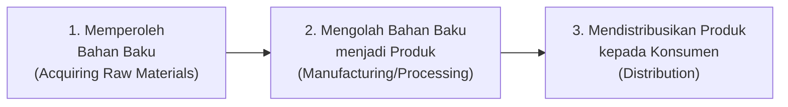
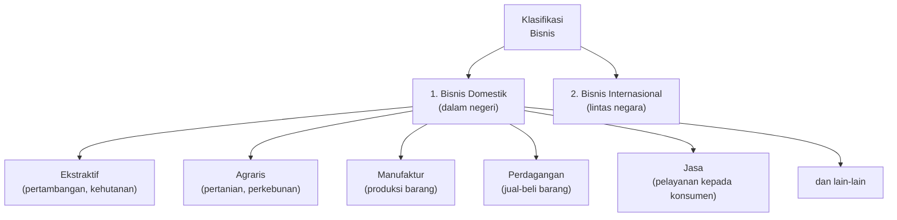
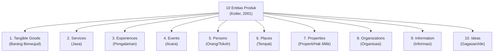
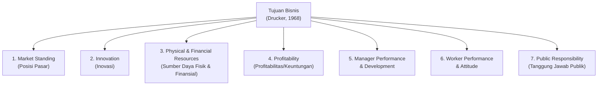
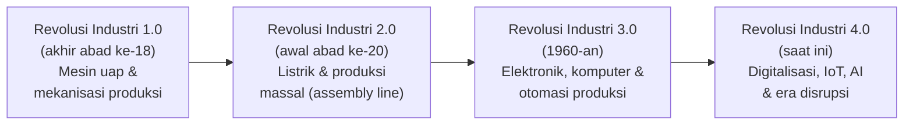
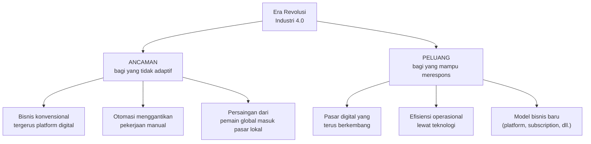
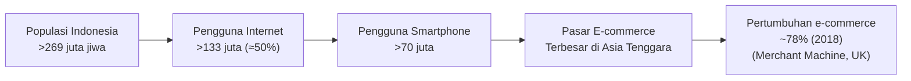
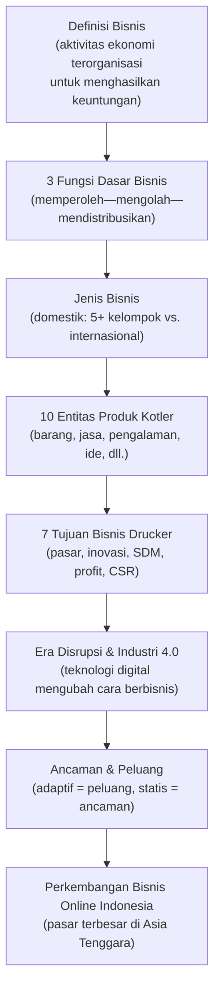

# Sesi 2 — Konsep Bisnis dan Tren Bisnis di Era Disrupsi

**EMBS4102 Pengantar Bisnis**
Program Studi Sistem Informasi — Universitas Terbuka

> Catatan: dokumen ini merupakan ekstraksi sekaligus elaborasi dari materi *Inisiasi 2 — Modul 2: Konsep Bisnis dan Tren Bisnis di Era Disrupsi*. Setiap poin dijelaskan lebih dalam dengan konteks, referensi ahli, dan contoh nyata agar lebih mudah dipahami secara utuh. Diagram konseptual digambarkan ulang menggunakan mermaid.

Materi inisiasi ini mencakup dua pokok bahasan utama:

- **A — Konsep Bisnis**: definisi, fungsi, jenis, ruang lingkup entitas, dan tujuan bisnis.
- **B — Tren Bisnis di Era Disrupsi**: Revolusi Industri 4.0, ancaman & peluang, dan perkembangan bisnis online di Indonesia.

---

## A — Konsep Bisnis

### 1. Definisi Bisnis

> **Bisnis** adalah aktivitas ekonomi yang dilakukan secara terorganisasi untuk memproduksi atau menjual barang dan jasa dengan tujuan mendapatkan keuntungan. Bisnis dapat berupa perdagangan, industri, atau jasa.

Menurut **Steinhoff (1979: 5)**, bisnis adalah:

> Segala kegiatan yang berkaitan dengan penyediaan barang dan jasa yang dibutuhkan atau diinginkan orang.

Definisi ini menekankan bahwa bisnis adalah **aktivitas penyedia nilai** (*value provider*) — menjembatani antara kemampuan memproduksi (sisi penawaran) dan kebutuhan/keinginan konsumen (sisi permintaan). Bisnis tidak harus berbentuk perusahaan besar ber-badan hukum; individu yang berjualan tanpa badan hukum pun termasuk dalam pengertian bisnis.

> Perbedaan antara "**dibutuhkan**" (*needs*) dan "**diinginkan**" (*wants*) penting dalam strategi bisnis: kebutuhan adalah hal esensial (makanan, pakaian, tempat tinggal), sementara keinginan adalah preferensi yang dibentuk oleh budaya dan pengalaman (misalnya iPhone vs. ponsel biasa). Bisnis yang sukses biasanya mampu mengubah keinginan menjadi kebutuhan yang terasa mendesak di benak konsumen.

### 2. Fungsi Dasar Bisnis

Menurut **Steinhoff (1979: 17)**, terdapat **tiga fungsi dasar** yang dijalankan setiap bisnis:

| Fungsi | Penjelasan | Contoh |
|---|---|---|
| **Memperoleh Bahan Baku** | Proses pengadaan input/sumber daya yang akan diolah menjadi produk atau jasa. | Pabrik tahu membeli kedelai; restoran membeli bahan masakan. |
| **Mengolah Bahan Baku** | Proses transformasi input mentah menjadi output yang bernilai tambah lebih tinggi. | Kedelai → tahu; tepung + telur → kue; data → laporan analitik. |
| **Mendistribusikan Produk** | Proses menyampaikan produk/jasa dari produsen ke tangan konsumen akhir. | Distribusi lewat toko, marketplace online, atau kurir langsung. |

> Ketiga fungsi ini membentuk **rantai nilai** (*value chain*) dasar sebuah bisnis. Inovasi di mana pun dalam rantai ini bisa menjadi keunggulan kompetitif — misalnya Amazon mengubah fungsi distribusi dengan logistik ultra-cepat, dan Gojek mengubah distribusi jasa transportasi dengan platform digital.

### 3. Jenis dan Klasifikasi Bisnis

Bisnis dapat diklasifikasikan berdasarkan **cakupan geografis operasinya**:

**Bisnis Domestik** adalah kegiatan usaha yang dilakukan oleh para pengusaha di dalam wilayah hukum suatu negara — dalam konteks Indonesia, di dalam wilayah NKRI. Bisnis domestik dibagi ke beberapa kelompok:

| Kelompok | Penjelasan | Contoh |
|---|---|---|
| **Ekstraktif** | Mengambil sumber daya langsung dari alam. | Pertambangan batubara, penebangan kayu, penangkapan ikan. |
| **Agraris** | Memanfaatkan tanah dan alam untuk budidaya. | Pertanian padi, perkebunan sawit, peternakan sapi. |
| **Manufaktur** | Mengolah bahan baku menjadi barang jadi. | Pabrik tekstil, perakitan kendaraan, produksi elektronik. |
| **Perdagangan** | Membeli dan menjual kembali barang tanpa mengubah wujudnya. | Toko kelontong, supermarket, pedagang grosir. |
| **Jasa** | Menyediakan layanan non-fisik yang memenuhi kebutuhan konsumen. | Perbankan, transportasi, konsultasi, pendidikan. |

**Bisnis Internasional** adalah aktivitas bisnis yang tidak terbatas hanya pada transaksi di dalam satu negara, melainkan dapat dilakukan lintas batas negara — mencakup ekspor-impor, investasi asing langsung, lisensi merek, waralaba internasional, hingga operasi perusahaan multinasional.

> Perbedaan kunci antara bisnis domestik dan internasional bukan hanya soal geografi, tetapi juga kompleksitas: bisnis internasional harus menghadapi perbedaan regulasi, mata uang, budaya, dan risiko geopolitik antar negara.

### 4. Ruang Lingkup / Entitas Bisnis (Kotler, 2001)

Menurut **Kotler (2001: 7)**, produk yang dipasarkan dalam suatu kegiatan bisnis dapat dikelompokkan ke dalam **10 entitas produk**:

| Entitas | Contoh |
|---|---|
| **Tangible Goods** | Sepatu, smartphone, beras, mobil — barang fisik yang dapat dipegang. |
| **Services** | Potong rambut, konsultasi hukum, layanan streaming musik. |
| **Experiences** | Wahana taman hiburan, paket wisata petualangan, kelas memasak. |
| **Events** | Konser musik, pertandingan olahraga, pameran dagang. |
| **Persons** | Manajemen karier selebriti, personal branding influencer, sponsorship atlet. |
| **Places** | Destinasi wisata (Bali), kawasan industri, kota yang dipasarkan untuk investor. |
| **Properties** | Properti real estate, portofolio investasi, hak kepemilikan aset. |
| **Organizations** | Merek universitas, reputasi LSM, citra perusahaan multinasional. |
| **Information** | Basis data, jurnal akademik, berita berbayar, laporan riset pasar. |
| **Ideas** | Kampanye sosial ("stop smoking"), ideologi partai, konsep desain yang dipatenkan. |

> Klasifikasi Kotler ini menunjukkan bahwa **bisnis jauh melampaui sekadar jual-beli barang fisik**. Di era digital, entitas seperti *information*, *experiences*, dan *ideas* justru semakin bernilai tinggi — contohnya platform seperti Coursera menjual *information* dan *experiences* belajar, sementara konsultan strategi menjual *ideas*.

### 5. Tujuan Bisnis (Drucker, 1968)

Menurut **Peter Drucker (1968: 83)**, terdapat **tujuh tujuan bisnis** yang komprehensif:

| Tujuan | Penjelasan |
|---|---|
| **Market Standing** | Posisi dan pangsa pasar (*market share*) yang ingin dicapai bisnis di industri dan di benak konsumen. |
| **Innovation** | Kemampuan menghasilkan produk, proses, atau model bisnis baru yang lebih baik dari sebelumnya. |
| **Physical & Financial Resources** | Pengelolaan aset fisik (mesin, gedung) dan keuangan (modal, likuiditas) agar bisnis tetap beroperasi dan berkembang. |
| **Profitability** | Menghasilkan keuntungan yang cukup untuk mempertahankan dan mengembangkan bisnis jangka panjang. |
| **Manager Performance & Development** | Kinerja manajerial yang baik dan pengembangan kapasitas pemimpin bisnis secara berkelanjutan. |
| **Worker Performance & Attitude** | Produktivitas dan sikap kerja karyawan yang mendukung tercapainya tujuan organisasi. |
| **Public Responsibility** | Tanggung jawab bisnis terhadap masyarakat dan lingkungan sekitarnya (*corporate social responsibility*). |

> Drucker visioner dengan memasukkan **Public Responsibility** sebagai salah satu tujuan bisnis sejak 1968 — jauh sebelum istilah CSR (*Corporate Social Responsibility*) menjadi populer. Ini menunjukkan bahwa bisnis yang baik tidak hanya mengukur keberhasilan dari profit semata, tetapi juga dari dampaknya bagi masyarakat luas.

---

## B — Tren Bisnis di Era Disrupsi

### 6. Revolusi Industri dan Era Disrupsi

Sebelum **Industri 4.0**, terdapat tiga revolusi industri sebelumnya yang masing-masing mengubah paradigma dalam aktivitas manufaktur/produksi secara mendasar:

**Industri 4.0** menghadirkan fenomena yang disebut **era disrupsi** (*disruptive era*) — suatu era di mana industri yang ada saat ini **terganggu** akibat munculnya perubahan cara berbisnis yang didorong oleh lahirnya penggunaan **teknologi digital**.

> Istilah "disrupsi" (*disruption*) dalam konteks bisnis dipopulerkan oleh **Clayton Christensen** dengan konsep *disruptive innovation* — yaitu inovasi yang awalnya tampak inferior dan menyasar pasar bawah, namun akhirnya menggusur pemain lama yang mapan. Contoh klasik: Netflix menggusur Blockbuster, Gojek menggusur taksi konvensional, dan Tokopedia menggusur toko fisik kecil.

### 7. Ancaman dan Peluang Bisnis di Era Revolusi Industri 4.0

Setiap perubahan besar selalu hadir dengan dua sisi: **ancaman** bagi yang tidak beradaptasi, dan **peluang** bagi yang mampu merespons dengan cepat.

> - **Ancaman** adalah berbagai perubahan yang terjadi di lingkungan bisnis yang memiliki potensi **mengurangi laba perusahaan**.
> - **Peluang bisnis** adalah kesempatan **memperoleh laba** akibat terjadinya perubahan lingkungan perusahaan.

Sebagai contoh, bagi perusahaan digital seperti **Grab, Tokopedia, Shopee**, dan lainnya, Industri 4.0 menghadirkan **peluang usaha** sehingga perusahaan-perusahaan ini dapat terus berkembang pesat. Sebaliknya, bisnis transportasi konvensional atau ritel fisik yang tidak bertransformasi menghadapi ancaman penurunan permintaan yang signifikan.

> Kunci merespons era disrupsi adalah **ambidexterity** organisasi — kemampuan menjalankan bisnis inti yang sudah ada (*exploitation*) sekaligus berinvestasi dalam model bisnis baru (*exploration*). Perusahaan yang hanya fokus pada salah satu akan tertinggal.

### 8. Perkembangan Bisnis Online di Indonesia

Indonesia adalah salah satu pasar digital dengan pertumbuhan paling cepat di dunia:

| Indikator | Data |
|---|---|
| **Pertumbuhan e-commerce** | ~78% pada 2018 — salah satu tercepat di dunia *(Merchant Machine, lembaga riset Inggris)* |
| **Pengguna internet** | Lebih dari **100 juta** pengguna |
| **Total populasi** | Lebih dari **269 juta jiwa** |
| **Terhubung internet** | Lebih dari **133 juta** jiwa |
| **Pengguna smartphone** | Lebih dari **70 juta** pengguna |
| **Posisi regional** | Pangsa pasar **terbesar di Asia Tenggara** bagi pemain e-commerce |

> Kombinasi populasi besar, penetrasi smartphone yang tinggi, dan kelas menengah yang tumbuh menjadikan Indonesia "**the next big market**" bagi bisnis digital global. Ini juga berarti peluang luar biasa bagi wirausaha lokal untuk membangun bisnis digital yang menjangkau ratusan juta konsumen potensial tanpa perlu membuka toko fisik di setiap kota.

---

## Ringkasan Keterkaitan Antar Konsep

Inti dari sesi ini: **bisnis** pada dasarnya adalah aktivitas terorganisasi untuk menciptakan nilai bagi konsumen sekaligus keuntungan bagi pelakunya — dengan tiga fungsi dasar (memperoleh, mengolah, mendistribusikan), berbagai jenis dan cakupan (domestik hingga internasional), dan 10 entitas produk yang jauh melampaui sekadar barang fisik. Di era Revolusi Industri 4.0, bisnis menghadapi **era disrupsi** yang bersifat double-edged: ancaman bagi yang tidak beradaptasi, sekaligus peluang bagi yang mampu merespons — dan Indonesia, dengan pertumbuhan e-commerce tercepat di dunia, adalah salah satu arena disrupsi bisnis digital yang paling dinamis saat ini.

---

*Terima kasih*
