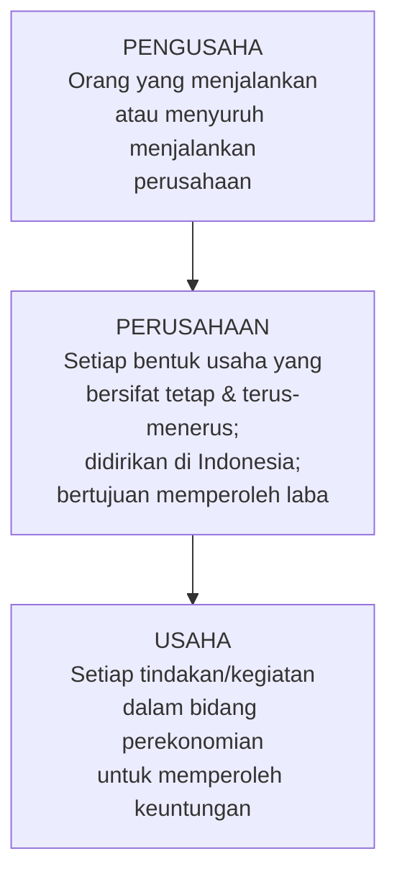
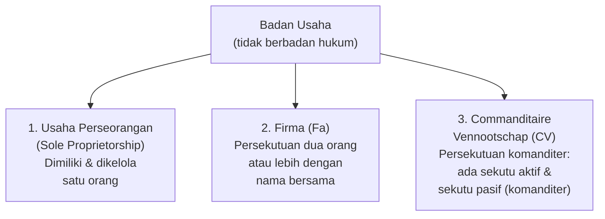
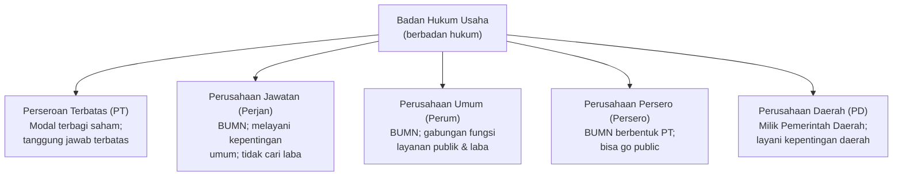
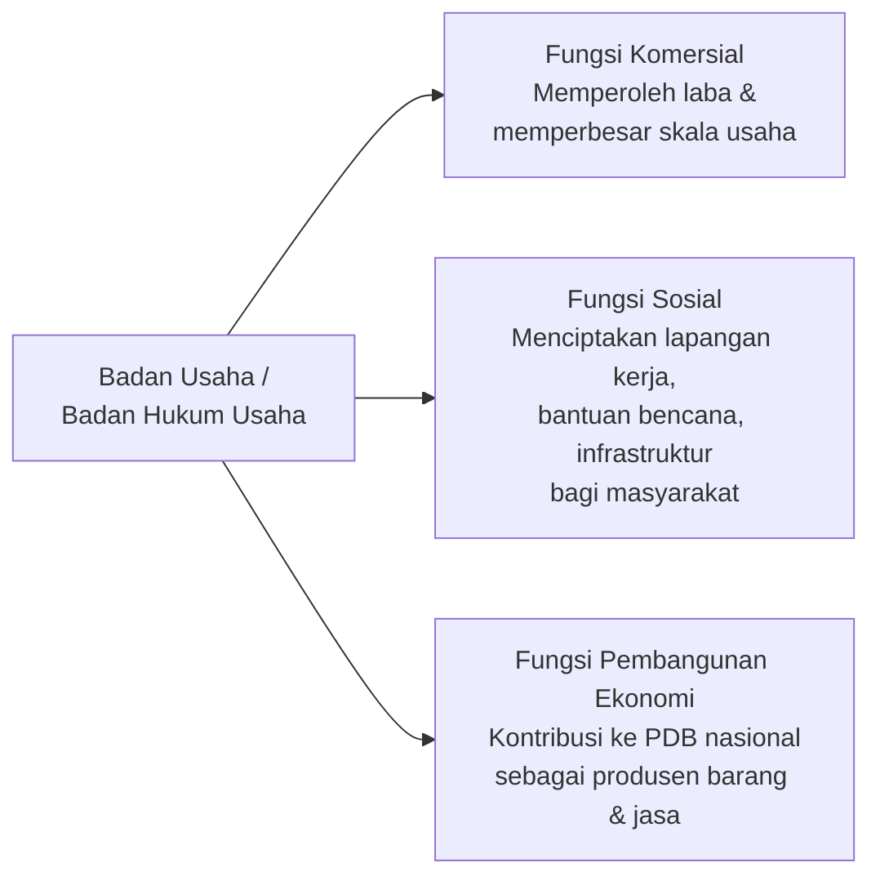
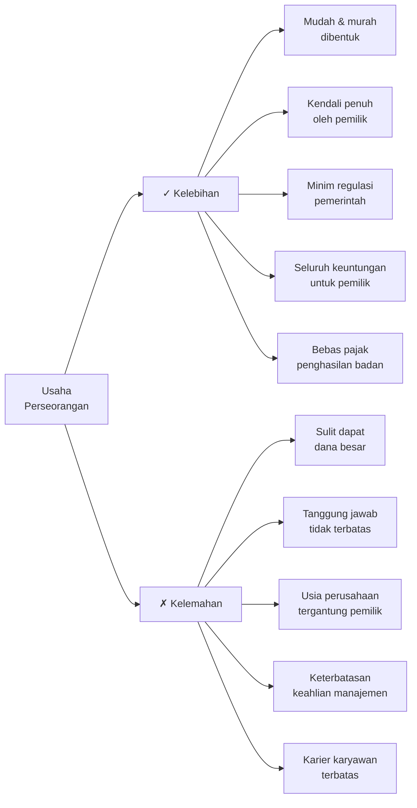
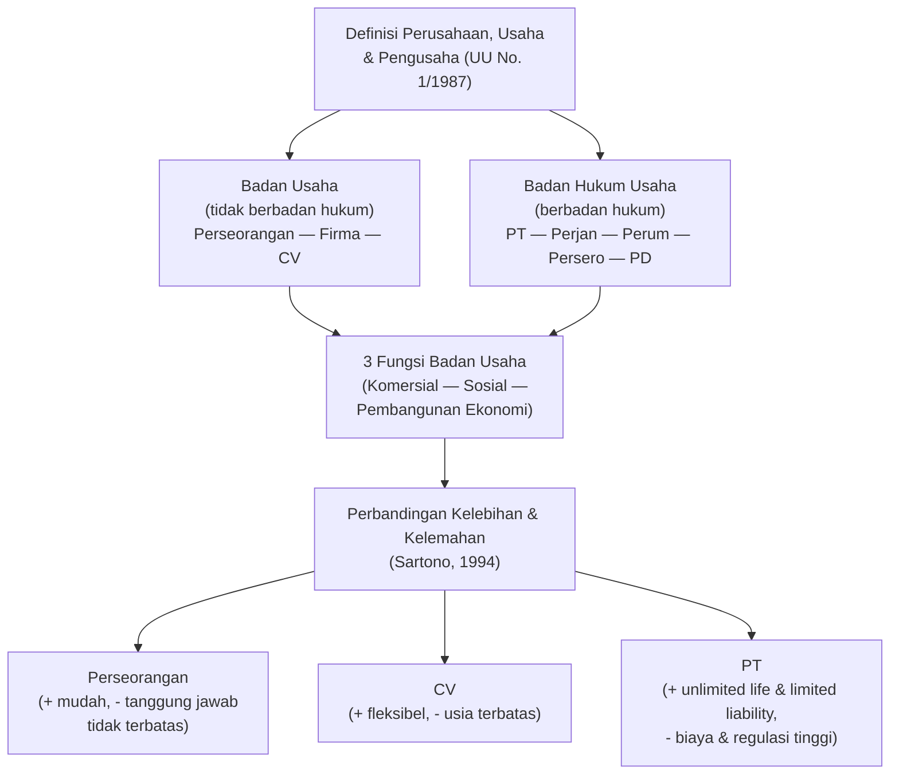

# Sesi 3 — Bentuk Badan Usaha dan Badan Hukum Usaha

**EMBS4102 Pengantar Bisnis**
Program Studi Sistem Informasi — Universitas Terbuka

> Catatan: dokumen ini merupakan ekstraksi sekaligus elaborasi dari materi *Inisiasi 3 — Modul 3: Bentuk Badan Usaha dan Badan Hukum Usaha*. Setiap poin dijelaskan lebih dalam dengan konteks hukum, contoh nyata, dan perbandingan praktis agar lebih mudah dipahami secara utuh. Diagram konseptual digambarkan ulang menggunakan mermaid.

Materi inisiasi ini mencakup dua pokok bahasan utama:

- **A — Pengertian dan Bentuk Badan Usaha**: definisi perusahaan, usaha & pengusaha; jenis badan usaha (Perseorangan, Firma, CV); serta badan hukum usaha (PT, Perum, Persero, dll.).
- **B — Fungsi dan Perbandingan Badan Usaha**: fungsi komersial, sosial, & pembangunan ekonomi; serta kelebihan dan kelemahan tiap bentuk badan usaha.

---

## A — Pengertian dan Bentuk Badan Usaha

### 1. Definisi: Perusahaan, Usaha, dan Pengusaha

Tiga istilah ini sering digunakan secara bergantian dalam percakapan sehari-hari, padahal masing-masing memiliki definisi yuridis yang berbeda menurut **Undang-Undang Nomor 1 Tahun 1987**:

| Istilah | Definisi (UU No. 1/1987) |
|---|---|
| **Perusahaan** | Setiap bentuk usaha yang menjalankan setiap jenis usaha yang bersifat **tetap dan terus-menerus**, yang didirikan, bekerja, serta berkedudukan dalam wilayah negara Indonesia dengan tujuan memperoleh keuntungan dan/atau laba. |
| **Usaha** | Setiap tindakan, perbuatan, atau kegiatan apapun dalam bidang perekonomian yang dilakukan oleh setiap pengusaha untuk memperoleh keuntungan dan/atau laba. |
| **Pengusaha** | Orang yang menjalankan perusahaan atau menyuruh (orang lain) menjalankan perusahaan. |

> Kata kunci "**tetap dan terus-menerus**" dalam definisi perusahaan membedakannya dari kegiatan usaha insidental. Misalnya, seseorang yang sekali-sekali menjual barang bekas bukan termasuk perusahaan; tetapi seseorang yang secara rutin berjualan dengan struktur yang terorganisasi sudah memenuhi unsur "perusahaan" secara substansi — meski mungkin belum terdaftar secara resmi.

### 2. Pengertian dan Jenis-Jenis Badan Usaha

> **Badan usaha** merupakan organisasi usaha yang menjadi **wadah** untuk menjalankan kegiatan usaha.

Badan usaha di Indonesia terbagi menjadi **tiga jenis utama** yang **tidak berbadan hukum**:

| Jenis | Karakteristik Utama |
|---|---|
| **Usaha Perseorangan** | Didirikan dan dimiliki oleh satu orang; pemilik menanggung seluruh risiko secara pribadi; tidak ada pemisahan antara aset bisnis dan aset pribadi. |
| **Firma (Fa)** | Persekutuan antara dua orang atau lebih yang menjalankan usaha dengan nama bersama; semua sekutu bertanggung jawab penuh atas utang firma. |
| **CV (Commanditaire Vennootschap)** | Terdiri dari **sekutu aktif** (komplementer) yang mengelola usaha dan bertanggung jawab penuh, serta **sekutu pasif** (komanditer) yang hanya menyetorkan modal dan tanggung jawabnya terbatas pada modal yang disetor. |

> Perbedaan mendasar antara **Firma** dan **CV** terletak pada struktur tanggung jawab: di Firma semua sekutu aktif bertanggung jawab tidak terbatas, sedangkan di CV sekutu komanditer (pasif) hanya menanggung risiko sebesar modal yang diinvestasikan — mirip konsep investor modern yang tidak mau ikut campur operasional.

### 3. Bentuk Badan Hukum Usaha

> **Badan hukum** adalah organisasi atau badan yang diwujudkan/diciptakan oleh hukum sebagai **pembawa hak dan kewajiban** seperti halnya manusia.

Konsep badan hukum (*legal entity*) berarti perusahaan diperlakukan secara hukum sebagai "orang" yang dapat memiliki aset, menandatangani kontrak, menggugat, dan digugat — **terpisah sepenuhnya dari pribadi pemiliknya**.

| Bentuk | Penjelasan |
|---|---|
| **Perseroan Terbatas (PT)** | Badan hukum swasta paling umum; modal terbagi atas saham-saham; tanggung jawab pemegang saham terbatas pada saham yang dimiliki. |
| **Perusahaan Jawatan (Perjan)** | BUMN yang seluruh modalnya dimiliki negara; tujuan utamanya melayani kepentingan umum, bukan mencari laba. Saat ini sudah banyak dikonversi menjadi BUMN bentuk lain. |
| **Perusahaan Umum (Perum)** | BUMN yang mencari keseimbangan antara melayani kepentingan umum dan menghasilkan laba. Contoh: Perum BULOG, Perum Damri. |
| **Perusahaan Persero (Persero)** | BUMN berbentuk PT yang sebagian atau seluruh sahamnya dimiliki negara; dapat go public di bursa efek. Contoh: PT Pertamina (Persero), PT PLN (Persero). |
| **Perusahaan Daerah (PD/BUMD)** | Perusahaan milik pemerintah daerah (provinsi/kabupaten/kota); melayani kepentingan dan pembangunan daerah. Contoh: PAM Jaya, Bank DKI. |

> Perbedaan antara **Perum** dan **Persero**: keduanya BUMN, tetapi Persero berbentuk PT dan bisa menjual saham ke publik (*go public*), sementara Perum tidak berbentuk PT dan modalnya 100% milik negara. Persero lebih berorientasi profit, Perum lebih berorientasi layanan publik namun tetap harus menghasilkan laba.

---

## B — Fungsi dan Perbandingan Badan Usaha

### 4. Fungsi Badan Usaha / Badan Hukum Usaha

Badan usaha/badan hukum usaha menjalankan **tiga fungsi utama** secara bersamaan:

| Fungsi | Penjelasan | Contoh |
|---|---|---|
| **Fungsi Komersial** | Badan hukum usaha seperti PT dibentuk untuk memperoleh laba dari aktivitas bisnis. PT dapat memperbesar skala usaha sehingga laba yang diperoleh semakin besar. | PT yang mengembangkan bisnis dari satu kota ke seluruh nasional, meningkatkan revenue dan profit. |
| **Fungsi Sosial** | Badan hukum dapat menciptakan lapangan pekerjaan, menyumbang korban bencana alam, atau membangun sarana dan prasarana yang dapat dimanfaatkan masyarakat dari keuntungan perusahaan. | Program CSR perusahaan besar, penyerapan tenaga kerja lokal, pembangunan fasilitas umum. |
| **Fungsi Pembangunan Ekonomi** | Perusahaan berbadan hukum merupakan produsen barang dan jasa yang berkontribusi terhadap nilai **Produk Domestik Bruto (PDB)** suatu negara. | Setiap output yang dihasilkan perusahaan — dari pabrik tekstil hingga startup digital — menambah PDB Indonesia. |

> Ketiga fungsi ini idealnya berjalan **serentak**, bukan saling mengorbankan. Perusahaan yang baik mampu mengejar profit (komersial) sekaligus menciptakan lapangan kerja (sosial) dan berkontribusi pada pertumbuhan ekonomi (PDB). Konsep ini sejalan dengan **shared value** yang dipopulerkan Michael Porter — bisnis paling sukses adalah yang menciptakan nilai ekonomi sekaligus nilai sosial.

### 5. Perbandingan Kelebihan dan Kelemahan Badan Usaha

*(Sartono, 1994)*

#### Usaha Perseorangan

| | Kelebihan | Kelemahan |
|---|---|---|
| 1 | Mudah dan murah dalam proses pembentukannya | Kesulitan mendapatkan dana besar |
| 2 | Pemilik mengendalikan perusahaan secara langsung | Tanggung jawab pemilik **tidak terbatas** (utang perusahaan = utang pribadi) |
| 3 | Tidak banyak dipengaruhi peraturan pemerintah | Usia perusahaan bergantung pada usia individu pemilik |
| 4 | Pemilik menerima **semua** keuntungan dan menanggung **semua** kerugian | Keterbatasan keahlian manajemen |
| 5 | Bebas dari pajak penghasilan badan | Kurangnya kesempatan karier bagi karyawan karena struktur organisasi terbatas |

> **Tanggung jawab tidak terbatas** (*unlimited liability*) adalah risiko terbesar usaha perseorangan: jika bisnis bangkrut dengan utang besar, pemilik bisa kehilangan aset pribadinya (rumah, kendaraan, tabungan). Ini berbeda dengan PT di mana pemegang saham hanya kehilangan modal yang diinvestasikan.

#### Badan Usaha Komanditer (CV)

| | Kelebihan | Kelemahan |
|---|---|---|
| 1 | Pembentukannya relatif mudah | Tanggung jawab sekutu aktif terhadap utang **tidak terbatas** |
| 2 | Lebih mudah memperoleh dana dibanding usaha perseorangan | Usia perusahaan terbatas — jika salah satu anggota meninggal/keluar, usaha bisa bubar |
| 3 | Tersedianya keahlian manajerial lebih banyak | Kesulitan pemindahan kepemilikan dan kurangnya fleksibilitas penambahan anggota |
| 4 | Tingkat pajak penghasilan yang relatif rendah | Potensi masalah lebih kompleks dibanding usaha perseorangan |

> CV adalah bentuk badan usaha yang sering dipilih oleh **usaha kecil dan menengah (UKM)** di Indonesia karena lebih mudah dibentuk dibanding PT namun menawarkan struktur lebih formal dari usaha perseorangan. Posisinya berada di tengah-tengah: lebih profesional dari perseorangan, lebih sederhana dari PT.

#### Perseroan Terbatas (PT)

| | Kelebihan | Kelemahan |
|---|---|---|
| 1 | Tanggung jawab perusahaan terhadap utang **bersifat terbatas** | Pemilik membayar pajak yang lebih besar (pajak badan + pajak dividen) |
| 2 | Usia perusahaan **tidak terbatas** (tidak bergantung pada pendiri) | Biaya pembentukan badan hukum PT lebih besar |
| 3 | Pemindahan kepemilikan mudah — cukup dengan menjual saham | Potensi *agency problem* atau konflik antar kelompok dalam perusahaan |
| 4 | Lebih mudah mengumpulkan dana besar melalui saham atau obligasi | Lebih banyak campur tangan pemerintah dan biaya kepatuhan regulasi yang besar |
| 5 | Lebih mudah memperoleh manajemen yang profesional | — |

> **Agency problem** adalah konflik kepentingan antara pemilik saham (*principals*) dan manajemen yang mereka tunjuk (*agents*). Manajemen mungkin mengambil keputusan yang menguntungkan diri sendiri (gaji tinggi, fasilitas mewah) daripada memaksimalkan nilai bagi pemegang saham. Ini adalah salah satu isu tata kelola perusahaan (*corporate governance*) yang paling fundamental — dan secara langsung berkaitan dengan materi **Tata Kelola TI** (STSI4402) yang membahas mekanisme kontrol dan akuntabilitas organisasi.

---

## Ringkasan Keterkaitan Antar Konsep

Inti dari sesi ini: memilih **bentuk badan usaha** adalah keputusan strategis yang berdampak langsung pada aspek hukum, keuangan, dan operasional bisnis. Tidak ada bentuk yang terbaik secara mutlak — usaha perseorangan cocok untuk bisnis kecil yang butuh fleksibilitas, CV untuk UKM yang butuh suntikan modal tanpa kompleksitas PT, dan PT untuk bisnis yang memerlukan skala besar, tanggung jawab terbatas, dan usia perusahaan yang tidak bergantung pada pendirinya. Ketiga fungsi badan usaha (komersial, sosial, pembangunan ekonomi) menunjukkan bahwa peran bisnis dalam masyarakat jauh melampaui sekadar mencari keuntungan.

---

*Terima kasih*
