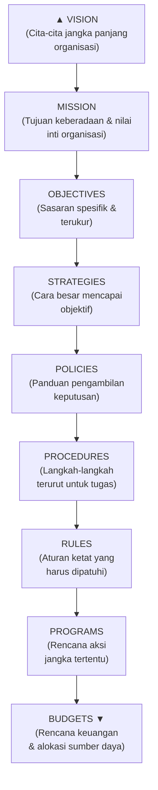
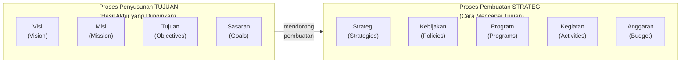
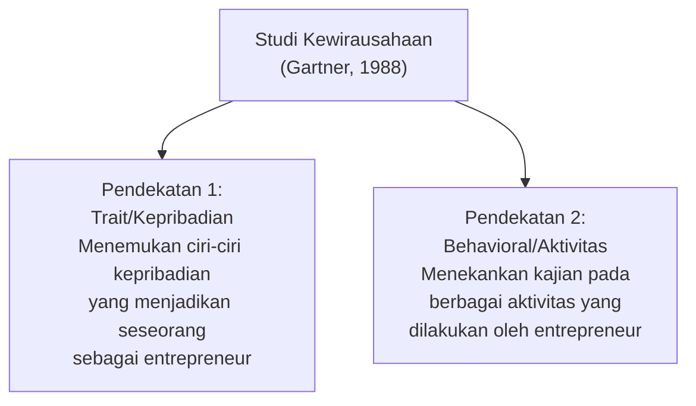
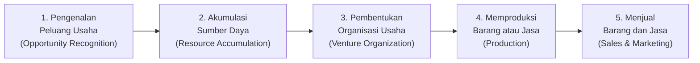
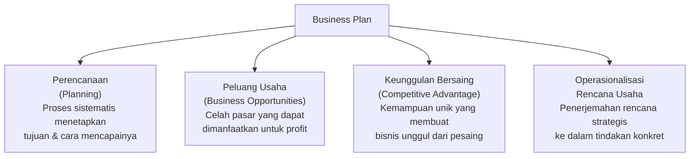
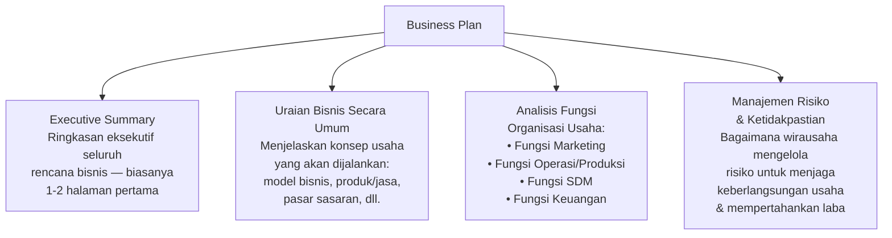
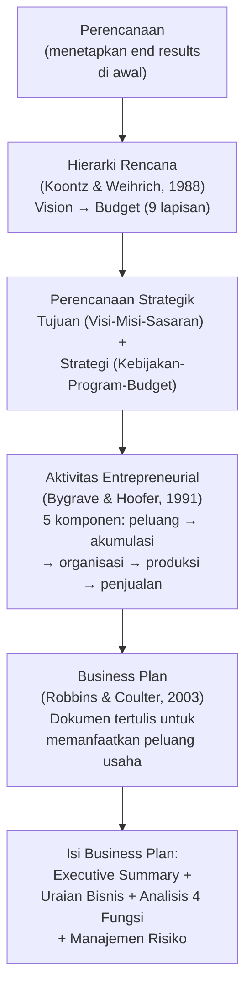

# Sesi 4 — Rencana Bisnis (Business Plan)

**EMBS4102 Pengantar Bisnis**
Program Studi Sistem Informasi — Universitas Terbuka

> Catatan: dokumen ini merupakan ekstraksi sekaligus elaborasi dari materi *Inisiasi 4 — Modul 4: Rencana Bisnis (Business Plan)*. Diagram hierarki rencana dari slide asli digambarkan ulang menggunakan mermaid. Setiap poin dijelaskan lebih dalam dengan konteks, referensi ahli, dan contoh nyata agar lebih mudah dipahami secara utuh.

Materi inisiasi ini mencakup dua pokok bahasan utama:

- **Bagian 1 — Elemen Perencanaan Strategik**: pengertian perencanaan, hierarki rencana, perencanaan strategik, dan aktivitas entrepreneurial.
- **Bagian 2 — Business Plan**: pengertian, konsep pendukung, dan isi rencana bisnis.

---

## Bagian 1 — Elemen Perencanaan Strategik dalam Rencana Bisnis

### 1. Pengertian Perencanaan

> **Perencanaan** merupakan suatu proses untuk menetapkan di awal berbagai hasil akhir (*end results*) yang ingin dicapai perusahaan di masa mendatang.

Perencanaan adalah fondasi dari semua aktivitas manajemen — tanpa perencanaan yang jelas, organisasi akan bergerak reaktif mengikuti keadaan, bukan secara proaktif menuju tujuan yang ditetapkan. Perencanaan menjawab pertanyaan mendasar: **"Ke mana kita ingin pergi, dan bagaimana kita akan sampai ke sana?"**

> Fungsi perencanaan (*planning*) adalah yang pertama dari empat fungsi manajemen klasik yang dikemukakan Henri Fayol: **Planning → Organizing → Leading → Controlling**. Semua fungsi lainnya bergantung pada kualitas perencanaan yang dilakukan di awal.

### 2. Hierarki Rencana (Koontz & Weihrich, 1988)

**Koontz dan Weihrich (1988)** menggambarkan keterkaitan antara berbagai jenis rencana yang dibuat perusahaan dalam bentuk **hierarki rencana** — sebuah piramida di mana setiap lapisan menjadi landasan bagi lapisan di bawahnya:

| Lapisan | Penjelasan | Contoh |
|---|---|---|
| **Vision** | Gambaran ideal tentang kondisi masa depan yang ingin diwujudkan — aspirasi jangka panjang tertinggi. | "Menjadi perusahaan teknologi terbesar di Asia Tenggara." |
| **Mission** | Pernyataan tujuan keberadaan organisasi saat ini — mengapa kita ada dan siapa yang kita layani. | "Menghubungkan penjual dan pembeli di seluruh Indonesia melalui platform digital yang terpercaya." |
| **Objectives** | Sasaran spesifik, terukur, dan bertenggat waktu yang berasal dari misi. | "Mencapai 10 juta pengguna aktif pada akhir tahun 2026." |
| **Strategies** | Pendekatan besar atau cara utama untuk mencapai objektif — keputusan strategis yang menentukan arah. | "Ekspansi ke pasar luar Jawa melalui kemitraan dengan UMKM lokal." |
| **Policies** | Panduan umum yang memandu pengambilan keputusan di seluruh tingkatan organisasi. | "Setiap produk baru harus melalui pengujian keamanan selama minimal 2 minggu sebelum diluncurkan." |
| **Procedures** | Serangkaian langkah berurutan yang harus diikuti untuk menyelesaikan tugas tertentu. | SOP penanganan keluhan pelanggan: terima laporan → konfirmasi dalam 1×24 jam → selesaikan dalam 3 hari kerja. |
| **Rules** | Aturan yang menetapkan secara spesifik apa yang boleh dan tidak boleh dilakukan — tidak memberikan ruang diskresi. | "Karyawan dilarang menerima gratifikasi dalam bentuk apapun dari mitra bisnis." |
| **Programs** | Rencana komprehensif yang menggabungkan tujuan, kebijakan, prosedur, dan anggaran untuk satu inisiatif besar. | Program digitalisasi layanan pelanggan Q3 2026. |
| **Budgets** | Rencana keuangan yang mengekspresikan hasil yang diharapkan dalam angka — alokasi sumber daya untuk mewujudkan program. | Anggaran pemasaran digital Rp 500 juta untuk semester I. |

> Hirarki ini mengalir dari **abstrak ke konkret**: Vision dan Mission bersifat inspiratif dan tidak bertenggat waktu, sementara Budgets sangat konkret dan terukur dalam angka. Seorang wirausaha harus mampu menerjemahkan visi yang besar ke dalam budgets yang realistis — inilah esensi dari perencanaan strategis yang baik.

### 3. Pengertian Perencanaan Strategik

Proses perencanaan strategik menghasilkan dua kelompok output:

> **Perencanaan Strategik** adalah proses penetapan tujuan perusahaan sekaligus cara mencapainya (strategi). Prosesnya bersifat **iteratif**: setelah strategi dijalankan, hasilnya dievaluasi, dan perencanaan baru dilakukan — membentuk siklus manajemen yang berkelanjutan.

Perbedaan antara **tujuan** dan **sasaran** (*objectives* vs *goals*): tujuan biasanya lebih luas dan jangka panjang, sementara sasaran lebih spesifik, terukur, dan bertenggat waktu. Keduanya saling melengkapi — sasaran adalah "pecahan" operasional dari tujuan yang lebih besar.

### 4. Pendekatan Studi Kewirausahaan (Gartner, 1988)

Studi kewirausahaan dapat didekati dengan **dua pendekatan** menurut Gartner (1988):

| Pendekatan | Fokus | Pertanyaan Inti |
|---|---|---|
| **Trait (Kepribadian)** | Siapa entrepreneur itu? — karakteristik, sifat, dan watak yang membedakan entrepreneur dari orang lain. | "Apakah ada 'gen entrepreneur'? Apakah entrepreneur dilahirkan atau dibentuk?" |
| **Behavioral (Aktivitas)** | Apa yang dilakukan entrepreneur? — tindakan dan proses yang menghasilkan usaha baru. | "Apa saja aktivitas konkret yang dilakukan entrepreneur sehingga usahanya berhasil?" |

> Perdebatan antara dua pendekatan ini sejalan dengan debat klasik *nature vs. nurture* dalam psikologi. Pandangan modern cenderung mengintegrasikan keduanya: kepribadian memang berperan, tetapi aktivitas dan kebiasaan yang dapat dipelajari jauh lebih menentukan keberhasilan wirausaha.

### 5. Aktivitas Entrepreneurial dan Komponennya

#### Definisi Aktivitas Entrepreneurial

> Menurut **Bygrave dan Hoofer (1991)**, aktivitas entrepreneurial (berdasarkan pendekatan proses) adalah seluruh fungsi, aktivitas, dan tindakan yang berkaitan dengan **peluang tertentu** dan **penciptaan organisasi** untuk memanfaatkan peluang-peluang tersebut.

> **Nascent Business** adalah sebutan untuk para entrepreneur yang saat ini sedang berusaha untuk memulai usaha baru — mereka sudah mengidentifikasi peluang dan aktif mengambil langkah-langkah awal, namun usahanya belum sepenuhnya beroperasi.

#### Komponen-Komponen Aktivitas Entrepreneurial

Lima komponen yang membentuk alur aktivitas entrepreneurial:

| Komponen | Penjelasan |
|---|---|
| **Pengenalan Peluang Usaha** | Kemampuan mengidentifikasi celah di pasar yang belum atau kurang terlayani — ini adalah titik awal dari seluruh proses entrepreneurial. Tidak semua orang melihat peluang yang sama di lingkungan yang sama. |
| **Akumulasi Sumber Daya** | Proses mengumpulkan semua sumber daya yang diperlukan: modal finansial, tenaga kerja, teknologi, jaringan, dan pengetahuan. Termasuk di dalamnya mencari investor, merekrut tim, dan membangun kemitraan. |
| **Pembentukan Organisasi Usaha** | Membangun struktur formal organisasi — mendirikan badan usaha (perseorangan, CV, atau PT), menetapkan struktur organisasi, dan membangun sistem operasi dasar. |
| **Memproduksi Barang atau Jasa** | Menjalankan proses produksi untuk menghasilkan produk/jasa yang akan ditawarkan ke pasar. Mencakup pengembangan produk, pengendalian kualitas, dan efisiensi produksi. |
| **Menjual Barang dan Jasa** | Memasarkan dan menjual produk/jasa ke konsumen — aktivitas ini menghasilkan pendapatan (*revenue*) yang menjadi darah kehidupan bisnis. |

> Kelima komponen ini bersifat **sekuensial namun sering tumpang tindih** dalam praktik. Misalnya, seorang entrepreneur sering kali mulai menjual (komponen 5) bahkan sebelum organisasinya terbentuk sempurna (komponen 3) — strategi ini dikenal sebagai *lean startup* dalam metodologi modern.

---

## Bagian 2 — Business Plan (Rencana Bisnis)

### 6. Pengertian Business Plan

> **Business Plan** merupakan dokumen tertulis yang menjelaskan rencana perusahaan/pengusaha untuk **memanfaatkan peluang-peluang usaha** yang terdapat di lingkungan eksternal perusahaan. *(Robbins and Coulter, 2003)*

Business plan bukan sekadar dokumen formalitas — ia adalah **peta jalan** (*roadmap*) yang mengintegrasikan seluruh aspek bisnis ke dalam satu narasi yang koheren dan dapat dikomunikasikan kepada pemangku kepentingan (investor, bank, mitra, karyawan kunci).

### 7. Konsep-Konsep Pendukung Business Plan

Empat konsep yang menjadi pilar penyusunan business plan:

| Konsep | Penjelasan |
|---|---|
| **Perencanaan (*Planning*)** | Fondasi business plan — tanpa perencanaan yang sistematis, business plan hanya menjadi kumpulan keinginan tanpa arah yang jelas. |
| **Peluang Usaha (*Business Opportunities*)** | Business plan harus berangkat dari identifikasi peluang yang nyata di pasar — bukan sekadar ide yang menarik. Peluang yang baik memiliki pasar yang cukup besar, belum jenuh, dan dapat dijangkau oleh kapasitas wirausaha. |
| **Keunggulan Bersaing (*Competitive Advantage*)** | Business plan harus menjelaskan apa yang membuat usaha ini berbeda dan lebih baik dari pesaing — bisa berupa harga lebih murah, kualitas lebih tinggi, layanan lebih personal, atau teknologi yang unik. |
| **Operasionalisasi Rencana Usaha** | Business plan harus dapat dijalankan — diterjemahkan ke dalam program kerja, jadwal, anggaran, dan tanggung jawab yang spesifik. |

### 8. Isi Business Plan

Business plan yang komprehensif memuat tiga bagian utama:

| Bagian | Penjelasan |
|---|---|
| **Executive Summary** | Ringkasan seluruh business plan dalam format singkat — biasanya yang pertama dibaca investor tetapi yang terakhir ditulis. Harus mampu menjawab: "Apa bisnisnya? Mengapa menarik? Berapa yang dibutuhkan? Apa proyeksi hasilnya?" |
| **Uraian Bisnis Secara Umum** | Menjelaskan konsep usaha secara keseluruhan: apa produk/jasa yang ditawarkan, siapa target pasarnya, bagaimana model bisnisnya, dan apa proposisi nilai (*value proposition*) yang ditawarkan kepada pelanggan. |
| **Analisis Fungsi Organisasi** | Analisis mendalam terhadap empat fungsi utama bisnis: **(1) Marketing** — strategi pemasaran, segmentasi, penetapan harga; **(2) Operasi/Produksi** — proses produksi, kapasitas, manajemen rantai pasok; **(3) SDM** — struktur organisasi, kebutuhan tenaga kerja, kompensasi; **(4) Keuangan** — proyeksi pendapatan, arus kas, titik impas (*break-even point*), kebutuhan modal. |
| **Manajemen Risiko** | Identifikasi risiko-risiko utama yang mungkin mengancam keberlangsungan usaha (risiko pasar, operasional, keuangan, regulasi) beserta rencana mitigasinya — menunjukkan bahwa wirausaha sudah berpikir realistis, bukan hanya optimis. |

> **Executive Summary** adalah bagian terpenting namun sering disalahpahami. Banyak wirausaha menulisnya di awal padahal seharusnya di akhir — setelah seluruh analisis selesai. Investor profesional biasanya hanya membaca executive summary untuk memutuskan apakah perlu membaca lebih jauh; itulah mengapa ringkasan ini harus sangat kuat dan memikat.

---

## Ringkasan Keterkaitan Antar Konsep

Inti dari sesi ini: **business plan** adalah titik pertemuan antara perencanaan strategis dan aktivitas entrepreneurial — ia menerjemahkan hierarki rencana (dari visi abstrak hingga anggaran yang konkret) ke dalam dokumen yang dapat dikomunikasikan dan dieksekusi. Wirausaha yang baik tidak hanya visioner dalam mengenali peluang, tetapi juga sistematis dalam merencanakan bagaimana memanfaatkan peluang tersebut melalui analisis mendalam atas empat fungsi bisnis (marketing, operasi, SDM, keuangan) dan kesiapan menghadapi risiko.

---

*Terima kasih*
