# Sesi 5 — Manajemen Bisnis

**EMBS4102 Pengantar Bisnis**
Program Studi Sistem Informasi — Universitas Terbuka

> Catatan: dokumen ini merupakan ekstraksi sekaligus elaborasi dari materi *Inisiasi 5 — Modul 5: Manajemen Bisnis*. Setiap poin dijelaskan lebih dalam dengan konteks, referensi ahli, dan contoh nyata. Diagram konseptual digambarkan ulang menggunakan mermaid.

Materi inisiasi ini mencakup dua pokok bahasan utama:

- **Bagian 1 — Konsep Manajemen Bisnis**: definisi manajemen, keahlian manajerial, sumber daya organisasi, dan tingkatan manajer.
- **Bagian 2 — Fungsi Manajemen dan Peran Manajer**: fungsi manajemen, motivasi, komunikasi, pengendalian, dan peran manajerial Mintzberg.

---

## Bagian 1 — Konsep Manajemen Bisnis

### 1. Definisi Manajemen

> **Manajemen** dapat didefinisikan sebagai proses **perencanaan, pengorganisasian, kepemimpinan, dan pengendalian** dari berbagai sumber daya organisasi untuk mencapai tujuan secara **efektif dan efisien**.

Dua kata kunci dalam definisi ini perlu dibedakan:

| Kata Kunci | Arti |
|---|---|
| **Efektif** (*effective*) | Mencapai tujuan yang telah ditetapkan — "mengerjakan hal yang benar" (*doing the right things*). |
| **Efisien** (*efficient*) | Mencapai tujuan dengan penggunaan sumber daya sesedikit mungkin — "mengerjakan hal dengan benar" (*doing things right*). |

> Manajemen yang ideal adalah yang **efektif sekaligus efisien**: mencapai tujuan (efektif) dengan pemborosan sumber daya seminimal mungkin (efisien). Sebuah organisasi bisa saja efektif tapi tidak efisien (tujuan tercapai tapi boros biaya), atau efisien tapi tidak efektif (hemat biaya tapi tujuan tidak tercapai) — keduanya bermasalah.

### 2. Keahlian Manajerial (*Managerial Skills*)

Manajer yang efektif harus menguasai serangkaian keahlian. Dua model keahlian manajerial yang paling sering dirujuk:

#### Model Katz (1955)

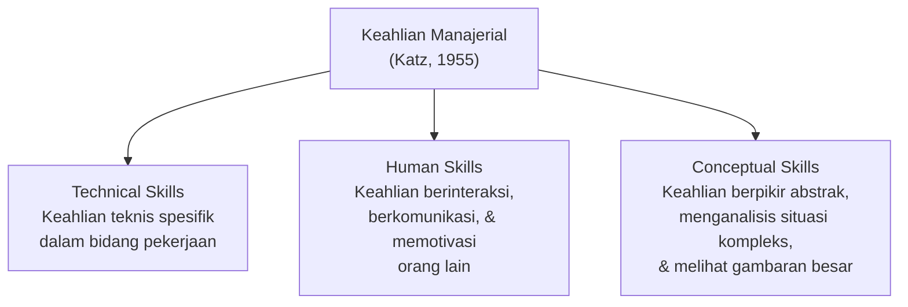

| Keahlian | Penjelasan | Contoh |
|---|---|---|
| **Technical Skills** | Pengetahuan dan kemahiran dalam metode, proses, prosedur, dan teknik spesifik bidang tertentu. | Manajer keuangan memahami akuntansi; manajer TI memahami pemrograman. |
| **Human Skills** | Kemampuan bekerja secara efektif dengan orang lain — individu maupun kelompok. Mencakup empati, komunikasi, dan kepemimpinan. | Membangun kepercayaan tim, menyelesaikan konflik antar karyawan, menginspirasi semangat kerja. |
| **Conceptual Skills** | Kemampuan melihat organisasi secara holistik dan memahami bagaimana bagian-bagian saling berkaitan dan memengaruhi satu sama lain. | CEO yang mampu mengidentifikasi tren industri 5 tahun ke depan dan menyesuaikan strategi perusahaan. |

> Penting: kebutuhan ketiga keahlian ini **berbeda di setiap tingkatan manajer**. Manajer lini pertama lebih membutuhkan *technical skills*, manajer menengah membutuhkan keseimbangan ketiganya, sementara manajer puncak (CEO) paling membutuhkan *conceptual skills* untuk membaca arah strategis.

#### Model Clark Wilson (Kreitner, 2007)

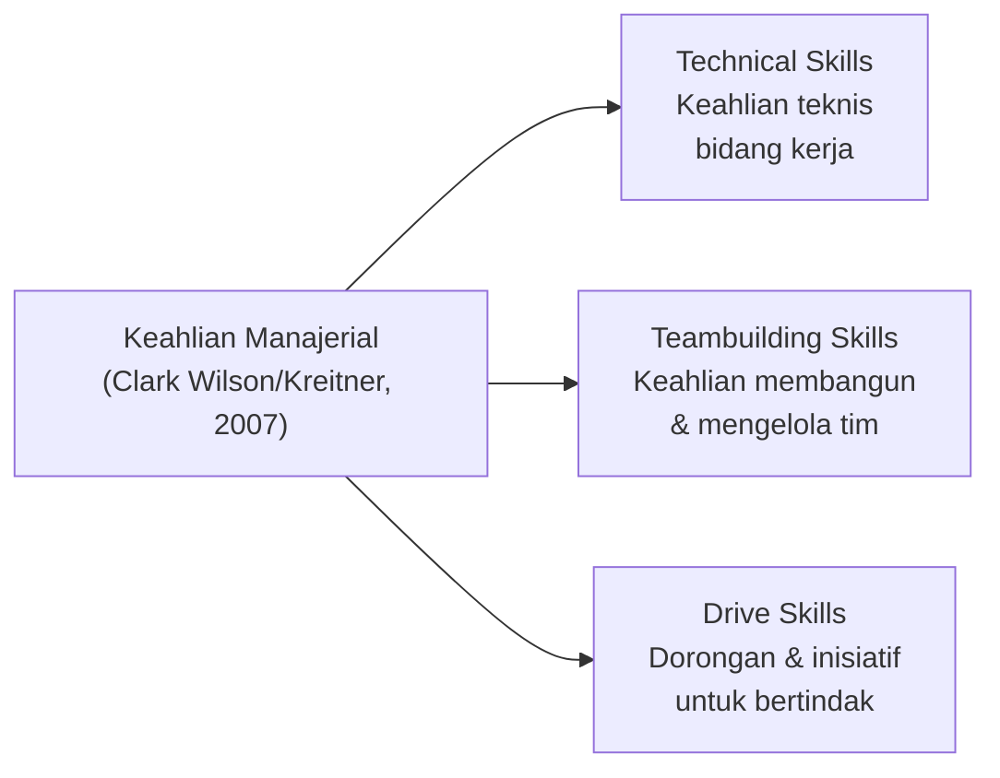

> Model Wilson menekankan *teambuilding skills* dan *drive skills* sebagai komplemen dari keahlian teknis — menunjukkan bahwa kemampuan membangun tim yang solid dan dorongan proaktif untuk bertindak adalah keahlian yang sama pentingnya dengan kompetensi teknis dalam manajemen modern.

### 3. Sumber Daya Organisasi (*Organizational Resources*)

#### Klasifikasi Tangible vs. Intangible (Barney & Hesterly, 2018)

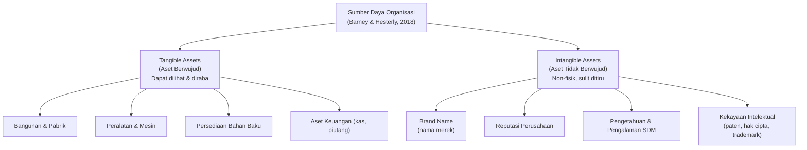

| Jenis Aset | Karakteristik | Contoh |
|---|---|---|
| **Tangible Assets** | Dapat dilihat, dihitung, dan dinilai secara fisik. Mudah ditiru pesaing karena bisa dibeli di pasar. | Gedung kantor, mesin produksi, kendaraan operasional, kas di bank. |
| **Intangible Assets** | Non-fisik, sulit dinilai secara akuntansi, tetapi sering kali menjadi sumber **keunggulan bersaing yang berkelanjutan** (*sustainable competitive advantage*) karena sulit ditiru. | Merek Apple, reputasi Amazon, paten teknologi, loyalitas pelanggan setia. |

> **Intangible assets** adalah aset yang paling sering **diremehkan** dalam neraca keuangan konvensional tetapi justru yang paling bernilai dalam ekonomi digital. Nilai pasar Google, misalnya, jauh melampaui nilai aset fisiknya karena reputasi merek dan kekayaan intelektual (algoritma pencarian) yang tidak ternilai. Inilah mengapa **brand building** dan **manajemen pengetahuan** menjadi investasi strategis, bukan sekadar biaya.

#### Klasifikasi Berdasarkan Fungsi Organisasi

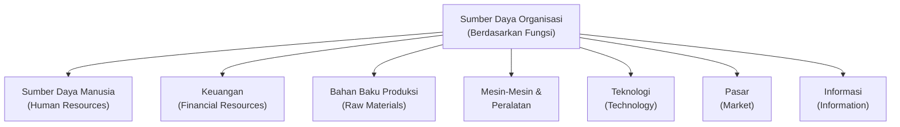

> Klasifikasi ini menunjukkan bahwa **informasi** dan **pasar** sudah diakui sebagai sumber daya organisasi yang setara dengan sumber daya fisik dan keuangan — mencerminkan realitas ekonomi berbasis pengetahuan (*knowledge economy*) di mana data dan akses pasar adalah aset strategis yang nyata.

### 4. Tingkatan-Tingkatan Manajer

Di dalam sebuah perusahaan terdapat **tiga tingkatan manajer** yang membentuk hierarki:

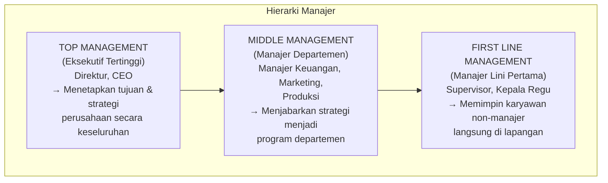

| Tingkatan | Sebutan | Fokus Utama | Keahlian Dominan |
|---|---|---|---|
| **Top Management** | Directors, CEO, Presiden Direktur | Visi, misi, strategi jangka panjang, kebijakan korporat. | Conceptual skills |
| **Middle Management** | Manajer Departemen (Keuangan, Marketing, Produksi) | Menerjemahkan strategi korporat menjadi program kerja departemen; koordinasi antar unit. | Keseimbangan ketiga keahlian |
| **First Line Management** | Supervisor, Kepala Regu, Kepala Shift | Mengawasi pekerjaan harian karyawan non-manajer; memastikan SOP dijalankan. | Technical skills |

> Semakin tinggi tingkatan manajer, semakin luas cakupan tanggung jawabnya dan semakin jauh dari pekerjaan teknis sehari-hari. Inilah mengapa **transisi dari supervisor ke manajer menengah** sering menjadi tantangan besar: seseorang yang unggul secara teknis harus belajar mendelegasikan pekerjaan teknis dan mulai fokus pada koordinasi dan pengembangan strategi.

---

## Bagian 2 — Fungsi Manajemen dan Peran Manajer

### 5. Fungsi-Fungsi Manajemen Bisnis

**Koontz & Weihrich (1988)** mengelompokkan fungsi manajemen ke dalam **lima fungsi** yang dilaksanakan secara **simultan** untuk menjamin tercapainya tujuan perusahaan:

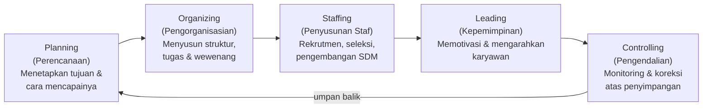

| Fungsi | Penjelasan |
|---|---|
| **Planning** | Menetapkan tujuan organisasi dan menentukan cara terbaik untuk mencapainya. Termasuk analisis situasi, penetapan sasaran, dan penyusunan rencana aksi. |
| **Organizing** | Merancang struktur organisasi, mendistribusikan tugas dan wewenang, serta mengalokasikan sumber daya agar semua orang tahu peran dan tanggung jawabnya. |
| **Staffing** | Mengelola sumber daya manusia: rekrutmen, seleksi, pelatihan, pengembangan, kompensasi, dan evaluasi kinerja karyawan. |
| **Leading** | Mengarahkan, mempengaruhi, dan memotivasi karyawan untuk bekerja menuju tujuan organisasi — membutuhkan keahlian interpersonal dan kepemimpinan. |
| **Controlling** | Memantau kinerja aktual, membandingkan dengan standar yang ditetapkan, dan mengambil tindakan korektif jika terjadi penyimpangan. |

> Kelima fungsi ini bukan urutan linier yang kaku, melainkan **siklus yang terus berputar**: hasil dari *controlling* menjadi masukan baru bagi *planning* di periode berikutnya — membentuk siklus perbaikan berkelanjutan (*continuous improvement*).

### 6. Proses Motivasi (*Motivating*)

Motivasi adalah hasil interaksi yang dialami individu dengan situasi yang melingkupinya, sehingga **motivasi seseorang dapat berbeda untuk situasi yang berbeda**.

#### Tiga Unsur Utama Motivasi (Robbins & Coulter, 2003)

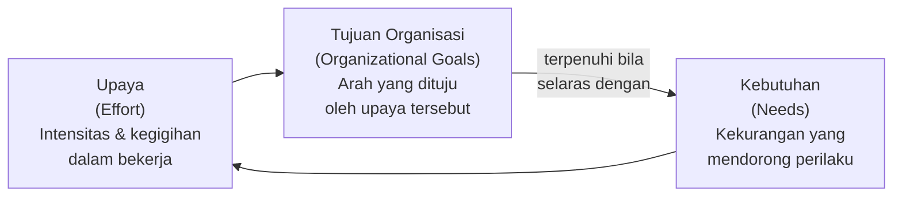

| Unsur | Penjelasan |
|---|---|
| **Upaya (*Effort*)** | Intensitas dan ketekunan usaha yang dicurahkan seseorang dalam pekerjaannya. Motivasi tinggi menghasilkan upaya yang tinggi pula. |
| **Tujuan Organisasi (*Organizational Goals*)** | Agar motivasi karyawan bermanfaat bagi organisasi, upaya yang dikerahkan harus diarahkan menuju tujuan organisasi — bukan tujuan pribadi yang bertentangan. |
| **Kebutuhan (*Needs*)** | Ketidakseimbangan internal yang mendorong perilaku — seseorang berusaha keras karena ada kebutuhan yang ingin dipenuhi. |

#### Hierarki Kebutuhan Maslow

Abraham Maslow merumuskan kebutuhan manusia dalam bentuk hierarki lima tingkat:

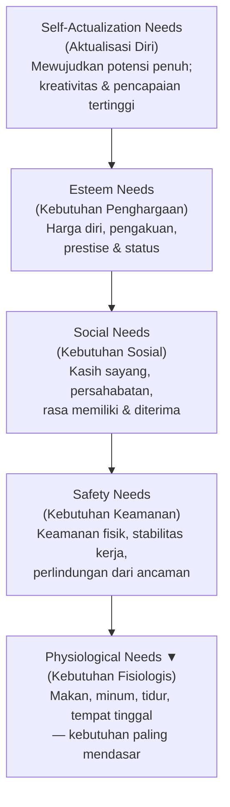

> Menurut Maslow, seseorang baru akan termotivasi untuk memenuhi kebutuhan di tingkat lebih tinggi **setelah kebutuhan di tingkat bawahnya terpenuhi secara cukup**. Implikasinya bagi manajemen: manajer harus memahami di tingkat mana kebutuhan karyawannya saat ini agar bisa memberikan motivasi yang tepat sasaran. Memberikan *self-actualization opportunity* kepada karyawan yang masih khawatir soal keamanan kerja tidak akan efektif.

### 7. Komunikasi (*Communication*)

> **Komunikasi** adalah proses pertukaran lambang-lambang — baik verbal maupun nonverbal — antara komunikator dengan *receiver* yang sangat memengaruhi kualitas kepemimpinan.

Tiga kategori komunikasi dalam konteks manajemen:

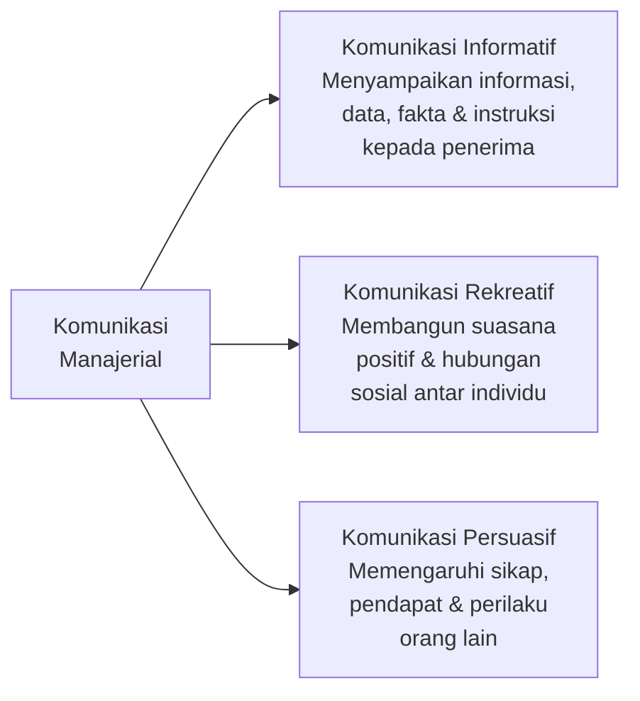

| Kategori | Penjelasan | Contoh dalam Bisnis |
|---|---|---|
| **Informatif** | Komunikasi yang bertujuan menyampaikan informasi faktual — karyawan perlu tahu *apa* yang terjadi dan *apa* yang harus dilakukan. | Memo kebijakan baru, laporan keuangan, briefing operasional harian. |
| **Rekreatif** | Komunikasi yang membangun hubungan sosial, suasana kerja yang positif, dan rasa kebersamaan dalam tim. | Obrolan santai di kantin, acara team building, perayaan ulang tahun karyawan. |
| **Persuasif** | Komunikasi yang bertujuan mengubah sikap atau perilaku orang lain — sangat penting dalam kepemimpinan, penjualan, dan negosiasi. | Presentasi investor, pidato motivasi CEO, negosiasi kontrak dengan klien. |

> Komunikasi yang efektif adalah **inti dari kepemimpinan** yang baik. Penelitian menunjukkan manajer menghabiskan 70–90% waktu kerjanya untuk berkomunikasi dalam berbagai bentuk — rapat, email, telepon, presentasi. Kualitas komunikasi seorang manajer secara langsung berdampak pada kejelasan arah tim, produktivitas, dan kepuasan kerja karyawan.

### 8. Fungsi Pengendalian (*Controlling*)

> **Pengendalian** adalah proses monitoring terhadap berbagai aktivitas yang dilakukan sumber daya organisasi untuk memastikan bahwa aktivitas tersebut akan dapat **mencapai tujuan yang telah ditetapkan** dan tindakan koreksi dapat dilakukan untuk memperbaiki penyimpangan yang terjadi. *(Robbins & Coulter, 2003: 496)*

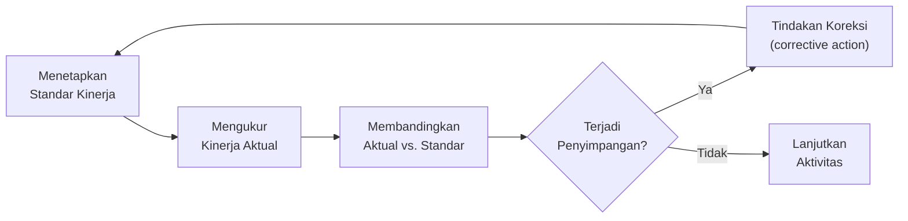

> Fungsi pengendalian **menutup siklus manajemen**: hasil monitoring menjadi umpan balik (*feedback*) yang menginformasikan perencanaan berikutnya. Tanpa pengendalian yang efektif, perencanaan yang baik sekalipun tidak menjamin tujuan akan tercapai — karena tidak ada mekanisme untuk mendeteksi dan mengoreksi penyimpangan yang terjadi di lapangan.

### 9. Peranan Manajerial (Mintzberg, 1988)

**Mintzberg (1988)** merumuskan bahwa manajer adalah orang yang memiliki wewenang dalam organisasi karena diberikan **wewenang formal** (*formal authority*) oleh perusahaan. Dari wewenang ini lahirlah **tiga kelompok peran manajerial**:

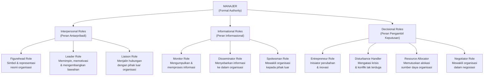

| Kelompok Peran | Sub-Peran | Penjelasan |
|---|---|---|
| **Interpersonal** | Figurehead | Melakukan tugas-tugas seremonial dan simbolis sebagai kepala unit. |
| | Leader | Memotivasi, mengembangkan, dan mengarahkan bawahan. |
| | Liaison | Membangun jaringan hubungan dengan pihak di luar unit kerjanya. |
| **Informational** | Monitor | Mencari dan menerima informasi dari berbagai sumber untuk memahami organisasi dan lingkungannya. |
| | Disseminator | Meneruskan informasi penting yang diterima kepada anggota organisasi. |
| | Spokesman | Menyampaikan informasi tentang organisasi kepada pihak luar. |
| **Decisional** | Entrepreneur | Menginisiasi dan memimpin proyek perubahan untuk meningkatkan kinerja organisasi. |
| | Disturbance Handler | Mengambil tindakan korektif ketika organisasi menghadapi masalah atau krisis mendadak. |
| | Resource Allocator | Memutuskan bagaimana sumber daya organisasi (waktu, uang, SDM) didistribusikan. |
| | Negotiator | Berpartisipasi dalam negosiasi penting yang mewakili kepentingan organisasi. |

> Model Mintzberg ini penting karena menunjukkan bahwa manajemen **bukan hanya soal menjalankan fungsi-fungsi formal** (plan-organize-lead-control), tetapi juga tentang peran-peran yang lebih *fluid* dan reaktif — seperti menangani gangguan mendadak (*disturbance handler*) atau bernegosiasi (*negotiator*). Realitas pekerjaan manajerial jauh lebih dinamis dan tidak terstruktur dibanding yang digambarkan dalam buku teks.

---

## Ringkasan Keterkaitan Antar Konsep

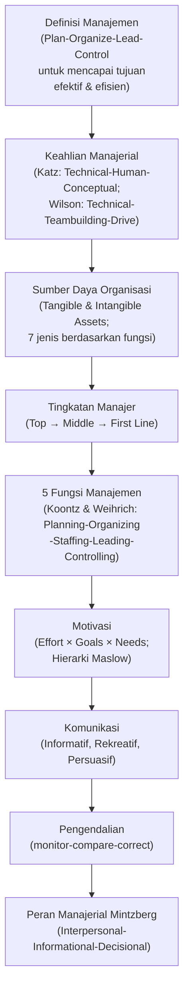

Inti dari sesi ini: **manajemen bisnis** adalah seni dan ilmu mengelola sumber daya organisasi — baik yang berwujud (*tangible*) maupun tidak berwujud (*intangible*) — melalui lima fungsi utama (planning, organizing, staffing, leading, controlling) yang dijalankan secara simultan. Manajer yang efektif harus menguasai keahlian teknis, manusiawi, dan konseptual; memahami cara memotivasi dengan tepat berdasarkan hierarki kebutuhan; berkomunikasi secara informatif, rekreatif, dan persuasif; serta mampu menjalankan sepuluh peran manajerial Mintzberg yang mencakup dimensi antarpribadi, informasional, dan pengambilan keputusan.

---

*Terima kasih*
