# Sesi 6 — Organisasi dalam Manajemen

**EMBS4102 Pengantar Bisnis**
Program Studi Sistem Informasi — Universitas Terbuka

> Catatan: dokumen ini merupakan ekstraksi sekaligus elaborasi dari materi *Inisiasi 6 — Modul 6: Organisasi dalam Manajemen*. Setiap poin dijelaskan lebih dalam dengan konteks, referensi ahli, dan contoh nyata agar lebih mudah dipahami secara utuh. Diagram konseptual digambarkan ulang menggunakan mermaid.

Materi inisiasi ini mencakup dua pokok bahasan utama:

- **Bagian 1 — Organisasi dalam Manajemen**: pengertian organisasi, proses pengorganisasian, dan tahap-tahapnya.
- **Bagian 2 — Bidang Manajemen Bisnis**: manajemen pemasaran, operasi, sumber daya manusia, dan keuangan & akuntansi.

---

## Bagian 1 — Organisasi dalam Manajemen

### 1. Pengertian Organisasi

Menurut **Soffer (1973: 220)**:

> **Organisasi** adalah persekutuan/perkumpulan orang-orang yang masing-masing diberi peranan tertentu dalam suatu sistem kerja dan pembagian kerja, di mana pekerjaan dipilah-pilah menjadi tugas dan dibagikan kepada para pelaksana tugas/pemegang jabatan untuk mendapatkan **satu kesatuan hasil**.

Tiga elemen kunci dalam definisi ini:

| Elemen | Penjelasan |
|---|---|
| **Persekutuan orang-orang** | Organisasi adalah entitas sosial — selalu terdiri dari manusia, bukan sekadar struktur di atas kertas. |
| **Sistem kerja & pembagian kerja** | Pekerjaan dipilah menjadi tugas-tugas yang lebih kecil dan didistribusikan — inilah prinsip *division of labor* yang meningkatkan efisiensi secara dramatis. |
| **Satu kesatuan hasil** | Meski dibagi-bagi, semua tugas bermuara pada satu tujuan bersama — organisasi yang baik memastikan koordinasi agar bagian-bagian tidak bergerak sendiri-sendiri. |

> Konsep **pembagian kerja** (*division of labor*) adalah salah satu prinsip paling fundamental dalam organisasi modern. Adam Smith dalam *The Wealth of Nations* (1776) mendemonstrasikan bahwa pabrik jarum yang membagi-bagi pekerjaan ke 10 spesialisasi mampu menghasilkan 48.000 jarum per hari, sementara satu orang yang mengerjakan seluruh proses sendiri hanya bisa menghasilkan 20 per hari — peningkatan efisiensi 2.400 kali lipat!

### 2. Proses Pengorganisasian

> **Fungsi pengorganisasian** (*organizing*) adalah fungsi yang dijalankan oleh para manajer perusahaan untuk membagi-bagi pekerjaan kepada para pelaksana tugas.

Pengorganisasian selalu mengikuti perencanaan: tujuan-tujuan perusahaan yang ingin dicapai terlebih dahulu ditetapkan melalui **perencanaan (*planning*)**, kemudian fungsi pengorganisasian menentukan **bagaimana** sumber daya dan manusia dikelola untuk mencapai tujuan tersebut.

### 3. Tahap-Tahap dalam Proses Pengorganisasian

Proses pengorganisasian memiliki **5 tahapan** berurutan:

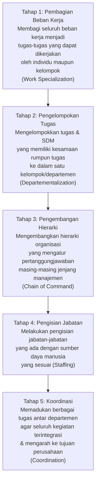

| Tahap | Konsep Kunci | Penjelasan |
|---|---|---|
| **1. Pembagian Beban Kerja** | *Work Specialization* | Memecah pekerjaan besar menjadi tugas-tugas lebih kecil yang dapat dikuasai dengan baik oleh individu. |
| **2. Pengelompokan Tugas** | *Departementalization* | Tugas-tugas dengan kesamaan rumpun disatukan ke dalam departemen — bisa berdasarkan fungsi (pemasaran, produksi), produk, wilayah, atau pelanggan. |
| **3. Pengembangan Hierarki** | *Chain of Command* | Menetapkan siapa melapor kepada siapa — struktur otoritas yang jelas menghindari kebingungan dan konflik peran. |
| **4. Pengisian Jabatan** | *Staffing* | Mencocokkan orang yang tepat dengan jabatan yang tepat (*right person, right job*) — melibatkan rekrutmen, seleksi, dan penempatan. |
| **5. Koordinasi** | *Coordination* | Memastikan semua departemen yang bekerja terpisah tetap bergerak menuju tujuan yang sama — fungsi integratif yang kritis agar organisasi tidak terfragmentasi. |

> Tahap 5 (**koordinasi**) adalah yang paling sering diremehkan namun justru paling kritis. Sebuah perusahaan bisa memiliki departemen-departemen yang masing-masing bekerja dengan sangat baik secara internal, tetapi bila koordinasi antar departemen buruk, hasilnya justru menjadi kontraproduktif — misalnya tim penjualan menjanjikan fitur yang tim produksi tidak bisa penuhi.

---

## Bagian 2 — Bidang Manajemen Bisnis

Perusahaan melakukan pengelolaan sumber daya sesuai dengan fungsi organisasi yang mencakup **empat bidang manajemen utama**:

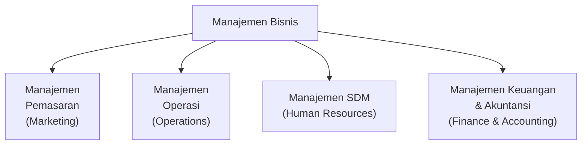

### 4. Manajemen Pemasaran

#### Tiga Pilar Dasar Konsep Marketing (Spiro et al., 2008)

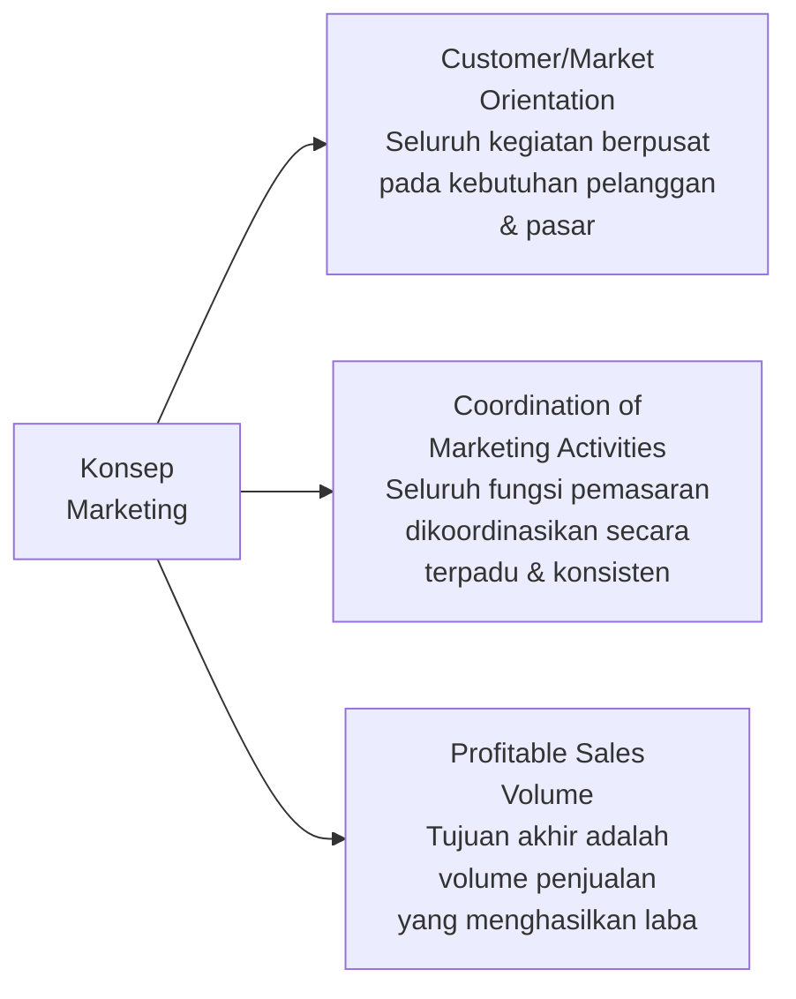

| Pilar | Penjelasan |
|---|---|
| **Customer/Market Orientation** | Semua keputusan bisnis berangkat dari pemahaman mendalam tentang kebutuhan dan keinginan pelanggan — bukan dari apa yang bisa diproduksi. |
| **Coordination of Marketing Activities** | Seluruh aktivitas pemasaran (iklan, harga, distribusi, produk) harus saling mendukung dan dijalankan secara terkoordinasi, bukan parsial. |
| **Profitable Sales Volume** | Tujuan akhir bukan sekadar menjual sebanyak-banyaknya, melainkan volume penjualan yang menghasilkan **keuntungan** — penjualan rugi sebesar-besarnya bukanlah keberhasilan. |

#### Evolusi Konsep Pemasaran

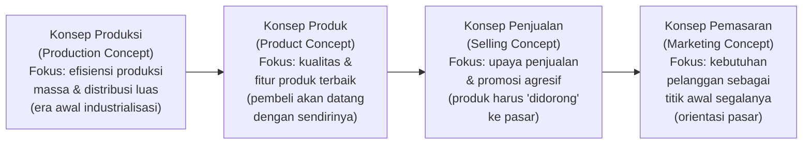

> Evolusi dari **konsep produksi** ke **konsep pemasaran** mencerminkan pergeseran kekuatan dari penjual ke pembeli. Di era persaingan ketat saat ini, perusahaan yang masih menggunakan mindset "konsep produksi" atau "konsep penjualan" — yaitu memproduksi dulu baru mencari pembeli — akan kesulitan bersaing dengan perusahaan yang memulai dari pemahaman mendalam atas kebutuhan pelanggan.

#### Strategi Marketing: 2 Elemen Utama

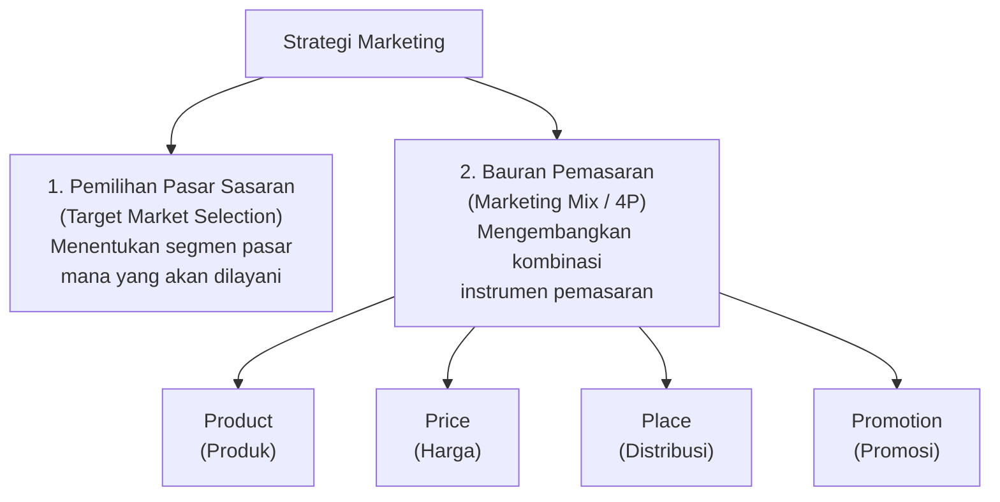

> **Marketing Mix (4P)** — Product, Price, Place, Promotion — adalah kerangka kerja klasik Neil Borden yang dipopulerkan McCarthy (1960). Dalam konteks bisnis digital dan jasa, kerangka ini sering diperluas menjadi **7P** dengan menambahkan *People* (orang), *Process* (proses), dan *Physical Evidence* (bukti fisik) — relevan untuk bisnis seperti perbankan, restoran, atau platform teknologi.

### 5. Manajemen Operasi

> Menurut **Heizer dan Render (2011)**, manajemen operasi merupakan **serangkaian aktivitas yang menciptakan nilai (*value*)** dalam pembuatan barang dan jasa melalui perubahan berbagai **input menjadi output**.

Peletak dasar pendekatan *scientific management* dalam operasi adalah **Frederick Winslow Taylor** — yang menekankan studi waktu dan gerak (*time and motion study*) untuk menemukan cara kerja paling efisien.

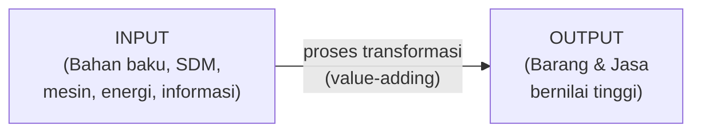

#### 10 Keputusan Penting dalam Manajemen Operasi (Heizer & Render, 1999)

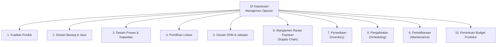

| Keputusan | Penjelasan |
|---|---|
| **Kualitas Produk** | Menetapkan standar kualitas yang memenuhi ekspektasi pelanggan dan membangun sistem untuk memastikan konsistensi. |
| **Desain Barang & Jasa** | Merancang produk/jasa yang memenuhi kebutuhan pelanggan sekaligus dapat diproduksi secara efisien. |
| **Desain Proses & Kapasitas** | Menentukan teknologi produksi, layout pabrik, dan kapasitas yang sesuai dengan skala permintaan. |
| **Pemilihan Lokasi** | Memilih lokasi fasilitas produksi/operasi yang meminimalkan biaya logistik dan dekat dengan sumber daya kritis. |
| **Desain SDM & Jabatan** | Merancang pekerjaan yang efisien, ergonomis, dan memotivasi karyawan operasional. |
| **Manajemen Rantai Pasokan** | Mengelola hubungan dengan pemasok untuk memastikan pasokan bahan baku yang andal dan berkualitas. |
| **Persediaan** | Menentukan berapa banyak bahan baku, WIP, dan produk jadi yang perlu disimpan — menyeimbangkan biaya penyimpanan vs. risiko kehabisan stok. |
| **Penjadwalan** | Menentukan urutan dan waktu produksi untuk memaksimalkan efisiensi dan memenuhi tenggat pelanggan. |
| **Pemeliharaan** | Menjaga kondisi mesin dan fasilitas agar tidak terjadi *downtime* yang merugikan. |
| **Budget Produksi** | Menetapkan anggaran untuk seluruh aktivitas produksi agar operasi berjalan dalam batas biaya yang terkendali. |

> Manajemen operasi adalah **jantung** dari bisnis manufaktur dan semakin relevan bagi bisnis jasa dan digital. Konsep-konsep seperti *lean manufacturing* (eliminasi pemborosan), *just-in-time inventory*, dan *total quality management (TQM)* lahir dari tradisi manajemen operasi ini.

### 6. Manajemen Sumber Daya Manusia

#### Human Capital

Menurut **Bollander et al. (2001)**:

> **Human capital** adalah nilai ekonomi yang berasal dari kombinasi **pengetahuan, pengalaman, keahlian, dan kemampuan** para karyawan.

**Kaplan dan Norton (1996)** juga meyakini bahwa sumber daya manusia adalah salah satu **pendorong kinerja** (*performance driver*) yang akan menunjang keberhasilan implementasi strategi perusahaan — konsep ini menjadi landasan *Balanced Scorecard* dalam perspektif *learning and growth*.

Tujuan utama kegiatan manajemen SDM *(Daft dan Marcic, 2007: 332)*:

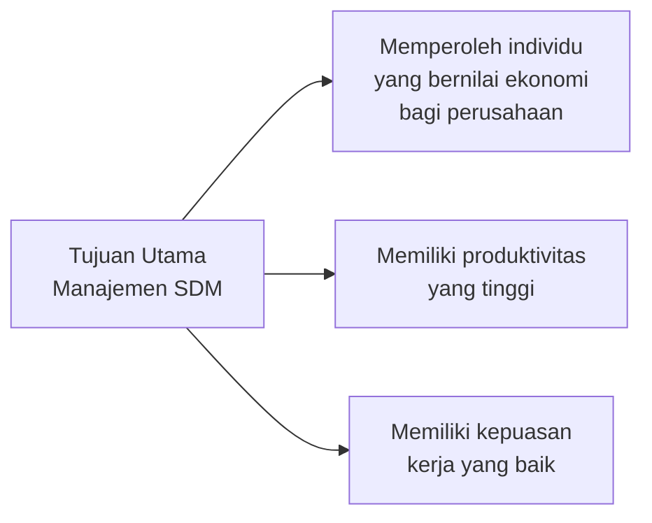

#### Proses Manajemen SDM

Untuk memperoleh, mempertahankan, dan mengembangkan SDM potensial, perusahaan menjalankan **siklus manajemen SDM** berikut:

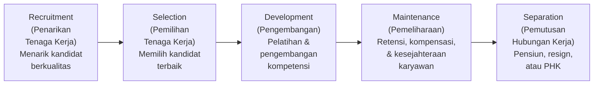

| Tahap | Penjelasan |
|---|---|
| **Recruitment** | Proses menarik kandidat yang memenuhi syarat untuk mengisi posisi yang tersedia — bisa melalui iklan lowongan, job fair, referral, atau headhunter. |
| **Selection** | Proses memilih kandidat terbaik melalui serangkaian alat seleksi: wawancara, tes psikologi, tes kemampuan, pemeriksaan referensi. |
| **Development** | Investasi perusahaan dalam meningkatkan kompetensi karyawan melalui pelatihan (*training*), pendidikan lanjutan, rotasi jabatan, dan *mentoring*. |
| **Maintenance** | Upaya mempertahankan karyawan terbaik dengan memberikan kompensasi kompetitif, lingkungan kerja yang baik, dan pengakuan atas prestasi. |
| **Separation** | Proses berakhirnya hubungan kerja — bisa atas inisiatif karyawan (resign, pensiun) maupun perusahaan (PHK) — harus dilakukan sesuai aturan hukum ketenagakerjaan. |

> **Human capital** berbeda dari aset fisik dalam satu hal penting: perusahaan **tidak bisa memilikinya sepenuhnya** — karyawan bisa keluar kapan saja. Itulah mengapa tahap **maintenance** (retensi) sangat kritis: biaya merekrut dan melatih karyawan baru bisa mencapai 50–200% dari gaji tahunan posisi tersebut, sehingga investasi dalam retensi karyawan berkualitas selalu lebih murah dari *turnover*.

### 7. Manajemen Keuangan

Menurut **Keown, Martin, Petty & Scott Jr. (2005)**:

> **Manajemen keuangan** merupakan disiplin ilmu yang berkaitan dengan bagaimana manajer keuangan **memelihara dan menciptakan nilai ekonomi atau kekayaan** para pemegang saham.

**Van Horne dan Wachowicz Jr. (2001)** membagi fungsi manajemen keuangan ke dalam **tiga kategori keputusan**:

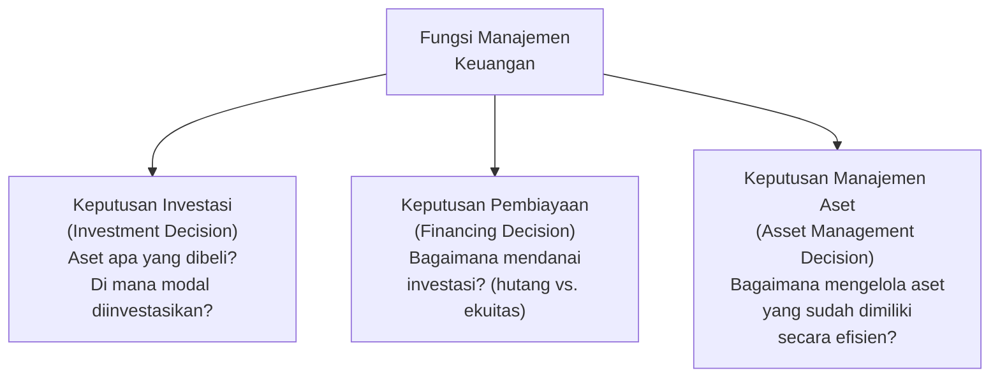

| Keputusan | Pertanyaan Kunci | Contoh |
|---|---|---|
| **Investasi** | Proyek atau aset mana yang layak dibiayai? | Apakah membeli mesin baru senilai Rp 10 M menghasilkan return yang memadai? |
| **Pembiayaan** | Bagaimana mendanai investasi — dari utang (obligasi, pinjaman bank) atau ekuitas (saham baru)? | Menerbitkan obligasi 5 tahun vs. rights issue ke pemegang saham. |
| **Manajemen Aset** | Bagaimana mengelola aset lancar (kas, piutang, persediaan) agar arus kas tetap sehat? | Memperketat kebijakan piutang untuk mempercepat *cash collection*. |

### 8. Akuntansi

Menurut **Ebert dan Griffin (2011: 216)**:

> **Akuntansi** merupakan suatu sistem komprehensif untuk **mengumpulkan, menganalisis, dan mengomunikasikan** informasi keuangan perusahaan.

#### Pengguna Informasi Akuntansi

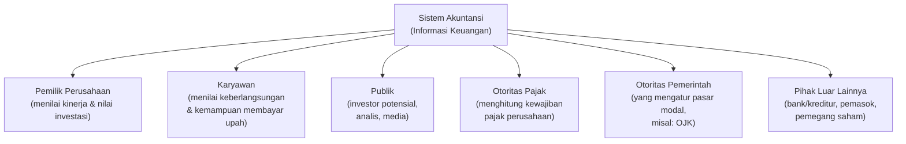

#### Empat Laporan Keuangan Utama

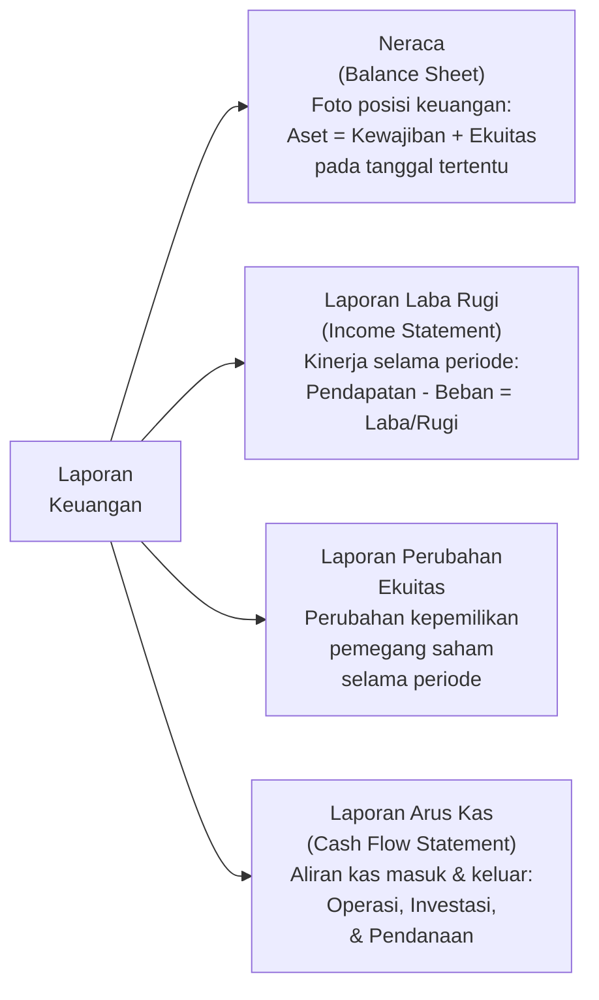

| Laporan | Menjawab Pertanyaan |
|---|---|
| **Neraca** | "Apa yang dimiliki, dihutang, dan dimiliki pemegang saham pada tanggal ini?" |
| **Laporan Laba Rugi** | "Apakah perusahaan menghasilkan laba atau merugi selama periode ini?" |
| **Laporan Perubahan Ekuitas** | "Bagaimana ekuitas pemegang saham berubah selama periode ini?" |
| **Laporan Arus Kas** | "Dari mana uang masuk dan ke mana uang keluar? Apakah perusahaan *cash positive*?" |

> Meski laporan laba rugi paling sering jadi perhatian utama, **laporan arus kas** (*cash flow statement*) justru paling kritis bagi kelangsungan bisnis. Sebuah perusahaan bisa tampak profitable di laporan laba rugi namun mengalami krisis likuiditas karena arus kasnya negatif — inilah yang disebut "profit di atas kertas, bangkrut di lapangan." *Cash is king* dalam bisnis.

---

## Ringkasan Keterkaitan Antar Konsep

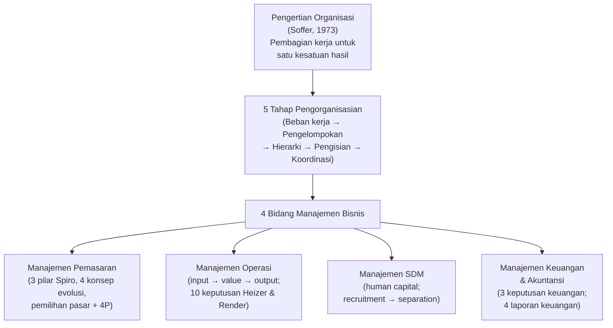

Inti dari sesi ini: **organisasi dalam manajemen** adalah tentang bagaimana perusahaan menstrukturkan diri melalui 5 tahap pengorganisasian — dari pembagian beban kerja hingga koordinasi — untuk kemudian menjalankan empat fungsi bisnis utama secara efektif. Manajemen pemasaran memastikan produk/jasa sampai ke pelanggan yang tepat; manajemen operasi memastikan penciptaan nilai yang efisien; manajemen SDM memastikan *human capital* yang kompeten dan termotivasi; dan manajemen keuangan & akuntansi memastikan perusahaan memiliki sumber daya finansial yang sehat dan informasi keuangan yang akurat sebagai dasar pengambilan keputusan.

---

*Terima kasih*
