# Sesi 7 — Pembiayaan Usaha

**EMBS4102 Pengantar Bisnis**
Program Studi Sistem Informasi — Universitas Terbuka

> Catatan: dokumen ini merupakan ekstraksi sekaligus elaborasi dari materi *Inisiasi 7 — Modul 7: Pembiayaan Usaha*. Setiap poin dijelaskan lebih dalam dengan konteks, referensi ahli, dan contoh nyata. Diagram konseptual (termasuk Matrix Ansoff) digambarkan ulang menggunakan mermaid.

Materi inisiasi ini mencakup dua pokok bahasan utama:

- **Bagian 1 — Konsep Pembiayaan Usaha**: pengertian, investasi, Matrix Ansoff, tujuan pembiayaan.
- **Bagian 2 — Sumber Pembiayaan**: modal sendiri, bank, pasar modal, lembaga keuangan non-bank, angel investor, fintech; serta strategi dan proses pengajuan pembiayaan.

---

## Bagian 1 — Konsep Pembiayaan Usaha

### 1. Pengertian Pembiayaan Usaha

> **Pembiayaan** adalah penyediaan dana untuk mendukung kegiatan **operasional** dan **investasi** agar tujuan perusahaan dapat tercapai.

Setiap perusahaan — sekecil apapun — membutuhkan dana untuk:

- Membayar gaji karyawan
- Biaya pemasaran (iklan, promosi)
- Biaya produksi
- Pembelian bahan baku
- Investasi aset dan peralatan
- Biaya operasional harian lainnya

> Tanpa pembiayaan yang memadai, bahkan ide bisnis yang paling brilian sekalipun tidak bisa dijalankan. Inilah mengapa pemahaman tentang **sumber dan strategi pembiayaan** adalah kompetensi esensial setiap wirausaha — bukan hanya urusan bagian keuangan.

### 2. Pengertian Investasi

Menurut **Fischer dan Jordan (1987)**:

> **Investasi** adalah penanaman modal yang didasari oleh adanya harapan untuk memperoleh **pengembalian modal yang positif** (*positive return*).

Artinya, investasi selalu mengandung dua komponen: **pengorbanan saat ini** (mengeluarkan modal sekarang) dan **harapan masa depan** (mengharapkan imbal hasil yang lebih besar di kemudian hari). Tanpa harapan imbal hasil positif, tindakan tersebut bukan investasi melainkan pemborosan.

### 3. Matrix Ansoff — Panduan Strategi Ekspansi

**Matrix Ansoff** (*Doyle, 1994: 117*) adalah kerangka kerja strategis yang memandu perusahaan dalam memilih arah pengembangan bisnis berdasarkan kombinasi **produk** dan **pasar**:

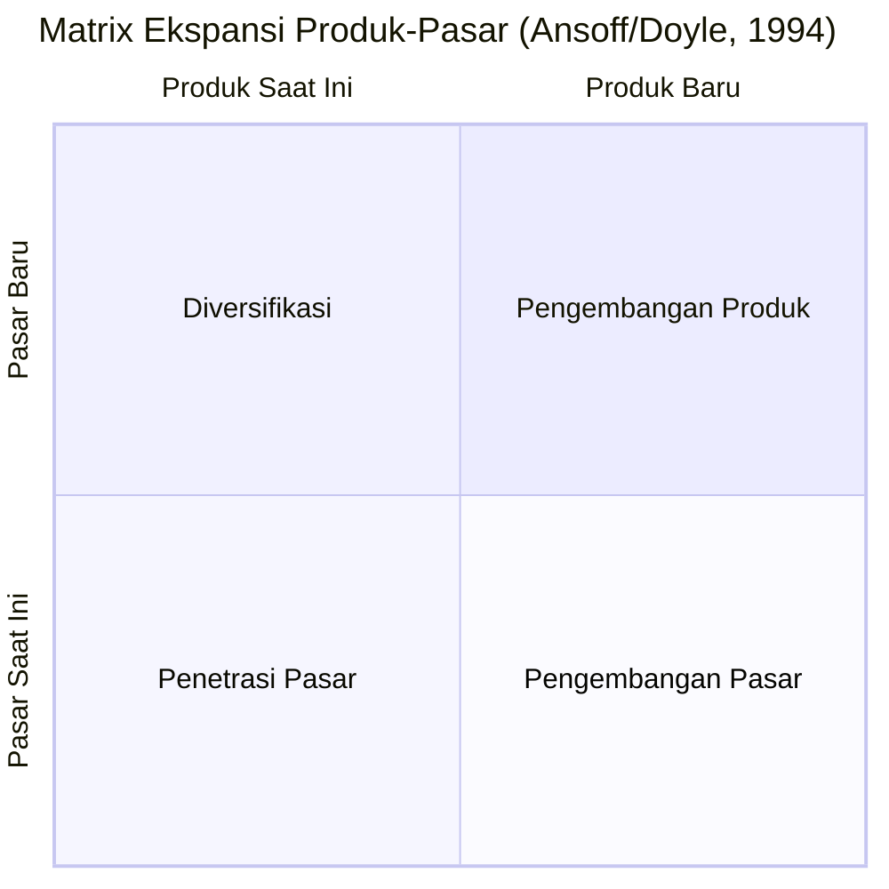

| Kuadran | Strategi | Kondisi | Investasi |
|---|---|---|---|
| **Produk Lama × Pasar Lama** | **Penetrasi Pasar** | Tingkatkan penjualan produk yang sudah ada ke pasar yang sudah dilayani (loyalitas, promosi lebih agresif, diskon). | Risiko rendah — paling familiar |
| **Produk Baru × Pasar Lama** | **Pengembangan Produk** | Kembangkan produk/jasa baru untuk melayani pasar yang sudah ada (R&D, inovasi). | Risiko menengah — pasar sudah dikenal |
| **Produk Lama × Pasar Baru** | **Pengembangan Pasar** | Bawa produk/jasa yang sudah ada ke segmen pasar atau wilayah geografi baru. | Risiko menengah — produk sudah teruji |
| **Produk Baru × Pasar Baru** | **Diversifikasi** | Masuki bisnis yang sepenuhnya baru dengan produk baru di pasar baru. | Risiko tertinggi — dua ketidakpastian sekaligus |

> Matrix Ansoff menunjukkan bahwa **tidak semua investasi sama risikonya**. Strategi **penetrasi pasar** adalah yang paling aman karena perusahaan bermain di area yang sudah dikenal, sementara **diversifikasi** adalah strategi paling berisiko karena perusahaan harus menghadapi ketidakpastian ganda — produk baru *dan* pasar baru secara bersamaan.

Empat jenis investasi yang selaras dengan strategi Ansoff:

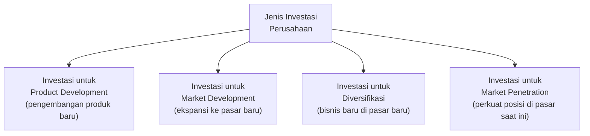

### 4. Tujuan Pembiayaan Usaha

Pembiayaan usaha memiliki **tujuh tujuan utama**:

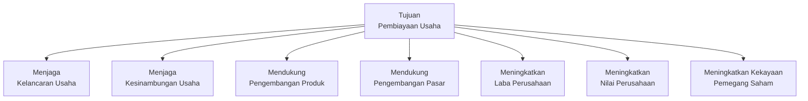

> Perhatikan bahwa tujuan pembiayaan tidak hanya bersifat **operasional** (menjaga kelancaran & kesinambungan) tetapi juga bersifat **strategis** (mengembangkan produk & pasar) dan **finansial** (meningkatkan laba, nilai perusahaan, dan kekayaan pemegang saham). Inilah yang membedakan pembiayaan bisnis dari sekadar "mencari uang untuk bertahan hidup."

---

## Bagian 2 — Sumber-Sumber Pembiayaan

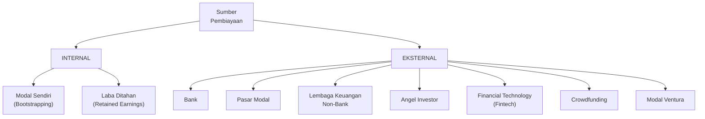

### 5. Sumber A — Modal Sendiri (Equity)

Usaha yang awalnya menggunakan modal sendiri disebut **bootstrapping**.

| Sumber Modal Sendiri | Penjelasan |
|---|---|
| **Tabungan pribadi** | Uang yang sudah dikumpulkan pendiri sebelum memulai bisnis. |
| **Investasi pribadi** | Aset pribadi yang dilikuidasi (dijual) untuk menjadi modal usaha. |
| **Laba ditahan** | Keuntungan yang tidak dibagikan sebagai dividen, melainkan diinvestasikan kembali ke dalam usaha (*retained earnings*). |

> **Bootstrapping** adalah pendekatan yang paling umum di tahap awal usaha — pendiri membiayai bisnis dari kantong sendiri. Keuntungannya: tidak ada utang dan tidak perlu berbagi kepemilikan dengan investor luar. Kelemahannya: skala pertumbuhan terbatas oleh kemampuan finansial pribadi. Banyak startup sukses seperti Mailchimp dan GitHub memulai dengan *bootstrapping* dan tumbuh organik tanpa VC (Venture Capital).

### 6. Sumber B — Bank

> **Bank** adalah badan usaha yang menghimpun dana dari masyarakat dalam bentuk simpanan dan menyalurkannya kepada masyarakat dalam bentuk kredit dan/atau bentuk-bentuk lainnya dalam rangka meningkatkan taraf hidup rakyat.

Bank menjalankan **tiga fungsi umum**:

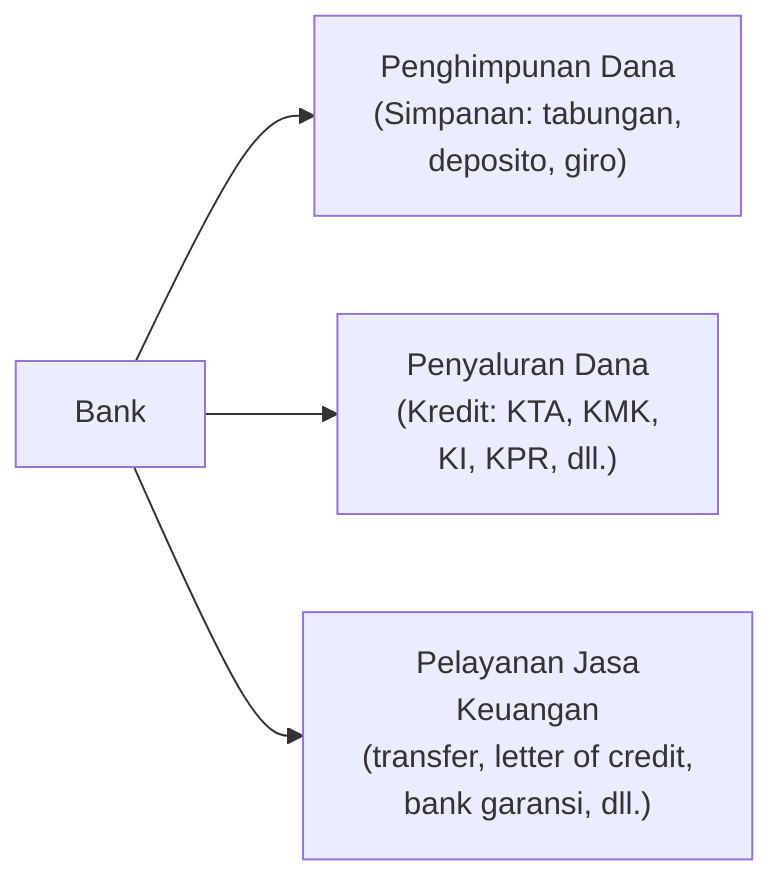

Jenis kredit bank untuk usaha:

| Jenis Kredit | Penjelasan |
|---|---|
| **Kredit Investasi (KI)** | Untuk pembelian aset tetap jangka panjang: mesin, gedung, kendaraan operasional. |
| **Kredit Modal Kerja (KMK)** | Untuk membiayai kebutuhan operasional jangka pendek: pembelian bahan baku, pembayaran gaji. |
| **KUR (Kredit Usaha Rakyat)** | Kredit bersubsidi pemerintah untuk UMKM dengan bunga rendah dan persyaratan lebih ringan. |

### 7. Sumber C — Pasar Modal

> **Pasar modal** secara umum merupakan suatu tempat bertemunya para penjual dan para pembeli untuk melakukan transaksi dalam rangka memperoleh modal.

Instrumen pasar modal yang diperdagangkan berbentuk **surat-surat berharga (efek)**. Menurut Sunariyah (2011), efek mencakup berbagai instrumen keuangan.

#### Instrumen Utama Pasar Modal

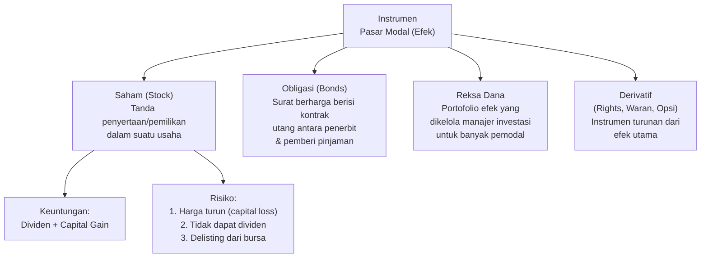

| Instrumen | Karakteristik | Keuntungan | Risiko |
|---|---|---|---|
| **Saham** | Bukti kepemilikan; pemegang saham adalah pemilik perusahaan. | Dividen + *capital gain* (kenaikan harga saham). | *Capital loss*, tidak dapat dividen, *delisting*. |
| **Obligasi** | Surat utang; pemegang obligasi adalah kreditur perusahaan. | Bunga/kupon yang tetap dan terjadwal. | Risiko gagal bayar (*default*) penerbit. |
| **Reksa Dana** | Portofolio terdiversifikasi yang dikelola manajer investasi. *(UU No. 8/1995)* | Diversifikasi otomatis, dikelola profesional, modal awal kecil. | Kinerja tergantung keahlian manajer investasi. |

> Perbedaan mendasar **saham vs. obligasi**: pemegang saham adalah **pemilik** yang berbagi risiko dan keuntungan perusahaan, sementara pemegang obligasi adalah **kreditur** yang memiliki hak atas pembayaran bunga dan pokok utang yang tetap — tidak peduli perusahaan untung atau rugi (selama tidak bangkrut).

### 8. Sumber D — Lembaga Keuangan Non-Bank (LKNB)

Perbedaan utama bank vs. LKNB:

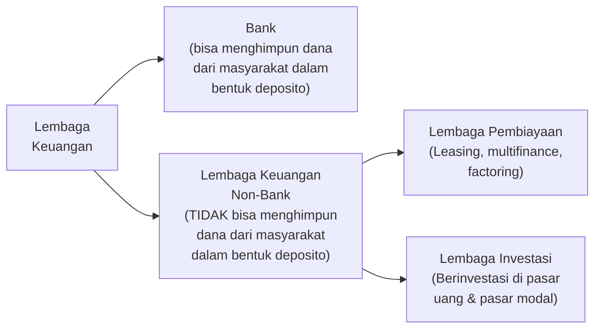

| Jenis LKNB | Contoh | Layanan |
|---|---|---|
| **Leasing** | Oto Multiartha, Adira Finance | Pembiayaan kendaraan dan alat berat dengan sistem sewa-beli. |
| **Modal Ventura** | MDI Ventures, Mandiri Capital | Investasi ekuitas di perusahaan yang sedang berkembang dengan potensi tinggi. |
| **Pembiayaan Konsumen** | Astra Credit Companies | Kredit kepemilikan barang konsumsi. |

### 9. Sumber E — Angel Investor

> **Angel Investor** adalah seseorang atau sekelompok orang yang berani mengambil risiko finansial dengan cara **mendanai bisnis baru yang memiliki potensi pertumbuhan tinggi** namun masih dalam tahap awal.

> **Startup business** adalah usaha baru yang dijalankan oleh wirausaha dan **belum mencapai periode waktu 48 bulan** (4 tahun) **atau belum memperoleh aliran kas positif**.

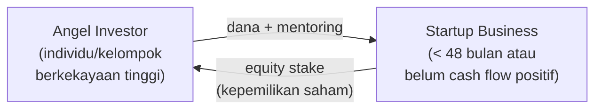

> Angel investor berbeda dari investor biasa dalam dua hal: mereka berinvestasi **sangat awal** (sebelum ada *track record*) dan sering memberikan **nilai lebih dari sekadar uang** — berupa jaringan, pengalaman, dan mentoring. Sebagai gantinya, mereka mendapat porsi kepemilikan saham di perusahaan. Tokoh angel investor terkenal global antara lain Peter Thiel (investor pertama Facebook) dan Reid Hoffman (investor awal Airbnb).

### 10. Sumber F — Financial Technology (Fintech)

> **Fintech** merupakan hasil gabungan antara **jasa keuangan dengan teknologi** yang mengubah model bisnis dari konvensional menjadi moderat — yang awalnya dalam membayar harus bertatap muka dan membawa uang kas, kini dapat dilakukan dengan transaksi jarak jauh.

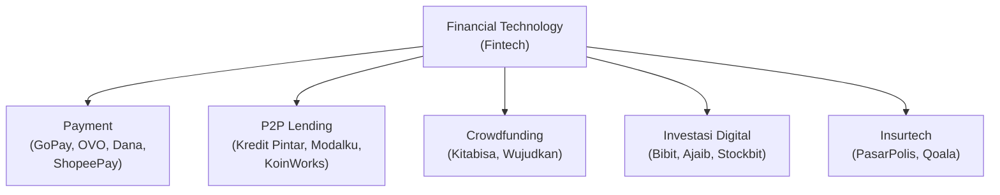

> Bagi UMKM dan startup, **fintech P2P lending** dan **crowdfunding** membuka akses pembiayaan yang sebelumnya tidak bisa dijangkau dari perbankan tradisional — tanpa agunan properti atau sejarah kredit panjang. Ini demokratisasi akses modal yang signifikan di Indonesia.

---

## Bagian 3 — Proses dan Strategi Mendapatkan Pembiayaan

### 11. Persyaratan dan Proses Pengajuan Pinjaman

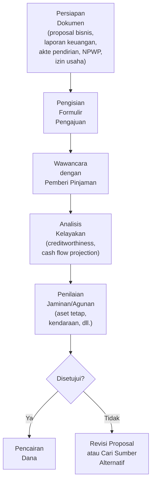

| Persyaratan Umum | Keterangan |
|---|---|
| **Proposal bisnis** | Rencana bisnis yang jelas, termasuk proyeksi keuangan dan analisis pasar. |
| **Laporan keuangan** | Neraca, laporan laba rugi, laporan arus kas — minimal 2 tahun terakhir (untuk bisnis yang sudah berjalan). |
| **Jaminan/agunan** | Aset tetap (tanah, bangunan), kendaraan, atau garansi pribadi yang menjadi jaminan pelunasan pinjaman. |
| **Dokumen legalitas** | Akte pendirian perusahaan, izin usaha (NIB/SIUP), NPWP perusahaan dan pengurus. |

### 12. Strategi Mendapatkan Pembiayaan

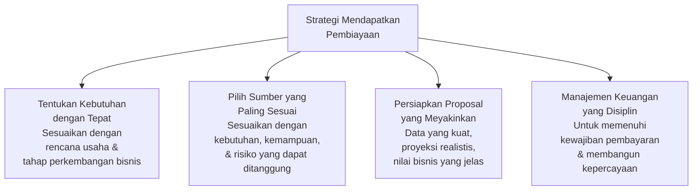

> Memilih sumber pembiayaan yang **tepat** sama pentingnya dengan mendapatkan jumlah yang cukup. Mengambil utang bank untuk membiayai eksperimen produk yang belum teruji adalah keputusan yang berbahaya — sementara menggunakan angel investor untuk ekspansi pasar yang sudah terbukti bisa jadi cara terbaik untuk tumbuh cepat tanpa membebani arus kas dengan cicilan. **Timing dan jenis pembiayaan harus selaras dengan tahap dan strategi bisnis.**

---

## Ringkasan Keterkaitan Antar Konsep

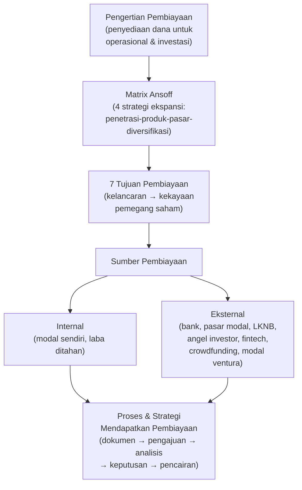

Inti dari sesi ini: **pembiayaan usaha** adalah tulang punggung operasional dan pertumbuhan bisnis. Wirausaha yang cerdas tidak hanya tahu *berapa* dana yang dibutuhkan, tetapi juga *dari mana* dan *kapan* mendapatkannya — dengan memilih sumber yang paling sesuai dengan tahap bisnis: modal sendiri di tahap awal (*bootstrapping*), bank untuk ekspansi yang sudah terbukti, angel investor untuk startup berpotensi tinggi, pasar modal untuk skala besar, dan fintech/crowdfunding untuk akses demokratis yang lebih fleksibel. Semua strategi ini harus dipandu oleh Matrix Ansoff yang menentukan arah ekspansi bisnis secara strategis.

---

*Terima kasih*
