# Sesi 8 — Lingkungan Usaha & Etika Bisnis dan Tanggung Jawab Sosial Perusahaan

**EMBS4102 Pengantar Bisnis**
Program Studi Sistem Informasi — Universitas Terbuka

> Catatan: dokumen ini merupakan ekstraksi sekaligus elaborasi dari materi *Inisiasi 8*, yang mencakup dua modul: **Modul 8 — Lingkungan Usaha** dan **Modul 9 — Etika Bisnis dan Tanggung Jawab Sosial Perusahaan (CSR)**. Setiap poin dijelaskan lebih dalam dengan konteks, referensi ahli, dan contoh nyata. Diagram konseptual digambarkan ulang menggunakan mermaid.

---

# Modul 8 — Lingkungan Usaha

## 1. Lingkungan Umum dan Lingkungan Khusus Bisnis

### Lingkungan Umum Perusahaan

> **Lingkungan umum perusahaan** terdiri dari berbagai kekuatan (*forces*) yang akan mempengaruhi perusahaan-perusahaan secara umum dan mempengaruhi kemampuan perusahaan untuk memperoleh sumber daya ekonomi.

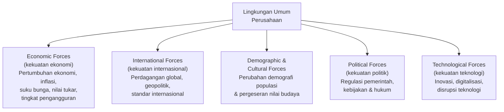

| Kekuatan | Penjelasan | Contoh Dampak pada Bisnis |
|---|---|---|
| **Economic Forces** | Kondisi makroekonomi yang memengaruhi daya beli konsumen dan biaya operasional. | Kenaikan suku bunga meningkatkan cicilan kredit, menekan ekspansi bisnis. |
| **International Forces** | Dinamika hubungan antarnegara dan perdagangan global. | Perang dagang AS-China memaksa banyak perusahaan merelokasi rantai pasok. |
| **Demographic & Cultural Forces** | Perubahan struktur populasi (usia, urbanisasi) dan nilai-nilai budaya masyarakat. | Aging population di Jepang mendorong ledakan bisnis layanan lansia. |
| **Political Forces** | Regulasi, kebijakan fiskal-moneter pemerintah, dan stabilitas politik. | Perubahan UU Ketenagakerjaan berdampak langsung pada biaya SDM perusahaan. |
| **Technological Forces** | Inovasi teknologi yang mengubah cara produksi, distribusi, dan interaksi dengan pelanggan. | AI dan otomasi menggantikan pekerjaan rutin di pabrik dan kantor. |

> Kelima kekuatan ini sering dianalisis menggunakan **PESTEL framework** (*Political, Economic, Social, Technological, Environmental, Legal*) — alat analisis makro-lingkungan standar dalam manajemen strategis. Pemahaman mendalam atas kekuatan-kekuatan ini adalah prasyarat bagi perencanaan strategis yang tanggap terhadap perubahan.

### Lingkungan Khusus Perusahaan

> **Lingkungan khusus** suatu perusahaan terdiri dari para pemegang kepentingan di luar perusahaan (*outside stakeholders*) yang secara langsung mempengaruhi kemampuan organisasi untuk memperoleh sumber daya ekonomi.

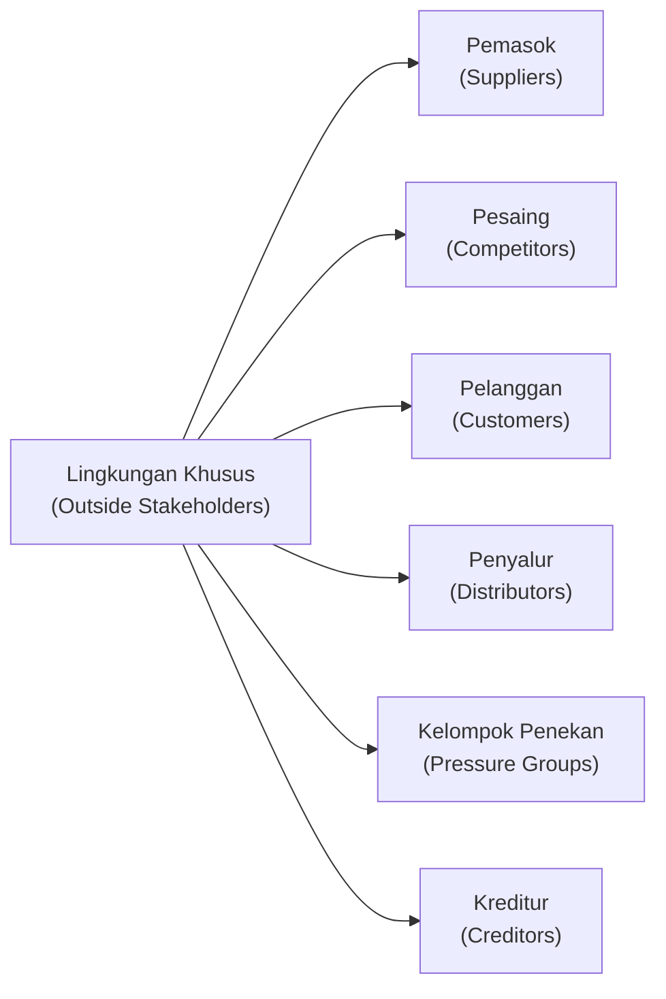

> Berbeda dengan lingkungan umum yang memengaruhi semua perusahaan secara luas, lingkungan khusus bersifat **unik untuk setiap industri dan perusahaan** — tekanan dari pelanggan Tokopedia berbeda dengan tekanan pelanggan rumah sakit, meski keduanya sama-sama menghadapi kekuatan ekonomi dan teknologi yang serupa.

## 2. Pemangku Kepentingan (*Stakeholders*)

### Definisi

Menurut **Freeman (1984: 46)**:

> **Stakeholder** adalah setiap kelompok atau individu yang dapat **mempengaruhi atau dipengaruhi** oleh pencapaian tujuan perusahaan.

Menurut **Donaldson dan Preston (1995)**:

> Stakeholders akan memberikan dukungan terhadap perusahaan apabila mereka memperoleh **imbalan sebanding atau lebih besar** dari perusahaan dibandingkan kontribusi yang mereka berikan.

> Ini adalah prinsip **quid pro quo** (*ada imbalan untuk setiap kontribusi*) yang mendasari seluruh hubungan stakeholder: karyawan bekerja keras bila dibayar dengan baik, investor menanamkan modal bila mendapat return yang kompetitif, pelanggan loyal bila mendapat nilai yang sepadan. Manajer yang memahami prinsip ini akan membangun sistem insentif yang saling menguntungkan.

### Klasifikasi Stakeholder

#### Berdasarkan Kedudukan dalam Perusahaan (Jones, 1995)

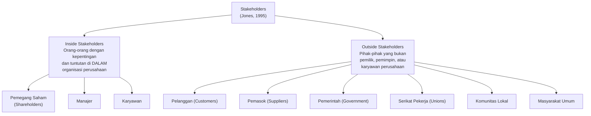

#### Berdasarkan Aktivitas Perusahaan (Post et al., 2011)

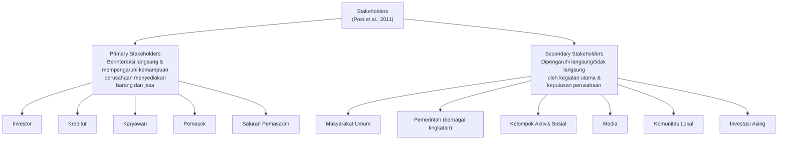

> **Primary vs. Secondary** bukan soal kepentingan yang lebih atau kurang penting — melainkan soal **kedekatan dan langsung tidaknya** pengaruh. Kelompok aktivis lingkungan (*secondary*) bisa sangat berpengaruh terhadap reputasi perusahaan, bahkan bila mereka tidak bertransaksi langsung. Era media sosial membuat batas antara primary dan secondary semakin kabur.

## 3. Manajemen Para Pemangku Kepentingan

**Berman, Wicks, Kotha, dan Jones (1999: 488–494)** mengidentifikasi dua model *stakeholder management*:

| Model | Filosofi |
|---|---|
| **Strategic Stakeholder Management** | Memenuhi kepentingan stakeholder karena hal itu meningkatkan kinerja dan nilai perusahaan — motivasinya **instrumental** (stakeholder sebagai sarana mencapai tujuan bisnis). |
| **Intrinsic Stakeholder Commitment** | Memenuhi kepentingan stakeholder karena itu adalah kewajiban moral yang benar — motivasinya **normatif** (stakeholder memiliki hak yang harus dipenuhi). |

**Langkah-langkah penerapan Stakeholder Management:**

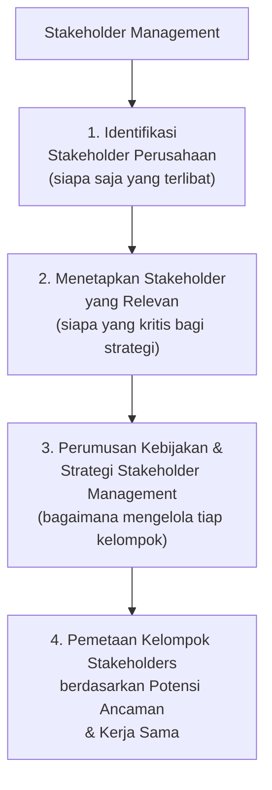

#### Empat Tipe Stakeholder (Blair & Whitehead, 1988)

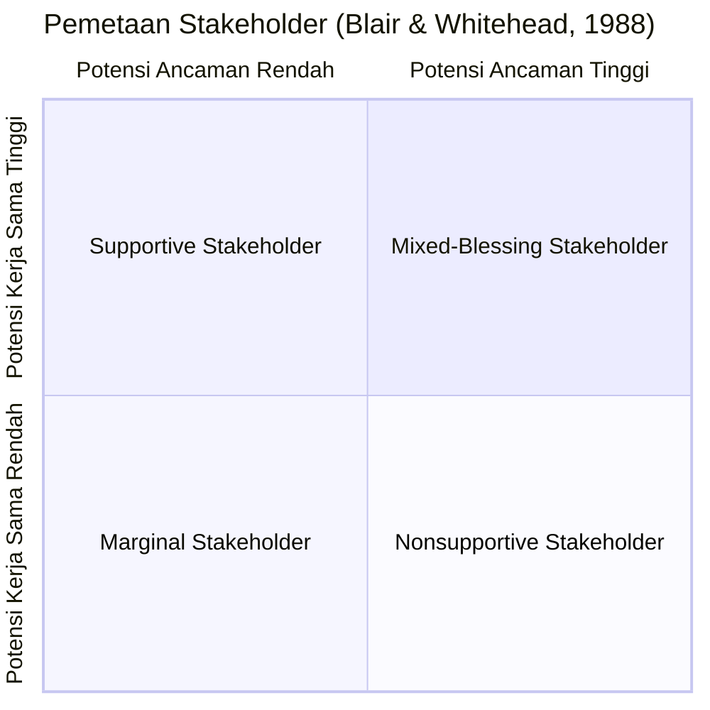

| Tipe | Karakteristik | Strategi yang Tepat |
|---|---|---|
| **Supportive** | Ancaman rendah, kerja sama tinggi — sekutu terbaik perusahaan. | Libatkan dan perkuat hubungan. |
| **Marginal** | Ancaman rendah, kerja sama rendah — kurang relevan saat ini. | Monitor secara berkala. |
| **Nonsupportive** | Ancaman tinggi, kerja sama rendah — potensi oposisi. | Kelola dengan hati-hati, kurangi dampak ancaman. |
| **Mixed-Blessing** | Ancaman tinggi, kerja sama tinggi — bisa jadi sekutu atau lawan. | Kolaborasi strategis untuk mengarahkan ke supportive. |

---

# Modul 9 — Etika Bisnis dan Tanggung Jawab Sosial Perusahaan

## 4. Etika Bisnis

### Definisi Norma, Moralitas, dan Etika

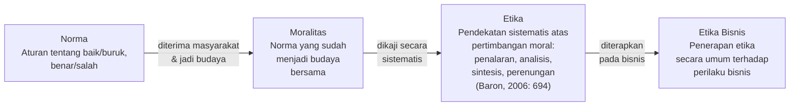

> Perbedaan antara **norma**, **moralitas**, dan **etika** penting dipahami: norma adalah aturan (*rules*), moralitas adalah keyakinan bersama yang sudah terinternalisasi (*shared beliefs*), sementara etika adalah disiplin reflektif yang mengkaji secara kritis apakah suatu tindakan benar atau salah. Etika bisnis tidak sekadar "mematuhi aturan" — ia mengharuskan perusahaan berpikir kritis tentang dampak tindakannya terhadap semua stakeholder.

### Mengapa Bisnis Harus Etis?

Menurut **Post et al. (2002: 104)**, terdapat **tujuh alasan** yang mendorong perusahaan menjalankan bisnis secara etis:

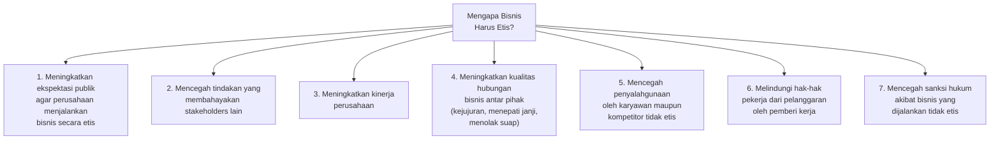

### Faktor Pemicu Masalah Etika Bisnis

Tiga faktor utama yang mendorong timbulnya masalah etika:

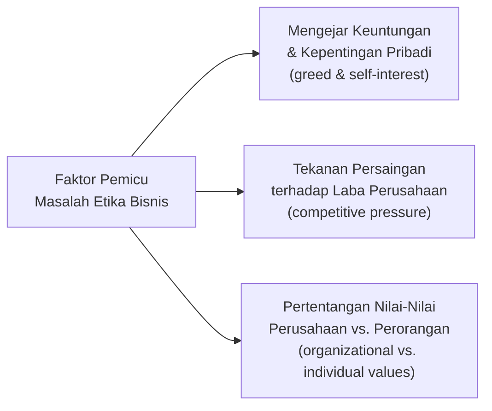

> Ketiga faktor ini saling memperkuat: tekanan persaingan mendorong manajer mengorbankan etika demi laba jangka pendek, sementara konflik nilai antara budaya perusahaan dan nilai pribadi karyawan menciptakan celah di mana penyimpangan etis bisa terjadi. Inilah mengapa **budaya etika organisasi** — bukan sekadar kode etik tertulis — adalah pertahanan terkuat terhadap pelanggaran etika.

### Isu-Isu Etika dalam Berbagai Bidang

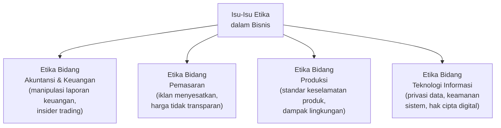

> **Etika bidang teknologi informasi** semakin relevan di era digital: mulai dari penggunaan data pribadi pengguna tanpa izin, algoritma yang bias, hingga eksploitasi celah keamanan sistem. Sebagai mahasiswa Sistem Informasi, pemahaman tentang etika TI adalah tanggung jawab profesional yang tidak bisa diabaikan.

### Standar Etika Bisnis

> **Standar etika bisnis/perusahaan** merupakan berbagai standar etika yang dirumuskan dan disosialisasikan oleh perusahaan kepada seluruh pemangku kepentingan — baik internal maupun eksternal.

Standar etika biasanya diwujudkan dalam bentuk: *code of conduct* (kode perilaku), kebijakan anti-korupsi, panduan whistleblowing, dan program pelatihan etika bagi karyawan.

## 5. Tanggung Jawab Sosial Perusahaan (CSR)

### Pengertian Tanggung Jawab

Menurut **Covey (1997: 61)**, kata *responsibility* terdiri dari dua kata: **response** (respons) + **ability** (kemampuan) — artinya tanggung jawab adalah **kemampuan untuk merespons** terhadap situasi dan konsekuensi dari tindakan yang diambil.

Terdapat **tiga jenis responsibility** *(Post et al., 2002: 69)*:

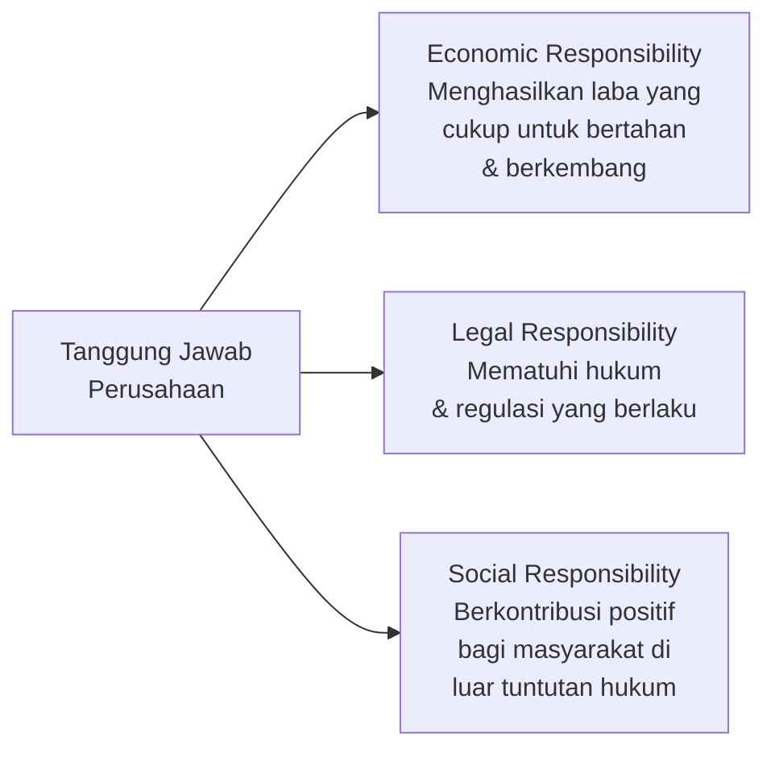

### Dua Perspektif tentang CSR

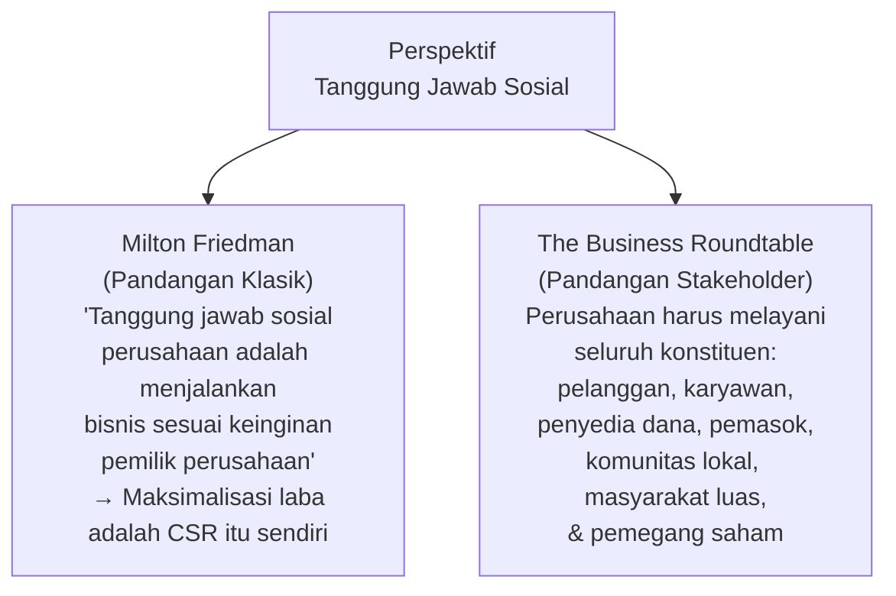

> Perdebatan antara **Friedman** dan **Business Roundtable** mencerminkan dua visi fundamental tentang peran perusahaan dalam masyarakat. Di era modern, pandangan Business Roundtable semakin diterima — pada 2019, lebih dari 180 CEO perusahaan besar Amerika menandatangani pernyataan bahwa tujuan korporasi bukan semata-mata memaksimalkan nilai pemegang saham, tetapi memberikan nilai bagi **seluruh stakeholder**.

### Tahap-Tahap Perkembangan CSR

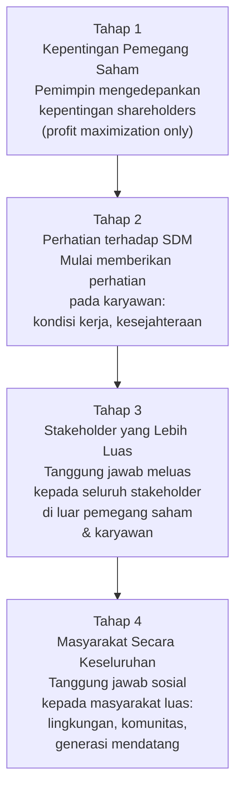

> Tahapan ini mencerminkan evolusi kesadaran korporat dari **shareholder capitalism** (hanya pemegang saham yang penting) menuju **stakeholder capitalism** (semua pemangku kepentingan penting). Perusahaan-perusahaan yang masih berada di Tahap 1 di era ini semakin rentan terhadap tekanan sosial, boikot konsumen, dan regulasi yang semakin ketat.

### Empat Dimensi CSR (Carroll/Solihin, 2008)

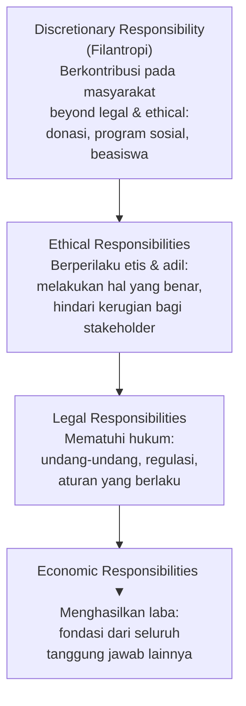

| Dimensi | Penjelasan |
|---|---|
| **Economic** | Fondasi paling dasar — perusahaan harus menghasilkan laba agar bisa bertahan dan memenuhi tanggung jawab lainnya. |
| **Legal** | Mematuhi semua hukum dan regulasi yang ditetapkan masyarakat sebagai aturan main bisnis. |
| **Ethical** | Bertindak benar dan adil bahkan ketika hukum tidak secara eksplisit mewajibkannya. |
| **Discretionary** | Kontribusi sukarela kepada masyarakat yang melampaui tuntutan ekonomi, hukum, dan etika — filantropi murni. |

> Piramida Carroll menunjukkan bahwa CSR bersifat **kumulatif**: tanggung jawab ekonomi adalah dasar, tetapi perusahaan kelas dunia tidak berhenti di situ. Menariknya, banyak perusahaan justru menemukan bahwa praktik Ethical dan Discretionary CSR yang konsisten pada akhirnya **meningkatkan kinerja ekonomi** — bukan mengorbankannya.

### Agenda CSR Asia — 10 Isu Prioritas

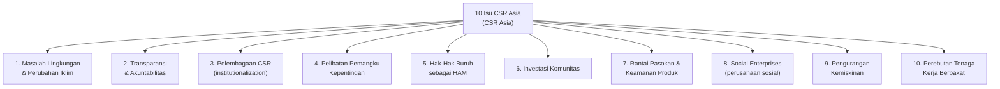

### CSR di Indonesia

Pemerintah Indonesia mengelompokkan pengaturan CSR ke dalam **dua kategori**:

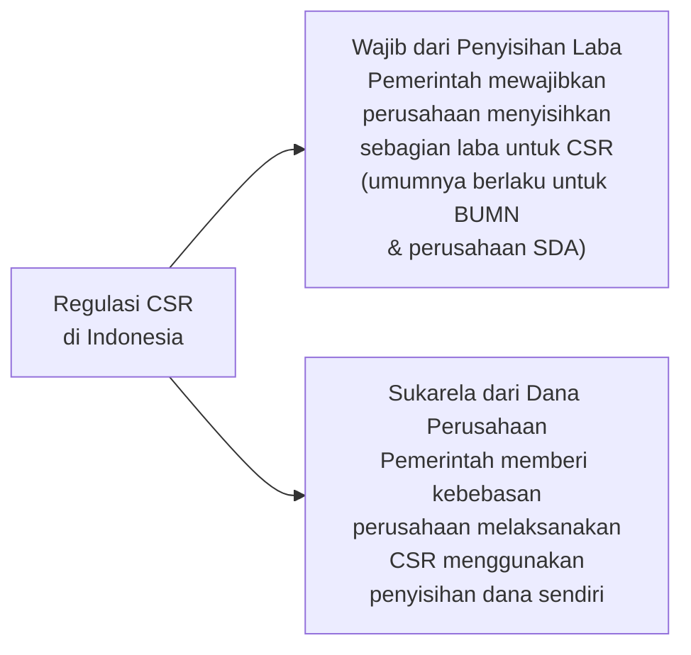

#### Program Kemitraan dan Bina Lingkungan (PKBL) BUMN

BUMN di Indonesia menjalankan CSR melalui **Program PKBL** dengan bentuk-bentuk kegiatan:

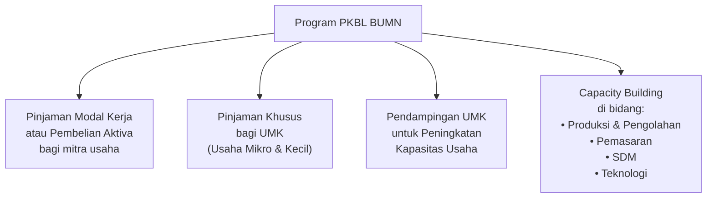

> PKBL adalah wujud konkret bagaimana **BUMN yang menganut Tahap 3–4 CSR** mengintegrasikan tanggung jawab sosialnya ke dalam model bisnis. Bukan sekadar donasi, PKBL dirancang untuk memberdayakan UMKM secara berkelanjutan — memberikan modal, pendampingan, dan peningkatan kapasitas agar mitra bisa mandiri dan tumbuh bersama BUMN.

---

## Ringkasan Keterkaitan Antar Konsep

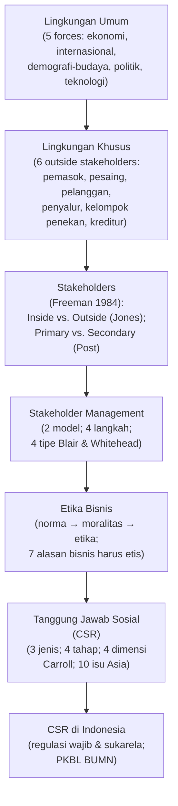

Inti dari sesi penutup ini: bisnis tidak beroperasi dalam vakum — ia dikelilingi oleh **lingkungan umum** (kekuatan makro) dan **lingkungan khusus** (stakeholder langsung) yang terus berubah dan saling mempengaruhi. Merespons lingkungan ini secara efektif membutuhkan **manajemen stakeholder** yang strategis — memahami siapa mereka, apa yang mereka inginkan, dan bagaimana potensi ancaman atau kerja sama mereka. Di atas semua itu, keberhasilan bisnis jangka panjang kini tidak lagi hanya diukur dari laba — tetapi juga dari komitmen terhadap **etika bisnis** dan **tanggung jawab sosial** (CSR) yang mencakup empat dimensi: ekonomi, hukum, etika, dan filantropi.

---

*Terima kasih*
