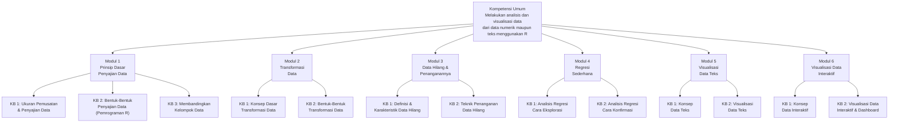

# Analisis dan Visualisasi Data (MSIM4310)

**Program Studi Sistem Informasi — Universitas Terbuka**

| | |
|---|---|
| **Kode Mata Kuliah** | MSIM4310 |
| **Bobot SKS** | 2 |
| **Nama Pengembang** | Moh. Khoridatul Huda, S.Pd., M.Si., Ph.D. |
| **Nama Penelaah** | — |
| **Tahun Pengembangan** | 2023 |

> Dokumen ini disusun berdasarkan **Rancangan Mata Kuliah (RMK)** dan **Garis-Garis Besar Program Pembelajaran (GBPP)** mata kuliah sebagai gambaran umum/preview materi yang dibahas di setiap pertemuan tutorial.

---

## Deskripsi Singkat Mata Kuliah

Mata kuliah **Analisis dan Visualisasi Data (MSIM4310)** mempelajari teknik **menganalisis dan memvisualisasikan data** baik dari data numerik maupun data teks menggunakan bahasa pemrograman **R**. Mata kuliah ini mencakup enam topik utama:

- **Prinsip Dasar Penyajian Data** — ukuran pemusatan, penyebaran, dan berbagai bentuk representasi data
- **Transformasi Data** — normalisasi, standardisasi, transformasi logaritma, dan penanganan *outlier*
- **Penanganan Data Hilang** — identifikasi MCAR/MAR/MNAR serta teknik imputasi dengan `mice` di R
- **Analisis Regresi Sederhana** — pendekatan eksplorasi dan konfirmasi hipotesis
- **Visualisasi Data Teks** — *text mining*, *word cloud*, *bigram network*, analisis sentimen menggunakan `tidytext`
- **Visualisasi Data Interaktif** — aplikasi Shiny, plotly, leaflet, DT, dan shinydashboard

Mahasiswa belajar melalui diskusi, tugas serta praktikum mandiri. Ketercapaian hasil belajar diukur melalui diskusi, tugas tutorial, dan ujian akhir semester.

## Capaian Pembelajaran Mata Kuliah

Melalui mata kuliah ini, mahasiswa mampu:

1. **Menerapkan prinsip dasar penyajian data** menggunakan ukuran pemusatan (mean, median, modus) dan ukuran penyebaran (jangkauan, simpangan baku, koefisien keragaman) serta berbagai bentuk representasi data.
2. **Menggunakan pemrograman R dan RStudio** untuk pengolahan data, visualisasi grafik dasar, dan penulisan laporan dengan R Markdown.
3. **Melakukan transformasi data** menggunakan teknik normalisasi, standardisasi, transformasi logaritma, dan transformasi pangkat untuk memenuhi asumsi analisis statistik.
4. **Mengidentifikasi dan menangani data hilang** dengan membedakan tipe MCAR, MAR, dan MNAR serta menerapkan teknik imputasi yang sesuai.
5. **Melakukan analisis regresi sederhana** secara eksplorasi (visualisasi korelasi, *model fitting*) maupun konfirmasi (uji hipotesis, evaluasi asumsi).
6. **Menganalisis dan memvisualisasikan data teks** menggunakan teknik *text mining*, analisis sentimen, dan berbagai jenis visualisasi teks.
7. **Membangun visualisasi data interaktif dan dashboard** menggunakan R Shiny, plotly, leaflet, dan shinydashboard.

---

## Peta Kompetensi

> **Kompetensi Umum (KU):** Setelah mengikuti mata kuliah ini, mahasiswa mampu melakukan analisis dan visualisasi data, baik dari data numerik maupun data teks menggunakan R.

---

## Rancangan Aktivitas Tutorial (RAT)

| Tutorial Ke- | Pokok Bahasan | Sub Pokok Bahasan | Tugas Tutorial | Daftar Pustaka |
|---|---|---|---|---|
| [1](pertemuan-01/README.md) | Prinsip Dasar Penyajian Data | Ukuran pemusatan data: mean, median, modus; Ukuran penyebaran data: jangkauan, keragaman, simpangan baku, koefisien keragaman | — | [1][2] |
| [2](pertemuan-02/README.md) | Pemrograman R | Dasar-dasar pemrograman R; Teknik dasar pengolahan data dengan R; Penggunaan RStudio pada komputer | — | [1][2][3] |
| [3](pertemuan-03/README.md) | Pemrograman R | Instalasi R & RStudio; variabel, tipe data & struktur data; operasi data frame; grafik dasar (batang, garis, histogram, *box plot*) menggunakan R; R Markdown | — | [1][2][3] |
| [4](pertemuan-04/README.md) | Prinsip Dasar Penyajian Data | Membandingkan kelompok data: distribusi normal, mean, variansi, koefisien keragaman, angka baku | **√ (Tugas 1)** | [1][2] |
| [5](pertemuan-05/README.md) | Transformasi Data | Konsep Dasar Transformasi Data: pengertian transformasi data, kapan melakukan transformasi, transformasi data dan normalitas | — | [1][2] |
| [6](pertemuan-06/README.md) | Transformasi Data | Bentuk-Bentuk Transformasi Data: transformasi logaritma, transformasi pangkat, analisis regresi linear sederhana | — | [1][2][3] |
| [7](pertemuan-07/README.md) | Data Hilang dan Penanganannya | Definisi dan karakteristik data hilang: tipe MCAR, MAR, MNAR; contoh kasus; implikasi dalam analisis; validitas hasil inferensi | — | [1][2] |
| [8](pertemuan-08/README.md) | Data Hilang dan Penanganannya | Teknik penanganan data hilang: penghapusan baris/kolom, imputasi sederhana (mean/median/modus), *multiple imputation*, KNN imputation, paket `mice` di R | **√ (Tugas 2)** | [1][2] |
| [9](pertemuan-09/README.md) | Regresi Sederhana | Analisis regresi cara eksplorasi: statistik deskriptif, korelasi, *scatter plot*, *heatmap* korelasi, model regresi linear sederhana, pemeriksaan asumsi | — | [1][2][3] |
| [10](pertemuan-10/README.md) | Regresi Sederhana | Analisis regresi cara konfirmasi: perumusan hipotesis (H0 dan H1), uji signifikansi koefisien, *cross-validation*, *train-test split* | — | [1][2][3] |
| [11](pertemuan-11/README.md) | Visualisasi Data Teks | Analisis data teks dengan R: pengumpulan data teks, pra-pemrosesan (tokenisasi, *stemming*, *stop words*), TF-IDF, N-gram, analisis sentimen (BING/AFINN/NRC) | — | [1][2][4] |
| [12](pertemuan-12/README.md) | Visualisasi Data Teks | Visualisasi data teks dengan R: *word cloud*, *bar plot* frekuensi kata, *bigram network* (ggraph/igraph), *sentiment visualization*, *heatmap* TF-IDF | **√ (Tugas 3)** | [1][2][4] |
| [13](pertemuan-13/README.md) | Visualisasi Data Interaktif | Konsep data interaktif: statis vs. interaktif; instalasi & struktur Shiny (UI, server); plotly, leaflet, DT; pola interaksi (filter, *drill-down*, *hover*, *zoom*) | — | [1][2][4][5] |
| [14](pertemuan-14/README.md) | Visualisasi Data Interaktif | Visualisasi data interaktif dengan R: *reactive programming* (`reactive()`, `observeEvent()`), berbagai jenis plot interaktif, *deployment* ke shinyapps.io | — | [1][2][4][5] |
| [15](pertemuan-15/README.md) | Visualisasi Data Interaktif & Dashboard | shinydashboard: `dashboardPage()`, `box()`, `valueBox()`, `infoBox()`, sistem grid 12-kolom, kustomisasi tema, *deployment* | — | [1][2][4][5] |

> Modus tutorial menggunakan **Tuton (Tutorial Online)**. Tugas Tutorial diberikan pada pertemuan ke-4, ke-8, dan ke-12 — masing-masing mencakup CPK esensial dari Modul 1 (Tugas 1), Modul 2–3 (Tugas 2), dan Modul 5 (Tugas 3) untuk mata kuliah berbobot 2 SKS.

---

### Rincian Capaian Pembelajaran Khusus per Pertemuan

#### Pertemuan 1 — Prinsip Dasar Penyajian Data (Ukuran Pemusatan & Penyebaran)

1. Menghitung mean dari sekumpulan data dan memahami kapan penggunaan mean yang tepat.
2. Menghitung median dan memahami kelebihan median dalam mengatasi *outlier* (pencilan).
3. Menentukan modus dari data dan memahami situasi di mana modus merupakan ukuran yang paling informatif.
4. Menghitung jangkauan (*range*) dan memahami keterbatasannya sebagai ukuran penyebaran.
5. Menghitung keragaman (variansi) dan simpangan baku (*standard deviation*) dari data.
6. Menghitung koefisien keragaman (*coefficient of variation*) untuk membandingkan variasi relatif antar kelompok data.
7. Menginterpretasikan ukuran pemusatan dan penyebaran data dalam konteks nyata.
8. Membandingkan dan mengevaluasi dua set data menggunakan ukuran pemusatan dan penyebaran.
9. Menulis skrip dasar di R untuk menghitung dan menganalisis ukuran pemusatan dan penyebaran data.

#### Pertemuan 2 — Pemrograman R (Dasar-Dasar & Penyajian Data)

1. Menyajikan data dalam bentuk tabel menggunakan R.
2. Menyajikan data dalam bentuk grafik (bar chart, line chart, scatter plot) menggunakan R.
3. Menyajikan data dalam bentuk diagram (pie chart, histogram) menggunakan R.
4. Menyajikan data dalam bentuk peta (*choropleth map*) menggunakan R.
5. Melakukan interpretasi dan analisis data yang disajikan dalam berbagai bentuk visual.
6. Menggunakan software R dan RStudio sebagai alat penyajian data yang efektif.

#### Pertemuan 3 — Pemrograman R (Lanjutan)

1. Menginstal R dan RStudio pada komputer dan memahami antarmuka RStudio beserta fungsi-fungsi dasarnya.
2. Menulis dan menjalankan skrip R dasar.
3. Menggunakan variabel, tipe data dasar (numerik, karakter, logika), dan struktur data (vektor, matriks, dan data frame).
4. Melakukan operasi dasar pada data frame: *subsetting*, *filtering*, dan mutasi data.
5. Menghitung statistik deskriptif dasar (mean, median, modus, variansi, standar deviasi) menggunakan R.
6. Membuat grafik dasar (grafik batang, garis, histogram, box plot) menggunakan package `ggplot2` atau base R.
7. Menyesuaikan grafik dengan menambahkan judul, label, dan legenda.
8. Menginstal dan menggunakan paket R tambahan untuk memperluas fungsionalitas (misalnya `dplyr`).
9. Menyusun laporan menggunakan R Markdown di RStudio.

#### Pertemuan 4 — Prinsip Dasar Penyajian Data (Membandingkan Kelompok Data)

1. Memahami definisi dan rumus koefisien keragaman (*coefficient of variation*).
2. Menghitung koefisien keragaman dari data yang diberikan.
3. Menginterpretasikan hasil koefisien keragaman dalam konteks variasi relatif data.
4. Membandingkan koefisien keragaman dari dua atau lebih kelompok data untuk menentukan kelompok mana yang memiliki variasi relatif lebih besar.
5. Menjelaskan hasil perbandingan tersebut dalam konteks masalah nyata.
6. Menulis skrip dasar di R untuk menghitung dan menganalisis koefisien keragaman.

#### Pertemuan 5 — Transformasi Data (Konsep Dasar)

1. Menjelaskan definisi transformasi data serta tujuan dan manfaatnya dalam analisis.
2. Mengidentifikasi dan menerapkan metode transformasi dasar seperti normalisasi, standardisasi, dan log transformasi.
3. Menggunakan perangkat lunak R untuk melakukan transformasi data.
4. Mengenali dan mengatasi *missing values* dan *outliers* dalam dataset.
5. Melakukan transformasi data kategorikal.
6. Mengevaluasi hasil transformasi data dan memilih metode transformasi yang paling sesuai untuk dataset tertentu.
7. Menerapkan transformasi data pada kasus nyata dan menginterpretasikan hasil transformasi.

#### Pertemuan 6 — Transformasi Data (Bentuk-Bentuk)

1. Menjelaskan apa yang dimaksud dengan transformasi data dan mengapa hal tersebut penting dalam analisis data.
2. Mengidentifikasi berbagai jenis transformasi data yang umum digunakan dalam analisis data.
3. Menerapkan teknik normalisasi untuk mengubah skala data sehingga berada dalam rentang tertentu (0–1).
4. Menerapkan teknik standardisasi untuk mengubah data sehingga memiliki rata-rata nol dan standar deviasi satu (*z-score standardization*).
5. Mengubah data kategori menjadi format numerik menggunakan *one-hot encoding* dan *label encoding*.
6. Mengubah data dari format panjang ke format lebar (*pivot*) dan sebaliknya (*unpivot*) untuk analisis lebih lanjut.
7. Menerapkan transformasi logaritma untuk mengurangi *skewness* dan menstabilkan variansi data.
8. Menerapkan berbagai bentuk transformasi pangkat (kuadrat, akar kuadrat, pangkat tiga, akar pangkat tiga) untuk memperbaiki distribusi.

#### Pertemuan 7 — Data Hilang dan Penanganannya (Definisi & Karakteristik)

1. Menjelaskan apa yang dimaksud dengan data hilang dalam konteks analisis data.
2. Mengidentifikasi berbagai bentuk data hilang, termasuk nilai yang hilang sepenuhnya dan data yang tidak lengkap.
3. Menjelaskan tiga tipe utama data hilang: *Missing Completely at Random* (MCAR), *Missing at Random* (MAR), dan *Missing Not at Random* (MNAR).
4. Memberikan contoh nyata dari setiap tipe data hilang.
5. Menggunakan metode statistik dan visualisasi untuk mendeteksi data hilang dalam dataset.
6. Menginterpretasikan pola data hilang yang ditemukan dalam analisis.
7. Menerapkan teknik penanganan data hilang (penghapusan baris/kolom, imputasi sederhana, teknik imputasi lanjutan).
8. Menjelaskan kelebihan dan kekurangan masing-masing teknik penanganan data hilang.
9. Menggunakan perangkat lunak statistik R untuk mendeteksi, menangani, dan menganalisis data hilang.
10. Menyusun laporan yang mencakup deskripsi data hilang, teknik penanganan yang digunakan, dan dampak terhadap hasil analisis.

#### Pertemuan 8 — Data Hilang dan Penanganannya (Teknik Penanganan)

1. Menjelaskan apa yang dimaksud dengan data hilang dan bagaimana data hilang dapat mempengaruhi hasil analisis data.
2. Mengidentifikasi berbagai tipe data hilang (MCAR, MAR, MNAR) dan memberikan contoh untuk masing-masing tipe.
3. Menggunakan metode statistik dan visualisasi untuk mendeteksi data hilang dalam dataset.
4. Menginterpretasikan pola data hilang yang ditemukan dan menyusun rencana penanganan yang sesuai.
5. Menghapus baris atau kolom yang memiliki data hilang dengan mempertimbangkan dampaknya terhadap dataset dan analisis selanjutnya.
6. Menerapkan teknik imputasi sederhana seperti pengisian dengan nilai mean, median, atau modus untuk menggantikan nilai yang hilang.
7. Menjelaskan kelebihan dan kekurangan dari teknik imputasi sederhana.
8. Menerapkan teknik imputasi berganda (*multiple imputation*) untuk menangani data hilang dan memahami bagaimana metode ini dapat mengurangi bias.
9. Menggunakan paket `mice` di R untuk mendeteksi, menangani, dan menganalisis data hilang.
10. Mengintegrasikan langkah-langkah penanganan data hilang dalam keseluruhan proses analisis data.

#### Pertemuan 9 — Regresi Sederhana (Cara Eksplorasi)

1. Menjelaskan definisi dan tujuan analisis regresi.
2. Mengidentifikasi variabel dependen dan variabel independen dalam konteks regresi.
3. Mengumpulkan data yang relevan dan membersihkannya dari *missing values* serta *outliers*.
4. Menghitung statistik deskriptif untuk variabel dalam dataset.
5. Membuat visualisasi data awal seperti histogram, scatter plot, dan box plot.
6. Menghitung dan menginterpretasikan matriks korelasi.
7. Menggunakan visualisasi *heatmap* untuk menggambarkan hubungan antar variabel.
8. Membangun model regresi linear sederhana menggunakan R.
9. Menginterpretasikan koefisien regresi dari model sederhana.
10. Memeriksa normalitas residual, homoskedastisitas, dan independensi residual.
11. Menerapkan validasi silang (*cross-validation*) dan pembagian data (*train-test split*) untuk mengevaluasi kinerja model.
12. Membuat ringkasan temuan dari hasil analisis regresi.

#### Pertemuan 10 — Regresi Sederhana (Cara Konfirmasi)

1. Menjelaskan definisi dan tujuan analisis regresi dalam konteks konfirmasi hipotesis.
2. Mengidentifikasi variabel dependen dan variabel independen.
3. Mengumpulkan data yang relevan dan membersihkannya dari nilai yang hilang dan *outliers*.
4. Merumuskan hipotesis nol (H₀) dan hipotesis alternatif (H₁) yang akan diuji dengan analisis regresi.
5. Menentukan variabel yang relevan berdasarkan literatur dan teori yang ada.
6. Menghitung statistik deskriptif dan membuat visualisasi data awal (histogram, scatter plot, box plot).
7. Menghitung dan menginterpretasikan matriks korelasi.
8. Membangun model regresi linear sederhana menggunakan R.
9. Menginterpretasikan koefisien regresi dari model sederhana dan menguji signifikansinya.
10. Menggunakan visualisasi *heatmap* untuk menggambarkan hubungan antar variabel.

#### Pertemuan 11 — Konsep Data Teks

1. Menjelaskan definisi data teks dan perbedaannya dengan data numerik dan kategorikal.
2. Mengidentifikasi sumber-sumber data teks seperti dokumen, media sosial, dan transkrip percakapan.
3. Memahami berbagai metode pengumpulan data teks (web scraping, pengumpulan dari media sosial, digitalisasi dokumen fisik).
4. Menjelaskan pentingnya pra-pemrosesan dalam analisis data teks.
5. Menerapkan teknik pra-pemrosesan: tokenisasi, *stemming*, *lemmatization*, dan penghapusan *stop words*.
6. Menerapkan teknik dasar analisis teks: *word frequency analysis*, N-gram, dan analisis sentimen.
7. Menggunakan alat dan software untuk analisis teks menggunakan R (`tidytext`).
8. Mengidentifikasi aplikasi praktis analisis data teks dalam berbagai bidang (pemasaran, kesehatan, ilmu sosial).
9. Merancang dan melaksanakan proyek analisis data teks yang relevan.
10. Mengidentifikasi tantangan teknis dan etika dalam pengolahan dan analisis data teks.
11. Menerapkan praktik terbaik dalam memastikan privasi dan keamanan data teks yang dianalisis.

#### Pertemuan 12 — Visualisasi Data Teks

1. Menjelaskan definisi dan pentingnya visualisasi data teks dalam analisis data.
2. Mengidentifikasi perbedaan antara visualisasi data teks dan visualisasi data numerik.
3. Mengenal berbagai alat dan software untuk visualisasi data teks (R: `ggplot2`, `wordcloud`, `plotly`).
4. Memahami teknik pengolahan data teks yang diperlukan sebelum visualisasi (tokenisasi, *stemming*, *stop words*).
5. Menerapkan teknik pengolahan data teks menggunakan R.
6. Memahami prinsip-prinsip desain visualisasi yang efektif (penggunaan warna, bentuk, dan tata letak yang tepat untuk teks).
7. Membuat berbagai jenis visualisasi data teks: *word cloud*, *bar plot* frekuensi kata, *bigram network*, dan *heatmap*.
8. Menggunakan alat `ggplot2`, `wordcloud`, dan `plotly` di R untuk membuat visualisasi data teks.
9. Menggunakan visualisasi data teks untuk mengeksplorasi dan menganalisis pola serta tren dalam data teks.
10. Menginterpretasikan hasil visualisasi untuk mengambil kesimpulan berbasis data.

#### Pertemuan 13 — Konsep Data Interaktif

1. Menjelaskan teori dan konsep dasar dari data interaktif, termasuk teknik pengumpulan, pengolahan, dan penyajian data.
2. Mengidentifikasi jenis-jenis data yang dapat diubah menjadi data interaktif.
3. Mengenal alat-alat visualisasi data interaktif seperti Tableau, Power BI, D3.js, dan R Shiny.
4. Mengintegrasikan berbagai jenis data (numerik, kategorikal, geografis) dalam visualisasi yang interaktif dan *user-friendly*.
5. Menganalisis dataset menggunakan teknik statistik dasar dan lanjutan untuk menemukan pola dan tren yang dapat diwakili secara interaktif.
6. Menginstal dan mengkonfigurasi paket Shiny (UI, server, ShinyApp) untuk membangun aplikasi visualisasi data interaktif.
7. Memahami pola interaksi dasar: filter, *drill-down*, *hover*, *zoom*, dan animasi.

#### Pertemuan 14 — Visualisasi Data Interaktif

1. Menjelaskan definisi dan pentingnya visualisasi data interaktif dalam analisis data.
2. Mengidentifikasi perbedaan antara visualisasi data statis dan interaktif.
3. Memahami teknik pengolahan data yang diperlukan sebelum visualisasi (pembersihan, transformasi, agregasi data).
4. Menerapkan teknik pengolahan data menggunakan R.
5. Memahami dan menerapkan prinsip-prinsip desain visualisasi yang efektif dalam membangun antarmuka interaktif.
6. Membuat berbagai jenis visualisasi data interaktif seperti peta interaktif, grafik interaktif, dan tabel dinamis.
7. Menerapkan *reactive programming* (`reactive()`, `observeEvent()`, `eventReactive()`) di Shiny untuk membangun antarmuka yang responsif.
8. Menggunakan visualisasi data interaktif untuk mengeksplorasi dan menganalisis data.
9. Menginterpretasikan hasil visualisasi untuk mengambil keputusan berbasis data.
10. Menyusun presentasi yang mencakup visualisasi data interaktif untuk menyampaikan hasil analisis.
11. Mengidentifikasi aplikasi praktis visualisasi data interaktif dalam berbagai bidang (bisnis, kesehatan, ilmu sosial).

#### Pertemuan 15 — Visualisasi Data Interaktif dan Dashboard

1. Merancang dan mengembangkan dashboard interaktif yang menyajikan data secara komprehensif dan mudah diakses.
2. Mengembangkan dashboard yang dapat digunakan oleh pengguna non-teknis untuk eksplorasi data mandiri.
3. Menggunakan `shinydashboard` untuk membangun dashboard dengan komponen `dashboardPage()`, `box()`, `valueBox()`, dan `infoBox()`.
4. Menerapkan sistem grid 12-kolom pada shinydashboard untuk tata letak yang responsif.
5. Mengintegrasikan berbagai komponen visualisasi (grafik plotly interaktif, tabel DT, peta leaflet) ke dalam satu dashboard terintegrasi.
6. Melakukan kustomisasi tampilan dashboard menggunakan tema *skin* dan CSS kustom.
7. Men-*deploy* aplikasi Shiny/shinydashboard ke shinyapps.io menggunakan `rsconnect::deployApp()`.

---

## Daftar Pustaka

**Utama:**

1. Long, J. D., & Teetor, P. (2019, September 26). *R Cookbook, 2nd Edition*. [https://rc2e.com/](https://rc2e.com/)
2. Ratnaningsih, D.J., & Hakim, B.F. (2023, Mei). *Analisis dan Visualisasi Data*. Penerbit Universitas Terbuka.
3. Kabacoff, R. (2024). *Modern Data Visualisation with R* (1st ed.). CRC Press. [https://rkabacoff.github.io/datavis/Intro.html](https://rkabacoff.github.io/datavis/Intro.html)

**Sumber Lainnya:**

4. Makarim, A. H. (2024, January 10). Exploring Statistical Analysis with R Shiny: A Guide to Interactive Data Visualization. *Medium*. [https://medium.com/@21611129/exploring-statistical-analysis-with-r-shiny-a-guide-to-interactive-data-visualization-f5dba937a808](https://medium.com/@21611129/exploring-statistical-analysis-with-r-shiny-a-guide-to-interactive-data-visualization-f5dba937a808)
5. Nugraha, A. E. (2023, September 7). Data Analyst 6: Jenis-Jenis Metode Analisis dan Visualisasi Data. *Medium*. [https://medium.com/@an.ekanugraha/data-analyst-6-jenis-jenis-metode-analisis-dan-visualisasi-data-2abe9774bf68](https://medium.com/@an.ekanugraha/data-analyst-6-jenis-jenis-metode-analisis-dan-visualisasi-data-2abe9774bf68)
