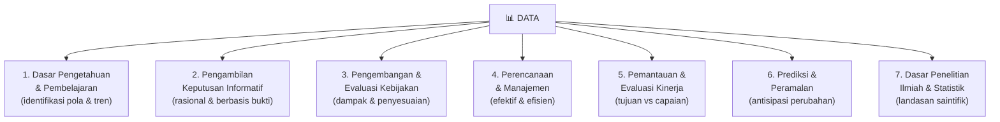
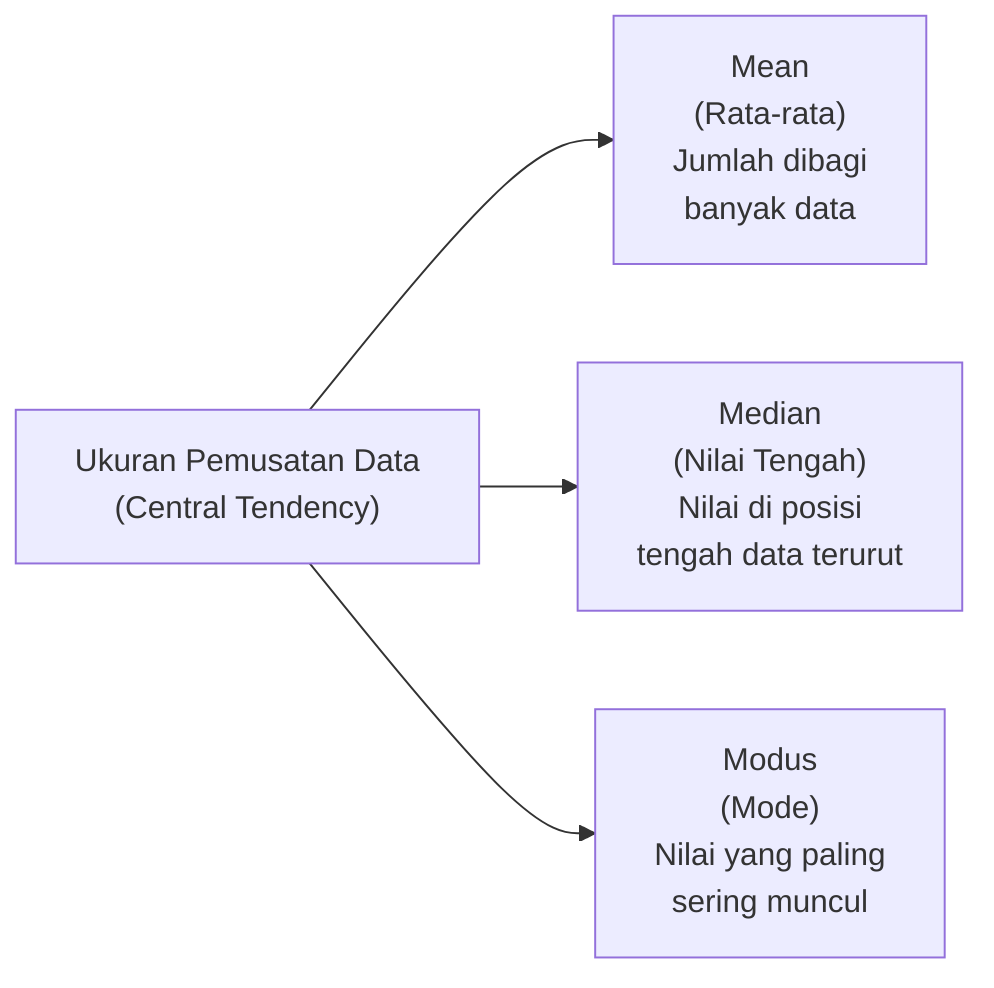
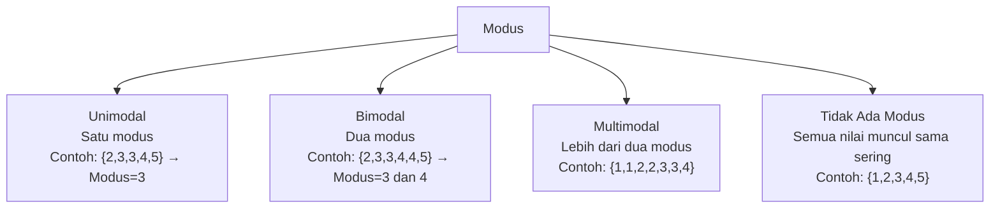
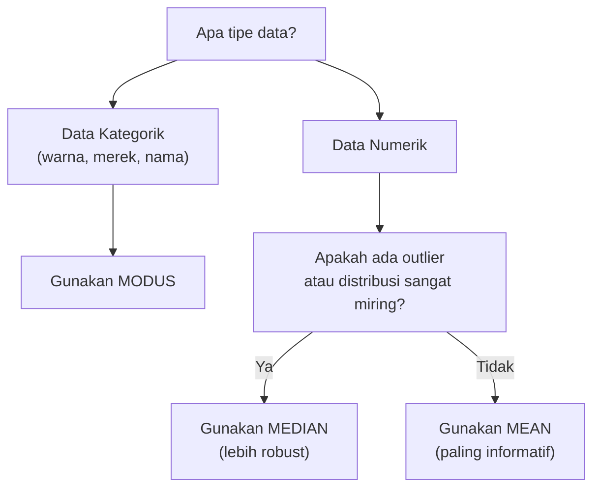
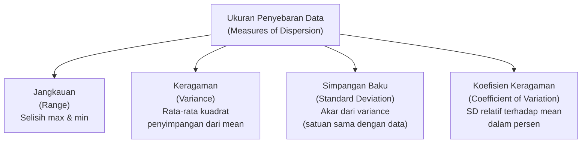
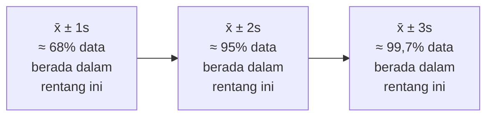
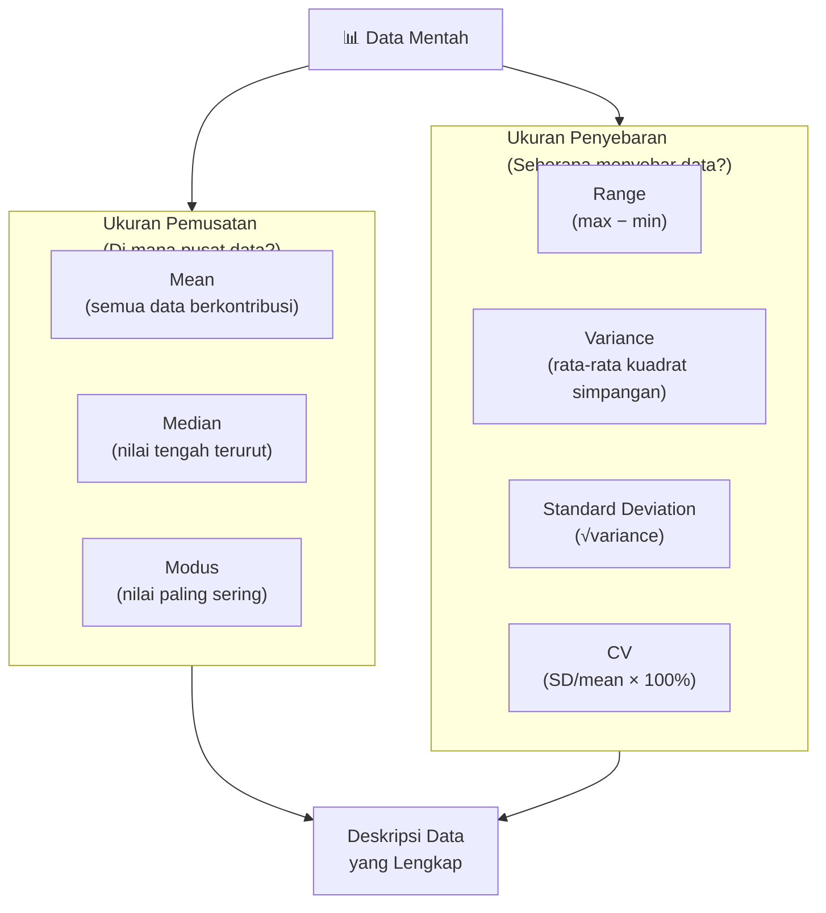
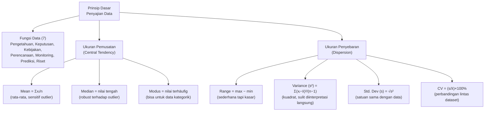

# Sesi 1 — Prinsip Dasar Penyajian Data

**MSIM4310 Analisis dan Visualisasi Data**  
Program Studi Sistem Informasi — Universitas Terbuka

> Catatan: dokumen ini merupakan ekstraksi sekaligus elaborasi dari materi *Inisiasi 1 — Prinsip Dasar Penyajian Data*. Setiap konsep dijelaskan lebih dalam dengan rumus, contoh numerik konkret, dan diagram agar lebih mudah dipahami secara utuh.

---

## Daftar Isi

1. [Mengapa Data Penting?](#1-mengapa-data-penting)
2. [Ukuran Pemusatan Data](#2-ukuran-pemusatan-data)
   - [Mean (Rata-rata)](#21-mean-rata-rata)
   - [Median (Nilai Tengah)](#22-median-nilai-tengah)
   - [Modus (Mode)](#23-modus-mode)
   - [Kapan Menggunakan Mean, Median, atau Modus?](#24-kapan-menggunakan-mean-median-atau-modus)
3. [Ukuran Penyebaran Data](#3-ukuran-penyebaran-data)
   - [Jangkauan (Range)](#31-jangkauan-range)
   - [Keragaman (Variance)](#32-keragaman-variance)
   - [Simpangan Baku (Standard Deviation)](#33-simpangan-baku-standard-deviation)
   - [Koefisien Keragaman (Coefficient of Variation)](#34-koefisien-keragaman-coefficient-of-variation)
4. [Pemusatan vs Penyebaran: Dua Sisi Deskripsi Data](#4-pemusatan-vs-penyebaran-dua-sisi-deskripsi-data)
5. [Ringkasan](#5-ringkasan)

---

## 1. Mengapa Data Penting?

Data adalah bahan bakar era modern. Tanpa data yang baik, keputusan yang diambil hanyalah spekulasi. Terdapat **tujuh fungsi utama data** dalam kehidupan nyata:



| # | Fungsi | Contoh Nyata |
|---|---|---|
| 1 | **Dasar Pengetahuan & Pembelajaran** | Netflix menganalisis pola tontonan jutaan pengguna untuk merekomendasikan film yang relevan bagi tiap individu. |
| 2 | **Pengambilan Keputusan Informatif** | Rumah sakit menggunakan data rekam medis untuk menentukan diagnosis yang lebih akurat, bukan sekadar perkiraan klinis. |
| 3 | **Pengembangan & Evaluasi Kebijakan** | Pemerintah menggunakan data kemiskinan dan pendidikan untuk mengevaluasi apakah program bantuan sosial efektif menjangkau sasaran. |
| 4 | **Perencanaan & Manajemen** | Toko ritel menganalisis data penjualan per musim untuk merencanakan stok agar tidak kekurangan atau kelebihan barang. |
| 5 | **Pemantauan & Evaluasi Kinerja** | Perusahaan memantau data *key performance indicators* (KPI) bulanan untuk menilai apakah target penjualan tercapai dan divisi mana yang perlu dibenahi. |
| 6 | **Prediksi & Peramalan** | Bank menggunakan data historis transaksi untuk memprediksi kemungkinan gagal bayar (*default*) seorang nasabah sebelum memberikan kredit. |
| 7 | **Penelitian Ilmiah & Statistik** | Ilmuwan menggunakan data eksperimen untuk menguji hipotesis secara statistik dan menarik kesimpulan yang dapat direplikasi. |

> **Intinya:** data yang dikumpulkan dengan baik, diolah dengan tepat, dan disajikan dengan jelas adalah aset strategis — bukan sekadar angka-angka mentah. Analisis dan visualisasi data adalah keterampilan yang mengubah data mentah menjadi *insight* yang bernilai.

---

## 2. Ukuran Pemusatan Data

**Ukuran pemusatan data** (*measures of central tendency*) adalah nilai tunggal yang merepresentasikan "pusat" atau "titik tengah" dari sekumpulan data. Ukuran ini menjawab pertanyaan: *"Di mana sebagian besar data berkumpul?"*



---

### 2.1 Mean (Rata-rata)

**Mean** adalah jumlah seluruh nilai data dibagi dengan banyaknya data. Ini adalah ukuran pemusatan yang paling umum digunakan.

**Rumus Mean untuk data tunggal:**

```
        x₁ + x₂ + ... + xₙ     Σxᵢ
x̄  =  ─────────────────────  =  ────
               n                  n
```

Di mana:
- **x̄** = mean (dibaca: *x bar*)
- **xᵢ** = nilai data ke-i
- **n** = banyaknya data
- **Σ** = simbol sigma, artinya "jumlahkan semua"

#### Contoh Perhitungan Mean

Nilai ujian 7 mahasiswa: **70, 80, 75, 90, 65, 85, 80**

```
x̄ = (70 + 80 + 75 + 90 + 65 + 85 + 80) / 7
x̄ = 545 / 7
x̄ = 77,86
```

**Interpretasi:** Rata-rata nilai ujian adalah **77,86** — artinya secara umum, mahasiswa dalam kelompok ini mendapat nilai sekitar 77–78.

#### Sifat Mean

| Sifat | Penjelasan |
|---|---|
| **Sensitif terhadap nilai ekstrem** | Satu nilai yang jauh berbeda (*outlier*) dapat menarik mean ke atas atau bawah secara signifikan |
| **Menggunakan semua data** | Setiap nilai ikut diperhitungkan, tidak ada yang diabaikan |
| **Bisa tidak representatif** | Jika distribusi data sangat miring (*skewed*), mean bisa menipu |

> **Contoh efek outlier:** Gaji 5 karyawan: 3jt, 3,5jt, 4jt, 4,5jt, **50jt** (direktur). Mean = 13jt — padahal 4 dari 5 orang bergaji di bawah 5jt. Dalam kasus ini, mean bukan gambaran yang baik.

---

### 2.2 Median (Nilai Tengah)

**Median** adalah nilai yang membagi data yang **sudah diurutkan** menjadi dua bagian yang sama besar — 50% data di bawah median dan 50% di atasnya.

**Rumus Median untuk data tunggal (setelah diurutkan):**

```
Jika n GANJIL  → Median = x(i),  dengan  i = (n+1)/2

                         x(i) + x(i+1)
Jika n GENAP   → Median = ─────────────,  dengan  i = n/2
                               2
```

#### Contoh — n Ganjil (7 data)

Data terurut: **65, 70, 75, 80, 80, 85, 90**

```
n = 7 (ganjil)
i = (7+1)/2 = 4
Median = data ke-4 = 80
```

**Interpretasi:** Nilai tengah dari 7 mahasiswa adalah **80** — 3 mahasiswa mendapat nilai di bawah 80, dan 3 mahasiswa mendapat nilai di atas 80.

#### Contoh — n Genap (6 data)

Data terurut: **65, 70, 75, 80, 85, 90**

```
n = 6 (genap)
i = 6/2 = 3
Median = (x(3) + x(4)) / 2 = (75 + 80) / 2 = 77,5
```

**Interpretasi:** Nilai tengah dari 6 mahasiswa adalah **77,5**.

#### Sifat Median

| Sifat | Penjelasan |
|---|---|
| **Tidak sensitif terhadap outlier** | Nilai ekstrem tidak mengubah posisi tengah secara drastis |
| **Harus diurutkan** | Data wajib diurutkan dari kecil ke besar sebelum dihitung |
| **Representatif untuk data miring** | Lebih baik dari mean ketika distribusi data tidak simetris |

---

### 2.3 Modus (Mode)

**Modus** adalah nilai (atau kategori) yang **paling sering muncul** dalam sekumpulan data. Modus tidak memerlukan perhitungan matematika — cukup temukan nilai dengan frekuensi tertinggi.

#### Contoh Modus

**Data:** 65, 70, **80**, 75, **80**, 85, **80**, 90

Nilai 80 muncul **3 kali** — lebih sering dari nilai lainnya.

**Modus = 80**

#### Jenis-Jenis Modus



| Jenis | Kondisi | Contoh |
|---|---|---|
| **Unimodal** | Satu nilai paling sering | {3, 5, **7**, **7**, **7**, 9} → Modus = 7 |
| **Bimodal** | Dua nilai sama-sama paling sering | {2, **3**, **3**, 4, **5**, **5**, 6} → Modus = 3 dan 5 |
| **Tidak ada modus** | Semua nilai muncul sama sering | {1, 2, 3, 4, 5} |

#### Sifat Modus

| Sifat | Penjelasan |
|---|---|
| **Berlaku untuk data kategorik** | Satu-satunya ukuran pemusatan yang bisa dipakai untuk data non-numerik (contoh: warna favorit, merek HP) |
| **Tidak selalu unik** | Bisa ada lebih dari satu modus (bimodal/multimodal) |
| **Tidak mempertimbangkan semua data** | Hanya melihat frekuensi, bukan nilai aktual |

> **Penggunaan nyata:** Modus sangat berguna di bisnis ritel. "Ukuran baju apa yang paling banyak terjual?" — jawabannya adalah modus dari data penjualan berdasarkan ukuran. Toko perlu menyetok ukuran modus terbanyak.

---

### 2.4 Kapan Menggunakan Mean, Median, atau Modus?



| Situasi | Pilihan Terbaik | Alasan |
|---|---|---|
| Data simetris, tidak ada outlier | **Mean** | Menggunakan semua informasi data |
| Data miring / ada outlier | **Median** | Tidak terpengaruh nilai ekstrem |
| Data kategorik / nominal | **Modus** | Satu-satunya yang berlaku |
| Ingin tahu nilai "paling umum" | **Modus** | Representasi frekuensi tertinggi |
| Laporan keuangan / UMP | **Median** | Lebih adil, tidak terpengaruh gaji ekstrem atas |

---

## 3. Ukuran Penyebaran Data

Jika ukuran pemusatan menjawab *"di mana pusat data?"*, maka **ukuran penyebaran** (*measures of dispersion*) menjawab: *"Seberapa jauh data menyebar dari pusatnya?"*

Dua dataset bisa memiliki mean yang sama persis tetapi karakteristik yang sangat berbeda:

> Kelompok A: 48, 49, 50, 51, 52 → Mean = 50  
> Kelompok B: 10, 25, 50, 75, 90 → Mean = 50

Keduanya bermean 50, tetapi kelompok B jauh lebih bervariasi. Di sinilah ukuran penyebaran berperan.



---

### 3.1 Jangkauan (Range)

**Range** adalah selisih antara nilai terbesar dan nilai terkecil. Ini adalah ukuran penyebaran paling sederhana.

```
Range = Nilai Maksimum − Nilai Minimum
```

#### Contoh

Data nilai ujian: **65, 70, 75, 80, 80, 85, 90**

```
Range = 90 − 65 = 25
```

**Interpretasi:** Nilai ujian tersebar dalam rentang **25 poin** dari nilai terendah ke tertinggi.

#### Kelebihan & Kekurangan Range

| Aspek | Keterangan |
|---|---|
| **Mudah dihitung** | Hanya butuh nilai max dan min |
| **Sensitif terhadap outlier** | Satu nilai ekstrem langsung mengubah range secara drastis |
| **Mengabaikan distribusi internal** | Tidak memberikan informasi tentang bagaimana data tersebar di antara min dan max |

> **Contoh masalah range:** Data {1, 50, 50, 50, 51} dan {1, 25, 50, 75, 100} sama-sama memiliki range = 99, padahal distribusinya sangat berbeda.

---

### 3.2 Keragaman (Variance)

**Variance** mengukur rata-rata kuadrat penyimpangan setiap nilai dari mean. Semakin besar variance, semakin data menyebar jauh dari pusat.

#### Variance Populasi (σ²)

Digunakan ketika data yang dimiliki adalah **seluruh populasi** (semua anggota kelompok yang ingin diteliti).

```
       N
      Σ (xᵢ − μ)²
      i=1
σ²  = ─────────────
           N
```

Di mana:
- **σ²** = variance populasi (dibaca: *sigma kuadrat*)
- **μ** = mean populasi (dibaca: *mu*)
- **N** = ukuran populasi (semua anggota)
- **(xᵢ − μ)²** = kuadrat penyimpangan tiap nilai dari mean

#### Variance Sampel (s²)

Digunakan ketika data yang dimiliki adalah **sampel** (sebagian dari populasi). Penyebut menggunakan **(n−1)** — bukan n — untuk mengkoreksi bias estimasi (ini disebut *Bessel's correction*).

```
       n
      Σ (xᵢ − x̄)²
      i=1
s²  = ─────────────
          n − 1
```

Di mana:
- **s²** = variance sampel
- **x̄** = mean sampel
- **n** = ukuran sampel
- **n−1** = *degrees of freedom* (derajat kebebasan)

#### Contoh Variance Sampel

Data: **70, 80, 75, 90, 65, 85, 80** → x̄ = 77,86

| xᵢ | xᵢ − x̄ | (xᵢ − x̄)² |
|---|---|---|
| 70 | 70 − 77,86 = −7,86 | 61,78 |
| 80 | 80 − 77,86 = 2,14 | 4,58 |
| 75 | 75 − 77,86 = −2,86 | 8,18 |
| 90 | 90 − 77,86 = 12,14 | 147,38 |
| 65 | 65 − 77,86 = −12,86 | 165,38 |
| 85 | 85 − 77,86 = 7,14 | 50,98 |
| 80 | 80 − 77,86 = 2,14 | 4,58 |
| **Jumlah** | | **442,86** |

```
s² = 442,86 / (7−1) = 442,86 / 6 = 73,81
```

**Mengapa mengkuadratkan selisihnya?**
- Selisih positif dan negatif akan saling meniadakan jika dijumlahkan langsung (total = 0)
- Mengkuadratkan memastikan semua selisih bernilai positif, sehingga bisa dijumlahkan
- Nilainya lebih menekankan penyimpangan yang besar

---

### 3.3 Simpangan Baku (Standard Deviation)

**Simpangan baku** adalah akar kuadrat dari variance. Ini mengembalikan satuan ke satuan asli data (bukan satuan kuadrat seperti variance), sehingga lebih mudah diinterpretasikan.

```
      ┌──────────────────
      │   n
      │  Σ (xᵢ − x̄)²
s  =  │  i=1               =  √s²
      │  ──────────────
      │      n − 1
      └
```

#### Contoh (lanjutan dari sebelumnya)

```
s = √73,81 = 8,59
```

**Interpretasi:** Nilai ujian rata-rata menyimpang sekitar **±8,59 poin** dari mean (77,86). Artinya, secara umum nilai mahasiswa berada dalam kisaran 77,86 ± 8,59 = **69,27 hingga 86,45**.

#### Aturan Empiris (68-95-99,7 Rule)

Untuk data yang terdistribusi normal (*bell curve*), simpangan baku memiliki makna yang sangat konkret:



> **Contoh:** Tinggi badan orang Indonesia dewasa rata-rata 165 cm dengan simpangan baku 7 cm. Maka sekitar 68% orang memiliki tinggi antara 158–172 cm, dan 95% antara 151–179 cm.

---

### 3.4 Koefisien Keragaman (Coefficient of Variation)

**Koefisien Keragaman (CV)** adalah simpangan baku yang dinyatakan sebagai persentase dari mean. CV memungkinkan perbandingan penyebaran antar dataset yang memiliki **satuan berbeda** atau **skala yang sangat berbeda**.

```
     s
CV = ── × 100%
     x̄
```

#### Contoh

| Kelompok | x̄ | s | CV |
|---|---|---|---|
| Nilai Ujian | 77,86 | 8,59 | (8,59/77,86) × 100% = **11,03%** |
| Gaji Karyawan (juta) | 8,5 | 3,2 | (3,2/8,5) × 100% = **37,65%** |
| Harga Saham (ribu) | 4,2 | 1,8 | (1,8/4,2) × 100% = **42,86%** |

**Interpretasi:** CV yang lebih kecil menunjukkan data yang lebih **homogen** (seragam), sedangkan CV yang lebih besar menunjukkan data yang lebih **heterogen** (bervariasi).

| Nilai CV | Interpretasi |
|---|---|
| CV < 15% | Keragaman rendah — data sangat homogen |
| 15% ≤ CV < 30% | Keragaman sedang |
| CV ≥ 30% | Keragaman tinggi — data sangat bervariasi |

> **Mengapa CV berguna?** Bandingkan simpangan baku tinggi badan anak SD (±5 cm) dengan simpangan baku berat badan (±8 kg). Kita tidak bisa langsung membandingkan 5 cm vs 8 kg — satuan berbeda. Dengan CV, kita bisa membandingkan relatif tingkat keragaman keduanya secara adil.

---

## 4. Pemusatan vs Penyebaran: Dua Sisi Deskripsi Data

Deskripsi data yang lengkap selalu membutuhkan **keduanya** — ukuran pemusatan DAN ukuran penyebaran. Hanya melaporkan mean tanpa penyebaran (atau sebaliknya) memberikan gambaran yang tidak lengkap.



**Contoh perbandingan dua kelas:**

| Statistik | Kelas A | Kelas B |
|---|---|---|
| Mean | 75 | 75 |
| Median | 75 | 78 |
| Modus | 75 | 80 |
| Range | 10 | 60 |
| Std. Deviasi | 2 | 18 |

Kelas A dan B sama-sama memiliki mean 75, namun karakteristiknya sangat berbeda:
- **Kelas A**: homogen, semua siswa mendapat nilai sekitar 75
- **Kelas B**: heterogen, ada yang sangat rendah dan sangat tinggi

Tanpa ukuran penyebaran, dua kelas ini tampak identik — padahal tidak.

---

## 5. Ringkasan



**Panduan ringkas memilih statistik:**

| Pertanyaan | Statistik yang Tepat |
|---|---|
| Berapa nilai "rata-rata" dataset? | **Mean** |
| Berapa nilai "tengah" yang tidak terpengaruh outlier? | **Median** |
| Nilai apa yang paling sering muncul? | **Modus** |
| Seberapa besar rentang data dari min ke max? | **Range** |
| Seberapa jauh data rata-rata menyimpang dari mean? | **Standard Deviation** |
| Apakah dataset A lebih bervariasi dari dataset B (beda satuan)? | **Coefficient of Variation** |

---

*Selamat Belajar...*
