# Sesi 2 — Bentuk-Bentuk Penyajian Data

**MSIM4310 Analisis dan Visualisasi Data**  
Program Studi Sistem Informasi — Universitas Terbuka

> Catatan: dokumen ini merupakan ekstraksi sekaligus elaborasi dari materi *Inisiasi 2 — Bentuk-Bentuk Penyajian Data*. Setiap jenis visualisasi dijelaskan dengan karakteristik, kapan digunakan, contoh nyata, dan diagram ilustratif.

---

## Daftar Isi

1. [Apa itu Penyajian Data?](#1-apa-itu-penyajian-data)
2. [Tabel](#2-tabel)
   - [Tabel Satu Arah (One-Way Table)](#21-tabel-satu-arah-one-way-table)
   - [Tabulasi Silang (Two-Way Table)](#22-tabulasi-silang-two-way-table)
   - [Tabel Frekuensi](#23-tabel-frekuensi)
3. [Grafik Garis (Line Chart)](#3-grafik-garis-line-chart)
4. [Histogram dan Diagram Batang (Bar Chart)](#4-histogram-dan-diagram-batang-bar-chart)
5. [Diagram Lingkaran (Pie Chart)](#5-diagram-lingkaran-pie-chart)
6. [Ogive (Kurva Frekuensi Kumulatif)](#6-ogive-kurva-frekuensi-kumulatif)
7. [Scatter Plot (Plot Pencaran)](#7-scatter-plot-plot-pencaran)
8. [Heatmap](#8-heatmap)
9. [Boxplot (Diagram Kotak)](#9-boxplot-diagram-kotak)
10. [Peta Tematik](#10-peta-tematik)
11. [Diagram Pareto](#11-diagram-pareto)
12. [Infografik](#12-infografik)
13. [Panduan Memilih Visualisasi](#13-panduan-memilih-visualisasi)
14. [Ringkasan](#14-ringkasan)

---

## 1. Apa itu Penyajian Data?

**Penyajian data** adalah cara untuk mengkomunikasikan informasi dari data kepada orang lain dengan cara yang **jelas, terstruktur, dan mudah dipahami**.

Data mentah — kumpulan angka atau teks tanpa konteks — sulit dibaca dan ditarik kesimpulannya. Penyajian data yang tepat mengubah data mentah menjadi *insight* yang bisa dipahami dalam hitungan detik.

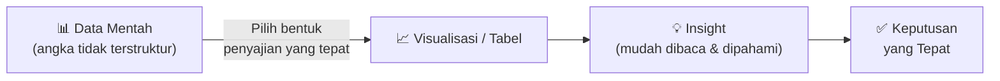

Terdapat **10 bentuk penyajian data** utama yang dibahas dalam sesi ini:

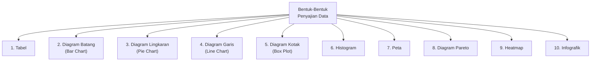

---

## 2. Tabel

**Tabel** adalah bentuk penyajian data paling dasar — data disusun dalam baris dan kolom sehingga mudah dibaca, dibandingkan, dan direferensikan. Tabel cocok untuk menyajikan **data numerik maupun kategorik** secara rinci.

Terdapat tiga jenis tabel utama:

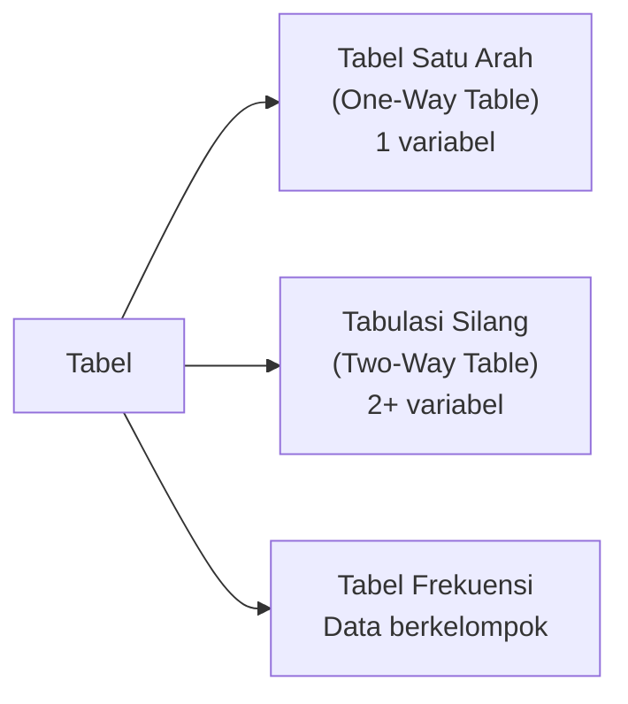

---

### 2.1 Tabel Satu Arah (One-Way Table)

Tabel satu arah merangkum **satu variabel** saja — biasanya frekuensi atau jumlah per kategori.

**Contoh:** Jumlah responden berdasarkan kategori umur:

| Kategori Umur | Jumlah Responden |
|---|---|
| < 20 tahun | 10 |
| 21 – 30 tahun | 15 |
| 31 – 40 tahun | 25 |
| > 40 tahun | 10 |
| **Total** | **60** |

**Cara membaca:** Paling banyak responden (25 orang, 41,7%) berusia 31–40 tahun. Kelompok usia termuda (< 20 tahun) dan tertua (> 40 tahun) sama-sama berjumlah 10 orang.

**Kapan digunakan:** Ingin melihat distribusi satu variabel kategorik secara cepat dan ringkas.

---

### 2.2 Tabulasi Silang (Two-Way Table)

Tabulasi silang (*cross-tabulation*) merangkum **dua variabel sekaligus** dalam satu tabel — baris mewakili satu variabel, kolom mewakili variabel lain. Ini sangat berguna untuk melihat **hubungan atau pola antar dua variabel kategorik**.

**Contoh:** Jumlah responden berdasarkan kategori umur DAN jenis kelamin:

| Kategori Umur | Laki-laki | Perempuan | Total |
|---|---|---|---|
| < 20 tahun | 5 | 5 | 10 |
| 21 – 30 tahun | 10 | 5 | 15 |
| 31 – 40 tahun | 12 | 13 | 25 |
| > 40 tahun | 2 | 8 | 10 |
| **Total** | **29** | **31** | **60** |

**Cara membaca:** Tabel ini menambahkan dimensi jenis kelamin ke tabel sebelumnya. Kita bisa langsung melihat bahwa:
- Pada kelompok usia **31–40 tahun**, perempuan (13) sedikit lebih banyak dari laki-laki (12)
- Pada kelompok usia **> 40 tahun**, perempuan (8) jauh lebih banyak dari laki-laki (2)
- Secara keseluruhan, jumlah perempuan (31) sedikit lebih banyak dari laki-laki (29)

**Kapan digunakan:** Menganalisis hubungan atau distribusi antar dua variabel kategorik sekaligus (misalnya: kelompok usia × preferensi produk, tingkat pendidikan × status pekerjaan).

---

### 2.3 Tabel Frekuensi

**Tabel frekuensi** merangkum data berkelompok (*grouped data*) dengan menghitung berapa banyak data yang jatuh dalam setiap **interval/kelas**. Tabel ini adalah langkah pertama dalam mengubah data mentah menjadi sesuatu yang bermakna.

**Proses membuat tabel frekuensi:**

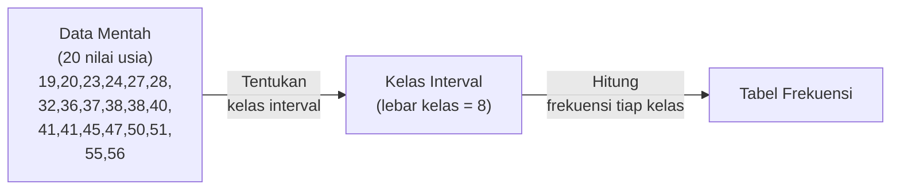

**Data mentah usia 20 responden:**

```
19  20  23  24
27  28  32  36
37  38  38  40
41  41  45  47
50  51  55  56
```

**Langkah menentukan kelas interval:**
1. Range = 56 − 19 = 37
2. Jumlah kelas ≈ √20 ≈ 5 kelas (aturan Sturges: 1 + 3,322 × log₁₀(20) ≈ 5,3 → ambil 5)
3. Lebar kelas = 37 / 5 ≈ 8 (dibulatkan ke atas)

**Hasil tabel frekuensi:**

| Kelas Umur | Frekuensi | Frekuensi Relatif |
|---|---|---|
| 19 – 26 | 4 | 20,0% |
| 27 – 34 | 3 | 15,0% |
| 35 – 42 | 7 | 35,0% |
| 43 – 50 | 3 | 15,0% |
| 51 – 58 | 3 | 15,0% |
| **Total** | **20** | **100%** |

**Cara membaca:** Kelompok usia 35–42 tahun adalah yang terbanyak (7 orang, 35%). Kelompok usia lainnya relatif merata (3–4 orang masing-masing).

> **Tips penting:** Kelas interval tidak boleh tumpang tindih, harus mencakup seluruh data, dan sebaiknya memiliki lebar yang sama agar perbandingan visual menjadi adil.

---

## 3. Grafik Garis (Line Chart)

**Grafik garis** menghubungkan titik-titik data dengan garis berkesinambungan. Ini adalah pilihan terbaik untuk menampilkan **perubahan data seiring waktu** (*time series*).

**Contoh dari slide:** Hasil Produksi Padi Indonesia Tahun 2016–2020

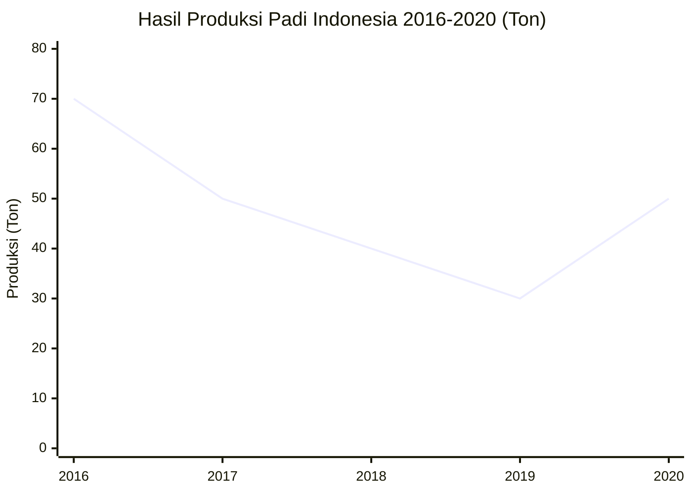

**Cara membaca:** Produksi padi mengalami penurunan terus-menerus dari 2016 (70 ton) hingga 2019 (30 ton — titik terendah), kemudian kembali naik pada 2020 (50 ton).

**Kapan menggunakan Line Chart:**

| Kondisi | Cocok? |
|---|---|
| Data berurutan waktu (harian, bulanan, tahunan) | ✅ Ya |
| Ingin melihat tren naik/turun | ✅ Ya |
| Membandingkan beberapa kelompok sepanjang waktu | ✅ Ya (multi-line) |
| Data kategorik tanpa urutan waktu | ❌ Tidak |
| Ingin menampilkan proporsi bagian | ❌ Tidak |

**Komponen penting Line Chart:**
- **Sumbu X (horizontal):** biasanya waktu (tahun, bulan, hari)
- **Sumbu Y (vertikal):** nilai yang diukur
- **Titik data:** nilai aktual di setiap periode
- **Garis penghubung:** menunjukkan kecenderungan/tren

> **Perhatian:** Line chart menyiratkan bahwa ada kesinambungan antar titik. Jangan gunakan untuk data kategorik yang tidak memiliki urutan logis (contoh: laki-laki vs perempuan bukanlah "urutan waktu").

---

## 4. Histogram dan Diagram Batang (Bar Chart)

Keduanya menggunakan batang vertikal, namun memiliki perbedaan mendasar:

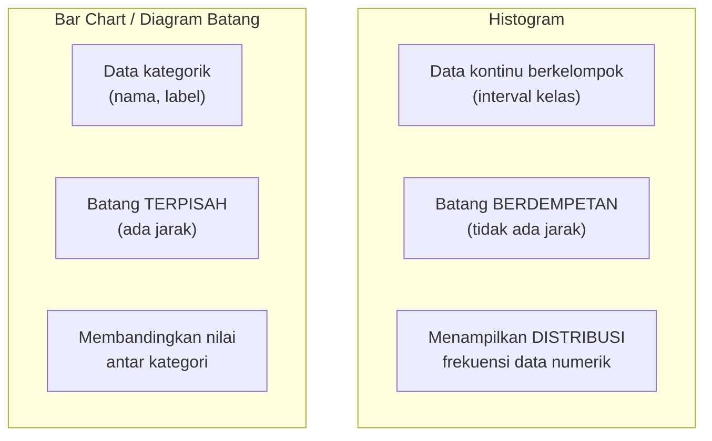

### Diagram Batang (Bar Chart)

**Contoh dari slide:** Data Pegawai PT Mantap Jiwa 2019 berdasarkan tingkat pendidikan dan jenis kelamin:

| Tingkat Pendidikan | Laki-laki | Perempuan |
|---|---|---|
| SD | 20 | 10 |
| SMP | 47 | 22 |
| SMA | 35 | 19 |
| D3 | 15 | 6 |
| S1 | 25 | 8 |
| S2 | 14 | 5 |

**Cara membaca:** Pegawai dengan latar belakang SMP paling banyak (47 laki-laki, 22 perempuan). Di semua tingkat pendidikan, jumlah laki-laki lebih banyak dari perempuan. Ini disebut **grouped bar chart** (diagram batang berkelompok) karena ada dua kategori (laki-laki & perempuan) di setiap kelompok.

### Jenis-Jenis Bar Chart

| Jenis | Deskripsi | Kapan Digunakan |
|---|---|---|
| **Simple bar chart** | Satu kategori per kelompok | Perbandingan sederhana |
| **Grouped bar chart** | Beberapa sub-kategori per kelompok | Perbandingan antar kelompok dengan sub-kategori |
| **Stacked bar chart** | Sub-kategori ditumpuk dalam satu batang | Komposisi total + perbandingan |
| **Horizontal bar chart** | Batang mendatar | Nama kategori panjang, banyak kategori |

**Kapan menggunakan Bar Chart vs Histogram:**

| Pertanyaan | Pilihan |
|---|---|
| "Seberapa besar perbedaan kategori A vs B?" | **Bar Chart** |
| "Bagaimana distribusi data numerik berkelompok?" | **Histogram** |
| "Berapa frekuensi mahasiswa per rentang nilai?" | **Histogram** |
| "Berapa penjualan per produk bulan ini?" | **Bar Chart** |

---

## 5. Diagram Lingkaran (Pie Chart)

**Pie chart** menampilkan **proporsi** setiap bagian terhadap keseluruhan. Setiap "irisan" mewakili persentase dari total 100%.

**Contoh dari slide:** Distribusi diagnosis pasien di suatu rumah sakit:

| Diagnosis | Persentase | Sudut (°) |
|---|---|---|
| Gagal Jantung | 37% | 133,2° |
| Stroke Iskemik | 26% | 93,6° |
| Stroke Hemoragik | 19% | 68,4° |
| Fraktur Post-Operasi | 18% | 64,8° |
| **Total** | **100%** | **360°** |

**Cara membaca:** Gagal jantung adalah diagnosis terbanyak (37%), hampir dua kali lipat fraktur post-operasi (18%). Dua jenis stroke bersama-sama mencapai 45% dari total pasien.

**Kapan menggunakan Pie Chart:**

| Kondisi | Cocok? |
|---|---|
| Ingin menampilkan proporsi bagian dari keseluruhan | ✅ Ya |
| Jumlah kategori sedikit (2–5) | ✅ Ya |
| Perbedaan antar bagian cukup besar | ✅ Ya |
| Jumlah kategori banyak (> 6) | ❌ Tidak (sulit dibaca) |
| Ingin membandingkan nilai absolut | ❌ Tidak |
| Ingin melihat tren waktu | ❌ Tidak |

> **Aturan praktis:** Jika semua irisan tampak hampir sama ukurannya, **jangan gunakan pie chart** — gunakan bar chart sebagai gantinya karena mata manusia lebih baik membandingkan panjang batang daripada sudut irisan.

**Cara menghitung sudut irisan:**
```
Sudut = (Persentase / 100) × 360°

Contoh Gagal Jantung: (37 / 100) × 360° = 133,2°
```

---

## 6. Ogive (Kurva Frekuensi Kumulatif)

**Ogive** adalah grafik garis yang menampilkan **frekuensi kumulatif** — jumlah data yang bernilai kurang dari atau sama dengan batas atas setiap kelas interval. Berbeda dengan histogram yang menampilkan frekuensi tiap kelas, ogive menampilkan akumulasi progresif.

**Contoh dari slide:** Ogive data usia responden (lanjutan dari tabel frekuensi sebelumnya):

**Langkah membuat ogive dari tabel frekuensi:**

| Kelas Umur | Frekuensi | Frekuensi Kumulatif | Batas Atas Kelas |
|---|---|---|---|
| 19 – 26 | 4 | 4 | 26,5 |
| 27 – 34 | 3 | 7 | 34,5 |
| 35 – 42 | 7 | 14 | 42,5 |
| 43 – 50 | 3 | 17 | 50,5 |
| 51 – 58 | 3 | 20 | 58,5 |

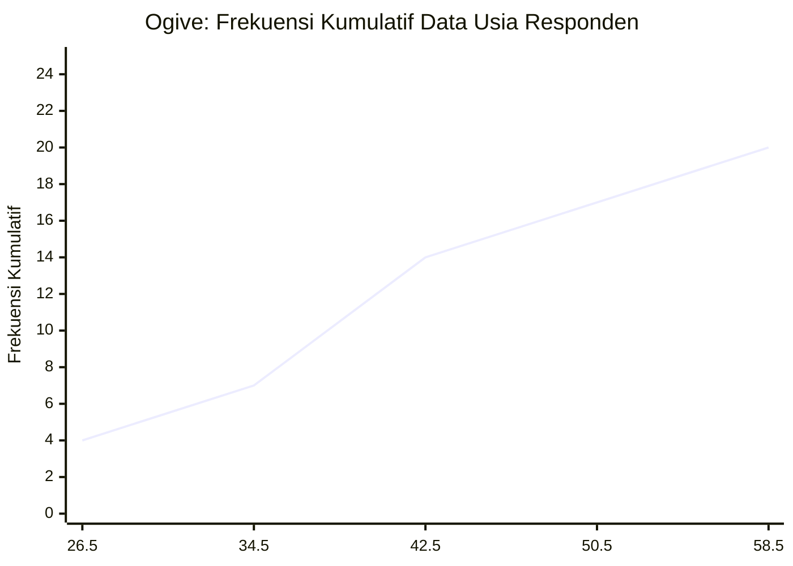

**Cara membaca ogive:**
- Titik (26,5 ; 4) → 4 responden berusia ≤ 26,5 tahun
- Titik (42,5 ; 14) → 14 responden berusia ≤ 42,5 tahun (70% dari total)
- Titik (58,5 ; 20) → seluruh 20 responden berusia ≤ 58,5 tahun (100%)

**Kegunaan ogive:**
- Menentukan **persentil** — misalnya, berapa usia responden pada persentil ke-50 (median)?
- Menjawab pertanyaan seperti: "Berapa persen responden yang berusia di bawah 40 tahun?"

---

## 7. Scatter Plot (Plot Pencaran)

**Scatter plot** menampilkan hubungan antara **dua variabel numerik** — setiap titik mewakili satu observasi dengan koordinat (x, y).

**Contoh dari slide:** Hubungan antara tenaga mesin (*horsepower*) dan harga mobil (*price*):

- **Sumbu X:** horsepower (tenaga mesin, dalam HP)
- **Sumbu Y:** price (harga mobil, dalam satuan tertentu)
- **Setiap titik** = satu model mobil

**Cara membaca scatter plot:**

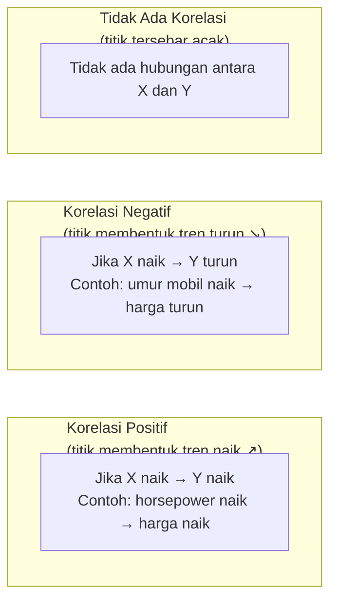

**Interpretasi dari scatter plot horsepower vs price:** Terdapat **korelasi positif** yang jelas — semakin besar tenaga mesin, semakin tinggi harga mobil. Namun ada beberapa titik yang menyimpang jauh (*outlier*) — mobil dengan HP tinggi tetapi harga relatif rendah, atau sebaliknya.

**Kapan menggunakan Scatter Plot:**

| Kondisi | Cocok? |
|---|---|
| Ingin melihat hubungan antara dua variabel numerik | ✅ Ya |
| Ingin mengidentifikasi outlier | ✅ Ya |
| Ingin memperkirakan pola/tren korelasi | ✅ Ya |
| Salah satu variabel adalah kategorik | ❌ Tidak |
| Data terlalu sedikit (< 10 titik) | ❌ Kurang ideal |

**Ukuran kekuatan korelasi:** Koefisien korelasi Pearson (r) berkisar −1 hingga +1:

| Nilai r | Interpretasi |
|---|---|
| r = +1 | Korelasi positif sempurna |
| 0,7 ≤ r < 1 | Korelasi positif kuat |
| 0,3 ≤ r < 0,7 | Korelasi positif sedang |
| r ≈ 0 | Tidak ada korelasi |
| −0,7 < r ≤ −0,3 | Korelasi negatif sedang |
| r = −1 | Korelasi negatif sempurna |

---

## 8. Heatmap

**Heatmap** menggunakan **warna** sebagai dimensi ketiga untuk merepresentasikan nilai dalam matriks dua dimensi. Semakin tinggi nilai, semakin "panas" (gelap/merah) warnanya; semakin rendah nilai, semakin "dingin" (terang/biru) warnanya.

**Keunggulan heatmap:** Mampu menampilkan **pola dalam data berdimensi tinggi** yang tidak mungkin divisualisasikan dengan grafik biasa.

**Contoh penggunaan heatmap:**

| Bidang | Contoh Penggunaan |
|---|---|
| Bioinformatik | Ekspresi gen (ratusan gen × beberapa sampel) — terlihat dari contoh di slide |
| Web Analytics | Klik pengguna di halaman web (*click heatmap*) |
| Keuangan | Korelasi antar aset investasi (saham, obligasi, dll.) |
| Cuaca | Suhu per wilayah per bulan dalam satu tahun |
| Machine Learning | Confusion matrix (prediksi vs aktual) |

**Cara membaca heatmap:**
1. **Tentukan palet warna** — pastikan arah warna (gelap = tinggi atau rendah?)
2. **Cari kluster** — area dengan warna serupa menunjukkan pola/grup
3. **Identifikasi outlier** — sel dengan warna sangat berbeda dari sekitarnya
4. **Baca legenda** — nilai numerik di balik setiap warna

> **Dari contoh slide:** Heatmap ekspresi gen menampilkan ekspresi ratusan gen (baris) di berbagai jenis sel (kolom). Warna kuning/cerah = ekspresi tinggi, ungu/gelap = ekspresi rendah. Terlihat jelas kluster gen yang over-expressed di jenis sel tertentu.

---

## 9. Boxplot (Diagram Kotak)

**Boxplot** (atau *box-and-whisker plot*) adalah visualisasi ringkasan statistik yang padat — menampilkan **5 ukuran statistik sekaligus** dalam satu diagram.

### Anatomi Boxplot

```
          ┌─── Whisker bawah           Whisker atas ───┐
          │   ┌───────────┬───────────┐                │
Outlier ──○   │           │     ─ ─ ─│─ ─  ← Median   │
              │    Q1     │    Q3     │                │
          │   └───────────┴───────────┘                │
          │                                            │
         Min                                          Max
```

**5 komponen utama boxplot:**

| Komponen | Definisi | Makna |
|---|---|---|
| **Minimum** | Nilai terkecil (tanpa outlier) | Batas bawah data "normal" |
| **Q1 (Kuartil 1)** | Persentil ke-25 | 25% data di bawah nilai ini |
| **Median (Q2)** | Persentil ke-50 | Nilai tengah data |
| **Q3 (Kuartil 3)** | Persentil ke-75 | 75% data di bawah nilai ini |
| **Maksimum** | Nilai terbesar (tanpa outlier) | Batas atas data "normal" |

**IQR (Interquartile Range):**
```
IQR = Q3 − Q1

Batas bawah normal = Q1 − 1,5 × IQR
Batas atas normal  = Q3 + 1,5 × IQR

Data di luar batas ini → ditandai sebagai OUTLIER (titik ○)
```

**Keunggulan boxplot dibanding histogram:**

| Aspek | Histogram | Boxplot |
|---|---|---|
| Distribusi detail | ✅ Terlihat jelas | ❌ Hanya ringkasan |
| Perbandingan banyak kelompok | ❌ Berat | ✅ Efisien |
| Outlier | ❌ Tidak eksplisit | ✅ Ditandai jelas |
| Skewness (kemiringan) | ✅ Terlihat | ✅ Terlihat (posisi median) |

**Cara membaca boxplot:** Jika median berada di tengah kotak → distribusi **simetris**. Jika median mendekati Q1 → distribusi **miring kanan** (*right-skewed*). Jika median mendekati Q3 → distribusi **miring kiri** (*left-skewed*).

**Dari contoh slide:** Boxplot membandingkan nilai *actual* (kuning) vs *predicted* (biru) di tiga eksperimen. Terlihat bahwa prediksi model (biru) secara konsisten lebih tinggi dari nilai aktual (kuning) — gap ini mengindikasikan bias prediksi ke atas.

---

## 10. Peta Tematik

**Peta tematik** adalah peta yang dirancang untuk menampilkan **distribusi suatu variabel/fenomena secara geografis**. Berbeda dengan peta topografi (yang fokus pada fitur fisik), peta tematik menampilkan data spasial yang terkait tema tertentu.

**Contoh dari slide:** Peta distribusi nilai di wilayah-wilayah Kabupaten (dengan gradasi warna dari kuning muda → oranye → coklat tua untuk menunjukkan tingkatan nilai).

### Unsur-Unsur Peta Tematik

Setiap peta tematik yang baik harus memiliki 8 unsur berikut:

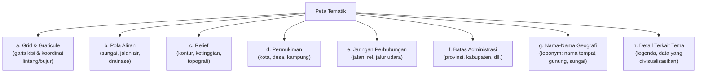

### Jenis-Jenis Peta Tematik

| Jenis | Cara Representasi | Contoh Penggunaan |
|---|---|---|
| **Choropleth** | Gradasi warna per wilayah | Kepadatan penduduk per provinsi |
| **Dot map** | Titik-titik mewakili jumlah | Distribusi kasus penyakit |
| **Proportional symbol** | Simbol berbeda ukuran | Besarnya GDP kota |
| **Flow map** | Panah menunjukkan arah & volume | Migrasi penduduk, arus perdagangan |
| **Cartogram** | Wilayah diubah ukurannya sesuai data | Populasi sebagai luas wilayah |

### Simbol Kartografi

Dalam peta tematik, terdapat tiga jenis simbol dasar:

| Tipe Simbol | Bentuk | Sifat | Digunakan untuk |
|---|---|---|---|
| **Point** | Titik, lingkaran, ikon | Associative, selective, ordered, quantitative | Lokasi titik (kota, fasilitas) |
| **Line** | Garis, panah | Associative, selective, ordered | Jalan, sungai, batas |
| **Area** | Poligon berwarna/bertekstur | Associative, selective | Wilayah administrasi |

**Variabel visual** yang bisa digunakan:
- **Size** (ukuran) — mewakili kuantitas
- **Value** (kecerahan) — mewakili intensitas/tingkat
- **Texture** (tekstur) — mewakili kategori
- **Colour** (warna) — mewakili kategori nominal
- **Orientation** (orientasi) — mewakili arah
- **Shape** (bentuk) — mewakili jenis/tipe

---

## 11. Diagram Pareto

**Diagram Pareto** adalah kombinasi bar chart (frekuensi per kategori, diurutkan dari tertinggi) dan line chart (frekuensi kumulatif). Namanya berasal dari **Hukum Pareto (80/20 Rule)**: sekitar 80% masalah disebabkan oleh 20% penyebab.

**Contoh penggunaan nyata:**

Misalkan sebuah toko online mencatat 100 keluhan pelanggan:

| Jenis Keluhan | Frekuensi | Kumulatif | % Kumulatif |
|---|---|---|---|
| Pengiriman lambat | 42 | 42 | 42% |
| Produk tidak sesuai | 28 | 70 | 70% |
| Packing rusak | 18 | 88 | 88% |
| CS tidak responsif | 8 | 96 | 96% |
| Lainnya | 4 | 100 | 100% |

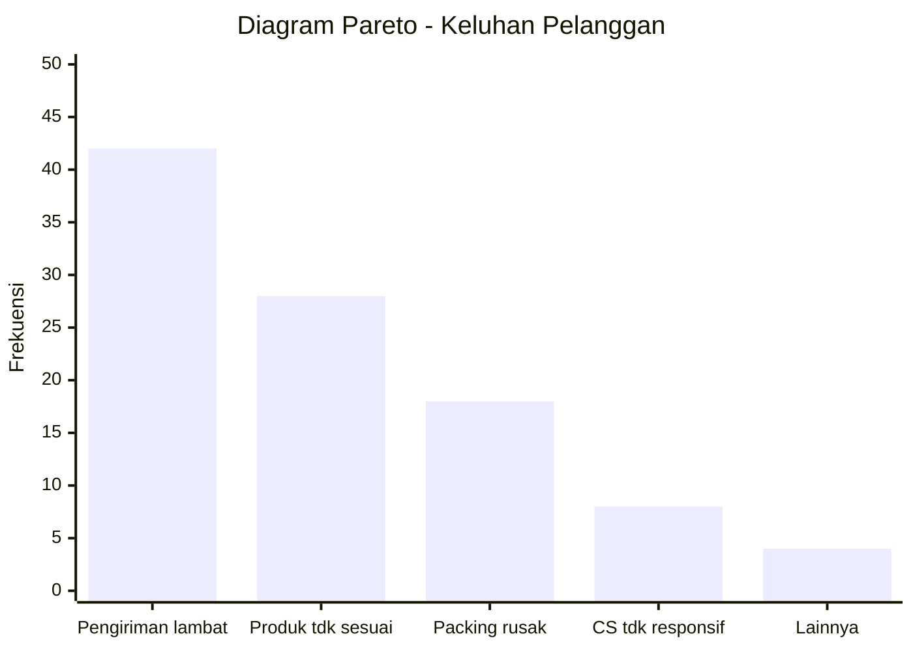

**Cara membaca:** Dengan menyelesaikan **dua masalah teratas** (pengiriman lambat + produk tidak sesuai), sudah menangani **70%** dari seluruh keluhan. Ini jauh lebih efisien daripada mencoba menyelesaikan semua masalah sekaligus.

**Kapan menggunakan Diagram Pareto:**
- Quality control / analisis keluhan / cacat produksi
- Prioritasi masalah yang perlu diselesaikan lebih dulu
- Analisis biaya: penyebab mana yang menyumbang biaya terbesar?

---

## 12. Infografik

**Infografik** adalah kombinasi **teks, visual, dan data** yang dirancang untuk mengkomunikasikan informasi secara cepat, menarik, dan mudah dicerna. Infografik bukan sekadar grafik — ia adalah *cerita visual*.

**Komponen khas infografik:**

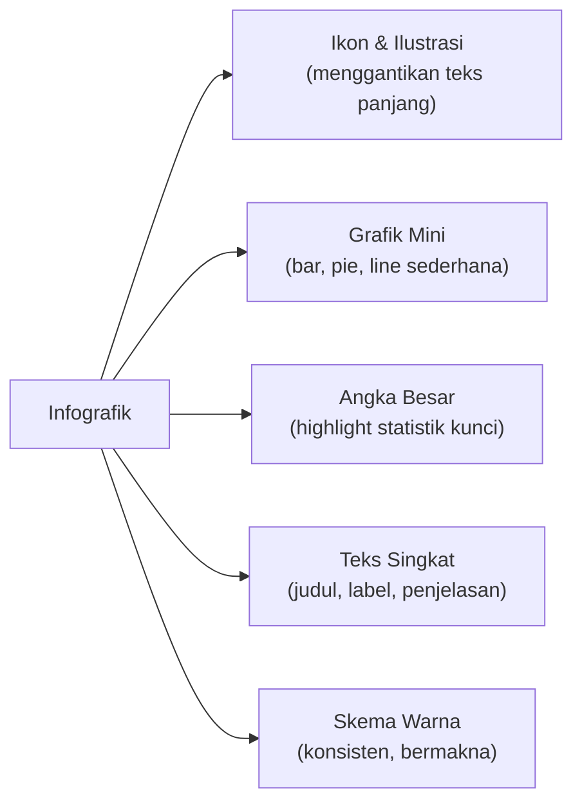

**Prinsip desain infografik yang baik:**

| Prinsip | Penjelasan |
|---|---|
| **Satu pesan utama** | Setiap infografik harus menyampaikan satu ide pokok yang jelas |
| **Hierarki visual** | Elemen terpenting paling menonjol (ukuran/warna) |
| **Data akurat** | Visual tidak menipu (sumbu mulai dari 0, proporsi tepat) |
| **Kesederhanaan** | Buang elemen yang tidak menambah informasi (*chart junk*) |
| **Konsistensi** | Font, warna, dan gaya visual seragam |

**Kapan menggunakan infografik:**
- Laporan tahunan perusahaan untuk publik
- Sosialisasi kebijakan pemerintah kepada masyarakat
- Presentasi data penelitian ke audiens non-teknis
- Konten media sosial berbasis data

> **Perhatian:** Infografik yang buruk dapat **menyesatkan** — misalnya, pie chart dengan total > 100%, atau bar chart dengan sumbu Y tidak dimulai dari 0 sehingga perbedaan tampak lebih dramatis dari aslinya. Selalu verifikasi bahwa visualisasi merepresentasikan data secara jujur.

---

## 13. Panduan Memilih Visualisasi

Pilihan bentuk visualisasi yang tepat bergantung pada **tipe data** dan **pertanyaan yang ingin dijawab**.

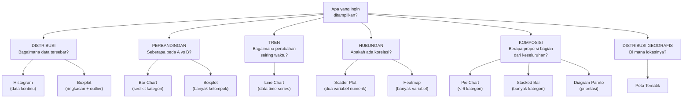

**Ringkasan tabel pemilihan cepat:**

| Tujuan | Data | Visualisasi Terbaik |
|---|---|---|
| Melihat distribusi frekuensi data numerik | Numerik kontinu | **Histogram** |
| Membandingkan beberapa kelompok | Kategorik + Numerik | **Bar Chart** atau **Boxplot** |
| Menampilkan tren waktu | Time series | **Line Chart** |
| Menampilkan proporsi dari total | Kategorik (< 6) | **Pie Chart** |
| Melihat korelasi dua variabel | Dua numerik | **Scatter Plot** |
| Melihat pola dalam matriks besar | Matriks | **Heatmap** |
| Distribusi spasial/geografis | Geografis | **Peta Tematik** |
| Prioritasi masalah (80/20) | Frekuensi terurut | **Diagram Pareto** |
| Data rinci dengan akurasi tinggi | Semua tipe | **Tabel** |
| Komunikasi ke publik umum | Semua tipe | **Infografik** |

---

## 14. Ringkasan

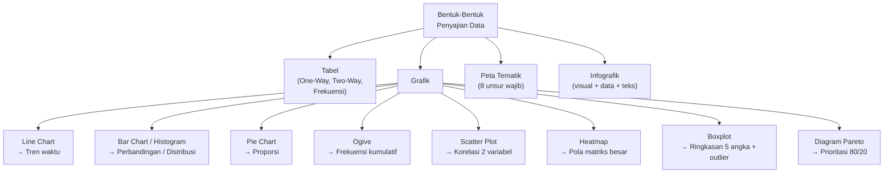

**Prinsip emas penyajian data:**

1. **Pilih visualisasi sesuai pertanyaan** — bukan sesuai selera estetika
2. **Jujur dalam representasi** — skala, proporsi, dan label harus akurat
3. **Sederhana tapi informatif** — buang elemen dekoratif yang tidak menambah makna
4. **Beri konteks** — judul, label sumbu, legenda, dan sumber data wajib ada
5. **Kenali audiens** — visualisasi untuk analis teknis berbeda dengan untuk publik umum

---

*Selamat Belajar...*
