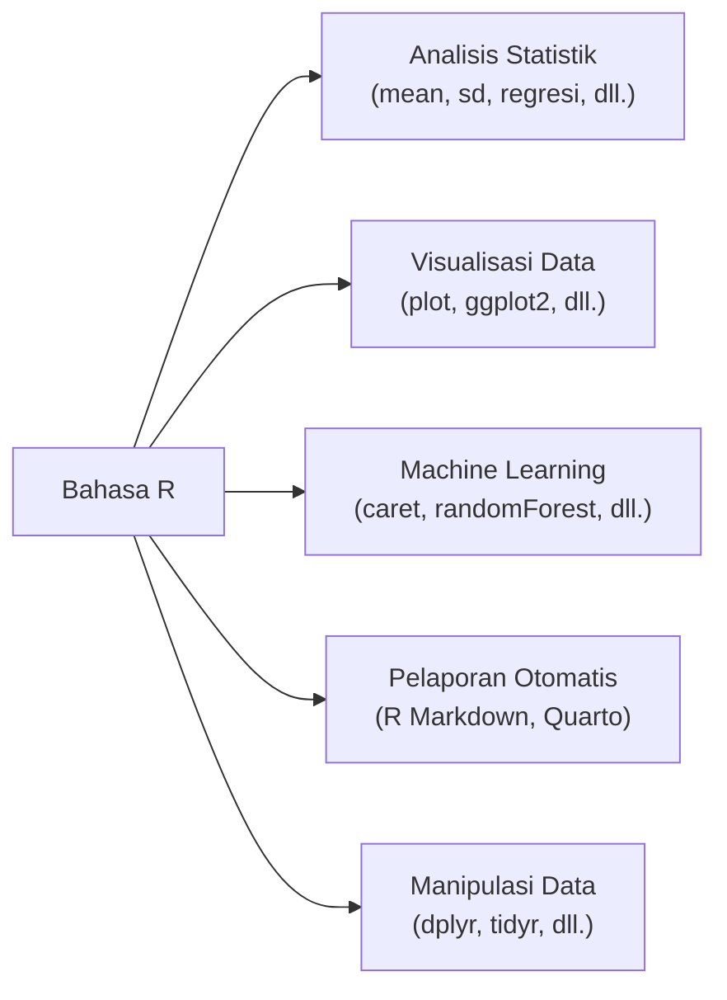
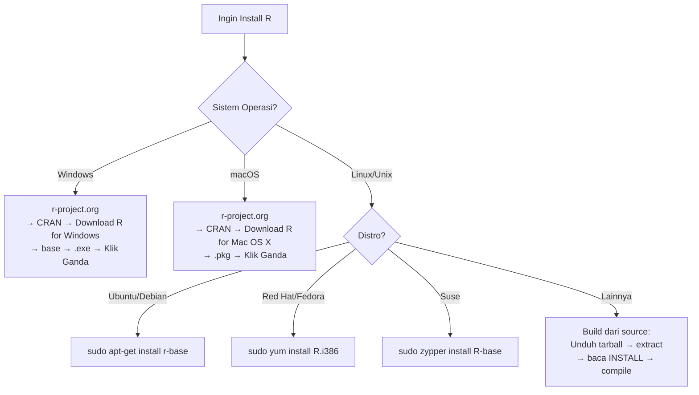
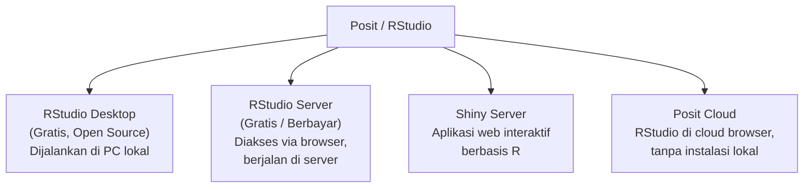
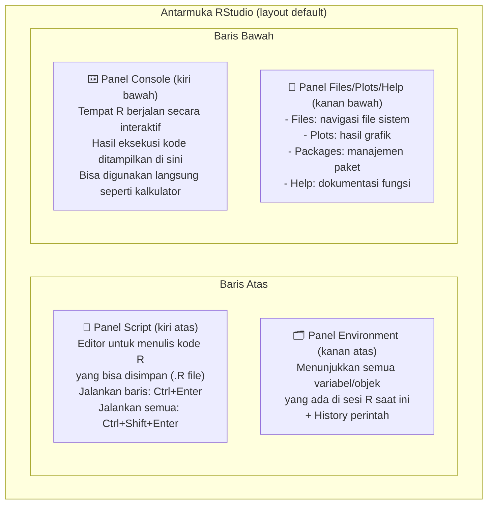
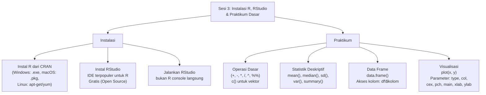
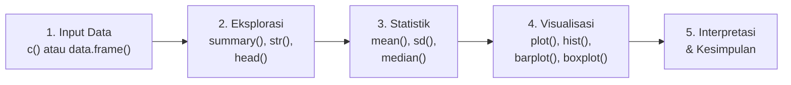

# Sesi 3 — Instalasi R, RStudio, dan Praktikum Dasar

**MSIM4310 Analisis dan Visualisasi Data**  
Program Studi Sistem Informasi — Universitas Terbuka

> Catatan: dokumen ini merupakan ekstraksi sekaligus elaborasi dari dua materi Inisiasi 3 — **(AB03)** Instalasi R dan RStudio, serta **(AB03b)** Praktikum 1: Operasi Dasar dan Visualisasi di R. Setiap langkah disertai penjelasan konteks, contoh kode yang dilengkapi output, dan tips praktis.

---

## Daftar Isi

1. [Apa itu R dan Mengapa Menggunakannya?](#1-apa-itu-r-dan-mengapa-menggunakannya)
2. [Instalasi R](#2-instalasi-r)
   - [Windows](#21-windows)
   - [macOS](#22-macos)
   - [Linux / Unix](#23-linux--unix)
3. [Instalasi RStudio](#3-instalasi-rstudio)
4. [Menjalankan RStudio](#4-menjalankan-rstudio)
5. [Mengenal Antarmuka RStudio](#5-mengenal-antarmuka-rstudio)
6. [Praktikum 1 — Operasi Dasar di R](#6-praktikum-1--operasi-dasar-di-r)
7. [Praktikum 2 — Analisis Statistik Dasar](#7-praktikum-2--analisis-statistik-dasar)
8. [Praktikum 3 — Menggambar Grafik dengan `plot()`](#8-praktikum-3--menggambar-grafik-dengan-plot)
9. [Ringkasan Fungsi-Fungsi Penting](#9-ringkasan-fungsi-fungsi-penting)
10. [Ringkasan](#10-ringkasan)

---

## 1. Apa itu R dan Mengapa Menggunakannya?

**R** adalah bahasa pemrograman dan lingkungan komputasi statistik yang dirancang khusus untuk **analisis data, statistik, dan visualisasi**. R dikembangkan oleh Ross Ihaka dan Robert Gentleman di University of Auckland, Selandia Baru, dan kini dikelola oleh *R Development Core Team*.



**Mengapa R?**

| Aspek | R | Excel | Python |
|---|---|---|---|
| **Statistik** | ✅ Kelas dunia | ⚠️ Terbatas | ✅ Kuat (scipy, statsmodels) |
| **Visualisasi** | ✅ ggplot2 luar biasa | ⚠️ Standar saja | ✅ matplotlib, seaborn |
| **Kemudahan** | ⚠️ Perlu belajar | ✅ Mudah dipahami | ⚠️ Perlu belajar |
| **Gratis & Open Source** | ✅ Ya | ❌ Berbayar | ✅ Ya |
| **Ekosistem Data Science** | ✅ CRAN (20.000+ paket) | ❌ Tidak | ✅ PyPI |
| **Reproduksibilitas** | ✅ Script R Markdown | ❌ Susah | ✅ Jupyter Notebook |

> **Kesimpulan:** R adalah pilihan terbaik untuk analisis statistik mendalam dan visualisasi data ilmiah. Untuk mata kuliah MSIM4310, R adalah alat utama yang akan digunakan.

---

## 2. Instalasi R

R didistribusikan melalui **CRAN** (*Comprehensive R Archive Network*) — jaringan cermin (*mirror*) server yang menyimpan installer R untuk semua platform.



---

### 2.1 Windows

1. Buka `http://www.r-project.org/` di browser.
2. Klik **"CRAN"** — akan muncul daftar situs mirror yang dikelompokkan per negara.
3. Pilih situs terdekat, atau gunakan **"0-Cloud"** (`https://cloud.r-project.org/`) yang otomatis memilih mirror terbaik.
4. Klik **"Download R for Windows"** di bagian *Download and Install R*.
5. Klik **"base"**.
6. Klik tautan untuk mengunduh versi terbaru (file `.exe`).
7. Setelah unduh selesai, **klik ganda** file `.exe` dan ikuti wizard instalasi.

> **Tips Windows:** Pilih "Customize startup" saat instalasi jika ingin mengubah direktori instalasi. Untuk sebagian besar pengguna, pilihan *default* sudah cukup. Setelah instalasi, R bisa diakses melalui Start Menu, tetapi lebih baik langsung menggunakan **RStudio** (lihat bagian selanjutnya).

---

### 2.2 macOS

1. Buka `http://www.r-project.org/` di browser.
2. Klik **"CRAN"** dan pilih situs mirror terdekat atau gunakan "0-Cloud".
3. Klik **"Download R for (Mac) OS X"**.
4. Klik file `.pkg` untuk versi terbaru R (tercantum di bawah *"Latest release:"*).
5. Setelah unduh selesai, **klik ganda** file `.pkg` dan ikuti petunjuk instalasi.

> **Tips macOS:** Pastikan sistem operasi macOS kamu sudah mendukung versi R yang diunduh. Halaman CRAN biasanya mencantumkan versi macOS minimum yang didukung. Untuk Mac dengan chip **Apple Silicon (M1/M2/M3)**, pilih installer khusus ARM yang terpisah dari installer Intel.

---

### 2.3 Linux / Unix

Sebagian besar distribusi Linux menyediakan paket R langsung di repositori resminya.

**Tabel paket R per distribusi Linux:**

| Distribusi | Nama Paket | Perintah Instalasi |
|---|---|---|
| Ubuntu atau Debian | `r-base` | `sudo apt-get install r-base` |
| Red Hat atau Fedora | `R.i386` | `sudo yum install R.i386` |
| Suse | `R-base` | `sudo zypper install R-base` |

**Rekomendasi Ubuntu/Debian — instalasi lengkap dengan dokumentasi:**

```bash
# Paket utama R
sudo apt-get install r-base

# Dokumentasi HTML (opsional tapi sangat berguna)
sudo apt-get install r-base-html r-doc-html
```

**Build dari source (untuk kasus khusus):**

```bash
# 1. Unduh tarball dari CRAN
wget https://cloud.r-project.org/src/base/R-latest.tar.gz

# 2. Ekstrak
tar -xvzf R-latest.tar.gz

# 3. Masuk ke direktori hasil ekstrak
cd R-x.x.x/

# 4. Baca file INSTALL, lalu compile
./configure
make
sudo make install
```

> **Catatan:** Disarankan mengunduh R langsung dari CRAN, bukan dari repositori Linux pihak ketiga, karena CRAN selalu memiliki versi paling baru. Gunakan hak akses `sudo` atau `root` untuk instalasi di level sistem.

---

## 3. Instalasi RStudio

**RStudio** adalah *Integrated Development Environment* (IDE) yang paling populer untuk R. Jika R adalah mesin mobilnya, maka RStudio adalah kabinnya — memberikan antarmuka yang jauh lebih nyaman dan produktif dibanding hanya menggunakan konsol R biasa.

**Produk-produk RStudio (sekarang bernama Posit):**



**Cara menginstal RStudio Desktop:**

1. Buka `https://www.rstudio.com/products/rstudio/download/`
2. Pilih **"RStudio Desktop — Open Source License"** (gratis)
3. Klik tombol unduh sesuai sistem operasi (Windows `.exe`, macOS `.dmg`, Linux `.deb`/`.rpm`)
4. Jalankan installer dan ikuti petunjuk

> **Penting:** R harus sudah terinstal lebih dulu sebelum menginstal RStudio. RStudio bukan pengganti R — ia adalah antarmuka grafis yang menggunakan R di belakangnya. Tanpa R, RStudio tidak bisa berjalan.

---

## 4. Menjalankan RStudio

Kesalahan umum pengguna R pemula adalah membuka **R** (konsol bawaan) padahal yang dimaksud adalah **RStudio**. Selalu pastikan membuka RStudio, bukan R.

| Sistem Operasi | Cara Membuka RStudio |
|---|---|
| **Windows** | Klik Start Menu → Ketik `RStudio` di kotak pencarian → Tekan Enter |
| **macOS** | Buka Launchpad → Cari `RStudio`, atau tekan `Cmd+Space` → Ketik `RStudio` (Spotlight) |
| **Ubuntu / Linux** | Tekan `Alt+F1` → Ketik `RStudio`, atau buka terminal dan ketik `rstudio` |

> **Tips produktivitas:** Setelah pertama kali membuka RStudio, sematkan (*pin*) ikon RStudio ke taskbar (Windows) atau Dock (macOS) agar mudah diakses lain kali.

---

## 5. Mengenal Antarmuka RStudio

RStudio memiliki empat panel utama yang dapat dikonfigurasi tata letaknya:



**Shortcut keyboard penting RStudio:**

| Shortcut | Fungsi |
|---|---|
| `Ctrl+Enter` (Win) / `Cmd+Enter` (Mac) | Jalankan baris kode yang dipilih |
| `Ctrl+Shift+Enter` | Jalankan seluruh script |
| `Ctrl+L` | Bersihkan konsol |
| `Alt+-` | Ketik operator assignment `<-` |
| `Ctrl+Shift+M` | Ketik operator pipe `%>%` |
| `Tab` | Auto-complete nama fungsi/variabel |
| `?nama_fungsi` | Tampilkan dokumentasi fungsi |
| `??kata_kunci` | Cari fungsi di seluruh paket |

---

## 6. Praktikum 1 — Operasi Dasar di R

Saat pertama kali menggunakan R, anggap saja sebagai **kalkulator canggih** — masukkan ekspresi, R mengevaluasi dan menampilkan hasilnya.

### 6.1 Operasi Aritmatika

```r
# Penjumlahan
1 + 2
#> [1] 3

# Pengurangan
10 - 4
#> [1] 6

# Perkalian
3 * 5
#> [1] 15

# Pembagian
15 / 4
#> [1] 3.75

# Pangkat
2^8
#> [1] 256

# Modulo (sisa bagi)
17 %% 5
#> [1] 2
```

> **Kenapa ada `[1]` di depan hasil?**  
> Di R, semua hasil adalah **vektor** — bahkan nilai tunggal sekalipun. Tanda `[1]` menunjukkan bahwa nilai berikutnya adalah elemen ke-1 dari vektor. Jika hasilnya panjang (misalnya 30 angka), baris kedua akan dimulai dengan `[16]` yang berarti elemen ke-16, dan seterusnya.

### 6.2 Fungsi Bawaan R

```r
# Nilai maksimum
max(1, 4, 7)
#> [1] 7

# Nilai minimum
min(1, 4, 7)
#> [1] 1

# Nilai absolut
abs(-5)
#> [1] 5

# Akar kuadrat
sqrt(81)
#> [1] 9

# Pembulatan
round(3.14159, digits = 2)
#> [1] 3.14

# Logaritma natural
log(100)
#> [1] 4.60517

# Logaritma basis 10
log10(100)
#> [1] 2
```

### 6.3 Variabel dan Assignment

Di R, nilai disimpan ke variabel menggunakan operator `<-` (direkomendasikan) atau `=`:

```r
# Menyimpan nilai ke variabel
x <- 10
y <- 3

# Menggunakan variabel
x + y
#> [1] 13

x * y
#> [1] 30

# Nama variabel bersifat case-sensitive
hasil <- x / y
Hasil  # Error! R tidak mengenal "Hasil" (huruf H besar)
#> Error: object 'Hasil' not found
```

### 6.4 Vektor

**Vektor** adalah struktur data paling dasar di R — kumpulan elemen dengan tipe data yang sama, dibuat dengan fungsi `c()` (*concatenate*):

```r
# Membuat vektor numerik
nilai <- c(70, 80, 75, 90, 65, 85)

# Mengakses elemen
nilai[1]   # elemen pertama
#> [1] 70

nilai[3]   # elemen ketiga
#> [1] 75

nilai[2:4] # elemen ke-2 hingga ke-4
#> [1] 80 75 90

# Operasi pada seluruh vektor (vectorized)
nilai + 5
#> [1] 75 85 80 95 70 90

nilai * 2
#> [1] 140 160 150 180 130 170
```

---

## 7. Praktikum 2 — Analisis Statistik Dasar

### 7.1 Fungsi Statistik Deskriptif

```r
# Input data
data <- c(2, 3, 5, 6, 10, 13, 18, 22, 24, 25)

# Rata-rata (mean)
mean(data)
#> [1] 12.8

# Median
median(data)
#> [1] 11.5

# Standar deviasi (sampel, n-1)
sd(data)
#> [1] 8.905

# Variansi (sampel, n-1)
var(data)
#> [1] 79.29

# Nilai minimum dan maksimum
min(data)
#> [1] 2

max(data)
#> [1] 25

# Range (jangkauan)
range(data)
#> [1]  2 25

# Jumlah semua elemen
sum(data)
#> [1] 128

# Banyaknya elemen
length(data)
#> [1] 10

# Ringkasan statistik lengkap (5-number summary + mean)
summary(data)
#>    Min. 1st Qu.  Median    Mean 3rd Qu.    Max.
#>    2.00    5.75   11.50   12.80   21.00   25.00
```

> **Verifikasi manual `sd(data)` dari Contoh 3:**  
> data = {2, 3, 5, 6, 10, 13, 18, 22, 24, 25}, x̄ = 12,8  
> s² = [(2-12,8)² + (3-12,8)² + ... + (25-12,8)²] / (10-1)  
> s² = [116,64 + 96,04 + 60,84 + 46,24 + 7,84 + 0,04 + 27,04 + 84,64 + 125,44 + 148,84] / 9  
> s² = 713,6 / 9 = **79,29**  
> s = √79,29 = **8,905** ✓

### 7.2 Data Frame

**Data frame** adalah struktur data dua dimensi (seperti tabel spreadsheet) — kumpulan kolom yang masing-masing bisa memiliki tipe data berbeda. Ini adalah format paling umum untuk data analisis di R.

```r
# Membuat data frame
data_frame_1 <- data.frame(
  data_1 = c(1, 3, 4, 6, 8, 9),
  data_2 = c(7, 8, 8, 7, 13, 16),
  data_3 = c(11, 13, 13, 18, 19, 22),
  data_4 = c(12, 16, 18, 22, 29, 38)
)

# Tampilkan data frame
data_frame_1
#>   data_1 data_2 data_3 data_4
#> 1      1      7     11     12
#> 2      3      8     13     16
#> 3      4      8     13     18
#> 4      6      7     18     22
#> 5      8     13     19     29
#> 6      9     16     22     38

# Mengakses kolom dengan operator $
data_frame_1$data_1
#> [1] 1 3 4 6 8 9

# Hitung standar deviasi kolom data_1
sd(data_frame_1$data_1)
#> [1] 3.061
```

> **Verifikasi `sd(data_frame_1$data_1)`:**  
> data_1 = {1, 3, 4, 6, 8, 9}, x̄ = 31/6 = 5,167  
> s² = [(1-5,167)² + (3-5,167)² + (4-5,167)² + (6-5,167)² + (8-5,167)² + (9-5,167)²] / 5  
> s² = [17,36 + 4,69 + 1,36 + 0,69 + 8,03 + 14,69] / 5 = 46,83 / 5 = **9,367**  
> s = √9,367 = **3,061** ✓

**Operasi statistik pada seluruh data frame:**

```r
# Hitung mean untuk setiap kolom sekaligus
colMeans(data_frame_1)
#>   data_1   data_2   data_3   data_4
#>  5.16667  9.83333 16.00000 22.50000

# Hitung sd untuk setiap kolom
sapply(data_frame_1, sd)
#>    data_1    data_2    data_3    data_4
#>  3.060501  3.869060  4.242641  9.748677

# Ringkasan seluruh kolom
summary(data_frame_1)
```

---

## 8. Praktikum 3 — Menggambar Grafik dengan `plot()`

Fungsi `plot()` adalah fungsi visualisasi paling dasar di R. Ketik `?plot` di konsol RStudio untuk melihat dokumentasi lengkapnya.

### 8.1 Plot Titik Tunggal

```r
# Menggambar satu titik di koordinat (2, 5)
plot(2, 5)
```

**Hasil:** Grafik kosong dengan satu titik di koordinat (x=2, y=5). Sumbu X berkisar 1,5–2,5 dan sumbu Y berkisar 3–7 (R otomatis menyesuaikan range).

```mermaid
xychart-beta
    title "plot(2, 5) — Titik Tunggal"
    x-axis [1.5, 2.0, 2.5]
    y-axis "y" 3 --> 7
    line [5]
```

### 8.2 Plot Multi-Titik (Scatter Plot)

```r
# Menggambar 4 titik: (1,2), (4,5), (6,6), (7,8)
plot(c(1, 4, 6, 7), c(2, 5, 6, 8))
```

**Penjelasan:** Parameter pertama `c(1,4,6,7)` adalah nilai X (sumbu horizontal), parameter kedua `c(2,5,6,8)` adalah nilai Y (sumbu vertikal). Setiap pasang nilai membentuk satu titik.

| Titik ke- | x | y |
|---|---|---|
| 1 | 1 | 2 |
| 2 | 4 | 5 |
| 3 | 6 | 6 |
| 4 | 7 | 8 |

### 8.3 Plot Garis

```r
# type="l" berarti "line" — menghubungkan titik-titik dengan garis
plot(1:15, type = "l")
```

**Penjelasan:** `1:15` menghasilkan vektor {1, 2, 3, ..., 15}. Karena hanya satu vektor yang diberikan, R menggunakan indeks (1, 2, 3, ...) sebagai nilai X dan nilai vektor sebagai nilai Y. Parameter `type="l"` mengubah tampilan dari titik menjadi garis.

**Nilai parameter `type`:**

| `type` | Tampilan |
|---|---|
| `"p"` | Points (titik) — *default* |
| `"l"` | Lines (garis) |
| `"b"` | Both (titik + garis) |
| `"h"` | Histogram-like (garis vertikal dari sumbu X) |
| `"s"` | Stepped line (garis tangga) |
| `"n"` | No plot (hanya buat sumbu, tanpa data) |

### 8.4 Menambahkan Label

```r
# Tambahkan judul dan label sumbu
plot(1:15,
     main  = "Grafik 1",    # judul grafik
     xlab  = "Data 1",       # label sumbu X
     ylab  = "Data 2")       # label sumbu Y
```

**Parameter label penting:**

| Parameter | Fungsi | Contoh |
|---|---|---|
| `main` | Judul utama grafik | `main = "Distribusi Nilai"` |
| `xlab` | Label sumbu X | `xlab = "Tahun"` |
| `ylab` | Label sumbu Y | `ylab = "Produksi (ton)"` |
| `sub` | Sub-judul di bawah grafik | `sub = "Sumber: BPS 2023"` |

### 8.5 Kustomisasi Tampilan Grafik

R menyediakan tiga parameter utama untuk mengkustomisasi tampilan titik:

| Parameter | Fungsi | Nilai |
|---|---|---|
| `col` | Warna titik/garis | Nama warna: `"red"`, `"blue"`, `"green"` atau kode hex: `"#FF5733"` |
| `cex` | Ukuran titik (*character expansion*) | `1` = normal, `0.5` = 50% lebih kecil, `2` = 2× lebih besar |
| `pch` | Bentuk titik (*plotting character*) | Integer 0–25 |

**Daftar simbol `pch`:**

| pch | Simbol | pch | Simbol | pch | Simbol |
|---|---|---|---|---|---|
| 0 | □ persegi kosong | 9 | ⊕ plus-dalam-lingkaran | 18 | ◆ belah ketupat padat |
| 1 | ○ lingkaran kosong | 10 | ⊕ plus-dalam-lingkaran | 19 | ● lingkaran padat |
| 2 | △ segitiga kosong | 11 | ✶ bintang | 20 | • titik kecil |
| 3 | + plus | 12 | ⊞ plus-dalam-kotak | 21 | ○ lingkaran (dapat diwarnai isi) |
| 4 | × silang | 13 | ⊗ silang-dalam-lingkaran | 22 | □ kotak (dapat diwarnai isi) |
| 5 | ◇ belah ketupat kosong | 14 | △ segitiga-dalam-kotak | 23 | ◇ belah ketupat (dapat diwarnai isi) |
| 6 | ▽ segitiga terbalik | 15 | ■ kotak padat | 24 | △ segitiga atas (dapat diwarnai isi) |
| 7 | ⊠ silang-dalam-kotak | 16 | ● lingkaran padat | 25 | ▽ segitiga bawah (dapat diwarnai isi) |
| 8 | ✳ asterisk | 17 | ▲ segitiga padat | | |

**Contoh kustomisasi lengkap:**

```r
# Grafik dengan warna biru, ukuran 2x, bentuk segitiga terbalik (pch=6)
plot(1:15,
     main = "Grafik 1",
     xlab = "Data 1",
     ylab = "Data 2",
     col  = "blue",
     cex  = 2,
     pch  = 6)
```

**Contoh kustomisasi lanjutan:**

```r
# Grafik garis merah dengan titik lingkaran padat
plot(1:10,
     type = "b",         # titik + garis
     col  = "red",
     pch  = 19,          # lingkaran padat
     cex  = 1.5,
     lwd  = 2,           # ketebalan garis
     main = "Grafik Tren",
     xlab = "Periode",
     ylab = "Nilai")

# Menambahkan garis horizontal referensi
abline(h = 5, col = "gray", lty = 2)  # garis putus-putus abu-abu di y=5
```

### 8.6 Grafik Umum Lainnya dengan Fungsi Bawaan R

```r
# Histogram
hist(data, main = "Histogram Data", xlab = "Nilai", col = "steelblue")

# Bar chart
barplot(c(10, 25, 15, 30), names.arg = c("A", "B", "C", "D"),
        main = "Diagram Batang", col = "orange")

# Box plot
boxplot(data_frame_1, main = "Boxplot per Kolom",
        col = c("red", "blue", "green", "yellow"))

# Pie chart
pie(c(37, 26, 19, 18),
    labels = c("Gagal Jantung", "Stroke Iskemik", "Stroke Hemoragik", "Fraktur"),
    main = "Distribusi Diagnosis")
```

---

## 9. Ringkasan Fungsi-Fungsi Penting

### Fungsi Statistik

| Fungsi | Kegunaan | Contoh |
|---|---|---|
| `c()` | Membuat vektor | `c(1, 2, 3, 4)` |
| `mean(x)` | Rata-rata | `mean(data)` |
| `median(x)` | Nilai tengah | `median(data)` |
| `sd(x)` | Standar deviasi sampel | `sd(data)` |
| `var(x)` | Variansi sampel | `var(data)` |
| `sum(x)` | Jumlah total | `sum(data)` |
| `length(x)` | Banyak elemen | `length(data)` |
| `min(x)` | Nilai minimum | `min(data)` |
| `max(x)` | Nilai maksimum | `max(data)` |
| `range(x)` | [min, max] | `range(data)` |
| `summary(x)` | Ringkasan 5-angka | `summary(data)` |

### Fungsi Data Frame

| Fungsi | Kegunaan | Contoh |
|---|---|---|
| `data.frame()` | Membuat data frame | `data.frame(a=c(1,2), b=c(3,4))` |
| `df$kolom` | Akses kolom | `df$nama` |
| `nrow(df)` | Jumlah baris | `nrow(df)` |
| `ncol(df)` | Jumlah kolom | `ncol(df)` |
| `colMeans(df)` | Mean tiap kolom | `colMeans(df)` |
| `sapply(df, sd)` | Fungsi ke tiap kolom | `sapply(df, sd)` |
| `head(df)` | 6 baris pertama | `head(df)` |
| `str(df)` | Struktur data frame | `str(df)` |

### Parameter Fungsi `plot()`

| Parameter | Fungsi | Contoh Nilai |
|---|---|---|
| `main` | Judul grafik | `"Grafik Saya"` |
| `xlab` | Label sumbu X | `"Tahun"` |
| `ylab` | Label sumbu Y | `"Nilai"` |
| `type` | Tipe plot | `"p"`, `"l"`, `"b"`, `"h"` |
| `col` | Warna | `"red"`, `"blue"`, `"#FF5733"` |
| `cex` | Ukuran titik | `1` (normal), `2` (2× lebih besar) |
| `pch` | Bentuk titik | `0`–`25` |
| `lwd` | Ketebalan garis | `1` (normal), `2` (lebih tebal) |
| `lty` | Jenis garis | `1` (solid), `2` (dashed), `3` (dotted) |
| `xlim` | Batas sumbu X | `c(0, 100)` |
| `ylim` | Batas sumbu Y | `c(0, 50)` |

---

## 10. Ringkasan



**Alur kerja analisis data sederhana di R:**



---

*Selamat Belajar...*
