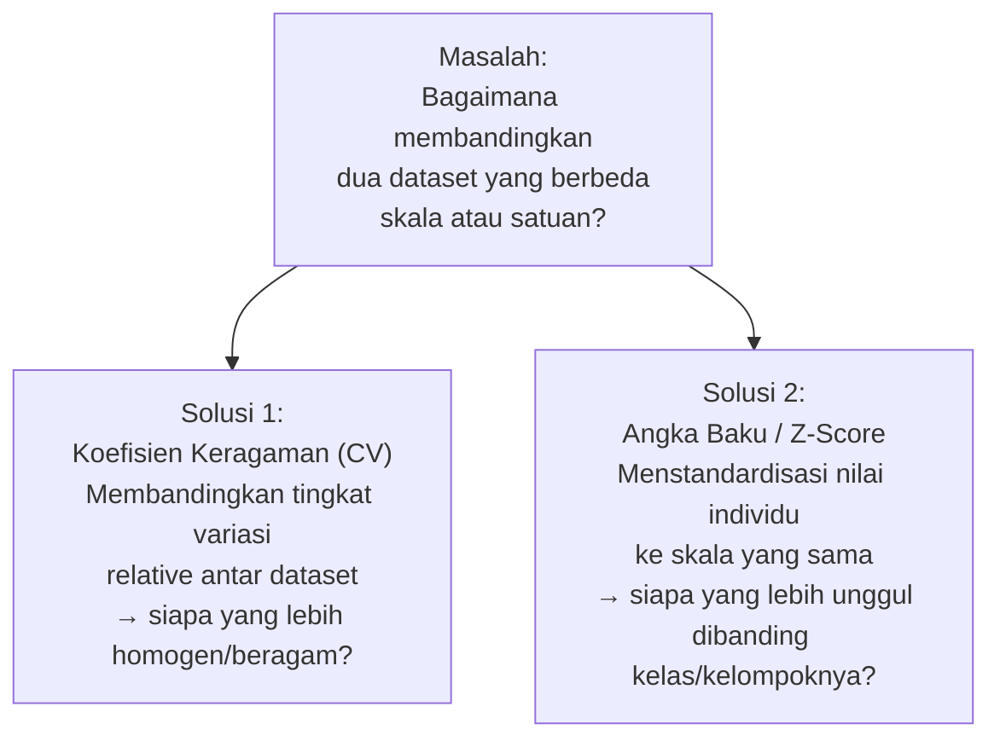
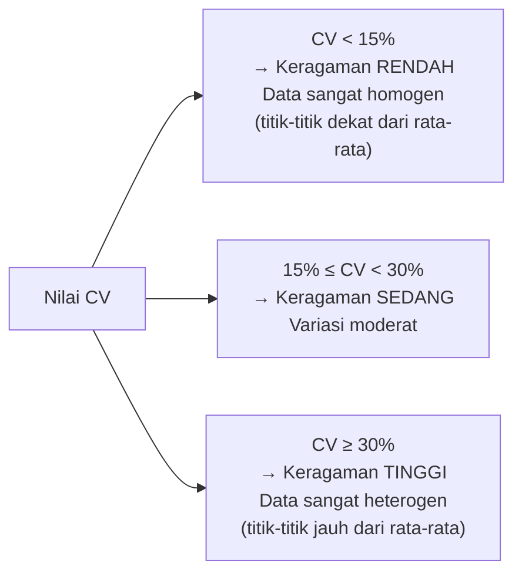
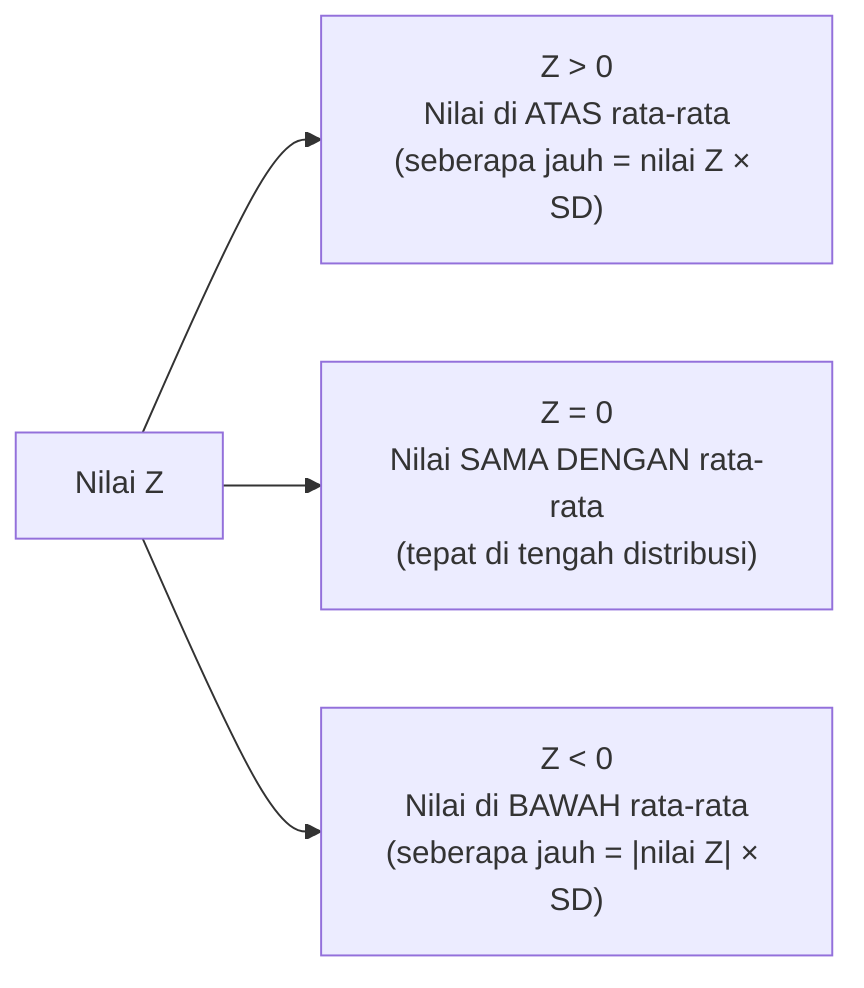
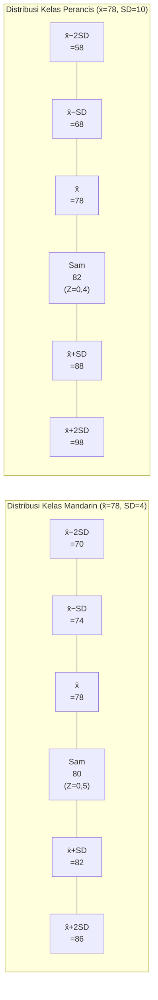
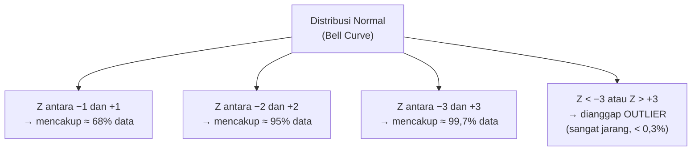
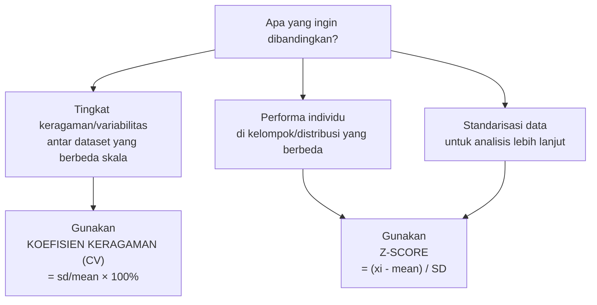
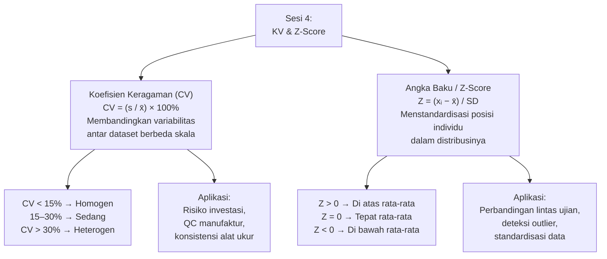

# Sesi 4 — Koefisien Keragaman dan Angka Baku (Z-Score)

**MSIM4310 Analisis dan Visualisasi Data**  
Program Studi Sistem Informasi — Universitas Terbuka

> Catatan: dokumen ini merupakan ekstraksi sekaligus elaborasi dari materi *Inisiasi 4* yang membahas **Koefisien Keragaman (CV)** dan **Angka Baku (Z-Score)** — dua alat statistik untuk membandingkan data dari distribusi yang berbeda. Juga dilengkapi dengan **Tugas Tutorial** beserta solusi lengkap menggunakan R.

---

## Daftar Isi

1. [Mengapa Kita Perlu Alat Perbandingan Relatif?](#1-mengapa-kita-perlu-alat-perbandingan-relatif)
2. [Koefisien Keragaman (Coefficient of Variation)](#2-koefisien-keragaman-coefficient-of-variation)
   - [Rumus dan Komponen](#21-rumus-dan-komponen)
   - [Interpretasi CV](#22-interpretasi-cv)
   - [Contoh 1 — CV Satu Kelas](#23-contoh-1--cv-satu-kelas)
   - [Contoh 2 — Membandingkan Dua Set Data](#24-contoh-2--membandingkan-dua-set-data)
   - [CV dalam R](#25-cv-dalam-r)
   - [Aplikasi CV di Berbagai Bidang](#26-aplikasi-cv-di-berbagai-bidang)
3. [Angka Baku / Z-Score (Nilai Standar)](#3-angka-baku--z-score-nilai-standar)
   - [Rumus dan Komponen](#31-rumus-dan-komponen)
   - [Interpretasi Z-Score](#32-interpretasi-z-score)
   - [Contoh 3 — Membandingkan Performa di Mata Pelajaran Berbeda](#33-contoh-3--membandingkan-performa-di-mata-pelajaran-berbeda)
   - [Z-Score dan Distribusi Normal](#34-z-score-dan-distribusi-normal)
   - [Z-Score dalam R](#35-z-score-dalam-r)
4. [CV vs Z-Score: Kapan Menggunakan Yang Mana?](#4-cv-vs-z-score-kapan-menggunakan-yang-mana)
5. [Tugas Tutorial — Dataset Kecepatan Mobil](#5-tugas-tutorial--dataset-kecepatan-mobil)
6. [Ringkasan](#6-ringkasan)

---

## 1. Mengapa Kita Perlu Alat Perbandingan Relatif?

Ketika membandingkan dua dataset, **standar deviasi saja tidak cukup** — karena standar deviasi bergantung pada skala pengukurannya.

**Contoh masalah:**

> Harga saham A: x̄ = Rp 50.000, SD = Rp 5.000  
> Tinggi badan: x̄ = 165 cm, SD = 7 cm  
> Nilai ujian: x̄ = 75, SD = 8

Tidak mungkin langsung membandingkan "mana yang lebih bervariasi" antara Rp 5.000 vs 7 cm vs 8 — satuannya berbeda! Di sinilah **CV** dan **Z-score** berperan:



---

## 2. Koefisien Keragaman (Coefficient of Variation)

**Koefisien Keragaman (CV)** adalah ukuran statistik yang mengekspresikan standar deviasi sebagai **persentase dari rata-rata**. Dengan mengubah ke bentuk persentase, CV memungkinkan perbandingan tingkat variasi antara dataset yang memiliki satuan atau skala yang berbeda.

### 2.1 Rumus dan Komponen

```
     s
CV = ── × 100%
     x̄
```

| Simbol | Nama | Keterangan |
|---|---|---|
| **CV** | Koefisien Keragaman | Hasil dalam satuan persen (%) |
| **s** | Standar Deviasi | Ukuran penyebaran data (satuan sama dengan data) |
| **x̄** | Rata-rata (Mean) | Pusat data |

> **Analogi:** Bayangkan dua orang bergoyang. Orang A (tinggi 2 m) bergoyang 10 cm, Orang B (tinggi 1 m) bergoyang 8 cm. Siapa yang "lebih banyak bergoyang" relatif terhadap ukurannya? Orang A: 10/200 = 5%, Orang B: 8/100 = 8%. Orang B lebih banyak bergoyang secara relatif!

---

### 2.2 Interpretasi CV



**Membandingkan dua CV:**
- CV lebih **besar** → data lebih **beragam/heterogen** (relatif terhadap rata-ratanya)
- CV lebih **kecil** → data lebih **seragam/homogen** (relatif terhadap rata-ratanya)

> **Penting:** CV bisa menyesatkan jika rata-rata mendekati nol atau negatif. Dalam kasus tersebut, CV kehilangan makna interpretasinya.

---

### 2.3 Contoh 1 — CV Satu Kelas

**Soal:** Kelas A mengikuti ujian mata kuliah Analisis dan Visualisasi Data (AVD) dengan rata-rata kelas **85** dan standar deviasi **6**. Tentukan koefisien keragaman nilai ujian kelas A!

**Jawab:**

```
     s        6
CV = ── × 100% = ── × 100% = 7,06%
     x̄       85
```

**Interpretasi:** CV sebesar **7,06%** berarti standar deviasi hanya sekitar 7% dari nilai rata-rata kelas. Ini termasuk kategori keragaman **sangat rendah** (CV < 15%) — artinya nilai ujian mahasiswa kelas A cukup seragam, sebagian besar berada dekat rata-rata 85.

> ⚠️ **Catatan koreksi:** Materi asli menyebutkan rata-rata = 84 di teks tetapi menggunakan 85 di formula, menghasilkan CV = 6/85 × 100% = 7,05. README ini menggunakan **rata-rata = 85** (sesuai formula) karena menghasilkan hasil yang konsisten dengan jawaban yang diberikan.

---

### 2.4 Contoh 2 — Membandingkan Dua Set Data

**Soal:** Dua set data X dan Y:
- Data X: standar deviasi = 10, rata-rata = 75
- Data Y: standar deviasi = 12, rata-rata = 100

Manakah yang memiliki variasi relatif lebih besar?

**Jawab:**

```
       sₓ        10
CVₓ = ──── × 100% = ── × 100% = 13,33%
       x̄ₓ        75

       sᵧ        12
CVᵧ = ──── × 100% = ─── × 100% = 12,00%
       x̄ᵧ       100
```

**Perbandingan:**

| Dataset | Rata-rata | Std. Deviasi | CV |
|---|---|---|---|
| Data X | 75 | 10 | **13,33%** |
| Data Y | 100 | 12 | 12,00% |

**Interpretasi:** Meskipun Data Y memiliki standar deviasi yang **lebih besar** (12 vs 10), namun Data X memiliki **CV yang lebih besar** (13,33% vs 12,00%). Artinya, **Data X lebih beragam secara relatif** terhadap rata-ratanya.

**Mengapa bisa terjadi?** Standar deviasi 10 pada rata-rata 75 memberikan CV 13,33%, sedangkan standar deviasi 12 pada rata-rata 100 hanya memberikan CV 12%. Semakin besar rata-ratanya, semakin "kecil" dampak standar deviasi yang sama secara relatif.

> ⚠️ **Catatan koreksi:** Dalam materi asli, deskripsi Data Y menyebut sd=15 dan mean=90, namun formula menggunakan sd=12 dan mean=100. Nilai yang digunakan di sini (sd=12, mean=100) diambil dari formula karena konsisten dengan kesimpulan yang diberikan.

---

### 2.5 CV dalam R

R tidak memiliki fungsi bawaan `cv()`, tetapi sangat mudah dihitung:

```r
# Fungsi CV kustom
cv <- function(x) {
  (sd(x) / mean(x)) * 100
}

# Contoh penggunaan
nilai_kelas_a <- c(80, 82, 85, 87, 84, 86, 83, 88, 85, 85)

cv(nilai_kelas_a)
#> [1] 2.618...  # CV sangat rendah, kelas sangat homogen

# Membandingkan dua dataset
data_x <- c(65, 70, 75, 80, 85)   # mean=75, sd≈7.9
data_y <- c(85, 95, 100, 105, 115) # mean=100, sd≈10.8

cat("CV Data X:", cv(data_x), "%\n")
cat("CV Data Y:", cv(data_y), "%\n")
```

**Cara cepat untuk satu set data:**

```r
data <- c(2, 3, 5, 6, 10, 13, 18, 22, 24, 25)

# Manual inline
(sd(data) / mean(data)) * 100
#> [1] 69.57...   # CV tinggi — data sangat beragam
```

---

### 2.6 Aplikasi CV di Berbagai Bidang

| Bidang | Contoh Penggunaan CV |
|---|---|
| **Keuangan & Investasi** | Mengukur risiko per unit return. CV = SD return / mean return. Saham dengan CV lebih rendah = lebih efisien per unit risiko |
| **Manufaktur & QC** | Mengukur konsistensi produk (misal: berat kemasan). CV < 5% biasanya diterima untuk produksi massal |
| **Pertanian** | Membandingkan konsistensi hasil panen antar varietas atau antar lahan |
| **Medis & Klinis** | Mengukur presisi alat ukur (misal: glukometer). CV < 5% untuk alat yang presisi |
| **Pendidikan** | Membandingkan homogenitas nilai ujian antar kelas atau antar mata kuliah |

---

## 3. Angka Baku / Z-Score (Nilai Standar)

**Z-Score** (atau angka baku, nilai standar) adalah cara mengkonversi nilai individual ke skala universal yang menunjukkan **seberapa jauh nilai tersebut dari rata-rata kelompoknya**, dinyatakan dalam satuan standar deviasi.

Dengan Z-score, kita bisa membandingkan performa seseorang di dua ujian yang berbeda skala — seperti membandingkan nilai ujian Matematika (mean=75, sd=10) dengan nilai ujian Bahasa Inggris (mean=70, sd=8) secara adil.

### 3.1 Rumus dan Komponen

```
     xᵢ − x̄
Z = ─────────
       SD
```

| Simbol | Nama | Keterangan |
|---|---|---|
| **Z** | Z-Score / Angka Baku | Hasil dalam satuan standar deviasi (tanpa satuan) |
| **xᵢ** | Nilai observasi | Nilai individu yang ingin distandarisasi |
| **x̄** | Rata-rata | Mean dari populasi atau sampel |
| **SD** | Standar Deviasi | Populasi (σ) atau sampel (s) |

---

### 3.2 Interpretasi Z-Score



**Contoh interpretasi konkret:**

| Z-Score | Makna | Contoh (mean=75, sd=10) |
|---|---|---|
| Z = 2,0 | 2 SD di atas rata-rata | Nilai = 75 + 2×10 = **95** |
| Z = 1,0 | 1 SD di atas rata-rata | Nilai = 75 + 1×10 = **85** |
| Z = 0,5 | 0,5 SD di atas rata-rata | Nilai = 75 + 0,5×10 = **80** |
| Z = 0,0 | Tepat di rata-rata | Nilai = **75** |
| Z = −1,0 | 1 SD di bawah rata-rata | Nilai = 75 − 1×10 = **65** |
| Z = −2,0 | 2 SD di bawah rata-rata | Nilai = 75 − 2×10 = **55** |

---

### 3.3 Contoh 3 — Membandingkan Performa di Mata Pelajaran Berbeda

**Soal:** Sam memperoleh:
- **Ujian Bahasa Mandarin:** nilai = 80, rata-rata kelas = 78, SD = 4
- **Ujian Bahasa Perancis:** nilai = 82, rata-rata kelas = 78, SD = 10

Pada mata pelajaran mana performa Sam relatif lebih baik dibanding teman sekelasnya?

**Jawab:**

**Langkah 1 — Hitung Z-score masing-masing:**

```
        xᵢ − x̄   80 − 78   2
Z_Mandarin = ─────── = ─────── = ── = 0,5
          SD         4       4

        xᵢ − x̄   82 − 78   4
Z_Perancis = ─────── = ─────── = ── = 0,4
          SD        10      10
```

**Langkah 2 — Bandingkan Z-score:**

| Mata Pelajaran | Nilai | Rata-rata Kelas | SD | Z-Score |
|---|---|---|---|---|
| Bahasa Mandarin | 80 | 78 | 4 | **0,50** |
| Bahasa Perancis | 82 | 78 | 10 | 0,40 |

**Kesimpulan:** Meskipun nilai absolut Sam di Bahasa Perancis (82) lebih tinggi dari Bahasa Mandarin (80), **performa relatif Sam lebih baik di Bahasa Mandarin** — ia berada 0,5 standar deviasi di atas rata-rata kelas untuk Mandarin, vs hanya 0,4 standar deviasi di atas rata-rata untuk Perancis.

**Visualisasi konseptual posisi Sam:**



> ⚠️ **Catatan koreksi:** Materi asli menyebutkan SD Mandarin = 8 dan SD Perancis = 6 di teks narasi, namun formula menggunakan SD=4 (Mandarin) dan SD=10 (Perancis). Nilai yang digunakan di sini (SD=4 untuk Mandarin, SD=10 untuk Perancis) diambil dari formula karena menghasilkan kesimpulan yang konsisten dengan penjelasan di materi. Jika menggunakan nilai di teks (SD_Mandarin=8, SD_Perancis=6): Z_Mandarin=0,25 dan Z_Perancis=0,67 → kesimpulan akan berbalik (Perancis lebih baik).

---

### 3.4 Z-Score dan Distribusi Normal

Z-score sangat kuat ketika dikombinasikan dengan pengetahuan tentang **distribusi normal** (*bell curve*). Untuk data yang terdistribusi normal:



**Interpretasi persentil dari Z-score:**

| Z-Score | Persentil | Artinya |
|---|---|---|
| Z = −2,0 | ~2,3% | Hanya 2,3% nilai yang lebih rendah |
| Z = −1,0 | ~15,9% | Hanya 15,9% nilai yang lebih rendah |
| Z = 0,0 | 50% | Tepat di tengah distribusi |
| Z = +1,0 | ~84,1% | Lebih tinggi dari 84,1% populasi |
| Z = +2,0 | ~97,7% | Lebih tinggi dari 97,7% populasi |

**Aplikasi deteksi outlier:** Nilai dengan |Z| > 3 sering dianggap outlier (berada di luar rentang yang mencakup 99,7% data normal).

---

### 3.5 Z-Score dalam R

```r
# Hitung Z-score manual untuk satu nilai
z_score <- function(xi, mean_pop, sd_pop) {
  (xi - mean_pop) / sd_pop
}

# Contoh 3
z_mandarin <- z_score(80, 78, 4)
z_perancis  <- z_score(82, 78, 10)

cat("Z-score Mandarin:", z_mandarin, "\n")  # 0.5
cat("Z-score Perancis:", z_perancis, "\n")  # 0.4

# Standardisasi seluruh vektor data (Z-score tiap elemen)
data <- c(65, 70, 75, 80, 85, 90, 95)
z_data <- scale(data)    # fungsi bawaan R
print(z_data)
#>            [,1]
#> [1,] -1.5000000
#> [2,] -1.0000000
#> [3,] -0.5000000
#> [4,]  0.0000000  ← tepat di rata-rata
#> [5,]  0.5000000
#> [6,]  1.0000000
#> [7,]  1.5000000

# Identifikasi outlier berdasarkan Z-score
data_dengan_outlier <- c(65, 70, 75, 80, 85, 140)  # 140 adalah outlier
z_vals <- scale(data_dengan_outlier)
outlier_idx <- which(abs(z_vals) > 2)  # nilai dengan |Z| > 2
cat("Indeks outlier:", outlier_idx, "\n")
cat("Nilai outlier:", data_dengan_outlier[outlier_idx], "\n")
```

---

## 4. CV vs Z-Score: Kapan Menggunakan Yang Mana?



**Tabel perbandingan:**

| Aspek | CV | Z-Score |
|---|---|---|
| **Output** | Persentase (%) | Angka tanpa satuan (dalam unit SD) |
| **Unit of analysis** | Dataset (keseluruhan) | Nilai individual |
| **Pertanyaan dijawab** | "Seberapa beragam dataset ini?" | "Di mana posisi nilai ini dalam distribusinya?" |
| **Perbandingan** | Antar dataset berbeda skala | Antar individu dari distribusi berbeda |
| **Contoh penggunaan** | Mana saham lebih berisiko? | Siapa yang lebih berprestasi relatif? |
| **Kelemahan** | Tidak berlaku jika mean ≈ 0 | Butuh asumsi distribusi normal untuk interpretasi persentil |

---

## 5. Tugas Tutorial — Dataset Kecepatan Mobil

Berikut adalah **tugas tutorial** untuk sesi ini beserta solusi lengkap menggunakan R.

### Data: Kecepatan Mobil dan Jarak Berhenti

Dataset berisi 50 pengamatan kecepatan mobil (km/jam) dan jarak yang dibutuhkan hingga berhenti (meter):

| No | Kecepatan (km/h) | Jarak (m) | No | Kecepatan (km/h) | Jarak (m) |
|---|---|---|---|---|---|
| 1 | 4 | 2 | 26 | 16 | 55 |
| 2 | 4 | 10 | 27 | 16 | 35 |
| 3 | 7 | 4 | 28 | 17 | 40 |
| 4 | 7 | 20 | 29 | 17 | 30 |
| 5 | 8 | 17 | 30 | 17 | 44 |
| 6 | 8 | 13 | 31 | 17 | 50 |
| 7 | 9 | 18 | 32 | 17 | 46 |
| 8 | 10 | 28 | 33 | 18 | 53 |
| 9 | 10 | 33 | 34 | 18 | 70 |
| 10 | 11 | 18 | 35 | 18 | 80 |
| 11 | 11 | 26 | 36 | 19 | 36 |
| 12 | 12 | 12 | 37 | 19 | 46 |
| 13 | 12 | 24 | 38 | 20 | 68 |
| 14 | 12 | 22 | 39 | 20 | 34 |
| 15 | 13 | 28 | 40 | 20 | 48 |
| 16 | 13 | 24 | 41 | 20 | 50 |
| 17 | 13 | 32 | 42 | 20 | 56 |
| 18 | 13 | 34 | 43 | 21 | 60 |
| 19 | 14 | 43 | 44 | 22 | 64 |
| 20 | 14 | 24 | 45 | 23 | 56 |
| 21 | 14 | 30 | 46 | 24 | 72 |
| 22 | 14 | 58 | 47 | 24 | 90 |
| 23 | 15 | 80 | 48 | 24 | 92 |
| 24 | 15 | 20 | 49 | 25 | 110 |
| 25 | 15 | 24 | 50 | 25 | 85 |

---

### Soal 1: Statistik Deskriptif

**Pertanyaan:**
1. Rata-rata kecepatan mobil
2. Rata-rata jarak yang ditempuh
3. Standar deviasi jarak yang ditempuh

**Script R ([main.R](main.R)):**

```r
speed <- c(4, 4, 7, 7, 8, 8, 9, 10, 10, 11, 11, 12, 12, 12, 13, 13, 13, 13,
           14, 14, 14, 14, 15, 15, 15, 16, 16, 17, 17, 17, 17, 17, 18, 18, 18,
           19, 19, 20, 20, 20, 20, 20, 21, 22, 23, 24, 24, 24, 25, 25)

distance <- c(2, 10, 4, 20, 17, 13, 18, 28, 33, 18, 26, 12, 24, 22, 28, 24, 32,
              34, 43, 24, 30, 58, 80, 20, 24, 55, 35, 40, 30, 44, 50, 46, 53, 70,
              80, 36, 46, 68, 34, 48, 50, 56, 60, 64, 56, 72, 90, 92, 110, 85)

print("Rata-rata Kecepatan:")
print(mean(speed))

print("Rata-rata Jarak Henti:")
print(mean(distance))

print("Standar Deviasi Jarak Henti:")
print(sd(distance))
```

**Hasil dan jawaban:**

```
[1] "Rata-rata Kecepatan:"
[1] 15.5

[1] "Rata-rata Jarak Henti:"
[1] 42.28

[1] "Standar Deviasi Jarak Henti:"
[1] 25.77
```

**Interpretasi:**
- Rata-rata kecepatan mobil adalah **15,5 km/jam**
- Rata-rata jarak berhenti adalah **42,28 meter**
- Standar deviasi jarak berhenti adalah **25,77 meter** — cukup besar relatif terhadap mean, menandakan variasi jarak berhenti yang signifikan antar mobil

---

### Soal 2: Visualisasi dan Interpretasi

#### 2a & 2b — Scatter Plot Kecepatan vs Jarak

```r
plot(speed, distance,
     main = "Scatter Plot Kecepatan vs Jarak Henti Mobil",
     xlab = "Kecepatan (km/jam)",
     ylab = "Jarak henti (meter)",
     pch  = 19,
     col  = "steelblue")

# Tambahkan garis regresi linear
abline(lm(distance ~ speed), col = "red", lwd = 2)
```

**Interpretasi Scatter Plot:**

Scatter plot menunjukkan hubungan antara kecepatan dan jarak berhenti mobil. Dari grafik, dapat diamati:

1. **Tren positif yang jelas** — semakin tinggi kecepatan, semakin panjang jarak berhenti. Garis regresi linear (merah) mengkonfirmasi tren ini.
2. **Korelasi positif kuat** — titik-titik data cenderung mengikuti pola naik dari kiri bawah ke kanan atas.
3. **Variabilitas meningkat** — pada kecepatan tinggi (20–25 km/jam), jarak berhenti sangat bervariasi (34–110 meter). Ini menunjukkan bahwa pada kecepatan tinggi, faktor lain (kondisi rem, kondisi jalan, reaksi pengemudi) lebih berpengaruh.
4. **Beberapa outlier** terlihat — misalnya pada kecepatan 15 km/jam ada jarak 80 meter yang jauh di atas rata-rata kelompok itu.

> **Makna praktis:** Data ini konsisten dengan fisika — energi kinetik berbanding lurus dengan kuadrat kecepatan (E = ½mv²), sehingga jarak berhenti meningkat lebih cepat dari kecepatan. Ini menjadi dasar aturan jarak aman berkendara.

#### 2c & 2d — Histogram Kecepatan

```r
hist(speed,
     main   = "Histogram Kecepatan Mobil",
     xlab   = "Kecepatan (km/jam)",
     ylab   = "Frekuensi",
     col    = "lightblue",
     border = "white")
```

**Interpretasi Histogram:**

1. **Distribusi cenderung simetris** dengan puncak di sekitar 13–17 km/jam, mendekati distribusi normal.
2. **Kecepatan paling umum** adalah 17 km/jam (muncul 5 kali) dan 20 km/jam (muncul 5 kali).
3. **Tidak ada kecepatan ekstrem** — rentang data dari 4 hingga 25 km/jam, tidak terdapat nilai outlier yang mencolok.
4. **Distribusi relatif merata** di rentang tengah (9–20 km/jam), mencerminkan pengambilan sampel yang cukup representatif.

---

### Soal 3: Koefisien Keragaman Ujian Thomas

**Soal:** Thomas memperoleh:
- Ujian Matematika: nilai = 80, rata-rata kelas = 75, SD = 10
- Ujian Bahasa Inggris: nilai = 75, rata-rata kelas = 70, SD = 8

Hitunglah koefisien keragaman untuk ujian Matematika dan Bahasa Inggris!

**Jawab:**

```
         SD_Matematika      10
CV_Matematika = ──────────────── × 100% = ── × 100% = 13,33%
         x̄_Matematika      75

         SD_Inggris          8
CV_Inggris = ──────────────── × 100% = ── × 100% = 11,43%
         x̄_Inggris          70
```

**Tabel hasil:**

| Mata Ujian | Nilai Thomas | Rata-rata Kelas | SD | CV |
|---|---|---|---|---|
| Matematika | 80 | 75 | 10 | **13,33%** |
| Bahasa Inggris | 75 | 70 | 8 | 11,43% |

**Interpretasi:** Distribusi nilai ujian **Matematika lebih beragam** (CV 13,33%) dibandingkan Bahasa Inggris (CV 11,43%). Artinya, kelas Matematika lebih heterogen — ada mahasiswa yang nilainya sangat tinggi dan ada yang sangat rendah. Kelas Bahasa Inggris lebih homogen.

> **Catatan:** Soal ini menanyakan CV dari distribusi kelas (menggunakan rata-rata dan SD kelas), bukan perbandingan nilai Thomas secara individual. Untuk perbandingan performa relatif Thomas antar dua ujian, Z-score yang lebih tepat digunakan:  
> Z_Matematika = (80−75)/10 = **0,5**  
> Z_Inggris = (75−70)/8 = **0,625**  
> → Secara relatif, performa Thomas di Bahasa Inggris **sedikit lebih baik** (0,625 SD di atas mean vs 0,5 SD).

---

## 6. Ringkasan



**Panduan cepat memilih antara CV dan Z-score:**

| Pertanyaan | Alat |
|---|---|
| Dataset mana yang lebih konsisten/homogen? | **CV** |
| Siapa yang performa relatifnya lebih baik? | **Z-Score** |
| Bagaimana mendeteksi outlier secara universal? | **Z-Score** (|Z| > 3) |
| Seberapa berisiko investasi ini per unit return? | **CV** |
| Bagaimana menyetarakan data dari skala berbeda? | **Z-Score (scale())** |

---

*Selamat Belajar...*
