# Sesi 5 — Transformasi Data dan Normalitas

**MSIM4310 Analisis dan Visualisasi Data**  
Program Studi Sistem Informasi — Universitas Terbuka

> Catatan: dokumen ini merupakan ekstraksi sekaligus elaborasi dari materi *Inisiasi 5 — Konsep Dasar Transformasi Data dan Normalitas*. Setiap kondisi transformasi dijelaskan secara mendalam dengan rumus, contoh kode R, diagram keputusan, dan panduan interpretasi hasil uji normalitas.

---

## Daftar Isi

1. [Mengapa Transformasi Data Diperlukan?](#1-mengapa-transformasi-data-diperlukan)
2. [Skewness dan Kurtosis — Dasar Menilai Distribusi Data](#2-skewness-dan-kurtosis--dasar-menilai-distribusi-data)
3. [Konsep Dasar Transformasi Data](#3-konsep-dasar-transformasi-data)
   - [Kondisi 1 — Mengatasi Skewness](#31-kondisi-1--mengatasi-skewness)
   - [Kondisi 2 — Memenuhi Asumsi Normalitas](#32-kondisi-2--memenuhi-asumsi-normalitas)
   - [Kondisi 3 — Mengatasi Heteroskedastisitas](#33-kondisi-3--mengatasi-heteroskedastisitas)
   - [Kondisi 4 — Linearitas Hubungan](#34-kondisi-4--linearitas-hubungan)
   - [Kondisi 5 — Mengatasi Outliers](#35-kondisi-5--mengatasi-outliers)
   - [Kondisi 6 — Normalisasi atau Standardisasi](#36-kondisi-6--normalisasi-atau-standardisasi)
   - [Kondisi 7 — Transformasi Data Kategorikal](#37-kondisi-7--transformasi-data-kategorikal)
4. [Tukey's Ladder of Powers](#4-tukeys-ladder-of-powers)
5. [Jenis-Jenis Transformasi dan Implementasi di R](#5-jenis-jenis-transformasi-dan-implementasi-di-r)
6. [Normalitas — Distribusi Gaussian](#6-normalitas--distribusi-gaussian)
7. [Cara Menguji Normalitas](#7-cara-menguji-normalitas)
   - [Metode Visual](#71-metode-visual)
   - [Uji Statistik](#72-uji-statistik)
8. [Alur Kerja Transformasi Data](#8-alur-kerja-transformasi-data)
9. [Ringkasan](#9-ringkasan)

---

## 1. Mengapa Transformasi Data Diperlukan?

Data di dunia nyata jarang sekali "sempurna" untuk langsung dianalisis. Distribusi yang miring, skala yang tidak seragam, outlier yang ekstrem, atau hubungan yang tidak linear — semua ini dapat merusak akurasi model statistik dan machine learning.

**Transformasi data** adalah proses mengubah format, struktur, atau nilai data untuk:
- Memenuhi asumsi yang diperlukan suatu teknik statistik
- Meningkatkan kualitas dan interpretabilitas data
- Mempersiapkan data untuk model machine learning

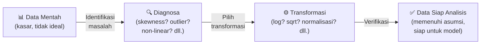

> **Analogi:** Transformasi data seperti mempersiapkan bahan masakan. Bawang mentah tidak bisa langsung dijadikan caramel — perlu dikupas, diiris, dan dimasak dulu. Begitu pula data: perlu diproses agar "matang" dan siap diolah lebih lanjut.

---

## 2. Skewness dan Kurtosis — Dasar Menilai Distribusi Data

Sebelum memahami transformasi, penting mengenal dua ukuran bentuk distribusi:

### Skewness (Kemiringan)

**Skewness** mengukur seberapa simetris distribusi data.

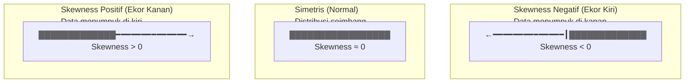

| Nilai Skewness | Interpretasi |
|---|---|
| Skewness < −1 | Miring kiri signifikan |
| −1 ≤ Skewness < −0,5 | Miring kiri moderat |
| −0,5 ≤ Skewness ≤ 0,5 | Hampir simetris (distribusi mendekati normal) |
| 0,5 < Skewness ≤ 1 | Miring kanan moderat |
| Skewness > 1 | Miring kanan signifikan |

**Contoh skewness positif di kehidupan nyata:** Distribusi pendapatan — mayoritas orang bergaji moderat, tetapi segelintir orang sangat kaya menarik ekor distribusi ke kanan.

### Kurtosis (Ketajaman Puncak)

**Kurtosis** mengukur seberapa "runcing" atau "datar" distribusi dibanding distribusi normal.

| Jenis | Kurtosis | Ciri |
|---|---|---|
| **Mesokurtik** (Normal) | ≈ 3 (excess ≈ 0) | Puncak standar distribusi normal |
| **Leptokurtik** | > 3 (excess > 0) | Puncak sangat runcing, ekor tebal — banyak outlier |
| **Platikurtik** | < 3 (excess < 0) | Puncak lebih datar, ekor tipis — data tersebar merata |

```r
# Hitung skewness dan kurtosis di R
# install.packages("moments")
library(moments)

data <- c(1, 2, 3, 4, 5, 10, 15, 20, 50, 100)  # skewed positif
skewness(data)   # nilai > 1 = miring kanan signifikan
kurtosis(data)   # kurtosis (4 = leptokurtik)
```

---

## 3. Konsep Dasar Transformasi Data

Transformasi data diperlukan dalam **7 kondisi utama**:

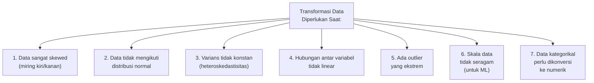

---

### 3.1 Kondisi 1 — Mengatasi Skewness

Jika data sangat miring (skewed), model statistik yang mengasumsikan distribusi normal akan memberikan hasil yang tidak akurat. Transformasi membantu "meratakan" kemiringan.

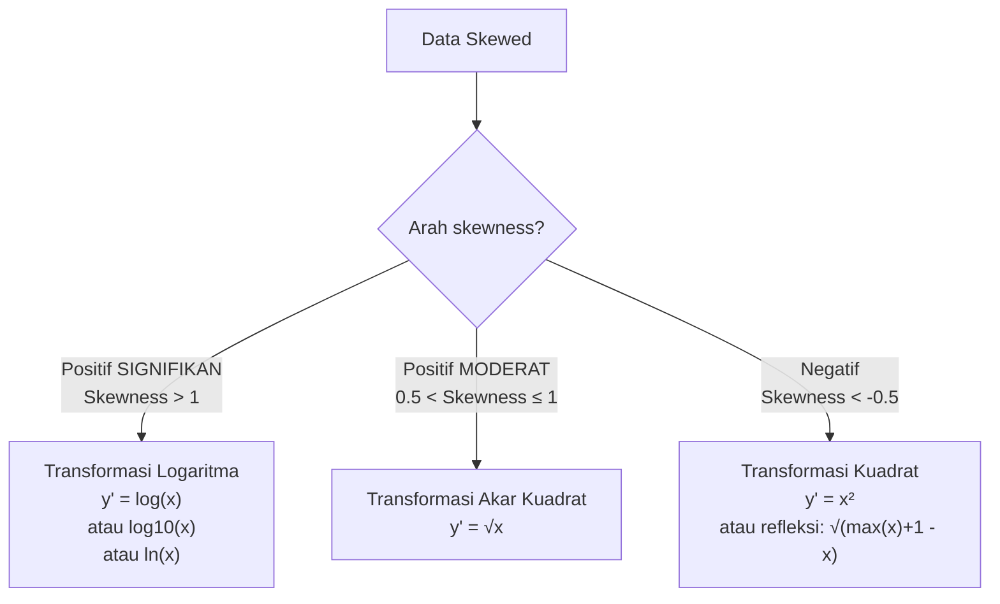

**Contoh nyata:**
- **Pendapatan / harga properti** → skewed positif kuat → gunakan log
- **Jumlah kejahatan per kota** → skewed positif moderat → gunakan √x
- **Skor tes yang kebanyakan tinggi** → skewed negatif → gunakan kuadrat

```r
data_skewed <- c(1, 2, 2, 3, 3, 3, 5, 8, 15, 50, 100, 500)

# Sebelum transformasi
hist(data_skewed, main="Data Asli (Skewed Positif)")

# Transformasi log
data_log <- log(data_skewed)
hist(data_log, main="Setelah Transformasi Log")

# Transformasi akar kuadrat
data_sqrt <- sqrt(data_skewed)
hist(data_sqrt, main="Setelah Transformasi Sqrt")
```

> **Perhatian:** Transformasi log tidak bisa diterapkan pada nilai ≤ 0. Jika ada nilai negatif atau nol, gunakan `log(x + 1)` atau tambahkan konstanta sebelum transformasi.

---

### 3.2 Kondisi 2 — Memenuhi Asumsi Normalitas

Banyak teknik analisis mengasumsikan data mengikuti distribusi normal:

| Teknik Statistik | Asumsi Normalitas Pada |
|---|---|
| **Regresi Linear** | Residual (error) mengikuti distribusi normal |
| **ANOVA** | Nilai dalam setiap grup mengikuti distribusi normal |
| **Uji t (t-test)** | Data atau selisih mengikuti distribusi normal |
| **Pearson Correlation** | Kedua variabel mengikuti distribusi bivariat normal |

Jika asumsi ini dilanggar, **p-value dan confidence interval menjadi tidak valid** — kesimpulan statistik bisa salah.

```r
# Cek normalitas sebelum analisis
data <- c(12, 15, 13, 18, 14, 16, 20, 19, 17, 15)

# Jika tidak normal, pertimbangkan transformasi
shapiro.test(data)
# p-value > 0.05 → tidak cukup bukti untuk menolak normalitas
# p-value < 0.05 → data kemungkinan tidak normal → perlu transformasi
```

---

### 3.3 Kondisi 3 — Mengatasi Heteroskedastisitas

**Heteroskedastisitas** terjadi ketika varians residual dalam model regresi tidak konstan — varians berubah seiring bertambahnya nilai prediksi.

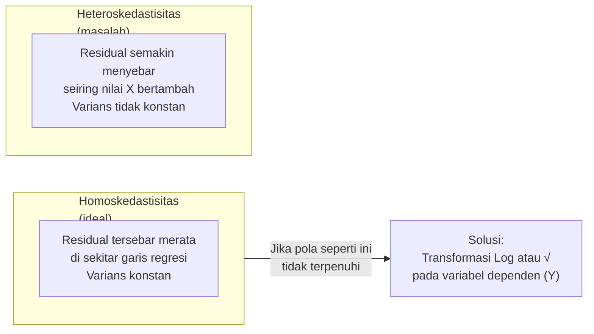

**Contoh:** Dalam regresi pendapatan vs pengeluaran, orang berpendapatan tinggi memiliki variasi pengeluaran yang jauh lebih besar dari orang berpendapatan rendah → heteroskedastisitas. Solusi: transformasi log pada variabel pengeluaran.

---

### 3.4 Kondisi 4 — Linearitas Hubungan

Regresi linear mengasumsikan hubungan **linear** antara X dan Y. Jika hubungan sebenarnya eksponensial, logaritmik, atau pangkat, model linear akan memberikan prediksi yang buruk.

**Contoh hubungan non-linear yang umum:**

| Hubungan Asli | Transformasi | Hasil |
|---|---|---|
| Y = aX^b (pangkat) | log(Y) vs log(X) | Linear |
| Y = ae^(bX) (eksponensial) | log(Y) vs X | Linear |
| Y = a + b·log(X) (logaritmik) | Y vs log(X) | Linear |
| Y = 1/(a+bX) (hiperbolik) | 1/Y vs X | Linear |

```r
# Contoh: Hubungan eksponensial
x <- 1:20
y <- 2 * exp(0.3 * x) + rnorm(20, 0, 5)

# Plot asli (non-linear)
plot(x, y, main = "Hubungan Asli (Eksponensial)")

# Setelah transformasi log pada Y
plot(x, log(y), main = "Setelah log(Y) — Linear!")
abline(lm(log(y) ~ x), col = "red")
```

---

### 3.5 Kondisi 5 — Mengatasi Outliers

Outlier ekstrem dapat mendistorsi hasil analisis secara dramatis. Transformasi membantu menekan pengaruh outlier tanpa harus menghapusnya.

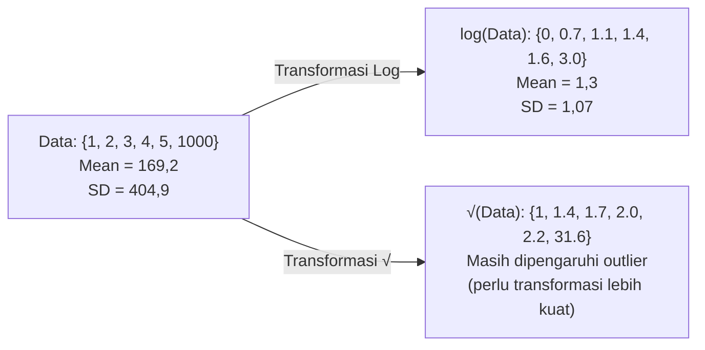

| Transformasi | Efektivitas Menekan Outlier |
|---|---|
| Akar kuadrat (√x) | Rendah — sedikit menekan |
| Logaritma log(x) | Sedang — efektif untuk skewed positif |
| Box-Cox optimal | Tinggi — adaptif ke karakteristik data |
| Winsorizing | Membatasi nilai ekstrem pada persentil tertentu |

---

### 3.6 Kondisi 6 — Normalisasi atau Standardisasi

Algoritma machine learning yang sensitif terhadap skala data memerlukan semua fitur berada dalam rentang yang sebanding.

**Normalisasi (Min-Max Scaling):**

```
         xᵢ − min(x)
x'ᵢ = ──────────────────
       max(x) − min(x)
```

- Mengubah semua nilai ke rentang **[0, 1]**
- Cocok untuk: K-NN, Neural Network, SVM
- Kelemahan: sensitif terhadap outlier (outlier menggeser min/max)

**Standardisasi (Z-score Scaling):**

```
     xᵢ − x̄
x'ᵢ = ────────
        SD
```

- Mengubah data sehingga mean = 0 dan SD = 1
- Cocok untuk: Regresi Linear, Logistik, PCA
- Lebih robust terhadap outlier dibanding normalisasi

```r
data <- c(200, 450, 1200, 800, 350, 950, 600)

# Normalisasi (Min-Max)
normalize <- function(x) (x - min(x)) / (max(x) - min(x))
data_norm <- normalize(data)
cat("Normalisasi:", round(data_norm, 3), "\n")
# Hasil: 0.000 0.208 1.000 0.600 0.150 0.750 0.400

# Standardisasi (Z-score)
data_std <- scale(data)
cat("Standardisasi:", round(data_std, 3), "\n")
# Hasil berkisar sekitar 0, dengan SD = 1
```

**Perbandingan:**

| Aspek | Normalisasi | Standardisasi |
|---|---|---|
| Rentang output | [0, 1] | Tidak terbatas (biasanya −3 s/d +3) |
| Sensitif outlier | Ya | Lebih tahan |
| Mempertahankan distribusi | Ya | Ya |
| Cocok untuk distribusi normal | Tidak harus | Lebih cocok |
| Fungsi R | `(x-min(x))/(max(x)-min(x))` | `scale(x)` |

---

### 3.7 Kondisi 7 — Transformasi Data Kategorikal

Sebagian besar algoritma ML hanya menerima input numerik, sehingga data kategorikal harus dikonversi.

**Label Encoding:** Setiap kategori diganti angka integer.

```
Merah → 0, Kuning → 1, Hijau → 2
```

```r
# Label encoding di R
warna <- c("Merah", "Kuning", "Hijau", "Merah", "Hijau")
warna_encoded <- as.integer(as.factor(warna))
print(warna_encoded)  # 3 1 2 3 2 (faktor diurutkan alfabetis)
```

**One-Hot Encoding:** Setiap kategori menjadi kolom biner (0/1). Menghindari asumsi urutan yang tersirat di label encoding.

```
Warna_Merah  Warna_Kuning  Warna_Hijau
    1              0             0       ← Merah
    0              1             0       ← Kuning
    0              0             1       ← Hijau
```

```r
# One-hot encoding di R (menggunakan model.matrix)
warna <- c("Merah", "Kuning", "Hijau", "Merah")
df <- data.frame(warna = as.factor(warna))
ohe <- model.matrix(~ warna - 1, data = df)
print(ohe)
```

**Kapan pakai mana:**

| Jenis Data | Rekomendasi |
|---|---|
| Ordinal (kecil < sedang < besar) | Label Encoding (urutan bermakna) |
| Nominal tanpa urutan (merek, warna) | One-Hot Encoding |
| Banyak kategori (> 10) | Target Encoding atau Embedding |

---

## 4. Tukey's Ladder of Powers

**Tukey's Ladder of Powers** adalah kerangka sistematis yang mengurutkan jenis transformasi berdasarkan kekuatan "efeknya" dalam mengubah distribusi data. Dikembangkan oleh statistikawan legendaris **John Tukey**.

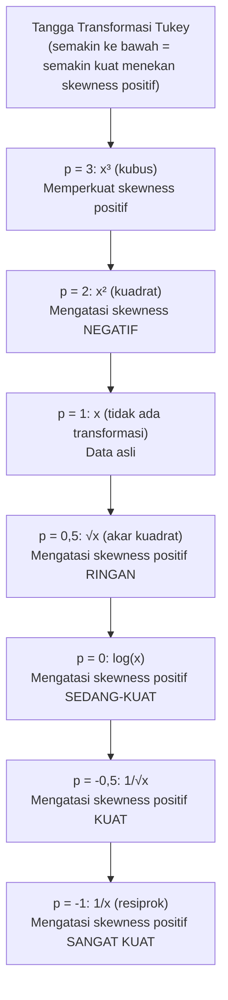

**Aturan praktis menggunakan Tukey's Ladder:**

1. Jika histogram menunjukkan **ekor kanan (positif)** → geser ke **bawah** tangga (p < 1)
2. Jika histogram menunjukkan **ekor kiri (negatif)** → geser ke **atas** tangga (p > 1)
3. Mulai dari langkah kecil, periksa hasilnya, lalu putuskan apakah perlu langkah lebih besar

| Kekuatan Skewness Positif | Transformasi yang Disarankan |
|---|---|
| Ringan (Skewness 0,5–1) | √x (p = 0,5) |
| Sedang (Skewness 1–2) | log(x) (p = 0) |
| Kuat (Skewness 2–3) | 1/√x (p = −0,5) |
| Sangat kuat (Skewness > 3) | 1/x (p = −1) |

---

## 5. Jenis-Jenis Transformasi dan Implementasi di R

### Ringkasan Transformasi Utama

| Transformasi | Formula | Kapan Digunakan | Batasan |
|---|---|---|---|
| **Log natural** | `log(x)` | Skewed positif signifikan | x > 0 |
| **Log10** | `log10(x)` | Skewed positif, interpretasi lebih mudah | x > 0 |
| **Log(x+1)** | `log(x+1)` | Skewed positif dengan nilai 0 | x ≥ 0 |
| **Akar kuadrat** | `sqrt(x)` | Skewed positif moderat | x ≥ 0 |
| **Kuadrat** | `x^2` | Skewed negatif | − |
| **Resiprok** | `1/x` | Skewed positif sangat kuat | x ≠ 0 |
| **Box-Cox** | Otomatis mencari λ optimal | Umum, adaptif | x > 0 |
| **Yeo-Johnson** | Variasi Box-Cox | Seperti Box-Cox | x boleh negatif |

### Implementasi R Lengkap

```r
# Data contoh (skewed positif)
set.seed(42)
data_skew <- rexp(200, rate = 0.1)  # distribusi eksponensial

# Buat panel 2x3 untuk membandingkan transformasi
par(mfrow = c(2, 3))

hist(data_skew,      main = "Data Asli",      col = "lightblue")
hist(sqrt(data_skew), main = "√x",             col = "lightgreen")
hist(log(data_skew),  main = "log(x)",         col = "lightyellow")
hist(log(data_skew + 1), main = "log(x+1)",   col = "lightsalmon")
hist(1/data_skew,    main = "1/x",             col = "lightpink")

par(mfrow = c(1, 1))  # kembalikan ke satu plot

# Box-Cox transformation (memerlukan paket MASS)
library(MASS)
bc <- boxcox(data_skew ~ 1)         # cari lambda optimal
lambda_optimal <- bc$x[which.max(bc$y)]
cat("Lambda optimal Box-Cox:", lambda_optimal, "\n")

# Terapkan Box-Cox dengan lambda optimal
if (lambda_optimal == 0) {
  data_bc <- log(data_skew)
} else {
  data_bc <- (data_skew^lambda_optimal - 1) / lambda_optimal
}
hist(data_bc, main = "Box-Cox Optimal", col = "plum")
```

### Evaluasi Keberhasilan Transformasi

```r
library(moments)

# Bandingkan skewness sebelum dan sesudah
cat("Skewness data asli:    ", skewness(data_skew), "\n")
cat("Skewness setelah sqrt: ", skewness(sqrt(data_skew)), "\n")
cat("Skewness setelah log:  ", skewness(log(data_skew)), "\n")

# Uji normalitas sebelum dan sesudah
shapiro.test(data_skew)         # kemungkinan p < 0.05 (tidak normal)
shapiro.test(log(data_skew))    # semoga p > 0.05 (lebih mendekati normal)
```

---

## 6. Normalitas — Distribusi Gaussian

**Distribusi normal** (atau distribusi Gaussian) adalah distribusi probabilitas yang berbentuk seperti lonceng (*bell curve*) — simetris sempurna di sekitar nilai rata-ratanya.

### Karakteristik Distribusi Normal

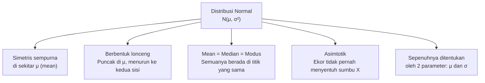

**Dua parameter yang menentukan bentuk distribusi normal:**

| Parameter | Simbol | Efek perubahan |
|---|---|---|
| **Mean (rata-rata)** | μ | Menggeser kurva ke kiri/kanan tanpa mengubah bentuk |
| **Standar Deviasi** | σ | Mengubah lebar kurva: σ kecil = runcing, σ besar = datar |

### Aturan Empiris 68-95-99,7

Untuk data yang terdistribusi normal, persentase data yang berada dalam rentang tertentu dari mean bersifat tetap:

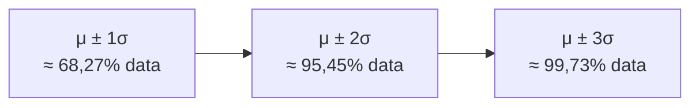

**Contoh aplikasi:** Nilai ujian terdistribusi normal dengan mean = 75, SD = 10:
- Sekitar **68%** mahasiswa mendapat nilai antara 65–85
- Sekitar **95%** mahasiswa mendapat nilai antara 55–95
- Hampir semua (**99,7%**) mendapat nilai antara 45–105

### Mengapa Normalitas Penting?

1. **Inferensi Statistik** — Uji t, ANOVA, regresi linear mengasumsikan residual berdistribusi normal agar p-value valid
2. **Estimasi Parameter** — Estimasi dalam model regresi lebih efisien dan tidak bias (*BLUE: Best Linear Unbiased Estimator*) jika asumsi normalitas terpenuhi
3. **Validitas Uji Hipotesis** — p-value yang dihitung dari tabel distribusi normal hanya valid jika data memang normal
4. **Prediksi Interval** — Confidence interval dan prediction interval diasumsikan mengikuti distribusi normal

```r
# Membuat distribusi normal di R
mu <- 75   # mean
sigma <- 10  # standar deviasi
n <- 1000

# Bangkitkan data normal
data_normal <- rnorm(n, mean = mu, sd = sigma)

# Visualisasi
hist(data_normal,
     probability = TRUE,
     main = "Distribusi Normal N(75, 10²)",
     xlab = "Nilai",
     col = "lightblue",
     border = "white")

# Tambahkan kurva teoritis
curve(dnorm(x, mean = mu, sd = sigma),
      add = TRUE, col = "red", lwd = 2)
```

---

## 7. Cara Menguji Normalitas

Terdapat dua pendekatan utama: **visual** dan **statistik**. Idealnya keduanya digunakan bersama.

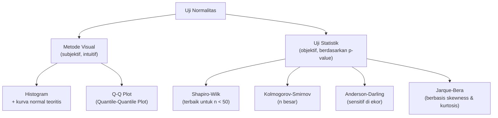

---

### 7.1 Metode Visual

#### Histogram dengan Kurva Normal

Histogram yang mendekati normal akan menunjukkan bentuk lonceng simetris. Dari materi ini ditampilkan histogram dengan kurva normal (garis merah melengkung) yang menunjukkan kecocokan distribusi data dengan distribusi normal teoritis.

```r
data <- rnorm(200, mean = 0, sd = 1)  # data normal

hist(data,
     probability = TRUE,
     main = "Histogram dengan Kurva Distribusi Normal",
     xlab = "Value",
     ylab = "Density",
     col  = "lightblue",
     border = "white")

# Overlay kurva normal teoritis
curve(dnorm(x, mean(data), sd(data)),
      add = TRUE, col = "red", lwd = 2)
```

**Cara membaca:**
- Bentuk **simetris seperti lonceng** → mendukung normalitas
- Ekor kiri/kanan jauh lebih panjang → ada skewness → tidak normal
- Puncak sangat runcing atau sangat datar → kurtosis bermasalah

#### Q-Q Plot (Quantile-Quantile Plot)

Q-Q Plot membandingkan kuantil data aktual dengan kuantil teoritis distribusi normal. Jika data normal, titik-titik akan **hampir tepat jatuh di garis diagonal**.

```r
# Q-Q Plot di R
data_normal  <- rnorm(100)
data_skewed  <- rexp(100)

par(mfrow = c(1, 2))

# Q-Q Plot untuk data normal
qqnorm(data_normal, main = "Q-Q Plot: Data Normal")
qqline(data_normal, col = "red", lwd = 2)

# Q-Q Plot untuk data skewed
qqnorm(data_skewed, main = "Q-Q Plot: Data Skewed")
qqline(data_skewed, col = "red", lwd = 2)

par(mfrow = c(1, 1))
```

**Cara membaca Q-Q Plot:**

| Pola Titik | Interpretasi |
|---|---|
| Titik mengikuti garis diagonal | Data mengikuti distribusi normal ✅ |
| Titik melengkung ke atas di ujung kanan | Ekor kanan lebih tebal (skewness positif) |
| Titik melengkung ke bawah di ujung kiri | Ekor kiri lebih tebal (skewness negatif) |
| Titik menyimpang di kedua ujung (S-shape) | Distribusi leptokurtik (ekor tebal) |

---

### 7.2 Uji Statistik

Semua uji statistik normalitas memiliki hipotesis yang sama:
- **H₀:** Data berdistribusi normal
- **H₁:** Data tidak berdistribusi normal

**Aturan keputusan:**
- **p-value > α (biasanya 0,05):** Gagal menolak H₀ → data kemungkinan normal
- **p-value ≤ 0,05:** Tolak H₀ → data kemungkinan tidak normal

#### Uji Shapiro-Wilk

Uji paling populer dan direkomendasikan untuk **sampel kecil hingga sedang (n < 50)**. Membandingkan korelasi antara data terurut dengan skor normalitas yang diharapkan.

```r
# Shapiro-Wilk di R (bawaan, tanpa paket tambahan)
data <- c(23, 25, 28, 22, 26, 24, 27, 29, 21, 25)

hasil_sw <- shapiro.test(data)
print(hasil_sw)
#>
#> 	Shapiro-Wilk normality test
#>
#> data:  data
#> W = 0.97283, p-value = 0.9211

# Interpretasi:
cat("W statistic:", hasil_sw$statistic, "\n")
cat("p-value:", hasil_sw$p.value, "\n")
if (hasil_sw$p.value > 0.05) {
  cat("Kesimpulan: Data KEMUNGKINAN NORMAL (gagal tolak H₀)\n")
} else {
  cat("Kesimpulan: Data TIDAK NORMAL (tolak H₀)\n")
}
```

**Karakteristik:**
- Statistik W berkisar 0–1; semakin dekat ke 1 → semakin normal
- Sangat sensitif untuk n kecil
- Kurang reliabel untuk n > 50 (hampir selalu menolak H₀)

#### Uji Kolmogorov-Smirnov

Membandingkan fungsi distribusi kumulatif empiris (ECDF) data dengan distribusi normal teoritis. Cocok untuk **sampel besar**.

```r
# Kolmogorov-Smirnov di R
data <- rnorm(100)  # data contoh

ks.test(data, "pnorm", mean(data), sd(data))
#>
#> 	Asymptotic one-sample Kolmogorov-Smirnov test
#>
#> data:  data
#> D = 0.074, p-value = 0.66
#> alternative hypothesis: two-sided
```

**Karakteristik:**
- Statistik D = deviasi maksimum antara ECDF dan CDF normal teoritis
- Semakin kecil D, semakin mirip dengan distribusi normal
- Kurang sensitif dibanding Shapiro-Wilk untuk sampel kecil

#### Uji Anderson-Darling

Variasi dari Kolmogorov-Smirnov yang memberikan **bobot lebih besar pada ekor distribusi** — lebih sensitif terhadap penyimpangan di area ekor.

```r
# Anderson-Darling (memerlukan paket nortest)
# install.packages("nortest")
library(nortest)

data <- c(15, 18, 22, 19, 25, 20, 17, 23, 21, 16)

ad.test(data)
#>
#> 	Anderson-Darling normality test
#>
#> data:  data
#> A = 0.22, p-value = 0.79
```

**Kapan lebih baik dari KS:** Ketika ada outlier di ekor distribusi yang ingin dideteksi.

#### Uji Jarque-Bera

Menguji normalitas berdasarkan **skewness (S) dan kurtosis (K)** data. Distribusi normal memiliki S = 0 dan K = 3 (excess kurtosis = 0).

```
         n     S²   (K - 3)²
JB = ─── × ── + ─────────
         6     1       4
```

Jika JB ≈ 0, distribusi mendekati normal.

```r
# Jarque-Bera (menggunakan paket tseries)
# install.packages("tseries")
library(tseries)

data <- rnorm(200)

jarque.bera.test(data)
#>
#> 	Jarque Bera Test
#>
#> data:  data
#> X-squared = 0.8, df = 2, p-value = 0.67
```

**Kelebihan:** Langsung mengukur dua karakteristik kunci normalitas (skewness dan kurtosis).  
**Kelemahan:** Kurang baik untuk sampel sangat kecil (n < 30).

### Perbandingan Keempat Uji

| Uji | Cocok untuk n | Kelebihan | Kekurangan |
|---|---|---|---|
| **Shapiro-Wilk** | n < 50 (ideal) | Paling powerful untuk n kecil | Kurang akurat untuk n besar |
| **Kolmogorov-Smirnov** | n besar | Umum, banyak tersedia | Sensitif ke parameter yang tidak diketahui |
| **Anderson-Darling** | n sedang-besar | Sensitif di ekor distribusi | Memerlukan paket tambahan |
| **Jarque-Bera** | n > 30 | Langsung berbasis skewness & kurtosis | Kurang cocok untuk n kecil |

**Rekomendasi praktis:**
1. **Selalu mulai dengan visualisasi** (histogram + Q-Q Plot)
2. Untuk **n < 50** → gunakan Shapiro-Wilk sebagai uji utama
3. Untuk **n besar** → gunakan Anderson-Darling atau Kolmogorov-Smirnov
4. Jika ada keraguan tentang skewness/kurtosis → tambahkan Jarque-Bera

---

## 8. Alur Kerja Transformasi Data

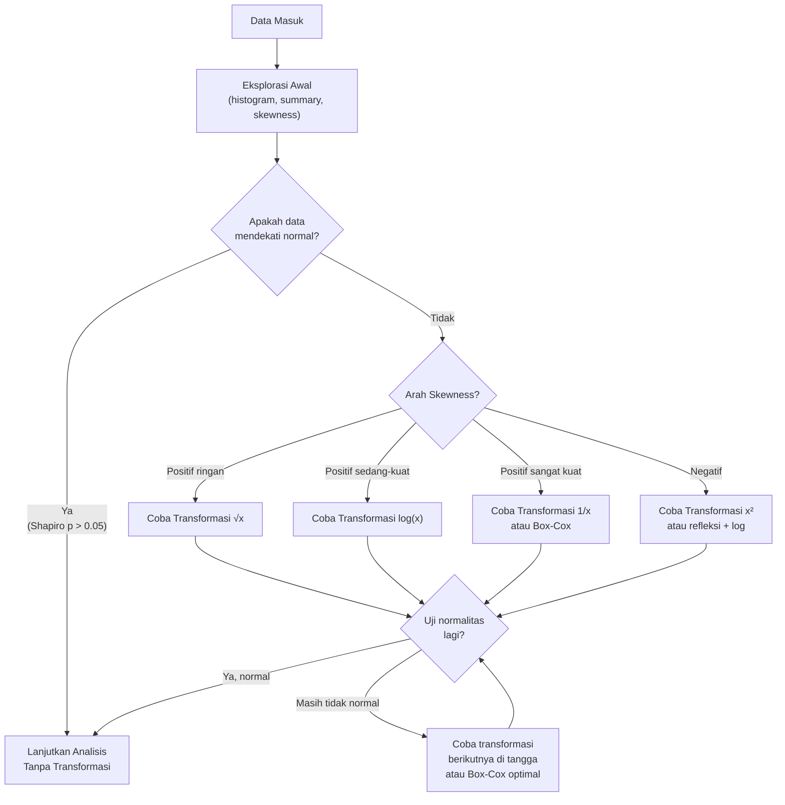

---

## 9. Ringkasan

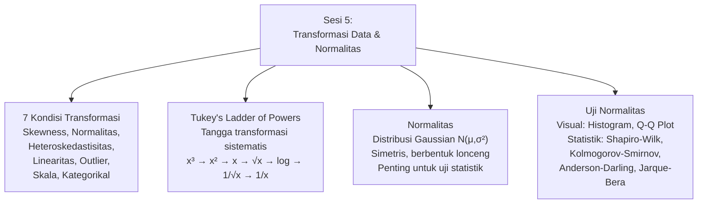

**Panduan cepat memilih transformasi:**

| Masalah | Solusi |
|---|---|
| Skewed positif ringan | `sqrt(x)` |
| Skewed positif sedang-kuat | `log(x)` atau `log(x+1)` jika ada nol |
| Skewed positif sangat kuat | `1/x` atau Box-Cox |
| Skewed negatif | `x²` atau refleksi dulu |
| Skala tidak seragam (ML) | Normalisasi atau Standardisasi |
| Data kategorikal | Label Encoding / One-Hot Encoding |
| Tidak tahu harus pakai apa | Box-Cox (cari λ optimal otomatis) |

**Aturan emas transformasi:**
1. **Selalu eksplorasi data dulu** sebelum memilih transformasi
2. **Visualisasikan sebelum dan sesudah** — transformasi harus terlihat membaik
3. **Uji normalitas sebelum dan sesudah** menggunakan Shapiro-Wilk
4. **Catat transformasi** yang digunakan agar bisa diinterpretasikan kembali ke skala asli

---

*Selamat Belajar...*
