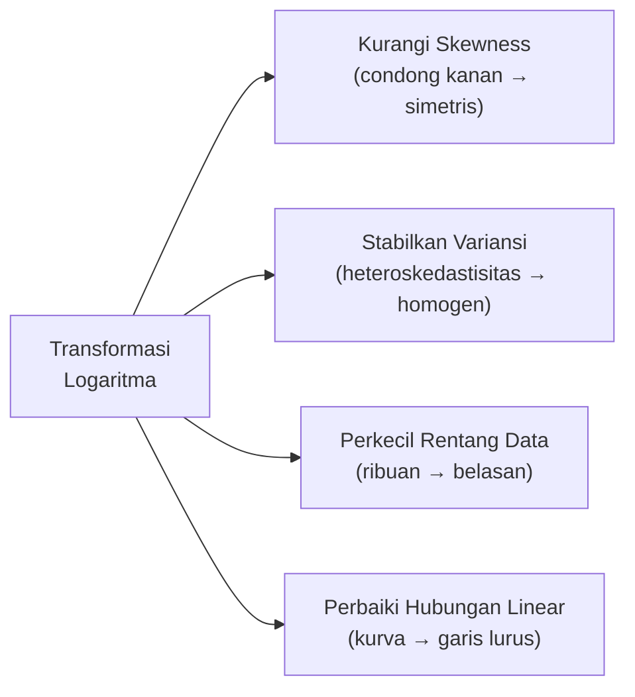
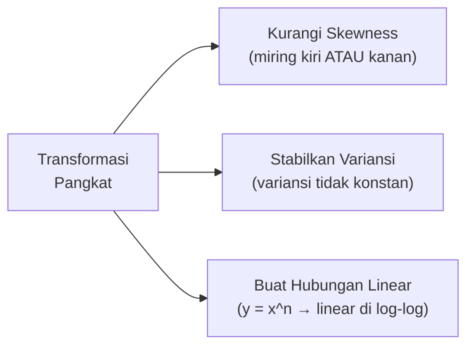
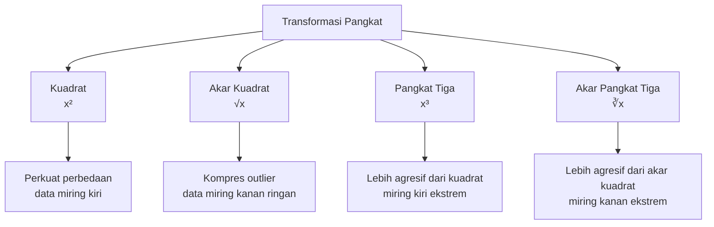
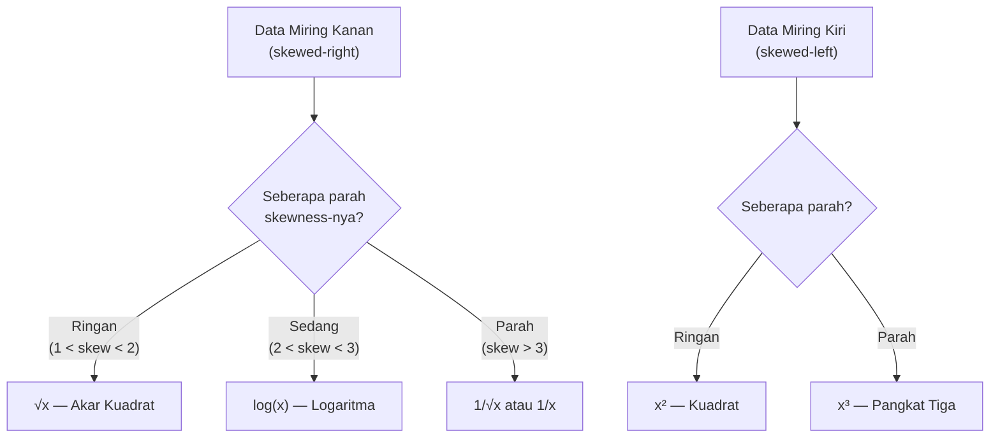
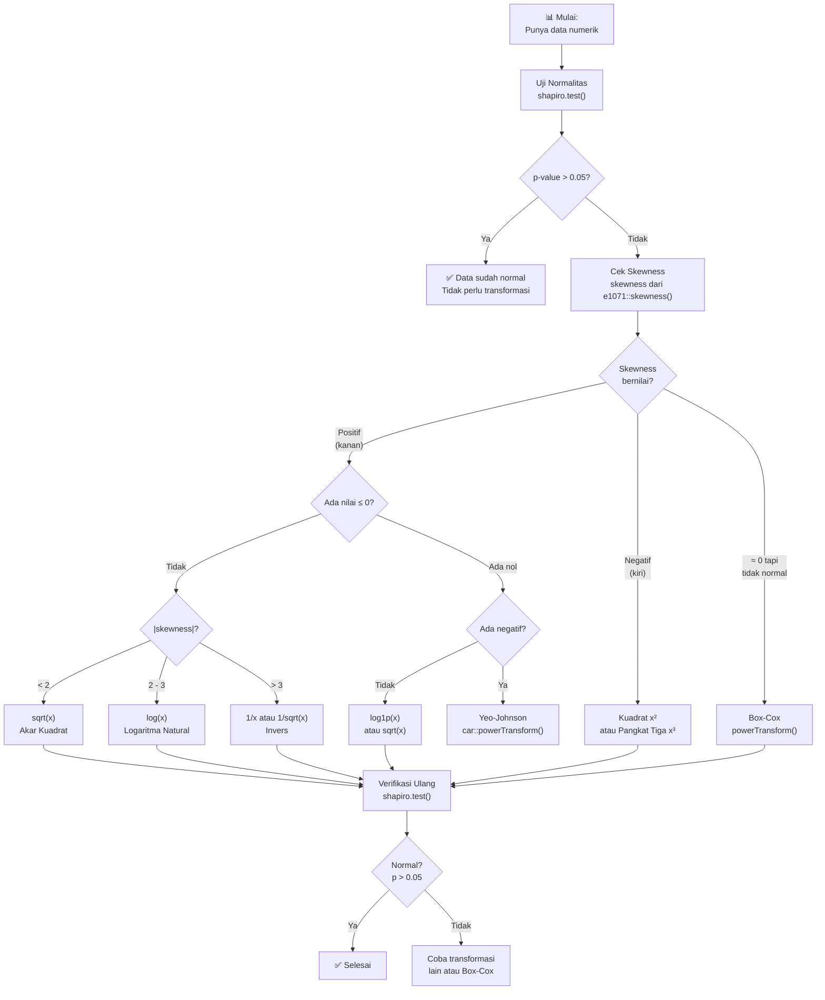
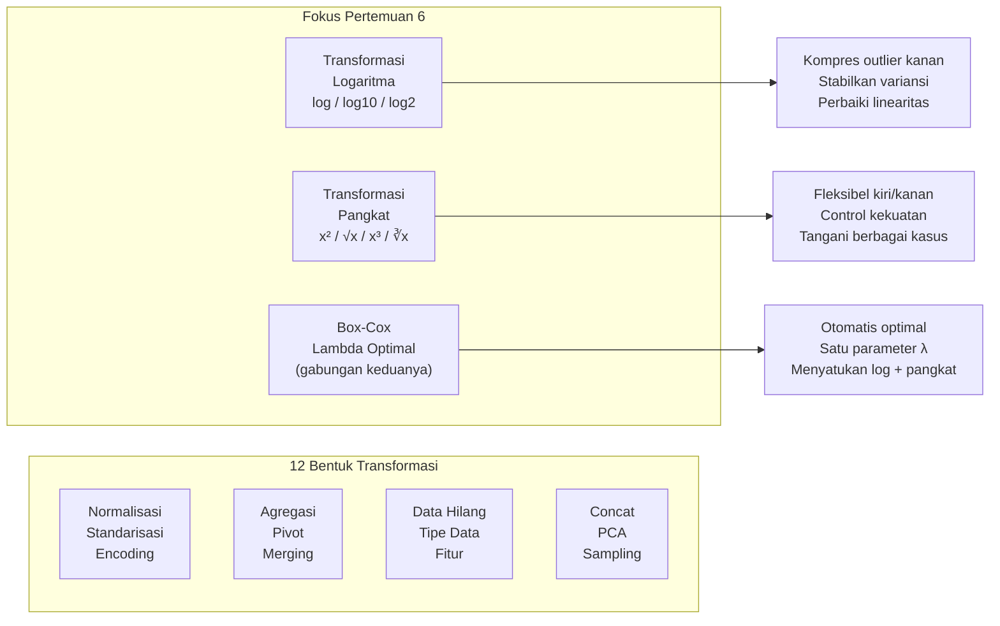

# Pertemuan 6 — Bentuk-Bentuk Transformasi Data

## Daftar Isi

1. [Pengantar Transformasi Data](#1-pengantar-transformasi-data)
2. [12 Bentuk Transformasi Data](#2-12-bentuk-transformasi-data)
3. [Transformasi Logaritma](#3-transformasi-logaritma)
4. [Transformasi Pangkat](#4-transformasi-pangkat)
5. [Perbandingan Log vs Pangkat](#5-perbandingan-log-vs-pangkat)
6. [Transformasi Box-Cox: Jembatan Keduanya](#6-transformasi-box-cox-jembatan-keduanya)
7. [Panduan Memilih Transformasi](#7-panduan-memilih-transformasi)

---

## 1. Pengantar Transformasi Data

**Transformasi data** adalah proses mengubah nilai-nilai dalam dataset dari satu bentuk ke bentuk lain agar data lebih sesuai untuk analisis statistik atau pemodelan.

Data di dunia nyata jarang sekali "bersih" — sering kali:
- Memiliki distribusi yang sangat miring (*skewed*)
- Memiliki satuan atau rentang yang berbeda-beda antar kolom
- Mengandung variabel kategori yang perlu dikodekan
- Memiliki hubungan non-linear yang menyulitkan pemodelan regresi

Transformasi data menyelesaikan masalah-masalah itu tanpa harus membuang data.

> **Analogi:** Bayangkan kamu ingin membandingkan tinggi manusia (meter) dengan berat (kilogram). Langsung dibandingkan tidak masuk akal karena satuannya berbeda. Transformasi membuatnya sebanding — seperti konversi mata uang sebelum membandingkan harga.

---

## 2. 12 Bentuk Transformasi Data

Terdapat 12 bentuk utama transformasi data yang digunakan dalam analisis:

```mermaid
flowchart TD
    A["🔄 Transformasi Data"] --> B1["1. Normalisasi"]
    A --> B2["2. Standarisasi"]
    A --> B3["3. Encoding Kategori"]
    A --> B4["4. Agregasi"]
    A --> B5["5. Pivoting & Unpivoting"]
    A --> B6["6. Penggabungan / Merging"]
    A --> B7["7. Penanganan Data Hilang"]
    A --> B8["8. Perubahan Tipe Data"]
    A --> B9["9. Ekstraksi Fitur"]
    A --> B10["10. Concatenation"]
    A --> B11["11. Reduksi Dimensi"]
    A --> B12["12. Sampling"]

    B1 --> C1["Skala 0–1\nMin-Max Scaling"]
    B2 --> C2["Mean=0, SD=1\nZ-Score"]
    B3 --> C3["OHE / Label\nEncoding"]
    B4 --> C4["SUM, AVG, COUNT\nper kelompok"]
    B5 --> C5["Baris ↔ Kolom\nwide/long format"]
    B6 --> C6["JOIN tabel\npada key tertentu"]
    B7 --> C7["Imputasi / Drop\nNaN / NULL"]
    B8 --> C8["int ↔ float ↔ str\nkonversi tipe"]
    B9 --> C9["Hari, Bulan, Tahun\ndari datetime"]
    B10 --> C10["Gabung string kolom\nmenjadi satu"]
    B11 --> C11["PCA, t-SNE\nkurangi fitur"]
    B12 --> C12["Random / Stratified\nbagian dari data"]
```



### Deskripsi Singkat Setiap Transformasi

| No | Transformasi | Tujuan | Contoh R |
|----|-------------|--------|----------|
| 1 | **Normalisasi** | Skala nilai ke rentang [0,1] | `(x - min(x)) / (max(x) - min(x))` |
| 2 | **Standarisasi** | Terpusat di mean=0, SD=1 | `scale(x)` |
| 3 | **Encoding Kategori** | Konversi teks ke angka | `model.matrix(~., data=df)` |
| 4 | **Agregasi** | Ringkas data per kelompok | `aggregate(y ~ grp, data, mean)` |
| 5 | **Pivoting/Unpivoting** | Ubah format wide ↔ long | `reshape()`, `tidyr::pivot_longer()` |
| 6 | **Merging** | Gabung dua tabel | `merge(df1, df2, by="id")` |
| 7 | **Data Hilang** | Isi atau hapus NA | `na.omit(x)`, `x[is.na(x)] <- mean(x, na.rm=T)` |
| 8 | **Perubahan Tipe** | Konversi tipe data | `as.numeric()`, `as.character()` |
| 9 | **Ekstraksi Fitur** | Buat fitur baru dari data ada | `format(tanggal, "%m")` |
| 10 | **Concatenation** | Gabung kolom teks | `paste(df$a, df$b, sep="-")` |
| 11 | **Reduksi Dimensi** | Kurangi jumlah variabel | `prcomp(df)` untuk PCA |
| 12 | **Sampling** | Ambil subset representatif | `sample(1:nrow(df), size=100)` |

---

## 3. Transformasi Logaritma

### 3.1 Konsep Dasar

Transformasi logaritma mengubah skala **eksponensial** (pertumbuhan cepat) menjadi **skala linear** yang lebih mudah dianalisis. Ketika sebuah variabel tumbuh secara eksponensial — seperti pendapatan, populasi, atau harga aset — logaritma "meratakan" pertumbuhan itu sehingga distribusinya lebih simetris.

**Formula umum:**

```
y = log_b(x)
```

Dimana `b` adalah basis logaritma dan `x` adalah nilai asli (harus > 0).

### 3.2 Tujuan Transformasi Logaritma



| Tujuan | Penjelasan | Kapan Digunakan |
|--------|-----------|-----------------|
| **Kurangi Skewness** | Data miring kanan (pendapatan, populasi) menjadi lebih normal | Skewness > 1 atau < -1 |
| **Stabilkan Variansi** | Variansi yang tumbuh seiring nilai rata-rata dikompres | Residual plot membentuk kerucut |
| **Perkecil Rentang** | Nilai ekstrem (1 juta vs 1000) dikompres agar tidak mendominasi | Outlier positif besar |
| **Perbaiki Linearitas** | Hubungan `y = a * b^x` → `log(y) = log(a) + x*log(b)` | Scatter plot melengkung |

### 3.3 Tiga Jenis Logaritma

| Jenis | Notasi | Basis | Fungsi R | Invers (Balik) |
|-------|--------|-------|----------|----------------|
| **Natural Log** | ln(x) | e ≈ 2.718 | `log(x)` | `exp(y)` |
| **Log Basis 10** | log₁₀(x) | 10 | `log10(x)` | `10^y` |
| **Log Basis 2** | log₂(x) | 2 | `log2(x)` | `2^y` |

> **Kapan pakai yang mana?**
> - **`log(x)`** — Default pilihan. Hasil koefisien regresi mudah diinterpretasikan sebagai persentase.
> - **`log10(x)`** — Ketika data dalam "orde besaran" (misalnya: pH, desibel, magnitudo gempa).
> - **`log2(x)`** — Populer di bioinformatika (fold-change ekspresi gen).

### 3.4 Sifat Matematika Penting

```
log(a × b) = log(a) + log(b)     # perkalian → penjumlahan
log(a / b) = log(a) - log(b)     # pembagian → pengurangan
log(a^n)   = n × log(a)          # pangkat → perkalian
log(1)     = 0                   # selalu
log(e)     = 1  (untuk ln)       # basis e
```

### 3.5 Contoh 1 — Transformasi Pendapatan

**Data pendapatan** (dalam juta rupiah):

```r
income <- c(25, 30, 35, 40, 100, 200, 300, 400, 500, 1000)
```

**Distribusi asli** — sangat miring kanan:
- Range: 25 – 1000 (rasio 40:1)
- Nilai 1000 jauh dari nilai lainnya (outlier)

```r
# Transformasi logaritma natural
log_income <- log(income)

# Tampilkan perbandingan
data.frame(
  asli    = income,
  log_alami = round(log(income), 3),
  log10   = round(log10(income), 3),
  log2    = round(log2(income), 3)
)
```

**Output:**

| Asli (income) | ln(income) | log₁₀(income) | log₂(income) |
|:---:|:---:|:---:|:---:|
| 25 | 3.219 | 1.398 | 4.644 |
| 30 | 3.401 | 1.477 | 4.907 |
| 35 | 3.555 | 1.544 | 5.129 |
| 40 | 3.689 | 1.602 | 5.322 |
| 100 | 4.605 | 2.000 | 6.644 |
| 200 | 5.298 | 2.301 | 7.644 |
| 300 | 5.704 | 2.477 | 8.229 |
| 400 | 5.991 | 2.602 | 8.644 |
| 500 | 6.215 | 2.699 | 8.966 |
| 1000 | 6.908 | 3.000 | 9.966 |

Perhatikan: perbedaan antara nilai 500 dan 1000 sekarang hanya **0.693** (ln) vs selisih asli **500**. Outlier sudah dikompres.

```r
# Visualisasi sebelum dan sesudah
par(mfrow = c(1, 2))

hist(income,
     main = "Sebelum Transformasi",
     xlab = "Pendapatan (juta)",
     col  = "lightcoral",
     breaks = 10)

hist(log_income,
     main = "Sesudah Transformasi (ln)",
     xlab = "ln(Pendapatan)",
     col  = "lightblue",
     breaks = 10)

par(mfrow = c(1, 1))  # kembalikan ke 1 panel
```

### 3.6 Menangani Nilai Nol dan Negatif

Logaritma **tidak terdefinisi** untuk `x ≤ 0`. Solusinya:

```r
# Strategi 1: Tambah konstanta kecil (paling umum)
log1p(x)           # setara dengan log(x + 1), aman untuk x = 0
log(x + 0.001)     # jika x bisa 0 dan perlu presisi tinggi

# Strategi 2: Cek dulu sebelum transformasi
x_clean <- ifelse(x <= 0, NA, x)
log_x   <- log(x_clean)

# Strategi 3: Signed log (untuk data dengan nilai negatif)
signed_log <- sign(x) * log(abs(x) + 1)
```

> **Mengapa `log(x + 1)` aman?** Karena `log(0 + 1) = log(1) = 0`, sehingga nilai nol dipetakan ke nol — masuk akal secara semantik.

### 3.7 Interpretasi Hasil dan Back-Transformation

Setelah analisis pada skala log, kembalikan ke skala asli dengan **invers**:

```r
# Jika log natural digunakan:
income_asli <- exp(log_income)      # exp() adalah invers dari log()

# Jika log10 digunakan:
income_asli <- 10^log10_income

# Contoh: koefisien regresi pada skala log
# β = 0.5 artinya: setiap kenaikan 1 unit X,
# Y naik sebesar (e^0.5 - 1) × 100% ≈ 64.9%
exp(0.5) - 1   # = 0.6487 → ≈ 65%
```

---

## 4. Transformasi Pangkat

### 4.1 Konsep Dasar

Transformasi pangkat (power transformation) mengubah skala data menggunakan operasi matematika pangkat atau akar. Berbeda dengan logaritma yang selalu mengkompres nilai besar, transformasi pangkat bisa:
- **Mengkompres** nilai besar → akar kuadrat, akar pangkat tiga
- **Memperbesar perbedaan** nilai kecil → kuadrat, pangkat tiga

Ini memberi fleksibilitas untuk menangani berbagai bentuk distribusi miring.

### 4.2 Tujuan Transformasi Pangkat



### 4.3 Empat Jenis Transformasi Pangkat



| Jenis | Formula | Fungsi R | Efek pada Distribusi | Batasan |
|-------|---------|----------|---------------------|---------|
| **Kuadrat** | x² | `x^2` | Memperbesar perbedaan, tangani skewed-kiri | Nilai negatif tetap valid |
| **Akar Kuadrat** | √x | `sqrt(x)` | Kompres nilai besar, tangani skewed-kanan | x ≥ 0 |
| **Pangkat Tiga** | x³ | `x^3` | Efek kuadrat lebih kuat, mempertahankan tanda | Tidak ada |
| **Akar Pangkat Tiga** | ∛x | `x^(1/3)` | Kompres lebih kuat dari √x, tangani x negatif | Aman untuk negatif |

### 4.4 Contoh 2 — Transformasi Kuadrat

```r
# Data awal
data <- c(1, 2, 3, 4, 5, 6, 7, 8, 9, 10)

# Transformasi kuadrat
data_squared <- data^2

# Perbandingan
data.frame(
  asli    = data,
  kuadrat = data_squared
)
```

| Asli | Kuadrat | Selisih Berurutan (kuadrat) |
|:---:|:---:|:---:|
| 1 | 1 | — |
| 2 | 4 | +3 |
| 3 | 9 | +5 |
| 4 | 16 | +7 |
| 5 | 25 | +9 |
| 6 | 36 | +11 |
| 7 | 49 | +13 |
| 8 | 64 | +15 |
| 9 | 81 | +17 |
| 10 | 100 | +19 |

Selisih berurutan yang selalu naik menunjukkan distribusi hasil bergerak **menjauhi** distribusi uniform — transformasi kuadrat cocok untuk data yang miring ke **kiri** (ingin "menarik" ekor kiri ke atas).

```r
# Visualisasi sebelum dan sesudah
par(mfrow = c(2, 2))

# Data asli
hist(data,
     main = "Asli: Distribusi Seragam",
     xlab = "Nilai",
     col  = "lightgreen",
     breaks = 10)

plot(data, type = "b",
     main = "Asli: Linear",
     ylab = "Nilai",
     col  = "darkgreen", pch = 19)

# Setelah kuadrat
hist(data_squared,
     main = "Setelah Kuadrat (x²)",
     xlab = "x²",
     col  = "lightyellow",
     breaks = 10)

plot(data, data_squared, type = "b",
     main = "Hubungan: Parabola",
     xlab = "x", ylab = "x²",
     col  = "darkorange", pch = 19)

par(mfrow = c(1, 1))
```

### 4.5 Contoh 3 — Akar Kuadrat untuk Data Miring Kanan

```r
# Data miring kanan (count data, misal: jumlah kecelakaan per hari)
kecelakaan <- c(0, 0, 1, 1, 1, 2, 2, 3, 4, 5, 7, 10, 15, 25, 50)

cat("Skewness asli    :", round(mean((kecelakaan - mean(kecelakaan))^3) /
                                sd(kecelakaan)^3, 3), "\n")

# Transformasi akar kuadrat
sqrt_kecelakaan <- sqrt(kecelakaan)

cat("Skewness sqrt    :", round(mean((sqrt_kecelakaan - mean(sqrt_kecelakaan))^3) /
                                sd(sqrt_kecelakaan)^3, 3), "\n")

# Transformasi akar pangkat tiga (lebih agresif)
cbrt_kecelakaan <- kecelakaan^(1/3)

cat("Skewness cbrt    :", round(mean((cbrt_kecelakaan - mean(cbrt_kecelakaan))^3) /
                                sd(cbrt_kecelakaan)^3, 3), "\n")
```

### 4.6 Hubungan dengan Tukey's Ladder of Powers

Transformasi pangkat adalah bagian dari **tangga Tukey** — sebuah kerangka sistematis memilih transformasi:

```
x³  → x²  → x  → √x  → log(x)  → 1/√x  → 1/x
  ↑ naik tangga (perkuat nilai)      turun tangga (kompres nilai) ↓
```

| Posisi Tangga | Transformasi | Kapan Digunakan |
|:---:|:---:|---|
| Naik (+3) | x³ | Skewed sangat ke kiri |
| Naik (+2) | x² | Skewed ke kiri |
| Normal (1) | x | Distribusi sudah oke |
| Turun (0.5) | √x | Skewed kanan ringan |
| Turun (0) | log(x) | Skewed kanan sedang |
| Turun (-0.5) | 1/√x | Skewed kanan kuat |
| Turun (-1) | 1/x | Skewed kanan ekstrem |

### 4.7 Hal yang Perlu Diperhatikan

**Nilai nol dan negatif:**

```r
# Akar kuadrat: x >= 0 wajib!
x <- c(-2, 0, 1, 4, 9)
sqrt(x)        # menghasilkan NaN untuk x negatif dan 0 OK

# Solusi 1: hanya transformasi nilai positif
x_pos <- x[x >= 0]
sqrt(x_pos)

# Solusi 2: tambah konstanta
sqrt(x + abs(min(x)) + 1)   # geser seluruh data ke positif

# Akar pangkat tiga: AMAN untuk nilai negatif!
(-8)^(1/3)     # = -2 ✓ (secara matematika)
# Tapi R tidak selalu menangani ini dengan benar untuk bilangan negatif:
# Gunakan:
sign(x) * abs(x)^(1/3)     # cara aman di R untuk ∛x termasuk negatif
```

**Interpretasi hasil:**

```r
# Setelah model regresi dengan √x sebagai prediktor:
# β = 3.5 artinya: kenaikan 1 unit √x dikaitkan dengan
# kenaikan 3.5 unit Y
# Ini BUKAN "kenaikan 1 unit x asli"!

# Untuk prediksi, balik transformasi dulu:
x_transformed <- 4          # nilai pada skala √x
x_asli        <- x_transformed^2   # = 16 (skala asli)
```

---

## 5. Perbandingan Log vs Pangkat



| Aspek | Transformasi Log | Transformasi Pangkat |
|-------|-----------------|---------------------|
| **Arah skewness** | Miring kanan | Fleksibel (kanan atau kiri) |
| **Kekuatan kompresi** | Sangat kuat pada nilai besar | Tergantung eksponen |
| **Nilai nol** | Tidak bisa (perlu +1) | Aman (kecuali akar) |
| **Nilai negatif** | Tidak bisa (perlu offset) | Aman untuk pangkat ganjil |
| **Interpretasi** | Persentase (regresi) | Lebih kompleks |
| **Fungsi R** | `log()`, `log10()`, `log2()` | `sqrt()`, `x^n`, `x^(1/3)` |
| **Invers** | `exp()`, `10^y`, `2^y` | `y^2`, `y^(1/0.5)` |
| **Penggunaan umum** | Ekonomi, biologi, fisika | Sains data, psikologi |

### Tabel Keputusan Cepat

| Kondisi | Pilihan Terbaik |
|---------|----------------|
| Skewed kanan, nilai > 0 | `log(x)` |
| Skewed kanan, ada nilai = 0 | `log1p(x)` atau `sqrt(x)` |
| Skewed kanan ringan | `sqrt(x)` |
| Skewed kiri | `x^2` atau `x^3` |
| Ingin otomatis optimal | Box-Cox |
| Count data (bilangan bulat ≥ 0) | `sqrt(x)` atau `sqrt(x + 0.5)` |
| Distribusi sudah normal | Tidak perlu transformasi |

---

## 6. Transformasi Box-Cox: Jembatan Keduanya

Transformasi **Box-Cox** (1964) adalah kerangka umum yang **menyatukan** logaritma dan pangkat dalam satu formula dengan parameter λ (lambda):

```
y(λ) = (x^λ - 1) / λ     jika λ ≠ 0
y(λ) = log(x)             jika λ = 0
```

Dengan memilih λ optimal, Box-Cox secara otomatis menemukan transformasi terbaik:

| Nilai λ | Transformasi Setara |
|:-------:|:-------------------:|
| λ = 2 | Kuadrat (x²) |
| λ = 1 | Tidak ada transformasi |
| λ = 0.5 | Akar kuadrat (√x) |
| λ = 0 | Logaritma natural (ln x) |
| λ = -0.5 | Invers akar (1/√x) |
| λ = -1 | Invers (1/x) |

```r
library(MASS)

# Contoh: cari λ optimal untuk data income
income <- c(25, 30, 35, 40, 100, 200, 300, 400, 500, 1000)

# Perlu model regresi untuk Box-Cox
# Buat model sederhana dengan outcome income
model <- lm(income ~ 1)
bc <- boxcox(model, lambda = seq(-2, 2, 0.1))

# λ optimal
lambda_optimal <- bc$x[which.max(bc$y)]
cat("λ optimal:", lambda_optimal, "\n")

# Terapkan transformasi
if (abs(lambda_optimal) < 0.01) {
  income_bc <- log(income)                              # λ ≈ 0
} else {
  income_bc <- (income^lambda_optimal - 1) / lambda_optimal
}

# Uji normalitas sebelum dan sesudah
shapiro.test(income)$p.value     # sebelum
shapiro.test(income_bc)$p.value  # sesudah (harap > 0.05)
```

> Box-Cox hanya bekerja untuk **x > 0**. Untuk data dengan nilai nol atau negatif, gunakan **Yeo-Johnson** yang tidak memiliki batasan ini (`car::powerTransform()` di R).

---

## 7. Panduan Memilih Transformasi

### Flowchart Keputusan Lengkap



### Kode Lengkap: Pipeline Transformasi Otomatis

```r
# Fungsi helper: deteksi dan terapkan transformasi terbaik
auto_transform <- function(x, verbose = TRUE) {
  # Hitung skewness manual (tanpa library tambahan)
  n       <- length(x)
  mu      <- mean(x, na.rm = TRUE)
  sigma   <- sd(x, na.rm = TRUE)
  skew    <- mean(((x - mu) / sigma)^3, na.rm = TRUE)

  if (verbose) cat(sprintf("Skewness asli: %.3f\n", skew))

  # Pilih transformasi
  if (abs(skew) < 0.5) {
    if (verbose) cat("Data mendekati normal, tidak perlu transformasi.\n")
    return(x)
  } else if (skew > 0) {
    # Miring kanan
    if (any(x <= 0, na.rm = TRUE)) {
      if (verbose) cat("Miring kanan + nilai <= 0: gunakan log1p(x)\n")
      return(log1p(x))
    } else if (skew < 2) {
      if (verbose) cat("Miring kanan ringan: gunakan sqrt(x)\n")
      return(sqrt(x))
    } else {
      if (verbose) cat("Miring kanan kuat: gunakan log(x)\n")
      return(log(x))
    }
  } else {
    # Miring kiri
    if (verbose) cat("Miring kiri: gunakan x^2\n")
    return(x^2)
  }
}

# Uji pipeline
income <- c(25, 30, 35, 40, 100, 200, 300, 400, 500, 1000)
income_t <- auto_transform(income)

# Bandingkan normalitas
cat("\nShapiro-Wilk sebelum:", shapiro.test(income)$p.value, "\n")
cat("Shapiro-Wilk sesudah:", shapiro.test(income_t)$p.value, "\n")
```

### Checklist Sebelum dan Sesudah Transformasi

| Tahap | Langkah | Fungsi R |
|-------|---------|----------|
| **Sebelum** | Cek distribusi | `hist()`, `qqnorm()` |
| **Sebelum** | Uji normalitas | `shapiro.test()` |
| **Sebelum** | Hitung skewness | `e1071::skewness()` |
| **Sebelum** | Cek nilai nol/negatif | `any(x <= 0)` |
| **Pilih** | Tentukan transformasi | Flowchart di atas |
| **Terapkan** | Transformasi data | `log()`, `sqrt()`, dll |
| **Sesudah** | Verifikasi normalitas | `shapiro.test()` |
| **Sesudah** | Cek distribusi ulang | `hist()`, `qqnorm()` |
| **Sesudah** | Catat transformasi | Dokumentasi pipeline |
| **Prediksi** | Back-transform hasil | `exp()`, `^2`, dll |

---

## Ringkasan



| Konsep | Poin Kunci |
|--------|-----------|
| **Transformasi Log** | Gunakan untuk data miring kanan, nilai > 0, invers dengan `exp()` |
| **Log + 1** | Gunakan `log1p()` atau `log(x+1)` jika ada nilai nol |
| **Akar Kuadrat** | Miring kanan ringan, data count, `sqrt(x)` |
| **Kuadrat** | Miring kiri, perkuat perbedaan, `x^2` |
| **Pangkat Tiga** | Miring kiri ekstrem, aman untuk negatif, `x^3` |
| **Akar Pangkat Tiga** | Miring kanan ekstrem, aman untuk negatif, `x^(1/3)` |
| **Box-Cox** | Pilih λ optimal otomatis, hanya untuk x > 0 |
| **Back-transform** | Selalu kembalikan ke skala asli sebelum interpretasi |
