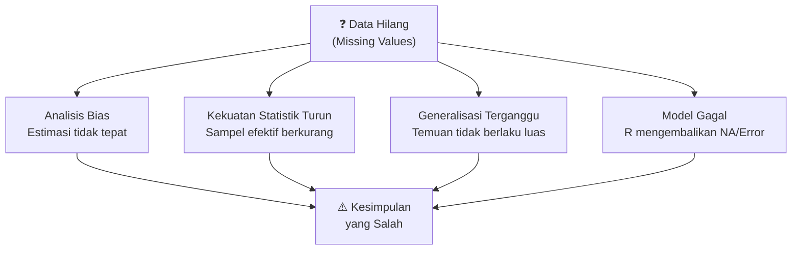
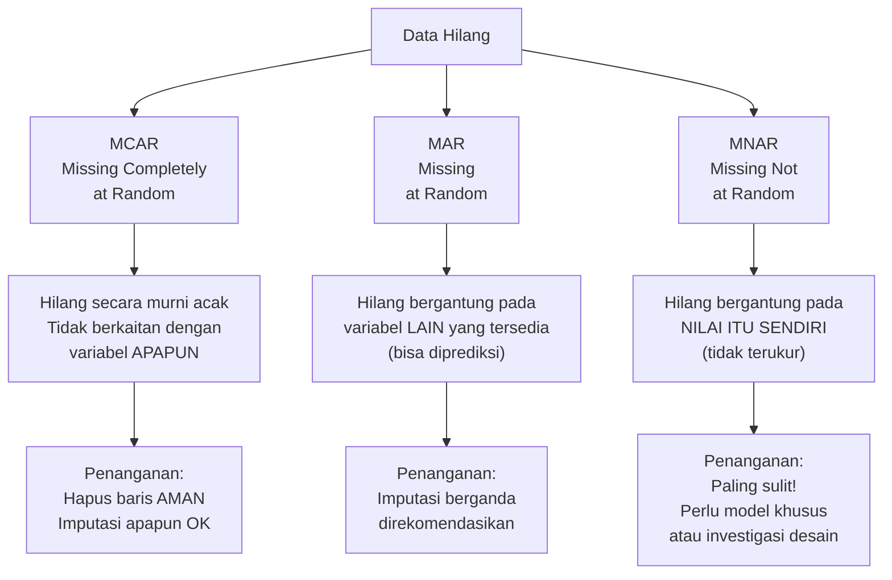
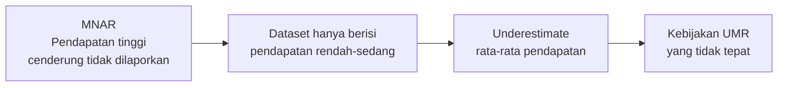
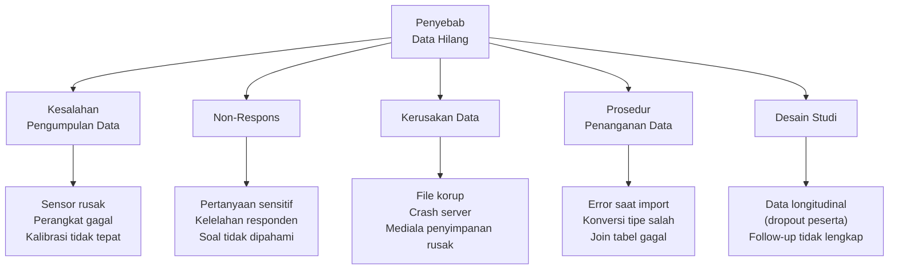
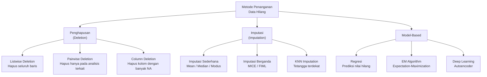
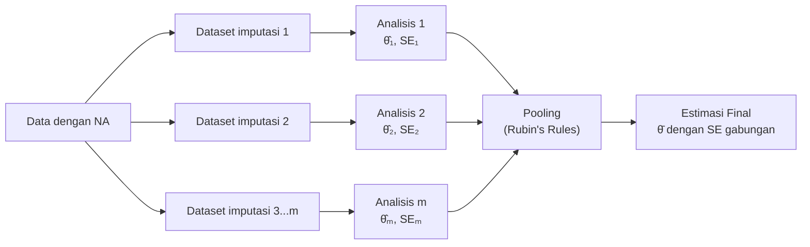
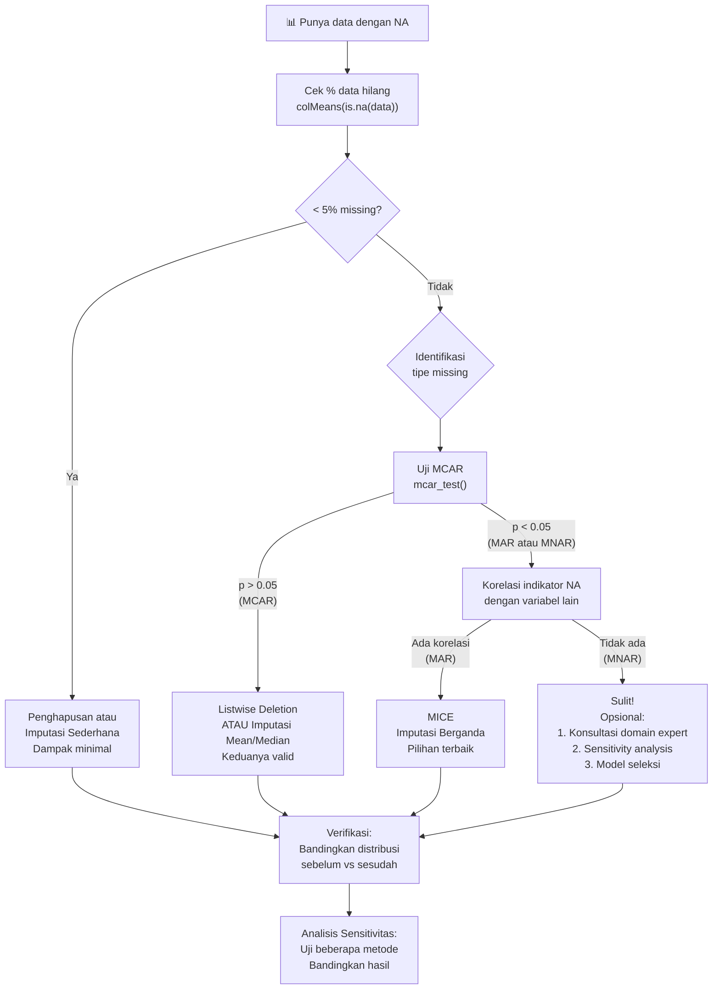
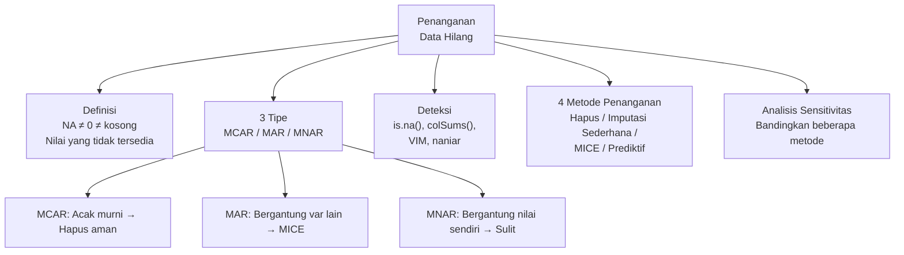

# Pertemuan 7 — Definisi dan Karakteristik Data Hilang

**MSIM4310 Analisis dan Visualisasi Data**  
Program Studi Sistem Informasi — Universitas Terbuka

> Catatan: dokumen ini merupakan ekstraksi sekaligus elaborasi dari materi *Inisiasi 7 — Definisi dan Karakteristik Data Hilang*. Setiap konsep dijelaskan lebih dalam dengan contoh nyata, kode R lengkap, dan diagram agar lebih mudah dipahami secara utuh.

---

## Daftar Isi

1. [Mengapa Data Hilang adalah Masalah Serius?](#1-mengapa-data-hilang-adalah-masalah-serius)
2. [Definisi Data Hilang](#2-definisi-data-hilang)
3. [Tipe-Tipe Data Hilang](#3-tipe-tipe-data-hilang)
   - [MCAR — Missing Completely at Random](#31-mcar--missing-completely-at-random)
   - [MAR — Missing at Random](#32-mar--missing-at-random)
   - [MNAR — Missing Not at Random](#33-mnar--missing-not-at-random)
   - [Perbandingan Ketiga Tipe](#34-perbandingan-ketiga-tipe)
4. [Penyebab Data Hilang](#4-penyebab-data-hilang)
5. [Dampak Data Hilang](#5-dampak-data-hilang)
6. [Deteksi Data Hilang di R](#6-deteksi-data-hilang-di-r)
7. [Teknik Penanganan Data Hilang](#7-teknik-penanganan-data-hilang)
   - [Penghapusan Baris/Kolom](#71-penghapusan-bariskolom-listwise--pairwise-deletion)
   - [Imputasi Sederhana](#72-imputasi-sederhana)
   - [Imputasi Berganda dengan MICE](#73-imputasi-berganda-multiple-imputation-dengan-mice)
   - [Predictive Imputation](#74-predictive-imputation)
8. [Analisis Sensitivitas](#8-analisis-sensitivitas)
9. [Panduan Memilih Metode Penanganan](#9-panduan-memilih-metode-penanganan)
10. [Ringkasan](#10-ringkasan)

---

## 1. Mengapa Data Hilang adalah Masalah Serius?

Bayangkan kamu melakukan riset tentang hubungan antara **pendapatan** dan **tingkat kebahagiaan** pada 1.000 responden. Setelah survei selesai, ternyata 200 responden (20%) tidak mengisi kolom pendapatan. Apa yang terjadi?

- Jika kamu langsung menghapus 200 baris itu → sampel jadi 800 orang, dan mungkin yang tidak isi adalah orang kaya atau miskin (bias)
- Jika kamu mengisi pendapatan yang hilang dengan rata-rata → kamu secara artifisial mempersempit distribusi pendapatan
- Jika kamu membiarkannya → sebagian besar fungsi R akan mengembalikan `NA` dan analisis gagal

**Data hilang bukan sekadar "baris kosong"** — ia mengandung informasi tentang *mengapa* data itu tidak ada, dan keputusan yang salah dalam menanganinya dapat menghasilkan kesimpulan yang menyesatkan.



---

## 2. Definisi Data Hilang

**Data hilang** (*missing data* atau *missing values*) adalah kondisi di mana satu atau lebih nilai dalam dataset **tidak tersedia, tidak tercatat, atau tidak dapat digunakan** untuk analisis.

Dalam R, data hilang direpresentasikan sebagai **`NA`** (*Not Available*). Jenis lain yang perlu diwaspadai:

| Simbol | Arti | Konteks |
|--------|------|---------|
| `NA` | Not Available — nilai umum yang hilang | Numeric, character, logical |
| `NaN` | Not a Number — hasil operasi tidak terdefinisi | `0/0`, `sqrt(-1)` |
| `NULL` | Objek kosong — bukan nilai, tapi ketiadaan objek | List, argumen fungsi |
| `Inf` / `-Inf` | Tak terhingga — bukan hilang tapi bisa bermasalah | `1/0`, `-1/0` |
| `""` | String kosong — secara teknis bukan NA tapi semantiknya hilang | Data teks survei |

> **Penting:** `NA` ≠ `0` dan `NA` ≠ `""`. Nilai nol (0) adalah nilai yang valid — seseorang yang penghasilannya 0 itu berbeda dengan seseorang yang tidak mengisi pertanyaan penghasilan.

```r
# Cek jenis missing di R
x <- c(1, NA, NaN, Inf, -Inf, 0)
is.na(x)      # TRUE untuk NA dan NaN
is.nan(x)     # TRUE hanya untuk NaN
is.infinite(x) # TRUE untuk Inf dan -Inf
is.finite(x)  # TRUE hanya untuk 1 dan 0
```

---

## 3. Tipe-Tipe Data Hilang

Ini adalah konsep paling penting dalam analisis data hilang. Tipe data hilang menentukan **metode penanganan yang tepat** — pemilihan yang salah bisa menghasilkan bias yang lebih besar dari data hilang itu sendiri.



### 3.1 MCAR — Missing Completely at Random

**MCAR** berarti hilangnya data murni kebetulan — tidak ada pola, tidak ada hubungan dengan nilai variabel manapun, baik yang hilang maupun yang tersedia.

**Analogi:** Kamu menumpahkan kopi ke lembar kuesioner secara acak sehingga beberapa jawaban tidak terbaca. Tidak ada kecenderungan kopi tumpah ke bagian pertanyaan tertentu.

**Contoh konkret:**
- Responden melewatkan pertanyaan karena halaman terselip (tidak sengaja)
- Sensor suhu gagal merekam karena gangguan listrik sesaat yang acak
- File data terpotong karena masalah penyimpanan yang random

**Ciri-ciri:**
- Proporsi data hilang sama di semua subkelompok
- Menghapus baris yang hilang tidak memperkenalkan bias
- Paling mudah ditangani dari ketiga tipe

**Uji formal:** Little's MCAR Test

```r
library(naniar)
# Uji Little MCAR (hipotesis nol: data MCAR)
mcar_test(data)
# Jika p-value > 0.05: tidak cukup bukti menolak MCAR
# Jika p-value < 0.05: kemungkinan MAR atau MNAR
```

### 3.2 MAR — Missing at Random

**MAR** berarti hilangnya data tidak sepenuhnya acak, tetapi dapat **dijelaskan oleh variabel lain yang tersedia** dalam dataset. Nama "at Random" sebenarnya agak menyesatkan — lebih tepat disebut "conditionally random".

**Analogi:** Perempuan cenderung tidak mengisi kolom "pendapatan" pada survei. Hilangnya data pendapatan bergantung pada variabel "jenis kelamin" yang tersedia di dataset.

**Contoh konkret:**
- Lansia lebih mungkin tidak mengisi pertanyaan teknis tentang penggunaan aplikasi (hilangnya bergantung pada usia yang tersedia)
- Responden dengan pendidikan rendah lebih mungkin melewatkan pertanyaan bertingkat (bergantung pada variabel pendidikan)
- Pengukuran glukosa darah tidak dilakukan pada pasien yang tidak datang ke klinik, dan ketidakhadiran berkorelasi dengan lokasi tempat tinggal (bergantung pada variabel lokasi)

**Ciri-ciri:**
- Data yang hilang berkorelasi dengan variabel lain yang ada di dataset
- Bisa "dimodelkan" dan diimputasi menggunakan variabel lain
- Penghapusan baris masih bisa bias — imputasi lebih disukai

**Cara mendeteksi:**

```r
# Buat variabel indikator: apakah income hilang?
data$income_missing <- is.na(data$income)

# Uji apakah variabel lain berkorelasi dengan indikator hilang
t.test(age ~ income_missing, data = data)
# Jika p < 0.05: usia berkorelasi dengan hilangnya income → MAR
```

### 3.3 MNAR — Missing Not at Random

**MNAR** adalah skenario paling bermasalah. Hilangnya data **bergantung pada nilai itu sendiri** — yaitu nilai yang seharusnya ada, tapi justru tidak ada karena nilainya tertentu.

**Analogi:** Orang dengan pendapatan sangat tinggi enggan melaporkan pendapatannya. Hilangnya data pendapatan bergantung pada nilai pendapatan itu sendiri (yang tidak tersedia).

**Contoh konkret:**
- Pasien dengan gejala depresi berat tidak datang ke klinik untuk evaluasi → skor depresi tinggi justru hilang dari dataset
- Mahasiswa yang mendapat nilai sangat buruk mengundurkan diri dari ujian → skor rendah hilang dari dataset
- Perusahaan dengan kinerja keuangan buruk tidak mempublikasikan laporan keuangan

**Ciri-ciri:**
- Tidak bisa dimodelkan dari variabel yang ada (karena hubungannya dengan nilai yang hilang itu sendiri)
- Imputasi standar akan bias
- Diperlukan asumsi eksplisit atau data tambahan dari luar
- Idealnya ditangani dengan redesain pengumpulan data

**Implikasi:**



### 3.4 Perbandingan Ketiga Tipe

| Aspek | MCAR | MAR | MNAR |
|-------|------|-----|------|
| **Pola hilang** | Murni acak | Bergantung variabel lain | Bergantung nilai itu sendiri |
| **Bisa diprediksi?** | Tidak | Ya (dari data yang ada) | Tidak (dari data yang ada) |
| **Bias jika dihapus?** | Minimal | Mungkin ada | Hampir pasti ada |
| **Metode terbaik** | Hapus atau imputasi apapun | Imputasi berganda (MICE) | Model seleksi / redesain |
| **Deteksi** | Little's test | Korelasi dengan indikator | Sulit — butuh pengetahuan domain |
| **Frekuensi di dunia nyata** | Jarang (ideal) | Paling umum | Sering (tapi sering diabaikan) |

---

## 4. Penyebab Data Hilang



| Penyebab | Contoh Nyata | Tipe Missing Kemungkinan |
|----------|-------------|--------------------------|
| **Kesalahan pengumpulan** | Sensor IoT di gudang mati karena baterai habis | MCAR (jika acak), MNAR (jika kondisi tertentu) |
| **Non-respons survei** | Pertanyaan tentang penghasilan tidak dijawab | MAR atau MNAR |
| **Kelelahan responden** | Pertanyaan di halaman terakhir sering dilewat | MAR (bergantung posisi pertanyaan) |
| **Kerusakan data** | File Excel korup saat transfer via email | MCAR |
| **Error impor data** | Kolom tanggal terbaca sebagai string, gagal diparse | MCAR atau MAR |
| **Dropout studi longitudinal** | Peserta penelitian 2 tahun berhenti di tengah | MAR atau MNAR |
| **Data sensitif** | Riwayat penyakit mental tidak dilaporkan | MNAR |
| **Desain database** | Kolom baru ditambahkan → data lama otomatis NULL | MCAR |

---

## 5. Dampak Data Hilang

### 5.1 Bias Estimasi

Ketika data yang hilang tidak acak (MAR atau MNAR), statistik yang dihitung dari data yang tersisa tidak merepresentasikan populasi sebenarnya.

**Contoh kuantitatif:**

Misalkan pendapatan 10 orang (dalam juta): `[3, 5, 7, 8, 10, 15, 20, 30, 50, 100]`

- Mean sebenarnya: **24,8 juta**
- Jika 3 nilai tertinggi hilang (MNAR): `[3, 5, 7, 8, 10, 15, 20]` → Mean = **9,71 juta**
- Bias: **−61%** dari nilai sebenarnya

```r
# Ilustrasi bias MNAR di R
pendapatan_asli <- c(3, 5, 7, 8, 10, 15, 20, 30, 50, 100)
pendapatan_mnar <- pendapatan_asli[pendapatan_asli <= 20]  # hilang karena terlalu besar

cat("Mean asli   :", mean(pendapatan_asli), "\n")   # 24.8
cat("Mean MNAR   :", mean(pendapatan_mnar), "\n")   # 9.71
cat("Bias        :", round((mean(pendapatan_mnar) - mean(pendapatan_asli)) /
                           mean(pendapatan_asli) * 100, 1), "%\n")  # -60.8%
```

### 5.2 Penurunan Kekuatan Statistik

Kekuatan statistik (*statistical power*) adalah kemampuan untuk mendeteksi efek yang benar-benar ada. Semakin kecil sampel efektif, semakin besar kemungkinan efek nyata tidak terdeteksi (*Type II Error*).

```
Sampel awal: n = 200
Data hilang: 30%
Sampel efektif (listwise deletion): n = 140

Power sebelum (effect size d=0.3): ~72%
Power sesudah (n=140, d=0.3): ~60%
→ Peluang melewatkan temuan nyata naik dari 28% ke 40%
```

### 5.3 Dampak pada Model Machine Learning

| Algoritma | Perilaku saat ada NA | Solusi |
|-----------|---------------------|--------|
| Regresi Linear/Logistik | Error / mengabaikan baris NA | Imputasi sebelum fitting |
| Decision Tree (rpart) | Menggunakan surrogate splits | Bisa bekerja parsial |
| Random Forest (ranger) | Error | Imputasi atau parameter na.action |
| KNN | Error | Imputasi |
| XGBoost | Menangani NA secara internal | Tidak perlu imputasi |
| Neural Network | Error | Imputasi |

---

## 6. Deteksi Data Hilang di R

### 6.1 Deteksi Dasar

```r
# Dataset contoh dari modul
data <- data.frame(
  id     = 1:10,
  age    = c(25, 30, NA, 40, 35, 50, NA, 45, 55, 60),
  income = c(50000, 60000, 55000, NA, 70000, 65000, 75000, 80000, NA, 90000)
)

# 1. Lihat seluruh data (NA terlihat langsung)
print(data)

# 2. Ringkasan — menampilkan jumlah NA per kolom
summary(data)
# Output: age: 2 NA's, income: 2 NA's

# 3. Cek sel tertentu apakah NA
is.na(data$age)      # TRUE/FALSE per baris
is.na(data)          # Matrix TRUE/FALSE

# 4. Jumlah NA per kolom
colSums(is.na(data))
# id: 0, age: 2, income: 2

# 5. Jumlah NA seluruh dataset
sum(is.na(data))     # 4

# 6. Persentase NA per kolom
round(colMeans(is.na(data)) * 100, 1)
# id: 0%, age: 20%, income: 20%

# 7. Baris mana yang lengkap (tidak ada NA)?
complete.cases(data)          # logical vector
data[complete.cases(data), ]  # tampilkan hanya baris lengkap

# 8. Baris mana yang memiliki NA?
data[!complete.cases(data), ]
```

### 6.2 Visualisasi Pola Data Hilang dengan VIM

```r
library(VIM)

# Visualisasi agregat pola missing
aggr(data,
     col       = c('navyblue', 'yellow'),  # biru=ada, kuning=hilang
     numbers   = TRUE,                      # tampilkan angka
     sortVars  = TRUE,                      # urutkan variabel
     labels    = names(data),
     cex.axis  = .7,
     gap       = 3,
     ylab      = c("Missing data", "Pattern"))
# Output: plot kiri menunjukkan % missing per kolom
#         plot kanan menunjukkan kombinasi pola missing antar kolom

# Missing value plot — scatter plot dengan highlighting
marginplot(data[, c("age", "income")],
           col = c("darkblue", "red"),
           cex = 1.2,
           cex.lab = 1.5,
           cex.numbers = 1.3,
           pch = 19)
# Titik merah = observasi di mana variabel lain hilang
# Membantu melihat apakah ada korelasi antar missing
```

### 6.3 Visualisasi dengan naniar (Alternatif Modern)

```r
library(naniar)

# Heatmap missing values
vis_miss(data)
# Output: heatmap tiap sel, hitam = NA

# Ringkasan tabel missing
miss_var_summary(data)
# Kolom: variable, n_miss, pct_miss

# Scatter plot dengan NA ditampilkan pada sumbu
ggplot(data, aes(x = age, y = income)) +
  geom_miss_point() +
  theme_minimal()
# Titik merah = nilai yang hilang, diplot di tepi sumbu

# Uji Little MCAR
mcar_test(data)
```

### 6.4 Output yang Diharapkan dari Data Contoh

Data contoh dari modul:

```
   id  age income
1   1   25  50000
2   2   30  60000
3   3   NA  55000   ← age hilang
4   4   40     NA   ← income hilang
5   5   35  70000
6   6   50  65000
7   7   NA  75000   ← age hilang
8   8   45  80000
9   9   55     NA   ← income hilang
10 10   60  90000
```

| Kolom | Jumlah NA | Persentase |
|-------|-----------|-----------|
| id | 0 | 0% |
| age | 2 | 20% |
| income | 2 | 20% |
| **Total** | **4** | **10% dari semua sel** |

---

## 7. Teknik Penanganan Data Hilang



### 7.1 Penghapusan Baris/Kolom (Listwise & Pairwise Deletion)

#### Listwise Deletion (Complete Case Analysis)

Menghapus **seluruh baris** yang memiliki setidaknya satu nilai NA.

```r
# Cara 1: na.omit()
data_clean <- na.omit(data)
nrow(data_clean)   # 6 baris tersisa dari 10

# Cara 2: complete.cases()
data_clean <- data[complete.cases(data), ]

# Cara 3: filter dari dplyr
library(dplyr)
data_clean <- data %>% filter(complete.cases(.))
```

**Kapan aman:**
- Data MCAR
- Persentase missing kecil (< 5%)
- Sampel sangat besar sehingga kehilangan beberapa baris tidak signifikan

**Kapan berbahaya:**
- Data MAR atau MNAR → bias
- Banyak kolom dengan NA kecil-kecil → banyak baris terhapus

**Contoh masalah listwise:**

```r
# Dataset dengan 5 kolom, masing-masing 10% NA (acak)
# Peluang baris LENGKAP: (0.9)^5 = 59%
# Jadi 41% baris terhapus — padahal setiap kolom hanya 10% NA!
0.9^5   # 0.5905 → hampir separuh data hilang!
```

#### Column Deletion

Menghapus kolom ketika terlalu banyak NA (umumnya > 40–60%).

```r
# Hapus kolom jika lebih dari 50% nilainya NA
threshold <- 0.5
data_filtered <- data[, colMeans(is.na(data)) < threshold]
```

### 7.2 Imputasi Sederhana

Mengganti nilai NA dengan statistik ringkasan dari data yang tersedia.

#### Imputasi dengan Mean

```r
# Imputasi kolom age dengan mean
data$age[is.na(data$age)] <- mean(data$age, na.rm = TRUE)

# Cara yang lebih aman: buat salinan dulu
data_imp_mean <- data
data_imp_mean$age[is.na(data_imp_mean$age)] <- mean(data$age, na.rm = TRUE)
data_imp_mean$income[is.na(data_imp_mean$income)] <- mean(data$income, na.rm = TRUE)

print(data_imp_mean)
# age = 25,30,40,40,35,50,40,45,55,60 (NA diganti mean=40)
# income = 50000,...,68750,...,68750,...,90000 (NA diganti mean)
```

#### Imputasi dengan Median

```r
data_imp_median <- data
data_imp_median$age[is.na(data_imp_median$age)] <- median(data$age, na.rm = TRUE)
data_imp_median$income[is.na(data_imp_median$income)] <- median(data$income, na.rm = TRUE)
```

#### Imputasi dengan Modus (untuk data kategorik)

```r
# Fungsi modus (R tidak punya fungsi built-in)
get_mode <- function(x) {
  ux <- unique(x[!is.na(x)])
  ux[which.max(tabulate(match(x[!is.na(x)], ux)))]
}

# Contoh: kolom kategorik
data$gender[is.na(data$gender)] <- get_mode(data$gender)
```

#### Perbandingan Imputasi Sederhana

| Metode | Kelebihan | Kekurangan | Kapan Gunakan |
|--------|-----------|-----------|---------------|
| **Mean** | Mudah, mempertahankan mean | Mempersempit variansi, tidak baik untuk skewed | Data normal, sedikit NA |
| **Median** | Robust terhadap outlier | Mempersempit variansi | Data miring atau ada outlier |
| **Modus** | Berlaku untuk kategorik | Tidak mempertimbangkan distribusi | Data kategorik/nominal |

**Masalah utama imputasi sederhana:** Semua NA diisi nilai yang **sama** → variansi artifisial turun, korelasi antar variabel terdistorsi.

```r
# Demonstrasi: imputasi mean mengubah distribusi
set.seed(42)
x_asli <- c(rnorm(80, mean=50, sd=10), rep(NA, 20))  # 20% NA
x_imp  <- x_asli
x_imp[is.na(x_imp)] <- mean(x_asli, na.rm=TRUE)

cat("SD asli (tanpa NA):", sd(x_asli, na.rm=TRUE), "\n")  # ~10
cat("SD setelah imputasi mean:", sd(x_imp), "\n")          # < 10, lebih kecil!
```

### 7.3 Imputasi Berganda (Multiple Imputation) dengan MICE

**MICE** (*Multivariate Imputation by Chained Equations*) adalah pendekatan imputasi paling canggih dan direkomendasikan untuk data MAR. Idenya: buat **m dataset lengkap** (biasanya m=5–20) dengan nilai imputasi berbeda, analisis setiap dataset, lalu gabungkan hasilnya menggunakan *Rubin's Rules*.



**Metode PMM (Predictive Mean Matching)** adalah default MICE untuk data numerik — lebih baik dari regresi biasa karena nilai imputasi diambil dari nilai nyata dalam dataset (tidak pernah menghasilkan nilai di luar rentang data).

```r
library(mice)

# Langkah 1: Jalankan MICE
# m = jumlah dataset imputasi (default: 5)
# maxit = iterasi per variabel (default: 5, gunakan 50 untuk produksi)
# meth = metode imputasi per variabel
# seed = untuk reprodusibilitas
imputed_data <- mice(data,
                     m     = 5,
                     maxit = 50,
                     meth  = 'pmm',   # Predictive Mean Matching
                     seed  = 500,
                     printFlag = FALSE)

# Langkah 2: Lihat ringkasan
summary(imputed_data)

# Langkah 3: Cek nilai yang diimputasi
imputed_data$imp$age      # 5 set nilai imputasi untuk kolom age
imputed_data$imp$income   # 5 set nilai imputasi untuk kolom income

# Langkah 4: Ambil satu dataset lengkap (untuk eksplorasi)
completed_data_1 <- complete(imputed_data, 1)  # dataset imputasi ke-1
completed_data_2 <- complete(imputed_data, 2)  # dataset imputasi ke-2

# Langkah 5: Analisis pada semua m dataset + pooling
# Contoh: regresi linear pada setiap imputasi, lalu pool
fit <- with(imputed_data, lm(income ~ age))
pooled <- pool(fit)
summary(pooled)  # estimasi koefisien yang sudah digabungkan

# Langkah 6 (opsional): Buat dataset "long" semua imputasi
completed_all <- complete(imputed_data, "long", include = TRUE)
nrow(completed_all)  # 10 baris × (m+1 = 6) = 60 baris
```

#### Memilih Metode Imputasi MICE per Variabel

```r
# Cek metode default yang dipilih MICE
imputed_data$method
# age: "pmm", income: "pmm" (keduanya numerik)

# Untuk tipe data berbeda, gunakan metode yang sesuai:
# pmm   = Predictive Mean Matching (numerik kontinu)
# norm  = Bayesian Linear Regression (numerik, distribusi normal)
# logreg = Logistic Regression (biner: 0/1)
# polyreg = Multinomial Logit (kategorik > 2 kelas)
# polr  = Proportional Odds Model (ordinal)
# rf    = Random Forest (fleksibel, semua tipe)

# Tentukan metode manual
meth <- make.method(data)
meth["age"]    <- "pmm"
meth["income"] <- "norm"

imputed_custom <- mice(data, method = meth, m = 5, seed = 42)
```

### 7.4 Predictive Imputation

Menggunakan model statistik/ML untuk memprediksi nilai yang hilang berdasarkan variabel lain.

#### Imputasi dengan Regresi Linear

```r
# Strategi: prediksi income dari age menggunakan baris yang lengkap
data_lengkap <- data[complete.cases(data), ]
model_reg    <- lm(income ~ age, data = data_lengkap)

# Prediksi income untuk baris yang income-nya NA
baris_na <- which(is.na(data$income))
data_imp_reg <- data
data_imp_reg$income[baris_na] <- predict(model_reg,
                                          newdata = data[baris_na, ])
print(data_imp_reg)
```

#### Imputasi dengan KNN (K-Nearest Neighbors)

```r
library(VIM)

# KNN imputation: isi NA dengan rata-rata k tetangga terdekat
# k = jumlah tetangga (default: 5)
data_knn <- kNN(data, k = 5)
# Kolom baru *_imp dibuat untuk menandai mana yang diimputasi
print(data_knn)

# Hapus kolom indikator jika tidak diperlukan
data_knn <- data_knn[, names(data)]  # hanya kolom asli
```

**Perbandingan metode predictive:**

| Metode | Kelebihan | Kekurangan | Library R |
|--------|-----------|-----------|-----------|
| **Regresi** | Sederhana, interpretable | Asumsi linear, tidak menangani banyak tipe | `stats::lm()` |
| **KNN** | Non-parametrik, fleksibel | Lambat untuk data besar, sensitif skala | `VIM::kNN()` |
| **Random Forest** | Sangat akurat, menangani semua tipe | Komputasi berat, black box | `missForest::missForest()` |
| **MICE/PMM** | Akuntabel ketidakpastian, standar emas | Kompleks, butuh validasi asumsi MAR | `mice::mice()` |

---

## 8. Analisis Sensitivitas

**Analisis sensitivitas** menguji seberapa besar hasil analisis berubah ketika metode penanganan data hilang yang berbeda digunakan. Ini krusial karena tidak ada cara pasti untuk membuktikan metode mana yang "benar" — terutama untuk data MNAR.

```r
# Jalankan analisis yang sama dengan 3 metode penanganan berbeda
# Dataset: ingin mengetahui hubungan age → income

# Metode 1: Listwise deletion
data_listwise <- na.omit(data)
m1 <- lm(income ~ age, data = data_listwise)

# Metode 2: Imputasi mean
data_mean <- data
data_mean$age[is.na(data_mean$age)] <- mean(data$age, na.rm = TRUE)
data_mean$income[is.na(data_mean$income)] <- mean(data$income, na.rm = TRUE)
m2 <- lm(income ~ age, data = data_mean)

# Metode 3: MICE
library(mice)
imputed <- mice(data, m = 5, seed = 42, printFlag = FALSE)
m3 <- pool(with(imputed, lm(income ~ age)))

# Bandingkan koefisien
hasil_sensitivity <- data.frame(
  Metode = c("Listwise Deletion", "Imputasi Mean", "MICE (pooled)"),
  Intercept = c(coef(m1)[1], coef(m2)[1], summary(m3)$estimate[1]),
  Slope_age = c(coef(m1)[2], coef(m2)[2], summary(m3)$estimate[2])
)

print(hasil_sensitivity)
```

**Interpretasi analisis sensitivitas:**

| Skenario | Makna |
|----------|-------|
| Ketiga metode menghasilkan kesimpulan **sama** | Temuan robust — bisa dipercaya |
| Metode berbeda menghasilkan kesimpulan **berbeda** | Ada ketidakpastian — laporkan semua, diskusikan implikasi |
| Listwise dan MICE sama, mean berbeda | Imputasi mean memperkenalkan bias (sering terjadi) |

---

## 9. Panduan Memilih Metode Penanganan



### Aturan Praktis: Persentase Missing

| % Missing | Rekomendasi |
|-----------|-------------|
| < 5% | Listwise deletion aman (kecuali sampel kecil) |
| 5–15% | Imputasi sederhana (mean/median) atau MICE |
| 15–40% | MICE atau metode prediktif; hati-hati bias |
| > 40% | Pertimbangkan menghapus kolom; MICE dengan kehati-hatian tinggi |

### Aturan Praktis: Tipe Data

| Tipe Data | Metode Imputasi Direkomendasikan |
|-----------|----------------------------------|
| Numerik kontinu, distribusi normal | MICE dengan `meth="norm"` atau `pmm` |
| Numerik kontinu, skewed | MICE dengan `pmm` (mengambil nilai nyata) |
| Biner (0/1) | MICE dengan `meth="logreg"` |
| Kategorik nominal | MICE dengan `meth="polyreg"` atau modus |
| Kategorik ordinal | MICE dengan `meth="polr"` |
| Count data (bilangan bulat ≥ 0) | MICE dengan `pmm` |

---

## 10. Ringkasan



**Panduan ringkas:**

| Pertanyaan | Jawaban |
|-----------|---------|
| Bagaimana representasi NA di R? | `NA`, berbeda dari `0`, `NaN`, `NULL`, atau `""` |
| Bagaimana cara cek jumlah NA per kolom? | `colSums(is.na(data))` |
| Apa bedanya MCAR, MAR, dan MNAR? | MCAR=acak murni, MAR=bergantung variabel lain, MNAR=bergantung nilai sendiri |
| Metode mana yang paling aman untuk MAR? | MICE (Multiple Imputation by Chained Equations) |
| Apa package MICE di R? | `library(mice)`, fungsi `mice()` dan `pool()` |
| Mengapa imputasi mean berbahaya? | Mempersempit variansi, mendistorsi korelasi antar variabel |
| Apa itu analisis sensitivitas? | Membandingkan hasil dari beberapa metode penanganan — jika hasilnya sama, temuan robust |

---

*Selamat Belajar...*
