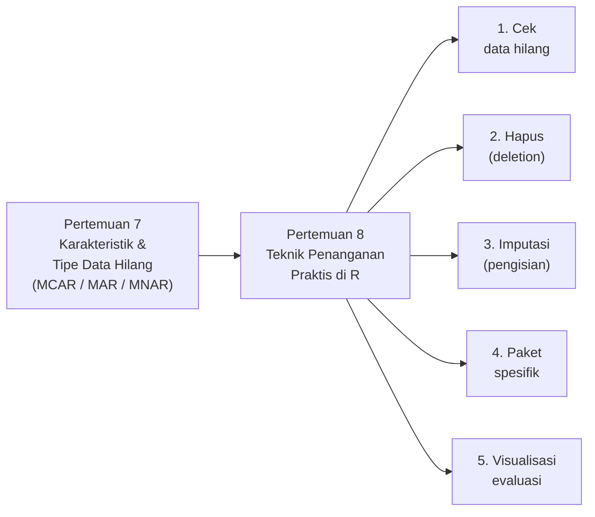
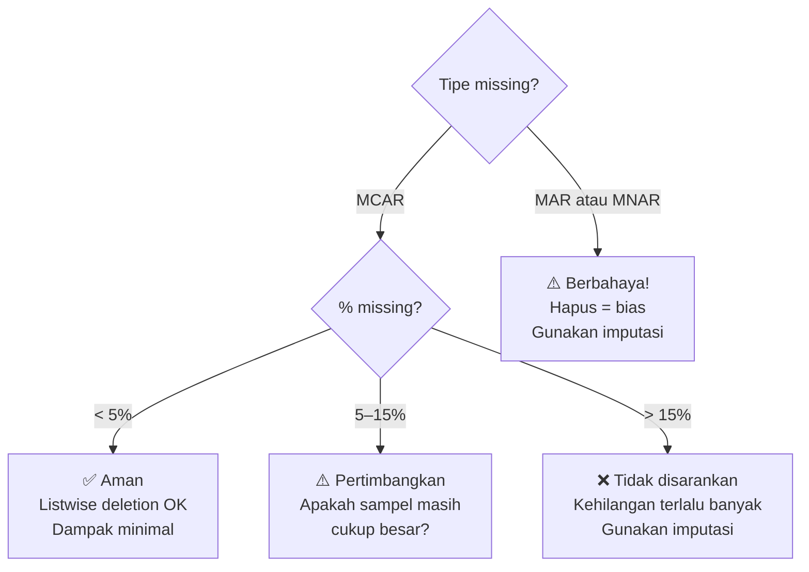
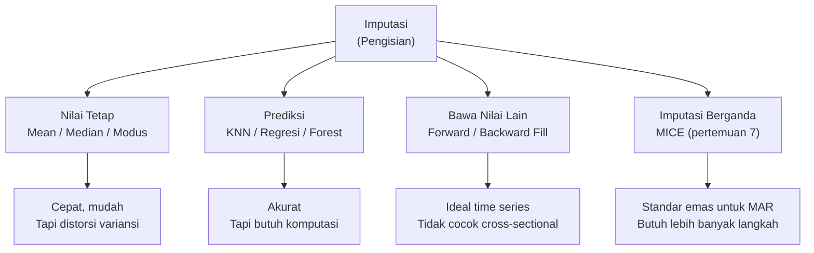
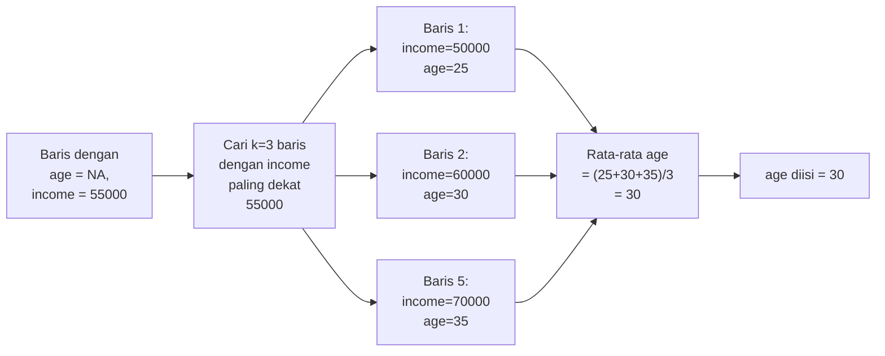
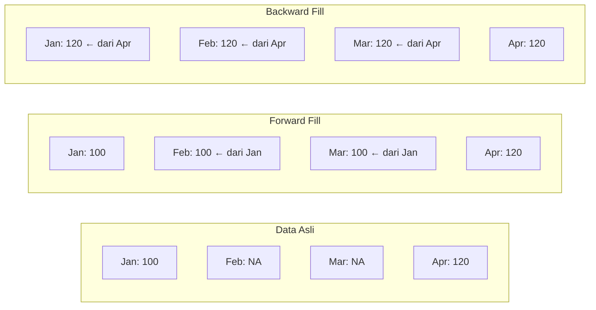
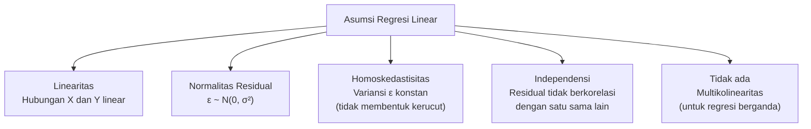
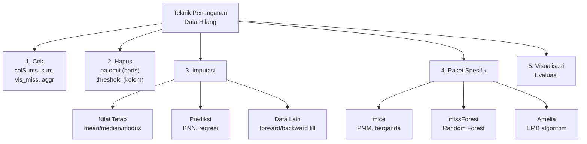

# Pertemuan 8 — Teknik Penanganan Data Hilang

**MSIM4310 Analisis dan Visualisasi Data**  
Program Studi Sistem Informasi — Universitas Terbuka

> Catatan: dokumen ini merupakan ekstraksi sekaligus elaborasi dari materi *Inisiasi 8 — Teknik Penanganan Data Hilang*. Pertemuan ini adalah kelanjutan langsung dari Pertemuan 7 (karakteristik & tipe data hilang) — jika belum membaca, disarankan membaca Pertemuan 7 terlebih dahulu.

---

## Daftar Isi

1. [Hubungan dengan Pertemuan 7](#1-hubungan-dengan-pertemuan-7)
2. [Mengecek Data Hilang](#2-mengecek-data-hilang)
3. [Menghapus Data Hilang](#3-menghapus-data-hilang)
4. [Mengisi Data Hilang (Imputasi)](#4-mengisi-data-hilang-imputasi)
   - [Imputasi dengan Nilai Tetap](#41-imputasi-dengan-nilai-tetap)
   - [Imputasi dengan Prediksi](#42-imputasi-dengan-prediksi)
   - [Imputasi dengan Data Lain (Forward/Backward Fill)](#43-imputasi-dengan-data-lain-forwardbackward-fill)
5. [Paket Spesifik Penanganan Data Hilang](#5-paket-spesifik-penanganan-data-hilang)
   - [Paket mice](#51-paket-mice)
   - [Paket missForest](#52-paket-missforest)
   - [Paket Amelia](#53-paket-amelia)
6. [Visualisasi untuk Mengevaluasi Data Hilang](#6-visualisasi-untuk-mengevaluasi-data-hilang)
7. [Studi Kasus Lengkap: Dataset airquality](#7-studi-kasus-lengkap-dataset-airquality)
8. [Perbandingan Akurasi Antar Metode](#8-perbandingan-akurasi-antar-metode)
9. [Tugas Tutorial — Regresi Linear Sederhana](#9-tugas-tutorial--regresi-linear-sederhana)
10. [Ringkasan](#10-ringkasan)

---

## 1. Hubungan dengan Pertemuan 7

Pertemuan 7 membahas **apa itu** data hilang dan **mengapa** terjadi. Pertemuan 8 berfokus pada **bagaimana** menanganinya secara praktis di R.



**Prinsip umum sebelum memilih teknik:**

| Pertanyaan | Jawaban yang Harus Dicari |
|-----------|--------------------------|
| Berapa % data yang hilang? | `colMeans(is.na(data))` |
| Di kolom mana saja? | `colSums(is.na(data))` |
| Apa tipe missing-nya? | MCAR → hapus aman; MAR → MICE; MNAR → model khusus |
| Apa tipe kolom yang hilang? | Numerik → mean/median/KNN; Kategorik → modus/forest |
| Apakah data time series? | Ya → forward/backward fill; Tidak → imputasi lain |

---

## 2. Mengecek Data Hilang

**Langkah pertama selalu: tahu dulu sebelum bertindak.**

### 2.1 Pemeriksaan Dasar

```r
# Contoh dataset: buat sendiri untuk latihan
data <- data.frame(
  id     = 1:10,
  age    = c(25, 30, NA, 40, 35, 50, NA, 45, 55, 60),
  income = c(50000, 60000, 55000, NA, 70000, 65000, 75000, 80000, NA, 90000),
  gender = c("M", "F", NA, "M", "F", "M", "F", NA, "M", "F")
)

# 1. Jumlah NA per kolom
colSums(is.na(data))
# id: 0  age: 2  income: 2  gender: 2

# 2. Total NA di seluruh dataset
sum(is.na(data))
# [1] 6

# 3. Persentase NA per kolom
round(colMeans(is.na(data)) * 100, 1)
# id: 0%  age: 20%  income: 20%  gender: 20%

# 4. Ringkasan cepat — menampilkan "NA's : X" per kolom
summary(data)

# 5. Baris mana yang lengkap vs tidak?
complete.cases(data)          # vector logical: TRUE = lengkap
data[!complete.cases(data), ] # tampilkan baris yang punya NA

# 6. Pola per sel
is.na(data)   # matrix TRUE/FALSE — berguna untuk inspeksi manual
```

### 2.2 Visualisasi dengan naniar

```r
library(ggplot2)
library(naniar)

# Heatmap missing values — visual paling intuitif
vis_miss(data)
# Kolom hitam = NA; putih = tersedia; angka bawah = % missing

# Ringkasan dalam bentuk tabel
miss_var_summary(data)
#   variable n_miss pct_miss
#   age           2     20.0
#   income        2     20.0
#   gender        2     20.0
#   id            0      0.0

# Proporsi missing di tiap kombinasi variabel
miss_var_table(data)

# Scatter plot dengan titik NA ditampilkan di tepi sumbu
ggplot(data, aes(x = age, y = income)) +
  geom_miss_point() +
  labs(title = "Scatter Plot dengan Titik NA")
# Titik merah = observasi di mana salah satu variabel NA
# Membantu deteksi pola MAR

# Uji Little MCAR
mcar_test(data)
# H₀: data MCAR. p > 0.05 → tidak tolak MCAR
```

**Interpretasi output `vis_miss()`:**

| Warna | Makna |
|-------|-------|
| Abu-abu muda | Nilai tersedia |
| Hitam | Nilai hilang (NA) |
| Angka di bawah | Persentase missing kolom tersebut |
| Angka di kanan | Persentase missing baris tersebut |

---

## 3. Menghapus Data Hilang

### 3.1 Menghapus Baris (Listwise Deletion)

```r
# Hapus semua baris yang mengandung setidaknya 1 NA
data_cleaned <- na.omit(data)
nrow(data_cleaned)   # 10 - jumlah baris dengan NA

# Cara alternatif dengan complete.cases
data_cleaned <- data[complete.cases(data), ]

# Cara dengan dplyr
library(dplyr)
data_cleaned <- data %>% filter(complete.cases(.))

# Hapus baris hanya jika kolom tertentu NA
data_age_ok <- data[!is.na(data$age), ]      # hanya jika age NA
data_inc_ok <- data[!is.na(data$income), ]   # hanya jika income NA
```

### 3.2 Menghapus Kolom

```r
# Hapus kolom yang memiliki setidaknya 1 NA
data_no_na_col <- data[, colSums(is.na(data)) == 0]

# Hapus kolom jika lebih dari X% nilainya NA (threshold)
threshold <- 0.30  # 30%
cols_to_keep <- colMeans(is.na(data)) < threshold
data_filtered <- data[, cols_to_keep]
cat("Kolom dihapus:", names(data)[!cols_to_keep], "\n")
```

### 3.3 Kapan Menghapus Aman vs Berbahaya



**Jebakan listwise deletion dengan banyak kolom:**

```r
# Simulasi: dataset 10 kolom, masing-masing 5% NA acak
# Berapa baris yang TERSISA setelah na.omit()?
p_complete <- (1 - 0.05)^10
cat("Baris lengkap:", round(p_complete * 100, 1), "%\n")
# Baris lengkap: 59.9 %
# → Lebih dari 40% baris hilang, padahal tiap kolom hanya 5% NA!
```

---

## 4. Mengisi Data Hilang (Imputasi)

Imputasi mengisi nilai yang hilang tanpa membuang baris, sehingga mempertahankan ukuran sampel. Pilihan metode bergantung pada tipe data dan tipe missing.



### 4.1 Imputasi dengan Nilai Tetap

#### Imputasi Mean

```r
# Isi NA dengan mean kolom tersebut
data$age[is.na(data$age)] <- mean(data$age, na.rm = TRUE)

# Cara lebih aman: buat salinan dulu
data_imp <- data
data_imp$age[is.na(data_imp$age)]       <- mean(data$age, na.rm = TRUE)
data_imp$income[is.na(data_imp$income)] <- mean(data$income, na.rm = TRUE)

# Verifikasi tidak ada NA yang tersisa
sum(is.na(data_imp))   # harus 0
```

**Efek mean imputation pada distribusi:**

```r
set.seed(42)
x_asli   <- rnorm(100, mean = 50, sd = 15)
x_miss   <- x_asli
x_miss[sample(1:100, 20)] <- NA  # buat 20% NA secara MCAR

x_imp_mean <- x_miss
x_imp_mean[is.na(x_miss)] <- mean(x_miss, na.rm = TRUE)

cat("SD asli      :", round(sd(x_asli), 2), "\n")       # ~15
cat("SD setelah   :", round(sd(x_imp_mean), 2), "\n")   # < 15, variansi turun!
cat("Mean asli    :", round(mean(x_asli), 2), "\n")     # ~50
cat("Mean sesudah :", round(mean(x_imp_mean), 2), "\n") # ~50 (mean terjaga)
```

#### Imputasi Median

```r
data_imp$age[is.na(data_imp$age)]       <- median(data$age, na.rm = TRUE)
data_imp$income[is.na(data_imp$income)] <- median(data$income, na.rm = TRUE)
```

**Kapan median lebih baik dari mean:**
- Data memiliki outlier (nilai ekstrem akan menarik mean, tidak menarik median)
- Distribusi data miring (*skewed*)
- Contoh: pendapatan, harga properti, jumlah kunjungan

#### Imputasi Modus (untuk Data Kategorik)

```r
# R tidak punya fungsi mode() bawaan untuk modus statistik
# Gunakan fungsi kustom:
get_mode <- function(x) {
  tbl <- table(x[!is.na(x)])
  names(tbl)[which.max(tbl)]
}

# Isi NA pada kolom kategorik
data_imp$gender[is.na(data_imp$gender)] <- get_mode(data$gender)
```

#### Perbandingan Ketiga Metode

| Metode | Mean | Median | Modus |
|--------|------|--------|-------|
| **Tipe data** | Numerik | Numerik | Kategorik / Numerik diskrit |
| **Pengaruh outlier** | Sensitif | Tidak sensitif | Tidak sensitif |
| **Efek pada variansi** | Mengecilkan variansi | Mengecilkan variansi | Mengecilkan variansi |
| **Efek pada distribusi** | Mempertajam puncak | Mempertajam puncak | Mempertajam modus |
| **Kecepatan** | Sangat cepat | Sangat cepat | Cepat |
| **Kompleksitas** | Sangat rendah | Sangat rendah | Rendah |

### 4.2 Imputasi dengan Prediksi

Teknik ini menggunakan variabel lain dalam dataset untuk **memprediksi** nilai yang hilang. Lebih akurat dari imputasi nilai tetap, tapi membutuhkan lebih banyak komputasi.

#### KNN Imputation (K-Nearest Neighbors)

**Cara kerja:** Untuk setiap nilai NA, cari k baris lain yang paling "mirip" (tetangga terdekat) berdasarkan variabel lain yang tersedia, lalu isi NA dengan rata-rata nilai tetangga tersebut.



```r
# Paket VIM menyediakan kNN imputation yang handal
library(VIM)

# k = jumlah tetangga (default 5)
# variable = kolom yang ingin diimputasi (opsional)
data_knn <- kNN(data, k = 5)
# Kolom baru *_imp dibuat sebagai indikator (TRUE = diimputasi)

# Tampilkan hanya kolom asli
data_knn <- data_knn[, names(data)]
print(data_knn)

# ⚠️ Catatan: Paket DMwR (knnImputation) sudah diarsipkan dari CRAN.
# Gunakan VIM::kNN() atau DMwR2::knnImputation() sebagai gantinya.
```

#### Imputasi dengan Regresi Linear (via MICE)

```r
library(mice)

# method = 'norm.predict': prediksi langsung dari regresi linear
# Lebih deterministik dari PMM — tidak mengambil dari nilai nyata
imputed_data <- mice(data,
                     method    = 'norm.predict',
                     m         = 5,
                     printFlag = FALSE)
complete_data <- complete(imputed_data)
print(complete_data)

# Perbedaan norm.predict vs pmm:
# norm.predict: nilai imputasi = tepat dari prediksi regresi
#               → bisa menghasilkan nilai di luar range asli!
# pmm:          nilai imputasi = diambil dari nilai nyata terdekat
#               → selalu dalam range data asli ✓
```

#### missForest — Imputasi dengan Random Forest

```r
library(missForest)

# Algoritma:
# 1. Imputasi awal dengan mean/modus
# 2. Bangun Random Forest untuk setiap kolom dengan NA
# 3. Prediksi nilai hilang menggunakan model RF
# 4. Update imputasi → ulangi sampai OOB error konvergen

data_mf <- missForest(data)

# Ambil dataset yang sudah diimputasi
data_imputed <- data_mf$ximp
print(data_imputed)

# Cek OOB (Out-of-Bag) error — estimasi akurasi imputasi
# OOB numerik: NRMSE (0 = sempurna, 1 = baseline mean imputation)
# OOB kategorik: proporsi salah klasifikasi
data_mf$OOBerror
```

### 4.3 Imputasi dengan Data Lain (Forward/Backward Fill)

**Forward fill** dan **backward fill** mengisi NA dengan nilai **dari baris sebelumnya** (forward) atau **sesudahnya** (backward). Ini khusus untuk **data berurutan** (time series, panel data, data longitudinal).



```r
library(zoo)

# Contoh data time series
ts_data <- data.frame(
  bulan  = c("Jan", "Feb", "Mar", "Apr", "Mei", "Jun"),
  suhu   = c(28, NA, NA, 31, NA, 33),
  curah_hujan = c(120, 110, NA, NA, 95, 100)
)

# Forward fill: isi NA dengan nilai SEBELUMNYA
ts_data$suhu_ff <- zoo::na.locf(ts_data$suhu)
# Jan:28, Feb:28, Mar:28, Apr:31, Mei:31, Jun:33

# Backward fill: isi NA dengan nilai SESUDAHNYA
ts_data$suhu_bf <- zoo::na.locf(ts_data$suhu, fromLast = TRUE)
# Jan:28, Feb:31, Mar:31, Apr:31, Mei:33, Jun:33

# Kombinasi: forward fill dulu, sisa (jika ada NA di awal) → backward fill
ts_data$suhu_combo <- zoo::na.locf(
  zoo::na.locf(ts_data$suhu, na.rm = FALSE),
  fromLast = TRUE
)

print(ts_data)
```

**Kapan forward/backward fill tepat:**

| Kondisi | Rekomendasi |
|---------|-------------|
| Data time series dengan nilai yang berubah perlahan | Forward fill ✓ |
| Data sensor dengan dropout sesaat | Forward fill ✓ |
| Harga saham harian dengan hari libur | Forward fill ✓ |
| Data cross-sectional (survei, bukan berurutan) | Tidak cocok ✗ |
| NA di awal periode (tidak ada nilai sebelumnya) | Backward fill atau imputasi lain |

**Alternatif modern dengan tidyr:**

```r
library(tidyr)

# Forward fill dengan tidyr (lebih readable)
ts_data <- ts_data %>%
  fill(suhu, .direction = "down")         # forward fill
  # fill(suhu, .direction = "up")         # backward fill
  # fill(suhu, .direction = "downup")     # forward then backward
```

---

## 5. Paket Spesifik Penanganan Data Hilang

### 5.1 Paket mice

Sudah dibahas detail di Pertemuan 7. Ringkasan cara penggunaan:

```r
library(mice)

# Imputasi berganda (m=5 dataset) dengan PMM
imputed_data <- mice(data,
                     m         = 5,
                     method    = 'pmm',
                     maxit     = 50,
                     seed      = 500,
                     printFlag = FALSE)

# Ambil satu dataset lengkap (untuk eksplorasi)
complete_data <- complete(imputed_data, 1)

# Analisis dan pooling (cara yang benar untuk inferensi statistik)
fit    <- with(imputed_data, lm(income ~ age))
pooled <- pool(fit)
summary(pooled)
```

**Metode mice yang tersedia:**

| Metode | Tipe Data | Deskripsi |
|--------|-----------|-----------|
| `pmm` | Numerik | Predictive Mean Matching (default, direkomendasikan) |
| `norm` | Numerik | Bayesian Linear Regression |
| `norm.predict` | Numerik | Regresi linear biasa (tanpa keacakan) |
| `mean` | Numerik | Imputasi mean sederhana |
| `logreg` | Biner (0/1) | Logistic Regression |
| `polyreg` | Kategorik ≥ 3 | Multinomial Logistic Regression |
| `polr` | Ordinal | Proportional Odds Model |
| `rf` | Semua | Random Forest |
| `cart` | Semua | Classification and Regression Trees |

### 5.2 Paket missForest

`missForest` menggunakan Random Forest — metode yang kuat karena:
- Tidak memerlukan asumsi tentang distribusi data
- Menangani data campuran (numerik + kategorik) secara bersamaan
- Mengestimasi sendiri akurasi imputasinya via OOB error

```r
library(missForest)

# Parameter penting:
# maxiter = maksimum iterasi konvergensi (default: 10)
# ntree   = jumlah pohon di Random Forest (default: 100)
# mtry    = jumlah variabel per split (default: sqrt(p) kategorik, p/3 numerik)
result <- missForest(data,
                     maxiter  = 10,
                     ntree    = 100,
                     verbose  = TRUE)  # tampilkan progres iterasi

# Ambil dataset yang diimputasi
data_complete <- result$ximp

# Evaluasi kualitas imputasi
# OOBerror[1]: NRMSE untuk variabel numerik (lebih kecil = lebih baik)
# OOBerror[2]: PFC (proporsi salah klasifikasi) untuk kategorik
print(result$OOBerror)

# Jika ingin paralelisasi (untuk dataset besar):
library(doParallel)
registerDoParallel(cores = 4)
result_parallel <- missForest(data, parallelize = "forests")
```

**Interpretasi NRMSE (Normalized Root Mean Squared Error):**

```
NRMSE = 0    → imputasi sempurna
NRMSE = 1    → sama buruknya dengan imputasi mean (baseline)
NRMSE < 0.5  → imputasi cukup baik
NRMSE > 1    → lebih buruk dari mean imputation — ada masalah!
```

### 5.3 Paket Amelia

`Amelia` adalah paket imputasi berganda yang menggunakan algoritma **EMB (Expectation-Maximization with Bootstrapping)**. Nama "Amelia" merujuk pada Amelia Earhart — pilot yang hilang tanpa jejak.

```r
library(Amelia)

# Imputasi berganda dengan Amelia
# m = jumlah dataset imputasi
amelia_out <- amelia(data,
                     m    = 5,
                     noms = "gender")  # kolom nominal/kategorik

# Ambil dataset ke-2
data_amelia <- amelia_out$imputations[[2]]

# Missingness map — plot visualisasi data hilang
missmap(data,
        main  = "Missing Values vs Observed",
        col   = c("yellow", "black"),
        legend = FALSE)
# Kuning = missing, hitam = observed
```

---

## 6. Visualisasi untuk Mengevaluasi Data Hilang

Visualisasi memiliki dua peran: **(a)** memahami pola sebelum memilih metode, dan **(b)** memverifikasi hasil setelah imputasi.

### 6.1 Pra-Imputasi: Memahami Pola

```r
library(VIM)

# aggr: gabungan bar chart + pattern plot
aggr(data,
     col      = c('navyblue', 'yellow'),   # biru=ada, kuning=hilang
     numbers  = TRUE,                       # tampilkan angka proporsi
     sortVars = TRUE,                       # urutkan kolom dari banyak ke sedikit NA
     labels   = names(data),
     cex.axis = .7,
     gap      = 3,
     ylab     = c("Missing data", "Pattern"))

# Plot kiri:  bar chart proporsi missing per kolom
# Plot kanan: pattern plot — setiap baris adalah kombinasi NA
#             Misal: "age=missing, income=missing" → pola bersama
```

**Interpretasi pattern plot:**

```
Pattern plot membaca seperti ini:
- Setiap baris = satu pola unik kombinasi missing
- Angka di kanan = frekuensi pola tersebut
- Jika age dan income sering hilang bersamaan → mungkin ada korelasi (MAR)
- Jika setiap kolom hilang independen → mendukung MCAR
```

```r
# marginplot: scatter plot dengan distribusi NA di tepi
marginplot(data[, c("age", "income")],
           col    = c("darkblue", "red"),
           cex    = 1.2,
           pch    = 19)
# Titik biru = kedua variabel tersedia
# Titik merah di sumbu X bawah = income-nya NA (age tersedia)
# Titik merah di sumbu Y kiri = age-nya NA (income tersedia)
# Box plot merah vs biru: bandingkan distribusi
#   Jika median beda jauh → kemungkinan MAR atau MNAR
```

### 6.2 Pasca-Imputasi: Verifikasi Distribusi

Setelah imputasi, distribusi nilai yang diimputasi seharusnya **masuk akal** — tidak di luar rentang data asli dan tidak mengubah distribusi secara drastis.

```r
library(mice)

# Verifikasi distribusi dengan stripplot
imputed_data <- mice(data, m = 5, seed = 42, printFlag = FALSE)

# Stripplot: magenta = nilai imputasi, biru = nilai asli
stripplot(imputed_data, age ~ .imp,
          jit   = TRUE,
          col   = c("grey", "red"),
          pch   = c(1, 20))
# Jika titik magenta tersebar mirip dengan biru → imputasi masuk akal
# Jika magenta mengelompok di satu titik → mungkin ada masalah

# Density plot: bandingkan distribusi sebelum vs sesudah imputasi
densityplot(imputed_data)
# Garis biru = distribusi data asli (dengan NA dihilangkan)
# Garis magenta = distribusi nilai yang diimputasi
# Idealnya: kedua garis berhimpitan atau mendekati
```

---

## 7. Studi Kasus Lengkap: Dataset airquality

Dataset `airquality` adalah dataset bawaan R yang mengukur kualitas udara New York dari Mei–September 1973. Ini adalah contoh nyata penanganan data hilang pada data lingkungan.

### 7.1 Mengenal Dataset

```r
data("airquality")
str(airquality)
# 'data.frame': 153 obs. of 6 variables:
#  $ Ozone  : int  41 36 12 18 NA 28 23 19 8 NA ...  ← banyak NA!
#  $ Solar.R: int  190 118 149 313 NA NA 299 99 19 194 ...
#  $ Wind   : num  7.4 8 12.6 11.5 14.3 14.9 8.6 13.8 20.1 8.6 ...
#  $ Temp   : int  67 72 74 62 56 66 65 59 61 69 ...
#  $ Month  : int  5 5 5 5 5 5 5 5 5 5 ...
#  $ Day    : int  1 2 3 4 5 6 7 8 9 10 ...
```

| Kolom | Deskripsi | Satuan |
|-------|-----------|--------|
| `Ozone` | Konsentrasi ozon rata-rata harian | ppb (parts per billion) |
| `Solar.R` | Radiasi matahari | Langleys |
| `Wind` | Kecepatan angin rata-rata | mph |
| `Temp` | Suhu maksimum harian | °F |
| `Month` | Bulan (5=Mei s.d. 9=September) | — |
| `Day` | Tanggal (1–31) | — |

### 7.2 Memeriksa Data Hilang

```r
# Cek jumlah NA
colSums(is.na(airquality))
# Ozone   Solar.R Wind Temp Month Day
#    37       7    0    0     0   0

# Persentase
round(colMeans(is.na(airquality)) * 100, 1)
# Ozone: 24.2%, Solar.R: 4.6%, Wind: 0%, Temp: 0%, Month: 0%, Day: 0%
```

**Ozone memiliki 37 NA (24.2%)** — cukup besar, tidak bisa sembarangan dihapus.

### 7.3 Menghapus Baris dengan Data Hilang

```r
# Hapus baris dengan data hilang
airquality_cleaned <- na.omit(airquality)
nrow(airquality_cleaned)  # 111 dari 153 — kehilangan 42 baris (27.5%)!

# Implikasi: 27.5% data hilang setelah listwise deletion
# Padahal kolom Ozone hanya 24.2% missing, Solar.R hanya 4.6%
# Tapi ada baris yang KEDUANYA missing → kehilangan lebih banyak
```

### 7.4 Imputasi dengan Mean

```r
# Buat salinan untuk imputasi mean
airquality_mean <- airquality

# Imputasi Ozone dengan mean
mean_ozone <- mean(airquality$Ozone, na.rm = TRUE)
cat("Mean Ozone:", round(mean_ozone, 1), "ppb\n")  # ~42.1 ppb

airquality_mean$Ozone[is.na(airquality_mean$Ozone)] <- mean_ozone

# Imputasi Solar.R dengan median (karena distribusinya lebih skewed)
median_solar <- median(airquality$Solar.R, na.rm = TRUE)
airquality_mean$Solar.R[is.na(airquality_mean$Solar.R)] <- median_solar

# Verifikasi
sum(is.na(airquality_mean))  # harus 0
```

### 7.5 Imputasi dengan KNN

```r
library(VIM)

# KNN imputation dengan k=5 tetangga
airquality_knn <- kNN(airquality, k = 5)
airquality_knn <- airquality_knn[, names(airquality)]  # hapus kolom indikator

head(airquality_knn)
sum(is.na(airquality_knn))  # harus 0
```

### 7.6 Imputasi dengan missForest

```r
library(missForest)

# Random Forest imputation (lebih akurat tapi lebih lambat)
set.seed(42)
mf_result       <- missForest(airquality)
airquality_mf   <- mf_result$ximp

# Evaluasi OOB error
cat("OOB NRMSE:", round(mf_result$OOBerror["NRMSE"], 4), "\n")
# Nilai < 0.5 menunjukkan imputasi yang baik
```

### 7.7 Imputasi dengan MICE

```r
library(mice)

# Imputasi berganda
set.seed(500)
imputed_aq <- mice(airquality,
                   m         = 5,
                   method    = 'pmm',
                   maxit     = 50,
                   printFlag = FALSE)

# Dataset lengkap imputasi ke-1
airquality_mice <- complete(imputed_aq, 1)
sum(is.na(airquality_mice))  # harus 0
```

### 7.8 Visualisasi Pola Data Hilang

```r
library(VIM)

# Plot agregat: proporsi missing + pattern
aggr(airquality,
     col      = c('navyblue', 'yellow'),
     numbers  = TRUE,
     sortVars = TRUE,
     labels   = names(airquality),
     cex.axis = .7,
     gap      = 3,
     ylab     = c("Missing data", "Pattern"))

library(Amelia)

# Missingness map — heatmap seluruh dataset
missmap(airquality,
        main   = "airquality — Missing vs Observed",
        col    = c("yellow", "black"),
        legend = FALSE)
```

---

## 8. Perbandingan Akurasi Antar Metode

Cara mengevaluasi metode imputasi: **hapus data yang diketahui secara artifisial**, lakukan imputasi, lalu bandingkan dengan nilai asli.

```r
library(missForest)
library(VIM)
library(mice)

set.seed(42)

# Gunakan data lengkap sebagai "ground truth"
data_true <- airquality[complete.cases(airquality), ]

# Buat missing secara artifisial (MCAR, 20%)
data_miss         <- prodNA(data_true, noNA = 0.20)
idx_missing       <- which(is.na(data_miss$Ozone))

# Fungsi hitung RMSE
rmse <- function(pred, actual) sqrt(mean((pred - actual)^2))

# --- Metode 1: Mean Imputation ---
data_m1         <- data_miss
data_m1$Ozone[is.na(data_m1$Ozone)] <- mean(data_miss$Ozone, na.rm = TRUE)
rmse_mean       <- rmse(data_m1$Ozone[idx_missing], data_true$Ozone[idx_missing])

# --- Metode 2: Median Imputation ---
data_m2         <- data_miss
data_m2$Ozone[is.na(data_m2$Ozone)] <- median(data_miss$Ozone, na.rm = TRUE)
rmse_median     <- rmse(data_m2$Ozone[idx_missing], data_true$Ozone[idx_missing])

# --- Metode 3: KNN ---
data_m3         <- kNN(data_miss, k = 5)[, names(data_miss)]
rmse_knn        <- rmse(data_m3$Ozone[idx_missing], data_true$Ozone[idx_missing])

# --- Metode 4: missForest ---
data_m4         <- missForest(data_miss)$ximp
rmse_mf         <- rmse(data_m4$Ozone[idx_missing], data_true$Ozone[idx_missing])

# --- Metode 5: MICE PMM ---
imp_mice        <- mice(data_miss, m = 5, method = "pmm", printFlag = FALSE)
data_m5         <- complete(imp_mice, 1)
rmse_mice       <- rmse(data_m5$Ozone[idx_missing], data_true$Ozone[idx_missing])

# Tampilkan perbandingan
hasil <- data.frame(
  Metode = c("Mean", "Median", "KNN (k=5)", "missForest", "MICE PMM"),
  RMSE   = round(c(rmse_mean, rmse_median, rmse_knn, rmse_mf, rmse_mice), 2)
)
hasil <- hasil[order(hasil$RMSE), ]  # urutkan dari terbaik
print(hasil)
```

**Ekspektasi hasil (urutan dari yang biasanya terbaik ke terburuk untuk data kompleks):**

| Peringkat | Metode | RMSE Relatif | Catatan |
|-----------|--------|-------------|---------|
| 1 | missForest | Terendah | Paling akurat secara umum |
| 2 | MICE PMM | Rendah | Akuntabel ketidakpastian |
| 3 | KNN | Sedang | Bergantung pilihan k |
| 4 | Median | Tinggi | Sederhana tapi mendistorsi |
| 5 | Mean | Tertinggi | Paling sederhana |

> **Catatan:** Urutan ini tidak selalu sama untuk setiap dataset. Untuk dataset kecil, mean/median kadang mengalahkan KNN. Selalu evaluasi pada data spesifik.

---

## 9. Tugas Tutorial — Regresi Linear Sederhana

### 9.1 Konteks Tugas

Dataset `data_pendapatan.xlsx` berisi data pendapatan dan tingkat kebahagiaan. Tujuan: mengetahui apakah pendapatan dapat memprediksi kebahagiaan secara linear.

- **Variabel bebas (X):** Pendapatan (satuan asli × 10.000 rupiah)
- **Variabel terikat (Y):** Kebahagiaan (skor)
- **Metode:** Regresi Linear Sederhana: `Y = β₀ + β₁X + ε`

### 9.2 Teori Regresi Linear Sederhana

**Regresi linear sederhana** memodelkan hubungan linear antara satu variabel bebas (X) dan satu variabel terikat (Y):

```
Ŷ = β₀ + β₁ · X

Di mana:
β₀ = intercept (nilai Y ketika X = 0)
β₁ = slope (perubahan Y untuk setiap kenaikan 1 unit X)
ε  = residual (selisih nilai aktual Y dengan prediksi Ŷ)
```

Estimasi β₀ dan β₁ menggunakan **metode Ordinary Least Squares (OLS)** — meminimalkan jumlah kuadrat residual:

```
β₁ = Σ(xᵢ - x̄)(yᵢ - ȳ) / Σ(xᵢ - x̄)²    = Cov(X,Y) / Var(X)
β₀ = ȳ - β₁ · x̄
```

**Asumsi regresi linear (BLUE — Best Linear Unbiased Estimator):**



### 9.3 Script R Lengkap

```r
# ============================================================
# TUGAS TUTORIAL 2 - MSIM4310
# Regresi Linear Sederhana: Pendapatan vs Kebahagiaan
# ============================================================

# ---- 1. Instalasi dan pemuatan paket ----
options(repos = c(CRAN = "https://cloud.r-project.org"))

# install.packages(c("ggplot2", "dplyr", "broom", "ggpubr", "readxl"))
library(ggplot2)
library(dplyr)
library(broom)
library(ggpubr)
library(readxl)

# ---- 2. Import data ----
data <- read_excel("data_pendapatan.xlsx",
                   col_types = c("numeric", "numeric", "numeric"))

# Eksplorasi awal
head(data)
str(data)
summary(data)
# Kolom: id/no, pendapatan (×10.000 Rp), kebahagiaan (skor)

# ============================================================
# SOAL a — Histogram variabel terikat (kebahagiaan)
# ============================================================
hist(data$kebahagiaan,
     main   = "Histogram Kebahagiaan",
     xlab   = "Kebahagiaan",
     ylab   = "Frekuensi",
     col    = "lightgray",
     border = "black")
# Tambahkan garis density untuk mempermudah interpretasi
lines(density(data$kebahagiaan), col = "red", lwd = 2)

# Uji normalitas formal
shapiro.test(data$kebahagiaan)
# H₀: data berdistribusi normal
# p > 0.05: tidak ada bukti kuat menolak normalitas → asumsi terpenuhi

# ============================================================
# SOAL b — Scatter plot untuk cek linearitas
# ============================================================
plot(data$pendapatan, data$kebahagiaan,
     main = "Scatter Plot Pendapatan vs Kebahagiaan",
     xlab = "Pendapatan (×Rp10.000)",
     ylab = "Skor Kebahagiaan",
     pch  = 19,
     col  = adjustcolor("steelblue", alpha.f = 0.7))
abline(lm(kebahagiaan ~ pendapatan, data = data),
       col = "red", lwd = 2)

# Korelasi Pearson
r <- cor(data$pendapatan, data$kebahagiaan)
cat("Korelasi Pearson (r):", round(r, 4), "\n")
cat("Koefisien Determinasi (r²):", round(r^2, 4), "\n")
# r mendekati +1 → korelasi positif kuat
# r² = proporsi variansi Y yang dijelaskan X

# ============================================================
# SOAL c — Regresi linear sederhana
# ============================================================
model <- lm(kebahagiaan ~ pendapatan, data = data)

# Output ringkasan
summary(model)
# Call:
#   lm(formula = kebahagiaan ~ pendapatan, data = data)
#
# Coefficients:
#              Estimate Std. Error t value Pr(>|t|)
# (Intercept) β₀         SE(β₀)   t       p
# pendapatan  β₁         SE(β₁)   t       p
#
# Residual standard error: RSE on n-2 degrees of freedom
# Multiple R-squared: R², Adjusted R-squared: R²adj
# F-statistic: F on 1 and n-2 DF, p-value: p

# Cara rapi dengan broom
tidy(model)    # tabel koefisien dengan confidence interval
glance(model)  # statistik goodness-of-fit dalam satu baris

# Interpretasi:
# β₀ = nilai kebahagiaan ketika pendapatan = 0
# β₁ = untuk setiap kenaikan 1 unit pendapatan (Rp10.000),
#      kebahagiaan naik/turun sebesar β₁ poin
# R² = % variansi kebahagiaan yang dijelaskan oleh pendapatan
# p-value β₁ < 0.05 → pendapatan berpengaruh signifikan

# ============================================================
# SOAL d — Plot diagnostik untuk cek homoskedastisitas
# ============================================================
par(mfrow = c(2, 2))
plot(model)
par(mfrow = c(1, 1))

# 4 plot yang dihasilkan:
# 1. Residuals vs Fitted:
#    Idealnya: titik tersebar acak di sekitar garis 0
#    Jika membentuk pola/kipas → heteroskedastisitas / non-linearitas
#
# 2. Normal Q-Q:
#    Idealnya: titik mengikuti garis diagonal
#    Jika melenceng jauh → residual tidak normal
#
# 3. Scale-Location (√Residual Terstandar vs Fitted):
#    Idealnya: garis merah mendatar, titik tersebar merata
#    Jika garis naik → variansi membesar = heteroskedastisitas
#
# 4. Residuals vs Leverage:
#    Titik di luar Cook's distance > 1 → outlier berpengaruh (influential)

# Uji formal homoskedastisitas (Breusch-Pagan)
library(lmtest)
bptest(model)
# p > 0.05 → tidak ada bukti heteroskedastisitas (asumsi terpenuhi)

# ============================================================
# SOAL e — Visualisasi hasil regresi dengan ggplot2 + ggpubr
# ============================================================
regplot <- ggplot(data, aes(x = pendapatan, y = kebahagiaan)) +

  # Langkah e.1: plot titik data
  geom_point(color = "#2E5395",
             alpha = 0.6,
             size  = 2) +

  # Langkah e.2: tambahkan garis regresi linear
  geom_smooth(method = "lm",
              color  = "black",
              se     = TRUE,    # tampilkan confidence interval
              fill   = "gray80") +

  # Langkah e.3: tambahkan persamaan regresi dan R²
  stat_regline_equation(aes(label = paste(..eq.label.., ..rr.label..,
                                          sep = "~~~~")),
                        label.x = min(data$pendapatan),
                        label.y = max(data$kebahagiaan),
                        size    = 4) +

  # Langkah e.4: judul dan label sumbu
  labs(title    = "Hubungan Pendapatan dan Kebahagiaan",
       subtitle = "Regresi Linear Sederhana",
       x        = "Pendapatan (×Rp10.000)",
       y        = "Skor Kebahagiaan",
       caption  = "Data: data_pendapatan.xlsx") +

  theme_gray() +
  theme(plot.title    = element_text(face = "bold", size = 14),
        plot.subtitle = element_text(size = 10, color = "gray50"))

print(regplot)
```

### 9.4 Cara Membaca Output `summary(model)`

```
Call:
lm(formula = kebahagiaan ~ pendapatan, data = data)

Residuals:
   Min     1Q Median     3Q    Max
-XX.X  -X.XX   X.XX   X.XX  XX.XX
                                          → distribusi residual
Coefficients:
               Estimate Std. Error t value Pr(>|t|)
(Intercept)      β₀       SE(β₀)   t₀     p₀   ***
pendapatan        β₁       SE(β₁)   t₁     p₁   ***
---
Signif. codes: 0 '***' 0.001 '**' 0.01 '*' 0.05 '.' 0.1

Residual standard error: s on n-2 degrees of freedom
Multiple R-squared: R²               → variasi Y yang dijelaskan model
Adjusted R-squared: R²adj             → R² terkoreksi jumlah prediktor
F-statistic: F on 1 and n-2 DF, p-value: p
```

| Elemen | Cara Membaca |
|--------|-------------|
| **Estimate (Intercept)** | Nilai Y prediksi ketika X = 0 |
| **Estimate (pendapatan)** | Slope: kenaikan Y untuk setiap +1 unit X |
| **Pr(>\|t\|)** | p-value — jika < 0.05, koefisien signifikan |
| **R-squared** | Proporsi variansi Y yang dijelaskan model (0–1) |
| **F-statistic p-value** | Model secara keseluruhan signifikan atau tidak |

### 9.5 Interpretasi Plot Diagnostik

| Plot | Kondisi Ideal | Masalah Jika |
|------|--------------|-------------|
| **Residuals vs Fitted** | Titik tersebar acak, garis merah datar di 0 | Pola melengkung → non-linearitas |
| **Normal Q-Q** | Titik mengikuti garis diagonal | Titik melenceng di ekor → non-normalitas |
| **Scale-Location** | Titik merata, garis merah datar | Garis naik → variansi membesar (heteroskedastisitas) |
| **Residuals vs Leverage** | Semua titik dalam Cook's distance | Titik di luar garis putus-putus → influential outlier |

---

## 10. Ringkasan



**Panduan cepat memilih teknik:**

| Kondisi | Teknik yang Direkomendasikan |
|---------|------------------------------|
| < 5% missing, MCAR | `na.omit()` — listwise deletion |
| Numerik, distribusi normal | Imputasi mean |
| Numerik, ada outlier / skewed | Imputasi median |
| Kategorik | Imputasi modus |
| MAR, ingin akurasi tinggi | `mice(method="pmm")` |
| Campuran numerik + kategorik | `missForest()` |
| Time series, nilai berubah lambat | `zoo::na.locf()` forward fill |
| Ingin evaluasi formal (OOB error) | `missForest()` |
| Ingin inference statistik yang valid | `mice()` + `pool()` |

**Urutan pipeline yang disarankan:**

```r
# 1. Deteksi
colSums(is.na(data))
vis_miss(data)

# 2. Tentukan tipe (MCAR / MAR / MNAR)
mcar_test(data)

# 3. Pilih dan terapkan metode
data_complete <- missForest(data)$ximp   # atau mice, KNN, dll

# 4. Verifikasi
sum(is.na(data_complete))   # harus 0
densityplot(imputed_mice)   # distribusi masuk akal?

# 5. Analisis sensitivitas
# Bandingkan beberapa metode — jika hasil sama, temuan robust
```

---

*Selamat Belajar...*
