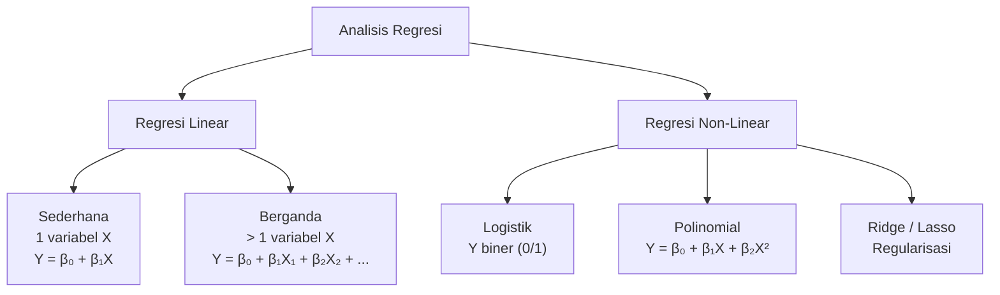
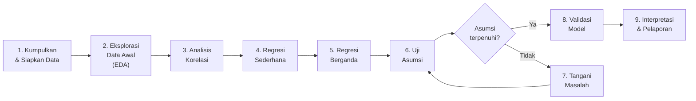
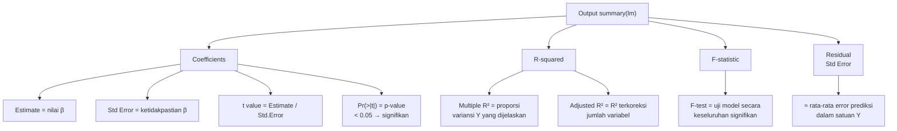
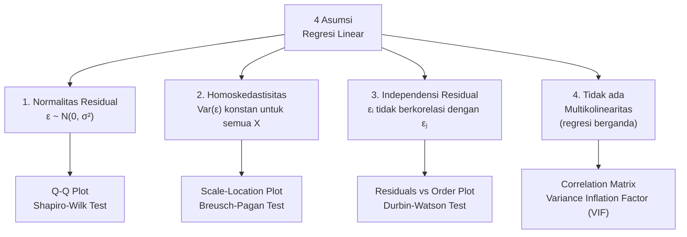
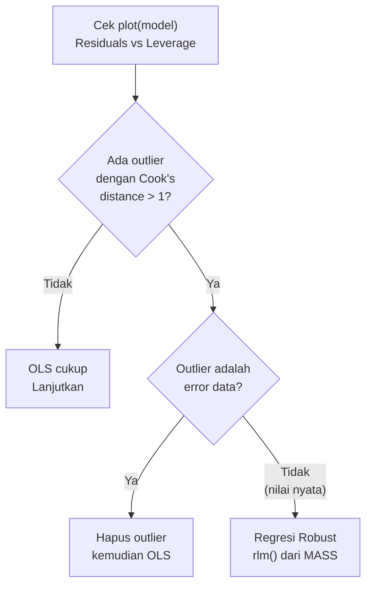
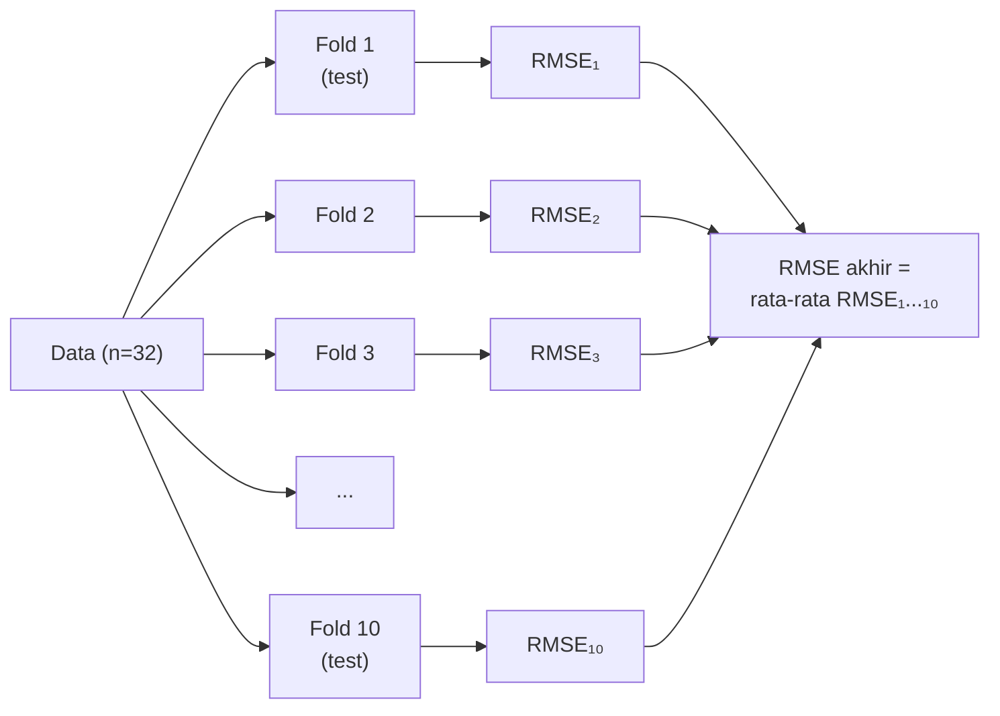
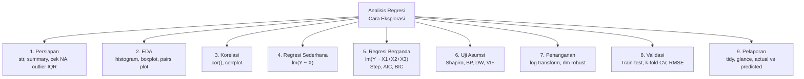

# Pertemuan 9 — Analisis Regresi Cara Eksplorasi

**MSIM4310 Analisis dan Visualisasi Data**  
Program Studi Sistem Informasi — Universitas Terbuka

> Catatan: dokumen ini merupakan ekstraksi sekaligus elaborasi dari materi *Inisiasi 9 — Analisis Regresi Cara Eksplorasi*. Setiap langkah dilengkapi dengan teori, kode R konkret (menggunakan dataset `mtcars` bawaan R), dan panduan interpretasi hasil.

---

## Daftar Isi

1. [Apa itu Analisis Regresi?](#1-apa-itu-analisis-regresi)
2. [Langkah 1 — Pengumpulan dan Persiapan Data](#2-langkah-1--pengumpulan-dan-persiapan-data)
3. [Langkah 2 — Eksplorasi Data Awal (EDA)](#3-langkah-2--eksplorasi-data-awal-eda)
4. [Langkah 3 — Analisis Korelasi](#4-langkah-3--analisis-korelasi)
5. [Langkah 4 — Model Regresi Sederhana](#5-langkah-4--model-regresi-sederhana)
6. [Langkah 5 — Model Regresi Berganda](#6-langkah-5--model-regresi-berganda)
7. [Langkah 6 — Uji Asumsi Model](#7-langkah-6--uji-asumsi-model)
8. [Langkah 7 — Penanganan Masalah dalam Model](#8-langkah-7--penanganan-masalah-dalam-model)
9. [Langkah 8 — Validasi Model](#9-langkah-8--validasi-model)
10. [Langkah 9 — Interpretasi dan Pelaporan Hasil](#10-langkah-9--interpretasi-dan-pelaporan-hasil)
11. [Studi Kasus Lengkap: Dataset mtcars](#11-studi-kasus-lengkap-dataset-mtcars)
12. [Ringkasan](#12-ringkasan)

---

## 1. Apa itu Analisis Regresi?

**Analisis regresi** adalah teknik statistik untuk memodelkan hubungan antara:
- **Variabel dependen (Y)** — variabel yang ingin diprediksi / dijelaskan
- **Variabel independen (X)** — variabel yang digunakan untuk memprediksi

Regresi menjawab dua pertanyaan sekaligus:
1. *Apakah ada hubungan* antara X dan Y? (uji signifikansi)
2. *Seberapa kuat dan ke arah mana* hubungan itu? (koefisien)

**Analogi:** Bayangkan kamu ingin memprediksi nilai ujian mahasiswa (Y) berdasarkan jam belajar (X). Regresi menemukan garis terbaik yang menggambarkan pola hubungan itu, sehingga kamu bisa memprediksi nilai berdasarkan jam belajar yang diketahui.

### Jenis-Jenis Regresi



**Pertemuan ini fokus pada regresi linear** — sederhana dan berganda — dengan pendekatan **eksplorasi** (bukan langsung modeling, tapi pahami data dulu).

### Pipeline Analisis Regresi Eksplorasi



---

## 2. Langkah 1 — Pengumpulan dan Persiapan Data

### 2.1 Pengumpulan Data

Sebelum analisis regresi, pastikan:
- **Sampel cukup besar**: aturan umum — minimal 10–20 observasi per variabel independen
- **Variabel yang relevan**: pilih variabel yang secara teoritis/logis mempengaruhi Y
- **Tipe data sesuai**: regresi linear membutuhkan Y numerik kontinu

### 2.2 Pembersihan Data

```r
# ---- Dataset: mtcars (Motor Trend Car Road Tests) ----
# Variabel: mpg (konsumsi BBM), cyl, disp, hp, wt, dll.
data <- mtcars

# Langkah 1: Kenali struktur data
str(data)
# 'data.frame': 32 obs. of 11 variables:
# $ mpg : num  21 21 22.8 21.4 18.7 18.1 ...  ← target (Y)
# $ cyl : num  6 6 4 6 8 6 8 4 4 6 ...
# $ disp: num  160 160 108 258 360 ...
# $ hp  : num  110 110 93 110 175 105 ...
# $ wt  : num  2.62 2.875 2.32 3.215 3.44 ...

# Langkah 2: Statistik ringkasan
summary(data)

# Langkah 3: Cek dan tangani data hilang
colSums(is.na(data))    # mtcars tidak punya NA, tapi biasanya perlu ini

# Langkah 4: Deteksi outlier dengan IQR rule
detect_outliers <- function(x) {
  Q1  <- quantile(x, 0.25)
  Q3  <- quantile(x, 0.75)
  IQR <- Q3 - Q1
  lower <- Q1 - 1.5 * IQR
  upper <- Q3 + 1.5 * IQR
  sum(x < lower | x > upper)
}

sapply(data, detect_outliers)
# Tampilkan jumlah outlier per kolom

# Langkah 5: Hapus outlier (opsional — pertimbangkan baik-baik!)
# Hanya hapus jika outlier adalah error data, bukan nilai nyata
clean_outliers <- function(df, col) {
  Q1  <- quantile(df[[col]], 0.25)
  Q3  <- quantile(df[[col]], 0.75)
  IQR <- Q3 - Q1
  df[df[[col]] >= Q1 - 1.5*IQR & df[[col]] <= Q3 + 1.5*IQR, ]
}
```

---

## 3. Langkah 2 — Eksplorasi Data Awal (EDA)

EDA adalah proses "mengenal" data sebelum membangun model. Tujuannya: memahami distribusi setiap variabel dan hubungan antar variabel secara visual.

### 3.1 Statistik Deskriptif

```r
# Ringkasan statistik lengkap
summary(data)
# Untuk setiap kolom:
#   Min.   1st Qu.  Median    Mean   3rd Qu.    Max.

# Statistik lebih detail
sapply(data, function(x) c(
  mean   = mean(x),
  median = median(x),
  sd     = sd(x),
  range  = diff(range(x)),
  cv     = sd(x)/mean(x)*100   # Coefficient of Variation
))
```

### 3.2 Visualisasi Distribusi

```r
# ---- Histogram untuk variabel dependen (mpg) ----
hist(data$mpg,
     main   = "Distribusi Konsumsi BBM (mpg)",
     xlab   = "Miles per Gallon",
     ylab   = "Frekuensi",
     col    = "lightblue",
     border = "white",
     breaks = 10)
# Tambah garis densitas (kurva normal)
lines(density(data$mpg), col = "red", lwd = 2)

# ---- Boxplot untuk semua variabel numerik ----
par(mfrow = c(2, 4))
for (col in names(data)) {
  boxplot(data[[col]],
          main = col,
          col  = "lightyellow",
          border = "gray40")
}
par(mfrow = c(1, 1))

# ---- Scatter plot: mpg vs variabel independen ----
plot(data$wt, data$mpg,
     main = "Berat Kendaraan vs Konsumsi BBM",
     xlab = "Berat (1000 lbs)",
     ylab = "Miles per Gallon (mpg)",
     pch  = 19,
     col  = adjustcolor("steelblue", alpha.f = 0.7))
abline(lm(mpg ~ wt, data = data), col = "red", lwd = 2)
```

### 3.3 Pairs Plot — Melihat Semua Hubungan Sekaligus

```r
# Base R: pairs plot
pairs(data[, c("mpg", "wt", "hp", "disp", "cyl")],
      main  = "Scatter Plot Matrix",
      pch   = 19,
      col   = adjustcolor("steelblue", alpha.f = 0.5))

# Versi lebih informatif: GGally::ggpairs
library(GGally)
ggpairs(data[, c("mpg", "wt", "hp", "disp")],
        lower = list(continuous = "smooth"),
        diag  = list(continuous = "density"),
        upper = list(continuous = "cor"))
# Panel diagonal: distribusi tiap variabel
# Panel bawah:   scatter plot dengan smooth line
# Panel atas:    nilai korelasi Pearson
```

**Apa yang dicari saat EDA:**

| Yang Dicari | Cara Melihat | Implikasi |
|-------------|-------------|-----------|
| Distribusi Y normal? | Histogram + Q-Q plot | Asumsi regresi |
| Hubungan X-Y linear? | Scatter plot | Kalau kurva → transformasi |
| Outlier ekstrem? | Boxplot | Mungkin perlu regresi robust |
| Variansi konstan? | Scatter plot | Kalau melebar → heteroskedastisitas |
| Pola hubungan antar X? | Pairs plot | Bisa ada multikolinearitas |

---

## 4. Langkah 3 — Analisis Korelasi

### 4.1 Matriks Korelasi

**Korelasi Pearson** mengukur kekuatan dan arah hubungan **linear** antara dua variabel numerik. Nilainya antara −1 hingga +1.

```
r = Σ[(xᵢ − x̄)(yᵢ − ȳ)] / √[Σ(xᵢ − x̄)² · Σ(yᵢ − ȳ)²]
```

| Nilai r | Interpretasi |
|---------|-------------|
| 0.9 s.d. 1.0 | Korelasi positif sangat kuat |
| 0.7 s.d. 0.9 | Korelasi positif kuat |
| 0.5 s.d. 0.7 | Korelasi positif sedang |
| 0.3 s.d. 0.5 | Korelasi positif lemah |
| 0.0 s.d. 0.3 | Hampir tidak ada korelasi |
| (negatif) | Arah berlawanan, skala sama |

```r
# Hitung matriks korelasi
cor_matrix <- cor(data)
round(cor_matrix, 2)   # tampilkan 2 desimal

# Uji signifikansi korelasi mpg vs wt
cor.test(data$mpg, data$wt)
# Output:
#   t = -9.559, df = 30, p-value = 1.294e-10
#   cor: -0.8677
# → Korelasi sangat kuat negatif, sangat signifikan (p << 0.05)
```

### 4.2 Visualisasi Matriks Korelasi

```r
# ---- Cara 1: heatmap() bawaan R ----
heatmap(cor_matrix,
        symm   = TRUE,
        col    = colorRampPalette(c("blue", "white", "red"))(100),
        main   = "Heatmap Korelasi")

# ---- Cara 2: corrplot (lebih baik & lebih informatif) ----
library(corrplot)

corrplot(cor_matrix,
         method = "color",        # warna persegi
         type   = "upper",        # hanya segitiga atas
         order  = "hclust",       # urutkan dengan hierarchical clustering
         addCoef.col = "black",   # tampilkan angka korelasi
         tl.col = "black",        # warna label
         tl.srt = 45,             # rotasi label
         number.cex = 0.7,        # ukuran angka
         main   = "Matriks Korelasi - mtcars")

# ---- Cara 3: corrplot dengan lingkaran (ukuran = kekuatan) ----
corrplot(cor_matrix,
         method = "circle",
         type   = "lower",
         diag   = FALSE)
```

### 4.3 Interpretasi untuk Pemilihan Variabel

Dari matriks korelasi, identifikasi:
- **Variabel dengan |r| tinggi terhadap Y** → kandidat prediktor baik
- **Variabel dengan |r| tinggi antar sesama X** → potensi multikolinearitas (masalah di langkah 6)

```r
# Urutkan korelasi terhadap mpg dari terkuat ke terlemah
cor_with_mpg <- sort(abs(cor_matrix["mpg", ]), decreasing = TRUE)
print(cor_with_mpg)
# mpg   wt    cyl  disp   hp  drat  vs   am  gear  carb  qsec
# 1.00  0.87  0.85 0.85  0.78 0.68 0.66 0.60 0.48  0.55  0.42
```

---

## 5. Langkah 4 — Model Regresi Sederhana

### 5.1 Formula dan Teori

Model regresi linear sederhana:

```
Ŷ = β₀ + β₁ · X + ε

Di mana:
β₀ = intercept (nilai Y ketika X = 0)
β₁ = slope (perubahan Y untuk setiap +1 unit X)
ε  = residual/error (Ŷ − Y sebenarnya)
```

Estimasi β₀ dan β₁ dengan **Ordinary Least Squares (OLS)** — meminimalkan Σε²:

```
β₁ = Cov(X,Y) / Var(X) = r · (Sy/Sx)
β₀ = ȳ − β₁ · x̄
```

### 5.2 Implementasi di R

```r
# Model: mpg ~ wt (berat kendaraan)
model_simple <- lm(mpg ~ wt, data = data)
summary(model_simple)
```

**Output `summary(lm)`:**

```
Call:
lm(formula = mpg ~ wt, data = data)

Residuals:
    Min      1Q  Median      3Q     Max
-4.5432 -2.3647 -0.1252  1.4096  6.8727

Coefficients:
            Estimate Std. Error t value Pr(>|t|)
(Intercept)  37.2851     1.8776  19.858  < 2e-16 ***
wt           -5.3445     0.5591  -9.559 1.29e-10 ***
---
Signif. codes:  0 '***' 0.001 '**' 0.01 '*' 0.05 '.' 0.1 ' ' 1

Residual standard error: 3.046 on 30 degrees of freedom
Multiple R-squared:  0.7528,    Adjusted R-squared:  0.7446
F-statistic: 91.38 on 1 and 30 DF,  p-value: 1.294e-10
```

### 5.3 Cara Membaca dan Menginterpretasi Output



**Interpretasi contoh di atas:**
- `β₀ = 37.285`: ketika berat kendaraan = 0, mpg prediksi = 37.285 (extrapolasi — tidak realistis tapi diperlukan secara matematis)
- `β₁ = -5.345`: setiap kenaikan 1.000 lbs berat kendaraan → mpg turun **5.345 miles per gallon**
- `R² = 0.753`: berat kendaraan menjelaskan **75.3%** variasi konsumsi BBM
- `p-value β₁ = 1.29e-10 << 0.05`: berat berpengaruh **sangat signifikan** terhadap mpg

```r
# Prediksi dengan model sederhana
new_cars <- data.frame(wt = c(2.0, 3.0, 4.0, 5.0))
predict(model_simple, newdata = new_cars)
# wt=2.0: 26.597 mpg
# wt=3.0: 21.252 mpg
# wt=4.0: 15.908 mpg
# wt=5.0: 10.564 mpg

# Prediksi + confidence interval
predict(model_simple, newdata = new_cars, interval = "confidence", level = 0.95)
#       fit      lwr      upr
# 1  26.597   24.754   28.441
# ...

# Plot hasil regresi
plot(data$wt, data$mpg,
     main = "Regresi Sederhana: mpg ~ wt",
     xlab = "Berat (1000 lbs)", ylab = "MPG",
     pch = 19, col = "steelblue")
abline(model_simple, col = "red", lwd = 2)
# Tambah confidence band
wt_seq  <- seq(min(data$wt), max(data$wt), length.out = 100)
ci      <- predict(model_simple,
                   newdata  = data.frame(wt = wt_seq),
                   interval = "confidence")
polygon(c(wt_seq, rev(wt_seq)),
        c(ci[,"lwr"], rev(ci[,"upr"])),
        col = adjustcolor("red", alpha.f = 0.15), border = NA)
```

---

## 6. Langkah 5 — Model Regresi Berganda

### 6.1 Formula dan Konsep

Model regresi linear berganda dengan k variabel independen:

```
Ŷ = β₀ + β₁X₁ + β₂X₂ + ... + βₖXₖ + ε
```

**Perbedaan kunci dari regresi sederhana:**
- Setiap β menunjukkan pengaruh variabel tersebut **setelah mengontrol variabel lain** (partial effect)
- R² meningkat setiap kali variabel baru ditambahkan (walau tidak relevan) → gunakan **Adjusted R²**
- Perlu waspada **multikolinearitas** antar variabel X

### 6.2 Implementasi di R

```r
# Model berganda: mpg ~ wt + hp + cyl
model_multi <- lm(mpg ~ wt + hp + cyl, data = data)
summary(model_multi)
```

**Output:**

```
Coefficients:
            Estimate Std. Error t value Pr(>|t|)
(Intercept) 38.7517     1.7868  21.687  < 2e-16 ***
wt          -3.1669     0.7406  -4.276 0.000199 ***
hp          -0.0180     0.0120  -1.499 0.145375
cyl         -0.9416     0.5509  -1.709 0.098712 .
---
Multiple R-squared:  0.8431, Adjusted R-squared:  0.8263
F-statistic: 50.19 on 3 and 28 DF, p-value: 2.184e-11
```

**Interpretasi:**
- `β_wt = -3.167`: setelah mengontrol hp dan cyl, setiap kenaikan 1.000 lbs → mpg turun 3.167 (lebih kecil dari model sederhana karena hp dan cyl juga berkorelasi dengan wt)
- `β_hp = -0.018`: setelah mengontrol wt dan cyl, setiap +1 hp → mpg turun 0.018 (tidak signifikan pada α=0.05)
- `R² = 0.843`: ketiga variabel bersama menjelaskan **84.3%** variasi mpg
- `Adjusted R² = 0.826`: lebih jujur dari R² mentah karena memperhitungkan jumlah variabel

### 6.3 Pemilihan Variabel (Model Selection)

```r
# ---- Cara 1: Stepwise regression (AIC-based) ----
# Mulai dari model dengan semua variabel
model_full  <- lm(mpg ~ ., data = data)
# Stepwise: tambah/hapus variabel satu per satu berdasarkan AIC
model_step  <- step(model_full, direction = "both")
summary(model_step)

# ---- Cara 2: Bandingkan model dengan AIC/BIC ----
# AIC dan BIC: lebih kecil = lebih baik
# AIC: penalti 2k; BIC: penalti k·ln(n) — lebih ketat
cat("Model sederhana — AIC:", AIC(model_simple), "BIC:", BIC(model_simple), "\n")
cat("Model berganda  — AIC:", AIC(model_multi),  "BIC:", BIC(model_multi),  "\n")
cat("Model penuh     — AIC:", AIC(model_full),   "BIC:", BIC(model_full),   "\n")

# ---- Cara 3: Perbandingan nested model dengan ANOVA ----
# Apakah menambah hp + cyl secara signifikan memperbaiki model wt saja?
anova(model_simple, model_multi)
# Jika p < 0.05 → model berganda secara signifikan lebih baik
```

**Kriteria pemilihan model:**

| Kriteria | Rumus | Keterangan |
|----------|-------|-----------|
| **R² Adjusted** | 1 − (1−R²)(n−1)/(n−k−1) | Lebih besar lebih baik, hukum variabel tidak berguna |
| **AIC** | −2·ln(L) + 2k | Lebih kecil lebih baik; penalti 2 per parameter |
| **BIC** | −2·ln(L) + k·ln(n) | Lebih kecil lebih baik; penalti lebih ketat dari AIC |
| **F-test** | perbandingan nested models | p < 0.05 → model kompleks signifikan lebih baik |

---

## 7. Langkah 6 — Uji Asumsi Model

Regresi linear valid hanya jika 4 asumsi terpenuhi (**BLUE** — Best Linear Unbiased Estimator):



### 7.1 Plot Diagnostik (Semua Sekaligus)

```r
# 4 plot diagnostik standar
par(mfrow = c(2, 2))
plot(model_multi)
par(mfrow = c(1, 1))
```

### 7.2 Asumsi 1 — Normalitas Residual

**Residual** adalah selisih antara nilai aktual Y dan prediksi Ŷ: `ε = Y − Ŷ`

```r
# Ambil residual
res <- residuals(model_multi)

# Plot 1: Histogram residual
hist(res,
     main   = "Histogram Residual",
     xlab   = "Residual",
     col    = "lightblue",
     breaks = 10)
curve(dnorm(x, mean = mean(res), sd = sd(res)) * length(res) * diff(hist(res, plot=FALSE)$breaks[1:2]),
      add = TRUE, col = "red", lwd = 2)

# Plot 2: Q-Q Plot (Normal Quantile-Quantile)
qqnorm(res, main = "Normal Q-Q Plot", pch = 19, col = "steelblue")
qqline(res, col = "red", lwd = 2)
# Jika titik mengikuti garis merah → residual normal

# Uji formal: Shapiro-Wilk
shapiro.test(res)
# H₀: residual berdistribusi normal
# p > 0.05 → tidak tolak H₀ → asumsi normalitas terpenuhi
```

**Interpretasi Q-Q Plot:**

| Pola | Makna |
|------|-------|
| Titik mengikuti garis diagonal | Residual normal ✓ |
| Ekor kanan melengkung ke atas | Distribusi right-skewed |
| Ekor kiri melengkung ke bawah | Distribusi left-skewed |
| Ekor kedua sisi melenceng keluar | Distribusi heavy-tailed |

### 7.3 Asumsi 2 — Homoskedastisitas

Variansi residual harus **konstan** (homoskedastis) — tidak boleh membesar atau mengecil seiring nilai prediksi Ŷ.

```r
# Plot: Scale-Location (√Residual Terstandarisasi vs Fitted)
# Plot ke-3 dari plot(model)
# Garis merah harus datar; titik tersebar merata

# Uji formal: Breusch-Pagan Test
library(lmtest)
bptest(model_multi)
# H₀: homoskedastis (variansi konstan)
# p > 0.05 → tidak tolak H₀ → homoskedastis ✓
# p < 0.05 → tolak H₀ → ada heteroskedastisitas ✗
```

**Contoh heteroskedastisitas (variansi membesar):**

```
Residual
  |                        *  *
  |                   *  *
  |              *  *
  |         *  *
  |    *  *
  |_________________________ Fitted Values
      ← variansi kecil    variansi besar →
```

### 7.4 Asumsi 3 — Independensi Residual

Penting khususnya untuk **data time series** atau **panel data** — residual dari satu observasi tidak boleh berkorelasi dengan yang lain.

```r
# Uji Durbin-Watson
library(lmtest)
dwtest(model_multi)
# H₀: residual tidak berkorelasi (independen)
# Statistik DW mendekati 2 → tidak ada autokorelasi
# DW < 1.5 → autokorelasi positif
# DW > 2.5 → autokorelasi negatif
# p > 0.05 → tidak tolak H₀ → independen ✓
```

### 7.5 Asumsi 4 — Tidak Ada Multikolinearitas

**Multikolinearitas** terjadi ketika dua atau lebih variabel X saling berkorelasi tinggi. Akibatnya: koefisien tidak stabil, standard error membengkak, t-value mengecil.

```r
library(car)

# Variance Inflation Factor (VIF)
vif(model_multi)
# mpg ~ wt + hp + cyl
#       wt       hp      cyl
# 5.096601 4.059654 5.915424
```

**Interpretasi VIF:**

| Nilai VIF | Interpretasi |
|-----------|-------------|
| VIF = 1 | Tidak ada multikolinearitas |
| 1 < VIF < 5 | Multikolinearitas rendah — umumnya masih OK |
| 5 ≤ VIF < 10 | Multikolinearitas sedang — perlu diperhatikan |
| VIF ≥ 10 | Multikolinearitas tinggi — perlu tindakan! |

**Penanganan multikolinearitas:**

```r
# Opsi 1: Hapus salah satu variabel yang berkorelasi tinggi
model_no_cyl <- lm(mpg ~ wt + hp, data = data)
vif(model_no_cyl)   # VIF lebih rendah

# Opsi 2: Principal Component Regression (PCR)
# Opsi 3: Ridge Regression (regularisasi)
library(glmnet)
x <- as.matrix(data[, c("wt", "hp", "cyl")])
y <- data$mpg
model_ridge <- glmnet(x, y, alpha = 0)  # alpha=0 → Ridge
```

### 7.6 Ringkasan Uji Asumsi

```r
# Pipeline lengkap uji asumsi
cat("=== UJI ASUMSI MODEL REGRESI ===\n\n")

# 1. Normalitas
sw <- shapiro.test(residuals(model_multi))
cat("1. Normalitas Residual (Shapiro-Wilk)\n")
cat("   W =", round(sw$statistic, 4), ", p =", round(sw$p.value, 4), "\n")
cat("   Status:", ifelse(sw$p.value > 0.05, "✓ Terpenuhi", "✗ Dilanggar"), "\n\n")

# 2. Homoskedastisitas
bp <- bptest(model_multi)
cat("2. Homoskedastisitas (Breusch-Pagan)\n")
cat("   BP =", round(bp$statistic, 4), ", p =", round(bp$p.value, 4), "\n")
cat("   Status:", ifelse(bp$p.value > 0.05, "✓ Terpenuhi", "✗ Dilanggar"), "\n\n")

# 3. Independensi Residual
dw <- dwtest(model_multi)
cat("3. Independensi Residual (Durbin-Watson)\n")
cat("   DW =", round(dw$statistic, 4), ", p =", round(dw$p.value, 4), "\n")
cat("   Status:", ifelse(dw$p.value > 0.05, "✓ Terpenuhi", "✗ Dilanggar"), "\n\n")

# 4. Multikolinearitas
vif_val <- vif(model_multi)
cat("4. Multikolinearitas (VIF)\n")
print(round(vif_val, 3))
cat("   Status:", ifelse(all(vif_val < 5), "✓ Terpenuhi", "⚠ Perlu perhatian"), "\n")
```

---

## 8. Langkah 7 — Penanganan Masalah dalam Model

### 8.1 Transformasi Variabel (Jika Asumsi Dilanggar)

Jika hubungan X–Y tidak linear, atau residual tidak normal, transformasi variabel sering membantu.

```r
# ---- Transformasi Log pada Y ----
# Berguna jika Y sangat skewed atau hubungan Y-X eksponensial
model_log <- lm(log(mpg) ~ wt + hp + cyl, data = data)
summary(model_log)

# Interpretasi koefisien log-Y:
# β₁ = perubahan log(Y) untuk +1 unit X
# → kenaikan X sebesar 1 unit ≈ β₁ × 100% perubahan Y
# Contoh: β_wt = -0.25 → kenaikan 1000 lbs ≈ -25% mpg

# ---- Transformasi Log pada X ----
# Berguna jika X sangat skewed (distribusi ekor panjang)
model_logx <- lm(mpg ~ log(wt) + hp, data = data)

# ---- Transformasi Pangkat ----
# Berguna jika hubungan berbentuk parabola
model_poly <- lm(mpg ~ wt + I(wt^2), data = data)
# I() melindungi ekspresi matematika dalam formula

# Bandingkan model
cat("Model linear   R²:", summary(model_multi)$r.squared, "\n")
cat("Model log(Y)   R²:", summary(model_log)$r.squared, "\n")
cat("Model polinomial R²:", summary(model_poly)$r.squared, "\n")
```

### 8.2 Regresi Robust (Jika Ada Outlier atau Heteroskedastisitas)

**Regresi robust** menggunakan fungsi loss yang kurang sensitif terhadap outlier dibanding OLS. Library `MASS::rlm()` menggunakan algoritma Huber M-estimation.

```r
library(MASS)

# Regresi robust dengan rlm()
model_robust <- rlm(mpg ~ wt + hp + cyl, data = data)
summary(model_robust)

# Bandingkan koefisien OLS vs Robust
coef_comparison <- data.frame(
  OLS    = coef(model_multi),
  Robust = coef(model_robust)
)
print(round(coef_comparison, 4))
# Jika koefisien sangat berbeda → ada outlier berpengaruh kuat
# Jika mirip → outlier tidak terlalu mempengaruhi OLS
```

**Kapan pakai regresi robust:**



---

## 9. Langkah 8 — Validasi Model

Validasi memastikan model tidak hanya baik pada data yang digunakan untuk membangunnya (*in-sample*), tapi juga pada data baru (*out-of-sample*).

### 9.1 Train-Test Split (70/30)

```r
set.seed(123)

# Bagi data: 70% latih, 30% uji
n_train          <- round(0.7 * nrow(data))
training_samples <- sample(1:nrow(data), n_train)

train_data <- data[training_samples, ]
test_data  <- data[-training_samples, ]

cat("Ukuran data latih:", nrow(train_data), "\n")  # ~22 baris
cat("Ukuran data uji  :", nrow(test_data), "\n")   # ~10 baris

# Bangun model pada data latih
model_train <- lm(mpg ~ wt + hp + cyl, data = train_data)

# Prediksi pada data uji
predictions <- predict(model_train, newdata = test_data)

# Hitung metrik evaluasi
residual_test <- test_data$mpg - predictions

MSE   <- mean(residual_test^2)
RMSE  <- sqrt(MSE)
MAE   <- mean(abs(residual_test))
MAPE  <- mean(abs(residual_test / test_data$mpg)) * 100
R2_test <- 1 - sum(residual_test^2) / sum((test_data$mpg - mean(test_data$mpg))^2)

cat("\n=== METRIK EVALUASI (DATA UJI) ===\n")
cat("MSE  :", round(MSE, 4), "\n")
cat("RMSE :", round(RMSE, 4), "mpg\n")
cat("MAE  :", round(MAE, 4), "mpg\n")
cat("MAPE :", round(MAPE, 2), "%\n")
cat("R²   :", round(R2_test, 4), "\n")
```

**Penjelasan metrik evaluasi:**

| Metrik | Formula | Interpretasi | Satuan |
|--------|---------|-------------|--------|
| **MSE** | Σ(ŷᵢ−yᵢ)²/n | Rata-rata kuadrat error | Satuan Y² |
| **RMSE** | √MSE | Rata-rata error prediksi | Satuan Y (mpg) |
| **MAE** | Σ\|ŷᵢ−yᵢ\|/n | Rata-rata error absolut | Satuan Y |
| **MAPE** | Σ\|ŷᵢ−yᵢ\|/yᵢ/n × 100 | Error relatif dalam % | % |
| **R² test** | 1 − SSres/SStot | Proporsi variansi Y dijelaskan | 0–1 |

**Panduan MAPE:**

| MAPE | Kualitas Prediksi |
|------|------------------|
| < 10% | Sangat baik |
| 10–20% | Baik |
| 20–50% | Cukup |
| > 50% | Buruk |

### 9.2 K-Fold Cross-Validation

Train-test split sekali saja bisa memberikan hasil yang tidak stabil (bergantung pembagian acak). **K-fold cross-validation** lebih andal karena data diuji k kali.

```r
library(caret)

# K-fold cross-validation (k = 10)
ctrl <- trainControl(method = "cv",
                     number = 10)    # 10 fold

# Latih model dengan cross-validation
model_cv <- train(mpg ~ wt + hp + cyl,
                  data      = data,
                  method    = "lm",
                  trControl = ctrl)

# Lihat hasil CV
print(model_cv)
# RMSE, Rsquared, MAE — rata-rata dari 10 fold

# Hasil lebih detail
model_cv$resample  # RMSE per fold
cat("RMSE mean  :", mean(model_cv$resample$RMSE), "\n")
cat("RMSE SD    :", sd(model_cv$resample$RMSE), "\n")
# SD kecil → model stabil, tidak overfit
```



---

## 10. Langkah 9 — Interpretasi dan Pelaporan Hasil

### 10.1 Ringkasan Temuan

Setelah semua langkah selesai, buat ringkasan yang menjawab:
1. Model apa yang digunakan? (variabel apa saja?)
2. Seberapa baik model menjelaskan data? (R², Adjusted R²)
3. Variabel mana yang signifikan? (koefisien + p-value)
4. Seberapa akurat prediksi model? (RMSE dari validasi)

```r
# Tabel koefisien yang rapi
library(broom)
tidy(model_multi, conf.int = TRUE, conf.level = 0.95)
#       term  estimate std.error statistic    p.value  conf.low conf.high
# (Intercept) 38.75   1.787     21.69    2.07e-19  35.09    42.41
# wt          -3.17   0.741     -4.28    1.99e-04  -4.68    -1.65
# hp          -0.018  0.012     -1.50    0.145     -0.042    0.006
# cyl         -0.942  0.551     -1.71    0.099     -2.07     0.19

# Statistik goodness-of-fit
glance(model_multi)
# r.squared adj.r.squared sigma statistic p.value df  AIC    BIC
# 0.8431    0.8263        2.512 50.19     2.18e-11 3  160.0  167.5
```

### 10.2 Visualisasi Hasil

```r
# ---- Plot 1: Actual vs Predicted (data uji) ----
plot(test_data$mpg, predictions,
     main = "Actual vs Predicted (Data Uji)",
     xlab = "Nilai Aktual (mpg)",
     ylab = "Nilai Prediksi (mpg)",
     pch  = 19,
     col  = "steelblue")
abline(a = 0, b = 1, col = "red", lwd = 2)  # garis 45° (prediksi sempurna)
# Titik yang dekat garis merah → prediksi akurat
# Titik jauh dari garis → prediksi meleset

# ---- Plot 2: Residual Plot ----
plot(predictions, residual_test,
     main = "Residual Plot (Data Uji)",
     xlab = "Nilai Prediksi",
     ylab = "Residual",
     pch  = 19, col = "steelblue")
abline(h = 0, col = "red", lwd = 2)
# Titik tersebar acak di sekitar garis 0 → model OK

# ---- Plot 3: Confidence + Prediction Interval ----
wt_range  <- data.frame(wt = seq(min(data$wt), max(data$wt), 0.1),
                        hp  = mean(data$hp),
                        cyl = mean(data$cyl))
ci_band   <- predict(model_multi, wt_range, interval = "confidence")
pi_band   <- predict(model_multi, wt_range, interval = "prediction")

plot(data$wt, data$mpg, pch = 19, col = "gray60",
     main = "Model Berganda: Confidence & Prediction Interval",
     xlab = "wt", ylab = "mpg")
lines(wt_range$wt, ci_band[,"fit"],   col = "red",   lwd = 2)
lines(wt_range$wt, ci_band[,"lwr"],   col = "blue",  lty = 2)
lines(wt_range$wt, ci_band[,"upr"],   col = "blue",  lty = 2)
lines(wt_range$wt, pi_band[,"lwr"],   col = "green", lty = 2)
lines(wt_range$wt, pi_band[,"upr"],   col = "green", lty = 2)
legend("topright",
       legend = c("Prediksi", "95% CI", "95% PI"),
       col    = c("red", "blue", "green"),
       lty    = c(1, 2, 2), lwd = 2)
```

**Perbedaan Confidence Interval vs Prediction Interval:**

| | Confidence Interval (CI) | Prediction Interval (PI) |
|--|--------------------------|--------------------------|
| **Menjawab** | Di mana **rata-rata Y** untuk X tertentu? | Di mana **Y individu** baru untuk X tertentu? |
| **Lebar** | Lebih sempit | Lebih lebar (karena tambah variansi individu) |
| **Kegunaan** | Estimasi tren populasi | Prediksi nilai baru satu per satu |

---

## 11. Studi Kasus Lengkap: Dataset mtcars

Berikut adalah pipeline lengkap dalam satu script yang dapat langsung dijalankan:

```r
# ============================================================
# PIPELINE ANALISIS REGRESI EKSPLORASI — mtcars
# Target Y: mpg (konsumsi BBM, miles per gallon)
# ============================================================

library(corrplot); library(car); library(lmtest)
library(broom);    library(caret); library(MASS)

data <- mtcars

# ---- LANGKAH 1: Persiapan ----
cat("=== DATA OVERVIEW ===\n")
cat("Dimensi:", nrow(data), "baris ×", ncol(data), "kolom\n")
cat("Missing values:", sum(is.na(data)), "\n\n")

# ---- LANGKAH 2: EDA ----
summary(data)
par(mfrow = c(1, 3))
hist(data$mpg, main = "Distribusi MPG", col = "lightblue", xlab = "mpg")
boxplot(data$mpg, main = "Boxplot MPG", col = "lightyellow")
qqnorm(data$mpg); qqline(data$mpg)
par(mfrow = c(1, 1))

# ---- LANGKAH 3: Korelasi ----
cor_matrix <- cor(data)
corrplot(cor_matrix, method = "color", type = "upper",
         addCoef.col = "black", number.cex = 0.6,
         tl.col = "black", tl.srt = 45)

# Variabel terkuat berkorelasi dengan mpg
top_vars <- names(sort(abs(cor_matrix["mpg",]), decreasing=TRUE))[2:5]
cat("Variabel terkuat:", top_vars, "\n")

# ---- LANGKAH 4: Regresi Sederhana ----
m1 <- lm(mpg ~ wt, data = data)
cat("\nRegresi Sederhana (mpg ~ wt):\n")
cat("R² =", round(summary(m1)$r.squared, 4), "\n")

# ---- LANGKAH 5: Regresi Berganda ----
m2 <- lm(mpg ~ wt + hp + cyl, data = data)
cat("\nRegresi Berganda (mpg ~ wt + hp + cyl):\n")
cat("R² =", round(summary(m2)$r.squared, 4),
    "| Adj.R² =", round(summary(m2)$adj.r.squared, 4), "\n")

# ---- LANGKAH 6: Uji Asumsi ----
cat("\n=== UJI ASUMSI ===\n")
sw_p  <- shapiro.test(residuals(m2))$p.value
bp_p  <- bptest(m2)$p.value
dw_p  <- dwtest(m2)$p.value
vif_v <- vif(m2)

cat("Normalitas Shapiro-Wilk p  =", round(sw_p, 4),
    ifelse(sw_p > 0.05, "✓", "✗"), "\n")
cat("Homoskedastisitas BP p     =", round(bp_p, 4),
    ifelse(bp_p > 0.05, "✓", "✗"), "\n")
cat("Independensi DW p          =", round(dw_p, 4),
    ifelse(dw_p > 0.05, "✓", "✗"), "\n")
cat("Max VIF                    =", round(max(vif_v), 2),
    ifelse(max(vif_v) < 5, "✓", "⚠"), "\n")

# ---- LANGKAH 8: Validasi ----
set.seed(42)
idx_train <- sample(nrow(data), 0.7 * nrow(data))
m_train   <- lm(mpg ~ wt + hp + cyl, data = data[idx_train, ])
pred_test <- predict(m_train, data[-idx_train, ])
actual    <- data[-idx_train, "mpg"]
rmse_val  <- sqrt(mean((actual - pred_test)^2))
r2_val    <- 1 - sum((actual - pred_test)^2) / sum((actual - mean(actual))^2)

cat("\n=== VALIDASI (DATA UJI 30%) ===\n")
cat("RMSE =", round(rmse_val, 4), "mpg\n")
cat("R²   =", round(r2_val, 4), "\n")

# ---- LANGKAH 9: Visualisasi Final ----
par(mfrow = c(1, 2))
plot(actual, pred_test, pch=19, col="steelblue",
     main="Actual vs Predicted", xlab="Aktual", ylab="Prediksi")
abline(0, 1, col="red", lwd=2)
plot(pred_test, actual - pred_test, pch=19, col="steelblue",
     main="Residual Plot", xlab="Prediksi", ylab="Residual")
abline(h=0, col="red", lwd=2)
par(mfrow = c(1, 1))

cat("\nSelesai!\n")
```

---

## 12. Ringkasan



**Checklist lengkap analisis regresi:**

| Langkah | Fungsi R Utama | Output yang Dicari |
|---------|---------------|-------------------|
| Persiapan data | `str()`, `summary()`, `colSums(is.na())` | Tidak ada NA, tipe data benar |
| EDA | `hist()`, `boxplot()`, `pairs()` | Distribusi masuk akal, hubungan terlihat |
| Korelasi | `cor()`, `corrplot()` | Variabel X berkorelasi kuat dengan Y |
| Regresi sederhana | `lm()`, `summary()` | R², koefisien, p-value |
| Regresi berganda | `lm()`, `step()`, `AIC()` | Adj.R² meningkat, AIC turun |
| Uji normalitas | `shapiro.test()`, `qqnorm()` | p > 0.05 |
| Uji homoskedastisitas | `bptest()` | p > 0.05 |
| Uji independensi | `dwtest()` | DW ≈ 2, p > 0.05 |
| Uji multikolinearitas | `vif()` | Semua VIF < 5 |
| Validasi | `sample()`, `predict()`, `RMSE` | RMSE rendah, R² stabil |
| Pelaporan | `tidy()`, `glance()`, `plot()` | Tabel koefisien + actual vs predicted |

---

*Selamat Belajar...*
