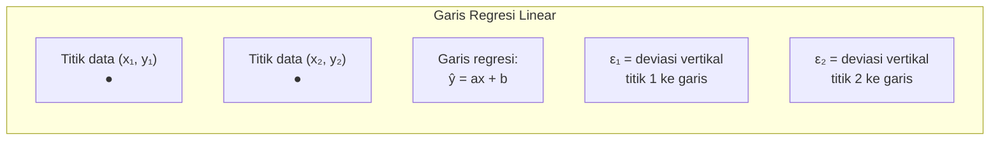
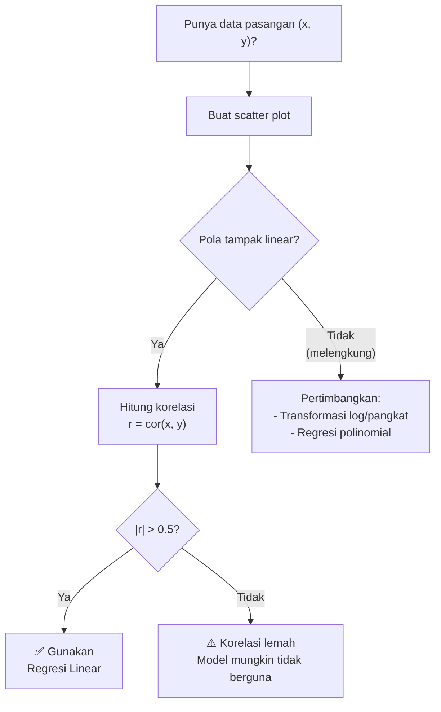
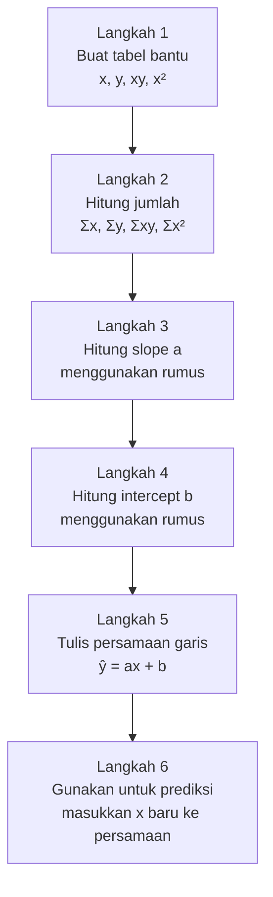
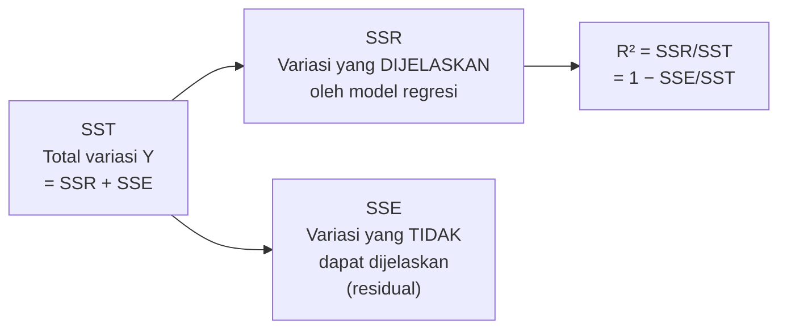
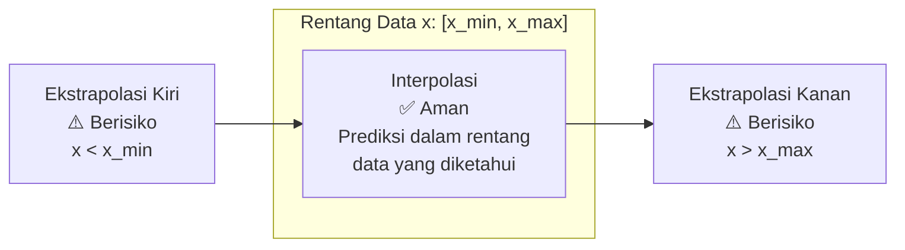
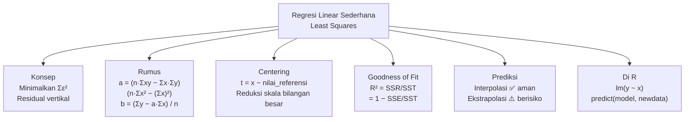

# Pertemuan 10 — Contoh Analisis Regresi Linear Sederhana

**MSIM4310 Analisis dan Visualisasi Data**  
Program Studi Sistem Informasi — Universitas Terbuka

> Catatan: dokumen ini merupakan ekstraksi sekaligus elaborasi dari materi *Inisiasi 10 — Contoh Analisis Regresi Linear Sederhana*. Pertemuan ini berfokus pada **perhitungan manual** metode Least Squares, yang merupakan fondasi matematis dari fungsi `lm()` di R yang telah kita gunakan sejak Pertemuan 8–9.

---

## Daftar Isi

1. [Metode Least Squares — Konsep dan Intuisi](#1-metode-least-squares--konsep-dan-intuisi)
2. [Rumus Least Squares](#2-rumus-least-squares)
3. [Langkah-Langkah Perhitungan Manual](#3-langkah-langkah-perhitungan-manual)
4. [Contoh 1 — Data Tiga Titik](#4-contoh-1--data-tiga-titik)
5. [Contoh 2 — Data Penjualan Perusahaan](#5-contoh-2--data-penjualan-perusahaan)
6. [Koefisien Determinasi (R²)](#6-koefisien-determinasi-r)
7. [Prediksi, Interpolasi, dan Ekstrapolasi](#7-prediksi-interpolasi-dan-ekstrapolasi)
8. [Implementasi di R](#8-implementasi-di-r)
9. [Contoh Tambahan — Latihan Mandiri](#9-contoh-tambahan--latihan-mandiri)
10. [Ringkasan](#10-ringkasan)

---

## 1. Metode Least Squares — Konsep dan Intuisi

### 1.1 Mengapa Perlu Metode Least Squares?

Jika kita punya data pasangan (x, y) yang membentuk pola linear, kita ingin menemukan **satu garis lurus terbaik** yang "paling mewakili" seluruh data. Masalahnya: ada tak terhingga garis yang bisa kita gambar melalui kumpulan titik tersebut. Mana yang terbaik?

**Metode Least Squares** menjawab: *garis yang terbaik adalah garis yang membuat total kesalahan prediksi sekecil mungkin* — khususnya, garis yang **meminimalkan jumlah kuadrat deviasi vertikal** dari setiap titik data ke garis.

### 1.2 Visualisasi Konsep



Secara visual, setiap titik data mempunyai "jarak vertikal" ke garis regresi yang disebut **residual** (ε):

```
  y
  ▲
  │            (x₂, y₂) ●
  │         ε₂↕   ┄┄┄┄┄┄ ← titik di bawah garis (ε₂ < 0)
  │          /
  │    ε₁↕ /  ← titik di atas garis (ε₁ > 0)
  │   ● /
  │(x₁,y₁) /
  │       /  True regression line: y = β₀ + β₁x
  └──────────────────────────────────► x
      x₁      x₂
```

**Least Squares** meminimalkan: `S = ε₁² + ε₂² + ... + εₙ² = Σεᵢ²`

**Mengapa dikuadratkan?**
- Residual positif (titik di atas garis) dan negatif (titik di bawah) akan saling menghilangkan jika dijumlahkan langsung
- Pengkuadratan memastikan semua residual bernilai positif dan dapat dijumlahkan
- Residual yang besar mendapat "penalti" lebih besar (2² = 4 lebih dari 2×2 = 4, tapi 3² = 9 jauh lebih besar dari 3×2 = 6)

### 1.3 Kapan Menggunakan Regresi Linear?



---

## 2. Rumus Least Squares

Garis regresi least squares ditulis sebagai:

```
ŷ = ax + b
```

Dimana `a` adalah **slope** (kemiringan) dan `b` adalah **intercept** (titik potong sumbu y).

Nilai `a` dan `b` yang meminimalkan `Σεᵢ²` diperoleh dengan rumus:

### Rumus a (Slope)

```
         n·Σxᵢyᵢ − Σxᵢ · Σyᵢ
a  =  ─────────────────────────────
         n·Σxᵢ² − (Σxᵢ)²
```

### Rumus b (Intercept)

```
     1  ⎛           ⎞
b =  ─  ⎜Σyᵢ − a·Σxᵢ⎟  =  ȳ − a·x̄
     n  ⎝           ⎠
```

### Bentuk Alternatif (Lebih Mudah Dipahami)

Rumus `a` bisa ditulis ulang sebagai:

```
     Σ(xᵢ − x̄)(yᵢ − ȳ)     Cov(x, y)
a  =  ─────────────────────  =  ─────────  =  r · (Sy/Sx)
         Σ(xᵢ − x̄)²            Var(x)
```

Dimana:
- `r` = korelasi Pearson antara x dan y
- `Sy`, `Sx` = simpangan baku y dan x

### Kuantitas yang Perlu Dihitung

| Simbol | Cara Hitung | Keterangan |
|--------|------------|-----------|
| `n` | Hitung baris data | Jumlah pasangan (x, y) |
| `Σxᵢ` | Jumlahkan semua x | |
| `Σyᵢ` | Jumlahkan semua y | |
| `Σxᵢyᵢ` | Kalikan xᵢ×yᵢ lalu jumlahkan | |
| `Σxᵢ²` | Kuadratkan xᵢ lalu jumlahkan | Hati-hati: bukan (Σxᵢ)²! |
| `x̄` | Σxᵢ/n | Rata-rata x |
| `ȳ` | Σyᵢ/n | Rata-rata y |

---

## 3. Langkah-Langkah Perhitungan Manual



**Tips mencegah kesalahan:**
- Selalu buat tabel bantu dengan kolom: x | y | xy | x²
- Hitung Σ dari setiap kolom secara terpisah
- Bedakan antara `Σx²` (jumlah kuadrat x) dan `(Σx)²` (kuadrat jumlah x) — keduanya berbeda!
- Gunakan variabel terpusat (centering) jika nilai x sangat besar (misalnya tahun)

---

## 4. Contoh 1 — Data Tiga Titik

**Soal:** Diberikan data {(2, 1), (1, 1), (3, 2)}. Hitunglah:
- a. Garis regresi least square
- b. Plot data dan garis regresi

### 4.1 Langkah Penyelesaian Manual

**Langkah 1 — Buat tabel bantu:**

| x | y | xy | x² |
|:-:|:-:|:--:|:--:|
| 2 | 1 | 2 | 4 |
| 1 | 1 | 1 | 1 |
| 3 | 2 | 6 | 9 |
| **Σx = 6** | **Σy = 4** | **Σxy = 9** | **Σx² = 14** |

n = 3

**Langkah 2 — Hitung slope a:**

```
         n·Σxy − Σx·Σy     3(9) − (6)(4)     27 − 24     3
a  =  ─────────────────── = ───────────────── = ───────── = ─── = 0,5
         n·Σx² − (Σx)²     3(14) − (6)²      42 − 36     6
```

**Langkah 3 — Hitung intercept b:**

```
     1              1                  1
b =  ─ (Σy − a·Σx) = ─ (4 − 0,5 × 6) = ─ (4 − 3) = 1/3 ≈ 0,333
     n              3                  3
```

**Langkah 4 — Persamaan garis:**

```
ŷ = 0,5x + 1/3
```

### 4.2 Verifikasi Persamaan

Cek apakah garis melewati titik rata-rata (x̄, ȳ):
```
x̄ = 6/3 = 2
ȳ = 4/3 ≈ 1,333

ŷ(x̄) = 0,5(2) + 1/3 = 1 + 0,333 = 1,333 = ȳ ✓
```

Garis regresi selalu melewati titik (x̄, ȳ) — ini sifat penting OLS.

### 4.3 Implementasi di R

```r
# Data
x <- c(2, 1, 3)
y <- c(1, 1, 2)

# Cara manual dengan rumus
n    <- length(x)
a    <- (n * sum(x*y) - sum(x) * sum(y)) / (n * sum(x^2) - sum(x)^2)
b    <- (sum(y) - a * sum(x)) / n

cat("Slope a    =", a, "\n")        # 0.5
cat("Intercept b =", b, "\n")       # 0.3333...
cat("Persamaan: ŷ =", a, "* x +", b, "\n")

# Verifikasi dengan lm()
model <- lm(y ~ x)
coef(model)
# (Intercept)    x
#  0.3333333  0.5000000
# Hasil sama! ✓

# Plot
plot(x, y,
     main = "Contoh 1: Regresi Linear (3 titik)",
     xlab = "x", ylab = "y",
     pch  = 19,
     col  = "steelblue",
     xlim = c(0, 4), ylim = c(0, 3),
     cex  = 1.5)
abline(model, col = "red", lwd = 2)
# Tambah residual lines
y_pred <- predict(model)
for (i in 1:n) {
  lines(c(x[i], x[i]), c(y[i], y_pred[i]),
        col = "orange", lwd = 1.5, lty = 2)
}
legend("topleft",
       legend = c("Data", "Garis Regresi", "Residual"),
       col    = c("steelblue", "red", "orange"),
       pch    = c(19, NA, NA), lty = c(NA, 1, 2), lwd = 2)
```

**Output prediksi:**
```
x=1: ŷ = 0,5(1) + 0,333 = 0,833
x=2: ŷ = 0,5(2) + 0,333 = 1,333
x=3: ŷ = 0,5(3) + 0,333 = 1,833
```

**Residual:**
| x | y | ŷ | ε = y − ŷ | ε² |
|:-:|:-:|:-:|:---------:|:--:|
| 1 | 1 | 0,833 | +0,167 | 0,028 |
| 2 | 1 | 1,333 | −0,333 | 0,111 |
| 3 | 2 | 1,833 | +0,167 | 0,028 |
| | | | **Σε = 0** | **Σε² = 0,167** |

Perhatikan: **Σε = 0** selalu — ini sifat penting OLS (residual selalu berjumlah nol).

---

## 5. Contoh 2 — Data Penjualan Perusahaan

**Soal:** Hasil penjualan produk suatu perusahaan (miliar IDR) ditunjukkan tabel berikut:

| x (tahun) | 2019 | 2020 | 2021 | 2022 | 2023 |
|:---------:|:----:|:----:|:----:|:----:|:----:|
| y (penjualan, miliar IDR) | 12 | 19 | 29 | 37 | 45 |

Hitunglah:
- a. Garis regresi least squares
- b. Estimasi penjualan tahun 2024

### 5.1 Teknik Centering Variabel

Jika x menggunakan tahun (2019, 2020, ...), nilai Σx dan Σx² akan sangat besar, rawan kesalahan hitung. Solusi: **geser sumbu** dengan transformasi:

```
t = x − 2019
```

Sehingga t menyatakan "berapa tahun setelah 2019":

| x (tahun) | 2019 | 2020 | 2021 | 2022 | 2023 |
|:---------:|:----:|:----:|:----:|:----:|:----:|
| t = x − 2019 | **0** | **1** | **2** | **3** | **4** |

> **Mengapa centering tidak mengubah kemiringan a?** Karena slope (a) hanya bergantung pada *pola perubahan* antara x dan y, bukan nilai absolut x. Centering hanya memindahkan titik origin (mengubah b), slope tetap sama.

> ⚠️ **Catatan koreksi:** Dalam modul sumber (AB10.pdf), nilai y pada tabel terpusat berubah dari (12, 19, 29, 37, 45) menjadi (10, 13, 25, 34, 40) — ini **tidak seharusnya terjadi** karena hanya variabel x yang digeser, bukan y. Kemungkinan merupakan kesalahan penulisan soal. Pada pembahasan di bawah ini akan digunakan nilai y sesuai soal asal (12, 19, 29, 37, 45) untuk konsistensi.

### 5.2 Penyelesaian dengan Variabel Terpusat

**Langkah 1 — Buat tabel bantu (dengan t = x − 2019):**

| t | y | ty | t² |
|:-:|:-:|:--:|:--:|
| 0 | 12 | 0 | 0 |
| 1 | 19 | 19 | 1 |
| 2 | 29 | 58 | 4 |
| 3 | 37 | 111 | 9 |
| 4 | 45 | 180 | 16 |
| **Σt = 10** | **Σy = 142** | **Σty = 368** | **Σt² = 30** |

n = 5

**Langkah 2 — Hitung slope a:**

```
         n·Σty − Σt·Σy     5(368) − (10)(142)     1840 − 1420     420
a  =  ─────────────────── = ─────────────────────── = ─────────── = ───── = 8,4
         n·Σt² − (Σt)²      5(30) − (10)²          150 − 100      50
```

**Langkah 3 — Hitung intercept b:**

```
     1              1                   1
b =  ─ (Σy − a·Σt) = ─ (142 − 8,4 × 10) = ─ (142 − 84) = 58/5 = 11,6
     n              5                   5
```

**Persamaan garis regresi (dalam t):**

```
ŷ = 8,4t + 11,6
```

### 5.3 Prediksi Penjualan Tahun 2024

Untuk tahun 2024: `t = 2024 − 2019 = 5`

```
ŷ = 8,4(5) + 11,6 = 42 + 11,6 = 53,6 miliar IDR
```

### 5.4 Konversi Kembali ke Variabel x (Tahun)

Persamaan dalam t bisa dikonversi ke persamaan dalam x:

```
t = x − 2019
ŷ = 8,4(x − 2019) + 11,6
ŷ = 8,4x − 16959,6 + 11,6
ŷ = 8,4x − 16948     (dalam satuan x = tahun)
```

Verifikasi: x=2024 → ŷ = 8,4(2024) − 16948 = 17001,6 − 16948 = 53,6 ✓

### 5.5 Implementasi di R

```r
# Data asli
tahun    <- c(2019, 2020, 2021, 2022, 2023)
penjualan <- c(12, 19, 29, 37, 45)

# Centering variabel
t <- tahun - 2019

# Perhitungan manual
n <- length(t)
a <- (n * sum(t * penjualan) - sum(t) * sum(penjualan)) /
     (n * sum(t^2) - sum(t)^2)
b <- (sum(penjualan) - a * sum(t)) / n

cat("Slope a     =", a, "\n")          # 8.4
cat("Intercept b =", b, "\n")          # 11.6
cat("Persamaan   : ŷ =", a, "* t +", b, "\n")

# Prediksi 2024 (t = 5)
t_2024 <- 2024 - 2019
pred_2024 <- a * t_2024 + b
cat("Prediksi 2024:", pred_2024, "miliar IDR\n")  # 53.6

# Verifikasi dengan lm()
model <- lm(penjualan ~ t)
coef(model)
# (Intercept)    t
#        11.6  8.4   ✓

# Plot hasil regresi
par(mfrow = c(1, 2))

# Plot 1: Data + garis regresi
plot(tahun, penjualan,
     main = "Penjualan vs Tahun",
     xlab = "Tahun", ylab = "Penjualan (miliar IDR)",
     pch  = 19, col = "steelblue", cex = 1.5,
     xlim = c(2019, 2025))
abline(lm(penjualan ~ tahun), col = "red", lwd = 2)
# Tambah titik prediksi 2024
points(2024, pred_2024, pch = 17, col = "orange", cex = 1.5)
text(2024, pred_2024 + 1.5, "2024\n(53.6)", col = "orange", cex = 0.8)

# Plot 2: Residuals
y_pred    <- predict(model)
residuals <- penjualan - y_pred
plot(t, residuals,
     main = "Plot Residual",
     xlab = "t (tahun setelah 2019)", ylab = "Residual",
     pch  = 19, col = "steelblue", cex = 1.5)
abline(h = 0, col = "red", lwd = 2, lty = 2)
text(t, residuals + 0.8, round(residuals, 2), cex = 0.7)

par(mfrow = c(1, 1))
```

### 5.6 Tabel Prediksi vs Aktual

| Tahun | t | y Aktual | ŷ Prediksi | Residual (ε) | ε² |
|:-----:|:-:|:--------:|:----------:|:------------:|:--:|
| 2019 | 0 | 12 | 11,6 | +0,4 | 0,16 |
| 2020 | 1 | 19 | 20,0 | −1,0 | 1,00 |
| 2021 | 2 | 29 | 28,4 | +0,6 | 0,36 |
| 2022 | 3 | 37 | 36,8 | +0,2 | 0,04 |
| 2023 | 4 | 45 | 45,2 | −0,2 | 0,04 |
| | | | | **Σε = 0** | **SSE = 1,60** |

Residual kecil (maksimum 1,0 dari skala penjualan 12–45) menunjukkan **model fit sangat baik**.

---

## 6. Koefisien Determinasi (R²)

**R²** (koefisien determinasi) mengukur seberapa baik garis regresi menjelaskan variasi data. Nilainya antara 0 dan 1.

### 6.1 Komponen Variasi Total

```
SST = SSR + SSE

Di mana:
SST = Total Sum of Squares     = Σ(yᵢ − ȳ)²    (total variasi Y)
SSR = Regression Sum of Squares = Σ(ŷᵢ − ȳ)²  (variasi yang dijelaskan model)
SSE = Error Sum of Squares     = Σ(yᵢ − ŷᵢ)²   (variasi sisa/residual)
```



### 6.2 Menghitung R²

**Menggunakan data Contoh 2:**

```
ȳ = 142/5 = 28,4

SST = (12−28,4)² + (19−28,4)² + (29−28,4)² + (37−28,4)² + (45−28,4)²
    = 268,96 + 88,36 + 0,36 + 73,96 + 275,56
    = 707,2

SSE = Σε² = 1,60   (dari tabel di atas)

SSR = SST − SSE = 707,2 − 1,6 = 705,6

R² = SSR/SST = 705,6/707,2 ≈ 0,9977
```

**R² = 0,9977 → 99,77% variasi penjualan dapat dijelaskan oleh hubungan linear dengan waktu!**

### 6.3 Implementasi R²

```r
# Dari summary(model) langsung
model <- lm(penjualan ~ t)
summary(model)$r.squared           # Multiple R-squared
summary(model)$adj.r.squared       # Adjusted R-squared

# Hitung manual
y_bar  <- mean(penjualan)
y_pred <- predict(model)
SST    <- sum((penjualan - y_bar)^2)
SSE    <- sum((penjualan - y_pred)^2)
SSR    <- SST - SSE
R2     <- SSR / SST

cat("SST:", SST, "\n")    # 707.2
cat("SSE:", SSE, "\n")    # 1.6
cat("SSR:", SSR, "\n")    # 705.6
cat("R² :", R2, "\n")     # 0.9977
```

### 6.4 Interpretasi R²

| R² | Interpretasi |
|----|-------------|
| 0,95 – 1,00 | Model sangat baik — hampir semua variasi Y dijelaskan |
| 0,80 – 0,95 | Model baik |
| 0,60 – 0,80 | Model cukup — masih ada variasi signifikan yang tidak dijelaskan |
| < 0,60 | Model lemah — perlu variabel tambahan atau transformasi |

> **Catatan penting:** R² yang tinggi tidak berarti model kausal yang benar. Dua variabel yang tidak berhubungan secara kausal bisa punya R² tinggi jika keduanya sama-sama berubah terhadap waktu (*spurious correlation*).

---

## 7. Prediksi, Interpolasi, dan Ekstrapolasi



**Contoh dengan data penjualan (t dari 0 s.d. 4):**

| Prediksi untuk | Jenis | Hasil |
|---------------|-------|-------|
| t = 2 (tahun 2021) | Interpolasi ✅ | ŷ = 8,4(2) + 11,6 = 28,4 (data asli: 29) |
| t = 5 (tahun 2024) | Ekstrapolasi kanan ⚠️ | ŷ = 8,4(5) + 11,6 = 53,6 |
| t = 10 (tahun 2029) | Ekstrapolasi jauh ❌ | ŷ = 8,4(10) + 11,6 = 95,6 — sangat tidak pasti |

**Mengapa ekstrapolasi berisiko?**

```r
# Ilustrasi bahaya ekstrapolasi
t_extrapolasi <- c(0:4, 5:10)  # termasuk 5 tahun ke depan
pred_all <- predict(model, newdata = data.frame(t = t_extrapolasi),
                    interval = "prediction", level = 0.95)

# Visualisasi
matplot(t_extrapolasi, pred_all,
        type = "l", lty = c(1,2,2),
        col = c("red", "blue", "blue"),
        xlab = "t (tahun setelah 2019)",
        ylab = "Penjualan (miliar IDR)",
        main = "Risiko Ekstrapolasi: PI melebar sangat lebar")
abline(v = 4, col = "gray", lty = 3, lwd = 2)
text(4.2, 20, "Data terakhir\n(t=4, 2023)", col = "gray40", cex = 0.8)
legend("topleft", c("Fit", "95% PI"),
       col = c("red","blue"), lty = c(1,2))
```

---

## 8. Implementasi di R

### 8.1 Kode Lengkap — Dari Data ke Prediksi

```r
# ============================================================
# ANALISIS REGRESI LINEAR SEDERHANA — Panduan Lengkap
# ============================================================

# ---- Fungsi perhitungan manual least squares ----
least_squares <- function(x, y) {
  n  <- length(x)
  a  <- (n * sum(x*y) - sum(x) * sum(y)) / (n * sum(x^2) - sum(x)^2)
  b  <- (sum(y) - a * sum(x)) / n
  list(a = a, b = b,
       formula = paste0("ŷ = ", round(a,4), "·x + ", round(b,4)))
}

# ---- Fungsi tabel bantu ----
tabel_bantu <- function(x, y) {
  df <- data.frame(
    x    = x,
    y    = y,
    xy   = x * y,
    x2   = x^2
  )
  df <- rbind(df, c(sum(df$x), sum(df$y), sum(df$xy), sum(df$x2)))
  rownames(df)[nrow(df)] <- "Σ"
  df
}

# ============================================================
# Contoh 1
# ============================================================
x1 <- c(2, 1, 3)
y1 <- c(1, 1, 2)

cat("=== CONTOH 1 ===\n")
cat("Tabel bantu:\n")
print(tabel_bantu(x1, y1))

hasil1 <- least_squares(x1, y1)
cat("\nSlope a     =", hasil1$a, "\n")
cat("Intercept b =", hasil1$b, "\n")
cat("Persamaan   :", hasil1$formula, "\n")

# ============================================================
# Contoh 2 (dengan centering)
# ============================================================
tahun     <- c(2019, 2020, 2021, 2022, 2023)
penjualan <- c(12, 19, 29, 37, 45)
t         <- tahun - 2019   # centering

cat("\n=== CONTOH 2 ===\n")
cat("Tabel bantu (variabel terpusat t = tahun - 2019):\n")
print(tabel_bantu(t, penjualan))

hasil2 <- least_squares(t, penjualan)
cat("\nSlope a     =", hasil2$a, "\n")
cat("Intercept b =", hasil2$b, "\n")
cat("Persamaan   :", hasil2$formula, "\n")

t_2024 <- 5
pred   <- hasil2$a * t_2024 + hasil2$b
cat("\nPrediksi 2024 (t=5):", pred, "miliar IDR\n")

# ---- Goodness of fit ----
model  <- lm(penjualan ~ t)
R2     <- summary(model)$r.squared
cat("R²           =", round(R2, 6), "\n")

# ---- Visualisasi ----
par(mfrow = c(1, 2))

plot(tahun, penjualan,
     main = "Penjualan Perusahaan 2019-2023",
     xlab = "Tahun", ylab = "Penjualan (miliar IDR)",
     pch  = 19, col = "steelblue", cex = 1.5,
     xlim = c(2018, 2025), ylim = c(0, 60))
abline(lm(penjualan ~ tahun), col = "red", lwd = 2)
points(2024, pred, pch = 17, col = "orange", cex = 2)
text(2024, pred + 3, paste("2024:\n", pred, "M"), col = "darkorange", cex = 0.8)
grid()

# Residual plot
plot(t, residuals(model),
     main = "Plot Residual",
     xlab = "t", ylab = "Residual",
     pch  = 19, col = "steelblue", cex = 1.5)
abline(h = 0, col = "red", lwd = 2, lty = 2)
grid()

par(mfrow = c(1, 1))
```

### 8.2 Ringkasan Fungsi R untuk Regresi Linear Sederhana

| Tujuan | Fungsi R | Output |
|--------|----------|--------|
| Bangun model | `lm(y ~ x, data)` | Objek model |
| Lihat koefisien & R² | `summary(model)` | Koefisien, p-value, R² |
| Ambil koefisien saja | `coef(model)` | Vektor a dan b |
| Ambil R² saja | `summary(model)$r.squared` | Angka 0–1 |
| Prediksi | `predict(model, newdata)` | Nilai ŷ |
| Prediksi + interval | `predict(model, newdata, interval="prediction")` | fit, lwr, upr |
| Plot diagnostik | `plot(model)` | 4 plot asumsi |
| Residual | `residuals(model)` | Vektor ε |
| Nilai fitted | `fitted(model)` | Vektor ŷ |

---

## 9. Contoh Tambahan — Latihan Mandiri

**Soal:** Data berikut menunjukkan hubungan antara jam belajar (x) dan nilai ujian (y) dari 6 mahasiswa:

| Mahasiswa | x (jam) | y (nilai) |
|:---------:|:-------:|:---------:|
| A | 2 | 50 |
| B | 3 | 60 |
| C | 4 | 65 |
| D | 5 | 75 |
| E | 6 | 80 |
| F | 8 | 90 |

**Tugas:**
1. Buat tabel bantu dan hitung a dan b secara manual
2. Tulis persamaan garis regresi
3. Prediksi nilai mahasiswa yang belajar 7 jam
4. Hitung R² dan interpretasikan
5. Verifikasi semua hasil dengan R

### Kunci Jawaban

**Tabel bantu:**

| x | y | xy | x² |
|:-:|:-:|:--:|:--:|
| 2 | 50 | 100 | 4 |
| 3 | 60 | 180 | 9 |
| 4 | 65 | 260 | 16 |
| 5 | 75 | 375 | 25 |
| 6 | 80 | 480 | 36 |
| 8 | 90 | 720 | 64 |
| **Σx = 28** | **Σy = 420** | **Σxy = 2115** | **Σx² = 154** |

n = 6

**Slope a:**
```
a = [6(2115) − (28)(420)] / [6(154) − (28)²]
  = [12690 − 11760] / [924 − 784]
  = 930 / 140
  = 6,643
```

**Intercept b:**
```
b = (420 − 6,643 × 28) / 6
  = (420 − 186) / 6
  = 234 / 6
  = 39
```

**Persamaan:** `ŷ = 6,643x + 39`

**Prediksi x = 7:**
```
ŷ = 6,643(7) + 39 = 46,5 + 39 = 85,5
```

**Verifikasi di R:**

```r
x_latihan <- c(2, 3, 4, 5, 6, 8)
y_latihan <- c(50, 60, 65, 75, 80, 90)

model_latihan <- lm(y_latihan ~ x_latihan)
cat("Koefisien:\n")
print(coef(model_latihan))
# (Intercept) x_latihan
#    39.00000   6.64286

cat("\nPrediksi x=7:", predict(model_latihan, data.frame(x_latihan = 7)), "\n")
# 85.5

cat("R²:", summary(model_latihan)$r.squared, "\n")
# 0.9913 → sangat baik!
```

---

## 10. Ringkasan



**Formula penting yang harus diingat:**

| Formula | Keterangan |
|---------|-----------|
| `ŷ = ax + b` | Persamaan garis regresi |
| `a = (n·Σxy − Σx·Σy) / (n·Σx² − (Σx)²)` | Slope — kemiringan garis |
| `b = (Σy − a·Σx) / n = ȳ − a·x̄` | Intercept — titik potong sumbu y |
| `R² = 1 − SSE/SST` | Proporsi variasi Y yang dijelaskan model |
| `t = x − x_ref` | Centering variabel untuk menyederhanakan perhitungan |

**Langkah kerja cepat:**

```
1. Buat tabel: x | y | xy | x²
2. Hitung: Σx, Σy, Σxy, Σx², dan n
3. Hitung a dengan rumus
4. Hitung b = (Σy − a·Σx)/n
5. Tulis persamaan ŷ = ax + b
6. Gunakan untuk prediksi (masukkan nilai x baru)
7. Hitung R² untuk menilai kualitas model
```

---

*Selamat Belajar...*
