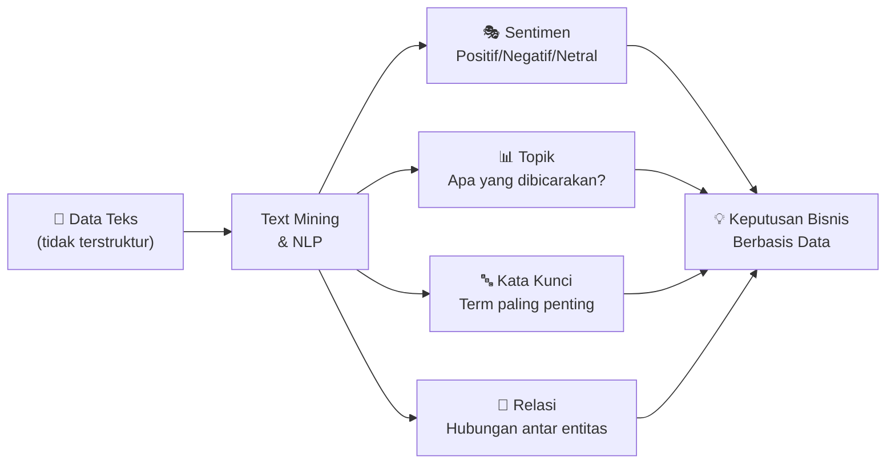
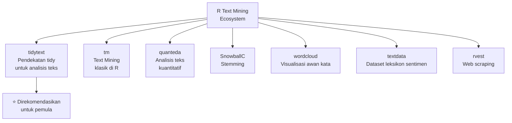
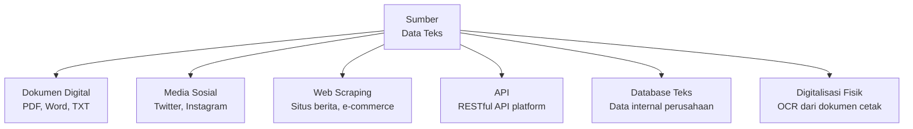
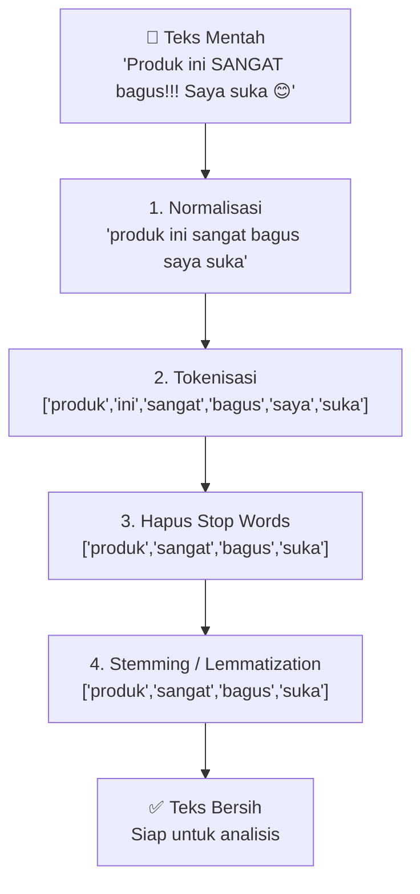
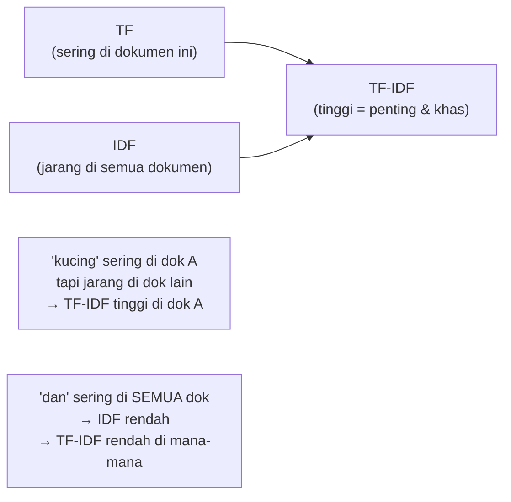
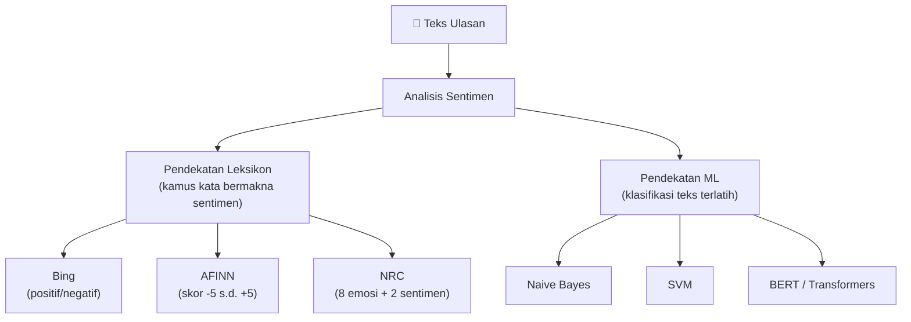
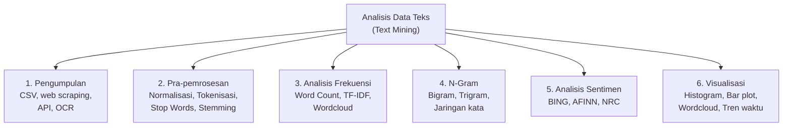

# Pertemuan 11 — Konsep Data Teks

**MSIM4310 Analisis dan Visualisasi Data**  
Program Studi Sistem Informasi — Universitas Terbuka

> Catatan: dokumen ini merupakan ekstraksi sekaligus elaborasi dari materi *Inisiasi 11 — Konsep Data Teks*. Pertemuan ini memperkenalkan dunia **Text Mining** dan **Natural Language Processing (NLP)** — analisis data berbentuk teks menggunakan R.

---

## Daftar Isi

1. [Pengantar Data Teks](#1-pengantar-data-teks)
2. [Pengumpulan Data Teks](#2-pengumpulan-data-teks)
3. [Pra-pemrosesan Data Teks](#3-pra-pemrosesan-data-teks)
4. [Analisis Frekuensi Kata](#4-analisis-frekuensi-kata)
5. [Analisis N-Gram](#5-analisis-n-gram)
6. [TF-IDF — Term Frequency Inverse Document Frequency](#6-tf-idf--term-frequency-inverse-document-frequency)
7. [Analisis Sentimen](#7-analisis-sentimen)
8. [Visualisasi Data Teks](#8-visualisasi-data-teks)
9. [Studi Kasus Lengkap](#9-studi-kasus-lengkap)
10. [Ringkasan](#10-ringkasan)

---

## 1. Pengantar Data Teks

### 1.1 Apa itu Data Teks?

**Data teks** adalah informasi yang diungkapkan dalam bentuk kata-kata, kalimat, atau paragraf — berbeda dengan data numerik (angka) atau data kategorikal (label diskrit). Data teks bersifat **tidak terstruktur** (*unstructured*): tidak ada kolom, tidak ada format baku, dan maknanya sangat bergantung pada konteks bahasa.

**Contoh data teks dalam kehidupan nyata:**

| Sumber | Contoh | Nilai Bisnis |
|--------|--------|-------------|
| Ulasan produk | "Baterainya cepat habis, tapi layarnya jernih" | Analisis kepuasan pelanggan |
| Media sosial | Tweet, postingan Instagram | Monitoring sentimen merek |
| Email/chat | Tiket layanan pelanggan | Klasifikasi masalah otomatis |
| Artikel berita | Berita ekonomi harian | Deteksi tren pasar |
| Laporan penelitian | Jurnal ilmiah | Literature review otomatis |
| Transkrip call center | Percakapan agen-pelanggan | Identifikasi keluhan umum |

### 1.2 Mengapa Text Mining Penting?

Sekitar **80% data di dunia berbentuk teks tidak terstruktur**. Analisis manual tidak mungkin untuk volume data besar (jutaan ulasan, miliaran tweet). Text mining mengotomasi proses ini:



### 1.3 Ekosistem Text Mining di R



---

## 2. Pengumpulan Data Teks

### 2.1 Sumber Data Teks



### 2.2 Membaca Data Teks dari File

```r
library(readr)
library(readtext)

# Membaca file TXT
teks_txt <- readLines("dokumen.txt", encoding = "UTF-8")

# Membaca file CSV dengan kolom teks
ulasan <- read_csv("ulasan_produk.csv")
head(ulasan)
# Struktur: review_id | product | review_text | rating | date

# Membaca multiple file TXT sekaligus
library(readtext)
dokumen <- readtext("folder_dokumen/*.txt")
```

### 2.3 Web Scraping dengan rvest

```r
library(rvest)
library(dplyr)

# Contoh: scraping ulasan dari situs berita
url <- "https://example-news.com/artikel/123"

halaman <- read_html(url)

# Ambil judul
judul <- halaman %>%
  html_node("h1.article-title") %>%
  html_text()

# Ambil isi artikel
isi <- halaman %>%
  html_nodes("p.article-body") %>%
  html_text() %>%
  paste(collapse = " ")

# Gabungkan
artikel <- data.frame(
  judul = judul,
  isi   = isi,
  stringsAsFactors = FALSE
)
```

### 2.4 Digitalisasi Dokumen dengan OCR

```r
# Paket tesseract untuk OCR (Optical Character Recognition)
library(tesseract)
library(magick)   # manipulasi gambar

# OCR dari gambar/scan PDF
eng <- tesseract("eng")        # mesin OCR bahasa Inggris
ind <- tesseract("ind")        # mesin OCR bahasa Indonesia

# Baca gambar dan ekstrak teks
gambar  <- image_read("dokumen_scan.png")
hasil_ocr <- tesseract::ocr(gambar, engine = ind)
cat(hasil_ocr)
```

---

## 3. Pra-pemrosesan Data Teks

Sebelum dianalisis, teks mentah harus "dibersihkan" dan diubah ke format yang bisa diproses secara komputasional. Ini disebut **pra-pemrosesan** (*text preprocessing*).



### 3.1 Normalisasi Teks

Normalisasi mengubah teks ke format standar sebelum dianalisis.

```r
# Contoh teks mentah
teks_mentah <- "Produk ini SANGAT Bagus!!! Harganya Rp500.000 (diskon 20%). 
                Saya beli tgl 15/01/2024 & sangat puas :)"

# Langkah normalisasi
teks_normal <- teks_mentah %>%
  tolower() %>%                              # huruf kecil semua
  gsub("[[:punct:]]", " ", .) %>%           # hapus tanda baca
  gsub("[0-9]+", "", .) %>%                 # hapus angka
  gsub("\\s+", " ", .) %>%                  # normalkan spasi
  trimws()                                   # hapus spasi di awal/akhir

cat(teks_normal)
# "produk ini sangat bagus harganya rp diskon saya beli tgl  sangat puas"

# Dengan pipe modern (R 4.1+)
teks_normal2 <- teks_mentah |>
  tolower() |>
  gsub(pattern = "[[:punct:]]", replacement = " ", x = _) |>
  gsub(pattern = "\\d+", replacement = "", x = _) |>
  gsub(pattern = "\\s+", replacement = " ", x = _) |>
  trimws()
```

**Referensi karakter regex yang sering digunakan:**

| Pattern | Cocok dengan | Contoh |
|---------|-------------|--------|
| `[[:punct:]]` | Semua tanda baca | `!`, `,`, `.`, `?`, `"` |
| `[[:alpha:]]` | Huruf saja | `a-z`, `A-Z` |
| `[[:digit:]]` atau `\\d` | Angka saja | `0-9` |
| `\\s` | Spasi, tab, newline | ` `, `\t`, `\n` |
| `\\s+` | Satu atau lebih spasi | `"  "` → `" "` |
| `[^a-z ]` | Bukan huruf kecil atau spasi | Semua karakter lain |

### 3.2 Tokenisasi

**Tokenisasi** adalah proses memecah teks menjadi unit-unit kecil (*token*) — biasanya kata.

```r
library(tidytext)
library(tidyverse)

# Contoh dataset ulasan
ulasan <- data.frame(
  id   = 1:3,
  teks = c(
    "Produk ini sangat bagus dan berkualitas tinggi",
    "Pengiriman cepat tapi produk kurang memuaskan",
    "Harga terjangkau kualitas oke recommended banget"
  )
)

# Tokenisasi per kata (unit = "words")
tidy_ulasan <- ulasan %>%
  unnest_tokens(kata, teks)
# Output: setiap baris = satu kata
# id | kata
#  1 | produk
#  1 | ini
#  1 | sangat
#  ...

# Tokenisasi per kalimat
tidy_kalimat <- ulasan %>%
  unnest_tokens(kalimat, teks, token = "sentences")

# Tokenisasi per karakter
tidy_karakter <- ulasan %>%
  unnest_tokens(karakter, teks, token = "characters")
```

### 3.3 Stop Words — Kata yang Tidak Bermakna

**Stop words** adalah kata-kata umum yang muncul sangat sering tetapi tidak membawa makna signifikan untuk analisis (misalnya: "dan", "atau", "ini", "itu", "yang", "di", "ke").

```r
# Stop words bahasa Inggris bawaan tidytext
data(stop_words)
head(stop_words, 10)
# word       lexicon
# a          SMART
# a's        SMART
# able       SMART
# ...

# Stop words bahasa Indonesia (perlu dibuat manual atau gunakan stopwords-id)
stop_words_id <- data.frame(
  word = c("yang", "di", "ke", "dari", "ini", "itu", "dan", "atau",
           "dengan", "untuk", "pada", "dalam", "adalah", "akan",
           "juga", "lebih", "sudah", "ada", "tidak", "saya",
           "kami", "kita", "mereka", "ia", "dia", "saya", "anda",
           "bisa", "dapat", "harus", "karena", "jika", "maka",
           "tetapi", "namun", "tapi", "bahwa", "seperti", "oleh")
)

# Alternatif: gunakan paket stopwords
library(stopwords)
sw_id <- data.frame(word = stopwords("id"))   # bahasa Indonesia
sw_en <- data.frame(word = stopwords("en"))   # bahasa Inggris

# Hapus stop words dari token
tidy_bersih <- tidy_ulasan %>%
  anti_join(stop_words_id, by = c("kata" = "word"))
```

**Mengapa menghapus stop words?** Tanpa penghapusan, kata-kata seperti "dan", "yang", "di" akan selalu menempati frekuensi teratas dan menyembunyikan kata-kata yang benar-benar bermakna.

### 3.4 Stemming dan Lemmatization

**Stemming** memangkas akhiran kata ke bentuk akar, sedangkan **Lemmatization** mengubah kata ke bentuk dasar yang sesungguhnya.

```
Contoh:
berjalan, berjalan-jalan, berlari, berlarian
                ↓ Stemming
jalan, jalan, lari, lari

"running", "runs", "ran"
      ↓ Lemmatization
"run", "run", "run"
```

```r
library(SnowballC)

# Stemming bahasa Inggris
kata <- c("running", "runs", "runner", "easily", "fairly")
wordStem(kata, language = "english")
# "run" "run" "runner" "easili" "fairli"
# (tidak selalu sempurna — "easily" → "easili")

# Stemming bahasa Indonesia
library(katadasaR)  # paket untuk bahasa Indonesia
stemming_id <- function(kata) {
  sapply(kata, function(w) katadasaR(w))
}

# Lemmatization (lebih akurat dari stemming)
library(textstem)
lemmatize_words(c("running", "flies", "ate", "better"))
# "run" "fly" "eat" "good"

# Terapkan pada dataset
tidy_bersih <- tidy_bersih %>%
  mutate(kata_stem = wordStem(kata, language = "english"))
```

| | Stemming | Lemmatization |
|--|----------|---------------|
| **Metode** | Aturan heuristik (potong akhiran) | Kamus linguistik |
| **Akurasi** | Lebih rendah | Lebih tinggi |
| **Kecepatan** | Lebih cepat | Lebih lambat |
| **Contoh** | "studies" → "studi" | "studies" → "study" |
| **Paket R** | `SnowballC::wordStem()` | `textstem::lemmatize_words()` |

---

## 4. Analisis Frekuensi Kata

### 4.1 Word Count Dasar

```r
library(tidyverse)
library(tidytext)

# Dataset simulasi ulasan produk (bisa diganti CSV nyata)
ulasan_df <- data.frame(
  review_id   = 1:5,
  review_text = c(
    "Produk bagus berkualitas tinggi sangat puas",
    "Kualitas produk bagus harga terjangkau recommended",
    "Pengiriman cepat produk sesuai deskripsi bagus",
    "Kurang puas kualitas buruk tidak sesuai ekspektasi",
    "Harga murah tapi kualitas mengecewakan tidak recommended"
  )
)

# Stop words Indonesia sederhana
sw_id <- data.frame(word = c("yang", "di", "ke", "dari", "ini",
                              "itu", "dan", "atau", "dengan", "untuk",
                              "pada", "dalam", "adalah", "tidak", "tapi"))

# Pipeline: tokenisasi → hapus stop words → hitung frekuensi
word_freq <- ulasan_df %>%
  unnest_tokens(word, review_text) %>%   # tokenisasi
  anti_join(sw_id, by = "word") %>%      # hapus stop words
  count(word, sort = TRUE)               # hitung & urutkan

# Tampilkan 10 teratas
head(word_freq, 10)
#        word  n
# 1    bagus   3
# 2  kualitas  3
# 3   produk   3
# 4 terjangkau 1
# ...
```

### 4.2 Visualisasi Frekuensi Kata

```r
library(ggplot2)

# Bar chart frekuensi kata
word_freq %>%
  top_n(10, n) %>%
  mutate(word = reorder(word, n)) %>%   # urutkan bar chart
  ggplot(aes(x = word, y = n)) +
  geom_col(fill = "steelblue", width = 0.7) +
  coord_flip() +
  labs(title    = "10 Kata Paling Sering dalam Ulasan",
       x        = NULL,
       y        = "Frekuensi") +
  theme_minimal(base_size = 12)
```

### 4.3 Word Cloud

```r
library(wordcloud)
library(RColorBrewer)

# Word cloud sederhana
set.seed(42)
wordcloud(words  = word_freq$word,
          freq   = word_freq$n,
          min.freq = 1,
          max.words = 100,
          random.order = FALSE,
          rot.per = 0.35,
          colors = brewer.pal(8, "Dark2"))

# Word cloud dengan wordcloud2 (lebih modern, interaktif)
library(wordcloud2)
wordcloud2(word_freq,
           size  = 1.2,
           color = "random-dark",
           shape = "circle")
```

---

## 5. Analisis N-Gram

**N-gram** adalah urutan n kata yang berdekatan. N-gram memungkinkan kita menangkap konteks dan frasa, bukan hanya kata tunggal.

| N | Nama | Contoh dari "produk sangat bagus" |
|:-:|------|----------------------------------|
| 1 | Unigram | "produk", "sangat", "bagus" |
| 2 | Bigram | "produk sangat", "sangat bagus" |
| 3 | Trigram | "produk sangat bagus" |

**Mengapa N-gram berguna?**
- "tidak bagus" ≠ "bagus" → bigram menangkap negasi
- "sangat memuaskan" → lebih kuat dari "memuaskan" saja
- Bigram "kurang memuaskan" menunjukkan sentimen negatif yang tidak terdeteksi dari kata tunggal

### 5.1 Membuat Bigram

```r
# Bigram dari dataset ulasan
bigram_df <- ulasan_df %>%
  unnest_tokens(bigram, review_text, token = "ngrams", n = 2)

head(bigram_df)
# review_id    bigram
#         1  produk bagus
#         1  bagus berkualitas
#         1  berkualitas tinggi
#         ...

# Hitung frekuensi bigram
bigram_count <- bigram_df %>%
  count(bigram, sort = TRUE)

head(bigram_count, 10)
```

### 5.2 Filter Bigram Bermakna

Pisahkan bigram menjadi dua kolom word1 dan word2, lalu filter jika salah satunya stop word:

```r
library(tidyr)

# Pisah bigram menjadi word1 dan word2
bigrams_separated <- bigram_df %>%
  separate(bigram, into = c("word1", "word2"), sep = " ")

# Filter: hapus bigram yang mengandung stop words
bigrams_filtered <- bigrams_separated %>%
  filter(!word1 %in% sw_id$word,
         !word2 %in% sw_id$word)

# Gabungkan kembali dan hitung
bigrams_filtered %>%
  unite(bigram, word1, word2, sep = " ") %>%
  count(bigram, sort = TRUE)
```

### 5.3 Visualisasi Jaringan Bigram

Bigram bisa divisualisasikan sebagai **graf jaringan** — setiap kata adalah simpul, setiap bigram adalah tepi:

```r
library(igraph)
library(ggraph)

# Buat graph dari bigram
bigram_graph <- bigrams_filtered %>%
  unite(bigram, word1, word2, sep = " ") %>%
  count(bigram, sort = TRUE) %>%
  filter(n >= 2) %>%
  separate(bigram, into = c("from", "to"), sep = " ") %>%
  graph_from_data_frame()

# Plot jaringan
set.seed(42)
ggraph(bigram_graph, layout = "fr") +
  geom_edge_link(aes(edge_alpha = n),
                 show.legend  = FALSE,
                 arrow        = arrow(type = "closed", length = unit(3, "mm")),
                 end_cap      = circle(3, "mm")) +
  geom_node_point(color = "steelblue", size = 4) +
  geom_node_text(aes(label = name), vjust = 1, hjust = 1, size = 3) +
  labs(title = "Jaringan Bigram Ulasan Produk") +
  theme_void()
```

---

## 6. TF-IDF — Term Frequency Inverse Document Frequency

**TF-IDF** mengukur seberapa penting sebuah kata dalam sebuah dokumen relatif terhadap seluruh koleksi dokumen (*corpus*). Berbeda dari frekuensi biasa yang hanya menghitung kemunculan, TF-IDF memberikan bobot lebih rendah pada kata yang muncul di banyak dokumen.

```
TF-IDF(t, d) = TF(t, d) × IDF(t)

Di mana:
TF(t, d)  = Frekuensi term t dalam dokumen d / Total kata dalam d
IDF(t)    = log(N / df(t))
N         = total jumlah dokumen
df(t)     = jumlah dokumen yang mengandung term t
```

**Intuisi:** Kata yang sering muncul di SATU dokumen tapi jarang di dokumen lain → penting dan khas untuk dokumen itu. Kata yang sering muncul di SEMUA dokumen → tidak informatif.



```r
# Hitung TF-IDF per dokumen
tfidf_result <- ulasan_df %>%
  unnest_tokens(word, review_text) %>%
  anti_join(sw_id, by = "word") %>%
  count(review_id, word) %>%
  bind_tf_idf(word, review_id, n)

# Urutkan berdasarkan TF-IDF tertinggi
tfidf_result %>%
  arrange(desc(tf_idf)) %>%
  head(15)

# Visualisasi: kata paling khas per dokumen
tfidf_result %>%
  group_by(review_id) %>%
  slice_max(tf_idf, n = 3) %>%
  ungroup() %>%
  mutate(word = reorder_within(word, tf_idf, review_id)) %>%
  ggplot(aes(word, tf_idf, fill = factor(review_id))) +
  geom_col(show.legend = FALSE) +
  facet_wrap(~ review_id, scales = "free_y") +
  scale_x_reordered() +
  coord_flip() +
  labs(title = "Kata Paling Khas per Ulasan (TF-IDF)",
       x = NULL, y = "TF-IDF") +
  theme_minimal()
```

---

## 7. Analisis Sentimen

### 7.1 Konsep Analisis Sentimen

**Analisis sentimen** (opinion mining) mengklasifikasikan teks berdasarkan emosi atau opini yang terkandung di dalamnya — umumnya: **positif**, **negatif**, atau **netral**.



### 7.2 Tiga Kamus Sentimen di tidytext

| Kamus | Format | Contoh | Kapan Digunakan |
|-------|--------|--------|----------------|
| **BING** | Biner (positif/negatif) | "good" → positive; "bad" → negative | Klasifikasi sederhana |
| **AFINN** | Skor integer −5 s.d. +5 | "love" → +3; "hate" → −4 | Intensitas sentimen |
| **NRC** | Multi-label emosi | "joy", "anger", "fear", "trust", dll | Analisis emosi mendalam |

```r
library(textdata)
library(tidytext)

# Download kamus (hanya sekali, disimpan lokal)
bing    <- get_sentiments("bing")    # positif/negatif
afinn   <- get_sentiments("afinn")   # skor -5 s.d. +5
nrc     <- get_sentiments("nrc")     # 10 kategori emosi

head(bing, 5)
#          word sentiment
# 1      2-faced  negative
# 2      2-faces  negative
# 3   a+          positive
# ...

head(afinn, 5)
#   word    value
# 1 abandon    -2
# 2 abandoned  -2
# 3 abominable -3
# ...

head(nrc[nrc$sentiment == "joy", ], 5)
#       word sentiment
# 1   abode       joy
# 2  absolve       joy
# ...
```

### 7.3 Analisis Sentimen dengan Kamus BING

```r
library(tidyverse)
library(tidytext)

# Dataset ulasan untuk sentimen
ulasan_sentiment <- data.frame(
  review_id   = 1:6,
  review_text = c(
    "The product is excellent and amazing quality",
    "Very good and fantastic customer service",
    "Terrible experience, poor quality and bad packaging",
    "Outstanding value, highly recommended product",
    "Disappointing quality, not worth the money",
    "Great product but slow delivery"
  )
)

# Ambil kamus BING
bing_sentiments <- get_sentiments("bing")

# Analisis sentimen per ulasan
sentiment_bing <- ulasan_sentiment %>%
  unnest_tokens(word, review_text) %>%       # tokenisasi
  inner_join(bing_sentiments, by = "word") %>% # cocokkan dengan kamus
  count(review_id, sentiment) %>%             # hitung pos/neg per ulasan
  pivot_wider(names_from  = sentiment,
              values_from = n,
              values_fill = 0) %>%            # spread: satu baris per ulasan
  mutate(
    sentiment_score = positive - negative,    # skor bersih
    label = case_when(
      sentiment_score > 0  ~ "Positif",
      sentiment_score < 0  ~ "Negatif",
      TRUE                 ~ "Netral"
    )
  )

print(sentiment_bing)
# review_id  negative  positive  sentiment_score  label
#         1         0         3                3  Positif
#         2         0         3                3  Positif
#         3         3         0               -3  Negatif
# ...
```

### 7.4 Analisis Sentimen dengan Kamus AFINN

```r
afinn_sentiments <- get_sentiments("afinn")

sentiment_afinn <- ulasan_sentiment %>%
  unnest_tokens(word, review_text) %>%
  inner_join(afinn_sentiments, by = "word") %>%
  group_by(review_id) %>%
  summarise(
    skor_afinn = sum(value),       # jumlahkan skor per ulasan
    n_kata     = n()
  ) %>%
  mutate(
    skor_norm = skor_afinn / n_kata,    # normalisasi per kata
    label = case_when(
      skor_afinn > 0  ~ "Positif",
      skor_afinn < 0  ~ "Negatif",
      TRUE            ~ "Netral"
    )
  )

print(sentiment_afinn)
```

### 7.5 Analisis Emosi dengan Kamus NRC

```r
nrc_sentiments <- get_sentiments("nrc")

# Distribusi emosi dalam seluruh corpus
emosi_distribusi <- ulasan_sentiment %>%
  unnest_tokens(word, review_text) %>%
  inner_join(nrc_sentiments, by = "word") %>%
  count(sentiment, sort = TRUE)

# Visualisasi distribusi emosi
emosi_distribusi %>%
  filter(!sentiment %in% c("positive", "negative")) %>%   # hanya emosi
  mutate(sentiment = reorder(sentiment, n)) %>%
  ggplot(aes(x = sentiment, y = n, fill = sentiment)) +
  geom_col(show.legend = FALSE) +
  coord_flip() +
  labs(title = "Distribusi Emosi dalam Ulasan (NRC)",
       x     = "Emosi",
       y     = "Jumlah Kata") +
  theme_minimal() +
  scale_fill_brewer(palette = "Set2")
```

### 7.6 Mendapatkan Kamus Sentimen dari CSV (untuk Amazon Reviews)

```r
# Membaca dataset ulasan produk dari CSV
reviews <- read_csv("amazon_reviews.csv")
# Struktur yang diharapkan: review_id | review_text | rating

# Pipeline lengkap analisis sentimen BING
tidy_reviews <- reviews %>%
  unnest_tokens(word, review_text) %>%
  anti_join(stop_words)                # hapus stop words

# Hitung frekuensi kata
word_count <- tidy_reviews %>%
  count(word, sort = TRUE)

head(word_count, 10)

# Analisis sentimen
bing_sentiments <- get_sentiments("bing")

sentiment_analysis <- tidy_reviews %>%
  inner_join(bing_sentiments, by = "word") %>%
  count(review_id, sentiment) %>%
  spread(sentiment, n, fill = 0) %>%
  mutate(sentiment_score = positive - negative)

head(sentiment_analysis)
```

---

## 8. Visualisasi Data Teks

### 8.1 Histogram Distribusi Skor Sentimen

```r
library(ggplot2)

# Histogram skor sentimen
ggplot(sentiment_analysis, aes(x = sentiment_score)) +
  geom_histogram(binwidth = 1,
                 fill     = "steelblue",
                 color    = "white",
                 alpha    = 0.8) +
  geom_vline(xintercept = 0, color = "red", linetype = "dashed", lwd = 1) +
  labs(title    = "Distribusi Skor Sentimen Ulasan Produk",
       subtitle = "Garis merah = batas positif/negatif",
       x        = "Skor Sentimen (positif − negatif)",
       y        = "Jumlah Ulasan") +
  annotate("text", x = -4, y = 5, label = "Negatif ←", color = "red", size = 4) +
  annotate("text", x = +4, y = 5, label = "→ Positif", color = "green4", size = 4) +
  theme_minimal(base_size = 12)
```

### 8.2 Bar Plot Kata Paling Berpengaruh

```r
# Bar plot: 10 kata positif dan negatif paling sering
word_count %>%
  inner_join(bing_sentiments, by = "word") %>%
  count(word, sentiment, sort = TRUE) %>%
  group_by(sentiment) %>%
  slice_max(n, n = 10) %>%
  ungroup() %>%
  mutate(word = reorder_within(word, n, sentiment)) %>%
  ggplot(aes(word, n, fill = sentiment)) +
  geom_col(show.legend = FALSE) +
  facet_wrap(~sentiment, scales = "free_y") +
  scale_x_reordered() +
  coord_flip() +
  scale_fill_manual(values = c("negative" = "#e74c3c",
                               "positive" = "#2ecc71")) +
  labs(y     = "Jumlah Kemunculan",
       x     = NULL,
       title = "Kata Positif dan Negatif Paling Sering") +
  theme_minimal(base_size = 11)
```

### 8.3 Wordcloud Berdasarkan Sentimen

```r
library(wordcloud)

# Pisahkan kata positif dan negatif
kata_positif <- word_count %>%
  inner_join(bing_sentiments, by = "word") %>%
  filter(sentiment == "positive")

kata_negatif <- word_count %>%
  inner_join(bing_sentiments, by = "word") %>%
  filter(sentiment == "negative")

# Dua word cloud berdampingan
par(mfrow = c(1, 2), mar = c(0, 0, 2, 0))

wordcloud(kata_positif$word, kata_positif$n,
          max.words = 50, colors = brewer.pal(8, "Greens"),
          main = "Kata Positif")
title("Kata Positif", col.main = "green4")

wordcloud(kata_negatif$word, kata_negatif$n,
          max.words = 50, colors = brewer.pal(8, "Reds"),
          main = "Kata Negatif")
title("Kata Negatif", col.main = "red")

par(mfrow = c(1, 1))
```

### 8.4 Sentimen Dari Waktu ke Waktu

```r
# Jika dataset punya kolom tanggal
sentiment_time <- reviews %>%
  mutate(bulan = floor_date(as.Date(review_date), "month")) %>%
  unnest_tokens(word, review_text) %>%
  inner_join(bing_sentiments, by = "word") %>%
  count(bulan, sentiment) %>%
  pivot_wider(names_from = sentiment, values_from = n, values_fill = 0) %>%
  mutate(net_sentiment = positive - negative)

ggplot(sentiment_time, aes(x = bulan, y = net_sentiment)) +
  geom_line(color = "steelblue", lwd = 1) +
  geom_hline(yintercept = 0, linetype = "dashed", color = "red") +
  geom_smooth(method = "loess", se = TRUE, color = "orange") +
  labs(title = "Tren Sentimen dari Waktu ke Waktu",
       x     = "Bulan",
       y     = "Skor Sentimen Bersih") +
  theme_minimal()
```

---

## 9. Studi Kasus Lengkap

Pipeline lengkap analisis teks menggunakan dataset yang bisa langsung dijalankan (data simulasi tanpa perlu file eksternal):

```r
# ============================================================
# STUDI KASUS: Analisis Ulasan Produk E-Commerce
# ============================================================

# Paket yang dibutuhkan
library(tidyverse)
library(tidytext)
library(wordcloud)
library(RColorBrewer)
library(textdata)

# ---- 1. Dataset Simulasi ----
set.seed(42)
ulasan_raw <- data.frame(
  review_id = 1:20,
  produk    = sample(c("Laptop", "Headphone", "Charger"), 20, replace = TRUE),
  rating    = sample(1:5, 20, replace = TRUE),
  teks      = c(
    "Excellent laptop! Amazing performance and great battery life",
    "Good quality headphone, comfortable and clear sound",
    "Terrible charger, stopped working after one week. Very disappointed",
    "Outstanding product, highly recommend to everyone",
    "Poor quality, the product broke easily. Not worth the price",
    "Fantastic laptop, fast processor and beautiful display",
    "Mediocre headphone, sound quality is just okay",
    "Great charger, charges quickly and durable",
    "Horrible experience, customer service was unhelpful",
    "Perfect laptop for work, lightweight and powerful",
    "Amazing sound quality, comfortable headphone for long hours",
    "Defective charger, dangerous and unreliable product",
    "Wonderful laptop, best purchase I ever made",
    "Decent headphone but lacks bass response",
    "Excellent charger, fast and safe charging experience",
    "Disappointing laptop, slow and overheating problems",
    "Superb headphone, noise cancellation is outstanding",
    "Reliable charger, sturdy build and consistent performance",
    "Awful product, completely broken on arrival",
    "Good value laptop, solid performance for the price"
  )
)

cat("=== DATASET OVERVIEW ===\n")
cat("Jumlah ulasan:", nrow(ulasan_raw), "\n")
cat("Distribusi rating:\n")
print(table(ulasan_raw$rating))

# ---- 2. Pra-pemrosesan ----
tidy_ulasan <- ulasan_raw %>%
  unnest_tokens(word, teks) %>%       # tokenisasi
  anti_join(stop_words, by = "word")  # hapus stop words Inggris

cat("\nTotal token setelah preprocessing:", nrow(tidy_ulasan), "\n")

# ---- 3. Analisis Frekuensi ----
freq_kata <- tidy_ulasan %>%
  count(word, sort = TRUE)

cat("\n10 Kata Paling Sering:\n")
print(head(freq_kata, 10))

# ---- 4. Analisis TF-IDF per Produk ----
tfidf_produk <- tidy_ulasan %>%
  count(produk, word) %>%
  bind_tf_idf(word, produk, n)

cat("\nKata Paling Khas per Produk (TF-IDF):\n")
tfidf_produk %>%
  group_by(produk) %>%
  slice_max(tf_idf, n = 3) %>%
  select(produk, word, tf_idf) %>%
  print()

# ---- 5. Analisis Sentimen BING ----
bing <- get_sentiments("bing")

sentimen <- tidy_ulasan %>%
  inner_join(bing, by = "word") %>%
  count(review_id, produk, rating, sentiment) %>%
  pivot_wider(names_from  = sentiment,
              values_from = n,
              values_fill = 0) %>%
  mutate(
    skor        = positive - negative,
    label_skor  = case_when(skor > 0 ~ "Positif",
                             skor < 0 ~ "Negatif",
                             TRUE     ~ "Netral")
  )

cat("\nRingkasan Sentimen per Produk:\n")
sentimen %>%
  group_by(produk) %>%
  summarise(
    rata_skor   = round(mean(skor), 2),
    n_positif   = sum(label_skor == "Positif"),
    n_negatif   = sum(label_skor == "Negatif")
  ) %>%
  print()

# ---- 6. Korelasi Rating vs Skor Sentimen ----
cat("\nKorelasi Rating vs Skor Sentimen:",
    round(cor(sentimen$rating, sentimen$skor), 3), "\n")
# Diharapkan positif: rating tinggi → skor sentimen positif

# ---- 7. Visualisasi ----
# Plot 1: Frekuensi Kata
p1 <- freq_kata %>%
  top_n(15, n) %>%
  mutate(word = reorder(word, n)) %>%
  ggplot(aes(word, n)) +
  geom_col(fill = "steelblue") +
  coord_flip() +
  labs(title = "15 Kata Paling Sering",
       x = NULL, y = "Frekuensi") +
  theme_minimal()

# Plot 2: Sentimen per Produk
p2 <- sentimen %>%
  group_by(produk) %>%
  summarise(rata_skor = mean(skor)) %>%
  ggplot(aes(produk, rata_skor, fill = rata_skor > 0)) +
  geom_col() +
  scale_fill_manual(values = c("TRUE" = "#2ecc71", "FALSE" = "#e74c3c"),
                    labels = c("Negatif", "Positif"),
                    name   = "Sentimen") +
  labs(title = "Rata-rata Skor Sentimen per Produk",
       x = "Produk", y = "Skor Sentimen Rata-rata") +
  theme_minimal()

# Plot 3: Distribusi Skor Sentimen
p3 <- sentimen %>%
  ggplot(aes(x = skor, fill = label_skor)) +
  geom_histogram(binwidth = 1, color = "white") +
  scale_fill_manual(values = c("Positif" = "#2ecc71",
                               "Negatif" = "#e74c3c",
                               "Netral"  = "gray")) +
  labs(title = "Distribusi Skor Sentimen",
       x     = "Skor",
       y     = "Jumlah Ulasan",
       fill  = "Label") +
  theme_minimal()

# Tampilkan semua plot
library(patchwork)
p1 / (p2 + p3)

cat("\nAnalisis selesai!\n")
```

---

## 10. Ringkasan



**Panduan cepat memilih metode:**

| Pertanyaan | Metode | Fungsi R |
|-----------|--------|----------|
| Kata apa yang paling sering? | Word Frequency | `count(word, sort=TRUE)` |
| Kata apa yang paling khas? | TF-IDF | `bind_tf_idf()` |
| Ulasan ini positif atau negatif? | Sentimen BING | `get_sentiments("bing")` |
| Seberapa kuat sentimennya? | Sentimen AFINN | `get_sentiments("afinn")` |
| Emosi apa yang terkandung? | NRC | `get_sentiments("nrc")` |
| Frasa apa yang sering muncul bersama? | N-gram | `unnest_tokens(..., n=2)` |

**Pipeline standar text mining:**

```r
data %>%
  unnest_tokens(word, teks) %>%      # 1. tokenisasi
  anti_join(stop_words) %>%          # 2. hapus stop words
  mutate(word = wordStem(word)) %>%  # 3. stemming (opsional)
  count(word, sort = TRUE) %>%       # 4. hitung frekuensi
  bind_tf_idf(word, doc_id, n) %>%   # 5. hitung TF-IDF
  inner_join(get_sentiments("bing")) # 6. tambah sentimen
```

---

*Selamat Belajar...*
