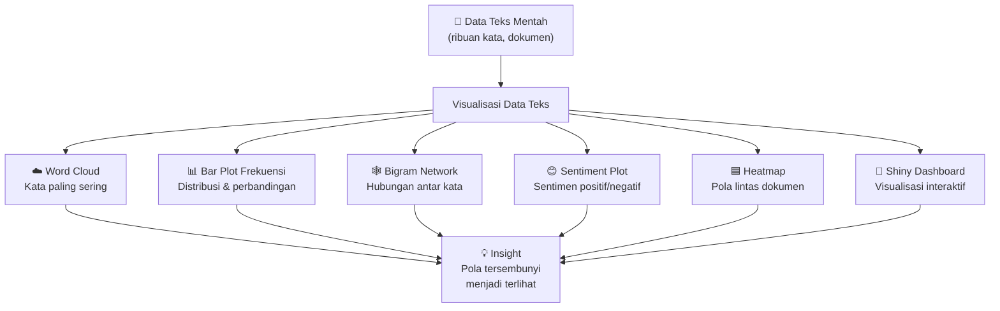
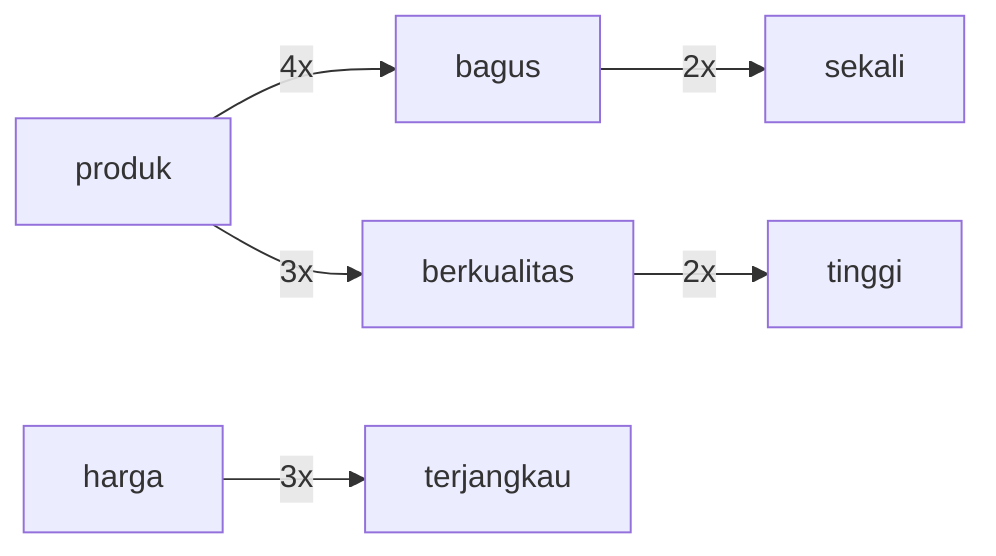
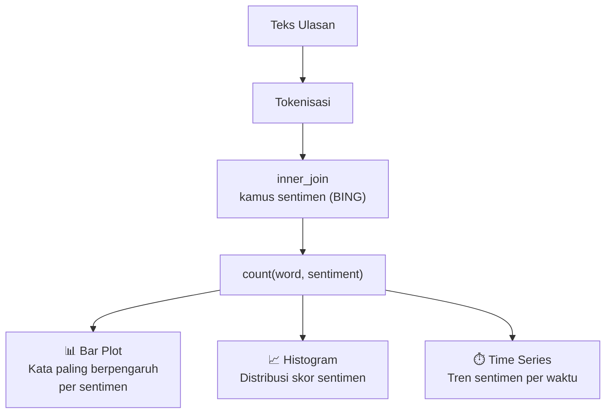
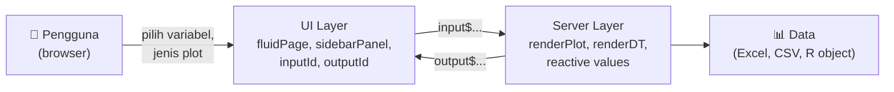
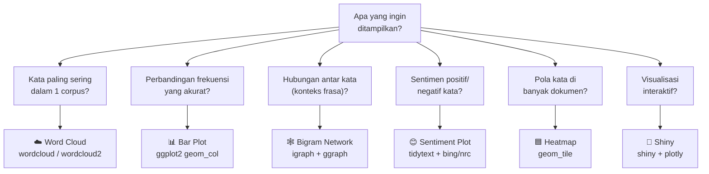

# Pertemuan 12 — Visualisasi Data Teks

**MSIM4310 Analisis dan Visualisasi Data**  
Program Studi Sistem Informasi — Universitas Terbuka

> Catatan: dokumen ini merupakan ekstraksi sekaligus elaborasi dari materi *Inisiasi 12 — Visualisasi Data Teks*. Pertemuan ini membahas 5 teknik visualisasi data teks beserta implementasinya di R, dilengkapi elaborasi mendalam dan contoh kode yang langsung bisa dijalankan.

---

## Daftar Isi

1. [Pengantar Visualisasi Data Teks](#1-pengantar-visualisasi-data-teks)
2. [Word Cloud](#2-word-cloud)
3. [Bar Plot Frekuensi Kata](#3-bar-plot-frekuensi-kata)
4. [Bigram Network](#4-bigram-network)
5. [Visualisasi Analisis Sentimen](#5-visualisasi-analisis-sentimen)
6. [Heatmap Distribusi Kata](#6-heatmap-distribusi-kata)
7. [Visualisasi Lanjutan](#7-visualisasi-lanjutan)
8. [Visualisasi Interaktif dengan Shiny](#8-visualisasi-interaktif-dengan-shiny)
9. [Studi Kasus Lengkap](#9-studi-kasus-lengkap)
10. [Ringkasan & Panduan Memilih Visualisasi](#10-ringkasan--panduan-memilih-visualisasi)

---

## 1. Pengantar Visualisasi Data Teks

**Visualisasi data teks** adalah cara menampilkan informasi teks dalam bentuk grafis sehingga lebih mudah dianalisis dan dipahami. Teknik ini sangat berguna untuk memahami pola, tren, dan hubungan dalam data teks yang jumlahnya sangat besar — di mana membaca satu per satu tidak mungkin dilakukan.



### Perbandingan 5 Teknik Visualisasi

| Teknik | Kekuatan | Kelemahan | Ideal Untuk |
|--------|----------|-----------|-------------|
| **Word Cloud** | Intuitif, menarik visual | Tidak akurat untuk perbandingan | Presentasi, overview cepat |
| **Bar Plot** | Perbandingan akurat | Kurang menarik jika banyak kata | Laporan, analisis mendalam |
| **Bigram Network** | Tampilkan konteks & relasi | Rumit untuk data besar | Analisis frasa, alur percakapan |
| **Sentiment Plot** | Langsung tunjukkan emosi | Bergantung kualitas kamus | Monitoring merek, ulasan |
| **Heatmap** | Pola lintas dokumen | Sulit dibaca jika banyak kata | Perbandingan multi-dokumen |

---

## 2. Word Cloud

### 2.1 Konsep

**Word Cloud** menampilkan kata-kata yang paling sering muncul dalam sebuah korpus teks. **Ukuran kata** proporsional dengan **frekuensinya** — kata yang lebih besar muncul lebih sering.

**Kelebihan:**
- Sangat intuitif: ukuran = frekuensi
- Menarik secara visual, cocok untuk presentasi
- Memberikan gambaran umum (*bird's-eye view*) dalam sekejap

**Keterbatasan:**
- Tidak akurat untuk membandingkan frekuensi antar kata (sulit menilai seberapa jauh bedanya)
- Kata panjang mendominasi visual meski frekuensinya tidak lebih tinggi
- Tidak cocok sebagai dasar analisis kuantitatif

**Kasus penggunaan nyata:**
- Memahami topik dominan dalam ribuan ulasan pelanggan
- Visualisasi kata kunci dari laporan tahunan perusahaan
- Analisis tren topik di media sosial

### 2.2 Implementasi dengan `wordcloud`

```r
library(wordcloud)
library(tidytext)
library(dplyr)
library(RColorBrewer)

# Data teks (bisa diganti dengan read_csv atau readLines)
teks <- c(
  "Produk ini bagus sekali kualitas sangat memuaskan",
  "Kualitas produk bagus harga terjangkau recommended",
  "Pengiriman cepat produk sesuai deskripsi bagus",
  "Layanan pelanggan ramah dan responsif sangat puas",
  "Produk berkualitas tinggi dan harga sangat terjangkau"
)
text_df <- data.frame(line = seq_along(teks), text = teks)

# Stop words Indonesia (manual sederhana)
sw_id <- data.frame(word = c("dan", "di", "ke", "dari", "ini",
                              "itu", "yang", "dengan", "untuk",
                              "pada", "adalah", "juga", "tidak",
                              "saya", "ini", "itu", "ini"))

# Pipeline: tokenisasi → hapus stop words → hitung frekuensi
text_processed <- text_df %>%
  unnest_tokens(word, text) %>%
  anti_join(sw_id, by = "word") %>%
  count(word, sort = TRUE)

# Word cloud dasar
set.seed(42)
wordcloud(
  words        = text_processed$word,
  freq         = text_processed$n,
  min.freq     = 1,           # kata muncul minimal 1x
  max.words    = 100,         # maksimal 100 kata ditampilkan
  random.order = FALSE,       # kata terbesar di tengah
  rot.per      = 0.20,        # 20% kata ditampilkan vertikal
  scale        = c(4, 0.5),   # rentang ukuran font
  colors       = brewer.pal(8, "Dark2")
)
title("Word Cloud Ulasan Produk")
```

### 2.3 Word Cloud Modern dengan `wordcloud2`

```r
library(wordcloud2)

# Versi interaktif (HTML widget)
wordcloud2(
  data  = text_processed,
  size  = 1.5,
  color = "random-dark",
  shape = "circle"         # bisa: "circle", "cardioid", "diamond", "star"
)

# Word cloud berbentuk kustom
wordcloud2(data = text_processed, shape = "star", size = 0.8,
           color = c("#e74c3c", "#3498db", "#2ecc71"))
```

### 2.4 Word Cloud Per Sentimen (Positif vs Negatif)

```r
library(tidytext)
library(wordcloud)

bing <- get_sentiments("bing")

# Pisahkan kata positif dan negatif
kata_sentimen <- text_processed %>%
  inner_join(bing, by = "word")

positif <- kata_sentimen %>% filter(sentiment == "positive")
negatif <- kata_sentimen %>% filter(sentiment == "negative")

# Dua word cloud berdampingan
par(mfrow = c(1, 2), mar = c(0, 0, 2, 0))

wordcloud(positif$word, positif$n,
          max.words = 50,
          colors    = brewer.pal(8, "Greens"),
          random.order = FALSE)
title("Kata Positif", col.main = "darkgreen")

wordcloud(negatif$word, negatif$n,
          max.words = 50,
          colors    = brewer.pal(8, "Reds"),
          random.order = FALSE)
title("Kata Negatif", col.main = "darkred")

par(mfrow = c(1, 1))
```

---

## 3. Bar Plot Frekuensi Kata

### 3.1 Konsep

**Bar Plot Frekuensi** menampilkan jumlah kemunculan setiap kata dalam bentuk batang. Berbeda dari word cloud, bar plot memungkinkan **perbandingan kuantitatif yang akurat** antar kata.

**Kapan pilih bar plot daripada word cloud?**
- Perlu menunjukkan perbedaan frekuensi yang tepat (10 vs 15 vs 20)
- Untuk laporan formal yang memerlukan presisi angka
- Ketika jumlah kata yang ditampilkan lebih dari ~30 kata

### 3.2 Implementasi

```r
library(ggplot2)
library(dplyr)
library(tidytext)

# Hitung frekuensi kata (gunakan text_processed dari bagian sebelumnya)
word_freq <- text_processed   # sudah di-count dan sort=TRUE

# --- Plot dasar ---
word_freq %>%
  top_n(15, n) %>%
  mutate(word = reorder(word, n)) %>%
  ggplot(aes(x = word, y = n)) +
  geom_col(fill = "steelblue") +
  coord_flip() +
  labs(title    = "Frekuensi Kata dalam Ulasan",
       subtitle = "Top 15 kata setelah hapus stop words",
       x        = NULL,
       y        = "Frekuensi") +
  theme_minimal(base_size = 12)
```

### 3.3 Bar Plot Berlabel dan Berwarna

```r
word_freq %>%
  top_n(15, n) %>%
  mutate(word = reorder(word, n)) %>%
  ggplot(aes(x = word, y = n, fill = n)) +
  geom_col(show.legend = FALSE) +
  geom_text(aes(label = n), hjust = -0.2, size = 3.5, color = "gray30") +
  coord_flip() +
  scale_fill_gradient(low = "#AED6F1", high = "#1A5276") +
  scale_y_continuous(expand = expansion(mult = c(0, 0.15))) +
  labs(title = "Top 15 Kata Paling Sering",
       x     = NULL,
       y     = "Frekuensi") +
  theme_minimal(base_size = 11) +
  theme(panel.grid.major.y = element_blank())
```

### 3.4 Perbandingan Frekuensi Antar Kelompok (Facet)

```r
# Bar plot per produk/kategori
reviews_by_cat <- data.frame(
  kategori = rep(c("Laptop", "Headphone", "Charger"), each = 5),
  word     = c("fast", "powerful", "lightweight", "display", "battery",
               "sound", "comfortable", "noise", "bass", "wireless",
               "safe", "durable", "charge", "cable", "compact"),
  n        = c(8, 6, 5, 4, 7,  7, 6, 5, 4, 3,  6, 5, 8, 3, 4)
)

reviews_by_cat %>%
  group_by(kategori) %>%
  slice_max(n, n = 4) %>%
  ungroup() %>%
  mutate(word = reorder_within(word, n, kategori)) %>%
  ggplot(aes(x = word, y = n, fill = kategori)) +
  geom_col(show.legend = FALSE) +
  facet_wrap(~ kategori, scales = "free_y") +
  scale_x_reordered() +
  coord_flip() +
  labs(title = "Kata Paling Sering per Kategori Produk",
       x = NULL, y = "Frekuensi") +
  theme_minimal()
```

---

## 4. Bigram Network

### 4.1 Konsep

**Bigram Network** (jaringan bigram) memvisualisasikan hubungan antara dua kata yang sering muncul berdekatan dalam teks. Setiap **simpul** (*node*) adalah kata, dan setiap **tepi** (*edge*) menghubungkan dua kata yang membentuk bigram. Ketebalan tepi bisa merepresentasikan frekuensi bigram.

**Mengapa bigram penting?**  
- Kata tunggal kehilangan konteks: "tidak" + "bagus" ≠ "bagus"
- Bigram "sangat memuaskan" lebih informatif dari "sangat" dan "memuaskan" sendiri-sendiri
- Tampilkan alur percakapan dan frasa yang sering digunakan bersama



### 4.2 Implementasi yang Benar

> ⚠️ **Catatan koreksi:** Kode bigram di materi PDF (`unnest_tokens(bigram, word, token="ngrams", n=2)`) menggunakan kolom `word` yang sudah berisi token tunggal — hasilnya bigram dari dua token berurutan, yang tidak bermakna. Bigram harus dibuat dari kolom **teks asli**, bukan dari kolom kata yang sudah di-tokenisasi. Berikut implementasi yang benar:

```r
library(tidyr)
library(igraph)
library(ggraph)
library(dplyr)
library(tidytext)

# Dataset dengan teks asli (BUKAN kolom 'word' hasil tokenisasi)
text_df_orig <- data.frame(
  id   = 1:5,
  text = c(
    "Produk bagus sekali kualitas sangat memuaskan",
    "Kualitas produk bagus harga terjangkau recommended",
    "Pengiriman cepat produk sesuai deskripsi bagus",
    "Layanan pelanggan ramah responsif sangat puas",
    "Produk berkualitas tinggi harga sangat terjangkau"
  )
)

# Buat bigram dari teks asli
bigrams <- text_df_orig %>%
  unnest_tokens(bigram, text, token = "ngrams", n = 2)

# Hitung frekuensi
bigram_freq <- bigrams %>%
  count(bigram, sort = TRUE)

# Pisah bigram → word1 dan word2
sw_id <- c("dan", "di", "ke", "dari", "ini", "itu", "yang",
           "dengan", "untuk", "pada", "adalah", "saya")

bigram_separated <- bigram_freq %>%
  separate(bigram, into = c("word1", "word2"), sep = " ") %>%
  filter(!word1 %in% sw_id, !word2 %in% sw_id)

cat("Top bigram:\n")
print(head(bigram_separated, 10))
```

### 4.3 Visualisasi Jaringan dengan `ggraph` (Rekomendasi)

```r
library(igraph)
library(ggraph)

# Buat graph dari bigram yang cukup sering (n >= 1 untuk data kecil)
bigram_graph <- bigram_separated %>%
  filter(n >= 1) %>%
  graph_from_data_frame()

set.seed(42)
ggraph(bigram_graph, layout = "fr") +
  geom_edge_link(
    aes(edge_alpha = n, edge_width = n),
    show.legend   = FALSE,
    arrow         = arrow(type = "closed", length = unit(3, "mm")),
    end_cap       = circle(3, "mm"),
    color         = "steelblue"
  ) +
  geom_node_point(color = "#E67E22", size = 5) +
  geom_node_text(aes(label = name), vjust = 1.5, hjust = 0.5,
                 size = 3.5, color = "gray20") +
  labs(title    = "Jaringan Bigram Ulasan Produk",
       subtitle = "Tepi lebih tebal = bigram lebih sering") +
  theme_void()
```

### 4.4 Visualisasi Dasar dengan `igraph` (Dari PDF)

```r
library(igraph)

# Buat graph
bigram_graph_base <- graph_from_data_frame(bigram_separated[bigram_separated$n >= 1, ])

# Plot dengan igraph base
plot(bigram_graph_base,
     vertex.size       = 10,
     vertex.label.cex  = 0.8,
     vertex.color      = "lightblue",
     vertex.label.color = "black",
     edge.arrow.size   = 0.5,
     edge.color        = "gray50",
     main              = "Bigram Network")
```

### 4.5 Analisis Network: Simpul Paling Sentral

```r
# Degree centrality: kata yang paling banyak terhubung
degree_centrality <- degree(bigram_graph, mode = "all")
sort(degree_centrality, decreasing = TRUE)[1:5]

# Betweenness: kata yang paling sering jadi "jembatan"
between <- betweenness(bigram_graph)
sort(between, decreasing = TRUE)[1:5]
```

---

## 5. Visualisasi Analisis Sentimen

### 5.1 Konsep

Visualisasi sentimen mengubah hasil analisis sentimen menjadi grafik yang memudahkan interpretasi — berapa banyak ulasan positif, kata apa yang paling berkontribusi, dan bagaimana tren sentimen berubah dari waktu ke waktu.



### 5.2 Bar Plot Kata Bersentimen (Dari PDF + Elaborasi)

```r
library(tidytext)
library(textdata)
library(ggplot2)
library(dplyr)

# Ambil kamus BING
bing_sentiments <- get_sentiments("bing")

# Pipeline analisis sentimen
sentiment_analysis <- text_df_orig %>%
  unnest_tokens(word, text) %>%
  inner_join(bing_sentiments, by = "word") %>%
  count(word, sentiment, sort = TRUE) %>%
  ungroup()

# Bar plot per kata, diisi warna berdasarkan sentimen
ggplot(sentiment_analysis,
       aes(x = reorder(word, n), y = n, fill = sentiment)) +
  geom_bar(stat = "identity") +
  coord_flip() +
  scale_fill_manual(values = c("positive" = "#27AE60",
                               "negative" = "#E74C3C")) +
  labs(title    = "Analisis Sentimen — Kontribusi Per Kata",
       x        = "Kata",
       y        = "Frekuensi",
       fill     = "Sentimen") +
  theme_minimal(base_size = 11)
```

### 5.3 Visualisasi Skor Sentimen Per Ulasan

```r
# Hitung skor sentimen per dokumen
skor_per_ulasan <- text_df_orig %>%
  unnest_tokens(word, text) %>%
  inner_join(bing_sentiments, by = "word") %>%
  count(id, sentiment) %>%
  tidyr::pivot_wider(names_from  = sentiment,
                     values_from = n,
                     values_fill = 0) %>%
  mutate(skor = positive - negative,
         label = ifelse(skor > 0, "Positif", ifelse(skor < 0, "Negatif", "Netral")))

# Bar chart skor per ulasan
ggplot(skor_per_ulasan, aes(x = factor(id), y = skor, fill = label)) +
  geom_col() +
  scale_fill_manual(values = c("Positif" = "#2ECC71",
                               "Negatif" = "#E74C3C",
                               "Netral"  = "#95A5A6")) +
  geom_hline(yintercept = 0, color = "gray30") +
  labs(title = "Skor Sentimen Per Ulasan",
       x     = "ID Ulasan",
       y     = "Skor Sentimen (positif − negatif)",
       fill  = "Label") +
  theme_minimal()
```

### 5.4 Visualisasi Emosi dengan NRC

```r
nrc <- get_sentiments("nrc")

# Distribusi 8 emosi dalam corpus
text_df_orig %>%
  unnest_tokens(word, text) %>%
  inner_join(nrc, by = "word") %>%
  filter(!sentiment %in% c("positive", "negative")) %>%
  count(sentiment, sort = TRUE) %>%
  mutate(sentiment = reorder(sentiment, n)) %>%
  ggplot(aes(x = sentiment, y = n, fill = sentiment)) +
  geom_col(show.legend = FALSE) +
  coord_flip() +
  scale_fill_brewer(palette = "Set2") +
  labs(title    = "Distribusi Emosi dalam Teks (NRC)",
       subtitle = "8 kategori emosi dasar",
       x        = "Emosi",
       y        = "Jumlah Kata") +
  theme_minimal()
```

---

## 6. Heatmap Distribusi Kata

### 6.1 Konsep

**Heatmap** memvisualisasikan data matriks menggunakan warna — semakin gelap (atau semakin intens), semakin tinggi nilainya. Untuk data teks, heatmap sangat berguna untuk melihat **distribusi kata di berbagai dokumen atau kategori** sekaligus dalam satu gambar.

> ⚠️ **Catatan koreksi:** Judul pada materi PDF di halaman 4 tertulis **"Heatmpa"** — ini adalah *typo*, seharusnya **"Heatmap"**.

**Kapan gunakan heatmap untuk data teks?**
- Perbandingan frekuensi kata di banyak dokumen (>3 dokumen) sekaligus
- Identifikasi dokumen mana yang "unik" (berbeda dari yang lain)
- Analisis co-occurrence (kata yang sering muncul bersama)

### 6.2 Implementasi dengan `reshape2` (Dari PDF)

```r
library(ggplot2)
library(reshape2)

# Data contoh: frekuensi 5 kata di 3 dokumen
word_matrix <- data.frame(
  word = c("data", "analysis", "visualization", "text", "R"),
  doc1 = c(5, 2, 3, 7, 1),
  doc2 = c(3, 7, 1, 6, 2),
  doc3 = c(6, 1, 4, 3, 5)
)

# Pivot ke format long (melt)
word_matrix_melted <- melt(word_matrix, id.vars = "word",
                           variable.name = "dokumen",
                           value.name    = "frekuensi")

# Heatmap dasar
ggplot(word_matrix_melted,
       aes(x = dokumen, y = word, fill = frekuensi)) +
  geom_tile(color = "white", lwd = 0.5) +
  scale_fill_gradient(low = "white", high = "#1A5276") +
  labs(title = "Heatmap Distribusi Kata",
       x     = "Dokumen",
       y     = "Kata",
       fill  = "Frekuensi") +
  theme_minimal(base_size = 12) +
  theme(panel.grid = element_blank())
```

### 6.3 Heatmap Lebih Kaya Informasi

```r
# Heatmap dengan nilai di dalam tile dan skema warna yang lebih baik
ggplot(word_matrix_melted,
       aes(x = dokumen, y = reorder(word, frekuensi), fill = frekuensi)) +
  geom_tile(color = "white", lwd = 0.8) +
  geom_text(aes(label = frekuensi), color = "white", fontface = "bold", size = 4) +
  scale_fill_gradient2(low  = "#ECF0F1",
                       mid  = "#5DADE2",
                       high = "#1B4F72",
                       midpoint = 3.5) +
  labs(title    = "Heatmap Distribusi Kata per Dokumen",
       subtitle = "Nilai = jumlah kemunculan kata di dokumen tersebut",
       x        = "Dokumen",
       y        = "Kata",
       fill     = "Frekuensi") +
  theme_minimal(base_size = 12) +
  theme(panel.grid = element_blank())
```

### 6.4 Heatmap TF-IDF (Lebih Informatif dari Frekuensi Mentah)

```r
library(tidytext)

# Gunakan TF-IDF sebagai nilai heatmap (lebih bermakna dari raw count)
tfidf_matrix <- text_df_orig %>%
  unnest_tokens(word, text) %>%
  count(id, word) %>%
  bind_tf_idf(word, id, n) %>%
  filter(tf_idf > 0) %>%
  select(id, word, tf_idf) %>%
  # Ambil hanya top words
  group_by(id) %>%
  slice_max(tf_idf, n = 5) %>%
  ungroup()

# Heatmap TF-IDF
ggplot(tfidf_matrix, aes(x = factor(id), y = word, fill = tf_idf)) +
  geom_tile(color = "white") +
  scale_fill_gradient(low = "#EAF2FF", high = "#1A5276") +
  labs(title    = "Heatmap TF-IDF per Dokumen",
       subtitle = "Kata paling khas di setiap dokumen",
       x        = "ID Dokumen",
       y        = "Kata",
       fill     = "TF-IDF") +
  theme_minimal()
```

---

## 7. Visualisasi Lanjutan

### 7.1 Visualisasi Interaktif dengan `plotly`

Mengubah grafik ggplot2 statis menjadi interaktif (zoom, hover, filter) hanya dengan satu baris kode:

```r
library(plotly)
library(ggplot2)

# Buat plot ggplot biasa terlebih dahulu
p <- word_freq %>%
  top_n(15, n) %>%
  mutate(word = reorder(word, n)) %>%
  ggplot(aes(x = word, y = n,
             text = paste("Kata:", word, "<br>Frekuensi:", n))) +
  geom_col(fill = "steelblue") +
  coord_flip() +
  labs(title = "Frekuensi Kata (Interaktif)", x = NULL, y = "Frekuensi") +
  theme_minimal()

# Konversi ke plotly
ggplotly(p, tooltip = "text")
```

### 7.2 Topic Modeling Visualization dengan LDA

**LDA (Latent Dirichlet Allocation)** mengidentifikasi topik tersembunyi dalam korpus dokumen. Hasilnya bisa divisualisasikan sebagai heatmap probabilitas kata-per-topik:

```r
library(topicmodels)
library(tidytext)

# Buat Document-Term Matrix
dtm <- text_df_orig %>%
  unnest_tokens(word, text) %>%
  count(id, word) %>%
  cast_dtm(id, word, n)

# Fit model LDA dengan 2 topik
lda_model <- LDA(dtm, k = 2, control = list(seed = 42))

# Ekstrak probabilitas kata per topik (beta)
topics_beta <- tidy(lda_model, matrix = "beta")

# Visualisasi top 5 kata per topik
topics_beta %>%
  group_by(topic) %>%
  slice_max(beta, n = 5) %>%
  ungroup() %>%
  mutate(term = reorder_within(term, beta, topic)) %>%
  ggplot(aes(term, beta, fill = factor(topic))) +
  geom_col(show.legend = FALSE) +
  facet_wrap(~ topic, scales = "free") +
  scale_x_reordered() +
  coord_flip() +
  labs(title = "Kata Paling Khas per Topik (LDA)",
       x     = NULL,
       y     = "Probabilitas β") +
  theme_minimal()
```

---

## 8. Visualisasi Interaktif dengan Shiny

### 8.1 Apa itu Shiny?

**Shiny** adalah framework R untuk membangun aplikasi web interaktif langsung dari R — tanpa perlu menguasai HTML, CSS, atau JavaScript. Pengguna bisa berinteraksi dengan visualisasi melalui dropdown, slider, dan tombol.



**Struktur dasar Shiny:**

```r
library(shiny)

# UI: tampilan yang dilihat pengguna
ui <- fluidPage(
  # input widgets
  # output placeholders
)

# Server: logika di balik layar
server <- function(input, output, session) {
  # output$... <- render...({ ... })
}

# Jalankan aplikasi
shinyApp(ui = ui, server = server)
```

### 8.2 Tugas Tutorial 3 — Aplikasi Visualisasi Data Cuaca

**Dataset:** `Data_set_Tugas_tutorial_3_STSI_4204.xlsx` — data cuaca harian Australia  
**Variabel numerik:** MinTemp, MaxTemp, Rainfall, Evaporation, Sunshine, WindGustSpeed, Humidity, Pressure, Cloud, Temp, RISK_MM  

**Fitur aplikasi:**
- Pilih jenis plot: Scatter Plot, Line Plot, Bar Plot, atau Tabel Data
- Pilih variabel yang ingin divisualisasikan
- Tabel data dengan fitur scroll dan pagination (paket DT)

```r
library(shiny)
library(ggplot2)
library(DT)
library(readxl)

# Muat data cuaca
data <- read_excel("Data_set_Tugas_tutorial_3_STSI_4204.xlsx",
                   na = c("", "NA", "N/A"))
data <- as.data.frame(data)

# Konversi kolom numerik
num_cols <- c("MinTemp", "MaxTemp", "Rainfall", "Evaporation", "Sunshine",
              "WindGustSpeed", "WindSpeed9am", "WindSpeed3pm",
              "Humidity9am", "Humidity3pm", "Pressure9am", "Pressure3pm",
              "Cloud9am", "Cloud3pm", "Temp9am", "Temp3pm", "RISK_MM")
for (col in num_cols) {
  if (col %in% names(data)) data[[col]] <- as.numeric(data[[col]])
}

var_numeric <- names(data)[sapply(data, is.numeric)]
var_all     <- names(data)

# ---- UI ----
ui <- fluidPage(
  titlePanel("Aplikasi Visualisasi Data Cuaca Interaktif"),
  sidebarLayout(
    sidebarPanel(
      selectInput("plot_type", "Pilih Jenis Plot:",
                  choices = c("Scatter Plot" = "scatter",
                              "Line Plot"    = "line",
                              "Bar Plot"     = "bar",
                              "Tabel Data"   = "table")),
      conditionalPanel(
        condition = "input.plot_type == 'scatter'",
        selectInput("x_var", "Variabel X:",
                    choices = var_numeric, selected = "MinTemp"),
        selectInput("y_var", "Variabel Y:",
                    choices = var_numeric, selected = "MaxTemp")
      ),
      conditionalPanel(
        condition = "input.plot_type == 'line' || input.plot_type == 'bar'",
        selectInput("var", "Pilih Variabel:",
                    choices = var_all, selected = "MaxTemp")
      )
    ),
    mainPanel(
      conditionalPanel(condition = "input.plot_type != 'table'",
                       plotOutput("plot", height = "500px")),
      conditionalPanel(condition = "input.plot_type == 'table'",
                       DTOutput("table"))
    )
  )
)

# ---- Server ----
server <- function(input, output, session) {
  output$plot <- renderPlot({
    if (input$plot_type == "scatter") {
      ggplot(data, aes_string(x = input$x_var, y = input$y_var)) +
        geom_point(color = "#428BCA", alpha = 0.6) +
        labs(title = paste(input$y_var, "vs", input$x_var),
             x = input$x_var, y = input$y_var) +
        theme_minimal()

    } else if (input$plot_type == "line") {
      df <- data.frame(idx = seq_len(nrow(data)), val = data[[input$var]])
      ggplot(df, aes(x = idx, y = val)) +
        geom_line(color = "#2E5395") +
        labs(title = paste("Line Plot —", input$var),
             x = "Hari ke-", y = input$var) +
        theme_minimal()

    } else if (input$plot_type == "bar") {
      var_data <- data[[input$var]]
      if (is.numeric(var_data)) {
        ggplot(data.frame(val = var_data), aes(x = val)) +
          geom_histogram(fill = "#428BCA", color = "white", bins = 20) +
          labs(title = paste("Distribusi —", input$var),
               x = input$var, y = "Frekuensi") +
          theme_minimal()
      } else {
        ggplot(data.frame(val = factor(var_data)), aes(x = val)) +
          geom_bar(fill = "#428BCA") +
          labs(title = paste("Bar Plot —", input$var),
               x = input$var, y = "Frekuensi") +
          theme_minimal()
      }
    }
  })

  output$table <- renderDT({
    datatable(data,
              options = list(scrollX = TRUE, pageLength = 10),
              rownames = FALSE)
  })
}

shinyApp(ui = ui, server = server)
```

### 8.3 Cara Menjalankan Aplikasi Shiny

```bash
# Opsi 1: dari terminal
Rscript app.R

# Opsi 2: dari RStudio — buka app.R, klik tombol "Run App"

# Opsi 3: dari R console
shiny::runApp("path/to/folder/")
```

### 8.4 Anatomi Komponen Shiny

| Fungsi | Kategori | Kegunaan |
|--------|----------|----------|
| `fluidPage()` | UI | Layout responsif mengikuti lebar browser |
| `sidebarLayout()` | UI | Layout dua kolom: sidebar + main panel |
| `selectInput()` | Input | Dropdown pilihan |
| `sliderInput()` | Input | Slider angka |
| `checkboxInput()` | Input | Kotak centang |
| `textInput()` | Input | Kotak teks |
| `plotOutput()` | Output | Placeholder untuk grafik |
| `DTOutput()` | Output | Placeholder untuk tabel interaktif |
| `renderPlot()` | Server | Render grafik saat input berubah |
| `renderDT()` | Server | Render tabel DT |
| `reactive()` | Server | Nilai yang dihitung ulang saat input berubah |
| `conditionalPanel()` | UI | Tampilkan/sembunyikan elemen berdasarkan kondisi |

---

## 9. Studi Kasus Lengkap

Pipeline visualisasi data teks end-to-end yang langsung bisa dijalankan (tanpa file eksternal):

```r
# ============================================================
# STUDI KASUS: Visualisasi Data Teks Ulasan Produk
# ============================================================

library(tidyverse)
library(tidytext)
library(wordcloud)
library(RColorBrewer)
library(textdata)
library(igraph)
library(ggraph)

# ---- 1. Dataset ----
set.seed(42)
ulasan <- data.frame(
  id        = 1:12,
  produk    = rep(c("Laptop", "Headphone", "Charger"), each = 4),
  teks      = c(
    "Excellent laptop fast processor powerful performance great display",
    "Good laptop lightweight battery good performance nice keyboard",
    "Terrible laptop slow overheating poor performance disappointing",
    "Outstanding laptop best purchase powerful display great value",
    "Amazing headphone clear sound comfortable excellent noise cancellation",
    "Good headphone decent sound comfortable fit reasonable price",
    "Poor headphone bad sound quality uncomfortable disappointing purchase",
    "Superb headphone outstanding noise cancellation excellent bass",
    "Excellent charger fast charging safe reliable durable product",
    "Good charger fast safe decent quality reasonable price",
    "Defective charger dangerous unreliable poor quality terrible",
    "Great charger consistent safe fast charging excellent build"
  )
)

cat("Dataset:\n")
print(ulasan[, c("id", "produk")])

# ---- 2. Tokenisasi & Frekuensi ----
tidy_ulasan <- ulasan %>%
  unnest_tokens(word, teks) %>%
  anti_join(stop_words, by = "word")

word_freq <- tidy_ulasan %>%
  count(word, sort = TRUE)

cat("\nTop 10 kata:\n")
print(head(word_freq, 10))

# ---- 3. Word Cloud ----
cat("\nMembuat word cloud...\n")
wordcloud(word_freq$word, word_freq$n,
          min.freq = 1, max.words = 50,
          random.order = FALSE,
          colors = brewer.pal(8, "Dark2"))
title("Word Cloud Ulasan Produk")

# ---- 4. Bar Plot Frekuensi ----
p_bar <- word_freq %>%
  top_n(12, n) %>%
  mutate(word = reorder(word, n)) %>%
  ggplot(aes(word, n, fill = n)) +
  geom_col(show.legend = FALSE) +
  coord_flip() +
  scale_fill_gradient(low = "#AED6F1", high = "#1A5276") +
  labs(title = "12 Kata Paling Sering", x = NULL, y = "Frekuensi") +
  theme_minimal()
print(p_bar)

# ---- 5. Bigram Network ----
bigrams_net <- ulasan %>%
  unnest_tokens(bigram, teks, token = "ngrams", n = 2) %>%
  count(bigram, sort = TRUE) %>%
  separate(bigram, into = c("word1", "word2"), sep = " ") %>%
  filter(n >= 1)

bg_graph <- graph_from_data_frame(bigrams_net)

set.seed(42)
p_net <- ggraph(bg_graph, layout = "fr") +
  geom_edge_link(aes(edge_alpha = n), show.legend = FALSE,
                 arrow = arrow(type = "closed", length = unit(3, "mm")),
                 end_cap = circle(3, "mm"), color = "steelblue") +
  geom_node_point(color = "#E67E22", size = 4) +
  geom_node_text(aes(label = name), vjust = 1.5, size = 2.8) +
  labs(title = "Bigram Network Ulasan Produk") +
  theme_void()
print(p_net)

# ---- 6. Analisis Sentimen ----
bing <- get_sentiments("bing")

skor_sentimen <- tidy_ulasan %>%
  inner_join(bing, by = "word") %>%
  count(id, produk, sentiment) %>%
  pivot_wider(names_from = sentiment, values_from = n, values_fill = 0) %>%
  mutate(skor = positive - negative,
         label = case_when(skor > 0 ~ "Positif",
                           skor < 0 ~ "Negatif",
                           TRUE     ~ "Netral"))

cat("\nSkor sentimen per ulasan:\n")
print(skor_sentimen[, c("id", "produk", "positive", "negative", "skor", "label")])

# Visualisasi sentimen
p_sent <- skor_sentimen %>%
  ggplot(aes(x = factor(id), y = skor, fill = label)) +
  geom_col() +
  geom_hline(yintercept = 0, color = "gray30") +
  scale_fill_manual(values = c("Positif" = "#27AE60",
                               "Negatif" = "#E74C3C",
                               "Netral"  = "#95A5A6")) +
  facet_wrap(~ produk, scales = "free_x", nrow = 1) +
  labs(title = "Skor Sentimen per Ulasan dan Produk",
       x = "ID Ulasan", y = "Skor Sentimen",
       fill = "Sentimen") +
  theme_minimal()
print(p_sent)

# ---- 7. Heatmap Distribusi Kata per Produk ----
tfidf_produk <- tidy_ulasan %>%
  count(produk, word) %>%
  bind_tf_idf(word, produk, n) %>%
  group_by(produk) %>%
  slice_max(tf_idf, n = 5) %>%
  ungroup()

p_heat <- tfidf_produk %>%
  ggplot(aes(x = produk, y = word, fill = tf_idf)) +
  geom_tile(color = "white", lwd = 0.5) +
  scale_fill_gradient(low = "#EAF2FF", high = "#1A5276") +
  labs(title = "Heatmap TF-IDF: Kata Khas per Produk",
       x = "Produk", y = "Kata", fill = "TF-IDF") +
  theme_minimal() +
  theme(panel.grid = element_blank())
print(p_heat)

cat("\nAnalisis selesai! Semua visualisasi telah dibuat.\n")
```

---

## 10. Ringkasan & Panduan Memilih Visualisasi



**Tabel panduan memilih teknik:**

| Pertanyaan | Teknik | Fungsi R Utama |
|-----------|--------|---------------|
| Kata apa yang paling dominan? | Word Cloud | `wordcloud()`, `wordcloud2()` |
| Seberapa sering setiap kata muncul? | Bar Plot | `geom_col() + coord_flip()` |
| Frasa apa yang sering muncul bersama? | Bigram Network | `graph_from_data_frame()`, `ggraph()` |
| Kata mana yang positif/negatif? | Sentiment Plot | `get_sentiments("bing")`, `geom_bar()` |
| Pola kata di berbagai dokumen? | Heatmap | `geom_tile()` |
| Pengguna perlu eksplorasi data sendiri? | Shiny Dashboard | `shinyApp(ui, server)` |
| Perlu interaktivitas ringan? | plotly | `ggplotly()` |

**Paket R yang digunakan:**

| Paket | Fungsi Utama |
|-------|-------------|
| `tidytext` | Tokenisasi, stop words, TF-IDF, sentiment |
| `wordcloud` | Word cloud statis |
| `wordcloud2` | Word cloud interaktif berbasis HTML |
| `ggplot2` | Bar plot, heatmap, sentiment plot |
| `igraph` | Membuat graph dari data |
| `ggraph` | Visualisasi graph berbasis ggplot2 |
| `textdata` | Kamus sentimen BING, AFINN, NRC |
| `shiny` | Aplikasi web interaktif |
| `plotly` | Konversi ggplot ke interaktif |
| `DT` | Tabel data interaktif |
| `reshape2` | Pivot data (melt/cast) |

---

*Selamat Belajar...*
