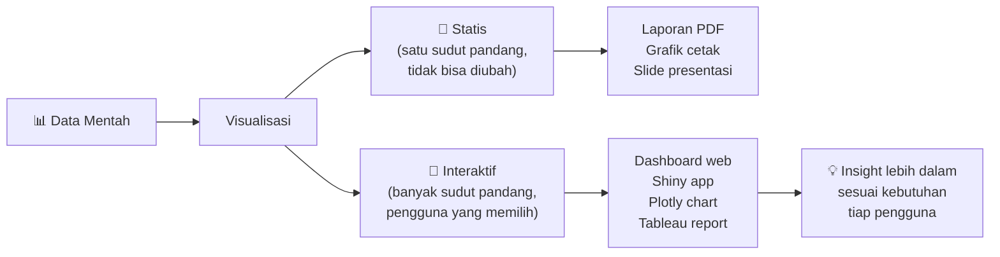
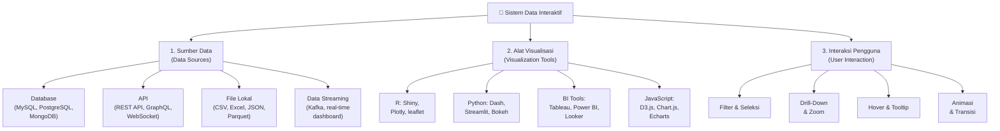
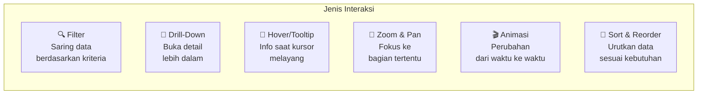
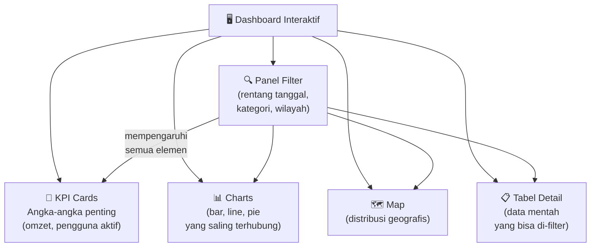
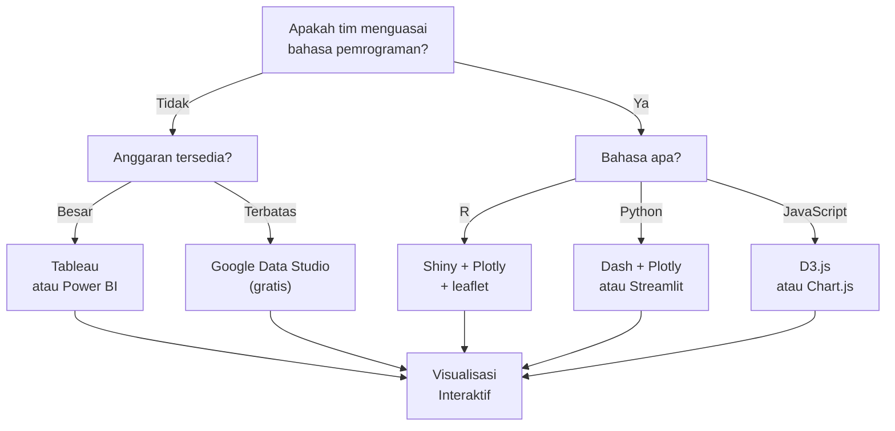
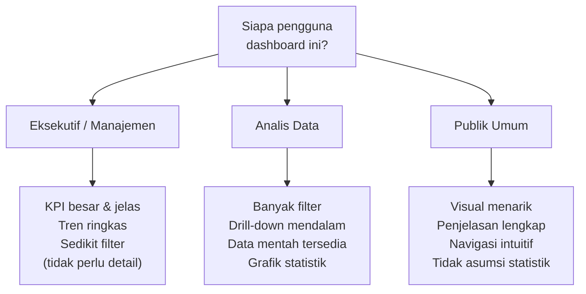
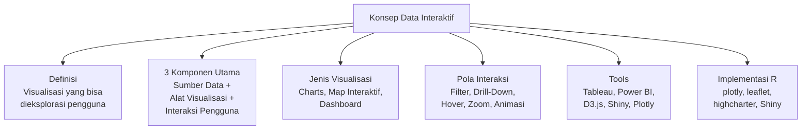

# Pertemuan 13 — Konsep Data Interaktif

**MSIM4310 Analisis dan Visualisasi Data**  
Program Studi Sistem Informasi — Universitas Terbuka

> Catatan: dokumen ini merupakan ekstraksi sekaligus elaborasi dari materi *Inisiasi 13 — Konsep Data Interaktif*. Materi PDF hanya 1 halaman, sehingga dilakukan elaborasi signifikan mencakup perbandingan tools, implementasi di R, pola interaksi, dan studi kasus lengkap.

---

## Daftar Isi

1. [Pengantar Data Interaktif](#1-pengantar-data-interaktif)
2. [Data Statis vs Data Interaktif](#2-data-statis-vs-data-interaktif)
3. [Komponen Utama Data Interaktif](#3-komponen-utama-data-interaktif)
4. [Jenis Visualisasi Data Interaktif](#4-jenis-visualisasi-data-interaktif)
5. [Pola Interaksi Pengguna](#5-pola-interaksi-pengguna)
6. [Tools Visualisasi Interaktif](#6-tools-visualisasi-interaktif)
7. [Implementasi di R](#7-implementasi-di-r)
8. [Map Interaktif dengan Leaflet](#8-map-interaktif-dengan-leaflet)
9. [Dashboard Interaktif dengan flexdashboard](#9-dashboard-interaktif-dengan-flexdashboard)
10. [Best Practices Visualisasi Interaktif](#10-best-practices-visualisasi-interaktif)
11. [Ringkasan](#11-ringkasan)

---

## 1. Pengantar Data Interaktif

**Data interaktif** adalah representasi data yang memungkinkan pengguna untuk **berinteraksi langsung** dengan visualisasi — mengeksplorasi, memfilter, men-*drill down*, dan memanipulasi tampilan — guna memperoleh wawasan yang lebih mendalam sesuai kebutuhan mereka sendiri.

Berbeda dari grafik statis yang menyajikan satu sudut pandang tetap, visualisasi interaktif memberikan kontrol kepada pengguna untuk menemukan polanya sendiri.



### Mengapa Data Interaktif Penting?

Bayangkan sebuah laporan penjualan 1.000 baris. Versi statis menampilkan total — informasi berguna, tapi terbatas. Versi interaktif memungkinkan:

- Manajer regional melihat **hanya data wilayahnya sendiri** (filter)
- Direktur meng-*hover* bar chart dan melihat **angka pasti + persentase** (tooltip)
- Analis men-*zoom* ke kuartal tertentu untuk melihat detail mingguan (drill-down)
- Semua ini **tanpa meminta laporan baru** dari tim data

---

## 2. Data Statis vs Data Interaktif

| Aspek | Data Statis | Data Interaktif |
|-------|------------|----------------|
| **Definisi** | Visualisasi tetap, tidak bisa diubah pengguna | Visualisasi yang bisa dieksplorasi dan dimanipulasi |
| **Kontrol pengguna** | Tidak ada | Filter, zoom, klik, hover, drill-down |
| **Format output** | PNG, PDF, slide, cetak | HTML, web app, dashboard, widget |
| **Pembuatan** | Mudah, cepat | Lebih kompleks, butuh lebih banyak waktu |
| **Pembaruan data** | Manual (buat ulang grafik) | Bisa otomatis (koneksi data langsung) |
| **Cocok untuk** | Laporan formal, publikasi ilmiah | Eksplorasi data, monitoring real-time |
| **Contoh tools** | ggplot2, matplotlib, Excel chart | Shiny, Plotly, Tableau, Power BI |
| **Akses** | File atau cetak | Browser web |
| **Ukuran file** | Kecil (KB) | Lebih besar (MB untuk app) |

**Kapan pilih statis?**
- Laporan akademis, jurnal, skripsi — format PDF tidak mendukung interaktivitas
- Presentasi di mana ukuran file penting
- Ketika pengguna akhir tidak perlu eksplorasi lebih jauh

**Kapan pilih interaktif?**
- Monitoring KPI yang perlu dipantau rutin
- Data dengan banyak dimensi yang ingin dieksplorasi
- Pengguna dengan kebutuhan analisis yang berbeda-beda
- *Self-service analytics* — pengguna ingin menjawab pertanyaannya sendiri

---

## 3. Komponen Utama Data Interaktif



### 3.1 Sumber Data

| Jenis Sumber | Contoh | Karakteristik |
|-------------|--------|--------------|
| **Database relasional** | MySQL, PostgreSQL, SQLite | Terstruktur, query SQL, cocok data bisnis |
| **Database NoSQL** | MongoDB, Firestore | Fleksibel skema, cocok data tidak terstruktur |
| **REST API** | Twitter API, OpenWeather | Data real-time, format JSON |
| **File lokal** | CSV, Excel, JSON | Mudah, tapi statis (tidak auto-update) |
| **Data streaming** | Apache Kafka, WebSocket | Real-time, cocok monitoring langsung |
| **Cloud data** | Google BigQuery, AWS S3 | Skalabel, multi-pengguna |

### 3.2 Alat Visualisasi

> ⚠️ **Catatan koreksi:** Materi PDF menggunakan kata *"Alat viasualisasi"* — ini adalah *typo*, seharusnya **"Alat visualisasi"**.

Tools utama yang disebutkan dalam PDF beserta ekosistemnya:

| Tool | Tipe | Keunggulan | Kurva Belajar |
|------|------|-----------|--------------|
| **Tableau** | BI Desktop/Cloud | Drag-and-drop, sangat visual | Rendah-Sedang |
| **Power BI** | BI Microsoft | Integrasi Office 365, harga terjangkau | Rendah-Sedang |
| **D3.js** | JavaScript library | Sangat fleksibel, full control | Tinggi |
| **Google Data Studio** | BI Cloud gratis | Gratis, koneksi Google ecosystem | Rendah |
| **R Shiny** | R web framework | Statistik + interaktivitas, open source | Sedang |
| **Plotly** | Library multi-bahasa | R, Python, JavaScript; integrasi mudah | Rendah |

### 3.3 Interaksi Pengguna



---

## 4. Jenis Visualisasi Data Interaktif

### 4.1 Charts dan Grafik Interaktif

Chart yang dibuat interaktif memiliki fitur hover tooltip, zoom, klik untuk filter, dan animasi transisi.

| Jenis Chart | Kegunaan | Contoh Interaksi |
|------------|----------|-----------------|
| **Bar Chart** | Perbandingan kategori | Hover menampilkan nilai, klik filter |
| **Line Chart** | Tren dari waktu ke waktu | Zoom ke periode tertentu, hover nilai |
| **Pie/Donut Chart** | Proporsi keseluruhan | Klik slice untuk highlight, explode |
| **Scatter Plot** | Hubungan dua variabel | Lasso select, zoom, warna per grup |
| **Area Chart** | Tren kumulatif | Stack/unstack, zoom temporal |
| **Box Plot** | Distribusi & outlier | Hover detail statistik per grup |
| **Heatmap** | Pola di matriks | Hover nilai sel, filter baris/kolom |

### 4.2 Map Interaktif

> ⚠️ **Catatan koreksi:** Materi PDF menulis *"bublle map"* — ini adalah *typo*, seharusnya **"bubble map"**.

| Jenis Map | Cara Kerja | Contoh Penggunaan |
|----------|------------|------------------|
| **Choropleth Map** | Warna wilayah berdasarkan nilai | Peta angka kemiskinan per provinsi |
| **Bubble Map** | Lingkaran di lokasi, ukuran = nilai | Peta jumlah kasus COVID per kota |
| **Heatmap Map** | Intensitas warna di area | Peta kepadatan lalu lintas |
| **Map Berlapis** | Beberapa layer di atas basemap | Peta jaringan jalan + lokasi toko |
| **Flow Map** | Garis yang menunjukkan pergerakan | Peta aliran migrasi penduduk |
| **Point Map** | Titik-titik di koordinat spesifik | Peta lokasi gerai minimarket |

### 4.3 Dashboard

**Dashboard** adalah koleksi beberapa visualisasi yang saling terkait, memberikan pandangan menyeluruh (*overview*) terhadap data dalam satu tampilan terpadu.



**Prinsip desain dashboard yang baik:**
- Informasi terpenting di **sudut kiri atas** (mata membaca dari kiri ke kanan, atas ke bawah)
- Tidak lebih dari **5-7 elemen** per halaman (hindari information overload)
- Gunakan **filter terpusat** yang mempengaruhi semua visualisasi sekaligus
- Konsisten dalam palet warna — merah = buruk, hijau = baik
- Sertakan **konteks** (perbandingan vs periode lalu, vs target)

---

## 5. Pola Interaksi Pengguna

### 5.1 Filter

Filter memungkinkan pengguna menyaring data sesuai kriteria — tanpa mengubah data asli.

```r
# Contoh filter di Shiny
selectInput("wilayah", "Pilih Wilayah:",
            choices = c("Semua", "Jawa", "Sumatra", "Kalimantan"))

# Di server, gunakan reactive
data_filtered <- reactive({
  if (input$wilayah == "Semua") data
  else filter(data, wilayah == input$wilayah)
})
```

**Jenis filter:**
- **Dropdown** — pilih satu dari banyak opsi
- **Checkbox** — pilih beberapa opsi sekaligus
- **Slider** — rentang numerik (misal: tahun 2020–2024)
- **Date range** — rentang tanggal
- **Search box** — cari teks bebas

### 5.2 Drill-Down

**Drill-down** memungkinkan pengguna membuka detail dari level agregat ke level spesifik. Contoh: klik "Jawa" di peta nasional → tampilkan data per provinsi di Jawa → klik "Jawa Barat" → tampilkan per kabupaten/kota.

```
Level 1: Nasional (total)
   ↓ klik
Level 2: Per Provinsi
   ↓ klik
Level 3: Per Kabupaten/Kota
   ↓ klik
Level 4: Per Kecamatan
```

### 5.3 Hover & Tooltip

Tooltip muncul saat kursor melayang di atas elemen grafik, menampilkan informasi detail tanpa memenuhi tampilan utama.

```r
# Plotly otomatis menambahkan tooltip dari aes()
library(plotly)
library(ggplot2)

p <- ggplot(mtcars, aes(x = wt, y = mpg,
                         text = paste("Model:", rownames(mtcars),
                                      "<br>Berat:", wt, "ton",
                                      "<br>Efisiensi:", mpg, "mpg"))) +
  geom_point(color = "steelblue", size = 3) +
  labs(title = "Berat vs Efisiensi Bahan Bakar") +
  theme_minimal()

ggplotly(p, tooltip = "text")
```

### 5.4 Zoom dan Pan

- **Zoom:** memperbesar area tertentu untuk melihat detail yang tidak terlihat di tampilan keseluruhan
- **Pan:** menggeser tampilan tanpa mengubah skala zoom
- Sangat berguna untuk time-series dengan rentang panjang (tahunan → bulanan → mingguan)

---

## 6. Tools Visualisasi Interaktif

### 6.1 Perbandingan Tools

| Kriteria | Tableau | Power BI | D3.js | Shiny (R) | Plotly |
|---------|---------|----------|-------|-----------|--------|
| **Harga** | Mahal (~$70/bulan) | Lebih murah (~$10/bulan) | Gratis (open source) | Gratis (open source) | Gratis (open source) |
| **Bahasa** | Drag-drop GUI | Drag-drop + DAX | JavaScript | R | R/Python/JS |
| **Fleksibilitas** | Sedang | Sedang | Sangat tinggi | Tinggi | Tinggi |
| **Kurva belajar** | Rendah | Rendah-Sedang | Sangat Tinggi | Sedang | Rendah |
| **Cocok untuk** | Bisnis non-teknis | Ekosistem Microsoft | Developer web | Data scientist R | Cepat interaktif |
| **Deployment** | Tableau Server/Cloud | Power BI Service | Web server | shinyapps.io | HTML/server |
| **Koneksi data** | Banyak konektor | Banyak konektor | Custom | Apapun di R | Apapun |
| **Kolaborasi** | Ya (cloud) | Ya (cloud) | Manual | Ya (shinyapps.io) | Terbatas |

### 6.2 Memilih Tool yang Tepat



---

## 7. Implementasi di R

### 7.1 Plotly — Cara Tercepat Membuat Interaktif

**Plotly** mengkonversi grafik ggplot2 statis menjadi interaktif dengan satu fungsi: `ggplotly()`.

```r
library(plotly)
library(ggplot2)
library(dplyr)

# ---- Bar Chart Interaktif ----
data("gapminder", package = "gapminder")

p_bar <- gapminder %>%
  filter(year == 2007) %>%
  group_by(continent) %>%
  summarise(gdp_mean = mean(gdpPercap)) %>%
  ggplot(aes(x = reorder(continent, gdp_mean),
             y = gdp_mean,
             fill = continent,
             text = paste("Kontinen:", continent,
                          "<br>GDP rata-rata: $", round(gdp_mean, 0)))) +
  geom_col(show.legend = FALSE) +
  coord_flip() +
  labs(title = "GDP Per Kapita Rata-rata per Kontinen (2007)",
       x = NULL, y = "GDP Per Kapita (USD)") +
  theme_minimal()

ggplotly(p_bar, tooltip = "text")
```

```r
# ---- Scatter Plot Interaktif ----
p_scatter <- gapminder %>%
  filter(year == 2007) %>%
  ggplot(aes(x      = gdpPercap,
             y      = lifeExp,
             size   = pop,
             color  = continent,
             text   = paste("Negara:", country,
                            "<br>GDP:", round(gdpPercap, 0),
                            "<br>Harapan Hidup:", round(lifeExp, 1),
                            "tahun"))) +
  geom_point(alpha = 0.7) +
  scale_x_log10() +
  scale_size_continuous(range = c(2, 15)) +
  labs(title = "GDP vs Harapan Hidup (2007)",
       x     = "GDP Per Kapita (log scale)",
       y     = "Harapan Hidup (tahun)") +
  theme_minimal()

ggplotly(p_scatter, tooltip = "text")
```

```r
# ---- Line Chart dengan Animasi ----
p_line <- gapminder %>%
  filter(country %in% c("Indonesia", "Malaysia", "Thailand",
                         "Vietnam", "Philippines")) %>%
  ggplot(aes(x = year, y = gdpPercap, color = country,
             group = country,
             text  = paste("Negara:", country,
                           "<br>Tahun:", year,
                           "<br>GDP:", round(gdpPercap, 0)))) +
  geom_line(lwd = 1) +
  geom_point(size = 2) +
  labs(title = "Perkembangan GDP Per Kapita ASEAN (1952–2007)",
       x = "Tahun", y = "GDP Per Kapita (USD)") +
  theme_minimal()

ggplotly(p_line, tooltip = "text")
```

### 7.2 Plotly Native — Lebih Fleksibel

```r
library(plotly)

# Scatter plot dengan animasi frame (tiap frame = satu tahun)
library(gapminder)

plot_ly(
  data   = gapminder,
  x      = ~gdpPercap,
  y      = ~lifeExp,
  size   = ~pop,
  color  = ~continent,
  frame  = ~year,        # ← animasi per tahun
  text   = ~country,
  hoverinfo = "text",
  type   = "scatter",
  mode   = "markers"
) %>%
  layout(
    title  = "GDP vs Harapan Hidup dari Waktu ke Waktu",
    xaxis  = list(type = "log", title = "GDP Per Kapita (log)"),
    yaxis  = list(title = "Harapan Hidup (tahun)"),
    showlegend = TRUE
  ) %>%
  animation_opts(1000, easing = "elastic", redraw = FALSE) %>%
  animation_button(x = 1, xanchor = "right", y = 0, yanchor = "bottom")
```

### 7.3 highcharter — Grafik Kelas Enterprise

```r
library(highcharter)
library(dplyr)
library(gapminder)

# Line chart interaktif ala Highcharts
gapminder %>%
  filter(continent == "Asia") %>%
  group_by(year, continent) %>%
  summarise(gdp_mean = mean(gdpPercap), .groups = "drop") %>%
  hchart("line",
         hcaes(x = year, y = gdp_mean),
         name = "GDP Rata-rata Asia") %>%
  hc_title(text = "Tren GDP Per Kapita Asia") %>%
  hc_xAxis(title = list(text = "Tahun")) %>%
  hc_yAxis(title = list(text = "GDP Per Kapita (USD)")) %>%
  hc_tooltip(valueDecimals = 0, valuePrefix = "$") %>%
  hc_add_theme(hc_theme_economist())
```

---

## 8. Map Interaktif dengan Leaflet

**Leaflet** adalah library JavaScript paling populer untuk map interaktif — tersedia di R melalui paket `leaflet`. Map berbasis OpenStreetMap/tile yang bisa di-zoom, di-pan, dan diklik.

### 8.1 Map Dasar dengan Marker

```r
library(leaflet)

# Contoh: lokasi kampus UT dan beberapa perguruan tinggi
lokasi_pt <- data.frame(
  nama = c("Universitas Terbuka", "UI Depok", "IPB Bogor", "ITB Bandung"),
  lat  = c(-6.3614, -6.3607, -6.5586, -6.8925),
  lon  = c(106.8270, 106.8281, 106.7292, 107.6107),
  jenis = c("Terbuka", "Negeri", "Negeri", "Negeri")
)

leaflet(lokasi_pt) %>%
  addTiles() %>%                              # basemap OpenStreetMap
  addMarkers(
    lng   = ~lon,
    lat   = ~lat,
    popup = ~paste("<b>", nama, "</b><br>Jenis:", jenis),
    label = ~nama
  ) %>%
  addMiniMap(toggleDisplay = TRUE) %>%       # peta mini di sudut
  setView(lng = 106.85, lat = -6.5, zoom = 9)
```

### 8.2 Choropleth Map

```r
library(leaflet)
library(sf)            # untuk data spatial (shapefile, GeoJSON)
library(dplyr)

# Contoh dengan data GeoJSON provinsi Indonesia
# (dalam praktik: unduh dari data.go.id atau sumber GIS lain)
# Asumsi: sudah ada objek 'prov_sf' dengan kolom 'jumlah_penduduk'

# Definisikan palet warna berdasarkan nilai
pal <- colorQuantile("YlOrRd", prov_sf$jumlah_penduduk, n = 5)

leaflet(prov_sf) %>%
  addTiles() %>%
  addPolygons(
    fillColor   = ~pal(jumlah_penduduk),
    fillOpacity = 0.7,
    color       = "white",
    weight      = 1,
    popup       = ~paste("<b>", PROVINSI, "</b><br>",
                         "Penduduk:", format(jumlah_penduduk, big.mark = ","))
  ) %>%
  addLegend(
    pal      = pal,
    values   = ~jumlah_penduduk,
    title    = "Jumlah Penduduk",
    position = "bottomright"
  )
```

### 8.3 Bubble Map

```r
library(leaflet)

# Data kota dengan nilai (misalnya: jumlah kasus penyakit)
kota <- data.frame(
  nama     = c("Jakarta", "Surabaya", "Bandung", "Medan", "Makassar"),
  lat      = c(-6.2088, -7.2575, -6.9175, 3.5952, -5.1477),
  lon      = c(106.8456, 112.7521, 107.6191, 98.6722, 119.4327),
  nilai    = c(1200, 800, 600, 450, 300)
)

leaflet(kota) %>%
  addTiles() %>%
  addCircleMarkers(
    lng    = ~lon,
    lat    = ~lat,
    radius = ~sqrt(nilai) * 2,        # ukuran lingkaran ∝ √nilai
    color  = "red",
    fillOpacity = 0.5,
    popup  = ~paste("<b>", nama, "</b><br>Jumlah kasus:", nilai)
  ) %>%
  addLegend("bottomright",
            title = "Ukuran ∝ Jumlah Kasus")
```

---

## 9. Dashboard Interaktif dengan flexdashboard

**flexdashboard** memungkinkan pembuatan dashboard R Markdown statis (atau Shiny-powered) yang ringan dan mudah di-deploy.

### 9.1 Struktur flexdashboard

Buat file `dashboard.Rmd` dengan YAML header berikut:

```yaml
---
title: "Dashboard Analisis Data"
output:
  flexdashboard::flex_dashboard:
    orientation: columns
    vertical_layout: fill
    theme: cerulean
runtime: shiny
---
```

Lalu gunakan markdown dengan `###` sebagai header panel:

````markdown
```{r setup, include=FALSE}
library(flexdashboard)
library(plotly)
library(dplyr)
library(gapminder)
```

Column {data-width=300}
-----------------------------------------------------------------------

### Filter Kontinen

```{r}
selectInput("kontinen", "Pilih Kontinen:",
            choices = c("Semua", levels(gapminder$continent)),
            selected = "Semua")
```

Column {data-width=700}
-----------------------------------------------------------------------

### GDP vs Harapan Hidup

```{r}
renderPlotly({
  df <- if (input$kontinen == "Semua") gapminder
        else filter(gapminder, continent == input$kontinen)

  df %>%
    filter(year == 2007) %>%
    plot_ly(x = ~gdpPercap, y = ~lifeExp,
            size = ~pop, color = ~continent,
            text = ~country,
            hoverinfo = "text+x+y",
            type = "scatter", mode = "markers") %>%
    layout(xaxis = list(type = "log"))
})
```
````

### 9.2 Shiny sebagai Backend Dashboard

```r
# Shiny adalah backend paling powerful untuk dashboard R
# Pola umum dashboard Shiny multi-tab:

library(shiny)
library(plotly)
library(DT)

ui <- navbarPage(
  title = "Dashboard Analisis",

  tabPanel("Overview",
    fluidRow(
      valueBoxOutput("total_data"),
      valueBoxOutput("mean_value"),
      valueBoxOutput("max_value")
    ),
    fluidRow(
      plotlyOutput("trend_chart", height = "400px")
    )
  ),

  tabPanel("Detail",
    sidebarLayout(
      sidebarPanel(
        selectInput("filter_cat", "Kategori:", choices = NULL),
        dateRangeInput("date_range", "Rentang Tanggal:",
                       start = "2023-01-01", end = "2024-12-31")
      ),
      mainPanel(
        DTOutput("detail_table")
      )
    )
  ),

  tabPanel("Peta",
    leafletOutput("peta", height = "600px")
  )
)

server <- function(input, output, session) {
  # Reactive data berdasarkan filter
  data_filtered <- reactive({
    # filter data berdasarkan input
  })

  output$trend_chart <- renderPlotly({
    # buat plot dari data_filtered()
  })

  output$detail_table <- renderDT({
    datatable(data_filtered(), options = list(scrollX = TRUE))
  })

  output$peta <- renderLeaflet({
    # buat map dari data_filtered()
  })
}

shinyApp(ui, server)
```

---

## 10. Best Practices Visualisasi Interaktif

### 10.1 Desain untuk Pengguna, Bukan Data



### 10.2 Panduan Praktis

**Warna:**
- Gunakan warna yang konsisten — merah selalu buruk, hijau selalu baik
- Maksimal 7 warna berbeda dalam satu grafik
- Pastikan aksesibel untuk pengguna buta warna (hindari merah-hijau berdampingan)

**Kinerja (*Performance*):**
- Jangan muat seluruh data ke browser — gunakan *server-side rendering*
- Agregasi data sebelum divisualisasikan (bukan semua 1 juta baris)
- Cache hasil kalkulasi yang mahal (`reactive()` di Shiny sudah otomatis cache)

**Interaksi:**
- Berikan *feedback* visual saat filter berubah (loading spinner)
- Simpan state filter di URL agar bisa di-bookmark/share
- Sediakan tombol "Reset" untuk kembali ke default

**Mobile-friendly:**
- Gunakan `fluidPage()` atau `fillPage()` yang responsif
- Hindari tabel lebar tanpa `scrollX = TRUE`
- Ukuran font minimal 14px untuk teks, 12px untuk label grafik

### 10.3 Kapan Tidak Pakai Interaktif

| Situasi | Rekomendasi |
|---------|-------------|
| Publikasi ilmiah / jurnal | Statis — PDF tidak mendukung interaksi |
| Laporan cetak | Statis — gunakan ggplot2, ekspor PNG/PDF |
| Persentase eksekutif di slide | Statis atau animasi GIF sederhana |
| Pengguna tidak punya internet | Statis atau offline HTML widget |
| Data sangat sederhana (1-2 variabel) | Statis sudah cukup, interaktif berlebihan |

---

## 11. Ringkasan



**Panduan cepat memilih pendekatan di R:**

| Kebutuhan | Solusi R | Paket Utama |
|-----------|---------|-------------|
| Grafik statis → interaktif cepat | `ggplotly()` | `plotly` |
| Grafik interaktif kustom | `plot_ly()` | `plotly` |
| Map interaktif | `leaflet()` | `leaflet` |
| Dashboard sederhana (no server) | flexdashboard | `flexdashboard` |
| Dashboard kompleks (server) | Shiny app | `shiny` |
| Grafik enterprise ala Highcharts | `hchart()` | `highcharter` |
| Tabel interaktif | `datatable()` | `DT` |

**Urutan belajar yang disarankan:**

```
ggplot2 (statis) → plotly (ggplotly) → plot_ly → leaflet → Shiny dasar → Shiny + leaflet + plotly → flexdashboard → Dashboard production-ready
```

---

*Selamat Belajar...*
