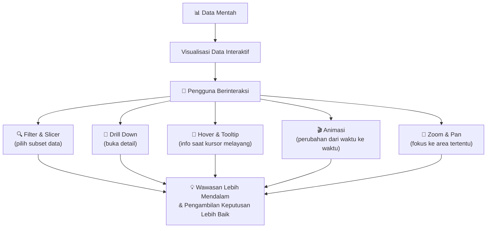
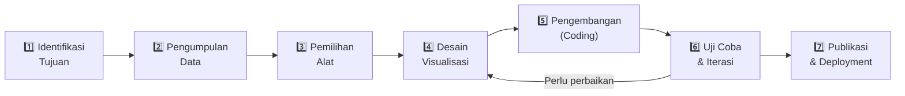
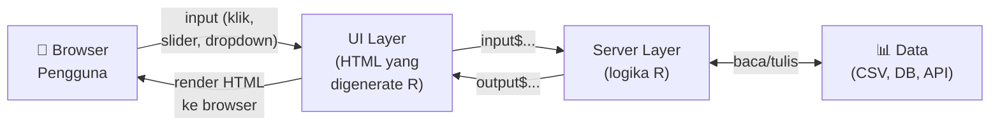
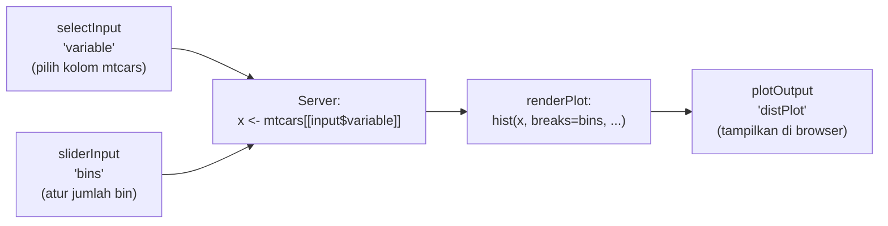
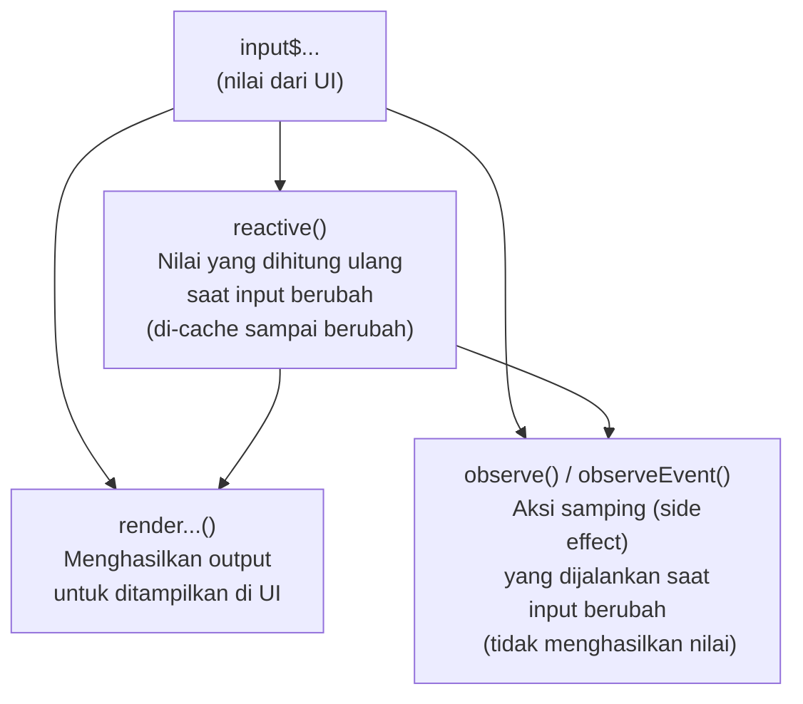
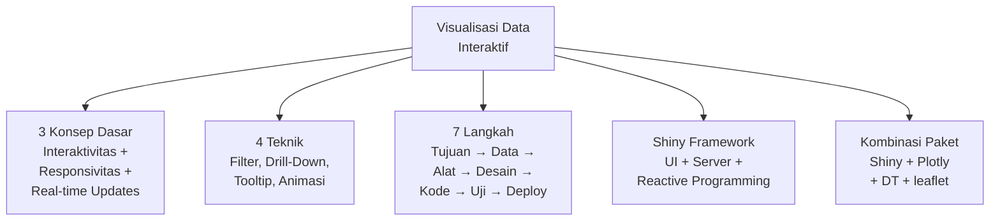

# Pertemuan 14 — Visualisasi Data Interaktif

**MSIM4310 Analisis dan Visualisasi Data**  
Program Studi Sistem Informasi — Universitas Terbuka

> Catatan: dokumen ini merupakan ekstraksi sekaligus elaborasi dari materi *Inisiasi 14 — Visualisasi Data Interaktif*. Pertemuan ini berfokus pada implementasi Shiny di R untuk membangun visualisasi dan aplikasi analitik interaktif.

---

## Daftar Isi

1. [Pengantar Visualisasi Data Interaktif](#1-pengantar-visualisasi-data-interaktif)
2. [Konsep Dasar Visualisasi Data Interaktif](#2-konsep-dasar-visualisasi-data-interaktif)
3. [Teknik Visualisasi Data Interaktif](#3-teknik-visualisasi-data-interaktif)
4. [7 Langkah Membuat Visualisasi Interaktif](#4-7-langkah-membuat-visualisasi-interaktif)
5. [Shiny Framework](#5-shiny-framework)
6. [Contoh 1 — Shiny Dasar (Histogram mtcars)](#6-contoh-1--shiny-dasar-histogram-mtcars)
7. [Contoh 2 — Shiny + Plotly](#7-contoh-2--shiny--plotly)
8. [Contoh 3 — Shiny + Tabel Interaktif DT](#8-contoh-3--shiny--tabel-interaktif-dt)
9. [Reactive Programming di Shiny](#9-reactive-programming-di-shiny)
10. [Contoh 4 — Aplikasi Shiny Lengkap Multi-Fitur](#10-contoh-4--aplikasi-shiny-lengkap-multi-fitur)
11. [Deployment Aplikasi Shiny](#11-deployment-aplikasi-shiny)
12. [Ringkasan](#12-ringkasan)

---

## 1. Pengantar Visualisasi Data Interaktif

**Visualisasi data interaktif** adalah representasi visual dari data yang memungkinkan pengguna untuk **berinteraksi langsung** dengan data tersebut — mengeksplorasi, menganalisis, dan memanipulasi tampilan melalui antarmuka visual — guna memperoleh wawasan yang lebih mendalam.



**Mengapa visualisasi interaktif lebih unggul dari grafik statis?**

Bayangkan laporan penjualan 50.000 baris. Grafik statis hanya menampilkan satu sudut pandang yang sudah ditetapkan. Visualisasi interaktif memungkinkan:
- Manajer regional memfilter hanya datanya sendiri
- Direktur meng-hover bar untuk melihat angka tepat dan persentase
- Analis men-zoom ke periode tertentu untuk pola mingguan
- Semua ini **tanpa meminta laporan baru** dari tim IT

---

## 2. Konsep Dasar Visualisasi Data Interaktif

Tiga pilar utama yang membedakan visualisasi interaktif dari visualisasi statis:

### 2.1 Interaktivitas

Pengguna dapat berinteraksi dengan data melalui berbagai mekanisme input:

| Mekanisme | Contoh | Efek |
|-----------|--------|------|
| **Filter** | Dropdown "pilih tahun" | Data berubah sesuai pilihan |
| **Hover** | Kursor di atas titik data | Tooltip muncul dengan detail |
| **Klik** | Klik slice pie chart | Slice di-*highlight* atau drill-down |
| **Zoom** | Scroll di area grafik | Fokus ke rentang tertentu |
| **Drag** | Geser slider | Rentang nilai berubah dinamis |
| **Lasso** | Seret kursor membentuk area | Pilih subset titik data |

### 2.2 Responsivitas

Visualisasi yang **responsif** menyesuaikan tampilannya dengan ukuran layar dan perangkat pengguna — desktop besar, laptop, tablet, atau smartphone — tanpa kehilangan keterbacaan.

```r
# Shiny secara otomatis responsif menggunakan Bootstrap
# fluidPage() = layout yang menyesuaikan lebar layar
ui <- fluidPage(
  # Konten otomatis menyesuaikan ukuran browser
  plotOutput("plot", height = "auto")   # "auto" = responsif terhadap tinggi
)
```

**Prinsip responsivitas:**
- Gunakan unit relatif (`%`, `vh`, `vw`) daripada pixel mutlak
- Teks terbaca di layar kecil (minimal 12px)
- Elemen tidak saling tumpang tindih di layar sempit

### 2.3 Real-Time Updates

> ⚠️ **Catatan koreksi:** Materi PDF menulis *"menmpilkan"* — *typo*, seharusnya **"menampilkan"**.

Kemampuan menampilkan data terbaru secara **real-time** tanpa memuat ulang halaman. Di R Shiny, ini dicapai melalui:

```r
# Update otomatis setiap 5 detik
output$realtime_plot <- renderPlot({
  invalidateLater(5000)             # refresh setiap 5000ms = 5 detik
  data_terbaru <- baca_dari_database()   # ambil data terbaru
  plot(data_terbaru$waktu, data_terbaru$nilai, type = "l")
})

# Atau dengan reactiveTimer()
timer <- reactiveTimer(intervalMs = 3000)   # 3 detik

output$gauge <- renderPlot({
  timer()         # trigger reactive setiap 3 detik
  nilai <- ambil_sensor()
  gauge(nilai, min = 0, max = 100)
})
```

---

## 3. Teknik Visualisasi Data Interaktif

### 3.1 Empat Teknik Utama

```mermaid
flowchart TD
    subgraph T1["🔍 Filter & Slicer"]
        F1["Pengguna memilih\nsubset data"] --> F2["Hanya data\nyang dipilih ditampilkan"]
        F2 --> F3["Contoh: filter tahun,\nwilayah, kategori produk"]
    end

    subgraph T2["📂 Drill Down"]
        D1["Tampilan level\nagregatif (nasional)"] --> D2["Klik → buka detail\n(per provinsi)"]
        D2 --> D3["Klik lagi → detail\nlebih dalam (per kota)"]
    end

    subgraph T3["💬 Tooltip & Hover"]
        H1["Kursor melayang\ndi atas elemen"] --> H2["Popup kecil muncul\ndengan info tambahan"]
        H2 --> H3["Nilai, persentase,\nrankring, label"]
    end

    subgraph T4["🎬 Animasi"]
        A1["Data berubah\ndari waktu ke waktu"] --> A2["Transisi visual\nyang halus"]
        A2 --> A3["Tren jadi lebih\nmudah dipahami"]
    end
```



### 3.2 Filter dan Slicer

Filter memungkinkan pengguna mempersempit data tanpa mengubah data asli.

```r
# Berbagai jenis filter di Shiny
sidebarPanel(
  # Dropdown (pilih satu)
  selectInput("tahun", "Pilih Tahun:",
              choices = 2019:2024, selected = 2024),

  # Checkbox (pilih beberapa)
  checkboxGroupInput("kategori", "Kategori Produk:",
                     choices = c("Elektronik", "Fashion", "Makanan"),
                     selected = c("Elektronik", "Fashion")),

  # Slider rentang numerik
  sliderInput("harga", "Rentang Harga (Rp):",
              min = 0, max = 10000000,
              value = c(100000, 5000000),
              step = 100000),

  # Date range
  dateRangeInput("tanggal", "Periode:",
                 start = "2024-01-01",
                 end   = "2024-12-31"),

  # Pencarian teks
  textInput("cari_produk", "Cari Produk:", placeholder = "Ketik nama produk...")
)
```

### 3.3 Drill Down

```r
# Implementasi drill-down sederhana: klik wilayah → tampilkan detail
server <- function(input, output, session) {
  # State: level saat ini (nasional / provinsi / kota)
  level <- reactiveVal("nasional")
  wilayah_dipilih <- reactiveVal(NULL)

  output$peta <- renderPlot({
    if (level() == "nasional") {
      plot_peta_nasional()
    } else if (level() == "provinsi") {
      plot_peta_provinsi(wilayah_dipilih())
    }
  })

  observeEvent(input$peta_click, {
    if (level() == "nasional") {
      level("provinsi")
      wilayah_dipilih(deteksi_wilayah(input$peta_click))
    }
  })

  # Tombol kembali
  observeEvent(input$tombol_kembali, {
    level("nasional")
    wilayah_dipilih(NULL)
  })
}
```

---

## 4. 7 Langkah Membuat Visualisasi Interaktif

> ⚠️ **Catatan koreksi:** Materi PDF menulis *"viasualisasi"* di heading langkah-langkah — *typo*, seharusnya **"visualisasi"**.



### Langkah 1 — Identifikasi Tujuan

Tentukan **pertanyaan bisnis** yang ingin dijawab sebelum menulis satu baris kode pun.

| Pertanyaan | Jenis Visualisasi |
|-----------|-----------------|
| "Bagaimana tren penjualan 12 bulan terakhir?" | Line chart interaktif |
| "Produk mana yang paling laris per wilayah?" | Bar chart dengan filter wilayah |
| "Bagaimana distribusi usia pelanggan?" | Histogram dengan slider bin |
| "Di mana lokasi gerai dengan penjualan tertinggi?" | Bubble map interaktif |

### Langkah 2 — Pengumpulan Data

```r
# Berbagai sumber data untuk Shiny
library(readxl)
library(DBI)
library(httr)

# Dari file Excel
data_excel <- read_excel("penjualan.xlsx")

# Dari database
con <- dbConnect(RSQLite::SQLite(), "database.db")
data_db <- dbGetQuery(con, "SELECT * FROM penjualan WHERE tahun = 2024")

# Dari REST API
resp <- GET("https://api.example.com/data",
            authenticate("user", "password"))
data_api <- content(resp, "parsed")
```

### Langkah 3 — Pemilihan Alat

| Kebutuhan | Rekomendasi Tools R | Alasan |
|-----------|--------------------|----|
| Grafik interaktif cepat | `plotly` + `ggplotly()` | Konversi ggplot2 langsung |
| Aplikasi web lengkap | `shiny` | Kontrol penuh, sangat fleksibel |
| Dashboard ringan | `flexdashboard` | Rmd-based, tanpa server |
| Map interaktif | `leaflet` | Standar industri untuk peta web |
| Tabel interaktif | `DT` | DataTables yang powerful |

### Langkah 4 — Desain Visualisasi

Buat *wireframe* atau *mockup* sebelum coding:
- Letakkan filter di panel kiri (sidebar)
- Visualisasi utama di panel kanan (mainPanel)
- KPI summary cards di atas (valueBox)
- Tabel detail di bawah grafik

### Langkah 5 — Pengembangan

Prinsip *incremental development*: mulai dari versi paling sederhana yang berjalan, lalu tambahkan fitur satu per satu.

```
Versi 1: Tampilkan data tanpa filter
    ↓
Versi 2: Tambahkan satu filter (dropdown)
    ↓
Versi 3: Tambahkan slider bin / rentang
    ↓
Versi 4: Tambahkan tabel interaktif
    ↓
Versi 5: Tambahkan plotly untuk tooltip
    ↓
Versi Final: Styling dan deployment
```

### Langkah 6 — Uji Coba dan Iterasi

Checklist sebelum publikasi:
- [ ] Semua filter bekerja dengan benar
- [ ] Tidak ada error saat data kosong (hasil filter = 0 baris)
- [ ] Tampilan baik di berbagai ukuran layar
- [ ] Performa cukup cepat (< 2 detik per interaksi)
- [ ] Tombol reset/kembali tersedia
- [ ] Judul dan label grafik jelas

### Langkah 7 — Publikasi

```r
# Publikasi ke shinyapps.io
library(rsconnect)

rsconnect::setAccountInfo(
  name   = "username-anda",
  token  = "TOKEN_DARI_SHINYAPPS",
  secret = "SECRET_DARI_SHINYAPPS"
)

rsconnect::deployApp(appDir = "path/to/app/")
# URL hasil: https://username-anda.shinyapps.io/nama-app/
```

---

## 5. Shiny Framework

### 5.1 Apa itu Shiny?

**Shiny** adalah framework R yang memungkinkan pembuatan aplikasi web interaktif sepenuhnya dalam bahasa R — tanpa perlu menguasai HTML, CSS, atau JavaScript. Shiny menggabungkan analisis data R dengan antarmuka pengguna yang interaktif.



### 5.2 Instalasi

```r
# Install paket yang diperlukan
install.packages("shiny")          # framework utama
install.packages("plotly")         # grafik interaktif
install.packages("DT")             # tabel interaktif
install.packages("shinydashboard") # layout dashboard
install.packages("shinyWidgets")   # widget input tambahan
install.packages("leaflet")        # map interaktif

# Muat paket
library(shiny)
```

### 5.3 Struktur Aplikasi Shiny

Aplikasi Shiny memiliki dua komponen utama yang bisa berada dalam **satu file `app.R`** atau **dua file terpisah** (`ui.R` dan `server.R`):

```r
# ---- Struktur dalam satu file app.R ----

library(shiny)

# ---- BAGIAN 1: UI ----
# Mendefinisikan tampilan yang dilihat pengguna
ui <- fluidPage(
  # Widget input   → pengguna memberikan nilai
  # Widget output  → tempat hasil ditampilkan
)

# ---- BAGIAN 2: SERVER ----
# Mendefinisikan logika di balik layar
server <- function(input, output, session) {
  # Baca input dengan input$nama_input
  # Tulis output dengan output$nama_output <- render...({ })
}

# ---- JALANKAN APLIKASI ----
shinyApp(ui = ui, server = server)
```

### 5.4 Widget Input yang Tersedia

| Fungsi | Tipe | Contoh Kegunaan |
|--------|------|----------------|
| `selectInput()` | Dropdown (pilih satu) | Pilih variabel, kategori |
| `selectizeInput()` | Dropdown dengan search | Pilih dari banyak opsi |
| `checkboxGroupInput()` | Multi-select checkbox | Pilih beberapa kategori |
| `radioButtons()` | Radio button | Pilih satu dari beberapa |
| `sliderInput()` | Slider angka / rentang | Atur bin, tahun, nilai |
| `textInput()` | Kotak teks bebas | Cari nama, masukkan teks |
| `numericInput()` | Kotak angka | Masukkan nilai spesifik |
| `dateInput()` | Kalender tanggal | Pilih tanggal tunggal |
| `dateRangeInput()` | Kalender rentang | Pilih periode |
| `fileInput()` | Upload file | Upload CSV/Excel |
| `actionButton()` | Tombol klik | Trigger aksi manual |

### 5.5 Widget Output yang Tersedia

| Fungsi UI | Fungsi Server | Kegunaan |
|-----------|--------------|---------|
| `plotOutput()` | `renderPlot()` | Grafik ggplot2 / base R |
| `plotlyOutput()` | `renderPlotly()` | Grafik Plotly interaktif |
| `DTOutput()` | `renderDT()` | Tabel DT interaktif |
| `tableOutput()` | `renderTable()` | Tabel HTML sederhana |
| `textOutput()` | `renderText()` | Teks dinamis |
| `verbatimTextOutput()` | `renderPrint()` | Output console R |
| `leafletOutput()` | `renderLeaflet()` | Map Leaflet interaktif |
| `valueBoxOutput()` | `renderValueBox()` | KPI card (shinydashboard) |
| `uiOutput()` | `renderUI()` | UI yang digenerate dinamis |

---

## 6. Contoh 1 — Shiny Dasar (Histogram mtcars)

Contoh dari PDF — aplikasi Shiny sederhana yang menampilkan histogram dari dataset `mtcars` dengan pilihan variabel dan jumlah bin.

```r
library(shiny)

# ---- UI ----
ui <- fluidPage(
  titlePanel("Interactive Plot with Shiny"),

  sidebarLayout(
    sidebarPanel(
      # Dropdown: pilih variabel numerik dari mtcars
      selectInput("variable", "Variable:",
                  choices = colnames(mtcars)[sapply(mtcars, is.numeric)]),

      # Slider: atur jumlah bin histogram
      sliderInput("bins", "Number of bins:",
                  min = 1, max = 50, value = 10)
    ),

    mainPanel(
      plotOutput("distPlot")
    )
  )
)

# ---- SERVER ----
server <- function(input, output) {
  output$distPlot <- renderPlot({
    x    <- mtcars[[input$variable]]   # ambil kolom yang dipilih
    bins <- seq(min(x), max(x), length.out = input$bins + 1)

    hist(x,
         breaks = bins,
         col    = "darkgray",
         border = "white",
         main   = paste("Histogram of", input$variable),
         xlab   = input$variable)
  })
}

# ---- JALANKAN ----
shinyApp(ui = ui, server = server)
```

**Cara menjalankan:**
```r
# Opsi 1: simpan sebagai app.R, lalu dari console R
shiny::runApp("path/to/folder/")

# Opsi 2: dari RStudio — buka app.R, klik tombol "Run App"

# Opsi 3: langsung dari file
shiny::runApp("app.R")
```

**Penjelasan alur reaktivitas:**



Setiap kali pengguna mengubah dropdown atau slider, Shiny **otomatis** menjalankan ulang `renderPlot` dan memperbarui grafik tanpa me-reload halaman.

---

## 7. Contoh 2 — Shiny + Plotly

Menggabungkan Shiny dengan Plotly untuk menghasilkan histogram yang interaktif (bisa hover, zoom, download).

> ⚠️ **Catatan koreksi kode PDF (halaman 4):** Kode di PDF menggunakan `p <- hist(x, ...)` lalu `ggplotly(p)`. Ini **tidak benar** — `hist()` mengembalikan objek bertipe `"histogram"` (bukan `ggplot`), sehingga `ggplotly()` tidak bisa memprosesnya. Solusi yang benar: gunakan `ggplot2` untuk membuat plot terlebih dahulu, baru panggil `ggplotly()`. Alternatif lain: gunakan `plot_ly()` langsung.

**Versi yang diperbaiki — menggunakan ggplot2 + ggplotly:**

```r
library(shiny)
library(plotly)
library(ggplot2)

ui <- fluidPage(
  titlePanel("Interactive Plot with Shiny and Plotly"),

  sidebarLayout(
    sidebarPanel(
      selectInput("variable", "Variable:",
                  choices = colnames(mtcars)[sapply(mtcars, is.numeric)]),
      sliderInput("bins", "Number of bins:",
                  min = 1, max = 50, value = 10)
    ),

    mainPanel(
      plotlyOutput("distPlot")   # ← plotlyOutput, bukan plotOutput
    )
  )
)

server <- function(input, output) {
  output$distPlot <- renderPlotly({   # ← renderPlotly
    x    <- mtcars[[input$variable]]

    # Buat grafik dengan ggplot2 terlebih dahulu
    p <- ggplot(data.frame(x = x), aes(x = x)) +
      geom_histogram(bins    = input$bins,
                     fill    = "darkgray",
                     color   = "white") +
      labs(title = paste("Histogram of", input$variable),
           x     = input$variable,
           y     = "Count") +
      theme_minimal()

    # Konversi ggplot → plotly (hover tooltip otomatis)
    ggplotly(p)
  })
}

shinyApp(ui = ui, server = server)
```

**Alternatif — menggunakan plot_ly() langsung (tanpa ggplot2):**

```r
server <- function(input, output) {
  output$distPlot <- renderPlotly({
    x <- mtcars[[input$variable]]

    plot_ly(x     = x,
            type  = "histogram",
            nbinsx = input$bins,
            marker = list(color = "steelblue",
                          line  = list(color = "white", width = 1))) %>%
      layout(title  = paste("Histogram of", input$variable),
             xaxis  = list(title = input$variable),
             yaxis  = list(title = "Count"))
  })
}
```

**Keunggulan Plotly dibanding base R hist:**

| Fitur | Base R `hist()` | Plotly |
|-------|----------------|--------|
| Hover tooltip | Tidak | Ya (nilai otomatis) |
| Zoom & Pan | Tidak | Ya |
| Download sebagai PNG | Tidak | Ya (tombol kamera) |
| Highlight bar saat klik | Tidak | Ya |
| Responsive | Tidak | Ya |

---

## 8. Contoh 3 — Shiny + Tabel Interaktif DT

Menambahkan tabel interaktif dengan paket `DT` yang mendukung sorting, searching, dan pagination.

```r
library(shiny)
library(DT)

ui <- fluidPage(
  titlePanel("Interactive Plot and Table with Shiny"),

  sidebarLayout(
    sidebarPanel(
      selectInput("variable", "Variable:",
                  choices = colnames(mtcars)[sapply(mtcars, is.numeric)]),
      sliderInput("bins", "Number of bins:",
                  min = 1, max = 50, value = 10)
    ),

    mainPanel(
      plotOutput("distPlot"),
      hr(),                          # garis pemisah
      h4("Data Mentah mtcars"),
      DTOutput("dataTable")          # placeholder untuk tabel DT
    )
  )
)

server <- function(input, output) {
  output$distPlot <- renderPlot({
    x    <- mtcars[[input$variable]]
    bins <- seq(min(x), max(x), length.out = input$bins + 1)
    hist(x, breaks = bins, col = "darkgray", border = "white",
         main = paste("Histogram of", input$variable),
         xlab = input$variable)
  })

  output$dataTable <- renderDT({
    datatable(
      mtcars,
      options = list(
        pageLength = 5,               # 5 baris per halaman
        scrollX    = TRUE,            # scroll horizontal jika lebar
        searching  = TRUE,            # kotak search
        ordering   = TRUE             # bisa sort kolom
      ),
      rownames = TRUE,                # tampilkan nama baris (nama mobil)
      filter   = "top"               # filter per kolom di bagian atas
    )
  })
}

shinyApp(ui = ui, server = server)
```

### Kustomisasi DT Lebih Lanjut

```r
# Tabel dengan format khusus, warna sel, dan tombol download
output$dataTable <- renderDT({
  datatable(
    mtcars,
    extensions = "Buttons",         # tambahkan tombol export
    options    = list(
      dom        = "Bfrtip",        # letak tombol: B=Buttons, f=filter, rt=table, i=info, p=pagination
      buttons    = c("copy", "csv", "excel", "pdf", "print"),
      pageLength = 10,
      scrollX    = TRUE
    )
  ) %>%
  formatRound(columns = c("mpg", "disp", "hp", "drat", "wt", "qsec"),
              digits  = 2) %>%
  formatStyle(
    "mpg",
    background = styleColorBar(mtcars$mpg, "lightblue"),
    backgroundSize   = "100% 90%",
    backgroundRepeat = "no-repeat",
    backgroundPosition = "center"
  )
})
```

---

## 9. Reactive Programming di Shiny

Konsep paling penting di Shiny adalah **reactive programming** — kode dijalankan ulang **secara otomatis** ketika nilai input berubah.

### 9.1 Tiga Komponen Reaktif Utama



### 9.2 `reactive()` — Nilai Reaktif yang Di-cache

```r
server <- function(input, output, session) {

  # reactive() = hitung sekali, gunakan berkali-kali
  # Dijalankan ulang HANYA jika input yang digunakan berubah
  data_filtered <- reactive({
    df <- mtcars
    if (input$silinder != "Semua") {
      df <- df[df$cyl == as.integer(input$silinder), ]
    }
    df
  })

  # Gunakan data_filtered() dengan tanda kurung
  output$plot <- renderPlot({
    plot(data_filtered()$wt, data_filtered()$mpg,
         main = paste("n =", nrow(data_filtered()), "mobil"))
  })

  output$tabel <- renderDT({
    datatable(data_filtered())
  })
}
```

**Mengapa reactive() lebih baik dari menghitung ulang di setiap renderPlot?**
- Filter yang sama tidak dihitung dua kali (plot dan tabel sama-sama pakai `data_filtered()`)
- Lebih efisien saat data besar
- Kode lebih rapi dan tidak duplikasi

### 9.3 `observeEvent()` — Aksi saat Tombol Diklik

```r
server <- function(input, output, session) {

  # Jalankan kode HANYA saat tombol "reset" diklik
  observeEvent(input$tombol_reset, {
    updateSelectInput(session, "wilayah", selected = "Semua")
    updateSliderInput(session, "tahun", value = c(2020, 2024))
    updateTextInput(session, "cari", value = "")
  })

  # Konfirmasi sebelum aksi besar
  observeEvent(input$tombol_hapus, {
    showModal(modalDialog(
      title  = "Konfirmasi",
      "Yakin ingin menghapus semua data?",
      footer = tagList(
        actionButton("konfirmasi_hapus", "Ya, Hapus", class = "btn-danger"),
        modalButton("Batal")
      )
    ))
  })
}
```

### 9.4 `eventReactive()` — Kalkulasi Mahal, Hanya saat Tombol Diklik

```r
server <- function(input, output, session) {

  # Kalkulasi HANYA dipicu oleh klik tombol, bukan tiap ketik
  hasil_analisis <- eventReactive(input$tombol_analisis, {
    withProgress(message = "Menghitung...", {
      Sys.sleep(2)                         # simulasi proses berat
      lm(mpg ~ wt + hp, data = mtcars)    # regresi linear
    })
  })

  output$hasil <- renderPrint({
    summary(hasil_analisis())
  })
}
```

---

## 10. Contoh 4 — Aplikasi Shiny Lengkap Multi-Fitur

Aplikasi komprehensif dengan scatter plot, ringkasan statistik, dan tabel — semua terhubung melalui filter yang sama:

```r
library(shiny)
library(plotly)
library(DT)
library(dplyr)

# ---- UI ----
ui <- fluidPage(
  titlePanel("Eksplorasi Dataset mtcars"),

  sidebarLayout(
    sidebarPanel(
      # Filter: jumlah silinder
      checkboxGroupInput("cyl", "Jumlah Silinder:",
                         choices  = c("4" = 4, "6" = 6, "8" = 8),
                         selected = c(4, 6, 8)),

      # Pilih variabel sumbu X dan Y
      selectInput("x_var", "Sumbu X:",
                  choices  = names(mtcars)[sapply(mtcars, is.numeric)],
                  selected = "wt"),
      selectInput("y_var", "Sumbu Y:",
                  choices  = names(mtcars)[sapply(mtcars, is.numeric)],
                  selected = "mpg"),

      # Opsi tambahan
      checkboxInput("show_line", "Tampilkan garis regresi", value = TRUE),

      hr(),
      # Tampilkan ringkasan data yang difilter
      h5("Ringkasan Data Terfilter:"),
      verbatimTextOutput("ringkasan")
    ),

    mainPanel(
      tabsetPanel(
        tabPanel("Scatter Plot",
                 plotlyOutput("scatter", height = "450px")),
        tabPanel("Tabel Data",
                 DTOutput("tabel")),
        tabPanel("Statistik Deskriptif",
                 tableOutput("statistik"))
      )
    )
  )
)

# ---- SERVER ----
server <- function(input, output, session) {

  # Data reaktif — difilter berdasarkan pilihan silinder
  data_filtered <- reactive({
    req(input$cyl)     # pastikan input tidak NULL/kosong
    mtcars %>%
      filter(cyl %in% as.integer(input$cyl)) %>%
      mutate(model = rownames(mtcars)[cyl %in% as.integer(input$cyl)])
  })

  # Ringkasan singkat
  output$ringkasan <- renderPrint({
    df <- data_filtered()
    cat("Jumlah mobil:", nrow(df), "\n")
    cat("MPG rata-rata:", round(mean(df$mpg), 2), "\n")
    cat("HP rata-rata:", round(mean(df$hp), 2))
  })

  # Scatter plot interaktif
  output$scatter <- renderPlotly({
    df  <- data_filtered()
    req(nrow(df) > 0)

    p <- ggplot(df, aes_string(x = input$x_var, y = input$y_var,
                               color = "factor(cyl)",
                               text  = "rownames(df)")) +
      geom_point(size = 3, alpha = 0.8) +
      scale_color_brewer(palette = "Set1", name = "Silinder") +
      labs(title    = paste(input$y_var, "vs", input$x_var),
           x        = input$x_var,
           y        = input$y_var) +
      theme_minimal()

    if (input$show_line) {
      p <- p + geom_smooth(method = "lm", se = TRUE,
                           linetype = "dashed", alpha = 0.2)
    }

    ggplotly(p, tooltip = c("x", "y", "text"))
  })

  # Tabel interaktif
  output$tabel <- renderDT({
    datatable(
      data_filtered(),
      options  = list(scrollX = TRUE, pageLength = 8),
      rownames = TRUE
    ) %>%
    formatRound(columns = names(mtcars), digits = 2)
  })

  # Statistik deskriptif
  output$statistik <- renderTable({
    df <- data_filtered()
    vars <- c(input$x_var, input$y_var)
    data.frame(
      Variabel = vars,
      Min      = sapply(df[vars], min,  na.rm = TRUE),
      Max      = sapply(df[vars], max,  na.rm = TRUE),
      Mean     = sapply(df[vars], mean, na.rm = TRUE),
      SD       = sapply(df[vars], sd,   na.rm = TRUE),
      row.names = NULL
    )
  }, digits = 3)
}

shinyApp(ui = ui, server = server)
```

---

## 11. Deployment Aplikasi Shiny

### 11.1 shinyapps.io (Paling Mudah)

```r
# Install rsconnect
install.packages("rsconnect")

# Konfigurasi akun (ambil token dari dashboard shinyapps.io)
library(rsconnect)
rsconnect::setAccountInfo(
  name   = "username-anda",
  token  = "TOKEN",
  secret = "SECRET"
)

# Deploy
rsconnect::deployApp(
  appDir  = "path/to/folder/",
  appName = "nama-aplikasi"
)
# Hasil: https://username-anda.shinyapps.io/nama-aplikasi/
```

**Batas paket gratis shinyapps.io:**
- 5 aplikasi aktif
- 25 jam aktif per bulan
- 1 GB RAM

### 11.2 Shiny Server (Self-hosted)

```bash
# Install di Ubuntu/Debian server
sudo apt-get install r-base
sudo R -e "install.packages('shiny')"

# Download & install Shiny Server
wget https://download3.rstudio.org/ubuntu-18.04/x86_64/shiny-server-1.5.21.1012-amd64.deb
sudo dpkg -i shiny-server-1.5.21.1012-amd64.deb

# Letakkan app di: /srv/shiny-server/nama-app/
# Akses di: http://ip-server:3838/nama-app/
```

### 11.3 Struktur Folder Deployment

```
my-app/
├── app.R              # atau: ui.R + server.R
├── data/
│   ├── penjualan.csv
│   └── lokasi.xlsx
├── www/               # file statis (gambar, CSS)
│   ├── logo.png
│   └── custom.css
└── R/
    └── helpers.R      # fungsi helper (di-source otomatis)
```

---

## 12. Ringkasan



**Perkembangan aplikasi Shiny (level):**

| Level | Fitur | Paket |
|-------|-------|-------|
| Dasar | Histogram + dropdown + slider | `shiny` |
| Menengah | Plotly interaktif + tooltip | `shiny` + `plotly` |
| Lanjutan | Tabel DT + filter + export | `shiny` + `DT` |
| Expert | Multi-tab + reactive data + deployment | `shiny` + semua |

**Pola reactive yang wajib dipahami:**

```r
# reactive()       → nilai yang di-cache, dipanggil dengan ()
# observe()        → aksi samping tanpa nilai kembalian
# observeEvent()   → aksi saat event tertentu terjadi
# eventReactive()  → nilai yang dihitung saat event terjadi
# req()            → hentikan eksekusi jika input kosong/NULL
# isolate()        → baca nilai reaktif tanpa membuat dependensi
```

**Checklist sebelum deployment:**
- [ ] Semua `input$...` di-validasi dengan `req()`
- [ ] Data besar di-cache dengan `reactive()`, bukan dihitung ulang di setiap `render`
- [ ] Error handling untuk data kosong (hasil filter = 0 baris)
- [ ] Tampilan diuji di berbagai ukuran layar
- [ ] File `data/` menggunakan path relatif (bukan absolute path)

---

*Selamat Belajar...*
