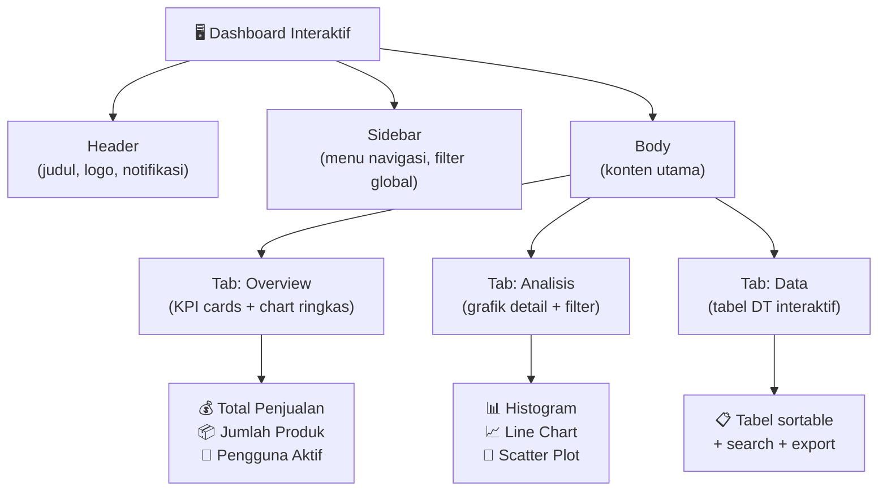
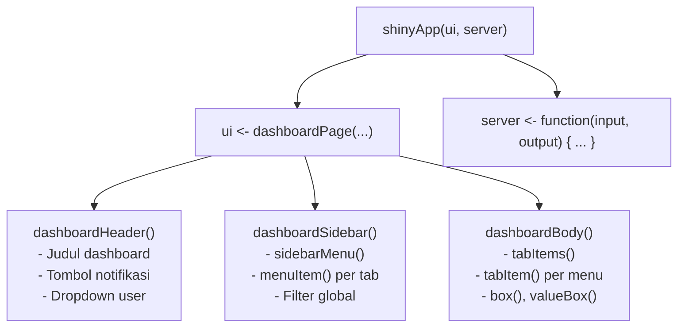
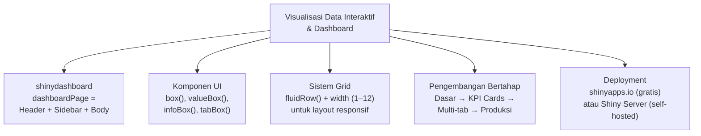

# Pertemuan 15 — Visualisasi Data Interaktif dan Dashboard

**MSIM4310 Analisis dan Visualisasi Data**  
Program Studi Sistem Informasi — Universitas Terbuka

> Catatan: dokumen ini merupakan ekstraksi sekaligus elaborasi dari materi *Inisiasi 15 — Visualisasi Data Interaktif dan Dashboard*. Pertemuan ini membahas pembuatan dashboard interaktif di R menggunakan paket `shinydashboard` — dari instalasi hingga deployment ke shinyapps.io.

---

## Daftar Isi

1. [Pengantar Dashboard Interaktif](#1-pengantar-dashboard-interaktif)
2. [Instalasi dan Persiapan](#2-instalasi-dan-persiapan)
3. [Anatomi shinydashboard](#3-anatomi-shinydashboard)
4. [Komponen UI shinydashboard](#4-komponen-ui-shinydashboard)
5. [Contoh 1 — Dashboard Dasar (faithful)](#5-contoh-1--dashboard-dasar-faithful)
6. [Contoh 2 — Dashboard Diperkaya Multi-Tab](#6-contoh-2--dashboard-diperkaya-multi-tab)
7. [Dashboard dengan KPI Cards](#7-dashboard-dengan-kpi-cards)
8. [Dashboard Lengkap Produksi](#8-dashboard-lengkap-produksi)
9. [Kustomisasi Tampilan Dashboard](#9-kustomisasi-tampilan-dashboard)
10. [Publikasi dan Distribusi](#10-publikasi-dan-distribusi)
11. [Ringkasan](#11-ringkasan)

---

## 1. Pengantar Dashboard Interaktif

**Dashboard interaktif** adalah antarmuka visual tunggal yang mengumpulkan beberapa visualisasi dan kontrol dalam satu halaman terpadu — memungkinkan pengguna memantau, mengeksplorasi, dan mengambil keputusan berdasarkan data secara langsung.



### Dashboard vs Laporan Statis

| Aspek | Laporan Statis (PDF/Excel) | Dashboard Interaktif |
|-------|--------------------------|---------------------|
| **Pembaruan data** | Manual (buat ulang) | Otomatis (koneksi langsung) |
| **Eksplorasi** | Tidak bisa | Filter, drill-down, zoom |
| **Pengguna** | Baca saja | Berinteraksi aktif |
| **Waktu pembuatan** | Cepat (satu kali) | Lebih lama (tapi reusable) |
| **Akses** | File/cetak | Browser web, bisa dishare URL |
| **Contoh tools R** | ggplot2 + rmarkdown | Shiny + shinydashboard |

### Kapan Membutuhkan Dashboard?

- Metrik yang dipantau **rutin** (harian, mingguan)
- Data yang terus **berubah** dan perlu dimonitor real-time
- Pengguna dengan **kebutuhan berbeda** (manajer vs analis vs eksekutif)
- Tim yang perlu **berbagi insight** tanpa mengirim file Excel berulang

---

## 2. Instalasi dan Persiapan

```r
# Install semua paket yang diperlukan
install.packages("shiny")           # framework utama
install.packages("shinydashboard")  # layout dashboard (header + sidebar + body)
install.packages("ggplot2")         # visualisasi grafik
install.packages("DT")              # tabel interaktif
install.packages("plotly")          # grafik interaktif (opsional tapi direkomendasikan)
install.packages("rsconnect")       # untuk deployment ke shinyapps.io
install.packages("shinyWidgets")    # widget input tambahan (opsional)

# Muat paket
library(shiny)
library(shinydashboard)
library(ggplot2)
library(DT)
```

**Perbedaan `shiny` dan `shinydashboard`:**

| Paket | Fungsi | Fungsi Utama |
|-------|--------|-------------|
| `shiny` | Framework dasar Shiny | `fluidPage()`, reaktivitas |
| `shinydashboard` | Ekstensi layout dashboard | `dashboardPage()`, `box()`, `valueBox()` |

`shinydashboard` **membutuhkan** `shiny` — ia hanya menambahkan komponen UI bergaya dashboard di atas fondasi Shiny.

---

## 3. Anatomi shinydashboard



**Tiga lapisan `dashboardPage()`:**

```r
ui <- dashboardPage(
  skin = "blue",           # tema warna: blue, black, purple, green, red, yellow

  dashboardHeader(
    title = "Judul Dashboard"
    # + notifikasi, pesan, dropdown user (opsional)
  ),

  dashboardSidebar(
    sidebarMenu(
      menuItem("Tab 1", tabName = "tab1", icon = icon("chart-bar")),
      menuItem("Tab 2", tabName = "tab2", icon = icon("table")),
      menuItem("Tab 3", tabName = "tab3", icon = icon("map"))
    )
    # + input filter global (opsional)
  ),

  dashboardBody(
    tabItems(
      tabItem(tabName = "tab1", ...),
      tabItem(tabName = "tab2", ...),
      tabItem(tabName = "tab3", ...)
    )
  )
)
```

### Sistem Grid shinydashboard

`shinydashboard` menggunakan **sistem 12 kolom Bootstrap**. Setiap `fluidRow()` dibagi 12 unit — elemen di dalamnya diberi `width` antara 1–12 (jumlahnya harus ≤ 12).

```r
# Contoh layout 12-kolom
fluidRow(
  box(width = 6, ...),   # setengah layar kiri
  box(width = 6, ...)    # setengah layar kanan
)

fluidRow(
  box(width = 4, ...),   # sepertiga kiri
  box(width = 4, ...),   # sepertiga tengah
  box(width = 4, ...)    # sepertiga kanan
)

fluidRow(
  box(width = 8, ...),   # dua pertiga kiri (konten utama)
  box(width = 4, ...)    # sepertiga kanan (kontrol/info)
)
```

---

## 4. Komponen UI shinydashboard

### 4.1 `box()` — Kontainer Konten

`box()` adalah elemen paling fundamental di `shinydashboard` — membungkus konten (grafik, tabel, form) dalam kotak bertepi.

```r
box(
  title       = "Judul Box",
  status      = "primary",    # warna header: primary, success, warning, danger, info
  solidHeader = TRUE,          # header solid (tidak transparan)
  width       = 6,             # lebar (1–12 kolom)
  collapsible = TRUE,          # bisa diciutkan/diperluas
  collapsed   = FALSE,         # kondisi awal (FALSE = terbuka)
  footer      = "Catatan di bawah",

  # Konten:
  plotOutput("grafik"),
  sliderInput("slider", "Bin:", min = 1, max = 50, value = 10)
)
```

**Warna status `box()`:**

| `status` | Warna Header | Makna Umum |
|---------|-------------|-----------|
| `"primary"` | Biru | Konten utama / visualisasi |
| `"success"` | Hijau | Hasil positif / target tercapai |
| `"warning"` | Oranye | Perlu perhatian |
| `"danger"` | Merah | Masalah / nilai kritis |
| `"info"` | Biru muda | Informasi tambahan / kontrol |

### 4.2 `valueBox()` — KPI Card Besar

Menampilkan satu angka KPI yang menonjol dengan ikon dan warna.

```r
# Di UI
valueBoxOutput("total_penjualan")   # placeholder

# Di server
output$total_penjualan <- renderValueBox({
  valueBox(
    value    = paste0("Rp ", format(sum(data$penjualan), big.mark = ".")),
    subtitle = "Total Penjualan Bulan Ini",
    icon     = icon("dollar-sign"),
    color    = "green"             # green, red, blue, orange, yellow, purple
  )
})
```

### 4.3 `infoBox()` — KPI Card Horizontal

Lebih kompak dari `valueBox()`, dengan ikon di sisi kiri.

```r
output$jumlah_transaksi <- renderInfoBox({
  infoBox(
    title    = "Transaksi",
    value    = nrow(data),
    subtitle = "Total transaksi bulan ini",
    icon     = icon("shopping-cart"),
    color    = "blue",
    fill     = TRUE
  )
})
```

### 4.4 `tabBox()` — Box dengan Tab Internal

Box yang berisi beberapa panel tab.

```r
tabBox(
  title = "Analisis",
  width = 12,
  tabPanel("Histogram",  plotOutput("hist")),
  tabPanel("Scatter",    plotOutput("scatter")),
  tabPanel("Ringkasan",  verbatimTextOutput("summary"))
)
```

### 4.5 Ikon dengan Font Awesome

`shinydashboard` menggunakan Font Awesome untuk ikon:

```r
icon("chart-bar")        # grafik batang
icon("table")            # tabel
icon("map")              # peta
icon("users")            # pengguna
icon("dollar-sign")      # uang
icon("exclamation-triangle")  # peringatan
icon("check-circle")     # sukses
icon("clock")            # waktu
icon("download")         # unduh
icon("filter")           # filter
```

---

## 5. Contoh 1 — Dashboard Dasar (faithful)

Dari PDF — aplikasi dashboard 2 tab: histogram dataset `faithful` + tabel DT.

```r
library(shiny)
library(shinydashboard)
library(DT)

# ---- UI ----
ui <- dashboardPage(
  dashboardHeader(title = "Interactive Dashboard"),

  dashboardSidebar(
    sidebarMenu(
      menuItem("Dashboard",  tabName = "dashboard",  icon = icon("dashboard")),
      menuItem("Data Table", tabName = "data_table", icon = icon("table"))
    )
  ),

  dashboardBody(
    tabItems(

      # ---- Tab 1: Histogram ----
      tabItem(tabName = "dashboard",
        fluidRow(
          box(title       = "Histogram Erupsi",
              status      = "primary",
              solidHeader = TRUE,
              width       = 8,
              plotOutput("plot1", height = 300)),

          box(title       = "Kontrol",
              status      = "warning",
              solidHeader = TRUE,
              width       = 4,
              sliderInput("bins", "Jumlah bin:",
                          min = 1, max = 50, value = 30),
              hr(),
              p("Dataset: Old Faithful Geyser (272 pengamatan)"),
              p("Variabel: durasi erupsi (menit)"))
        )
      ),

      # ---- Tab 2: Tabel ----
      tabItem(tabName = "data_table",
        fluidRow(
          box(title       = "Data Faithful",
              status      = "primary",
              solidHeader = TRUE,
              width       = 12,
              DTOutput("table"))
        )
      )

    )
  )
)

# ---- Server ----
server <- function(input, output) {
  output$plot1 <- renderPlot({
    x    <- faithful$eruptions
    bins <- seq(min(x), max(x), length.out = input$bins + 1)

    hist(x,
         breaks = bins,
         col    = "steelblue",
         border = "white",
         main   = "Histogram Durasi Erupsi Old Faithful",
         xlab   = "Durasi Erupsi (menit)",
         ylab   = "Frekuensi")
  })

  output$table <- renderDT({
    datatable(faithful,
              colnames = c("Durasi Erupsi (menit)", "Waktu Tunggu (menit)"),
              options  = list(pageLength = 10, scrollX = TRUE))
  })
}

# ---- Jalankan ----
shinyApp(ui = ui, server = server)
```

**Cara menjalankan:**

```r
# Dari console R (simpan sebagai app.R terlebih dahulu)
shiny::runApp("path/to/folder/")

# Atau dari RStudio: buka app.R → klik tombol "Run App"
```

---

## 6. Contoh 2 — Dashboard Diperkaya Multi-Tab

Dari PDF — menambahkan tab ketiga dengan scatter plot interaktif menggunakan dataset `mtcars`.

> ⚠️ **Catatan koreksi kode PDF (halaman 5):** Kode menggunakan `aes_string(x = input$xvar, y = input$yvar)`. Fungsi `aes_string()` sudah **deprecated** (tidak direkomendasikan) sejak ggplot2 3.0 dan akan dihapus di versi mendatang. Gunakan `.data[[input$xvar]]` sebagai pengganti yang lebih modern dan aman.

```r
library(shiny)
library(shinydashboard)
library(ggplot2)
library(DT)

# ---- UI ----
ui <- dashboardPage(
  skin = "blue",

  dashboardHeader(title = "Enhanced Interactive Dashboard"),

  dashboardSidebar(
    sidebarMenu(
      menuItem("Dashboard",    tabName = "dashboard",    icon = icon("tachometer-alt")),
      menuItem("Data Table",   tabName = "data_table",   icon = icon("table")),
      menuItem("Scatter Plot", tabName = "scatter_plot", icon = icon("circle"))
    )
  ),

  dashboardBody(
    tabItems(

      # ---- Tab 1: Histogram ----
      tabItem(tabName = "dashboard",
        fluidRow(
          box(title = "Histogram Erupsi", status = "primary", solidHeader = TRUE,
              width = 8, plotOutput("plot1", height = 300)),
          box(title = "Kontrol Histogram", status = "warning", solidHeader = TRUE,
              width = 4,
              sliderInput("bins", "Jumlah bin:", min = 1, max = 50, value = 30))
        )
      ),

      # ---- Tab 2: Tabel ----
      tabItem(tabName = "data_table",
        fluidRow(
          box(title = "Data Old Faithful", status = "primary", solidHeader = TRUE,
              width = 12,
              DTOutput("table"))
        )
      ),

      # ---- Tab 3: Scatter Plot ----
      tabItem(tabName = "scatter_plot",
        fluidRow(
          box(title = "Scatter Plot mtcars", status = "primary", solidHeader = TRUE,
              width = 8,
              plotOutput("scatterPlot", height = 350)),

          box(title = "Kontrol Scatter", status = "warning", solidHeader = TRUE,
              width = 4,
              selectInput("xvar", "Sumbu X:",
                          choices  = names(mtcars),
                          selected = "wt"),
              selectInput("yvar", "Sumbu Y:",
                          choices  = names(mtcars),
                          selected = "mpg"),
              checkboxInput("reg_line", "Tampilkan garis regresi", value = TRUE))
        )
      )

    )
  )
)

# ---- Server ----
server <- function(input, output) {

  # Histogram faithful
  output$plot1 <- renderPlot({
    x    <- faithful$eruptions
    bins <- seq(min(x), max(x), length.out = input$bins + 1)
    hist(x, breaks = bins, col = "steelblue", border = "white",
         main = "Histogram Durasi Erupsi",
         xlab = "Durasi (menit)")
  })

  # Tabel DT
  output$table <- renderDT({
    datatable(faithful, options = list(pageLength = 10, scrollX = TRUE))
  })

  # Scatter plot (versi diperbaiki — tidak pakai aes_string yang deprecated)
  output$scatterPlot <- renderPlot({
    p <- ggplot(mtcars,
                aes(x = .data[[input$xvar]],
                    y = .data[[input$yvar]])) +
      geom_point(color = "steelblue", size = 3, alpha = 0.8) +
      labs(title    = paste("Scatter Plot:", input$yvar, "vs", input$xvar),
           x        = input$xvar,
           y        = input$yvar) +
      theme_minimal(base_size = 13)

    if (input$reg_line) {
      p <- p + geom_smooth(method = "lm", se = TRUE,
                           color  = "red", linetype = "dashed")
    }
    p
  })
}

# ---- Jalankan ----
shinyApp(ui = ui, server = server)
```

---

## 7. Dashboard dengan KPI Cards

Menambahkan **value boxes** di bagian atas dashboard untuk menampilkan angka-angka penting secara menonjol:

```r
library(shiny)
library(shinydashboard)
library(dplyr)

ui <- dashboardPage(
  dashboardHeader(title = "Dashboard KPI"),

  dashboardSidebar(
    sidebarMenu(
      menuItem("Overview", tabName = "overview", icon = icon("tachometer-alt")),
      menuItem("Detail",   tabName = "detail",   icon = icon("chart-bar"))
    ),
    # Filter global di sidebar
    selectInput("pilih_gear", "Pilih Gear:",
                choices = c("Semua" = "all", "3" = 3, "4" = 4, "5" = 5),
                selected = "all")
  ),

  dashboardBody(
    tabItems(

      tabItem(tabName = "overview",
        # ---- Baris KPI ----
        fluidRow(
          valueBoxOutput("box_mobil",   width = 4),
          valueBoxOutput("box_mpg",     width = 4),
          valueBoxOutput("box_hp",      width = 4)
        ),

        # ---- Grafik ringkasan ----
        fluidRow(
          box(title = "Distribusi MPG per Jumlah Silinder",
              status = "primary", solidHeader = TRUE, width = 12,
              plotOutput("plot_mpg", height = 300))
        )
      ),

      tabItem(tabName = "detail",
        fluidRow(
          box(title = "Tabel mtcars",
              status = "primary", solidHeader = TRUE, width = 12,
              DTOutput("tabel_detail"))
        )
      )
    )
  )
)

server <- function(input, output) {

  # Data reaktif berdasarkan filter gear
  data_filtered <- reactive({
    if (input$pilih_gear == "all") mtcars
    else filter(mtcars, gear == as.integer(input$pilih_gear))
  })

  # KPI: jumlah mobil
  output$box_mobil <- renderValueBox({
    valueBox(
      value    = nrow(data_filtered()),
      subtitle = "Jumlah Mobil",
      icon     = icon("car"),
      color    = "blue"
    )
  })

  # KPI: rata-rata MPG
  output$box_mpg <- renderValueBox({
    mpg_mean <- round(mean(data_filtered()$mpg), 1)
    valueBox(
      value    = paste(mpg_mean, "mpg"),
      subtitle = "Rata-rata Efisiensi BBM",
      icon     = icon("gas-pump"),
      color    = ifelse(mpg_mean > 20, "green", "orange")
    )
  })

  # KPI: rata-rata HP
  output$box_hp <- renderValueBox({
    valueBox(
      value    = paste(round(mean(data_filtered()$hp)), "HP"),
      subtitle = "Rata-rata Tenaga Mesin",
      icon     = icon("bolt"),
      color    = "red"
    )
  })

  # Grafik distribusi MPG
  output$plot_mpg <- renderPlot({
    ggplot(data_filtered(), aes(x = factor(cyl), y = mpg, fill = factor(cyl))) +
      geom_boxplot(show.legend = FALSE, alpha = 0.8) +
      scale_fill_brewer(palette = "Set2") +
      labs(title = "Distribusi MPG per Jumlah Silinder",
           x     = "Jumlah Silinder",
           y     = "MPG") +
      theme_minimal(base_size = 13)
  })

  # Tabel detail
  output$tabel_detail <- renderDT({
    datatable(data_filtered(),
              options  = list(scrollX = TRUE, pageLength = 10),
              rownames = TRUE)
  })
}

shinyApp(ui = ui, server = server)
```

---

## 8. Dashboard Lengkap Produksi

Contoh dashboard **siap produksi** yang menggabungkan semua fitur: KPI, histogram, scatter plot interaktif, tabel, dan filter:

```r
library(shiny)
library(shinydashboard)
library(ggplot2)
library(plotly)
library(DT)
library(dplyr)

ui <- dashboardPage(
  skin = "purple",

  dashboardHeader(
    title = "Data Analytics Dashboard",
    # Notifikasi di header
    dropdownMenu(type = "notifications",
      notificationItem(text = "Data berhasil dimuat", status = "success",
                       icon = icon("check"))
    )
  ),

  dashboardSidebar(
    sidebarMenu(
      menuItem("Overview",      tabName = "overview",  icon = icon("tachometer-alt"),
               badgeLabel = "HOT", badgeColor = "red"),
      menuItem("Eksplorasi",    tabName = "explorasi", icon = icon("chart-bar")),
      menuItem("Data Mentah",   tabName = "data",      icon = icon("table"))
    ),
    hr(),
    # Filter global
    h5("Filter Global", style = "color: white; padding-left: 15px;"),
    checkboxGroupInput("cyl_filter", "Jumlah Silinder:",
                       choices  = c("4 silinder" = 4,
                                    "6 silinder" = 6,
                                    "8 silinder" = 8),
                       selected = c(4, 6, 8))
  ),

  dashboardBody(
    # CSS kustom kecil
    tags$head(tags$style(HTML("
      .content-wrapper { background-color: #f4f6f9; }
      .small-box { border-radius: 8px; }
    "))),

    tabItems(

      # ---- Tab Overview ----
      tabItem(tabName = "overview",
        fluidRow(
          valueBoxOutput("n_mobil",  width = 3),
          valueBoxOutput("avg_mpg",  width = 3),
          valueBoxOutput("avg_hp",   width = 3),
          valueBoxOutput("avg_wt",   width = 3)
        ),
        fluidRow(
          box(title = "Distribusi MPG",
              status = "primary", solidHeader = TRUE,
              width = 6, height = 350,
              plotlyOutput("hist_mpg")),
          box(title = "MPG vs Berat",
              status = "info", solidHeader = TRUE,
              width = 6, height = 350,
              plotlyOutput("scatter_overview"))
        )
      ),

      # ---- Tab Eksplorasi ----
      tabItem(tabName = "explorasi",
        fluidRow(
          box(title = "Konfigurasi Plot",
              status = "warning", solidHeader = TRUE,
              width = 3, height = 400,
              selectInput("x_var", "Sumbu X:", choices = names(mtcars), selected = "wt"),
              selectInput("y_var", "Sumbu Y:", choices = names(mtcars), selected = "mpg"),
              selectInput("color_var", "Warna:", choices = c("cyl", "gear", "carb", "am"),
                          selected = "cyl"),
              checkboxInput("show_lm", "Garis Regresi", value = TRUE),
              hr(),
              verbatimTextOutput("korelasi")
          ),
          box(title = "Scatter Plot Interaktif",
              status = "primary", solidHeader = TRUE,
              width = 9, height = 400,
              plotlyOutput("scatter_main", height = "340px"))
        )
      ),

      # ---- Tab Data Mentah ----
      tabItem(tabName = "data",
        fluidRow(
          box(title = "Dataset mtcars (Terfilter)",
              status = "primary", solidHeader = TRUE,
              width = 12,
              DTOutput("tabel_main"))
        )
      )
    )
  )
)

server <- function(input, output, session) {

  # Data reaktif — filter silinder
  df <- reactive({
    req(input$cyl_filter)
    filter(mtcars, cyl %in% as.integer(input$cyl_filter))
  })

  # ---- KPI Cards ----
  output$n_mobil <- renderValueBox({
    valueBox(nrow(df()), "Jumlah Mobil", icon = icon("car"), color = "blue")
  })
  output$avg_mpg <- renderValueBox({
    v <- round(mean(df()$mpg), 1)
    valueBox(paste(v, "mpg"), "Rata-rata Efisiensi",
             icon = icon("gas-pump"),
             color = ifelse(v > 20, "green", "orange"))
  })
  output$avg_hp <- renderValueBox({
    valueBox(paste(round(mean(df()$hp)), "HP"), "Rata-rata Tenaga",
             icon = icon("bolt"), color = "red")
  })
  output$avg_wt <- renderValueBox({
    valueBox(paste(round(mean(df()$wt), 2), "ton"), "Rata-rata Berat",
             icon = icon("weight"), color = "purple")
  })

  # ---- Histogram MPG (plotly) ----
  output$hist_mpg <- renderPlotly({
    p <- ggplot(df(), aes(x = mpg, fill = factor(cyl))) +
      geom_histogram(bins = 15, color = "white", alpha = 0.8) +
      scale_fill_brewer(palette = "Set1", name = "Silinder") +
      labs(x = "MPG", y = "Frekuensi") +
      theme_minimal()
    ggplotly(p)
  })

  # ---- Scatter Overview ----
  output$scatter_overview <- renderPlotly({
    p <- ggplot(df(), aes(x = wt, y = mpg, color = factor(cyl),
                          text = paste("Model:", rownames(df())))) +
      geom_point(size = 3, alpha = 0.8) +
      geom_smooth(method = "lm", se = FALSE, linetype = "dashed") +
      scale_color_brewer(palette = "Set1", name = "Silinder") +
      labs(x = "Berat (ton)", y = "MPG") +
      theme_minimal()
    ggplotly(p, tooltip = c("x", "y", "text"))
  })

  # ---- Scatter Eksplorasi (pilih variabel) ----
  output$scatter_main <- renderPlotly({
    req(input$x_var, input$y_var, input$color_var)
    p <- ggplot(df(),
                aes(x     = .data[[input$x_var]],
                    y     = .data[[input$y_var]],
                    color = factor(.data[[input$color_var]]),
                    text  = rownames(df()))) +
      geom_point(size = 3, alpha = 0.8) +
      scale_color_brewer(palette = "Set1",
                         name   = input$color_var) +
      labs(x = input$x_var, y = input$y_var) +
      theme_minimal()

    if (input$show_lm)
      p <- p + geom_smooth(method = "lm", se = FALSE, linetype = "dashed")

    ggplotly(p, tooltip = c("x", "y", "text"))
  })

  # Korelasi dua variabel
  output$korelasi <- renderPrint({
    req(input$x_var, input$y_var)
    r <- cor(df()[[input$x_var]], df()[[input$y_var]])
    cat("Korelasi Pearson:\nr =", round(r, 4))
  })

  # ---- Tabel DT ----
  output$tabel_main <- renderDT({
    datatable(df(),
              extensions = "Buttons",
              options = list(
                dom        = "Bfrtip",
                buttons    = c("copy", "csv", "excel"),
                scrollX    = TRUE,
                pageLength = 10
              ),
              rownames = TRUE
    ) %>% formatRound(columns = names(mtcars), digits = 2)
  })
}

shinyApp(ui = ui, server = server)
```

---

## 9. Kustomisasi Tampilan Dashboard

### 9.1 Tema Warna (`skin`)

```r
dashboardPage(
  skin = "blue",    # default — header biru
  # Pilihan: "blue", "black", "purple", "green", "red", "yellow"
)
```

| `skin` | Warna Header | Cocok Untuk |
|--------|-------------|------------|
| `"blue"` | Biru | Umum, profesional |
| `"black"` | Hitam | Tampilan dark/modern |
| `"purple"` | Ungu | Kreatif, startup |
| `"green"` | Hijau | Lingkungan, kesehatan |
| `"red"` | Merah | Urgensi, keuangan |
| `"yellow"` | Kuning | Ceria, konsumen |

### 9.2 CSS Kustom

```r
dashboardBody(
  tags$head(tags$style(HTML("
    /* Warna background konten */
    .content-wrapper { background-color: #f0f4f8; }

    /* Rounded corners untuk box */
    .box { border-radius: 8px; box-shadow: 0 2px 8px rgba(0,0,0,0.1); }

    /* Ukuran font default */
    body { font-size: 14px; }

    /* Warna teks sidebar */
    .sidebar-menu li a { color: #ecf0f1 !important; }
  "))),
  # Konten dashboard ...
)
```

### 9.3 Menyembunyikan Sidebar secara Default

```r
ui <- dashboardPage(
  dashboardHeader(title = "Dashboard"),
  dashboardSidebar(collapsed = TRUE),   # sidebar ditutup saat pertama dibuka
  dashboardBody(...)
)
```

---

## 10. Publikasi dan Distribusi

### 10.1 Publikasi ke shinyapps.io

Dari PDF — 4 langkah untuk mempublikasikan dashboard:

```r
# Langkah 1: Buat akun di https://www.shinyapps.io/ (gratis untuk 5 app)

# Langkah 2: Install rsconnect
install.packages("rsconnect")

# Langkah 3: Hubungkan akun ke RStudio
# (ambil nama/token/secret dari dashboard shinyapps.io → Account → Tokens)
library(rsconnect)
rsconnect::setAccountInfo(
  name   = "<USERNAME>",
  token  = "<TOKEN>",
  secret = "<SECRET>"
)

# Langkah 4: Deploy aplikasi
rsconnect::deployApp("path/to/folder/app.R")
# Hasil: https://<USERNAME>.shinyapps.io/<APPNAME>/
```

### 10.2 Struktur Folder yang Benar

```
dashboard/
├── app.R               ← satu file (atau: ui.R + server.R)
├── data/
│   ├── penjualan.csv
│   └── produk.xlsx
├── www/
│   ├── logo.png        ← gambar yang ditampilkan di app
│   └── custom.css
└── R/
    └── helpers.R       ← fungsi bantu (di-source otomatis oleh Shiny)
```

> Semua path file dalam kode harus **relatif** terhadap `app.R` — misalnya `read.csv("data/penjualan.csv")`, bukan path absolut.

### 10.3 Batasan shinyapps.io (Paket Gratis)

| Fitur | Batas Gratis |
|-------|-------------|
| Jumlah aplikasi aktif | 5 app |
| Waktu aktif per bulan | 25 jam |
| RAM per instance | 1 GB |
| Koneksi bersamaan | 1 |

Untuk kebutuhan lebih besar: upgrade ke paket berbayar atau gunakan **Shiny Server** di VPS sendiri.

### 10.4 Deployment ke Shiny Server (Self-hosted)

```bash
# Install Shiny Server di Ubuntu 22.04
sudo apt-get update
sudo apt-get install r-base

# Install paket Shiny di R
sudo R -e "install.packages('shiny', repos='https://cloud.r-project.org')"

# Download & install Shiny Server
wget https://download3.rstudio.org/ubuntu-18.04/x86_64/shiny-server-1.5.21.1012-amd64.deb
sudo dpkg -i shiny-server-1.5.21.1012-amd64.deb

# Letakkan folder app di:
sudo cp -r dashboard/ /srv/shiny-server/nama-app/

# Akses melalui:
# http://ip-server:3838/nama-app/
```

---

## 11. Ringkasan



**Perbandingan layout Shiny biasa vs shinydashboard:**

| | `fluidPage()` | `dashboardPage()` |
|--|--------------|------------------|
| **Navigasi** | `tabsetPanel()` horizontal | `sidebarMenu()` vertikal |
| **Kontainer konten** | Kolom/baris bebas | `box()` dengan judul + warna |
| **KPI cards** | Harus buat manual | `valueBox()` / `infoBox()` |
| **Tampilan** | Minimal / custom | Siap pakai (Bootstrap + AdminLTE) |
| **Cocok untuk** | Halaman analisis sederhana | Dashboard multi-tab |

**Checklist sebelum deploy:**

- [ ] Semua path file menggunakan path **relatif** (bukan absolut)
- [ ] `aes_string()` sudah diganti dengan `.data[[input$...]]`
- [ ] `req(input$...)` dipasang di setiap `render*()` untuk cegah error saat input kosong
- [ ] Uji di berbagai ukuran layar (desktop, tablet, mobile)
- [ ] Data besar difilter di `reactive()`, bukan di setiap `render*()`
- [ ] Paket yang digunakan sudah terdaftar di `install.packages()` di awal `app.R`

---

*Selamat Belajar...*
