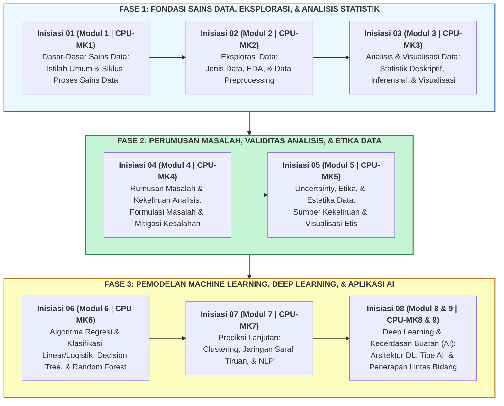

# Pengantar Sains Data (STDA4101)

* **Kode & Nama Mata Kuliah:** `STDA4101` — Pengantar Sains Data (*Introduction to Data Science*)
* **Bobot SKS:** 3 SKS (`T=2`, `P=1`) | **Semester:** 1
* **Program Studi:** Sistem Informasi & Sains Data — Fakultas Sains dan Teknologi, Universitas Terbuka
* **Referensi BMP Utama:** Buku Materi Pokok (`BMP`) `STDA4101` — *Pengantar Data Science* (Ramdani, F., & Utami, I. Q., 2024; Modul 1 – Modul 9), Penerbit Bumi Aksara / Universitas Terbuka
* **Platform Tutorial:** LMS Tutorial Online (`Tuton`) Universitas Terbuka & Digital Library UT

---

## Daftar Isi

1. [Deskripsi Mata Kuliah dan Capaian Pembelajaran (CPMK)](#1-deskripsi-mata-kuliah-dan-capaian-pembelajaran-cpmk)
2. [Peta Kompetensi dan Alur Pembelajaran Sains Data (`CPU-MK1` – `CPU-MK9`)](#2-peta-kompetensi-dan-alur-pembelajaran-sains-data-cpu-mk1--cpu-mk9)
3. [Indeks Materi Pertemuan (Tutorial Online Inisiasi 01 – Inisiasi 08)](#3-indeks-materi-pertemuan-tutorial-online-inisiasi-01--inisiasi-08)
4. [Rincian Rencana Pembelajaran Semester & Tutorial Online (`RPS` `STDA4101`)](#4-rincian-rencana-pembelajaran-semester--tutorial-online-rps-stda4101)
5. [Struktur Aktivitas, Bobot Asesmen, dan Jadwal Tugas Tutorial](#5-struktur-aktivitas-bobot-asesmen-dan-jadwal-tugas-tutorial)
6. [Daftar Pustaka dan Sumber Belajar Resmi](#6-daftar-pustaka-dan-sumber-belajar-resmi)

---

## 1. Deskripsi Mata Kuliah dan Capaian Pembelajaran (CPMK)

### Deskripsi Singkat Mata Kuliah

Mata kuliah **Pengantar Sains Data (`STDA4101`)** membekali mahasiswa dengan fondasi teoritis, metodologis, dan praktis dalam siklus hidup Sains Data (*Data Science Lifecycle*). Ruang lingkup pembahasan mencakup istilah-istilah dasar dan tahapan proses Sains Data, klasifikasi jenis data dan skala pengukuran, eksplorasi serta prapemrosesan data (*data preprocessing*), analisis statistik deskriptif dan inferensial, prinsip visualisasi data, penyusunan rumusan masalah dan pencegahan kekeliruan analisis, pengelolaan ketidakpastian (*uncertainty*), etika dan estetika data, konsep dasar algoritma pembelajaran mesin (*Regresi*, *Klasifikasi*, dan *Clustering*), Jaringan Saraf Tiruan (`ANN`), Pemrosesan Bahasa Alami (`NLP`), *Deep Learning*, hingga penerapan Sains Data dan Kecerdasan Buatan (`AI`) di berbagai sektor industri.

### Capaian Pembelajaran Mata Kuliah (`CPMK`)

Mahasiswa mampu menerapkan konsep dasar Sains Data secara menyeluruh, yakni **merumuskan pertanyaan penelitian/bisnis yang tepat, mengumpulkan data, melakukan *data preprocessing*, membangun hipotesis, mengolah dan menganalisis data, menguji hipotesis, merancang visualisasi data yang informatif dan etis, mengajukan solusi berbasis model yang akurat dan presisi, serta menyajikannya dalam laporan sistematis maupun presentasi**.

---

## 2. Peta Kompetensi dan Alur Pembelajaran Sains Data (`CPU-MK1` – `CPU-MK9`)

Berdasarkan dokumen resmi **Rencana Pembelajaran Semester (`RPS`) `STDA4101`**, kompetensi akhir tiap tahapan belajar (`CPU-MK`) tersusun dalam **tiga fase berurutan** di sepanjang 8 sesi Tutorial Online (mencakup seluruh 9 Modul `BMP`):

---

## 3. Indeks Materi Pertemuan (Tutorial Online Inisiasi 01 – Inisiasi 08)

Berikut adalah daftar rencana dan indeks navigasi dokumen rangkuman untuk setiap sesi Tutorial Online mata kuliah **`STDA4101`** (akan diperbarui seiring materi setiap sesi diunggah):

| Inisiasi Tuton | Aktivitas Belajar (`RPS`) | Modul `BMP` | Pokok Bahasan & Sub-Pokok Bahasan | Target File Catatan Markdown |
| :---: | :---: | :---: | :--- | :--- |
| **01** | `1 & 2` | **Modul 1** | **Dasar-Dasar Sains Data:** Beberapa Istilah dalam Sains Data (`KB1`) & Proses Sains Data (`KB2`). | `pertemuan-01/README.md` |
| **02** | `3 & 4` | **Modul 2** | **Eksplorasi Data:** Jenis Data (`KB1`), Eksplorasi Data (`KB2`), & *Data Preprocessing* (`KB3`). | `pertemuan-02/README.md` |
| **03** | `5 & 6` | **Modul 3** | **Analisis dan Visualisasi Data:** Analisis Statistik Deskriptif dan Inferensial (`KB1`) & Visualisasi Data (`KB2`). | `pertemuan-03/README.md` |
| **04** | `7` | **Modul 4** | **Rumusan Masalah dan Kekeliruan Analisis:** Membuat Kalimat Rumusan Masalah (`KB1`) & Memperbaiki Kekeliruan Analisis (`KB2`). | `pertemuan-04/README.md` |
| **05** | `9` | **Modul 5** | **Uncertainty, Etika dan Estetika Data:** Kekeliruan Analisis Data & Keterbatasan Sains Data (`KB1`), serta *Uncertainty*, Etika & Estetika Data (`KB2`). | `pertemuan-05/README.md` |
| **06** | `10 & 11` | **Modul 6** | **Konsep Dasar Algoritma Regresi dan Klasifikasi:** Regresi (`KB1`) & Klasifikasi (`KB2`). | `pertemuan-06/README.md` |
| **07** | `12 & 13` | **Modul 7** | **Prediksi:** *Clustering* (`KB1`) & Jaringan Saraf Tiruan serta Bahasa Alami (`KB2`). | `pertemuan-07/README.md` |
| **08** | `14 & 15` | **Modul 8 & 9** | **Deep Learning & Kecerdasan Buatan (`AI`):** Jenis & Aplikasi *Deep Learning* (Modul 8) serta Tipe `AI` & Aplikasi Sains Data (`AI`) di Berbagai Bidang (Modul 9). | `pertemuan-08/README.md` |

---

## 4. Rincian Rencana Pembelajaran Semester & Tutorial Online (`RPS` `STDA4101`)

### Inisiasi 01: Dasar-Dasar Sains Data *(BMP Modul 1 | `CPU-MK1`)*
* **Capaian Pembelajaran (`CPU-MK1`):** Mampu menjelaskan beberapa istilah umum dan menguraikan tahapan-tahapan proses Sains Data.
* **Indikator Penilaian:** (1) Menjelaskan konsep dasar sains data; (2) Menguraikan tahapan-tahapan proses sains data.
* **Kegiatan & Aktivitas:** Membaca `BMP` Modul 1, mengerjakan Tes Formatif 1, serta berpartisipasi aktif dalam **Diskusi 1**.

### Inisiasi 02: Eksplorasi Data *(BMP Modul 2 | `CPU-MK2`)*
* **Capaian Pembelajaran (`CPU-MK2`):** Mampu menentukan jenis data dan melakukan prapemrosesan data (*data preprocessing*) menggunakan beberapa teknik sehingga menghasilkan data yang berkualitas.
* **Indikator Penilaian:** (1) Menentukan jenis data dengan benar pada suatu kasus; (2) Melakukan eksplorasi data (`EDA`); (3) Melakukan *data preprocessing* menggunakan teknik *data cleaning*, *data integration*, *data reduction*, dan/atau *data transformation*.
* **Kegiatan & Aktivitas:** Membaca `BMP` Modul 2, mengerjakan Tes Formatif 2, serta berpartisipasi aktif dalam **Diskusi 2**.

### Inisiasi 03: Analisis dan Visualisasi Data *(BMP Modul 3 | `CPU-MK3`)*
* **Capaian Pembelajaran (`CPU-MK3`):** Mampu melakukan analisis statistik deskriptif dan statistik inferensial, serta melakukan visualisasi data.
* **Indikator Penilaian:** (1) Menentukan ukuran pemusatan, ukuran penyebaran, dan bentuk distribusi data; (2) Melakukan uji hipotesis langsung (*direksional*) dan/atau uji hipotesis tidak langsung (*nondireksional*); (3) Melakukan visualisasi untuk berbagai jenis data.
* **Kegiatan & Aktivitas:** Membaca `BMP` Modul 3, mengerjakan Tes Formatif 3, **Diskusi 3**, serta mengerjakan **Tugas Tutorial 1**.

### Inisiasi 04: Rumusan Masalah dan Kekeliruan Analisis *(BMP Modul 4 | `CPU-MK4`)*
* **Capaian Pembelajaran (`CPU-MK4`):** Mampu membuat kalimat rumusan masalah dengan benar dan mampu memperbaiki kekeliruan dalam analisis.
* **Indikator Penilaian:** (1) Membuat kalimat rumusan masalah dengan benar; (2) Membuat kesimpulan penyebab kekeliruan pada sains data; (3) Memberikan saran pencegahan/perbaikan kesalahan pada tahap akuisisi, pengolahan, dan penggunaan data.
* **Kegiatan & Aktivitas:** Membaca `BMP` Modul 4, mengerjakan Tes Formatif 4, serta berpartisipasi aktif dalam **Diskusi 4**.

### Inisiasi 05: Uncertainty, Etika dan Estetika Data *(BMP Modul 5 | `CPU-MK5`)*
* **Capaian Pembelajaran (`CPU-MK5`):** Mampu mengidentifikasi sumber kesalahan dalam proses analisis data dan memvisualisasikan ketidakpastian (*uncertainty*) data dengan memperhatikan kaidah etika dan estetika.
* **Indikator Penilaian:** (1) Menjelaskan sumber kesalahan dalam proses pengolahan dan analisis data; (2) Mengukur ketidakpastian (*uncertainty*) data; (3) Memvisualisasikan data dengan memperhatikan kaidah etika dan estetika.
* **Kegiatan & Aktivitas:** Membaca `BMP` Modul 5, mengerjakan Tes Formatif 5, **Diskusi 5**, serta mengerjakan **Tugas Tutorial 2**.

### Inisiasi 06: Konsep Dasar Algoritma Regresi dan Klasifikasi *(BMP Modul 6 | `CPU-MK6`)*
* **Capaian Pembelajaran (`CPU-MK6`):** Mampu menentukan metode yang tepat dalam analisis regresi dan klasifikasi.
* **Indikator Penilaian:** (1) Menggunakan algoritma regresi, *decision tree*, atau *random forest*; (2) Membedakan dan menerapkan paradigma *supervised learning*, *unsupervised learning*, atau *reinforcement learning*.
* **Kegiatan & Aktivitas:** Membaca `BMP` Modul 6, mengerjakan Tes Formatif 6, serta berpartisipasi aktif dalam **Diskusi 6**.

### Inisiasi 07: Prediksi *(BMP Modul 7 | `CPU-MK7`)*
* **Capaian Pembelajaran (`CPU-MK7`):** Mampu melakukan prediksi menggunakan pendekatan Algoritma *Clustering*, Jaringan Saraf Tiruan (`ANN`), dan Bahasa Alami (`NLP`).
* **Indikator Penilaian:** (1) Melakukan pengelompokan/prediksi menggunakan pendekatan Algoritma *Clustering*; (2) Melakukan pemodelan/prediksi menggunakan Jaringan Saraf Tiruan atau Pemrosesan Bahasa Alami.
* **Kegiatan & Aktivitas:** Membaca `BMP` Modul 7, mengerjakan Tes Formatif 7, **Diskusi 7**, serta mengerjakan **Tugas Tutorial 3**.

### Inisiasi 08: Deep Learning dan Aplikasi Kecerdasan Buatan (`AI`) *(BMP Modul 8 & 9 | `CPU-MK8` & `CPU-MK9`)*
* **Capaian Pembelajaran (`CPU-MK8` & `CPU-MK9`):** Mampu mendeskripsikan jenis dan aplikasi *Deep Learning*, menjelaskan hubungannya dengan `AI`, serta menunjukkan penerapan Sains Data dan `AI` di berbagai bidang.
* **Indikator Penilaian:** (1) Mendeskripsikan berbagai jenis *Deep Learning* dan hubungannya dengan `AI`; (2) Mendeskripsikan tipe-tipe `AI` dan penerapannya di berbagai sektor industri.
* **Kegiatan & Aktivitas:** Membaca `BMP` Modul 8 & Modul 9, mengerjakan Tes Formatif 8 & 9, serta berpartisipasi aktif dalam **Diskusi 8**.

---

## 5. Struktur Aktivitas, Bobot Asesmen, dan Jadwal Tugas Tutorial

Berdasarkan matriks asesmen hasil belajar pada **`RPS` `STDA4101`**, distribusi bobot capaian pembelajaran (`CPU-MK`) dan jadwal penugasan terstruktur adalah sebagai berikut:

| Sesi Tuton | Modul `BMP` | Pokok Bahasan Utama | Bentuk Evaluasi Terstruktur | Bobot Asesmen (`RPS`) |
| :---: | :---: | :--- | :--- | :---: |
| **Inisiasi 01** | Modul 1 | Dasar-Dasar Sains Data | Diskusi 1 & Tes (`UAS`) | `8,75%` |
| **Inisiasi 02** | Modul 2 | Eksplorasi Data & *Preprocessing* | Diskusi 2 & Tes (`UAS`) | `8,75%` |
| **Inisiasi 03** | Modul 3 | Analisis Statistik & Visualisasi Data | Diskusi 3 & **Tugas Tutorial 1** | `18,75%` |
| **Inisiasi 04** | Modul 4 | Rumusan Masalah & Kekeliruan Analisis | Diskusi 4 & Tes (`UAS`) | `8,75%` |
| **Inisiasi 05** | Modul 5 | *Uncertainty*, Etika, & Estetika Data | Diskusi 5 & **Tugas Tutorial 2** | `13,75%` |
| **Inisiasi 06** | Modul 6 | Algoritma Regresi & Klasifikasi | Diskusi 6 & Tes (`UAS`) | `8,75%` |
| **Inisiasi 07** | Modul 7 | Prediksi (*Clustering*, `JST`, & `NLP`) | Diskusi 7 & **Tugas Tutorial 3** | `18,75%` |
| **Inisiasi 08** | Modul 8 & 9 | *Deep Learning* & Aplikasi `AI` | Diskusi 8 & Tes (`UAS`) | `8,75%` + `5,00%` |
| **Akhir Semester** | Modul 1 – 9 | **Ujian Akhir Semester (`UAS`)** | Ujian Komprehensif Akhir | **Total = `100%`** |

---

## 6. Daftar Pustaka dan Sumber Belajar Resmi

1. **Pustaka Utama (`RPS`):** Ramdani, F., & Utami, I. Q. (2024). *Pengantar Data Science*. Jakarta: Penerbit Bumi Aksara / Universitas Terbuka (`BMP` `STDA4101`, Modul 1 – Modul 9).
2. **Dokumen Kurikulum Resmi:** *Rencana Pembelajaran Semester (`RPS`) Mata Kuliah `STDA4101` Pengantar Sains Data*, Program Studi Sains Data / Sistem Informasi, Fakultas Sains dan Teknologi, Universitas Terbuka (2024).
3. **Materi Tutorial Online (`Tuton`):** Materi Inisiasi 01 – Inisiasi 08, Latihan & Tes Formatif Modul 1 – 9, serta Video Materi Pengayaan LMS Universitas Terbuka.