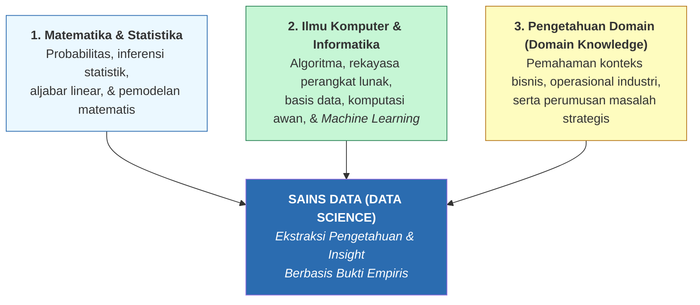
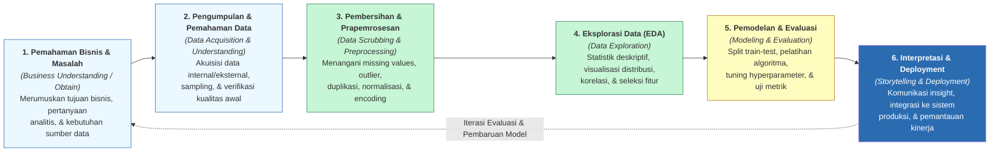
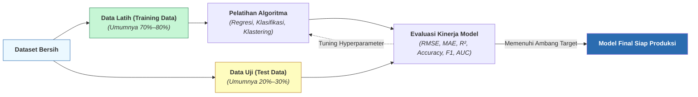

# Pertemuan 01: Dasar-Dasar Sains Data

* **Mata Kuliah:** Pengantar Sains Data (`STDA4101`)
* **Program Studi:** Sistem Informasi & Sains Data — Fakultas Sains dan Teknologi, Universitas Terbuka
* **Referensi Modul Utama:** Buku Materi Pokok (`BMP`) `STDA4101` Modul 1 — *Dasar-Dasar Sains Data* (`KB1`: Istilah dalam Sains Data; `KB2`: Proses Sains Data)
* **Topik:** Definisi & Konvergensi Interdisiplin Sains Data, Terminologi Dasar (`Data`, `Big Data 3V`, `Model` vs `Algoritma`, `Ekstraksi Pola`, `Generalisasi`), Peran & Kompetensi *Data Scientist*, Kerangka Kerja & Tahapan Siklus Hidup Sains Data (`OSEMN` & `CRISP-DM`), Tantangan & Peluang Ekosistem Data di Indonesia, serta Studi Kasus Terapan (Gojek, Tokopedia, PLN, dan Prediksi Harga Rumah)

---

## Daftar Isi

1. [Definisi, Konvergensi Interdisiplin, dan Esensi Sains Data](#1-definisi-konvergensi-interdisiplin-dan-esensi-sains-data)
2. [Terminologi Dasar dalam Sains Data](#2-terminologi-dasar-dalam-sains-data)
3. [Peran, Keahlian Inti, dan Prinsip Etika *Data Scientist*](#3-peran-keahlian-inti-dan-prinsip-etika-data-scientist)
4. [Siklus Hidup dan Kerangka Kerja Proses Sains Data (`OSEMN` & `CRISP-DM`)](#4-siklus-hidup-dan-kerangka-kerja-proses-sains-data-osemn--crisp-dm)
5. [Rincian Teknis Tahapan Proses Sains Data (Persiapan hingga *Deployment*)](#5-rincian-teknis-tahapan-proses-sains-data-persiapan-hingga-deployment)
6. [Peluang, Tantangan, dan Studi Kasus Implementasi Sains Data di Indonesia](#6-peluang-tantangan-dan-studi-kasus-implementasi-sains-data-di-indonesia)
7. [Referensi Resmi](#7-referensi-resmi)

---

## 1. Definisi, Konvergensi Interdisiplin, dan Esensi Sains Data

### Pengertian Sains Data (*Data Science*)

**Sains Data (*Data Science*)** adalah bidang ilmu transdisiplin yang menggunakan metode, proses, algoritma, dan sistem ilmiah untuk mengekstrak pengetahuan (*knowledge*) serta wawasan bermakna (*actionable insights*) dari berbagai bentuk data—baik yang terstruktur (*structured data*) maupun tidak terstruktur (*unstructured data*)—guna mendukung pengambilan keputusan berbasis bukti (*data-driven decision making*).

Secara keilmuan, Sains Data lahir dari irisan **tiga pilar disiplin ilmu utama**:

### Lima Esensi Utama Sains Data

1. **Pemahaman Data yang Mendalam:** Kemampuan menggali pola tersembunyi (*hidden patterns*) dan hubungan kausal yang melampaui sekadar penyajian informasi permukaan.
2. **Pengolahan Multi-Format Data:** Kapabilitas mengelola beragam struktur dataset, mulai dari tabel relasional hingga teks bebas, citra, audio, dan aliran sensor (*streaming*).
3. **Skalabilitas Komputasi (*Scalability*):** Penanganan data bervolume sangat besar dalam waktu singkat melalui arsitektur pemrosesan terdistribusi.
4. **Kreativitas dan Inovasi Analitis:** Eksplorasi hipotesis dan rekayasa fitur (*feature engineering*) yang adaptif tanpa terpaku secara kaku pada prosedur baku semata.
5. **Peran Kritis Manusia (*Human-in-the-Loop*):** Pertimbangan etis, interpretasi kontekstual, dan komunikasi strategis oleh manusia yang tidak dapat digantikan sepenuhnya oleh mesin.

---

## 2. Terminologi Dasar dalam Sains Data

Penguasaan kosakata baku merupakan prasyarat utama sebelum merancang pipeline analitik:

| Terminologi | Definisi Konseptual dan Penjelasan Teknis |
| :--- | :--- |
| **Data Kualitatif vs Kuantitatif** | • **Data Kualitatif (Kategorikal):** Data deskriptif non-numerik yang menyatakan atribut, label, atau kategori (contoh: jenis kelamin, ulasan pelanggan, kategori produk). • **Data Kuantitatif (Numerik):** Data berbentuk angka yang dapat diukur dan dihitung secara matematis, terbagi atas **diskrit** (bilangan bulat hasil pencacahan) dan **kontinu** (hasil pengukuran presisi). |
| **Struktur Dataset (`Dataset`, `Data Point`, `Atribut`)** | • **`Dataset`:** Kumpulan data yang terorganisasi dalam struktur tertentu (umumnya matriks baris dan kolom). • **`Data Point` (Observasi):** Satu baris dalam dataset yang merepresentasikan satu catatan atau entitas individu. • **`Atribut` (Fitur / Variabel):** Kolom dalam dataset yang merepresentasikan properti atau karakteristik dari setiap observasi. |
| **Data Tidak Terstruktur (*Unstructured Data*)** | Data yang tidak memiliki skema tabel relasional baku, seperti dokumen teks bebas, email, unggahan media sosial, citra medis, rekaman audio, dan video. |
| ***Big Data* (`3V`)** | Himpunan data berskala masif yang melampaui kapasitas pemrosesan basis data tradisional, dicirikan oleh tiga dimensi utama: **`Volume`** (ukuran data sangat besar), **`Velocity`** (kecepatan aliran dan pemrosesan data *real-time*), dan **`Variety`** (keragaman format terstruktur, semi-terstruktur, dan tidak terstruktur). |
| ***Low-Density Region*** | Wilayah dalam ruang distribusi data yang memiliki kepadatan titik observasi sangat rendah, umumnya mengindikasikan keberadaan **pencilan (*outlier*)** atau **anomali** sistem. |
| **Ekstraksi Pola (*Pattern Extraction*)** | Proses penemuan pengetahuan baru (*Knowledge Discovery in Databases* / `KDD`) melalui pencarian keterkaitan, korelasi, atau struktur tersembunyi dalam himpunan data. |
| **Generalisasi (*Generalization*)** | Kemampuan model untuk menarik kesimpulan yang valid pada data baru yang belum pernah dilihat sebelumnya, dibangun melalui penalaran **induktif** (dari contoh spesifik ke aturan umum), **deduktif**, maupun **abduktif**. |
| **Model vs Algoritma** | • **Algoritma:** Serangkaian langkah komputasi logis dan sistematis yang dijalankan komputer untuk mempelajari pola dari data (contoh: *Linear Regression*, *Random Forest*, `ARIMA`). • **Model Representatif:** Hasil keluaran (*output*) berupa abstraksi matematis yang terbentuk setelah algoritma dilatih menggunakan data historis, berfungsi untuk **memprediksi keluaran** dan **memahami hubungan antarvariabel** (Kotu & Deshpande, 2018). |

---

## 3. Peran, Keahlian Inti, dan Prinsip Etika *Data Scientist*

### Empat Peran Strategis *Data Scientist*

*Data Scientist*—yang dijuluki oleh *Harvard Business Review* sebagai *"the sexiest job of the 21st century"*—bertanggung jawab menjembatani data mentah menjadi nilai bisnis melalui empat peran inti:

1. **Penyusunan *Pipeline* Data (*Data Engineering & Preparation*):** Mengumpulkan, membersihkan, mengintegrasikan, dan menyiapkan alur data yang andal dari berbagai sumber.
2. **Eksplorasi Data (*Exploratory Data Analysis* / `EDA`):** Menyelidiki karakteristik statistik, pola distribusi, dan anomali pada dataset.
3. **Pemodelan Prediktif & Preskriptif:** Merancang, melatih, dan mengevaluasi algoritma pembelajaran mesin (*machine learning*) guna memprediksi tren masa depan atau mengoptimalkan keputusan.
4. **Komunikasi *Insight* (*Data Storytelling*):** Menerjemahkan temuan matematis yang kompleks menjadi visualisasi, *dashboard*, dan rekomendasi strategis yang mudah dipahami pemangku kepentingan non-teknis.

### Pilar Kompetensi dan Prinsip Etika Profesi

* **Kompetensi Teknis & Analitis:** Penguasaan bahasa pemrograman analitik (**Python**, **R**, **SQL**), alat bantu visual/pemodelan (**RapidMiner**, **SAS Enterprise Miner**), statistika, rekayasa perangkat lunak, serta *machine learning*.
* **Prinsip Etika & Tanggung Jawab:** *Data Scientist* wajib menjunjung tinggi integritas ilmiah, transparansi metodologi, serta menghormati **privasi data**, hak kepemilikan informasi, dan keadilan algoritmik (*algorithmic fairness*) agar hasil analisis tidak merugikan masyarakat.

---

## 4. Siklus Hidup dan Kerangka Kerja Proses Sains Data (`OSEMN` & `CRISP-DM`)

Dalam praktik industri, alur kerja Sains Data mengikuti siklus iteratif yang distandardisasi melalui kerangka kerja seperti **`OSEMN`** (*Obtain, Scrub, Explore, Model, Interpret*), **`CRISP-DM`** (*Cross-Industry Standard Process for Data Mining*), **`SEMMA`**, maupun **`DMAIC`**:

---

## 5. Rincian Teknis Tahapan Proses Sains Data (Persiapan hingga *Deployment*)

### A. Tahap Persiapan dan Prapemrosesan Data (*Data Preprocessing*)

1. **Penanganan Masalah Kualitas Data:** Mengatasi nilai hilang (*missing values*) melalui penghapusan atau imputasi statistik, mengelola pencilan (*outliers*), menghapus duplikasi rekaman, dan menyeragamkan inkonsistensi format.
2. **Transformasi dan Rekayasa Fitur (*Feature Engineering*):** Melakukan normalisasi/standardisasi skala numerik, *encoding* variabel kategorikal menjadi format numerik, serta menciptakan variabel turunan yang lebih informatif.
3. **Seleksi Fitur (*Feature Selection*):** Memilih atribut yang paling berpengaruh signifikan terhadap variabel target untuk mencegah kompleksitas berlebih dan risiko ***overfitting***.
4. **Pengambilan Sampel Data (*Data Sampling*):** Menggunakan teknik seperti *random sampling* atau *stratified sampling* agar sampel merepresentasikan populasi secara efisien dari segi biaya dan waktu komputasi.

### B. Tahap Pemodelan dan Evaluasi (*Modeling & Evaluation*)

* **Metrik Evaluasi Kuantitatif:**
  * **Kasus Regresi (Prediksi Nilai Kontinu):** Menggunakan *Root Mean Squared Error* (`RMSE`), *Mean Absolute Error* (`MAE`), dan koefisien determinasi ($R^2$).
  * **Kasus Klasifikasi (Prediksi Kategori):** Menggunakan *Accuracy*, *Precision*, *Recall*, *F1-Score*, dan *Area Under the ROC Curve* (`AUC`).
* **Interpretabilitas Model (*Explainable AI*):** Menggunakan teknik seperti ***Feature Importance*** dan ***SHAP Values*** (*SHapley Additive exPlanations*) untuk menjelaskan kontribusi masing-masing variabel terhadap keputusan prediksi model.

### C. Tahap Aplikasi dan Peluncuran Model (*Deployment*)

Model final diintegrasikan ke dalam sistem operasional perusahaan (aplikasi web/mobile atau *dashboard* manajerial) dengan memperhatikan lima faktor kritis: **kesiapan model**, **integrasi teknis**, **waktu respons (*latency*)**, **aksesibilitas data masukan**, dan **asimilasi pengguna bisnis**.

---

## 6. Peluang, Tantangan, dan Studi Kasus Implementasi Sains Data di Indonesia

### Peluang dan Tantangan Ekosistem Sains Data Nasional

* **Peluang Strategis:** Pertumbuhan pesat penetrasi internet, transaksi *e-commerce*, media sosial, dan konektivitas seluler di Indonesia menghasilkan volume data masif yang dapat dimanfaatkan untuk efisiensi kesehatan, pendidikan, energi, keuangan, dan transportasi.
* **Tantangan Utama:** Keterbatasan ketersediaan *Data Scientist* profesional, kesiapan infrastruktur *Big Data*, kebutuhan investasi permodalan teknologi, serta kepatuhan terhadap aspek hukum dan regulasi pelindungan data pribadi (seperti UU No. 27 Tahun 2022 tentang Pelindungan Data Pribadi / `UU PDP`).
* **Sinergi Solusi (*Quadruple Helix*):** Kolaborasi terpadu antara **Pemerintah** (regulasi & infrastruktur), **Akademisi** (kurikulum & riset), **Industri** (inovasi & adopsi), dan **Masyarakat** (literasi data).

### Rangkuman Studi Kasus Penerapan Sains Data

| Studi Kasus | Masalah Bisnis & Tujuan Analitis | Sumber Data & Variabel Utama | Pendekatan Algoritma / Model | Dampak & Nilai Tambah |
| :--- | :--- | :--- | :--- | :--- |
| **1. Gojek — *Dynamic Pricing* (*Surge Pricing*)** | Menyeimbangkan permintaan penumpang dan ketersediaan mitra pengemudi secara *real-time*. | Permintaan pesanan (*demand*), jumlah *driver* aktif (*supply*), lokasi geografis, jam sibuk, dan kondisi cuaca. | Pemodelan optimasi dan prediksi penawaran-permintaan dinamis (*surge multiplier*). | Ketersediaan armada tetap terjaga pada jam puncak dan kompensasi tarif proporsional. |
| **2. Tokopedia — Sistem Rekomendasi Produk** | Meningkatkan relevansi penemuan produk dan konversi pembelian pengguna. | Log perilaku pengguna (*clicks*, riwayat pencarian, keranjang belanja, dan histori *purchases*). | ***Collaborative Filtering*** dan arsitektur ***Deep Learning***. | Personalisasi katalog produk bagi setiap pengguna dan peningkatan rasio transaksi. |
| **3. PLN — Prediksi Beban Listrik** | Memproyeksikan kebutuhan beban listrik harian/bulanan (MW) untuk menjaga stabilitas pasokan daya. | Data historis konsumsi listrik beruntun (*time series*), pola musiman, dan beban harian. | Model deret waktu statistik **`ARIMA`** dan jaringan saraf berulang **`LSTM`**. | Perencanaan pembangkitan daya yang efisien serta pencegahan risiko pemadaman (*blackout*). |
| **4. Prediksi Harga Properti (Rumah)** | Mengestimasi nilai jual rumah secara objektif berdasarkan karakteristik fisik dan lokasi. | Luas bangunan, lokasi properti, jumlah kamar, dan tahun pembangunan (dibersihkan dari *missing values* & *outlier*). | **Regresi Linear** (*Linear Regression*) dievaluasi dengan metrik `RMSE` dan `MAE`. | Mengidentifikasi bahwa **lokasi** dan **luas bangunan** merupakan determinan utama harga rumah. |

---

## 7. Referensi Resmi

1. **Buku Materi Pokok (`BMP`) Utama:** Ramdani, F., & Utami, I. Q. (2024). *Pengantar Data Science* (`STDA4101`), Modul 1: *Dasar-Dasar Sains Data*. Jakarta: Penerbit Bumi Aksara / Universitas Terbuka.
2. **Materi Tutorial Online (`Tuton`):** Materi Inisiasi 01 — *Terminologi dan Aplikasi Sains Data* & *Analisis Data*, Program Studi Sistem Informasi / Sains Data, Universitas Terbuka.
3. **Kotu, V., & Deshpande, B.** (2018). *Data Science: Concepts and Practice* (2nd ed.). Cambridge, MA: Morgan Kaufmann.
4. **Provost, F., & Fawcett, T.** (2013). *Data Science for Business: What You Need to Know about Data Mining and Data-Analytic Thinking*. Sebastopol, CA: O'Reilly Media.