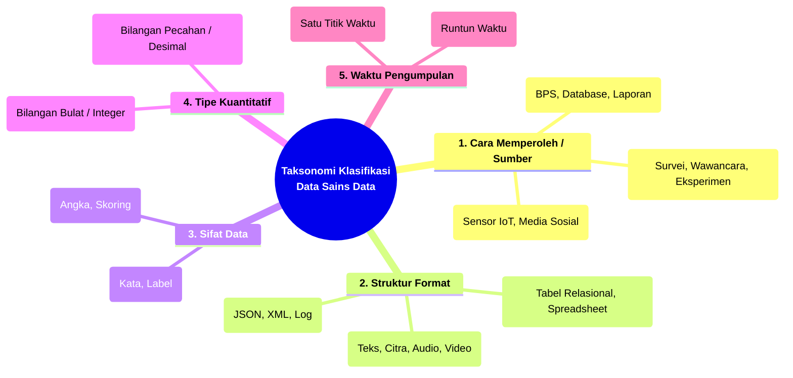
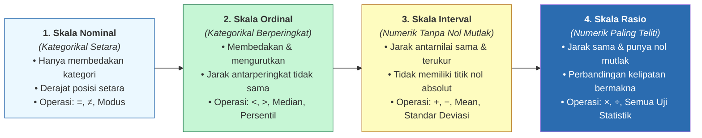
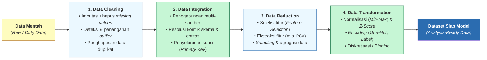

# Pertemuan 02: Eksplorasi Data, Skala Pengukuran, dan *Data Preprocessing*

* **Mata Kuliah:** Pengantar Sains Data (`STDA4101`)
* **Program Studi:** Sistem Informasi & Sains Data — Fakultas Sains dan Teknologi, Universitas Terbuka
* **Referensi Modul Utama:** Buku Materi Pokok (`BMP`) `STDA4101` Modul 2 — *Eksplorasi Data* (`KB1`: Jenis Data; `KB2`: Eksplorasi Data; `KB3`: *Data Preprocessing*)
* **Topik:** Definisi & Taksonomi Klasifikasi Data (Sumber, Struktur Format, Sifat, Tipe Numerik, & Dimensi Waktu), Empat Skala Pengukuran Data (*Nominal*, *Ordinal*, *Interval*, *Rasio*), Metode Pengumpulan Data, Eksplorasi Data (*Exploratory Data Analysis* / `EDA`), serta Empat Pilar *Data Preprocessing* (*Cleaning*, *Integration*, *Reduction*, & *Transformation*)

---

## Daftar Isi

1. [Definisi dan Taksonomi Klasifikasi Data](#1-definisi-dan-taksonomi-klasifikasi-data)
2. [Empat Skala Pengukuran Data (Nominal, Ordinal, Interval, Rasio)](#2-empat-skala-pengukuran-data-nominal-ordinal-interval-rasio)
3. [Metode Pengumpulan dan Akuisisi Data](#3-metode-pengumpulan-dan-akuisisi-data)
4. [Eksplorasi Data (*Exploratory Data Analysis* / `EDA`)](#4-eksplorasi-data-exploratory-data-analysis--eda)
5. [Tahapan *Data Preprocessing* (Prapemrosesan Data)](#5-tahapan-data-preprocessing-prapemrosesan-data)
6. [Validasi Kualitas Data (*Data Quality Dimensions*)](#6-validasi-kualitas-data-data-quality-dimensions)
7. [Referensi Resmi](#7-referensi-resmi)

---

## 1. Definisi dan Taksonomi Klasifikasi Data

### Pengertian Data

**Data** adalah sekumpulan keterangan, fakta mentah, atau deskripsi dasar yang berasal dari suatu objek maupun kejadian—yang direpresentasikan dalam bentuk kata-kata, kalimat, simbol, angka, maupun sinyal—yang diperoleh melalui proses pencarian dan pengamatan sistematis berdasarkan sumber tertentu.

### Klasifikasi Data Berdasarkan Lima Dimensi Utama

Dalam Sains Data, pemilihan metode statistik, teknik visualisasi, dan algoritma *machine learning* sangat bergantung pada karakteristik dasar data yang diklasifikasikan ke dalam **lima dimensi taksonomi** berikut:

| Dimensi Klasifikasi | Kategori & Penjelasan Teknis | Contoh Konkret dalam Dunia Nyata |
| :--- | :--- | :--- |
| **1. Cara Memperolehnya (Sumber Data)** | • **Data Primer:** Diperoleh secara langsung oleh peneliti/analis dari sumber atau objek amatan pertama. • **Data Sekunder:** Diperoleh secara tidak langsung dari sumber yang telah dikumpulkan dan dipublikasikan pihak lain (komersial maupun non-komersial). • **Data *Streaming*:** Aliran data berkecepatan tinggi yang dihasilkan secara kontinu dan *real-time*. | • *Primer:* Wawancara langsung pengunjung swalayan terkait kebutuhan bahan pokok. • *Sekunder:* Data tingkat kemiskinan dari Badan Pusat Statistik (`BPS`), laporan keuangan publik. • *Streaming:* Data telemetri sensor `IoT`, transaksi perbankan *real-time*, dan *feed* media sosial. |
| **2. Struktur Format Penyimpanan** | • **Data Terstruktur (*Structured*):** Memiliki skema baris dan kolom tetap yang mudah disimpan dalam basis data relasional (`RDBMS`). • **Data Semi-Terstruktur (*Semi-Structured*):** Tidak mengikuti skema tabel kaku, namun memiliki penanda (*tags* / *keys*) hierarkis. • **Data Tidak Terstruktur (*Unstructured*):** Tidak memiliki format organisasi tetap dan memerlukan ekstraksi fitur khusus. | • *Terstruktur:* Lembar kerja `Excel`/`CSV`, tabel transaksi `SQL`. • *Semi-Terstruktur:* Berkas pertukaran data `JSON`, `XML`, dan *server log*. • *Tidak Terstruktur:* Dokumen `PDF`, ulasan teks bebas, foto rontgen medis, rekaman suara. |
| **3. Sifat Data** | • **Data Kualitatif:** Dinyatakan dalam bentuk deskripsi kata, kalimat, simbol, atau gambar. • **Data Kuantitatif:** Dinyatakan dalam bentuk besaran angka atau data kualitatif yang dikuantifikasi (*skoring*). | • *Kualitatif:* Status pernikahan, komentar kepuasan pelanggan. • *Kuantitatif:* Pendapatan bulanan, atau skor skala Likert (`Sangat Baik = 4`, `Baik = 3`, `Kurang Baik = 2`, `Tidak Baik = 1`). |
| **4. Tipe Data Kuantitatif** | • **Data Diskrit:** Nilai numerik hasil pencacahan (*counting*) yang umumnya berupa bilangan bulat (*integer*). • **Data Kontinu:** Nilai numerik hasil pengukuran (*measuring*) yang dapat memuat bilangan pecahan atau titik desimal (*float*). | • *Diskrit:* Jumlah anak dalam keluarga ($0, 1, 2, \dots$), jumlah transaksi harian. • *Kontinu:* Tinggi badan ($172,5\text{ cm}$), suhu ruangan ($24,8^\circ\text{C}$), durasi akses ($12,34\text{ detik}$). |
| **5. Waktu Pengumpulannya** | • **Data *Cross-Section*:** Mengamati banyak objek/entitas pada **satu titik waktu tertentu** yang sama. • **Data *Time Series* (Berkala):** Mengamati satu atau beberapa objek secara berurutan **dari waktu ke waktu** dalam periode historis. | • *Cross-Section:* Jumlah pengunjung tempat wisata pada satu hari libur nasional tertentu. • *Time Series:* Jumlah pengunjung tempat wisata setiap bulan dari tahun $2020$ hingga $2024$. |

---

## 2. Empat Skala Pengukuran Data (Nominal, Ordinal, Interval, Rasio)

Menurut taksonomi **S. S. Stevens**, variabel data diklasifikasikan ke dalam **empat tingkat skala pengukuran** yang menentukan operasi matematis dan uji statistik yang sah diterapkan pada data tersebut:

### Matriks Ciri-Ciri Tingkat Pengukuran

| Sifat / Informasi Matematis | Nominal | Ordinal | Interval | Rasio | Contoh Variabel |
| :--- | :---: | :---: | :---: | :---: | :--- |
| **1. Perbedaan (Klasifikasi Kategori)** | $\checkmark$ | $\checkmark$ | $\checkmark$ | $\checkmark$ | Jenis kelamin, kode pos, golongan darah (**Nominal**) |
| **2. Urutan / Peringkat (*Ranking*)** | $\times$ | $\checkmark$ | $\checkmark$ | $\checkmark$ | Tingkat pendidikan (`SD < SMP < SMA`), tingkat kepuasan (**Ordinal**) |
| **3. Kesamaan Jarak (*Equal Interval*)** | $\times$ | $\times$ | $\checkmark$ | $\checkmark$ | Suhu dalam skala Celcius ($20^\circ\text{C}$ vs $40^\circ\text{C}$), skor tes `IQ` (**Interval**) |
| **4. Titik Nol Mutlak (*Absolute Zero*)** | $\times$ | $\times$ | $\times$ | $\checkmark$ | Berat badan ($0\text{ kg}$ berarti tidak ada massa), pendapatan, jarak (**Rasio**) |

> **Catatan Konseptual Penting:** Pada **skala interval**, nilai $0^\circ\text{C}$ bersifat arbitrer (kesepakatan titik beku air), bukan ketiadaan suhu; oleh karena itu, suhu $40^\circ\text{C}$ **tidak** dapat dikatakan "dua kali lebih panas" dari $20^\circ\text{C}$. Sebaliknya, pada **skala rasio**, nilai $0\text{ Rupiah}$ atau $0\text{ kg}$ bermakna ketiadaan kuantitas secara mutlak sehingga perbandingan rasio ($40\text{ kg}$ adalah dua kali lebih berat dari $20\text{ kg}$) berlaku secara matematis.

---

## 3. Metode Pengumpulan dan Akuisisi Data

Pemilihan metode akuisisi data disesuaikan dengan sumber data, anggaran, dan kebutuhan latensi sistem:

1. **Survei dan Kuesioner:** Pengumpulan data primer secara terstruktur menggunakan instrumen daftar pertanyaan tertutup maupun terbuka kepada sampel responden.
2. ***Web Scraping*:** Ekstraksi data otomatis dari halaman situs web publik menggunakan skrip pemrograman (seperti `BeautifulSoup`, `Scrapy`, atau `Selenium` pada Python) dengan tetap mematuhi etika *crawling* (`robots.txt`) dan ketentuan hak cipta.
3. **Sensor dan *Internet of Things* (`IoT`):** Perekaman data lingkungan atau operasional secara otomatis dan kontinu melalui perangkat keras sensor (suhu, GPS, akselerometer, kamera lalu lintas).
4. **Antarmuka Pemrograman Aplikasi (`API` Publik):** Pengambilan data terstruktur (umumnya berformat `JSON` atau `XML`) secara resmi dan terprogram dari penyedia layanan eksternal (misalnya `API` cuaca `BMKG`, `API` pasar finansial, atau `API` portal *Open Data* pemerintah).

---

## 4. Eksplorasi Data (*Exploratory Data Analysis* / `EDA`)

**Exploratory Data Analysis (`EDA`)** merupakan tahapan investigasi awal terhadap dataset sebelum dilakukan pemodelan formal, yang bertujuan untuk memahami struktur data, memeriksa asumsi distribusi, mendeteksi anomali, serta menemukan pola hubungan antarvariabel.

### Tiga Fokus Utama dalam `EDA`

* **Analisis Univariat (*Univariate Analysis*):** Memeriksa distribusi dan karakteristik setiap variabel secara tunggal menggunakan ringkasan statistik (mean, median, modus, rentang interkuartil / `IQR`, standar deviasi) serta visualisasi seperti **histogram**, ***box plot*** (untuk mendeteksi *outlier*), dan ***bar chart***.
* **Analisis Bivariat (*Bivariate Analysis*):** Mengidentifikasi hubungan, tren, atau perbedaan antar dua variabel menggunakan ***scatter plot*** (numerik vs numerik), **matriks korelasi** (Pearson/Spearman), ***grouped box plot*** (kategorikal vs numerik), dan **tabel kontingensi / tabulasi silang** (kategorikal vs kategorikal).
* **Analisis Multivariat (*Multivariate Analysis*):** Mengeksplorasi interaksi kompleks antara tiga atau lebih variabel secara simultan menggunakan ***heatmap* korelasi**, ***pair plot***, maupun reduksi dimensi visual.

---

## 5. Tahapan *Data Preprocessing* (Prapemrosesan Data)

Data mentah di dunia nyata hampir selalu bersifat kotor (*dirty*), tidak lengkap, dan tidak konsisten. Sesuai dengan indikator capaian pembelajaran `CPU-MK2`, prapemrosesan data mencakup **empat pilar teknis utama** sebelum data dimasukkan ke dalam algoritma pemodelan:

### Rincian Teknik pada Setiap Pilar *Data Preprocessing*

| Pilar Prapemrosesan | Permasalahan yang Ditangani | Teknik dan Rumus Matematis Utama |
| :--- | :--- | :--- |
| **1. *Data Cleaning* (Pembersihan Data)** | Nilai hilang (*missing values*), pencilan ekstrem (*outliers*), rekaman ganda (*duplicates*), dan kesalahan pengetikan format. | • ***Missing Values*:** Penghapusan baris/kolom (*listwise deletion*) jika persentase hilang sangat kecil, atau **imputasi** menggunakan *mean* (data simetris), *median* (data miring/*skewed*), maupun *modus* (data kategorikal). • ***Outliers*:** Deteksi menggunakan metode batas interkuartil ($\text{Q}_1 - 1,5 \times \text{IQR}$ dan $\text{Q}_3 + 1,5 \times \text{IQR}$) atau skor $Z$ ($|Z| > 3$). |
| **2. *Data Integration* (Integrasi Data)** | Data tersebar di berbagai basis data, *file* `CSV`, atau layanan `API` dengan penamaan atribut dan satuan yang berbeda. | • Penggabungan tabel (*join/merge*), pemetaan skema (*schema integration*), deduplikasi entitas lintas sumber, dan penyeragaman satuan ukuran (misal: konversi mata uang atau zona waktu). |
| **3. *Data Reduction* (Reduksi Data)** | Dimensi atribut terlalu besar (*curse of dimensionality*) atau volume baris terlalu masif sehingga memperlambat pelatihan model. | • ***Feature Selection*:** Memilih subset fitur paling relevan (misalnya menggunakan uji korelasi atau *Recursive Feature Elimination*). • ***Dimensionality Reduction*:** Memproyeksikan fitur ke ruang berdimensi lebih rendah seperti *Principal Component Analysis* (`PCA`). |
| **4. *Data Transformation* (Transformasi Data)** | Perbedaan rentang skala numerik antarvariabel yang mendominasi perhitungan jarak algoritma, serta variabel teks kategorikal yang belum dapat dibaca model matematis. | • **Normalisasi *Min-Max*:** Mengubah rentang nilai ke interval $[0, 1]$: $$x' = \frac{x - \min(X)}{\max(X) - \min(X)}$$ • **Standardisasi (*Z-Score Scaling*):** Mengubah distribusi memiliki rata-rata $\mu = 0$ dan simpangan baku $\sigma = 1$: $$z = \frac{x - \mu}{\sigma}$$ • ***Categorical Encoding*:** Mengubah kategori menjadi angka melalui ***Label Encoding*** (untuk data ordinal) atau ***One-Hot Encoding*** (untuk data nominal agar tidak menimbulkan bias urutan semu). |

---

## 6. Validasi Kualitas Data (*Data Quality Dimensions*)

Tahap akhir penyiapan data adalah memvalidasi bahwa dataset hasil prapemrosesan telah memenuhi **enam dimensi kualitas data** (*Data Quality Dimensions*) sebelum digunakan dalam pemodelan:

1. **Kelengkapan (*Completeness*):** Seluruh atribut dan rekaman penting terisi tanpa kekosongan data kritis.
2. **Keakuratan (*Accuracy*):** Nilai data mencerminkan kondisi atau realitas objek sebenarnya secara tepat.
3. **Konsistensi (*Consistency*):** Tidak terdapat kontradiksi nilai maupun format antar tabel atau antar sumber data.
4. **Ketepatan Waktu (*Timeliness*):** Data tersedia sesuai periode waktu yang dibutuhkan dan mencerminkan kondisi terkini yang relevan.
5. **Keunikan (*Uniqueness*):** Setiap entitas atau observasi tercatat secara tunggal tanpa duplikasi rekaman yang tidak disengaja.
6. **Validitas (*Validity*):** Nilai data mematuhi aturan domain, tipe data, dan rentang batasan yang telah ditetapkan (misalnya usia tidak bernilai negatif).

---

## 7. Referensi Resmi

1. **Buku Materi Pokok (`BMP`) Utama:** Ramdani, F., & Utami, I. Q. (2024). *Pengantar Data Science* (`STDA4101`), Modul 2: *Eksplorasi Data*. Jakarta: Penerbit Bumi Aksara / Universitas Terbuka.
2. **Materi Tutorial Online (`Tuton`):** Materi Inisiasi 02 — *Sumber, Tipe, Pengumpulan & Pemrosesan Data* serta *Data & Skala Pengukuran*, Program Studi Sistem Informasi / Sains Data, Universitas Terbuka.
3. **Han, J., Kamber, M., & Pei, J.** (2012). *Data Mining: Concepts and Techniques* (3rd ed.). Waltham, MA: Morgan Kaufmann.
4. **Tukey, J. W.** (1977). *Exploratory Data Analysis*. Reading, MA: Addison-Wesley.