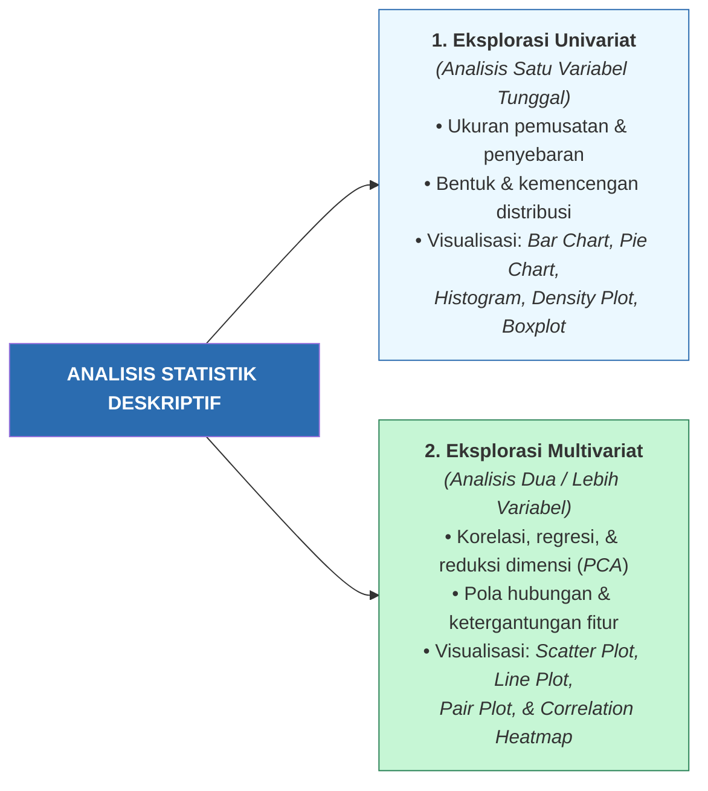
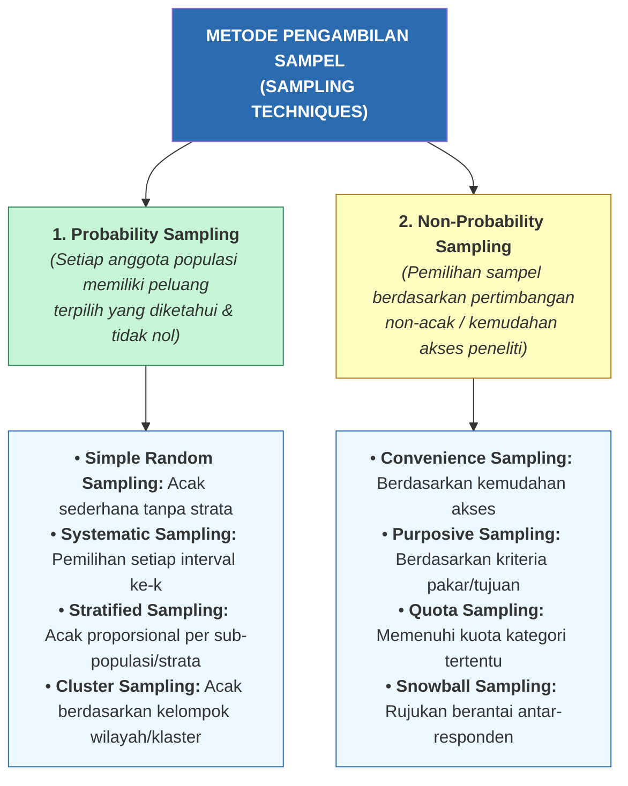

# Pertemuan 03: Analisis Statistik Deskriptif, Inferensial, dan Visualisasi Data

* **Mata Kuliah:** Pengantar Sains Data (`STDA4101`)
* **Program Studi:** Sistem Informasi & Sains Data — Fakultas Sains dan Teknologi, Universitas Terbuka
* **Referensi Modul Utama:** Buku Materi Pokok (`BMP`) `STDA4101` Modul 3 — *Analisis dan Visualisasi Data* (`KB1`: Analisis Statistik Deskriptif dan Inferensial; `KB2`: Visualisasi Data)
* **Topik:** Analisis Statistik Deskriptif (Eksplorasi Univariat & Multivariat, Ukuran Pemusatan, Ukuran Penyebaran, & Bentuk Distribusi), Statistik Inferensial (Tiga Teori Probabilitas, Teknik *Probability* vs *Non-Probability Sampling*, & Distribusi Probabilitas), Uji Hipotesis (*Direksional*/*One-Tailed* vs *Nondireksional*/*Two-Tailed* serta Kesalahan Tipe I & Tipe II), Perbandingan Uji Parametris vs Non-Parametris, serta Prinsip Pemilihan Visualisasi Data yang Efektif

---

## Daftar Isi

1. [Analisis Statistik Deskriptif: Eksplorasi Univariat dan Multivariat](#1-analisis-statistik-deskriptif-eksplorasi-univariat-dan-multivariat)
2. [Ukuran Pemusatan, Penyebaran, dan Bentuk Distribusi Data](#2-ukuran-pemusatan-penyebaran-dan-bentuk-distribusi-data)
3. [Statistik Inferensial: Teori Probabilitas dan Metode *Sampling*](#3-statistik-inferensial-teori-probabilitas-dan-metode-sampling)
4. [Uji Hipotesis: Direksional vs Nondireksional serta Kesalahan Tipe I & II](#4-uji-hipotesis-direksional-vs-nondireksional-serta-kesalahan-tipe-i--ii)
5. [Perbandingan Uji Statistik Parametris dan Non-Parametris](#5-perbandingan-uji-statistik-parametris-dan-non-parametris)
6. [Panduan Pemilihan Visualisasi Data Berdasarkan Jenis Analisis](#6-panduan-pemilihan-visualisasi-data-berdasarkan-jenis-analisis)
7. [Referensi Resmi](#7-referensi-resmi)

---

## 1. Analisis Statistik Deskriptif: Eksplorasi Univariat dan Multivariat

**Statistik Deskriptif** adalah metode statistika yang berkaitan dengan pengumpulan, peringkasan, penyajian, dan penggambaran karakteristik sekumpulan data agar memberikan informasi yang terstruktur, ringkas, dan mudah dipahami tanpa bermaksud menarik generalisasi di luar data yang diamati.

Dalam praktik Sains Data (seperti eksplorasi pada dataset klasik *Iris* yang memuat atribut `sepal.length`, `sepal.width`, `petal.length`, `petal.width`, dan `species`), analisis deskriptif dibagi menjadi **dua pendekatan utama**:

---

## 2. Ukuran Pemusatan, Penyebaran, dan Bentuk Distribusi Data

Untuk mendeskripsikan karakteristik distribusi variabel numerik secara presisi pada eksplorasi univariat, digunakan tiga kelompok ukuran statistik:

### A. Ukuran Pemusatan Data (*Measures of Central Tendency*)

| Ukuran Pemusatan | Formulasi Matematis | Karakteristik dan Kapan Digunakan |
| :--- | :--- | :--- |
| **Mean (Rata-rata Hitung)** | $$\bar{x} = \frac{1}{n} \sum_{i=1}^{n} x_i$$ | Jumlah seluruh nilai dibagi banyaknya observasi ($n$). Sangat sensitif terhadap keberadaan pencilan (*outlier*), sehingga ideal untuk data berdistribusi **simetris/normal**. |
| **Median (Nilai Tengah)** | Nilai posisi ke-$\frac{n+1}{2}$ (setelah data diurutkan) | Membagi distribusi data terurut menjadi dua bagian sama besar ($50\%$ bawah dan $50\%$ atas). Bersifat **robust terhadap *outlier***, sehingga ideal untuk data yang menceng (*skewed*). |
| **Modus (*Mode*)** | Nilai $x_i$ dengan frekuensi kemunculan tertinggi | Menunjukkan kategori atau nilai yang paling sering muncul. Satu-satunya ukuran pemusatan yang dapat diterapkan pada data berskala **nominal**. |

### B. Ukuran Penyebaran Data (*Measures of Dispersion*)

| Ukuran Penyebaran | Formulasi Matematis | Interpretasi Analitis |
| :--- | :--- | :--- |
| **Jangkauan (*Range*)** | $$\text{Range} = x_{\max} - x_{\min}$$ | Selisih antara nilai maksimum dan minimum. Memberikan gambaran kasar rentang data, namun sangat dipengaruhi oleh nilai ekstrem tunggal. |
| **Varians Sampel ($s^2$)** | $$s^2 = \frac{1}{n - 1} \sum_{i=1}^{n} (x_i - \bar{x})^2$$ | Rata-rata kuadrat deviasi setiap titik data terhadap nilai *mean*. Mengukur seberapa jauh data tersebar dalam satuan kuadrat. |
| **Simpangan Baku (*Standard Deviation*, $s$)** | $$s = \sqrt{s^2} = \sqrt{\frac{1}{n - 1} \sum_{i=1}^{n} (x_i - \bar{x})^2}$$ | Akar kuadrat dari varians sehingga satuannya kembali sama dengan satuan data asli. Semakin kecil nilai $s$, semakin homogen data di sekitar *mean*. |
| **Jangkauan Antarkuartil (`IQR`)** | $$\text{IQR} = Q_3 - Q_1$$ | Rentang $50\%$ data tengah antara kuartil ketiga ($Q_3$) dan kuartil pertama ($Q_1$). Digunakan pada *boxplot* untuk mendeteksi *outlier* secara objektif. |

### C. Ukuran Bentuk Distribusi (*Skewness* dan *Kurtosis*)

* **Kemencengan (*Skewness*):** Mengukur derajat ketidaksimetrisan distribusi data:
  * *Simetris ($\text{Skewness} \approx 0$):* $\text{Mean} \approx \text{Median} \approx \text{Modus}$.
  * *Menceng Kanan (*Positive Skew*):* Ekor panjang di sisi kanan ($\text{Mean} > \text{Median} > \text{Modus}$).
  * *Menceng Kiri (*Negative Skew*):* Ekor panjang di sisi kiri ($\text{Mean} < \text{Median} < \text{Modus}$).
* **Keruncingan (*Kurtosis*):** Mengukur tingkat keruncingan puncak distribusi dan ketebalan ekor (*tail*) dibandingkan distribusi normal (*mesokurtic*, *leptokurtic*, dan *platykurtic*).

---

## 3. Statistik Inferensial: Teori Probabilitas dan Metode *Sampling*

### Definisi Statistik Inferensial dan Tiga Pendekatan Probabilitas

**Statistik Inferensial** adalah pendekatan statistika yang digunakan untuk menarik kesimpulan, melakukan estimasi parameter, atau menguji hipotesis mengenai karakteristik suatu **populasi** berdasarkan informasi yang diperoleh dari **data sampel**. Fondasi matematisnya bertumpu pada **Teori Probabilitas**, yang terbagi menjadi **tiga aliran pendekatan**:

1. **Pendekatan Klasik (*Laplace*):** Menetapkan peluang berdasarkan rasio hasil yang diharapkan terhadap total ruang sampel yang mungkin, dengan asumsi seluruh kejadian memiliki peluang yang sama (*equally likely*): $P(A) = \frac{n(A)}{n(S)}$.
2. **Pendekatan Empiris (*Frekuensi Relatif*):** Menentukan peluang berdasarkan proporsi frekuensi kemunculan suatu kejadian dalam serangkaian percobaan atau pengamatan historis jangka panjang.
3. **Pendekatan Subjektif (*Bayesian*):** Mengukur derajat keyakinan (*degree of belief*) terhadap suatu kejadian berdasarkan bukti awal (*prior probability*) yang diperbarui secara dinamis ketika informasi baru diperoleh (*posterior probability*).

### Klasifikasi Metode *Sampling* dan Penentuan Ukuran Sampel

Karena meneliti seluruh anggota populasi sering kali tidak memungkinkan akibat kendala biaya, waktu, dan skala *Big Data*, peneliti menerapkan teknik ***sampling***:

> **Faktor Penentu Ukuran Sampel ($n$):** Penentuan jumlah sampel yang optimal dipengaruhi oleh empat faktor utama: (1) **tingkat kepercayaan** (*confidence level*, misal $95\%$ atau $99\%$), (2) **batas kesalahan toleransi** (*margin of error*, $e$), (3) **varians populasi** ($\sigma^2$), serta (4) **ukuran total populasi** ($N$).

---

## 4. Uji Hipotesis: Direksional vs Nondireksional serta Kesalahan Tipe I & II

### Konsep Hipotesis Nol ($H_0$) dan Hipotesis Alternatif ($H_1$)

**Hipotesis** adalah proposisi atau dugaan sementara yang dirumuskan secara formal untuk diuji kebenarannya secara empiris menggunakan data sampel:

* **Hipotesis Nol ($H_0$):** Pernyataan awal yang diasumsikan benar hingga terbukti sebaliknya—umumnya menyatakan *tidak ada perbedaan*, *tidak ada hubungan*, atau *tidak ada efek signifikan*.
* **Hipotesis Alternatif ($H_1$ / $H_a$):** Pernyataan tandingan yang ingin dibuktikan oleh peneliti, yang diterima apabila bukti data sampel menghasilkan nilai probabilitas (*p-value*) lebih kecil dari taraf signifikansi ($\alpha$, umumnya $\alpha = 0,05$).

### Klasifikasi Uji Hipotesis: Direksional (*One-Tailed*) vs Nondireksional (*Two-Tailed*)

| Jenis Uji Hipotesis | Arah Pengujian & Rumusan Simbolis | Contoh Penerapan dalam Kasus Sains Data (`BMP` Tabel 6.5) |
| :--- | :--- | :--- |
| **1. Uji Hipotesis Langsung (*Direksional* / *One-Tailed*) — Uji Pihak Kanan** | Hipotesis alternatif ($H_1$) menguji apakah parameter **lebih besar ($>$)** dari nilai acuan tertentu. | **Komparatif:** • $H_0$: Akurasi algoritma `SVM` $\le$ akurasi `Random Forest`. • $H_1$: Akurasi algoritma `SVM` $>$ akurasi `Random Forest`. |
| **2. Uji Hipotesis Langsung (*Direksional* / *One-Tailed*) — Uji Pihak Kiri** | Hipotesis alternatif ($H_1$) menguji apakah parameter **lebih kecil ($<$)** dari nilai acuan tertentu. | **Deskriptif:** • $H_0$: Akurasi klasifikasi model `SVM` $\ge 90\%$. • $H_1$: Akurasi klasifikasi model `SVM` $< 90\%$. |
| **3. Uji Hipotesis Tidak Langsung (*Nondireksional* / *Two-Tailed*) — Uji Dua Pihak** | Hipotesis alternatif ($H_1$) hanya menguji adanya **perbedaan ($\neq$)** tanpa menentukan arah lebih besar atau lebih kecil. | **Asosiatif & Komparatif:** • $H_0$: Tidak ada perbedaan akurasi antara `SVM` dan `Random Forest` ($\mu_1 = \mu_2$). • $H_1$: Ada perbedaan akurasi antara `SVM` dan `Random Forest` ($\mu_1 \neq \mu_2$). |

### Matriks Keputusan dan Risiko Kesalahan Tipe I ($\alpha$) serta Tipe II ($\beta$)

| Keputusan Pengujian Berdasarkan Sampel | Kondisi Sebenarnya di Populasi: **$H_0$ Benar** | Kondisi Sebenarnya di Populasi: **$H_0$ Salah** |
| :--- | :--- | :--- |
| **Tolak $H_0$** | **Kesalahan Tipe I (*False Positive* / $\alpha$)** Menolak $H_0$ padahal $H_0$ sebenarnya benar. | **Keputusan Tepat (*True Positive* / Power $= 1 - \beta$)** Berhasil mendeteksi efek/perbedaan yang nyata. |
| **Gagal Tolak (Terima) $H_0$** | **Keputusan Tepat (*True Negative* $= 1 - \alpha$)** Menerima $H_0$ yang memang benar. | **Kesalahan Tipe II (*False Negative* / $\beta$)** Menerima $H_0$ padahal $H_0$ sebenarnya salah. |

---

## 5. Perbandingan Uji Statistik Parametris dan Non-Parametris

Pemilihan metode uji statistik inferensial ditentukan oleh pemenuhan asumsi distribusi populasi dan skala pengukuran data:

| Dimensi Perbandingan | Uji Statistik Parametris | Uji Statistik Non-Parametris |
| :--- | :--- | :--- |
| **Asumsi Distribusi Data** | Mensyaratkan data sampel berasal dari populasi yang **berdistribusi normal** (*normality assumption*), homogen (*homoscedasticity*), dan dipilih secara acak. | **Bebas distribusi (*distribution-free*)**; tidak mensyaratkan data berdistribusi normal sehingga fleksibel untuk data menceng atau ber-outlier. |
| **Skala Pengukuran Data** | Dirancang untuk data kuantitatif berskala **Interval** dan **Rasio**. | Dirancang untuk data kategorikal berskala **Nominal** dan **Ordinal** (atau data numerik yang diubah menjadi peringkat). |
| **Kekuatan Statistik (*Statistical Power*)** | **Lebih akurat, sensitif, dan efisien** dalam mendeteksi perbedaan nyata apabila seluruh asumsi terpenuhi. | Lebih sederhana dan mudah diterapkan pada ukuran sampel kecil, namun **daya uji (*power*) relatif lebih rendah** dibanding uji parametris. |
| **Contoh Uji Statistik Utama** | • *One-Sample / Independent / Paired t-Test* • *Analysis of Variance* (`ANOVA`) • Korelasi *Pearson* & Regresi Linear | • Uji *Chi-Square* ($\chi^2$) • Uji *Mann-Whitney U* (padanan *independent t-test*) • Uji *Wilcoxon Signed-Rank* & *Kruskal-Wallis* |

---

## 6. Panduan Pemilihan Visualisasi Data Berdasarkan Jenis Analisis

**Visualisasi Data** bertujuan mengomunikasikan struktur, pola, tren, dan anomali data secara visual agar otak manusia dapat menangkap wawasan (*insight*) jauh lebih cepat dibandingkan membaca tabel angka mentah:

| Tujuan Visualisasi | Jenis Grafik / Plot | Tipe Variabel & Skala Data | Kegunaan Analitis Utama |
| :--- | :--- | :--- | :--- |
| **Perbandingan Kategori (*Comparison*)** | ***Bar Chart* / *Column Chart*** | Kategorikal (Nominal/Ordinal) vs Numerik | Membandingkan nilai atau frekuensi antar-kategori secara jelas menggunakan panjang batang. |
| **Proporsi Bagian-ke-Keseluruhan (*Composition*)** | ***Pie Chart* / *Stacked Bar Chart*** | Kategorikal (jumlah kategori sedikit, $\le 5$) | Menampilkan persentase kontribusi masing-masing bagian terhadap total keseluruhan ($100\%$). |
| **Distribusi & Pencilan (*Distribution*)** | ***Histogram*, *Density Plot*, & *Boxplot*** | Numerik Kontinu (Interval/Rasio) | Menampilkan bentuk sebaran frekuensi, pemusatan data, kuartil (`IQR`), dan deteksi *outlier*. |
| **Hubungan & Korelasi (*Relationship*)** | ***Scatter Plot* & *Bubble Chart*** | Dua atau tiga variabel Numerik Kontinu | Mengidentifikasi pola korelasi (positif, negatif, non-linear) serta klaster titik data. |
| **Tren Waktu (*Trend Over Time*)** | ***Line Chart* / *Area Chart*** | Deret Waktu (*Time Series*) vs Numerik | Melacak perubahan, tren jangka panjang, dan pola musiman (*seasonality*) dari waktu ke waktu. |
| **Korelasi Banyak Variabel (*Multivariate Matrix*)** | ***Correlation Heatmap* & *Pair Plot*** | Banyak variabel Numerik sekaligus | Memetakan kekuatan koefisien korelasi antar-seluruh pasangan fitur dalam matriks warna. |

---

## 7. Referensi Resmi

1. **Buku Materi Pokok (`BMP`) Utama:** Ramdani, F., & Utami, I. Q. (2024). *Pengantar Data Science* (`STDA4101`), Modul 3: *Analisis dan Visualisasi Data*. Jakarta: Penerbit Bumi Aksara / Universitas Terbuka.
2. **Materi Tutorial Online (`Tuton`):** Materi Inisiasi 03 — *Analisis Data: Statistik Deskriptif dan Inferensial*, Program Studi Sistem Informasi / Sains Data, Universitas Terbuka.
3. **Walpole, R. E., Myers, R. H., Myers, S. L., & Ye, K.** (2012). *Probability & Statistics for Engineers & Scientists* (9th ed.). Boston: Pearson.
4. **Wilke, C. O.** (2019). *Fundamentals of Data Visualization: A Primer on Making Informative and Compelling Figures*. Sebastopol, CA: O'Reilly Media.