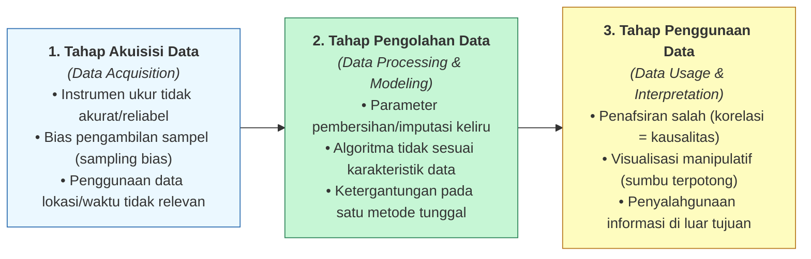
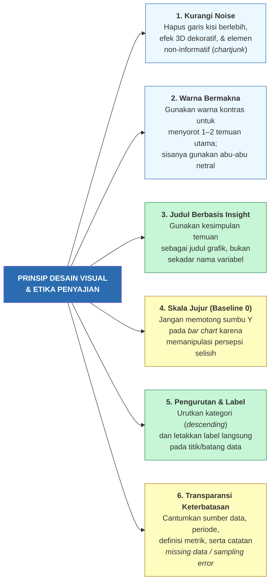

# Pertemuan 04: Rumusan Masalah, Kekeliruan Analisis, *Uncertainty*, Etika, dan Visualisasi Data

* **Mata Kuliah:** Pengantar Sains Data (`STDA4101`)
* **Program Studi:** Sistem Informasi & Sains Data — Fakultas Sains dan Teknologi, Universitas Terbuka
* **Referensi Modul Utama:** Buku Materi Pokok (`BMP`) `STDA4101` Modul 4 (*Rumusan Masalah dan Kekeliruan Analisis*) & Modul 5 (*Uncertainty, Etika dan Estetika Data*)
* **Topik:** Formulasi Rumusan Masalah Analitis, Tiga Jenis Kekeliruan Analisis Data & Sumber Kesalahan Lintas Tahap (*Akuisisi, Pengolahan, Penggunaan*), Konsep & Pengukuran *Uncertainty* (*Confusion Matrix*, `Precision`, `Recall`, `ROC` & `AUROC`), Lima Pilar Etika Data & Lisensi *Creative Commons*, Estetika & Prinsip Desain Visualisasi Data, *Data Storytelling* (`ABT`/`SCR`), serta Analisis Visual Hubungan Dua Variabel (*Scatter Plot* & Garis Regresi Linear)

---

## Daftar Isi

1. [Perumusan Masalah dan Tiga Jenis Kekeliruan Analisis Data](#1-perumusan-masalah-dan-tiga-jenis-kekeliruan-analisis-data)
2. [Sumber Kesalahan Lintas Tahap Proses Sains Data](#2-sumber-kesalahan-lintas-tahap-proses-sains-data)
3. [Ketidakpastian (*Uncertainty*) dalam Sains Data dan Metrik Evaluasi Klasifikasi](#3-ketidakpastian-uncertainty-dalam-sains-data-dan-metrik-evaluasi-klasifikasi)
4. [Etika Data, Privasi, dan Lisensi Kekayaan Intelektual](#4-etika-data-privasi-dan-lisensi-kekayaan-intelektual)
5. [Estetika Data, Prinsip Desain Visual, dan *Storytelling* dengan Data](#5-estetika-data-prinsip-desain-visual-dan-storytelling-dengan-data)
6. [Visualisasi Hubungan Dua Variabel dan Garis Regresi Linear](#6-visualisasi-hubungan-dua-variabel-dan-garis-regresi-linear)
7. [Referensi Resmi](#7-referensi-resmi)

---

## 1. Perumusan Masalah dan Tiga Jenis Kekeliruan Analisis Data

### Penyusunan Kalimat Rumusan Masalah yang Efektif

Keberhasilan proyek Sains Data berawal dari **kalimat rumusan masalah** yang spesifik, terukur, berorientasi pada keputusan (*decision-oriented*), dan selaras dengan ketersediaan data. Perumusan masalah yang kabur menyebabkan pemilihan fitur, metode pemodelan, hingga interpretasi hasil menjadi tidak terarah.

### Tiga Jenis Kekeliruan dalam Analisis Data

Dalam praktik analisis data, terdapat **tiga kategori kekeliruan konseptual dan metodologis** yang wajib dihindari oleh seorang *Data Scientist*:

| Jenis Kekeliruan | Definisi dan Akar Penyebab | Dampak dan Strategi Mitigasi |
| :--- | :--- | :--- |
| **1. Kekeliruan Trivial** (*Trivial Error*) | Kesalahan berupa temuan analisis yang bersifat dangkal, sudah jelas secara umum, atau **tidak memberikan nilai tambah maupun dampak signifikan** bagi pengambilan keputusan dan ilmu pengetahuan. | Rumuskan pertanyaan analitis yang menantang asumsi bisnis dan validasi relevansi temuan dengan pemangku kepentingan (*domain experts*). |
| **2. Kekeliruan Manual** (*Manual-Automation Mismatch*) | Kesalahan akibat memaksakan otomatisasi kompleks pada proses pengolahan data sederhana yang sebenarnya jauh lebih akurat dikerjakan secara manual, sehingga memicu pemborosan waktu dan ketidakakuratan. | Lakukan analisis biaya-manfaat (*cost-benefit*) dan kompleksitas tugas sebelum memilih antara verifikasi manual atau otomatisasi skrip. |
| **3. Kekeliruan Ekstraksi** (*Extraction / Modeling Error*) | Kesalahan dalam proses penarikan pengetahuan akibat **pemilihan metode, teknik, algoritma, atau parameter yang tidak sesuai** dengan struktur dan karakteristik statistik dataset. | Terapkan eksplorasi data (`EDA`) secara menyeluruh, uji asumsi distribusi, dan bandingkan beberapa kandidat algoritma dengan metrik validasi silang. |

---

## 2. Sumber Kesalahan Lintas Tahap Proses Sains Data

Kesalahan dalam Sains Data tidak hanya muncul saat pemodelan, melainkan dapat terjadi secara berantai sepanjang **tiga tahap utama siklus data**:

> **Catatan Kritis Mengenai Ukuran Data:** Kuantitas data yang sangat besar (*Big Data*) **tidak otomatis menjamin kualitas analisis**. Data dalam jumlah besar yang bias atau tidak relevan tetap menghasilkan kesimpulan yang keliru (*garbage in, garbage out*).

---

## 3. Ketidakpastian (*Uncertainty*) dalam Sains Data dan Metrik Evaluasi Klasifikasi

### Konsep, Tahapan Munculnya, dan Kategori *Uncertainty*

**Ketidakpastian (*Uncertainty*)** adalah ukuran perbedaan (*gap*) antara informasi yang dihasilkan dari data olahan dengan kondisi fenomena dunia nyata yang sesungguhnya dikaji. Transformasi fenomena dunia nyata menjadi hasil analisis melewati **empat lapisan abstraksi**:

1. **Dekomposisi (*Safeness*):** Pemecahan fenomena alam/sosial yang kompleks ke dalam komponen teramati.
2. **Abstraksi / Representasi:** Penyederhanaan fenomena ke dalam variabel dan skema model.
3. **Kuantifikasi:** Pengukuran variabel ke dalam angka/simbol (contoh: pengukuran curah hujan dalam satuan $\text{mm}$).
4. **Analisis:** Komputasi statistik dan pemodelan prediktif—**semakin turun ke tahap analisis, akumulasi tingkat *uncertainty* semakin meningkat**.

Menurut **Chung dan Wark (2016)**, *uncertainty* diklasifikasikan ke dalam **11 dimensi**: *akurasi, presisi, kelengkapan, konsistensi, lineage (asal-usul data), currency (kebaruan), verifiabilitas, subjektivitas, ketidakpastian stokastik, ketidakjelasan (vagueness), dan ketidakteraturan*. Sementara menurut **Lipinski (2009)**, penanganan visual *uncertainty* dilakukan melalui tiga langkah: **(1) Identifikasi sumber**, **(2) Kuantifikasi statistik** (interval kepercayaan, standar deviasi), dan **(3) Visualisasi *uncertainty*** (variasi warna, batas garis, maupun tingkat transparansi).

### Kuantifikasi *Uncertainty* Model Klasifikasi: *Confusion Matrix*, `Precision`, `Recall`, dan `AUROC`

Untuk mengukur tingkat kesalahan dan ketidakpastian pada model klasifikasi, digunakan ***Confusion Matrix*** yang membandingkan prediksi model terhadap kelas aktual:

| | **Aktual: Positif ($1$)** | **Aktual: Negatif ($0$)** |
| :--- | :--- | :--- |
| **Prediksi: Positif ($1$)** | ***True Positive* (`TP`)** Prediksi positif yang benar. | ***False Positive* (`FP` — Kesalahan Tipe I)** Prediksi positif padahal aktual negatif. |
| **Prediksi: Negatif ($0$)** | ***False Negative* (`FN` — Kesalahan Tipe II)** Prediksi negatif padahal aktual positif. | ***True Negative* (`TN`)** Prediksi negatif yang benar. |

Dari keempat komponen tersebut diturunkan metrik evaluasi kinerja klasifikasi utama:

* **Akurasi (*Accuracy*):** Proporsi total prediksi yang tepat dari seluruh data uji:
  $$\text{Accuracy} = \frac{\text{TP} + \text{TN}}{\text{TP} + \text{TN} + \text{FP} + \text{FN}}$$
* **Presisi (*Precision*):** Tingkat ketepatan prediksi positif (seberapa banyak yang benar-benar positif dari seluruh yang diprediksi positif):
  $$\text{Precision} = \frac{\text{TP}}{\text{TP} + \text{FP}}$$
* ***Recall* / Sensitivitas (*True Positive Rate* / `TPR`):** Kemampuan model menemukan kembali seluruh kasus positif yang sebenarnya ada:
  $$\text{Recall (Sensitivity)} = \frac{\text{TP}}{\text{TP} + \text{FN}}$$
* **Kurva `ROC` dan `AUROC`:** Kurva *Receiver Operating Characteristic* (`ROC`) memetakan hubungan antara ***Sensitivity* (`TPR`)** pada sumbu vertikal dan **$1 - \text{Specificity}$ (*False Positive Rate* / `FPR`)** pada sumbu horizontal di berbagai ambang batas (*threshold*). Nilai ***Area Under ROC Curve* (`AUROC`)** berkisar antara $0,5$ (tebakan acak) hingga $1,0$ (pemisahan kelas sempurna).

---

## 4. Etika Data, Privasi, dan Lisensi Kekayaan Intelektual

### Lima Pilar Tata Kelola Etika Data

Penggunaan sumber data resmi dan terverifikasi—seperti portal **Satu Data Indonesia** untuk data geospasial dan statistik nasional—harus dibarengi dengan kepatuhan terhadap **lima prinsip etika data**:

1. **Privasi Individu dan Kelompok:** Menghormati kerahasiaan identitas pribadi serta memperoleh persetujuan sadar (*informed consent*) sebelum mengumpulkan data personal.
2. **Kejelasan Tujuan (*Purpose Limitation*):** Menetapkan tujuan pengumpulan data secara eksplisit sejak awal dan membatasi pemrosesan hanya sesuai tujuan tersebut.
3. **Keamanan dan Kontrol Akses:** Menerapkan perlindungan teknis (enkripsi, otorisasi berjenjang) untuk mencegah kebocoran maupun akses tidak sah.
4. **Pengungkapan dan Akuntabilitas:** Mematuhi regulasi perlindungan data pribadi dan bertanggung jawab penuh atas dampak sosial dari algoritma yang dibangun.
5. **Penghapusan dan Pembuangan (*Data Retention & Disposal*):** Memusnahkan data yang telah habis masa retensinya secara aman agar tidak disalahgunakan di kemudian hari.

### Aspek Legal dan Lisensi *Creative Commons* (`CC`)

Dalam memanfaatkan maupun mendistribusikan dataset, grafik, atau karya ilmiah, praktisi wajib menghormati hak cipta dan ketentuan lisensi terbuka seperti ***Creative Commons* (`CC`)**—misalnya lisensi **`CC BY-ND`** (*Attribution-NoDerivatives*), yang mengizinkan penyalinan dan pendistribusian ulang karya asli (termasuk untuk keperluan komersial) dengan syarat **mencantumkan atribusi pencipta** dan **tidak memodifikasi/membuat karya turunan** dari bentuk aslinya.

---

## 5. Estetika Data, Prinsip Desain Visual, dan *Storytelling* dengan Data

### Tujuan Visualisasi Data

Visualisasi data berfungsi menjembatani transformasi hierarki informasi (**Data $\rightarrow$ Informasi $\rightarrow$ Pengetahuan $\rightarrow$ Kebijaksanaan**) dengan tiga tujuan utama:
1. ***Exploring* (Eksplorasi):** Menjelajahi struktur data mentah untuk menemukan pola, anomali, dan hubungan tersembunyi.
2. ***Analyzing* (Konfirmasi / Analisis):** Menguji hipotesis, membandingkan performa, dan memvalidasi temuan statistik.
3. ***Explaining* (Komunikasi):** Menyajikan wawasan secara jelas dan persuasif kepada pemangku kepentingan untuk mendukung keputusan.

### Enam Prinsip Desain Visual yang Efektif dan Etis

### Kerangka *Storytelling* dengan Data

***Storytelling* dengan Data** memadukan **Data + *Insight* + Visual + Narasi + Tujuan Aksi** sehingga audiens mampu menangkap pesan utama (*single main message*) dalam waktu **$\le 30$ detik** dan mengetahui langkah keputusan berikutnya. Alur kerja penyusunannya mengikuti tujuh langkah sistematis:
1. ***Define*:** Identifikasi audiens, konteks keputusan, dan pertanyaan utama.
2. ***Prepare*:** Bersihkan data serta periksa *missing values* dan *outlier*.
3. ***Explore*:** Temukan pola perbandingan, tren waktu, komposisi, atau korelasi.
4. ***Explain*:** Pilih $2\text{--}3$ *insight* paling berdampak bagi keputusan bisnis.
5. ***Visualize*:** Rancang grafik yang bersih, fokus, dan bebas bias skala.
6. ***Narrate*:** Susun alur narasi berbasis struktur **`ABT`** (*And, But, Therefore*) atau **`SCR`** (*Situation, Complication, Resolution*) disertai anotasi penjelas (*"so what"*).
7. ***Act*:** Rumuskan rekomendasi konkret beserta mitigasi risiko dan langkah tindak lanjut.

---

## 6. Visualisasi Hubungan Dua Variabel dan Garis Regresi Linear

### Empat Teknik Visualisasi Bivariat & Multivariat

1. ***Scatter Plot* (Diagram Pencar):** Memetakan pasangan titik observasi berdasarkan dua variabel numerik untuk mengidentifikasi pola hubungan linear, non-linear, maupun *outlier*.
2. ***Line Chart* (Grafik Garis):** Menampilkan perubahan tren berkelanjutan antarwaktu secara kronologis.
3. ***Bubble Chart*:** Memperluas *scatter plot* dengan merepresentasikan variabel kuantitatif ketiga melalui ukuran luas lingkaran.
4. ***Heatmap* (Peta Panas):** Menampilkan matriks intensitas korelasi atau kepadatan hubungan antarvariabel menggunakan gradasi warna.

### Pemodelan Tren dengan Garis Regresi Linear

Untuk memperjelas arah dan kekuatan hubungan linear antara variabel independen ($X$) dan variabel dependen ($Y$) pada *scatter plot*, ditambahkan **garis regresi linear sederhana**:

$$Y = aX + b$$

* **$a$ (*Slope* / Kemiringan Garis):** Menunjukkan besarnya perubahan rata-rata nilai $Y$ setiap kali variabel $X$ bertambah sebesar $1$ satuan (bernilai positif jika searah, negatif jika berlawanan arah).
* **$b$ (*Intercept* / Titik Potong Sumbu $Y$):** Nilai prediksi $Y$ ketika $X = 0$.

#### Contoh Penerapan Studi Kasus Bivariat

* **Kasus 1 — Jam Belajar ($X$) terhadap Nilai Ujian ($Y$):** Visualisasi *scatter plot* menghasilkan persamaan garis regresi $Y = 5,27X + 43,00$ (atau $Y = 5,00X + 45,00$ pada data simulasi kelas), menunjukkan korelasi positif di mana setiap penambahan $1$ jam belajar meningkatkan prediksi nilai ujian sekitar $5$ poin.
* **Kasus 2 — Suhu Lingkungan ($X$, $^{\circ}\text{C}$) terhadap Konsumsi Listrik ($Y$, $\text{kWh}$):** *Scatter plot* beserta garis tren menunjukkan peningkatan konsumsi energi listrik seiring kenaikan suhu udara akibat peningkatan beban pendingin ruangan.

---

## 7. Referensi Resmi

1. **Buku Materi Pokok (`BMP`) Utama:** Ramdani, F., & Utami, I. Q. (2024). *Pengantar Data Science* (`STDA4101`), Modul 4 (*Rumusan Masalah dan Kekeliruan Analisis*) & Modul 5 (*Uncertainty, Etika dan Estetika Data*). Jakarta: Penerbit Bumi Aksara / Universitas Terbuka.
2. **Materi Tutorial Online (`Tuton`):** Materi Inisiasi 04 & 05 — *Kekeliruan Analisis Data*, *Uncertainty, Etika dan Estetika Data*, *Visualisasi Data*, *Storytelling dengan Data*, dan *Visualisasi Hubungan Dua Variabel*, Program Studi Sistem Informasi / Sains Data, Universitas Terbuka.
3. **Knaflic, C. N.** (2015). *Storytelling with Data: A Data Visualization Guide for Business Professionals*. Hoboken, NJ: John Wiley & Sons.
4. **Chung, C., & Wark, S.** (2016). *Visualising Uncertainty in Intelligence Analysis*. Defence Science and Technology Group, Australia.