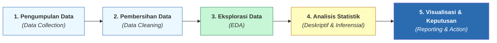
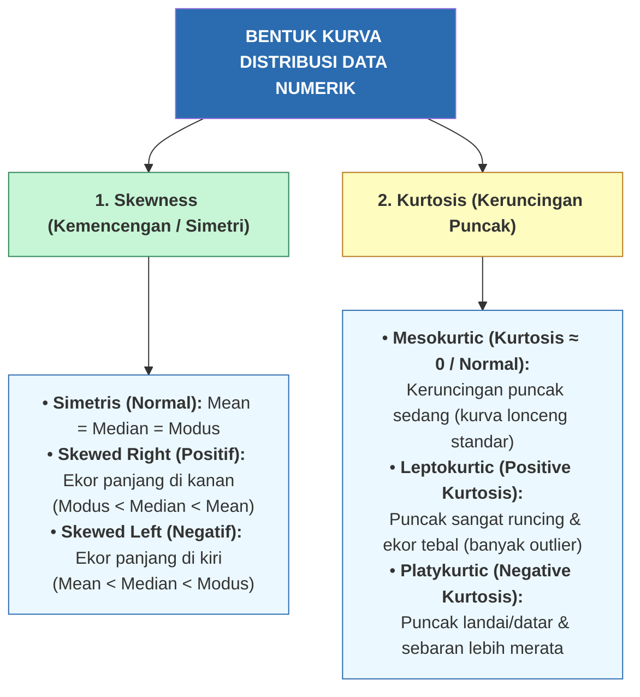

# Pertemuan 05: Analisis Data Tabular, Data Numerik, dan Statistik Deskriptif Lanjutan

* **Mata Kuliah:** Pengantar Sains Data (`STDA4101`)
* **Program Studi:** Sistem Informasi & Sains Data — Fakultas Sains dan Teknologi, Universitas Terbuka
* **Referensi Materi:** Materi Inisiasi 05 (`STDA4101`) — *Data Tabular dan Data Numerik*, *Analisis Data Numerik dengan Grafik*, dan *Analisis Deskriptif (Ukuran Pemusatan, Penyebaran, Skewness, & Kurtosis)*
* **Topik:** Struktur, Kelebihan, & Keterbatasan Data Tabular (`CSV`, `XLSX`, `SQL`), Klasifikasi Data Numerik (*Diskrit* vs *Kontinu*), Operasi Statistik pada Data Tabular (*Pemusatan*, *Penyebaran*, *Korelasi/Regresi*, & *Segmentasi Clustering*), Formulasi Matematis Lengkap (termasuk *Trirata*, *Skewness*, & *Kurtosis*), Visualisasi Data Numerik (*Histogram*, *Boxplot*, *Scatter Plot*, *Line Chart*), serta Studi Kasus Empiris (Analisis Nilai Mahasiswa, Faktor Jumlah Pendaftar, & Data SDKI Angka Kelahiran per Provinsi)

---

## Daftar Isi

1. [Konsep, Struktur, dan Karakteristik Data Tabular](#1-konsep-struktur-dan-karakteristik-data-tabular)
2. [Klasifikasi Data Numerik (*Diskrit* vs *Kontinu*) dan Tahapan Analisisnya](#2-klasifikasi-data-numerik-diskrit-vs-kontinu-dan-tahapan-analisisnya)
3. [Operasi Statistik Lengkap pada Data Numerik (Pemusatan, *Trirata*, & Penyebaran)](#3-operasi-statistik-lengkap-pada-data-numerik-pemusatan-trirata--penyebaran)
4. [Analisis Bentuk Distribusi: *Skewness* (Kemencengan) dan *Kurtosis* (Keruncingan)](#4-analisis-bentuk-distribusi-skewness-kemencengan-dan-kurtosis-keruncingan)
5. [Visualisasi Data Numerik dan Pemilihan Grafik yang Tepat](#5-visualisasi-data-numerik-dan-pemilihan-grafik-yang-tepat)
6. [Studi Kasus Terapan Analisis Data Tabular dan Numerik](#6-studi-kasus-terapan-analisis-data-tabular-dan-numerik)
7. [Referensi Resmi](#7-referensi-resmi)

---

## 1. Konsep, Struktur, dan Karakteristik Data Tabular

### Definisi dan Format Penyimpanan Data Tabular

**Data Tabular** adalah bentuk penyajian data terstruktur yang disusun ke dalam matriks dua dimensi berupa **baris (*rows* / observasi)** dan **kolom (*columns* / atribut atau fitur)**, di mana setiap baris merepresentasikan satu entitas individu dan setiap kolom mendeskripsikan properti spesifik dari entitas tersebut.

* **Format Penyimpanan Standar:** File teks terpisah koma/tab (`CSV`, `TSV`), lembar kerja elektronik (`XLSX`), serta tabel sistem manajemen basis data relasional (`SQL` / `RDBMS`).
* **Perangkat Lunak Pengolahan:** Python (`pandas`, `NumPy`), R (`tidyverse`, `data.table`), SQL, Microsoft Excel, dan *Business Intelligence tools*.

### Kelebihan dan Keterbatasan Data Tabular

| Dimensi Evaluasi | Karakteristik dan Penjelasan Teknis |
| :--- | :--- |
| **Kelebihan Utama** | • **Kemudahan Struktur & Validasi:** Skema kolom yang seragam memudahkan pengecekan tipe data, nilai hilang (*missing values*), dan aturan integritas. • **Kompatibilitas Algoritmik Tinggi:** Siap langsung digunakan pada hampir seluruh metode statistika klasik maupun algoritma *Machine Learning* standar (regresi, pohon keputusan, *clustering*). • **Efisiensi Visualisasi & Interpretasi:** Mendukung pembuatan ringkasan statistik dan grafik analitik secara cepat. |
| **Keterbatasan Utama** | • **Kurang Fleksibel untuk Data Tidak Terstruktur:** Tidak ideal untuk menyimpan atau memodelkan secara langsung dokumen teks bebas berukuran panjang, citra (*image*), rekaman audio, maupun sinyal sensor kompleks tanpa proses ekstraksi fitur terlebih dahulu. • **Keterbatasan Skalabilitas Skema:** Perubahan atribut secara dinamis pada lingkungan *Big Data* memerlukan penyesuaian struktur tabel yang kaku. |

---

## 2. Klasifikasi Data Numerik (*Diskrit* vs *Kontinu*) dan Tahapan Analisisnya

### Pengertian dan Pembagian Data Numerik

**Data Numerik** adalah data kuantitatif berbentuk angka yang merepresentasikan hasil penghitungan maupun pengukuran fisik sehingga dapat dikenai operasi aritmetika dan pemodelan matematis:

| Jenis Data Numerik | Karakteristik Matematis | Contoh Penerapan dalam Kasus Nyata |
| :--- | :--- | :--- |
| **1. Data Numerik Diskrit** (*Discrete Numerical Data*) | Bernilai **bilangan bulat (*integer*)** yang diperoleh dari proses **pencacahan/penghitungan**; tidak memiliki nilai pecahan di antara dua bilangan berurutan. | Jumlah mahasiswa per kelas, jumlah kendaraan melintas, frekuensi transaksi harian, jumlah kelahiran per provinsi. |
| **2. Data Numerik Kontinu** (*Continuous Numerical Data*) | Dapat mengambil **sembarang nilai dalam suatu rentang interval**, termasuk bilangan pecahan/desimal, karena diperoleh dari proses **pengukuran** dengan instrumen. | Tinggi badan ($\text{cm}$), Indeks Prestasi Kumulatif (`IPK`), suhu udara ($^\circ\text{C}$), waktu respons sistem ($\text{ms}$), pendapatan. |

### Alur Lima Tahap Analisis Data Numerik dan Empat Operasi Utama

Pada tahap **Analisis Statistik**, terdapat **empat operasi utama** yang diterapkan pada data numerik tabular:
1. **Ukuran Pemusatan Data:** Menentukan nilai tipikal pusat distribusi (*Mean*, *Median*, *Modus*, dan *Trirata*).
2. **Ukuran Penyebaran Data:** Mengukur keragaman dan deviasi data (*Range*, *Varians*, *Standar Deviasi*, dan *Interquartile Range*).
3. **Analisis Korelasi dan Regresi:** Mengukur arah, kekuatan hubungan linear, dan memodelkan prediksi antarvariabel numerik (didukung uji inferensial seperti *uji normalitas*, *uji-t*, dan `ANOVA`).
4. **Segmentasi Data (*Clustering*):** Mengelompokkan baris observasi ke dalam segmen-segmen homogen berdasarkan kemiripan jarak numerik.

---

## 3. Operasi Statistik Lengkap pada Data Numerik (Pemusatan, *Trirata*, & Penyebaran)

### A. Ukuran Pemusatan Data (*Measures of Central Tendency*)

1. **Mean Sampel ($\bar{x}$):** Rata-rata hitung dari himpunan $n$ observasi $x_1, x_2, \dots, x_n$:
   $$\bar{x} = \frac{\sum_{i=1}^{n} x_i}{n}$$

2. **Median ($Md$):** Nilai tengah dari dataset yang telah diurutkan dari terkecil hingga terbesar, sehingga sekurang-kurangnya $50\%$ observasi bernilai $\le Md$ dan sekurang-kurangnya $50\%$ bernilai $\ge Md$.

3. **Trirata (*Trimean* / $\text{TRI}$):** Ukuran pemusatan komposit yang menggabungkan median ($Md$) dengan kuartil bawah ($q_B$ atau $Q_1$) dan kuartil atas ($q_A$ atau $Q_3$) untuk menghasilkan estimasi pusat yang lebih stabil terhadap pencilan sekaligus mempertimbangkan sebaran tengah:
   $$\text{TRI} = \frac{q_A + q_B + 2 \cdot Md}{4}$$

4. **Modus (*Mode*):** Nilai atau kategori (*outcome*) yang paling sering muncul dalam himpunan data (suatu distribusi dapat bersifat *unimodal*, *bimodal*, atau *multimodal*).

### B. Ukuran Penyebaran Data (*Measures of Dispersion*)

| Ukuran Penyebaran | Formulasi Matematis | Makna Analitis |
| :--- | :--- | :--- |
| **Jangkauan (*Range*)** | $$\text{Range} = x_{\max} - x_{\min}$$ | Selisih mutlak antara observasi terbesar ($x_{\max}$) dan terkecil ($x_{\min}$). |
| **Varians Sampel ($s^2$)** | $$s^2 = \sum_{i=1}^{n} \frac{(x_i - \bar{x})^2}{n - 1}$$ | Rata-rata kuadrat selisih tiap titik data terhadap mean sampel (dengan derajat bebas $n - 1$). |
| **Standar Deviasi ($s$)** | $$s = \sqrt{\text{Variansi}} = \sqrt{\sum_{i=1}^{n} \frac{(x_i - \bar{x})^2}{n - 1}}$$ | Ukuran simpangan rata-rata dalam satuan asli variabel; semakin kecil $s$, semakin terpusat data di sekitar $\bar{x}$. |

---

## 4. Analisis Bentuk Distribusi: *Skewness* (Kemencengan) dan *Kurtosis* (Keruncingan)

Selain pusat dan sebaran, karakterisasi distribusi data numerik memerlukan pengukuran **bentuk kurva distribusi**:

---

## 5. Visualisasi Data Numerik dan Pemilihan Grafik yang Tepat

Pemilihan jenis visualisasi pada data numerik harus disesuaikan dengan pertanyaan analitis yang ingin dijawab:

| Jenis Grafik | Fungsi Analitis Utama | Contoh Penerapan pada Data Numerik |
| :--- | :--- | :--- |
| ***Histogram*** | Menampilkan bentuk distribusi frekuensi dan kemencengan (*skewness*) suatu variabel numerik kontinu. | Distribusi skor ujian mahasiswa atau distribusi jumlah pendaftar. |
| ***Boxplot*** (*Box-and-Whisker Plot*) | Memvisualisasikan ringkasan lima angka ($x_{\min}, Q_1, Md, Q_3, x_{\max}$) serta **mendeteksi keberadaan *outlier***. | Analisis variasi penghasilan mahasiswa atau sebaran pendaftar antar-periode. |
| ***Scatter Plot*** | Mengidentifikasi arah, kekuatan, dan pola hubungan linear/non-linear antara **dua variabel numerik**. | Hubungan jumlah kunjungan *website* (sumbu $X$) dengan jumlah pendaftar (sumbu $Y$). |
| ***Line Chart*** | Menampilkan perubahan nilai dan tren pergerakan variabel numerik dari waktu ke waktu (*time series*). | Tren pertumbuhan jumlah pendaftar mahasiswa baru dari tahun ke tahun. |

---

## 6. Studi Kasus Terapan Analisis Data Tabular dan Numerik

### Studi Kasus 1: Analisis Performa Akademik Nilai Mahasiswa
* **Struktur Data:** Tabel nilai mahasiswa yang memuat atribut numerik **Nilai Tugas**, **Nilai UTS**, dan **Nilai UAS**.
* **Teknik Analisis & Visualisasi:** Penggunaan *histogram* untuk memeriksa distribusi kelulusan, *boxplot* untuk mendeteksi nilai ekstrem (*outlier*), serta *scatter plot* untuk melihat korelasi antara nilai tugas dan nilai ujian akhir.
* **Keputusan Pendidikan:** Mengidentifikasi mahasiswa yang memerlukan program remedial serta mengevaluasi efektivitas kurikulum dan metode pengajaran.

### Studi Kasus 2: Analisis Faktor yang Memengaruhi Jumlah Pendaftar
* **Tujuan & Eksplorasi:** Mengevaluasi sebaran jumlah pendaftar menggunakan *histogram* dan *boxplot* (rentang $200$ hingga $400$ pendaftar), serta menguji hubungan antara **Kunjungan *Website*** dan **Jumlah Pendaftar** melalui *scatter plot*.
* **Temuan Utama:** Terdapat korelasi positif yang jelas—peningkatan trafik kunjungan *website* berbanding lurus dengan peningkatan jumlah pendaftar.

### Studi Kasus 3: Analisis Statistik Deskriptif Angka Kelahiran Remaja (Data SDKI 2017)
* **Deskripsi Dataset:** Data numerik diskrit jumlah kelahiran pada perempuan usia $15\text{–}19$ tahun di $N = 34$ provinsi di Indonesia (bersumber dari Survei Demografi dan Kesehatan Indonesia / `SDKI`), dengan nilai terendah di **Aceh ($18$)** dan tertinggi di **Kalimantan Tengah ($83$)**.
* **Hasil Perhitungan Statistik Deskriptif Lengkap:**

| Parameter Statistik | Nilai Hasil Perhitungan | Interpretasi Analitis |
| :--- | :---: | :--- |
| **Jumlah Observasi (`Count` / $N$)** | $34$ provinsi | Mencakup seluruh provinsi pengamatan. |
| **Total (`Sum`) & Rentang (`Range`)** | $\text{Sum} = 1.310$ \| $\text{Range} = 65$ | Selisih antara maksimum ($83$) dan minimum ($18$). |
| **Mean ($\bar{x}$) & Standard Error** | $\bar{x} = 38,53$ \| $\text{SE} = 2,70$ | Rata-rata kelahiran remaja per provinsi adalah $38,53$. |
| **Median ($Md$) & Kuartil ($Q_1, Q_3$)** | $Q_1 = 25,75$ \| $Md = 33,50$ \| $Q_3 = 49,50$ | $50\%$ provinsi memiliki angka kelahiran $\le 33,50$. |
| **Modus (`Mode`)** | $33$ dan $46$ (*bimodal*, muncul $2\times$) | Terdapat dua nilai frekuensi kemunculan tertinggi. |
| **Standar Deviasi ($s$) & Varians ($s^2$)** | $s = 15,73$ \| $s^2 = 247,53$ | Variasi antarprovinsi cukup lebar di sekitar nilai rata-rata. |
| ***Skewness* & *Kurtosis*** | $\text{Skewness} = 0,84$ \| $\text{Kurtosis} = 0,32$ | Karena $\text{Mean } (38,53) > \text{Median } (33,50)$ dan $\text{Skewness} > 0$, distribusi **menceng ke kanan (*positively skewed*)** dengan keruncingan mendekati normal (*mesokurtic*). |

---

## 7. Referensi Resmi

1. **Buku Materi Pokok (`BMP`) Utama:** Ramdani, F., & Utami, I. Q. (2024). *Pengantar Data Science* (`STDA4101`). Jakarta: Penerbit Bumi Aksara / Universitas Terbuka.
2. **Materi Tutorial Online (`Tuton`):** Materi Inisiasi 05 (`STDA4101`) — *Data Tabular dan Data Numerik*, *Analisis Data Numerik dengan Grafik*, dan *Analisis Deskriptif*, Program Studi Sistem Informasi / Sains Data, Universitas Terbuka.
3. **Badan Pusat Statistik (`BPS`) & Survei Demografi dan Kesehatan Indonesia (`SDKI`):** Dataset Angka Kelahiran pada Perempuan Usia $15\text{–}19$ Tahun Menurut Provinsi.