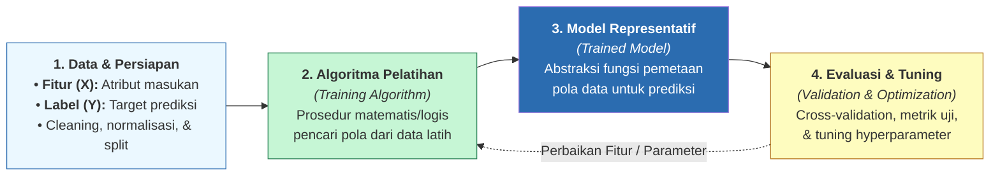

# Pertemuan 06: Pengantar *Machine Learning*, Algoritma Regresi, dan Klasifikasi

* **Mata Kuliah:** Pengantar Sains Data (`STDA4101`)
* **Program Studi:** Sistem Informasi & Sains Data — Fakultas Sains dan Teknologi, Universitas Terbuka
* **Referensi Modul Utama:** Buku Materi Pokok (`BMP`) `STDA4101` Modul 6 — *Konsep Dasar Algoritma Regresi dan Klasifikasi* (`KB1`: Regresi; `KB2`: Klasifikasi) serta Materi Pengayaan *Pengantar Machine Learning* & *Metode-Metode dalam Machine Learning*
* **Topik:** Konsep Fundamental *Machine Learning* (*Data*, *Fitur*, *Label*, *Model* vs *Algoritma*), Enam Paradigma Pembelajaran Mesin (*Supervised*, *Unsupervised*, *Semi-Supervised*, *Reinforcement*, *Deep Learning*, & *Ensemble Methods*), Kualitas Generalisasi (*Underfitting* vs *Overfitting* & *K-Fold Cross-Validation*), Algoritma Regresi (*Linear Sederhana*, *Linear Berganda*, *Polinomial*, *SVR*, *Decision Tree*, & *Random Forest*), Algoritma Klasifikasi (*Logistic Regression*, `KNN`, `SVM`, `Naïve Bayes`, & Prinsip Pareto `80:20`), serta Metode Pendukung (*Clustering* & Reduksi Dimensi `PCA`/`t-SNE`/`LDA`)

---

## Daftar Isi

1. [Konsep Fundamental *Machine Learning*: Data, Fitur, Label, Model, dan Algoritma](#1-konsep-fundamental-machine-learning-data-fitur-label-model-dan-algoritma)
2. [Enam Paradigma Utama dalam *Machine Learning*](#2-enam-paradigma-utama-dalam-machine-learning)
3. [Kualitas Generalisasi Model: *Underfitting*, *Overfitting*, dan *Cross-Validation*](#3-kualitas-generalisasi-model-underfitting-overfitting-dan-cross-validation)
4. [Algoritma Regresi: Formulasi Matematis, Pohon Keputusan, dan *Random Forest*](#4-algoritma-regresi-formulasi-matematis-pohon-keputusan-dan-random-forest)
5. [Algoritma Klasifikasi dan Panduan Pemilihan Metode](#5-algoritma-klasifikasi-dan-panduan-pemilihan-metode)
6. [Ringkasan Metode *Unsupervised*, Reduksi Dimensi, dan *Ensemble Learning*](#6-ringkasan-metode-unsupervised-reduksi-dimensi-dan-ensemble-learning)
7. [Referensi Resmi](#7-referensi-resmi)

---

## 1. Konsep Fundamental *Machine Learning*: Data, Fitur, Label, Model, dan Algoritma

### Pengertian *Machine Learning*

***Machine Learning* (`ML`)** adalah cabang dari Kecerdasan Buatan (*Artificial Intelligence* / `AI`) yang memungkinkan sistem komputer untuk **belajar secara otomatis dari data historis** dan meningkatkan kinerjanya tanpa harus diprogram secara eksplisit (*without being explicitly programmed*) dengan aturan-aturan statis.

### Elemen Dasar dalam Alur Kerja *Machine Learning*

| Konsep Dasar | Definisi dan Peran dalam Pemodelan |
| :--- | :--- |
| **Data Berlabel vs Tanpa Label** | • **Data Berlabel (*Labeled Data*):** Dataset yang memuat pasangan atribut masukan ($X$) dan variabel target jawaban ($Y$); digunakan pada *Supervised Learning*. • **Data Tanpa Label (*Unlabeled Data*):** Dataset yang hanya berisi atribut masukan ($X$) tanpa kolom target; digunakan pada *Unsupervised Learning* untuk menemukan struktur tersembunyi. |
| **Fitur (*Features* / $X$)** | Atribut atau variabel penjelas (*independent variables*) yang membantu model mengenali pola—dapat berupa angka, kategori, teks, maupun nilai piksel citra. |
| **Label (*Target* / $Y$)** | Variabel keluaran (*dependent variable*) yang ingin diprediksi atau diklasifikasikan oleh model. |
| **Algoritma vs Model** | • **Algoritma:** Prosedur langkah demi langkah yang digunakan untuk membangun model dari data (contoh: *Linear Regression*, `KNN`, `SVM`). • **Model:** Representasi matematis dari pola data yang dihasilkan setelah proses pelatihan algoritma selesai. |

---

## 2. Enam Paradigma Utama dalam *Machine Learning*

Berdasarkan ketersediaan label data, mekanisme umpan balik, dan arsitektur pemrosesan, teknik *Machine Learning* dikelompokkan ke dalam **enam kategori utama**:

| Paradigma *Machine Learning* | Mekanisme Pembelajaran | Algoritma Populer | Contoh Penerapan Nyata |
| :--- | :--- | :--- | :--- |
| **1. *Supervised Learning*** | Mempelajari fungsi pemetaan dari **data berlabel** ($X \rightarrow Y$) untuk memprediksi nilai kontinu atau kelas diskrit. | *Linear/Logistic Regression*, *Decision Tree*, *Random Forest*, `SVM`, `KNN`, *Naïve Bayes*. | Klasifikasi status kelulusan mahasiswa, deteksi penyakit, prediksi harga properti. |
| **2. *Unsupervised Learning*** | Mengeksplorasi **data tanpa label** untuk mengelompokkan observasi serupa atau menyederhanakan dimensi fitur. | *K-Means*, *Hierarchical Clustering*, `DBSCAN`, `PCA`, `t-SNE`. | Segmentasi perilaku belajar mahasiswa, klasterisasi pelanggan, deteksi anomali. |
| **3. *Semi-Supervised Learning*** | Menggabungkan **sejumlah kecil data berlabel** dengan **sejumlah besar data tanpa label** saat pelabelan manual mahal. | *Self-Training*, *Label Propagation*, *Graph-Based Semi-Supervised*. | Analisis sentimen komentar kuliah ketika hanya sebagian kecil ulasan yang sudah dilabeli. |
| **4. *Reinforcement Learning* (`RL`)** | **Agen (*agent*)** berinteraksi langsung dengan **lingkungan (*environment*)** melalui mekanisme ***reward* (hadiah)** dan ***penalty* (hukuman)**. | *Q-Learning*, *Deep Q-Network* (`DQN`), *Policy Gradient*, *Actor-Critic*. | Sistem navigasi robot kampus mandiri, penjadwalan kelas otomatis, *game AI*, kendali energi. |
| **5. *Deep Learning* (`DL`)** | Menggunakan jaringan saraf tiruan berlapis-lapis (*deep neural networks*) untuk mengekstrak fitur kompleks secara otomatis. | `FNN`, `CNN` (citra), `RNN` / `LSTM` (sekuens), *Transformers* (`NLP`). | Pengenalan wajah untuk presensi otomatis (`CNN`), *chatbot* dan penerjemah otomatis (*Transformers*). |
| **6. *Ensemble Methods*** | Menggabungkan prediksi dari **banyak model dasar (*weak/base learners*)** untuk menghasilkan akurasi dan stabilitas lebih tinggi. | *Bagging* (*Random Forest*), *Boosting* (`XGBoost`, *AdaBoost*), *Stacking*. | Prediksi performa akademik mahasiswa dan deteksi dini risiko putus kuliah (*drop-out*). |

---

## 3. Kualitas Generalisasi Model: *Underfitting*, *Overfitting*, dan *Cross-Validation*

Tujuan utama pelatihan model bukanlah menghafal data latih, melainkan mencapai kemampuan **generalisasi** yang akurat terhadap data baru yang belum pernah dilihat sebelumnya:

```mermaid
flowchart TD
    GM["<b>KESEIMBANGAN KOMPLEKSITAS MODEL<br/>(BIAS–VARIANCE TRADEOFF)</b>"]
    UF["<b>1. Underfitting (High Bias)</b><br/>• Model terlalu sederhana<br/>• Gagal menangkap pola penting data<br/>• Akurasi buruk di data latih MAUPUN uji<br/>• <i>Solusi:</i> Tambah fitur, kurangi regularisasi,<br/>  atau gunakan model lebih kompleks"]
    OP["<b>2. Optimal Fit (Good Generalization)</b><br/>• Menangkap pola esensial data secara seimbang<br/>• Performa tinggi & konsisten pada data<br/>  latih maupun data uji baru"]
    OF["<b>3. Overfitting (High Variance)</b><br/>• Model terlalu kompleks & menghafal <i>noise</i><br/>• Akurasi sangat tinggi di data latih,<br/>  tetapi anjlok drastis pada data uji<br/>• <i>Solusi:</i> Cross-validation, pruning pohon,<br/>  tambah data latih, atau ensemble learning"]

    GM --> UF
    GM --> OP
    GM --> OF

    style GM fill:#2b6cb0,color:#ffffff
    style UF fill:#fed7d7,stroke:#c53030
    style OP fill:#c6f6d5,stroke:#2f855a
    style OF fill:#fefcbf,stroke:#b7791f
```

### Validasi Silang (*K-Fold Cross-Validation*) dan Prinsip Pareto (`80:20`)

* **Prinsip Pareto dalam Pemisahan Data:** Dalam praktik klasifikasi dan regresi, dataset umumnya dibagi dengan rasio **$80\%$ Data Latih (*Training Data*)** dan **$20\%$ Data Uji (*Test Data*)**.
* ***K-Fold Cross-Validation*:** Teknik evaluasi yang membagi dataset menjadi $k$ lipatan (*folds*) berukuran sama secara acak (misalnya $k = 5$ atau $k = 10$). Model dilatih sebanyak $k$ kali—di mana pada setiap iterasi, $1$ *fold* digunakan sebagai data validasi dan $k - 1$ *fold* sisanya sebagai data latih. Rata-rata skor dari seluruh iterasi memberikan estimasi generalisasi yang stabil dan efektif mendeteksi *overfitting* maupun memandu *hyperparameter tuning*.

---

## 4. Algoritma Regresi: Formulasi Matematis, Pohon Keputusan, dan *Random Forest*

**Regresi** adalah metode statistika dan *machine learning* dalam paradigma *supervised learning* yang digunakan untuk memodelkan hubungan antara variabel penjelas ($X$) dan variabel target kontinu ($Y$), melakukan prediksi numerik, pengujian hipotesis, maupun analisis kausal.

### A. Ragam Model Regresi

1. **Regresi Linear Sederhana (*Simple Linear Regression*):** Memodelkan hubungan linear antara satu variabel independen ($X$) dan satu variabel dependen ($Y$):
   $$Y = a + bX + e$$
   *Keterangan:* $Y$ = variabel dependen, $X$ = variabel independen, $a$ = konstanta (*intercept*), $b$ = koefisien kemiringan (*slope*), dan $e$ = galat (*error term*).

2. **Regresi Linear Berganda (*Multiple Linear Regression*):** Melibatkan lebih dari satu variabel independen ($X_1, X_2, \dots, X_k$) secara simultan:
   $$Y = a + b_1 X_1 + b_2 X_2 + \dots + b_k X_k + e$$

3. **Regresi Polinomial (*Polynomial Regression*):** Menangani hubungan kurva non-linear dengan menambahkan suku pangkat lebih tinggi dari variabel penjelas (misalnya $X^2, X^3$).

4. ***Support Vector Regression* (`SVR`):** Memprediksi nilai kontinu dengan mencari fungsi *hyperplane* yang berada dalam batas margin toleransi kesalahan tertentu ($\varepsilon$).

### B. Pohon Keputusan (*Decision Tree*) dan *Random Forest*

* **Pohon Keputusan (*Decision Tree*):** Struktur hierarkis berbentuk pohon yang terdiri dari **simpul akar (*root node*)** sebagai pemisah awal, **simpul internal (*internal nodes*)** berisi kondisi pengujian fitur (*splitting condition*), **cabang (*branches*)** sebagai jalur keputusan, dan **simpul daun (*leaf nodes*)** yang menghasilkan nilai prediksi regresi atau kelas klasifikasi.
  * *Kelebihan:* Mudah dipahami dan divisualisasikan, mampu menangani data non-linear, dapat mengatasi *missing values*, serta mendukung banyak pustaka analitik.
  * *Kekurangan:* Sangat rentan terhadap ***overfitting*** jika pohon tumbuh terlalu dalam/kompleks dan sensitif terhadap perubahan kecil pada data latih.
* ***Random Forest*:** Algoritma *ensemble learning* berbasis ***Bagging*** yang membangun banyak pohon keputusan secara paralel pada subset acak dari data dan fitur, kemudian menggabungkan hasilnya (melalui **rata-rata prediksi** untuk regresi atau **pemungutan suara mayoritas / *majority voting*** untuk klasifikasi). Pendekatan ini secara signifikan menurunkan varians dan menekan risiko *overfitting*.

---

## 5. Algoritma Klasifikasi dan Panduan Pemilihan Metode

**Klasifikasi** adalah proses pemelajaran dari data berlabel untuk memprediksi kategori atau kelas diskrit dari objek baru berdasarkan atribut karakteristiknya.

### Perbandingan Algoritma Klasifikasi Utama

| Algoritma Klasifikasi | Prinsip Kerja dan Karakteristik Utama | Keunggulan & Konteks Penggunaan Ideal |
| :--- | :--- | :--- |
| ***Logistic Regression*** | Memodelkan probabilitas keanggotaan kelas biner ($0$ atau $1$) menggunakan fungsi aktivasi *sigmoid* ($\sigma(z) = \frac{1}{1 + e^{-z}}$). | Cepat, mudah diinterpretasikan koefisiennya; ideal untuk prediksi biner seperti status kelulusan mahasiswa atau risiko gagal bayar. |
| ***K-Nearest Neighbors* (`KNN`)** | Mengklasifikasikan titik data baru berdasarkan kelas mayoritas dari $k$ tetangga terdekatnya menggunakan metrik jarak (seperti *Euclidean Distance*). | Sederhana tanpa asumsi distribusi data (*non-parametrik*); efektif untuk analisis preferensi belajar dan sistem rekomendasi skala kecil. |
| ***Decision Tree* & *Random Forest*** | Memecah ruang fitur secara rekursif menggunakan kriteria kemurnian (*Gini Impurity* atau *Information Gain / Entropy*). | *Random Forest* memberikan akurasi sangat tinggi pada data tabular campuran untuk klasifikasi risiko akademik maupun kredit. |
| ***Support Vector Machine* (`SVM`)** | Mencari bidang pemisah (*hyperplane*) optimal yang memaksimalkan jarak (*margin*) antar-kelas berbeda. | Sangat efektif pada ruang fitur berdimensi tinggi dan batas keputusan kompleks seperti deteksi penyakit medis. |
| ***Naïve Bayes*** | Menerapkan Teorema Bayes dengan asumsi independensi bersyarat antar-fitur (*conditional independence*). | Sangat ringan dan cepat untuk pemrosesan data teks berdimensi besar seperti klasifikasi spam dan analisis sentimen. |

### Panduan Memilih Metode yang Tepat (`BMP` Modul 6)

* **Gunakan Regresi Linear / Logistik:** Apabila terdapat indikasi hubungan linear yang jelas antara fitur dan target, atau ketika interpretabilitas pengaruh masing-masing variabel menjadi prioritas utama.
* **Gunakan Pohon Keputusan / *Random Forest*:** Apabila pola data bersifat kompleks, non-linear, interaksi antarfitur belum diketahui secara pasti, atau terdapat campuran variabel numerik dan kategorikal.

---

## 6. Ringkasan Metode *Unsupervised*, Reduksi Dimensi, dan *Ensemble Learning*

1. **Algoritma *Clustering* (*Unsupervised Learning*):**
   * ***K-Means Clustering*:** Mengelompokkan data ke dalam $k$ klaster berdasarkan jarak terdekat ke titik pusat (*centroid*); efektif untuk klaster berbentuk bulat (*spherical*) dan seragam.
   * ***Hierarchical Clustering*:** Membangun hierarki pengelompokan bertingkat berbentuk diagram pohon (*dendrogram*).
   * ***DBSCAN*:** Mengelompokkan titik data berdasarkan kepadatan lokal (*density-based*), sehingga mampu menemukan klaster dengan bentuk tidak beraturan sekaligus mengidentifikasi *outlier* sebagai *noise*.
2. **Reduksi Dimensi (*Dimensionality Reduction*):**
   * **`PCA` (*Principal Component Analysis*):** Transformasi linear *unsupervised* yang memproyeksikan fitur asli ke dalam komponen utama (*principal components*) baru yang saling ortogonal dan menangkap varians terbesar data.
   * **`t-SNE`:** Teknik reduksi dimensi non-linear untuk memvisualisasikan data berdimensi sangat tinggi ke dalam ruang $2\text{D}$ atau $3\text{D}$.
   * **`LDA` (*Linear Discriminant Analysis*):** Reduksi dimensi *supervised* yang memaksimalkan pemisahan antar-kelas kategori.
3. **Tiga Teknik Utama *Ensemble Methods*:**
   * ***Bagging* (*Bootstrap Aggregating*):** Melatih banyak model sejenis secara paralel pada sampel *bootstrap* acak untuk menurunkan varians (contoh: *Random Forest*).
   * ***Boosting*:** Melatih model secara berurutan (*sequential*), di mana setiap model baru berfokus memperbaiki kesalahan prediksi model sebelumnya untuk menurunkan bias (contoh: `XGBoost`, *Gradient Boosting*).
   * ***Stacking*:** Menggabungkan keluaran prediksi dari beberapa algoritma dasar yang berbeda jenisnya menggunakan satu model meta (*meta-learner*).

---

## 7. Referensi Resmi

1. **Buku Materi Pokok (`BMP`) Utama:** Ramdani, F., & Utami, I. Q. (2024). *Pengantar Data Science* (`STDA4101`), Modul 6: *Konsep Dasar Algoritma Regresi dan Klasifikasi*. Jakarta: Penerbit Bumi Aksara / Universitas Terbuka.
2. **Materi Tutorial Online (`Tuton`):** Materi Inisiasi 06 (`STDA4101`) — *Pengantar Machine Learning*, *Metode-Metode dalam Machine Learning*, dan *Konsep Dasar Algoritma Regresi dan Klasifikasi*, Program Studi Sistem Informasi / Sains Data, Universitas Terbuka.
3. **James, G., Witten, D., Hastie, T., & Tibshirani, R.** (2021). *An Introduction to Statistical Learning* (2nd ed.). New York: Springer.