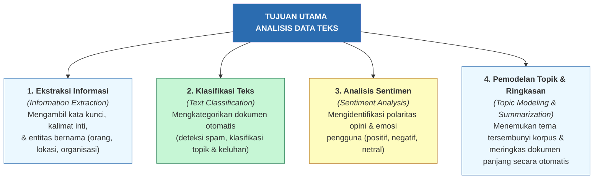
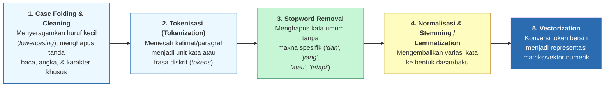
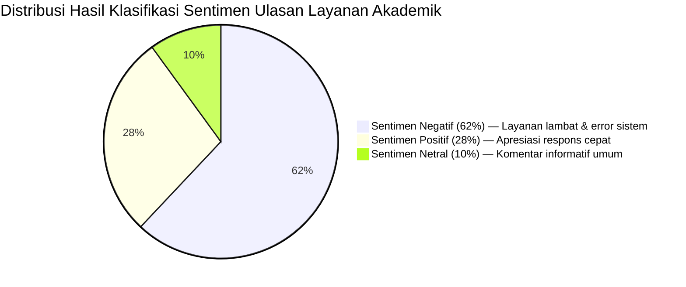

# Pertemuan 07: Analisis Data Teks, Pemrosesan Bahasa Alami (`NLP`), dan Studi Kasus Sentimen

* **Mata Kuliah:** Pengantar Sains Data (`STDA4101`)
* **Program Studi:** Sistem Informasi & Sains Data — Fakultas Sains dan Teknologi, Universitas Terbuka
* **Referensi Modul Utama:** Buku Materi Pokok (`BMP`) `STDA4101` Modul 7 — *Prediksi: Clustering, Jaringan Saraf Tiruan, dan Bahasa Alami (`NLP`)* serta Materi Inisiasi 07 (*Pengantar Analisis Data Teks*, *Pemodelan dan Analisis Data Teks*, *Konsep dalam NLP*, & *Studi Kasus Sentimen Mahasiswa*)
* **Topik:** Definisi & Empat Tujuan Utama Analisis Data Teks, Pipeline Prapemrosesan Teks (*Case Folding*, *Cleaning*, *Tokenization*, *Stopword Removal*, *Stemming* vs *Lemmatization*), Metode Representasi Teks ke Numerik (*Bag of Words*, `TF-IDF`, *Word Embeddings* `Word2Vec`/`GloVe`, & *Transformer Embeddings*), Tugas Utama & Evolusi Arsitektur `NLP` (*Naïve Bayes*/*SVM*, `RNN`/`LSTM`, hingga *Transformer* `BERT` & `GPT`), *Topic Modeling* (`LDA`) & *Clustering* Dokumen, Metrik Evaluasi (`Accuracy`, `Precision`, `Recall`, `F1-Score`, & *Perplexity*), serta Studi Kasus Analisis Sentimen Layanan Akademik Mahasiswa

---

## Daftar Isi

1. [Konsep Dasar dan Empat Tujuan Utama Analisis Data Teks](#1-konsep-dasar-dan-empat-tujuan-utama-analisis-data-teks)
2. [Alur Kerja (*Pipeline*) Prapemrosesan Data Teks (*Text Preprocessing*)](#2-alur-kerja-pipeline-prapemrosesan-data-teks-text-preprocessing)
3. [Metode Representasi Teks ke Vektor Numerik (*Text Vectorization*)](#3-metode-representasi-teks-ke-vektor-numerik-text-vectorization)
4. [Pemodelan, Tugas-Tugas Utama, dan Evolusi Arsitektur `NLP`](#4-pemodelan-tugas-tugas-utama-dan-evolusi-arsitektur-nlp)
5. [Metrik Evaluasi Model `NLP` dan Aplikasi Lintas Industri](#5-metrik-evaluasi-model-nlp-dan-aplikasi-lintas-industri)
6. [Studi Kasus Terapan: Analisis Sentimen Ulasan Layanan Akademik Mahasiswa](#6-studi-kasus-terapan-analisis-sentimen-ulasan-layanan-akademik-mahasiswa)
7. [Referensi Resmi](#7-referensi-resmi)

---

## 1. Konsep Dasar dan Empat Tujuan Utama Analisis Data Teks

### Pengertian Analisis Data Teks dan Pemrosesan Bahasa Alami (`NLP`)

**Analisis Data Teks (*Text Analytics* / *Text Mining*)** dan **Pemrosesan Bahasa Alami (*Natural Language Processing* / `NLP`)** adalah cabang disiplin Sains Data dan Kecerdasan Buatan yang berfokus pada pemrosesan, pemahaman, dan ekstraksi informasi serta wawasan bermakna dari data teks tidak terstruktur (*unstructured text data*)—seperti ulasan pelanggan, berita digital, unggahan media sosial, maupun dokumen akademik.

### Empat Tujuan Utama Analisis Data Teks

---

## 2. Alur Kerja (*Pipeline*) Prapemrosesan Data Teks (*Text Preprocessing*)

Data teks mentah (*raw text*) yang diperoleh melalui `API`, *web scraping*, maupun survei daring umumnya mengandung *noise* (tanda baca, huruf kapital tidak seragam, kata tidak baku, dan kata hubung umum). Oleh karena itu, teks wajib melewati **lima tahapan prapemrosesan standar** sebelum diubah menjadi angka:

### Perbedaan Teknis: *Stemming* vs *Lemmatization*

| Aspek Perbandingan | *Stemming* | *Lemmatization* |
| :--- | :--- | :--- |
| **Mekanisme Kerja** | Memotong awalan (*prefix*) atau akhiran (*suffix*) kata secara heuristik berdasarkan aturan pemotongan karakter tanpa memeriksa kamus morfologi lengkap. | Mengubah kata ke bentuk kata dasar leksikal (*lemma*) dengan mempertimbangkan analisis morfologi, kamus bahasa, dan konteks kelas kata (*Part-of-Speech*). |
| **Kecepatan & Akurasi** | Sangat cepat secara komputasi, tetapi terkadang menghasilkan kata dasar yang tidak baku (*over-stemming* / *under-stemming*). | Lebih lambat secara komputasi, tetapi menghasilkan kata dasar yang valid secara gramatikal dan semantik. |

---

## 3. Metode Representasi Teks ke Vektor Numerik (*Text Vectorization*)

Agar dapat diproses oleh algoritma pembelajaran mesin, token teks hasil prapemrosesan harus ditransformasikan menjadi representasi numerik menggunakan salah satu dari **empat pendekatan utama** berikut:

| Metode Representasi | Prinsip Kerja & Formulasi Konseptual | Kelebihan dan Keterbatasan |
| :--- | :--- | :--- |
| **1. *Bag of Words* (`BoW`)** | Merepresentasikan dokumen sebagai vektor frekuensi kemunculan setiap kata dalam kosakata korpus tanpa memperhatikan urutan kata. | • **Kelebihan:** Sangat sederhana dan cepat untuk klasifikasi dasar. • **Keterbatasan:** Mengabaikan urutan kata, tata bahasa, dan konteks semantik; menghasilkan matriks berdimensi tinggi yang jarang (*sparse*). |
| **2. `TF-IDF`** (*Term Frequency – Inverse Document Frequency*) | Memberikan bobot kepentingan pada setiap kata ($t$) di dalam dokumen ($d$) terhadap keseluruhan korpus ($D$): $$\text{TF-IDF}(t, d, D) = \text{TF}(t, d) \times \log\left(\frac{N}{|\{d \in D : t \in d\}|}\right)$$ | • **Kelebihan:** Menekan bobot kata yang terlalu umum muncul di semua dokumen dan menonjolkan kata kunci unik yang diskriminatif. • **Keterbatasan:** Masih belum menangkap kesamaan makna sinonim antar-kata. |
| **3. *Word Embeddings* (`Word2Vec`, `GloVe`)** | Memetakan setiap kata ke dalam vektor bilangan riil berdimensi padat (*dense vector*) sehingga kata-kata dengan konteks makna serupa memiliki jarak vektor yang berdekatan. | • **Kelebihan:** Mampu menangkap hubungan semantik dan analogi antar-kata secara matematis. • **Keterbatasan:** Menghasilkan satu vektor statis per kata tanpa membedakan kata polisemi (satu kata dengan banyak makna tergantung kalimat). |
| **4. *Transformer-Based Embeddings* (`BERT`, `GPT`)** | Menghasilkan representasi vektor dinamis berbasis mekanisme ***Self-Attention*** yang menyesuaikan makna vektor kata berdasarkan keseluruhan konteks kalimat di sekitarnya. | • **Kelebihan:** Presisi pemahaman konteks tertinggi (*state-of-the-art*) untuk tugas bahasa kompleks. • **Keterbatasan:** Membutuhkan sumber daya komputasi (`GPU`) dan memori yang jauh lebih besar. |

---

## 4. Pemodelan, Tugas-Tugas Utama, dan Evolusi Arsitektur `NLP`

### Enam Tugas Inti `NLP` dalam Pembelajaran Mesin

1. **Analisis Sentimen (*Sentiment Analysis*):** Mengklasifikasikan polaritas sikap emosional atau opini dalam teks ke dalam kelas **positif**, **negatif**, atau **netral**.
2. ***Named Entity Recognition* (`NER`):** Mengidentifikasi dan mengekstrak entitas spesifik di dalam kalimat seperti nama orang, organisasi, lokasi geografis, tanggal, maupun nilai mata uang.
3. ***Part-of-Speech Tagging* (`POS Tagging`):** Menandai kelas gramatikal setiap kata dalam konteks kalimat (kata benda, kata kerja, kata sifat, kata keterangan).
4. **Penerjemahan Mesin (*Machine Translation*):** Menerjemahkan teks secara otomatis antarbahasa alami menggunakan jaringan saraf tiruan (contoh: *Google Neural Machine Translation* / `GNMT`).
5. **Peringkasan Teks (*Text Summarization*):** Menghasilkan ringkasan padat dari dokumen panjang melalui pendekatan **ekstraktif** (memilih kalimat penting asli) atau **abstraktif** (menyusun kalimat ringkasan baru).
6. **Sistem Tanya Jawab (*Question Answering*):** Membangun sistem cerdas yang mampu menjawab pertanyaan pengguna secara akurat berdasarkan pemahaman isi korpus dokumen.

### Pemodelan Topik (*Topic Modeling* `LDA`) dan *Clustering* Dokumen

* ***Topic Modeling* (`LDA` — *Latent Dirichlet Allocation*):** Metode *unsupervised learning* untuk menemukan struktur tema atau topik laten yang tersembunyi di dalam kumpulan besar dokumen (contoh: mengelompokkan ribuan artikel berita ke dalam topik *ekonomi makro*, *perdagangan*, dan *keuangan digital*, atau memetakan tema publikasi ilmiah UT).
* ***Clustering* Dokumen:** Mengelompokkan dokumen berdasarkan kemiripan vektor tekstual (contoh: pengelompokan otomatis tema judul skripsi mahasiswa).

### Evolusi Arsitektur Model `NLP`

* **Model Tradisional (`Naïve Bayes`, `SVM`):** Mengandalkan fitur statistik `BoW` atau `TF-IDF`; sangat efisien untuk klasifikasi teks sederhana dan deteksi spam.
* **Model Berbasis Urutan (`RNN` & `LSTM`):** Memproses teks kata demi kata secara sekuensial dengan memori internal untuk menjaga ketergantungan konteks jangka pendek maupun panjang.
* **Arsitektur *Transformer* (`BERT` & `GPT`):** Memanfaatkan mekanisme ***Attention*** paralel tanpa pemrosesan berurutan lambat—di mana **`BERT`** (*Bidirectional Encoder Representations from Transformers*) unggul dalam memahami konteks dua arah (*pemahaman teks*), sedangkan **`GPT`** (*Generative Pre-trained Transformer*) unggul dalam menghasilkan teks baru yang koheren (*generasi teks*).

---

## 5. Metrik Evaluasi Model `NLP` dan Aplikasi Lintas Industri

### Metrik Kuantitatif Evaluasi Model Teks

1. **Metrik Klasifikasi Teks & Sentimen:** Menggunakan ***Confusion Matrix*** untuk menghitung **Accuracy**, **Precision**, **Recall**, dan **F1-Score** (sangat penting terutama saat distribusi kelas sentimen tidak seimbang).
2. ***Perplexity* (Evaluasi Model Bahasa):** Mengukur tingkat ketidakpastian model bahasa dalam memprediksi urutan kata berikutnya pada teks uji baru—**semakin rendah nilai *perplexity*, semakin baik kemampuan model bahasa tersebut**.

### Penerapan Nyata `NLP` di Berbagai Sektor

* **Asisten Virtual & *Chatbots*:** Memahami maksud (*intent*) perintah teks maupun suara untuk layanan pelanggan otomatis $24/7$.
* **Mesin Pencari Modern (*Semantic Search*):** Memahami maksud pencarian pengguna secara kontekstual meskipun kueri mengandung variasi sinonim atau ketidakteraturan tata bahasa.
* **Otomasi Dokumen Hukum, Medis, & Bisnis:** Ekstraksi klausa kontrak, ringkasan rekam medis, serta pemantauan sentimen merek secara *real-time*.

---

## 6. Studi Kasus Terapan: Analisis Sentimen Ulasan Layanan Akademik Mahasiswa

### Latar Belakang dan Alur Pemodelan Kasus

* **Tujuan Studi Kasus:** Mengevaluasi persepsi dan tingkat kepuasan mahasiswa terhadap layanan akademik dan infrastruktur TI kampus melalui ulasan teks digital.
* **Pipeline Pemrosesan & Pemodelan:**
  1. *Preprocessing Teks:* *Lowercasing*, penghapusan tanda baca/angka/karakter khusus, tokenisasi, penghapusan *stopwords*, serta normalisasi kata tidak baku dan *stemming*.
  2. *Ekstraksi Fitur & Pemodelan:* Transformasi teks ke vektor `TF-IDF` / *embedding*, dilanjutkan klasifikasi sentimen menggunakan kandidat algoritma **Naïve Bayes**, **`SVM`**, **`LSTM`**, dan **`BERT`**, serta dievaluasi menggunakan *Confusion Matrix* (`Accuracy`, `Precision`, `Recall`, `F1-Score`).

### Temuan Analitis dan Rekomendasi Strategis Institusi

* **Interpretasi Kata Kunci Dominan:** Ulasan negatif ($62\%$) didominasi kata kunci seperti **`lambat`** dan **`error`**, sedangkan ulasan positif ($28\%$) menyoroti kata kunci **`cepat`**.
* **Tindak Lanjut Strategis Institusi:** (1) Peningkatan kapasitas infrastruktur TI untuk mengatasi *error* sistem, (2) penambahan staf *helpdesk* pada jam sibuk akademik, (3) penyederhanaan alur birokrasi administrasi, serta (4) penerapan pemantauan sentimen berkala sebagai indikator kinerja layanan.

---

## 7. Referensi Resmi

1. **Buku Materi Pokok (`BMP`) Utama:** Ramdani, F., & Utami, I. Q. (2024). *Pengantar Data Science* (`STDA4101`), Modul 7: *Prediksi: Clustering, Jaringan Saraf Tiruan, dan Bahasa Alami*. Jakarta: Penerbit Bumi Aksara / Universitas Terbuka.
2. **Materi Tutorial Online (`Tuton`):** Materi Inisiasi 07 (`STDA4101`) — *Pengantar Analisis Data Teks*, *Pemodelan dan Analisis Data Teks*, *Konsep dalam NLP*, dan *Analisis Data Teks: Studi Kasus Sentimen Mahasiswa*, Program Studi Sistem Informasi / Sains Data, Universitas Terbuka.
3. **Jurafsky, D., & Martin, J. H.** (2023). *Speech and Language Processing* (3rd ed. draft). Stanford University.