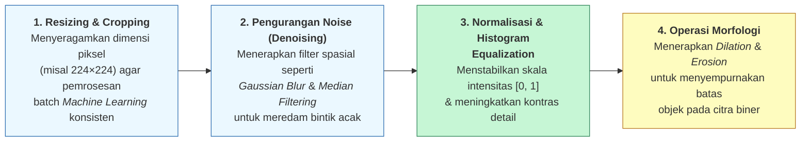
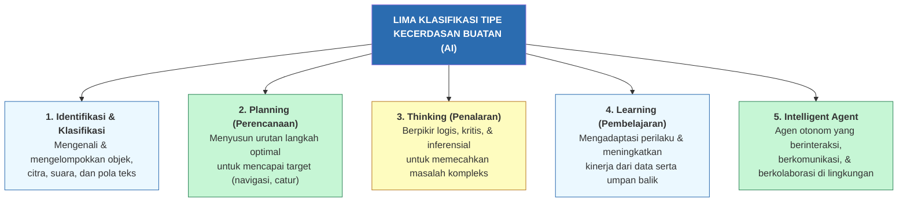

# Pertemuan 08: Analisis Data Citra, *Deep Learning*, dan Aplikasi Kecerdasan Buatan (`AI`)

* **Mata Kuliah:** Pengantar Sains Data (`STDA4101`)
* **Program Studi:** Sistem Informasi & Sains Data — Fakultas Sains dan Teknologi, Universitas Terbuka
* **Referensi Modul Utama:** Buku Materi Pokok (`BMP`) `STDA4101` Modul 8 (*Deep Learning*) & Modul 9 (*Aplikasi Data Science dan Kecerdasan Buatan*) serta Materi Inisiasi 08 (*Pengantar Analisis Data Citra* & *Kecerdasan Buatan*)
* **Topik:** Konsep Dasar & Jenis Data Citra Digital (*Biner*, *Grayscale*, `RGB`, *Multispektral/Hiperspektral*), Tahapan Prapemrosesan Citra (*Resizing*, *Denoising*, *Histogram Equalization*, & *Operasi Morfologi*), Studi Kasus Deteksi Kesehatan Daun (*Pertanian Presisi*), Arsitektur *Artificial Neural Network* (`ANN`) & Empat Jenis *Deep Learning* (`FC`, `CNN`, `RNN`, `GAN`), Lima Klasifikasi Tipe Kecerdasan Buatan (`AI`) & Pipeline Akuisisi Pengetahuan, Penerapan Strategis Sains Data & `AI` di Indonesia (*Kelautan, Kehutanan, Pertanian, Seni & Budaya*), serta Evaluasi Dampak & Etika `AI`

---

## Daftar Isi

1. [Konsep Dasar, Komponen, dan Jenis Data Citra Digital](#1-konsep-dasar-komponen-dan-jenis-data-citra-digital)
2. [Tahapan Prapemrosesan Citra (*Image Preprocessing*) dan Studi Kasus Pertanian Presisi](#2-tahapan-prapemrosesan-citra-image-preprocessing-dan-studi-kasus-pertanian-presisi)
3. [*Artificial Neural Network* (`ANN`) dan Empat Arsitektur *Deep Learning*](#3-artificial-neural-network-ann-dan-empat-arsitektur-deep-learning)
4. [Konsep Kecerdasan Buatan (`AI`), Lima Tipe `AI`, dan Pipeline Akuisisi Pengetahuan](#4-konsep-kecerdasan-buatan-ai-lima-tipe-ai-dan-pipeline-akuisisi-pengetahuan)
5. [Penerapan Strategis Sains Data dan `AI` di Berbagai Sektor di Indonesia](#5-penerapan-strategis-sains-data-dan-ai-di-berbagai-sektor-di-indonesia)
6. [Evaluasi Model, Kontroversi Sosial, dan Etika Pengembangan `AI`](#6-evaluasi-model-kontroversi-sosial-dan-etika-pengembangan-ai)
7. [Referensi Resmi](#7-referensi-resmi)

---

## 1. Konsep Dasar, Komponen, dan Jenis Data Citra Digital

### Definisi Data Citra Digital

**Data Citra (*Digital Image Data*)** adalah representasi visual dari objek atau fenomena dunia nyata yang tersusun atas matriks elemen gambar diskrit bernama **piksel (*picture elements*)**—atau ***voxel*** pada citra $3\text{D}$—di mana setiap titik koordinat $(x, y)$ menyimpan nilai intensitas cahaya maupun spektrum warna tertentu untuk diinterpretasikan oleh komputer.

* **Tantangan Karakteristik Citra:** Kualitas akuisisi citra sangat dipengaruhi oleh **resolusi spasial**, **kondisi pencahayaan (*illumination*)**, **derau sensor (*noise*)**, serta **distorsi geometris**, sehingga wajib melalui tahap prapemrosesan sebelum pemodelan.

### Klasifikasi Jenis Citra Berdasarkan Kanal Spektral

| Jenis Citra | Struktur Kanal & Rentang Nilai Piksel | Karakteristik & Kegunaan Utama |
| :--- | :--- | :--- |
| **1. Citra Biner** (*Binary Image*) | **1 kanal** dengan hanya dua nilai logika: **$0$ (hitam)** dan **$1$ (putih)**. | Digunakan untuk segmentasi bentuk objek sederhana, pengenalan karakter optik (`OCR`), dan ekstraksi siluet. |
| **2. Citra *Grayscale*** (Aras Keabuan) | **1 kanal** intensitas keabuan dengan rentang **$0$ (hitam pekat) hingga $255$ (putih terang)** ($8\text{-bit}$). | Efisien secara komputasi; ideal untuk deteksi tepi (*edge detection*), analisis tekstur, dan pencitraan medis (`X-Ray`, `USG`). |
| **3. Citra `RGB`** (*True Color*) | **3 kanal warna primer** (*Red*, *Green*, *Blue*), masing-masing bernilai $0\text{–}255$ (menghasilkan $256^3 \approx 16,7\text{ juta}$ kombinasi warna). | Standar fotografi digital, pengenalan wajah, serta deteksi objek visual sehari-hari. |
| **4. Citra Multispektral & Hiperspektral** | **Puluhan hingga ratusan kanal spektral** di luar cahaya tampak (inframerah dekat, termal, ultraviolet). | Digunakan pada penginderaan jauh satelit (*remote sensing*), pemetaan tutupan hutan, dan identifikasi komposisi material. |

---

## 2. Tahapan Prapemrosesan Citra (*Image Preprocessing*) dan Studi Kasus Pertanian Presisi

### Empat Teknik Utama Prapemrosesan Citra

### Studi Kasus: Deteksi Kesehatan Daun pada Pertanian Presisi

1. **Akuisisi dan *Preprocessing*:** Citra daun tanaman diambil menggunakan kamera ponsel pintar atau *drone*, kemudian dilakukan pemotongan area fokus (*cropping*), penyeragaman ukuran (*resizing*), dan penghilangan *noise*.
2. **Segmentasi Berbasis Ruang Warna (`HSV`):** Mengonversi citra ke ruang warna *Hue, Saturation, Value* (`HSV`) dan menerapkan ambang batas (*thresholding*) untuk memisahkan area daun yang sehat maupun berpenyakit dari latar belakang tanah/langit.
3. **Ekstraksi Fitur & Klasifikasi Penyakit:** Mengekstraksi fitur tekstur dan distribusi warna bercak daun, lalu melatih model **`SVM`** atau **`CNN`** untuk mendiagnosis jenis penyakit tanaman secara cepat.
4. **Dampak Pertanian Presisi:** Memberikan rekomendasi pemupukan atau penyemprotan pestisida secara tertarget sehingga menghemat biaya dan mencegah gagal panen.

---

## 3. *Artificial Neural Network* (`ANN`) dan Empat Arsitektur *Deep Learning*

### Konsep *Artificial Neural Network* (`ANN`) dan *Deep Learning* (`DL`)

* ***Artificial Neural Network* (`ANN`):** Model komputasi yang terinspirasi dari struktur jaringan neuron biologis otak manusia, tersusun atas **lapisan masukan (*input layer*)**, **lapisan tersembunyi (*hidden layers*)**, dan **lapisan keluaran (*output layer*)** yang berisi simpul pemrosesan (*nodes/neurons*) terhubung melalui bobot sinaptik.
* ***Deep Learning* (`DL`):** Sub-bidang *Machine Learning* yang memanfaatkan arsitektur `ANN` dengan **banyak lapisan tersembunyi (*deep architecture*)** sehingga mampu mengekstrak representasi fitur hierarkis secara mandiri dari data berukuran sangat besar dan kompleks.

### Perbandingan Empat Arsitektur Utama *Deep Learning*

| Arsitektur *Deep Learning* | Mekanisme Kerja & Struktur Jaringan | Domain Aplikasi Utama |
| :--- | :--- | :--- |
| **1. *Fully Connected Networks* (`FC` / `MLP`)** | Setiap neuron pada suatu lapisan terhubung penuh (*dense*) ke seluruh neuron pada lapisan sebelum dan sesudahnya. | Masalah klasifikasi dan regresi pada data tabular terstruktur berdimensi menengah. |
| **2. *Convolutional Neural Networks* (`CNN`)** | Menggunakan lapisan **konvolusi (*convolution*)** dan ***pooling*** untuk mengekstrak fitur spasial lokal (tepi, tekstur, bentuk) dari matriks piksel. | Pengolahan citra dan video: pengenalan wajah, deteksi intrusi visual, citra medis, dan analisis citra satelit. |
| **3. *Recurrent Neural Networks* (`RNN` / `LSTM`)** | Memiliki koneksi umpan balik berulang (*recurrent loops*) yang berfungsi sebagai memori internal untuk menyimpan konteks urutan waktu sebelumnya. | Data sekuensial dan deret waktu: pemrosesan teks, bahasa alami (`NLP`), pengenalan suara, dan peramalan sinyal. |
| **4. *Generative Adversarial Networks* (`GAN`)** | Terdiri dari dua jaringan yang saling berkompetisi (*adversarial*): ***Generator*** (menciptakan data sintetis) dan ***Discriminator*** (membedakan data asli vs sintetis). | Sintesis dan restorasi citra, generasi data sintetis untuk augmentasi dataset, serta simulasi desain visual. |

* **Kelebihan vs Keterbatasan `DL`:** Unggul dalam akurasi tinggi dan ekstraksi fitur otomatis tanpa rekayasa manual yang rumit, namun membutuhkan **biaya komputasi tinggi (`GPU`/`TPU`)**, volume data latih masif, serta bersifat kotak hitam (*black-box*) yang menuntut perhatian pada aspek privasi dan etika.

---

## 4. Konsep Kecerdasan Buatan (`AI`), Lima Tipe `AI`, dan Pipeline Akuisisi Pengetahuan

### Definisi dan Lima Klasifikasi Tipe Kecerdasan Buatan (`AI`)

**Kecerdasan Buatan (*Artificial Intelligence* / `AI`)**—istilah yang pertama kali diperkenalkan oleh **John McCarthy, Marvin Minsky**, dkk. pada tahun **1956** serta diuji melalui ***Turing Test***—adalah bidang ilmu komputer yang merancang sistem agar mampu meniru kemampuan kognitif manusia. Berdasarkan kapabilitas fungsionalnya, `AI` diklasifikasikan menjadi **lima tipe utama**:

### Lima Tahap Akuisisi Data dan Pengetahuan dari Dunia Nyata

Untuk menjembatani fenomena fisik dunia nyata ke dalam representasi komputasi yang cerdas, sistem `AI` menjalankan **lima tahapan akuisisi pengetahuan**:
1. **Pengumpulan Data (*Data Acquisition*):** Menangkap sinyal dunia nyata melalui sensor (suhu, cahaya, sentuhan, curah hujan), kamera, mikrofon, maupun internet.
2. **Pemrosesan Data (*Data Processing*):** Mengonversi sinyal mentah menjadi format digital terstruktur (matriks piksel, vektor sinyal, atau tensor).
3. **Ekstraksi Fitur (*Feature Extraction*):** Mengidentifikasi atribut pembeda utama seperti warna, bentuk, ukuran, maupun frekuensi spektral.
4. **Klasifikasi Data (*Data Classification*):** Mengelompokkan objek ke dalam kategori atau kelas semantik tertentu.
5. **Interpretasi Data (*Data Interpretation*):** Memberikan makna kontekstual dan kesimpulan yang dapat ditindaklanjuti oleh manusia maupun sistem otonom.

---

## 5. Penerapan Strategis Sains Data dan `AI` di Berbagai Sektor di Indonesia

Pemanfaatan Sains Data dan `AI` memiliki dampak transformatif pada sektor-sektor unggulan nasional Indonesia:

| Sektor Strategis | Fokus Pemanfaatan & Contoh Implementasi Teknologi |
| :--- | :--- |
| **1. Kelautan dan Perikanan** | • Pemantauan kesehatan ekosistem laut, estimasi populasi ikan, dan deteksi dini polusi perairan. • Sistem navigasi cerdas kapal tanpa awak (*autonomous vessels*), robot bawah laut (`ROV`), dan sonar pendeteksi gerombolan ikan untuk meningkatkan efisiensi tangkapan nelayan. |
| **2. Kehutanan dan Perkebunan** | • Pemantauan tutupan hutan, deteksi dini titik api kebakaran hutan (*hotspot*), serta pemetaan emisi karbon menggunakan citra satelit dan *drone*. • Optimasi jadwal pemeliharaan, pemupukan, dan panen perkebunan berbasis analitik prediktif. |
| **3. Pertanian Presisi** | • Pemetaan kesuburan lahan, prediksi cuaca mikro, sistem irigasi pintar otomatis (*smart irrigation*), serta deteksi dini hama dan penyakit daun berbasis *Computer Vision*. |
| **4. Seni dan Budaya Nusantara** | • Digitalisasi dan restorasi otomatis arsip naskah kuno, motif batik, musik tradisional, dan tarian daerah. • Analisis pola budaya, sintesis karya kreatif, serta sistem rekomendasi pelestarian warisan budaya Indonesia. |

---

## 6. Evaluasi Model, Kontroversi Sosial, dan Etika Pengembangan `AI`

### Metrik Evaluasi dan Validasi Model Analisis Citra & `AI`

* **Evaluasi Komprehensif:** Selain *Accuracy*, model klasifikasi citra dan `AI` (terutama pada dataset tidak seimbang seperti deteksi penyakit tanaman atau intrusi keamanan) wajib dievaluasi menggunakan ***Confusion Matrix***, ***Precision***, ***Recall***, dan ***F1-Score***.
* **Validasi Silang (*Cross-Validation*):** Diterapkan untuk memastikan model tidak mengalami *overfitting* dan memiliki generalisasi stabil di berbagai kondisi pencahayaan maupun sudut pengambilan gambar.

### Lima Kontroversi dan Tantangan Etis Kecerdasan Buatan

Di samping manfaat efisiensinya, adopsi `AI` secara luas memunculkan **lima isu kontroversial** yang harus dimitigasi melalui tata kelola dan etika teknologi:
1. **Pergeseran Lapangan Kerja (*Job Displacement*):** Otomatisasi tugas-tugas rutin, repetitif, maupun berisiko tinggi berpotensi menggantikan peran tenaga kerja manusia apabila tidak diimbangi dengan pelatihan ulang (*reskilling*).
2. **Ketergantungan Teknologi & Penurunan Kemandirian:** Ketergantungan berlebihan pada asisten `AI` dapat menurunkan daya kritis, kreativitas, dan keterampilan pemecahan masalah mandiri manusia.
3. **Biaya Pengembangan & Pemeliharaan Tinggi:** Infrastruktur komputasi `DL` membutuhkan investasi perangkat keras, konsumsi energi, dan pemeliharaan yang besar sehingga berisiko memperlebar kesenjangan digital.
4. **Ketidakselarasan Nilai & Prioritas (*AI Alignment*):** Sistem `AI` yang dioptimalkan tanpa batasan etika yang jelas dapat mengambil keputusan yang bias, tidak adil, atau bertentangan dengan keselamatan manusia.
5. **Degradasi Interaksi Sosial:** Berkurangnya komunikasi antarmanusia akibat dominasi interaksi dengan agen virtual dapat memengaruhi kesehatan mental dan kohesi sosial.

---

## 7. Referensi Resmi

1. **Buku Materi Pokok (`BMP`) Utama:** Ramdani, F., & Utami, I. Q. (2024). *Pengantar Data Science* (`STDA4101`), Modul 8 (*Deep Learning*) & Modul 9 (*Aplikasi Data Science dan Kecerdasan Buatan*). Jakarta: Penerbit Bumi Aksara / Universitas Terbuka.
2. **Materi Tutorial Online (`Tuton`):** Materi Inisiasi 08 (`STDA4101`) — *Pengantar Analisis Data Citra* dan *Kecerdasan Buatan*, Program Studi Sistem Informasi / Sains Data, Universitas Terbuka.
3. **Gonzalez, R. C., & Woods, R. E.** (2018). *Digital Image Processing* (4th ed.). New York: Pearson.
4. **Goodfellow, I., Bengio, Y., & Courville, A.** (2016). *Deep Learning*. Cambridge, MA: MIT Press.