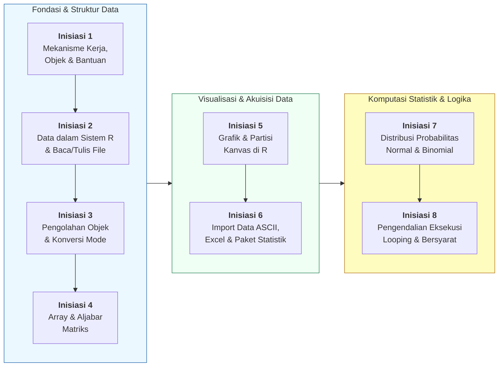

# Dasar Pemrograman R (STIK4111)

## Informasi Mata Kuliah

| Atribut | Keterangan |
| :--- | :--- |
| **Kode & Nama Mata Kuliah** | `STIK4111` — Dasar Pemrograman R |
| **Bobot SKS** | 3 SKS |
| **Program Studi** | Sistem Informasi / Statistika — Universitas Terbuka |
| **Pengembang Materi (RAT)** | Septian Rahardiantoro, S.Stat., M.Si. (IPB) |
| **Penelaah Materi** | Siti Hadijah Hasanah, S.Si., M.Si. |

---

## Deskripsi & Capaian Pembelajaran Umum

### Deskripsi Singkat
Mata kuliah ini menyajikan konsep-konsep fundamental dalam pengoperasian perangkat lunak dan bahasa pemrograman **R** untuk komputasi statistik. Pembahasan dimulai dari mekanisme kerja sistem R, manajemen objek dan tipe data, pengolahan struktur data (*vector*, *factor*, *matrix*, *array*, *data frame*, *list*, *time series*), visualisasi grafik dasar, impor data dari berbagai format eksternal, pengelolaan distribusi probabilitas kontinu dan diskrit, hingga pengendalian alur eksekusi program (*looping* dan *conditional*).

### Capaian Pembelajaran Umum (CPU)
Setelah menyelesaikan mata kuliah ini, mahasiswa diharapkan mampu merancang dan menjalankan pemrograman statistik sederhana menggunakan sistem R secara mandiri—mulai dari manipulasi objek dan struktur data, pembacaan dataset eksternal, pembuatan visualisasi grafik, simulasi distribusi peluang, hingga pengendalian alur logika program.

---

## Peta Alur Pembelajaran (`STIK4111`)

---

## Daftar Isi Materi & Jurnal Catatan (Inisiasi 1 – 8)

Tabel berikut memetakan silabus Rancangan Aktivitas Tutorial (RAT) dengan file catatan Markdown di dalam repositori ini:

| Inisiasi | Minggu Tuton | Pokok Bahasan & Sub-Pokok Bahasan | Evaluasi | Catatan Belajar |
| :---: | :---: | :--- | :---: | :--- |
| **01** | Minggu 2 | **Mekanisme Kerja, Pembuatan Objek, dan Informasi Bantuan dalam Sistem R** • Instalasi R & lingkungan kerja (`RGui` / `R Console`) • Mekanisme fungsi, argumen, RAM vs *Harddisk*, & *Working Directory* • Aturan penamaan, pembuatan (`<-`), penayangan (`ls`), & penghapusan (`rm`) objek • Sistem dokumentasi bantuan (`help`, `?`, `??`) | — | [pertemuan-01/README.md](./pertemuan-01/README.md) |
| **02** | Minggu 3 | **Data dalam Sistem R** • Atribut intrinsik objek (`mode` & `length`) serta nilai khusus (`Inf`, `NaN`, `NA`) • Struktur penyimpanan data (`vector`, `factor`, `matrix`, `array`, `data.frame`, `ts`, `list`) • Membaca dan menulis file (`read.table`, `read.csv`, `write.csv`) • Pembangkitan data teratur (`:`, `seq`, `c`, `rep`, `expand.grid`) | — | [pertemuan-02/README.md](./pertemuan-02/README.md) |
| **03** | Minggu 4 | **Pengantar Pengolahan Objek** • Pendalaman pembuatan `vector`, `factor` nominal/ordinal (`ordered`), `matrix`, `data.frame`, `list`, & `ts` • Konversi tipe data (`as.numeric`, `as.logical`, `as.character`) & perbandingan (`identical`, `all.equal`) • Sistem pengindeksan (*indexing*) 1D & 2D serta operasi aritmatika vektor | **Tugas Tutorial I** | [pertemuan-03/README.md](./pertemuan-03/README.md) |
| **04** | Minggu 5 | **Penggunaan Array dan Matrix** • Konsep array berdimensi $k \ge 1$ & aturan *coercion* otomatis • Teknik ekstraksi (*subsetting*) elemen vektor • Operator aljabar matriks (`*`, `%*%`, `%o%`, `t`, `solve`, `crossprod`) • Penggabungan baris dan kolom matriks (`rbind` & `cbind`) | — | [pertemuan-04/README.md](./pertemuan-04/README.md) |
| **05** | Minggu 6 | **Bekerja dengan Grafik di Lingkungan R** • Konsep *high-level* vs *low-level plotting*, `par()`, & manajemen *graphics devices* (`pdf`, `png`) • Partisi kanvas grafik menggunakan `split.screen()` dan `layout()` • Visualisasi dasar: `plot()`, `sunflowerplot()`, `pie()`, `boxplot()`, `stripchart()`, `coplot()`, & `interaction.plot()` | — | [pertemuan-05/README.md](./pertemuan-05/README.md) |
| **06** | Minggu 7 | **Import Data dari File** • Import file teks polos berformat ASCII menggunakan `scan()` • Import data lembar kerja Excel yang dikonversi ke `.txt` dan `.csv` • Import data dari perangkat lunak statistik eksternal via paket `foreign` (SPSS, Minitab, Stata) & `sas7bdat` (SAS) | **Tugas Tutorial II** | [pertemuan-06/README.md](./pertemuan-06/README.md) |
| **07** | Minggu 8 | **Pengelolaan Distribusi Probabilitas** • Konvensi 4 prefiks fungsi distribusi di R (`d`, `p`, `q`, `r`) & argumen `lower.tail` • Distribusi Kontinu — Normal (`dnorm`, `pnorm`, `qnorm`, `rnorm`) & kurva PDF/CDF • Distribusi Diskrit — Binomial (`dbinom`, `pbinom`, `qbinom`, `rbinom`) & plot PMF/CDF | — | [pertemuan-07/README.md](./pertemuan-07/README.md) |
| **08** | Minggu 9 | **Pengendalian Eksekusi Program** • Struktur perulangan (*looping*): `for`, `while`, dan `repeat` • Pengendali alur iterasi & eksekusi: `next`, `break`, `return()`, dan `stop()` • Struktur percabangan bersyarat: `if`, `if ... else`, serta fungsi tervektorisasi `ifelse()` | **Tugas Tutorial III** | [pertemuan-08/README.md](./pertemuan-08/README.md) |

---

## Daftar Pustaka & Referensi Resmi

1. **Rancangan Aktivitas Tutorial (RAT):** Mata Kuliah Dasar Pemrograman R (`STIK4111`), Universitas Terbuka (2019).
2. **Suhartono.** (2009). *Analisis Data Statistik dengan R*. Yogyakarta: Graha Ilmu.
3. **Venables, W. N., & Smith, D. M.** *An Introduction to R*. The R Development Core Team — CRAN Official Manual: <https://cran.r-project.org/doc/manuals/r-release/R-intro.html>
4. **The R Project for Statistical Computing:** <https://www.r-project.org/>