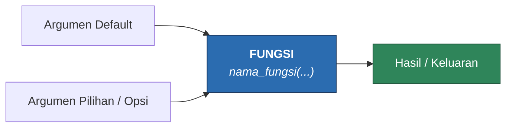
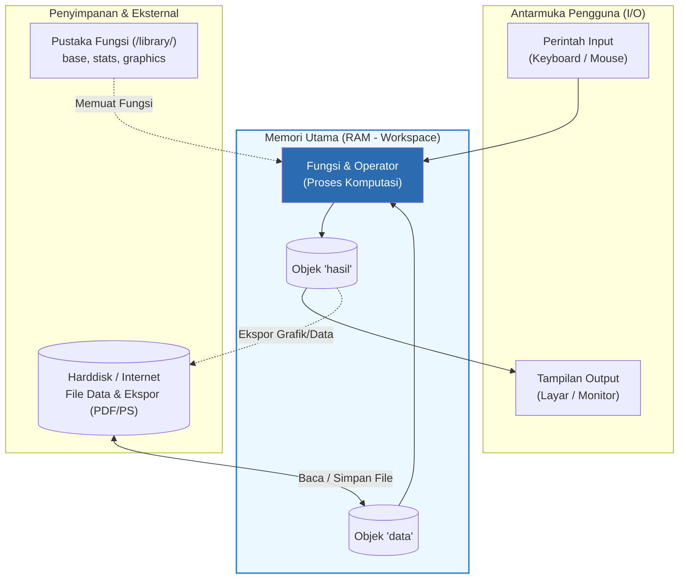

# Pertemuan 01: Mekanisme Kerja, Pembuatan Objek, dan Informasi Bantuan dalam Sistem R

* **Mata Kuliah:** Dasar Pemrograman R (`STIK4111`)
* **Program Studi:** Sistem Informasi — Universitas Terbuka
* **Topik:** Pengenalan R, Mekanisme Kerja, Manajemen Objek, dan Sistem Bantuan

---

## Daftar Isi
1. [Pengenalan & Instalasi Perangkat Lunak R](#1-pengenalan--instalasi-perangkat-lunak-r)
2. [Mekanisme Kerja Sistem R](#2-mekanisme-kerja-sistem-r)
3. [Manajemen Direktori Kerja (Working Directory)](#3-manajemen-direktori-kerja-working-directory)
4. [Pembuatan, Penayangan, dan Penghapusan Objek](#4-pembuatan-penayangan-dan-penghapusan-objek)
5. [Pencarian Informasi Bantuan (Help System)](#5-pencarian-informasi-bantuan-help-system)
6. [Referensi Resmi](#6-referensi-resmi)

---

## 1. Pengenalan & Instalasi Perangkat Lunak R

### Apa itu R?
**R** adalah bahasa pemrograman sekaligus lingkungan perangkat lunak (*software environment*) yang dirancang khusus untuk komputasi statistik, perhitungan matriks, manipulasi data, dan visualisasi grafis.

* **Sejarah Singkat:** Dikembangkan oleh **Ross Ihaka** dan **Robert Gentleman** di University of Auckland, Selandia Baru.
* **Lisensi Open Source:** R berada di bawah lisensi **GNU General Public License (GPL)**. Artinya, kode sumber (*source code*) didistribusikan secara bebas dan gratis untuk digunakan, dimodifikasi, maupun dikembangkan oleh siapa saja.

### Fasilitas Utama R
1. **Pengelolaan & Penyimpanan Data:** Menyediakan struktur data yang efektif untuk menyimpan dan memanipulasi berbagai jenis data.
2. **Komputasi Array & Matriks:** Memiliki kumpulan operator yang lengkap untuk perhitungan aljabar linear dan matriks.
3. **Fasilitas Analisis Data:** Dilengkapi ribuan paket (*packages*) terintegrasi untuk analisis data statistik klasik hingga modern (*machine learning*).
4. **Visualisasi Grafis:** Sarana pembuatan grafik berkualitas tinggi yang dapat ditampilkan di layar monitor maupun diekspor ke berbagai format dokumen (PDF, PNG, PostScript).
5. **Bahasa Pemrograman yang Ekspresif:** Mendukung percabangan, perulangan, dan fungsi buatan pengguna (*user-defined functions*).

### Tampilan Antarmuka Dasar (`RGui` & `R Console`)
Saat pertama kali membuka R (melalui `RGui` atau IDE seperti **RStudio**), pengguna akan disambut oleh **R Console** yang ditandai dengan simbol prompt `>`. Simbol ini menandakan bahwa R siap menerima perintah.

```r
# Menampilkan informasi sitasi resmi R
citation()

# Keluar dari sesi R
q()
```

---

## 2. Mekanisme Kerja Sistem R

### Anatomi Fungsi dan Argumen
Di dalam R, hampir seluruh pekerjaan dilakukan menggunakan **fungsi**. Fungsi adalah sekumpulan instruksi terstruktur untuk menjalankan tugas tertentu dan selalu ditulis dengan sepasang tanda kurung `()` di belakang namanya—meskipun tidak memiliki argumen di dalamnya.



* **Argumen Default:** Nilai parameter yang sudah ditetapkan secara bawaan oleh sistem R jika pengguna tidak menentukannya.
* **Argumen Pilihan (Opsi):** Parameter tambahan yang diberikan pengguna untuk mengubah perilaku atau nilai *default* fungsi (dapat berupa objek data, rumus, atau ekspresi logika).

```r
# Contoh fungsi dengan argumen default vs argumen pilihan
data_angka <- c(10, 20, 30, NA)

mean(data_angka)               # Menggunakan default (na.rm = FALSE), hasil: NA
mean(data_angka, na.rm = TRUE) # Mengubah opsi na.rm menjadi TRUE, hasil: 20
```

### Arsitektur & Alur Pemindahan Data (RAM vs Harddisk)
R bekerja secara *in-memory* (berbasis RAM). Berikut adalah diagram alur kerja bagaimana R memproses instruksi, mengelola objek di memori sementara, dan berinteraksi dengan penyimpanan eksternal:



1. **Penyimpanan di RAM:** Setiap objek (data atau hasil perhitungan) yang dibuat di R disimpan sementara di dalam **RAM** (*Random Access Memory*), bukan langsung di *harddisk*. Oleh karena itu, objek akan hilang saat sesi R ditutup kecuali disimpan secara eksplisit ke file.
2. **Pustaka Fungsi (`library`):** Seluruh fungsi bawaan R tersimpan di direktori instalasi R pada folder `/library/` (seperti paket inti `base`, `stats`, dan `graphics`).

---

## 3. Manajemen Direktori Kerja (Working Directory)

*Working Directory* adalah folder utama tempat R membaca file input dan menyimpan file output secara bawaan.

| Fungsi | Kegunaan | Contoh Penggunaan |
| :--- | :--- | :--- |
| `getwd()` | Menampilkan jalur (*path*) direktori kerja saat ini (*get working directory*). | `getwd()` |
| `setwd("path")` | Mengubah direktori kerja ke lokasi baru (*set working directory*). Gunakan garis miring `/` atau ganda `\\`. | `setwd("C:/Users/Mahasiswa/Documents")` |
| `dir()` atau `list.files()` | Menampilkan daftar file dan folder yang ada di dalam direktori kerja saat ini. | `dir()` |

---

## 4. Pembuatan, Penayangan, dan Penghapusan Objek

### Aturan Penamaan Objek
1. **Case-Sensitive:** R membedakan huruf besar dan huruf kecil. Variabel `Nilai`, `nilai`, dan `NILAI` dianggap sebagai tiga objek yang berbeda.
2. **Karakter Awal:** Nama objek **wajib** diawali dengan huruf (`a-z`, `A-Z`) atau titik (`.`) yang tidak diikuti angka.
3. **Karakter Lanjutan:** Setelah karakter awal, nama boleh diikuti oleh huruf, angka (`0-9`), titik (`.`), atau garis bawah (`_`).

* **Contoh Benar:** `Rata2`, `rata2`, `rata_rata`, `rata.rata`
* **Contoh Salah:** `2variabel` (diawali angka), `variabel*` (mengandung simbol khusus), `_variabel` (diawali garis bawah)

### Pembuatan Objek (Assignment)
Untuk menyimpan nilai ke dalam suatu objek, R menggunakan operator penugasan (*assignment operator*) berbentuk anak panah `<-` (paling direkomendasikan) atau `->`.

```r
# Penugasan ke kiri (Standar komunitas R)
x <- 5
y <- 97

# Penugasan ke kanan
24 -> z

# Pembuatan objek dengan operasi aritmatika dan fungsi
a1 <- 2 * (9 + 7)      # Hasil: 32
a2 <- sqrt(90 / 5)     # Hasil: 4.242641

# Menulis beberapa perintah dalam satu baris menggunakan titik koma (;)
Nama <- "Rudy"; Kelas <- "XII A"; NIM <- "16382"; Nilai <- 87
```

### Penayangan Objek di Memori (`Workspace`)
Untuk memeriksa objek apa saja yang sedang aktif tersimpan di dalam RAM:

```r
# Menampilkan semua nama objek yang tersimpan di RAM (lists simply)
ls()

# Menampilkan nama objek dengan pola awalan tertentu (menggunakan regex "^")
ls(pat = "^N")    # Output: "Nama" "Nilai" "NIM"

# Menampilkan nama objek yang mengandung huruf tertentu
ls(pat = "u")     # Output: character(0) jika tidak ditemukan

# Menampilkan rincian lengkap setiap objek (tipe data & isinya)
ls.str()
```

### Penghapusan Objek (`rm`)
Untuk mengosongkan memori RAM dari objek yang sudah tidak diperlukan, gunakan fungsi `rm()` (*remove*):

| Pernyataan | Makna / Fungsi |
| :--- | :--- |
| `rm(x)` | Menghapus satu objek bernama `x` dari memori. |
| `rm(x, y)` | Menghapus beberapa objek spesifik (`x` dan `y`) sekaligus. |
| `rm(list = ls(pat = "^N"))` | Menghapus semua objek yang namanya diawali huruf `"N"`. |
| `rm(list = ls())` | **Menghapus seluruh objek** yang ada di dalam memori RAM (*reset workspace*). |

---

## 5. Pencarian Informasi Bantuan (Help System)

R memiliki dokumentasi internal yang sangat lengkap dan dapat diakses langsung melalui konsol (baik secara offline maupun via peramban HTML lokal).

### Cara Mengakses Bantuan

1. **Mencari bantuan fungsi spesifik (nama fungsi sudah diketahui):**
   ```r
   help("mean")
   # atau menggunakan pintasan tanda tanya tunggal:
   ?mean
   ```

2. **Mencari bantuan berdasarkan kata kunci (nama fungsi belum diketahui pasti):**
   ```r
   help.search("cluster")
   # atau menggunakan pintasan tanda tanya ganda:
   ??cluster
   ```

3. **Membuka antarmuka bantuan berbasis HTML di browser:**
   ```r
   help.start()
   ```

### Struktur Halaman Dokumentasi R (`R Documentation`)
Setiap halaman bantuan fungsi di R memiliki struktur standar berikut:

* **Description:** Penjelasan singkat mengenai kegunaan fungsi.
* **Usage:** Sintaks cara penulisan fungsi beserta seluruh argumen dan nilai *default*-nya.
* **Arguments:** Penjelasan detail mengenai masing-masing argumen input yang diterima fungsi.
* **Details:** Penjelasan teknis mendalam mengenai algoritma atau cara kerja fungsi.
* **Value:** Tipe objek atau format keluaran (*output*) yang dihasilkan oleh fungsi.
* **Examples:** Contoh kode praktis yang siap dijalankan (*reproducible examples*).

---

## 6. Referensi Resmi

1. **Modul UT:** Materi Inisiasi 1 — *Mekanisme Kerja, Pembuatan Objek, dan Informasi Bantuan dalam Sistem R*, Mata Kuliah Dasar Pemrograman R (`STIK4111`), Universitas Terbuka.
2. **R Core Team:** *An Introduction to R* — Dokumentasi Resmi CRAN: <https://cran.r-project.org/doc/manuals/r-release/R-intro.html>
3. **R Project Official Website:** <https://www.r-project.org/>
4. **R Documentation (Base Package):**
   * Fungsi `ls()` & `rm()`: <https://stat.ethz.ch/R-manual/R-devel/library/base/html/ls.html>
   * Sistem Bantuan `help()`: <https://stat.ethz.ch/R-manual/R-devel/library/utils/html/help.html>