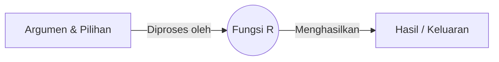
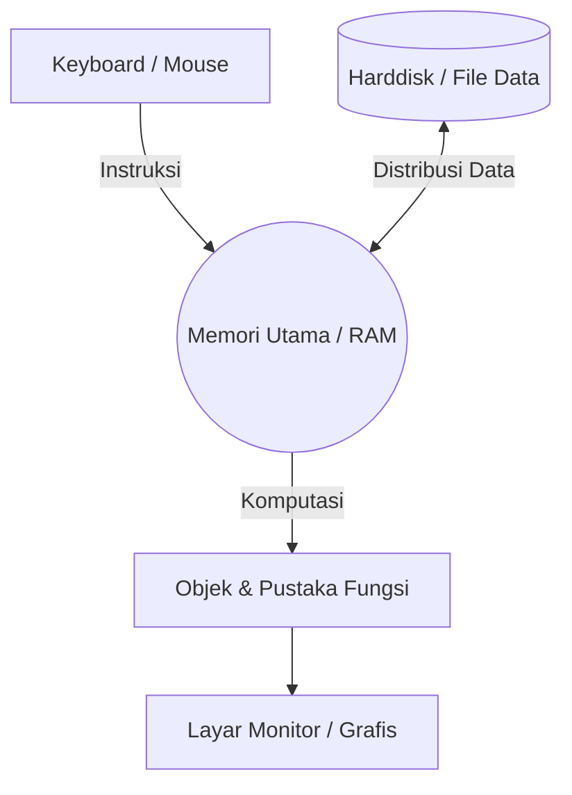

# Sesi 1

## Pengenalan Bahasa Pemrograman R

R adalah perangkat lunak *open-source* yang dirancang khusus untuk analisis statistik, komputasi matriks, dan visualisasi data grafis. Bahasa pemrograman ini memiliki kapabilitas komprehensif yang mencakup pengelolaan data dasar, manipulasi operasional pada *array* atau matriks, hingga penyajian grafis yang dapat ditampilkan di monitor maupun dicetak.

## Arsitektur dan Mekanisme Kerja R

Sistem komputasi R digerakkan oleh **Fungsi**. Sebuah fungsi menerima masukan (argumen) berupa data atau rumus, memprosesnya dengan parameter dasar (*default*), dan menghasilkan sebuah keluaran empiris.

Secara operasional, R memanipulasi data melalui mekanisme pemindahan memori. Data ditarik dari media penyimpanan persisten (seperti *harddisk* atau internet) menuju memori utama (RAM) agar dapat dieksekusi oleh pustaka fungsi, lalu hasilnya divisualisasikan.

## Manajemen Direktori Kerja (*Workspace*)

Untuk mengelola lokasi penyimpanan dan pengambilan berkas saat R berjalan, pengguna memerlukan navigasi ruang kerja menggunakan fungsi berikut:

* **`getwd()`**: Mengidentifikasi dan menampilkan path direktori kerja yang sedang aktif saat ini.

* **`setwd("nama_direktori")`**: Memindahkan orientasi sistem ke direktori kerja yang baru.

* **`dir()`**: Menyajikan daftar seluruh berkas atau *file* yang terdapat di dalam direktori aktif.

## Pengelolaan Objek

Bahasa R menerapkan aturan *case-sensitive*, yang berarti penamaan variabel dengan huruf kapital dan huruf kecil (contoh: `Y` dan `y`) dianggap sebagai dua entitas yang berbeda. Nama objek wajib diawali oleh huruf dan hanya diizinkan untuk diikuti oleh kombinasi huruf, angka, titik, atau garis bawah (*underscore*).

| Perintah Operasional | Fungsi dan Signifikansi Akademis |
| --- | --- |
| `x <- 5` atau `24 -> x` | **Pembuatan Objek:** Menugaskan nilai numerik atau hasil fungsi ke dalam variabel (*assignment operator*).|
| `ls()` | **Penayangan:** Menampilkan daftar seluruh objek atau variabel yang saat ini tersimpan aktif di dalam RAM.|
| `ls(pat="^N")` | **Penyaringan Tampilan:** Menampilkan objek spesifik yang namanya berawalan dengan karakter tertentu (misal: "N").|
| `ls.str()` | **Inspeksi Struktur:** Menguraikan spesifikasi teknis objek, meliputi tipe data dan rincian nilainya.|
| `rm(x)` | **Penghapusan Tunggal:** Menghapus variabel spesifik (`x`) dari memori sistem.|
| `rm(list=ls())` | **Pembersihan Massal:** Mengeliminasi seluruh objek yang ada di dalam RAM secara serentak.|

## Pencarian Informasi Bantuan (*Help System*)

R menyediakan dokumentasi internal bawaan yang memuat rincian paket, deskripsi fungsi, opsi argumen, dan panduan penggunaan melalui dua pendekatan utama:

* **`help("nama_fungsi")`**: Menampilkan dokumentasi spesifik dari sebuah fungsi, mencakup deskripsi, cara penulisan (*usage*), rincian argumen, dan tipe keluaran (*value*).

* **`help.search("kata_kunci")`**: Melakukan pencarian global pada seluruh dokumentasi pustaka R yang memuat kata kunci spesifik (contoh: *cluster* atau *kmeans*).