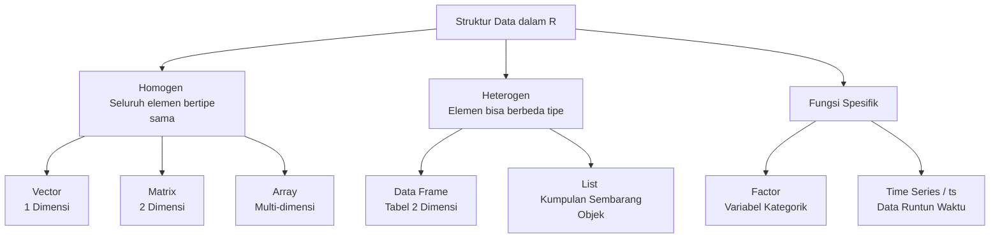

# Sesi 2

## Karakteristik Dasar Objek di R

Setiap objek di dalam ekosistem R didefinisikan oleh dua atribut intrinsik utama:

* **Mode (Tipe Data):** Mengklasifikasikan jenis nilai objek, seperti *numeric* (angka desimal/bulat), *character* (teks), *complex* (bilangan kompleks), atau *logical* (`TRUE`/`FALSE`).

* **Length (Panjang):** Mengukur total kuantitas elemen di dalam objek tersebut.

Selain itu, R mengenali hasil komputasi khusus, seperti `Inf` untuk bilangan tak hingga (dibagi nol) dan `NaN` (*Not a Number*) untuk operasi yang tidak terdefinisi secara matematis.

## Taksonomi Struktur Penyimpanan Data

Sistem R menyediakan berbagai wadah (*container*) data yang dibedakan berdasarkan dimensinya dan fleksibilitas tipe data (homogenitas).

Uraian fungsional dari masing-masing objek:

* **Vector, Matrix, & Array:** Struktur kaku yang hanya menampung satu tipe data yang sama (homogen). Vector digunakan untuk satu dimensi, Matrix untuk dua dimensi (baris-kolom), dan Array untuk lebih dari dua dimensi.

* **Factor:** Bekerja seperti vektor namun dioptimalkan khusus untuk pengelompokan variabel kategorik.

* **Data Frame:** Format tabular yang paling umum digunakan; memungkinkan setiap kolom memiliki mode tipe data yang berbeda, asalkan memiliki panjang baris yang sama.

* **List:** Struktur sangat fleksibel yang mampu menampung kombinasi objek apa pun, termasuk tipe *list* lain di dalamnya.

* **Time Series (`ts`):** Vektor atau matriks yang terikat secara kronologis dengan atribut waktu/tanggal dan frekuensi pencatatan.

## Impor dan Ekspor Data

Interaksi R dengan berkas data fisik di luar sistem dilakukan melalui fungsi baca-tulis berikut:

* **Impor (Membaca):** `read.table()` (format tabel umum), `read.csv()`/`read.csv2()` (berkas *Comma Separated Values*), dan `read.delim()`/`read.delim2()` (berkas yang dipisahkan oleh TAB). Fungsi `scan()` juga tersedia untuk memasukkan elemen menjadi matriks, vektor, atau list.

* **Ekspor (Menulis):** Hasil komputasi di RAM dapat disimpan ke *harddisk* menggunakan fungsi seperti `write.table()` atau `write.csv()`.

## Fungsi Pembangkitan Data Matematis

Untuk membangun deret observasi buatan atau menyusun pola data secara otomatis, R memfasilitasi operator dan fungsi bawaan:

* **Operator Titik Dua (`:`):** Membangun sekuens atau deret bilangan bulat berurutan, memiliki prioritas eksekusi tertinggi.

* **`seq()`:** Membangun deretan bilangan riil secara presisi dengan menentukan titik awal, titik akhir, interval, atau jumlah suku.

* **`c()` (Combine):** Menggabungkan sekumpulan elemen individual menjadi satu vektor kesatuan.

* **`rep()` (Replicate):** Mereplikasi atau menduplikasi elemen beserta pola tertentu secara berulang.

* **`expand.grid()`:** Membangun sebuah *data frame* dengan mengalkulasi dan menyusun seluruh kemungkinan kombinasi persilangan (faktorial) dari argumen yang diberikan.

## Video

[STATGEN CLASS 2023 #3 Komputer 1 (SATS4111) Pertemuan 2](https://www.youtube.com/watch?v=L2xSF19rSaQ)