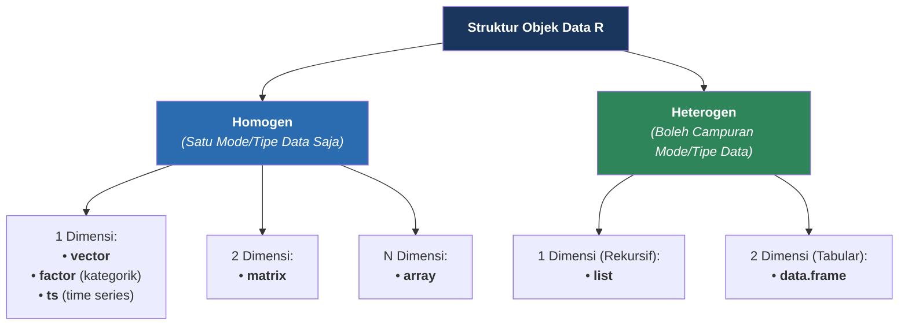
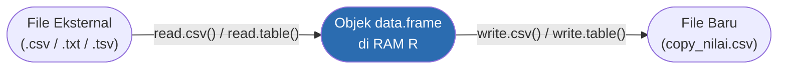

# Pertemuan 02: Data dalam Sistem R

* **Mata Kuliah:** Dasar Pemrograman R (`STIK4111`)
* **Program Studi:** Sistem Informasi — Universitas Terbuka
* **Topik:** Atribut Objek, Struktur Penyimpanan Data, Baca/Tulis File, dan Pembangkitan Data

---

## Daftar Isi
1. [Atribut Intrinsik dan Tipe Dasar Objek (`Mode` & `Length`)](#1-atribut-intrinsik-dan-tipe-dasar-objek-mode--length)
2. [Struktur Objek Penyimpanan Data di R](#2-struktur-objek-penyimpanan-data-di-r)
3. [Membaca dan Menulis File Data (Input/Output)](#3-membaca-dan-menulis-file-data-inputoutput)
4. [Fungsi Penting Pembangkitan (Pembuatan) Data](#4-fungsi-penting-pembangkitan-pembuatan-data)
5. [Referensi Resmi](#5-referensi-resmi)

---

## 1. Atribut Intrinsik dan Tipe Dasar Objek (`Mode` & `Length`)

Setiap objek di dalam sistem R memiliki dua atribut intrinsik (bawaan utama), yaitu:
1. **`mode` (Tipe Data):** Menunjukkan jenis nilai yang disimpan di dalam objek.
2. **`length` (Panjang):** Menunjukkan jumlah elemen yang terdapat di dalam objek tersebut.

### Jenis-Jenis Mode Dasar (Atomic Types)

| Mode / Tipe | Singkatan | Keterangan | Contoh Nilai |
| :--- | :---: | :--- | :--- |
| **Numeric** | `num` | Bilangan riil (desimal maupun bulat secara umum). | `3.91`, `5.89`, `10` |
| **Integer** | `int` | Bilangan bulat murni tanpa komponen pecahan (ditulis dengan akhiran `L`). | `3L`, `100L` |
| **Character** | `chr` | Teks atau alfanumerik (diapit tanda petik `""` atau `''`). | `"Matematika"`, `"G1"` |
| **Logical** | `log` | Nilai kebenaran logika boolean. | `TRUE`, `FALSE` |
| **Complex** | `cplx` | Bilangan kompleks (memiliki bagian riil dan imajiner `i`). | `2 + 3i` |

> **Catatan Tipe Khusus:**
> * **`Inf` / `-Inf` (*Infinity*):** Menandakan bilangan tak hingga positif atau negatif (misalnya hasil pembagian dengan nol `3.91 / 0`).
> * **`NaN` (*Not a Number*):** Menandakan hasil operasi matematika yang tidak terdefinisi secara numerik (misalnya `Inf - Inf` atau `0 / 0`).
> * **`NA` (*Not Available*):** Menandakan data yang hilang (*missing value*).

### Memeriksa Tipe dan Panjang Objek

```r
# Inisialisasi variabel
Jurusan <- "Matematika"
Lulus   <- TRUE
IPK     <- 3.91
Bulat   <- 5L

# Memeriksa mode dan class objek
mode(Jurusan)       # Output: "character"
class(IPK)          # Output: "numeric"
is.numeric(IPK)     # Output: TRUE
is.integer(IPK)     # Output: FALSE (karena default angka di R adalah double/numeric)
is.integer(Bulat)   # Output: TRUE

# Memeriksa panjang (jumlah elemen)
length(Jurusan)     # Output: 1

# Contoh nilai khusus (Inf dan NaN)
tak_hingga <- IPK / 0
tak_hingga          # Output: Inf
tak_hingga - tak_hingga # Output: NaN
```

---

## 2. Struktur Objek Penyimpanan Data di R

Secara umum, struktur data di R dikelompokkan berdasarkan **dimensi** dan **homogenitas tipe datanya** (apakah seluruh elemennya harus satu mode yang sama atau boleh campuran).



### Tabel Perbandingan Struktur Data

| Objek | Dimensi | Mode (Tipe) yang Didukung | Boleh Campuran Mode? | Karakteristik Utama |
| :--- | :---: | :--- | :---: | :--- |
| **`vector`** | 1D | Numerik, karakter, kompleks, logika | Tidak | Struktur paling dasar; kumpulan elemen satu tipe. |
| **`factor`** | 1D | Numerik atau karakter | Tidak | Khusus menyimpan data kategorik dengan atribut `Levels`. |
| **`matrix`** | 2D | Numerik, karakter, kompleks, logika | Tidak | Tabel 2 dimensi (baris $\times$ kolom) dengan tipe seragam. |
| **`array`** | $k$-D | Numerik, karakter, kompleks, logika | Tidak | Generalisasi matriks untuk dimensi lebih dari dua ($k \ge 1$). |
| **`ts`** | 1D / 2D | Numerik, karakter, kompleks, logika | Tidak | Data runtun waktu (*time series*) dengan informasi waktu & frekuensi. |
| **`data.frame`** | 2D | Semua mode dasar | **Ya** | Format standar tabel dataset di R; tiap kolom berupa vektor sama panjang. |
| **`list`** | 1D | Semua objek (termasuk `list` lain) | **Ya** | Wadah paling fleksibel; dapat menampung objek dengan panjang & tipe berbeda. |

### Contoh Implementasi Masing-Masing Struktur Data

```r
# 1. VECTOR: Kumpulan elemen bertipe sama menggunakan fungsi c() (combine)
x_vec <- c(3, 5, 8, 9, 12, 4)
is.vector(x_vec) # TRUE

# 2. FACTOR: Vektor khusus data kategorik
x_fac <- factor(c("a", "b", "g", "c", "a"))
x_fac            # Menampilkan elemen sekaligus Levels: a b c g
is.factor(x_fac) # TRUE

# 3. MATRIX: Array 2 dimensi (2 baris, 3 kolom) - diisi per kolom secara default
x_mat <- matrix(1:6, nrow = 2, ncol = 3)
is.matrix(x_mat) # TRUE

# 4. ARRAY: Tabel berdimensi k (contoh: 1 baris, 3 kolom, 2 lapisan)
x_arr <- array(1:6, dim = c(1, 3, 2))
is.array(x_arr)  # TRUE

# 5. DATA.FRAME: Tabel campuran tipe data dengan panjang baris yang sama
Nama  <- c("Tio", "Adi", "Eko", "Dio")
Kelas <- c("X", "XI", "X", "XII")
Nilai <- c(88, 78, 79, 90)
x_df  <- data.frame(Nama, Kelas, Nilai)

# 6. TS (Time Series): Data bulanan (freq = 12) dimulai Maret 2010
x_ts <- ts(1:15, start = c(2010, 3), frequency = 12)
is.ts(x_ts) # TRUE

# 7. LIST: Wadah bebas untuk berbagai objek
x_list <- list(Nama_Siswa = Nama, Tingkat = Kelas, Skor = Nilai)
is.list(x_list) # TRUE
```

---

## 3. Membaca dan Menulis File Data (Input/Output)

Untuk mengolah dataset eksternal (seperti file `.csv` atau `.txt`) maupun menyimpan hasil olahan data kembali ke penyimpanan permanen, R menyediakan fungsi pembacaan dan penulisan file.



### A. Fungsi Membaca Data (`Input`)

Fungsi induk untuk membaca file berbentuk tabel adalah **`read.table()`**, yang memiliki beberapa fungsi turunan (*wrapper*) siap pakai:

| Fungsi | Pemisah Kolom (*Separator*) | Tanda Desimal (*Decimal Point*) | Kegunaan Umum |
| :--- | :---: | :---: | :--- |
| `read.csv()` | Koma (`,`) | Titik (`.`) | Standar internasional file CSV (US/UK). |
| `read.csv2()` | Titik koma (`;`) | Koma (`,`) | Standar regional Eropa / Indonesia (ekspor Excel lokal). |
| `read.delim()` | Tab (`\t`) | Titik (`.`) | File teks berbatas Tab (*Tab-Separated Values*). |
| `read.delim2()` | Tab (`\t`) | Koma (`,`) | File teks berbatas Tab dengan format desimal koma. |
| `scan()` | Spasi / Baris baru | Titik (`.`) | Membaca data mentah secara fleksibel ke vektor atau list. |

### B. Fungsi Menulis Data (`Output`)

Untuk mengekspor objek `data.frame` atau `matrix` dari RAM ke dalam file penyimpanan, gunakan **`write.table()`** atau **`write.csv()`**.

```r
# 1. Mengatur direktori kerja tempat file berada
setwd("E:/dataR")

# 2. Membaca file CSV ke dalam objek data.frame
data1 <- read.csv("nilai.csv")

# Menampilkan struktur dan isi data1
head(data1)

# 3. Menyimpan kembali objek ke file CSV baru
# row.names = FALSE disarankan agar nomor baris R tidak ikut tertulis sebagai kolom baru
write.csv(data1, file = "copy_nilai.csv", row.names = FALSE)
```

---

## 4. Fungsi Penting Pembangkitan (Pembuatan) Data

R menyediakan berbagai fungsi efisien untuk membuat deret angka, pengulangan, maupun tabel kombinasi eksperimen secara otomatis tanpa perlu mengetik manual.

### 1. Operator Titik Dua (`:`)
Digunakan untuk membuat deretan bilangan bulat berurutan dengan selisih $1$ atau $-1$.
* **Catatan Prioritas:** Operator `:` memiliki prioritas eksekusi **lebih tinggi** daripada operator aritmatika (`+`, `-`, `*`, `/`). Misalnya, `1:5 + 1` akan dievaluasi sebagai `(1:5) + 1` menghasilkan `2, 3, 4, 5, 6`.

### 2. Fungsi `seq()` (*Sequence*)
Digunakan untuk membangun deret bilangan riil yang teratur dengan interval atau panjang tertentu.
* **Pola 1:** `seq(from, to, by = pertambahan)`
* **Pola 2:** `seq(from, to, length.out = jumlah_suku)`

### 3. Fungsi `c()` (*Combine*)
Digunakan untuk menggabungkan nilai-nilai bebas yang tidak memiliki pola deret tertentu menjadi satu vektor.

### 4. Fungsi `rep()` (*Replicate*)
Digunakan untuk mengulang elemen atau vektor sebanyak jumlah yang ditentukan.
* `rep(x, times = n)`: Mengulang seluruh vektor `x` sebanyak `n` kali secara berurutan.
* `rep(x, each = n)`: Mengulang **masing-masing elemen** di dalam `x` sebanyak `n` kali sebelum berpindah ke elemen berikutnya.

### 5. Fungsi `expand.grid()`
Digunakan untuk membentuk `data.frame` yang berisi **seluruh kombinasi faktorial** dari vektor-vektor argumen yang diberikan (sangat berguna dalam perancangan percobaan/eksperimen).

### Ilustrasi Praktik Pembangkitan Data

#### Ilustrasi 1: Membuat Dataset Wilayah & IPM
```r
Nomor <- 1:5
Kota  <- c("Bogor", "Padang", "Semarang", "Jakarta", "Aceh")
IPM   <- c(70.1, 68.9, 70.0, 72.9, 67.5)
X     <- seq(from = 10, to = 20, length.out = 5) # 5 angka berjarak sama dari 10 ke 20

data2 <- data.frame(Nomor, Kota, IPM, X)
print(data2)
```

#### Ilustrasi 2: Membuat Tabel Rancangan Percobaan (Menggunakan `rep()` vs `expand.grid()`)
```r
# Cara 1: Menggunakan kombinasi fungsi rep()
Perlakuan1 <- rep(c("A1", "A2"), times = 4)
Perlakuan2 <- rep(rep(c("B1", "B2"), each = 2), times = 2)
Ulangan    <- rep(c(1, 2), each = 4)

data3 <- data.frame(Perlakuan1, Perlakuan2, Ulangan)

# Cara 2: Menggunakan fungsi expand.grid() (Jauh lebih ringkas dengan hasil identik!)
data3_grid <- expand.grid(
  Perlakuan1 = c("A1", "A2"),
  Perlakuan2 = c("B1", "B2"),
  Ulangan    = c(1, 2)
)

print(data3_grid)
```

---

## 5. Referensi Resmi

1. **Modul UT:** Materi Inisiasi 2 — *Data dalam Sistem R*, Mata Kuliah Dasar Pemrograman R (`STIK4111`), Universitas Terbuka.
2. **R Core Team:** *An Introduction to R — Objects, their modes and attributes*: <https://cran.r-project.org/doc/manuals/r-release/R-intro.html#Objects>
3. **R Language Definition:** *Basic Types & Data Structures*: <https://cran.r-project.org/doc/manuals/r-release/R-lang.html#Basic-types>
4. **R Documentation (Utils & Base Packages):**
   * Data Input (`read.table` / `read.csv`): <https://stat.ethz.ch/R-manual/R-devel/library/utils/html/read.table.html>
   * Data Output (`write.table` / `write.csv`): <https://stat.ethz.ch/R-manual/R-devel/library/utils/html/write.table.html>
   * Sequence & Replicate (`seq`, `rep`, `expand.grid`): <https://stat.ethz.ch/R-manual/R-devel/library/base/html/seq.html>
