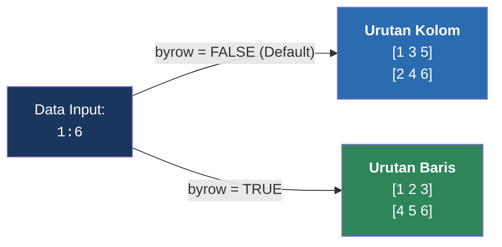
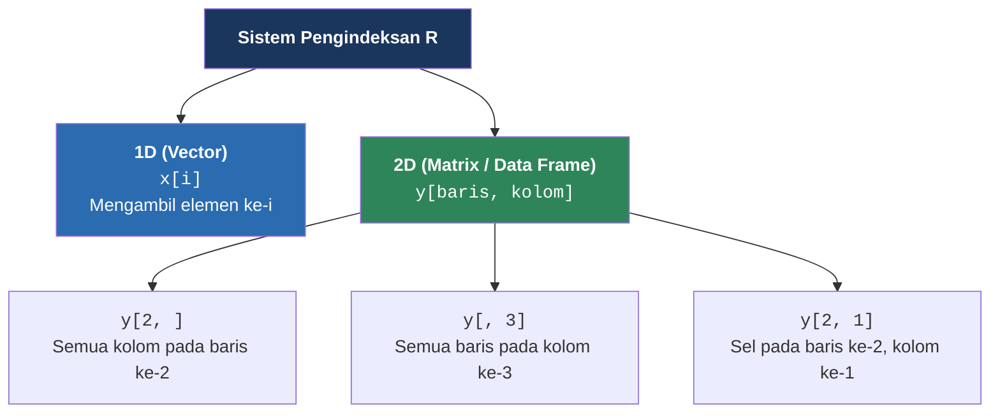

# Pertemuan 03: Pengantar Pengolahan Objek

* **Mata Kuliah:** Dasar Pemrograman R (`STIK4111`)
* **Program Studi:** Sistem Informasi — Universitas Terbuka
* **Topik:** Pembuatan & Pengolahan Objek (`Vector`, `Factor`, `Matrix`, `Data Frame`, `List`, `Time Series`), Konversi Tipe Data, Pengindeksan, dan Operasi Vektor

## Daftar Isi

1. [Pengolahan Objek Utama dalam R](#1-pengolahan-objek-utama-dalam-r)
   * [A. Vector](#a-vector)
   * [B. Factor (Nominal vs Ordinal)](#b-factor-nominal-vs-ordinal)
   * [C. Matrix](#c-matrix)
   * [D. Data Frame & Aturan Recycling](#d-data-frame--aturan-recycling)
   * [E. List](#e-list)
   * [F. Time Series (`ts`)](#f-time-series-ts)
2. [Konversi dan Perbandingan Objek](#2-konversi-dan-perbandingan-objek)
3. [Sistem Pengindeksan (*Indexing*)](#3-sistem-pengindeksan-indexing)
4. [Fungsi & Operator Aritmatika Vektor](#4-fungsi--operator-aritmatika-vektor)
5. [Referensi Resmi](#5-referensi-resmi)

---

## 1. Pengolahan Objek Utama dalam R

### A. Vector

**Vector** adalah struktur data paling fundamental di R yang menyimpan kumpulan nilai dengan **satu tipe data yang sama** (homogen).

| Fungsi Pembuat | Kegunaan | Contoh |
| :--- | :--- | :--- |
| `c(...)` | Menggabungkan (*combine*) elemen bebas menjadi satu vektor. | `c(1, 5, 4, 6)` |
| `assign("nama", ...)` | Menetapkan nilai ke dalam nama variabel secara terprogram. | `assign("a3", c(5, 4, 6, 3))` |
| `seq(from, to, by)` | Membuat deret bilangan dengan selisih (*step*) atau panjang tertentu. | `seq(1, 10, by = 2)` |
| `rep(x, times / each)` | Mengulang elemen atau seluruh vektor secara teratur. | `rep(1:3, each = 2)` |
| `paste(..., sep = "")` | Menggabungkan teks dan angka menjadi vektor karakter berpola. | `paste("X", 1:5, sep = "")` |

```r
# 1. Vektor bilangan berurutan & bebas
a0 <- 1:12
a1 <- c(1, 5, 4, 6, 7, 3)
a2 <- c("Budi", "Ani", "Bambang") # Vektor karakter
assign("a3", c(5, 4, 6, 3))      # Sama dengan a3 <- c(5, 4, 6, 3)

# 2. Vektor deret teratur
a4 <- seq(1, 10, by = 2)         # Output: 1 3 5 7 9
a5 <- seq(1, 10, length.out = 5) # Output: 1.00 3.25 5.50 7.75 10.00

# 3. Vektor pengulangan
a6 <- rep(1:3, times = 2)        # Output: 1 2 3 1 2 3
a7 <- rep(1:3, each = 2)         # Output: 1 1 2 2 3 3

# 4. Vektor karakter beraturan
a8 <- paste("X", 1:5, sep = "")  # Output: "X1" "X2" "X3" "X4" "X5"
```

---

### B. Factor (Nominal vs Ordinal)

**Factor** digunakan untuk merepresentasikan variabel kategorik. Secara internal, R menyimpan kategori sebagai bilangan bulat (*integer*) yang dipetakan ke label teks (`Levels`).

* **Skala Nominal (`factor()`):** Kategori tidak memiliki tingkatan/urutan (contoh: jenis kelamin, kota asal).
* **Skala Ordinal (`ordered()`):** Kategori memiliki urutan hierarkis yang jelas (contoh: tingkat pendidikan, tingkat kepuasan).

```r
tp0 <- c("SD", "SMP", "SMP", "SMA", "SD", "SMP")

# Skala Nominal (urutan level default berdasarkan abjad: SD, SMA, SMP)
tp1 <- factor(tp0)

# Skala Ordinal dengan urutan level yang didefinisikan eksplisit
tp4 <- ordered(tp0, levels = c("SD", "SMP", "SMA"))
tp4
# Output:
# [1] SD  SMP SMP SMA SD  SMP
# Levels: SD < SMP < SMA
```

---

### C. Matrix

**Matrix** adalah vektor 1 dimensi yang diberi atribut dimensi tambahan (`dim = c(nrow, ncol)`) sehingga membentuk tabel 2 dimensi yang homogen.

```r
matrix(data = NA, nrow = 1, ncol = 1, byrow = FALSE, dimnames = NULL)
```

* **`byrow = FALSE` (Default):** Elemen diisi ke bawah mengikuti kolom terlebih dahulu (*column-major order*).
* **`byrow = TRUE`:** Elemen diisi ke samping mengikuti baris terlebih dahulu (*row-major order*).



```r
# Matriks 3x4 dengan semua elemen bernilai konstanta 8
m1 <- matrix(8, nrow = 3, ncol = 4)

# Matriks 2x3 diisi per kolom (default)
m2 <- matrix(1:6, nrow = 2, ncol = 3)

# Matriks 2x3 diisi per baris
m3 <- matrix(1:6, nrow = 2, ncol = 3, byrow = TRUE)
```

---

### D. Data Frame & Aturan Recycling

**Data Frame** adalah struktur data berbentuk tabel di mana setiap kolom merupakan vektor dengan panjang yang sama, namun **tiap kolom boleh memiliki tipe data yang berbeda**.

> **Aturan *Vector Recycling*:** Jika vektor-vektor yang dimasukkan ke dalam `data.frame()` memiliki panjang yang berbeda, vektor yang lebih pendek akan **diulang secara otomatis** hingga menyamai panjang vektor terpanjang (dengan syarat panjang vektor terpanjang merupakan kelipatan bulat dari vektor yang lebih pendek).

```r
# Contoh 1: Recycling skalar (panjang 1 diulang 5 kali)
a <- 1:5
b <- 4
df1 <- data.frame(a, b)

# Contoh 2: Recycling vektor (panjang 2 diulang 3 kali agar menjadi 6 baris)
a1 <- 1:6
b1 <- c(2, 4)
df2 <- data.frame(a1, b1) # Kolom b1 berisi: 2, 4, 2, 4, 2, 4
```

---

### E. List

**List** adalah wadah objek paling fleksibel di R. Berbeda dengan `data.frame`, elemen-elemen di dalam `list` **tidak harus memiliki panjang atau dimensi yang sama**, dan dapat memuat objek apa pun (vektor, matriks, fungsi, bahkan `list` lain).

```r
x1 <- 1:5
x2 <- c("G1", "F1", "H1")
x3 <- matrix(1:6, nrow = 2, ncol = 3)

my_list <- list(Angka = x1, Kode = x2, Matriks = x3)
```

---

### F. Time Series (`ts`)

Objek **`ts`** digunakan untuk menyimpan data runtun waktu yang terikat pada periode kalender dan frekuensi pengamatan tertentu:

* `frequency = 12`: Data bulanan (*monthly*).
* `frequency = 4`: Data kuartalan (*quarterly*).
* `frequency = 1`: Data tahunan (*annual*).

```r
# Data bulanan dimulai dari bulan ke-2 (Februari) tahun 2016
ts_bulanan <- ts(1:15, frequency = 12, start = c(2016, 2))

# Data kuartalan dimulai dari Kuartal 2 tahun 2016
ts_kuartal <- ts(1:6, frequency = 4, start = c(2016, 2))
```

---

## 2. Konversi dan Perbandingan Objek

### Konversi Mode (*Coercion*)

Untuk mengubah tipe data suatu objek secara eksplisit, gunakan keluarga fungsi `as.*()`:

| Target Tipe Data | Fungsi Konversi | Catatan Penting |
| :--- | :--- | :--- |
| **Numerik** | `as.numeric(x)` | Mengonversi `factor` akan menghasilkan kode bilangan bulat internal levelnya (`1, 2, ...`). |
| **Logikal** | `as.logical(x)` | Angka `0` menjadi `FALSE`; angka selain nol menjadi `TRUE`. |
| **Karakter** | `as.character(x)` | Mengubah angka atau faktor menjadi teks (*string*). |

```r
status <- factor(c("Lulus", "Tidak lulus"))
as.numeric(status)   # Output: 1 2 (sesuai urutan alfabetis Levels)
as.character(status) # Output: "Lulus" "Tidak lulus"
```

### Operator Perbandingan & Kesetaraan Objek

* **Operator Perbandingan Elemen:** `==` (sama dengan), `!=` (tidak sama dengan), `<`, `<=`, `>`, `>=`.
* **`identical(x, y)`:** Memeriksa apakah dua objek **identik secara mutlak** (baik nilai, tipe data, maupun atribut penyimpanannya).
* **`all.equal(x, y)`:** Memeriksa kesetaraan dengan **toleransi pembulatan angka desimal** (*floating-point tolerance*).

```r
x <- 2:4
y <- 1:3

x == y                 # FALSE FALSE FALSE
x >= y                 # TRUE TRUE TRUE
identical(10, 25 - 15) # TRUE
all.equal(10, 25 - 15) # TRUE
```

---

## 3. Sistem Pengindeksan (*Indexing*)

Pengindeksan menggunakan tanda kurung siku `[...]` digunakan untuk mengekstrak, memfilter, atau memodifikasi elemen tertentu pada objek. **Catatan:** Indeks di R selalu dimulai dari angka **`1`** (bukan `0`).



```r
# 1. Pengindeksan pada Vector
x <- 5:9        # Isi: 5, 6, 7, 8, 9
x[2]            # Mengambil elemen ke-2 -> Output: 6
x[2] <- 4       # Mengubah elemen ke-2 menjadi 4 -> Isi baru: 5, 4, 7, 8, 9

# 2. Pengindeksan pada Matrix
y <- matrix(1:6, nrow = 2, ncol = 3)
y[2, ]          # Mengambil seluruh baris ke-2 -> Output: 2 4 6
y[, 3]          # Mengambil seluruh kolom ke-3 -> Output: 5 6
y[2, 1]         # Mengambil baris ke-2, kolom ke-1 -> Output: 2
```

---

## 4. Fungsi & Operator Aritmatika Vektor

Operasi aritmatika di R bersifat **vektorisasi (*vectorized*)**, artinya operasi matematika langsung diterapkan ke setiap pasangan elemen pada posisi yang bersesuaian (*element-wise*) tanpa perlu menulis perulangan (*loop*) manual.

```r
# Menggabungkan dua deret dengan seq() dan c()
deret_gabungan <- c(seq(1, 2, by = 0.3), seq(4, 5, by = 0.25))

# Operasi aritmatika antar-vektor (element-wise)
p <- rep(8, times = 5) # [8, 8, 8, 8, 8]
q <- 6:10              # [6, 7, 8, 9, 10]

r <- p + q             # Penjumlahan -> [14, 15, 16, 17, 18]
s <- q - p             # Pengurangan -> [-2, -1, 0, 1, 2]
t <- p * q             # Perkalian elemen -> [48, 56, 64, 72, 80]
```

---

## 5. Referensi Resmi

1. **Modul UT:** Materi Inisiasi 3 — *Pengantar Pengolahan Objek*, Mata Kuliah Dasar Pemrograman R (`STIK4111`), Universitas Terbuka.
2. **R Core Team:** *An Introduction to R — Simple manipulations; numbers and vectors*: <https://cran.r-project.org/doc/manuals/r-release/R-intro.html#Simple-manipulations-numbers-and-vectors>
3. **R Core Team:** *An Introduction to R — Arrays and matrices*: <https://cran.r-project.org/doc/manuals/r-release/R-intro.html#Arrays-and-matrices>
4. **R Core Team:** *An Introduction to R — Lists and data frames*: <https://cran.r-project.org/doc/manuals/r-release/R-intro.html#Lists-and-data-frames>
5. **R Documentation (Stats & Base Packages):**
   * Time-Series Objects (`ts`): <https://stat.ethz.ch/R-manual/R-devel/library/stats/html/ts.html>
   * Factors (`factor` & `ordered`): <https://stat.ethz.ch/R-manual/R-devel/library/base/html/factor.html>