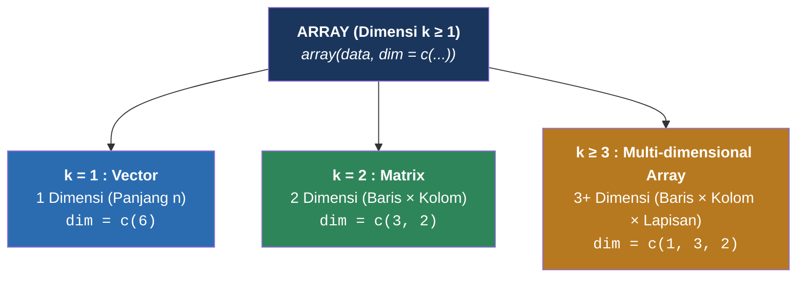
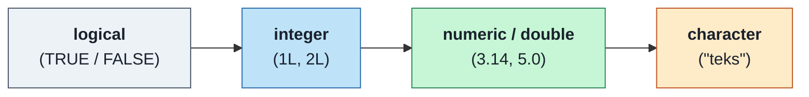
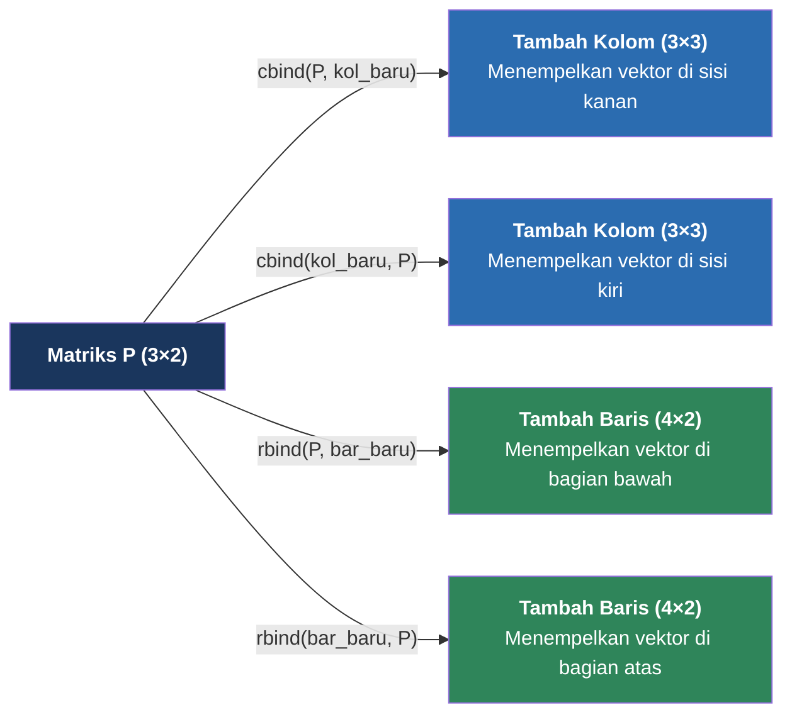

# Pertemuan 04: Penggunaan Array dan Matrix

* **Mata Kuliah:** Dasar Pemrograman R (`STIK4111`)
* **Program Studi:** Sistem Informasi — Universitas Terbuka
* **Topik:** Konsep Dimensi Array ($k \ge 1$), Objek Array 1D (Vektor), Objek Array 2D (Matriks), dan Operator Aljabar Matriks

## Daftar Isi

1. [Konsep Umum Array dalam R](#1-konsep-umum-array-dalam-r)
2. [Objek Array Satu Dimensi (Vektor)](#2-objek-array-satu-dimensi-vektor)
   * [Aturan Coercion Otomatis](#aturan-coercion-otomatis)
   * [Teknik Ekstraksi (Subsetting) Vektor](#teknik-ekstraksi-subsetting-vektor)
3. [Objek Array Dua Dimensi (Matriks)](#3-objek-array-dua-dimensi-matriks)
4. [Operator dan Fungsi Aljabar Matriks](#4-operator-dan-fungsi-aljabar-matriks)
5. [Penggabungan Baris dan Kolom (`rbind` & `cbind`)](#5-penggabungan-baris-dan-kolom-rbind--cbind)
6. [Referensi Resmi](#6-referensi-resmi)

---

## 1. Konsep Umum Array dalam R

Secara fundamental, **Array** di R adalah objek tabel berdimensi $k$ (dengan $k \ge 1$) yang menyimpan elemen dengan **satu tipe data yang sama** (homogen). Pada hakikatnya, array hanyalah sebuah vektor sederhana yang diberi atribut tambahan berupa dimensi (`dim`) dan opsional nama dimensi (`dimnames`).



### Pembuatan Array Multi-Dimensi

```r
# Array 1 dimensi (ekuivalen dengan vektor panjang 6)
arr_1d <- array(1:6, dim = c(6))

# Array 2 dimensi (ekuivalen dengan matriks 3 baris x 2 kolom)
arr_2d <- array(1:6, dim = c(3, 2))

# Array 3 dimensi (1 baris x 3 kolom x 2 lapisan matriks)
arr_3d <- array(1:6, dim = c(1, 3, 2))
```

---

## 2. Objek Array Satu Dimensi (Vektor)

### Aturan Coercion Otomatis

Karena vektor bersifat **homogen**, R tidak mengizinkan pencampuran dua atau lebih tipe data (*mode*) yang berbeda di dalam satu vektor. Jika pengguna menggabungkan tipe data berbeda menggunakan `c()`, R akan otomatis melakukan konversi paksa (*implicit coercion*) ke tipe data yang paling umum sesuai hierarki berikut:



```r
# Logical digabung dengan Numeric -> semua diubah menjadi Numeric (FALSE = 0, TRUE = 1)
c(FALSE, 1:5)
# Output: [1] 0 1 2 3 4 5

# Character digabung dengan Logical -> semua diubah menjadi Character
c("a", TRUE, FALSE, "b")
# Output: [1] "a" "TRUE" "FALSE" "b"
```

### Teknik Ekstraksi (Subsetting) Vektor

Ekstraksi elemen vektor dilakukan menggunakan kurung siku `[...]` berdasarkan posisi indeks, indeks negatif (pengecualian), maupun kondisi logika:

```r
v <- c(6, 5, 17, 16, 3, 19, 7, 10, 20, 21)

# 1. Ekstraksi berdasarkan posisi indeks tunggal
v[3]            # Elemen ke-3 -> Output: 17

# 2. Ekstraksi beberapa posisi indeks sekaligus
v[c(2, 6, 7)]   # Elemen ke-2, ke-6, dan ke-7 -> Output: 5 19 7

# 3. Ekstraksi dengan pengecualian (indeks negatif)
v[-c(7, 9)]     # Semua elemen KECUALI indeks ke-7 dan ke-9

# 4. Ekstraksi berdasarkan kondisi logika (boolean filtering)
v[v > 6]        # Semua elemen yang nilainya lebih besar dari 6

# Menyimpan hasil ekstraksi ke objek vektor baru
r <- v[v > 6]
```

---

## 3. Objek Array Dua Dimensi (Matriks)

**Matriks** adalah array dua dimensi yang dapat dibuat menggunakan fungsi `matrix()` maupun `array()`.

```r
# Keempat perintah berikut menghasilkan matriks 3x2 yang identik (diisi per kolom):
A <- matrix(c(10, 11, 12, 13, 14, 15), nrow = 3, ncol = 2)
B <- matrix(10:15, nrow = 3, ncol = 2)
C <- matrix(10:15, nrow = 3)
D <- matrix(10:15, 3)

# Pengisian matriks berdasarkan baris (byrow = TRUE)
data <- c(-2, 3, 4, -3, -4, 7)
E <- matrix(data, nrow = 2, ncol = 3, byrow = TRUE)

# Memeriksa atribut matriks
dim(E)      # Dimensi matriks -> Output: [1] 2 3 (2 baris, 3 kolom)
length(E)   # Total elemen -> Output: [1] 6
mode(E)     # Tipe data -> Output: [1] "numeric"
```

---

## 4. Operator dan Fungsi Aljabar Matriks

R membedakan dengan tegas antara operasi matematika **elemen demi elemen (*element-wise*)** dan operasi **aljabar linear matriks**. *(Catatan: Pada tampilan PDF sering kali simbol persen `%` mengalami kesalahan OCR; berikut adalah sintaks operator resmi R yang benar).*

| Operator / Fungsi | Nama Operasi | Keterangan & Rumus Matematis |
| :--- | :--- | :--- |
| `*` | Perkalian *Element-wise* | Mengalikan elemen pada posisi baris dan kolom yang sama ($A_{ij} \times B_{ij}$). |
| `%*%` | Perkalian Matriks Aljabar | Perkalian dot matriks standar ($A_{m \times n} \times B_{n \times p}$). |
| `%o%` | *Outer Product* | Perkalian luar dua vektor atau matriks ($A \otimes B$, ekuivalen `outer(A, B)`). |
| `t(X)` | Transpose Matriks | Menukar posisi baris menjadi kolom ($X^T$). |
| `solve(G)` | Invers Matriks | Mencari matriks balikan $G^{-1}$ (syarat: matriks persegi dan determinan $\neq 0$). |
| `crossprod(X)` | *Cross Product* | Menghitung perkalian transpose matriks secara efisien: $X^T X$ (`t(X) %*% X`). |

### Ilustrasi Kode Operasi Vektor & Matriks

```r
# 1. Operasi pada Vektor
x <- 6:10
x * x          # Perkalian element-wise -> [1] 36 49 64 81 100
crossprod(x)   # Cross product t(x) %*% x -> Output matriks 1x1 bernilai 330

# 2. Perkalian Element-wise (*) vs Perkalian Matriks (%*%)
F <- matrix(3:11, nrow = 3, ncol = 3)

F * F          # Setiap elemen dikuadratkan (contoh baris 1 kolom 1: 3*3 = 9)
F %*% F        # Perkalian matriks aljabar (baris 1 kolom 1: 3*3 + 6*4 + 9*5 = 78)

# 3. Invers dan Transpose Matriks Persegi
G <- matrix(c(3, 10, 8, 1, 6, 9, 4, 1, 1), nrow = 3, ncol = 3)

H <- solve(G)  # Menghitung matriks invers G^(-1)
J <- t(G)      # Menghitung matriks transpose G^T
```

---

## 5. Penggabungan Baris dan Kolom (`rbind` & `cbind`)

Untuk menambahkan baris baru atau kolom baru ke dalam matriks yang sudah ada, R menyediakan fungsi `cbind()` (*column bind*) dan `rbind()` (*row bind*).



```r
# Matriks awal P berukuran 3 baris x 2 kolom
P <- matrix(c(10, 11, 12, 13, 14, 15), nrow = 3, ncol = 2)

# 1. Menambahkan kolom baru menggunakan cbind()
P1 <- cbind(P, c(16, 18, 19))   # Menjadi kolom ke-3 (di sebelah kanan P)
P2 <- cbind(c(16, 18, 19), P)   # Menjadi kolom ke-1 (di sebelah kiri P)

# 2. Menambahkan baris baru menggunakan rbind()
P3 <- rbind(P, c(18, 20))       # Menjadi baris ke-4 (di bagian bawah P)
P4 <- rbind(c(14, 16), P)       # Menjadi baris ke-1 (di bagian atas P)
```

> **Syarat Dimensi:**
> * Saat menggunakan `cbind()`, panjang vektor yang ditambahkan harus sama dengan **jumlah baris** matriks (`nrow`).
> * Saat menggunakan `rbind()`, panjang vektor yang ditambahkan harus sama dengan **jumlah kolom** matriks (`ncol`).

---

## 6. Referensi Resmi

1. **Modul UT:** Materi Inisiasi 4 — *Penggunaan Array dan Matrix*, Mata Kuliah Dasar Pemrograman R (`STIK4111`), Universitas Terbuka.
2. **R Core Team:** *An Introduction to R — Arrays and matrices*: <https://cran.r-project.org/doc/manuals/r-release/R-intro.html#Arrays-and-matrices>
3. **R Core Team:** *An Introduction to R — Matrix facilities (Multiplication, Inversion, Crossprod)*: <https://cran.r-project.org/doc/manuals/r-release/R-intro.html#Matrix-facilities>
4. **R Documentation (Base Package):**
   * Matrix Multiplication (`%*%`): <https://stat.ethz.ch/R-manual/R-devel/library/base/html/matmult.html>
   * Solve Systems of Equations / Matrix Inversion (`solve`): <https://stat.ethz.ch/R-manual/R-devel/library/base/html/solve.html>
   * Combine R Objects by Rows or Columns (`cbind` & `rbind`): <https://stat.ethz.ch/R-manual/R-devel/library/base/html/cbind.html>