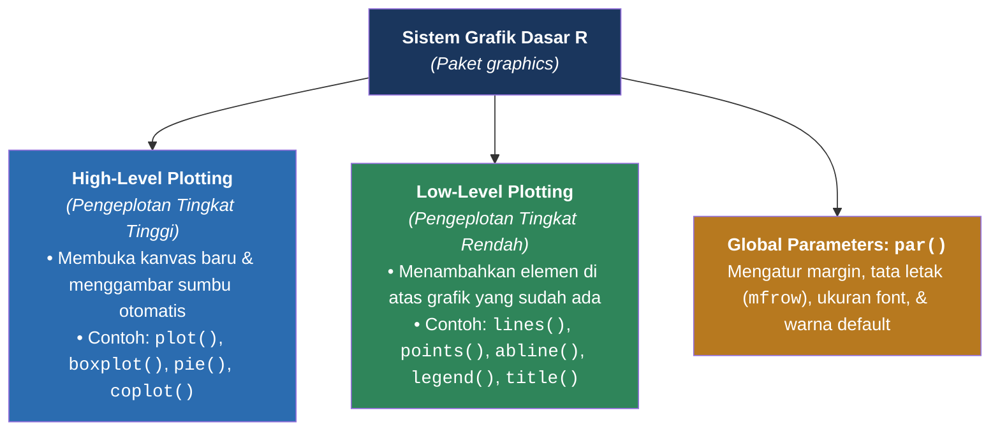
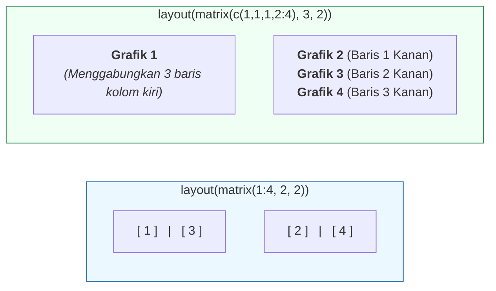

# Pertemuan 05: Bekerja dengan Grafik di Lingkungan R

* **Mata Kuliah:** Dasar Pemrograman R (`STIK4111`)
* **Program Studi:** Sistem Informasi — Universitas Terbuka
* **Topik:** Arsitektur Grafik R, *Graphics Devices*, Partisi Kanvas Grafik (`layout` & `split.screen`), dan Fungsi Pengeplotan Dasar (`plot`, `sunflowerplot`, `pie`, `boxplot`, `stripchart`, `coplot`, `interaction.plot`)

---

## Daftar Isi

1. [Dasar-Dasar Sistem Grafik di R](#1-dasar-dasar-sistem-grafik-di-r)
2. [Manajemen *Graphics Devices* (Perangkat Keluaran)](#2-manajemen-graphics-devices-perangkat-keluaran)
3. [Membuat Partisi Kanvas Grafik](#3-membuat-partisi-kanvas-grafik)
4. [Fungsi Pembuat Grafik Utama & Kustomisasi](#4-fungsi-pembuat-grafik-utama--kustomisasi)
   * [A. `plot()` dan Parameter Kustomisasinya](#a-plot-dan-parameter-kustomisasinya)
   * [B. `sunflowerplot()`](#b-sunflowerplot)
   * [C. `pie()` dan `boxplot()`](#c-pie-dan-boxplot)
   * [D. `stripchart()`](#d-stripchart)
   * [E. `coplot()` (Conditioning Plot)](#e-coplot-conditioning-plot)
   * [F. `interaction.plot()`](#f-interactionplot)
5. [Referensi Resmi](#5-referensi-resmi)

---

## 1. Dasar-Dasar Sistem Grafik di R

Dalam paket inti `graphics` di R, fungsi pembuatan visualisasi dibagi menjadi dua kategori utama berdasarkan cara kerjanya di atas kanvas (*graphics device*):



* **High-Level Plotting Functions:** Menghasilkan grafik baru secara lengkap (beserta sumbu koordinat, label, dan batas nilai otomatis).
* **Low-Level Plotting Functions:** Menambahkan komponen tambahan (seperti garis tren, titik baru, teks anotasi, atau legenda) ke grafik yang sedang aktif.
* **Fungsi `par()`:** Digunakan untuk melihat atau mengubah parameter grafik global yang nilai *default*-nya telah ditetapkan sistem.

---

## 2. Manajemen *Graphics Devices* (Perangkat Keluaran)

**Graphics Device** adalah media tujuan tempat grafik dirender—bisa berupa jendela layar interaktif maupun file dokumen yang tersimpan di penyimpanan (*harddisk*).

| Perintah / Fungsi | Kegunaan |
| :--- | :--- |
| `?device` | Melihat daftar lengkap seluruh perangkat grafik yang didukung oleh sistem R. |
| `dev.list()` | Menampilkan daftar perangkat grafik yang sedang aktif/terbuka saat ini. |
| `pdf("nama_file.pdf")` | Membuka perangkat file PDF untuk menyimpan hasil plot berikutnya. |
| `png("nama_file.png")` | Membuka perangkat file gambar PNG untuk menyimpan hasil plot berikutnya. |
| `postscript("file.ps")` | Membuka perangkat file PostScript (`.ps`). |
| `dev.off()` | **Menutup** perangkat grafik aktif (wajib dipanggil agar file PDF/PNG selesai ditulis dan dapat dibuka). |

```r
# Contoh menyimpan grafik langsung ke file PDF
pdf("grafik_output.pdf")
plot(1:10, (1:10)^2, main = "Grafik Kuadrat")
dev.off() # Menutup device dan menyimpan file ke working directory
```

---

## 3. Membuat Partisi Kanvas Grafik

Untuk membandingkan beberapa grafik secara berdampingan dalam satu jendela tampilan, kanvas grafik dapat dipartisi menggunakan `par(mfrow=...)`, `split.screen()`, atau `layout()`.

### A. Menggunakan `split.screen()`

Membagi jendela grafik aktif menjadi kisi-kisi layar (*screen*) bernomor:

```r
# Membagi kanvas menjadi 1 baris dan 2 kolom (menghasilkan screen 1 dan screen 2)
split.screen(c(1, 2))

screen(1)           # Mengaktifkan bagian layar ke-1
plot(1:5)

screen(2)           # Mengaktifkan bagian layar ke-2
boxplot(1:10)

erase.screen(1)     # Menghapus isi pada screen nomor 1
close.screen(all = TRUE) # Menutup mode split.screen
```

### B. Menggunakan `layout()`

Fungsi `layout()` memberikan fleksibilitas lebih tinggi karena dapat menggabungkan beberapa sel kisi menjadi satu area grafik yang lebih besar menggunakan matriks indeks.



```r
# Contoh 1: Membagi kanvas menjadi 4 bagian simetris (2 baris x 2 kolom)
layout(matrix(1:4, nrow = 2, ncol = 2))
layout.show(4) # Menampilkan pratinjau kotak partisi

# Contoh 2: Partisi asimetris (kolom kiri digabung menjadi 1 area besar untuk grafik ke-1)
def <- matrix(c(1, 1, 1, 2, 3, 4), nrow = 3, ncol = 2)
layout(def)
layout.show(4)

# Mengembalikan kanvas ke tata letak tunggal (default)
par(mfrow = c(1, 1))
```

---

## 4. Fungsi Pembuat Grafik Utama & Kustomisasi

### A. `plot()` dan Parameter Kustomisasinya

`plot()` adalah fungsi generik utama untuk menggambar diagram pencar (*scatter plot*) atau grafik garis.

* **`plot(x)`:** Memplot nilai vektor `x` pada sumbu vertikal ($y$) terhadap urutan indeksnya ($1, 2, \dots, n$) pada sumbu horizontal ($x$).
* **`plot(x, y)`:** Memplot pasangan koordinat $(x_i, y_i)$ pada bidang Kartesius dua dimensi.

#### Daftar Argumen Kustomisasi `plot()`

```r
plot(x, y, type = ..., lty = ..., lwd = ..., col = ...,
     main = ..., sub = ..., xlab = ..., ylab = ..., pch = ...)
```

| Argumen | Kepanjangan / Arti | Pilihan Nilai Umum |
| :--- | :--- | :--- |
| **`type`** | Tipe tampilan plot | `"p"` (titik/points), `"l"` (garis/lines), `"b"` (keduanya terpisah), `"o"` (garis menimpa titik), `"h"` (garis vertikal seperti histogram). |
| **`lty`** | *Line Type* (jenis garis) | `1` (solid/utuh), `2` (dashed/putus-putus), `3` (dotted/titik-titik), `4` (dotdash). |
| **`lwd`** | *Line Width* (ketebalan garis) | Angka positif (default `1`; misal `2` atau `3` untuk garis lebih tebal). |
| **`col`** | *Color* (warna plot) | Angka indeks (`1` hitam, `2` merah, `3` hijau, `4` biru) atau nama warna (`"red"`, `"steelblue"`). |
| **`pch`** | *Plotting Character* (simbol titik) | Angka `0`–`25` (misal `1` lingkaran, `16` lingkaran penuh, `17` segitiga) atau karakter tunggal seperti `"+"`, `"*"`, `"w"`. |
| **`main`** | Judul utama grafik | Teks string, misal `"Hubungan Variabel X dan Y"`. |
| **`sub`** | Anak judul (di bagian bawah) | Teks string keterangan tambahan. |
| **`xlab` / `ylab`** | Label sumbu-X dan sumbu-Y | Teks string nama variabel masing-masing sumbu. |

```r
x <- c(5, 3, 1, 9, 8, 3)
y <- c(8, 6, 2, 7, 4, 1)

# Plot dengan garis menimpa titik ('o'), garis putus-putus (lty=2), dan simbol '+'
plot(x, y, type = "o", lty = 2, pch = "+",
     main = "Contoh Kustomisasi Plot", xlab = "Sumbu X", ylab = "Sumbu Y")

# Plot dengan titik & garis ('b'), garis titik-titik tebal merah, simbol huruf 'w'
plot(x, y, type = "b", lty = 3, lwd = 3, col = 2, pch = "w")
```

---

### B. `sunflowerplot()`

Digunakan sebagai alternatif *scatter plot* ketika terdapat **banyak titik koordinat $(x, y)$ yang bertumpuk pada lokasi yang sama**. Titik yang muncul lebih dari sekali akan digambarkan sebagai simbol "bunga matahari" dengan jumlah kelopak (*petals*) sesuai frekuensi kemunculannya.

```r
x <- c(1, 3, 2, 4, 1, 2, 3, 4, 2, 3, 1)
y <- c(5, 5, 4, 4, 6, 4, 5, 4, 4, 4, 6)

# Koordinat (2, 4) muncul 3 kali -> digambarkan dengan 3 kelopak
sunflowerplot(x, y, main = "Sunflower Plot Frekuensi Titik")
```

---

### C. `pie()` dan `boxplot()`

* **`pie(x)`:** Membuat diagram lingkaran (*pie chart*) di mana luas setiap juring menunjukkan proporsi nilai elemen vektor `x`.
* **`boxplot(x)`:** Membuat diagram kotak garis (*box-and-whisker plot*) untuk melihat ringkasan lima angka distribusi data: nilai minimum (non-pencilan), **Kuartil 1 ($Q_1$ / persentil 25)**, **Median ($Q_2$ / persentil 50)**, **Kuartil 3 ($Q_3$ / persentil 75)**, nilai maksimum, serta mendeteksi **pencilan (*outliers*)**.

```r
# Diagram Lingkaran
proporsi <- c(0.2, 0.4, 0.1, 0.3)
pie(proporsi, labels = c("Kategori 1", "Kategori 2", "Kategori 3", "Kategori 4"))

# Boxplot
skor <- c(14, 10, 15, 20, 30, 25, 28, 22)
boxplot(skor, main = "Sebaran Data Skor", ylab = "Nilai")
```

---

### D. `stripchart()`

Menampilkan plot titik satu dimensi di sepanjang garis bilangan. Sangat efektif untuk memvisualisasikan sebaran data dengan **ukuran sampel kecil** di mana `boxplot` kurang informatif.

```r
x_kecil <- c(13, 16, 18, 20, 21, 14, 11, 18, 19, 30, 40, 12, 13, 14)
stripchart(x_kecil, method = "stack", pch = 16, main = "Stripchart Sebaran Data")
```

---

### E. `coplot()` (*Conditioning Plot*)

Menghasilkan serangkaian grafik hubungan antara dua variabel ($x$ dan $y$) yang dikelompokkan berdasarkan **interval nilai dari variabel ketiga ($z$)** sebagai variabel pengondisi.

* **Sintaks formula:** `coplot(x ~ y | z)` (dibaca: *plot `x` terhadap `y` diberikan kondisi `z`*).

```r
x <- c(20, 25, 11, 18, 30, 27, 28, 21, 19, 28, 24, 15, 18, 22, 40, 26, 20, 30)
y <- c(9, 10, 7, 9, 12, 22, 45, 11, 34, 45, 45, 23, 78, 61, 39, 65, 23, 29)
z <- c(2, 1, 2, 7, 3, 6, 3, 5, 3, 5, 3, 6, 8, 4, 7, 4, 9, 3)

coplot(x ~ y | z)
```

---

### F. `interaction.plot()`

Digunakan dalam analisis varians (ANOVA) dua arah untuk memvisualisasikan **ada tidaknya efek interaksi** antara dua faktor kategorik (`f1` dan `f2`) terhadap rata-rata suatu variabel respons numerik (`y`). Jika garis-garis pada grafik saling berpotongan atau tidak sejajar, mengindikasikan adanya interaksi antar-faktor.

* **Sintaks umum:** `interaction.plot(x.factor, trace.factor, response)`

```r
f1 <- c(1,1,1,1,1,1,1,1,1, 2,2,2,2,2,2,2,2,2, 3,3,3,3,3,3,3,3,3)
f2 <- c(1,1,1,2,2,2,3,3,3, 1,1,1,2,2,2,3,3,3, 3,1,1,1,2,2,2,3,3)
y  <- c(57,55,57,58,102,110,109,109,140,
        140,120,90,101,103,101,92,88,89,
        90,110,112,113,114,78,77,75,76)

interaction.plot(f2, f1, y, main = "Plot Interaksi Faktor f1 dan f2", ylab = "Rata-rata y")
```

---

## 5. Referensi Resmi

1. **Modul UT:** Materi Inisiasi 5 — *Bekerja dengan Grafik di Lingkungan R*, Mata Kuliah Dasar Pemrograman R (`STIK4111`), Universitas Terbuka.
2. **R Core Team:** *An Introduction to R — Graphical procedures*: <https://cran.r-project.org/doc/manuals/r-release/R-intro.html#Graphical-procedures>
3. **R Documentation (`graphics` & `grDevices` Packages):**
   * Generic X-Y Plotting (`plot`): <https://stat.ethz.ch/R-manual/R-devel/library/graphics/html/plot.default.html>
   * Set or Query Graphical Parameters (`par`): <https://stat.ethz.ch/R-manual/R-devel/library/graphics/html/par.html>
   * Specifying Complex Plot Arrangements (`layout`): <https://stat.ethz.ch/R-manual/R-devel/library/graphics/html/layout.html>
   * Conditioning Plots (`coplot`): <https://stat.ethz.ch/R-manual/R-devel/library/graphics/html/coplot.html>
   * Two-way Interaction Plot (`interaction.plot`): <https://stat.ethz.ch/R-manual/R-devel/library/stats/html/interaction.plot.html>