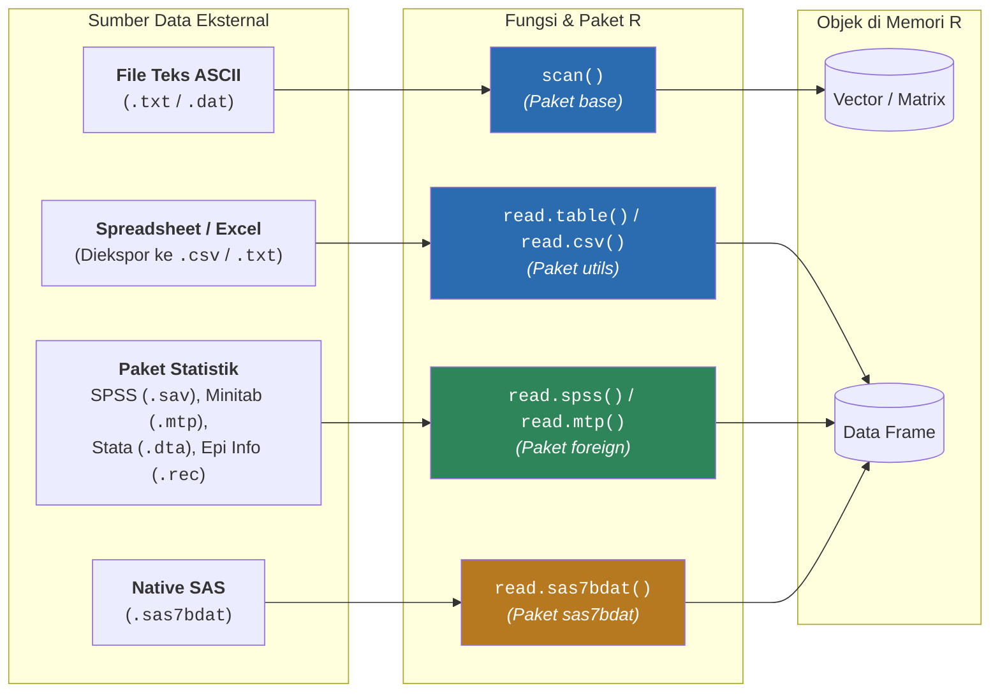

# Pertemuan 06: Import Data dari File

* **Mata Kuliah:** Dasar Pemrograman R (`STIK4111`)
* **Program Studi:** Sistem Informasi — Universitas Terbuka
* **Topik:** Import Data Format ASCII (`scan`), Import Data Spreadsheet/Excel (`read.table` & `read.csv`), serta Import Data dari Paket Statistik Eksternal (`foreign` & `sas7bdat`)

---

## Daftar Isi

1. [Peta Alur Import Data Eksternal ke dalam R](#1-peta-alur-import-data-eksternal-ke-dalam-r)
2. [Import Data dengan Format File ASCII (`scan`)](#2-import-data-dengan-format-file-ascii-scan)
3. [Import Data dari File Spreadsheet / Excel (`.txt` & `.csv`)](#3-import-data-dari-file-spreadsheet--excel-txt--csv)
4. [Import Data dari Paket Perangkat Lunak Statistik](#4-import-data-dari-paket-perangkat-lunak-statistik)
   * [A. Paket `foreign` (SPSS, Minitab, Stata, dll.)](#a-paket-foreign-spss-minitab-stata-dll)
   * [B. Paket `sas7bdat` (File Native SAS)](#b-paket-sas7bdat-file-native-sas)
5. [Referensi Resmi](#5-referensi-resmi)

---

## 1. Peta Alur Import Data Eksternal ke dalam R

Dalam praktik analisis data, dataset mentah sering kali tersimpan dalam berbagai format file eksternal. R menyediakan beragam fungsi bawaan maupun paket tambahan (*add-on packages*) untuk mengonversi file tersebut menjadi objek yang siap diolah di memori R:



---

## 2. Import Data dengan Format File ASCII (`scan`)

**File ASCII** (*American Standard Code for Information Interchange*) merupakan file teks polos universal yang berisi kumpulan angka atau karakter yang dipisahkan oleh spasi, tab, atau baris baru (*newline*), dan dapat dibuat dengan editor teks sederhana seperti Notepad.

* Fungsi **`scan()`** membaca seluruh elemen di dalam file teks secara berurutan dan menyimpannya ke dalam objek **vektor**.
* Vektor hasil pembacaan `scan()` dapat langsung dibentuk menjadi struktur lain seperti **matriks** menggunakan fungsi `matrix()`.

```r
# 1. Mengatur direktori kerja tempat file berada
setwd("E:/dataR")

# 2. Membaca 36 elemen numerik dari file ASCII 'data1.txt' ke dalam vektor
data_vektor <- scan("data1.txt")
print(data_vektor)

# 3. Membaca isi file langsung menjadi matriks berukuran 6x6
matriks1 <- matrix(scan("data1.txt"), nrow = 6, ncol = 6)
print(matriks1)
```

---

## 3. Import Data dari File Spreadsheet / Excel (`.txt` & `.csv`)

File lembar kerja Microsoft Excel (`.xls` atau `.xlsx`) dapat diimpor menggunakan fungsi bawaan R tanpa paket eksternal dengan cara menyimpannya (*Save As*) terlebih dahulu ke dalam format teks terstruktur:
1. **Text (Tab delimited)** dengan ekstensi **`.txt`** $\rightarrow$ dibaca menggunakan `read.table()`.
2. **CSV (Comma delimited)** dengan ekstensi **`.csv`** $\rightarrow$ dibaca menggunakan `read.csv()` atau `read.csv2()`.

> **Argumen Penting `header = TRUE`:** Digunakan untuk memberi tahu R bahwa **baris pertama** pada file berisi nama-nama variabel/kolom, bukan data pengamatan.

```r
# Membaca file Tab-Delimited (.txt) dengan baris pertama sebagai nama kolom
nilai_mk1 <- read.table("nilai_mk.txt", header = TRUE)
print(nilai_mk1)

# Membaca file CSV dengan pemisah titik koma (sep = ";")
# Catatan: Pengaturan regional Excel di Indonesia umumnya menggunakan ";" sebagai separator
nilai_mk2 <- read.csv("nilai_mk.csv", header = TRUE, sep = ";")
print(nilai_mk2)
```

*(Catatan: Untuk membaca file `.xlsx` secara langsung tanpa konversi manual, dalam ekosistem R modern juga tersedia paket tambahan seperti `readxl::read_excel()` atau `openxlsx::read.xlsx()`).*

---

## 4. Import Data dari Paket Perangkat Lunak Statistik

Untuk menjaga interoperabilitas antar-perangkat lunak analisis statistik, R menyediakan paket khusus untuk membaca format file biner milik aplikasi statistik lain.

### A. Paket `foreign` (SPSS, Minitab, Stata, dll.)

Paket **`foreign`** merupakan paket resmi yang dikelola oleh *R Core Team* untuk mengimpor data dari berbagai perangkat lunak statistik klasik:

| Perangkat Lunak Statistik | Ekstensi File Umum | Fungsi Import di Paket `foreign` | Keterangan |
| :--- | :--- | :--- | :--- |
| **SPSS** | `.sav` | `read.spss()` | Membaca dataset SPSS beserta label nilainya (*value labels*). |
| **MINITAB** | `.mtp` | `read.mtp()` | Membaca *Minitab Portable Worksheet*. |
| **SAS** | `.xpt` / `.ssd` | `read.xport()` / `read.ssd()` | Membaca format *SAS Transport*. |
| **STATA** | `.dta` | `read.dta()` | Membaca file dataset Stata (versi lama hingga Stata 12). |
| **S-PLUS** | — | `read.S()` | Membaca objek dump dari S-PLUS. |
| **Systat** | `.sys` / `.syd` | `read.systat()` | Membaca file data Systat. |
| **Epi Info** | `.rec` | `read.epiinfo()` | Membaca file rekam data epidemiologi Epi Info. |

#### Ilustrasi 1: Membaca File SPSS (`sleep.sav`)

```r
# Instalasi paket (cukup dilakukan satu kali jika belum terpasang)
# install.packages("foreign")

# Memuat paket foreign ke dalam sesi R
library(foreign)

# Membaca file SPSS dan mengonversinya langsung menjadi data.frame
data_sleep <- read.spss("sleep.sav",
                        use.value.labels = TRUE,
                        max.value.labels = Inf,
                        to.data.frame    = TRUE)

# Menampilkan 10 baris pertama dan 5 kolom pertama menggunakan pengindeksan
data_sleep[1:10, 1:5]
```

> **Penjelasan Argumen `read.spss()`:**
> * `use.value.labels = TRUE`: Mengonversi kode numerik kategori di SPSS menjadi teks label aslinya (objek `factor`).
> * `to.data.frame = TRUE`: Memastikan hasil pembacaan langsung berbentuk `data.frame` (secara *default* `read.spss` mengembalikan objek `list`).

#### Ilustrasi 2: Membaca File Minitab (`test.mtp`)

```r
library(foreign)
data_minitab <- read.mtp("test.mtp")
```

---

### B. Paket `sas7bdat` (File Native SAS)

Untuk membaca file dataset asli (*native*) milik perangkat lunak SAS yang berekstensi **`.sas7bdat`** tanpa harus mengekspornya ke format *SAS Transport* terlebih dahulu, digunakan paket **`sas7bdat`**:

```r
# Instalasi paket (jika belum terpasang)
# install.packages("sas7bdat")

library(sas7bdat)

# Membaca file dataset SAS ke dalam data.frame
data_sas <- read.sas7bdat("H:/dataR/test.sas7bdat")
print(data_sas)
```

---

## 5. Referensi Resmi

1. **Modul UT:** Materi Inisiasi 6 — *Import Data dari File*, Mata Kuliah Dasar Pemrograman R (`STIK4111`), Universitas Terbuka.
2. **R Core Team:** *R Data Import/Export Manual* — Dokumentasi Resmi CRAN: <https://cran.r-project.org/doc/manuals/r-release/R-data.html>
3. **CRAN Package `foreign`:** *Read Data Stored by 'Minitab', 'S', 'SAS', 'SPSS', 'Stata', 'Systat', 'Weka', 'dBase'*: <https://cran.r-project.org/package=foreign>
4. **CRAN Package `sas7bdat`:** *SAS Database Reader (experimental)*: <https://cran.r-project.org/package=sas7bdat>
5. **R Documentation (Base & Utils Packages):**
   * Read Data Values (`scan`): <https://stat.ethz.ch/R-manual/R-devel/library/base/html/scan.html>
   * Data Input (`read.table` & `read.csv`): <https://stat.ethz.ch/R-manual/R-devel/library/utils/html/read.table.html>