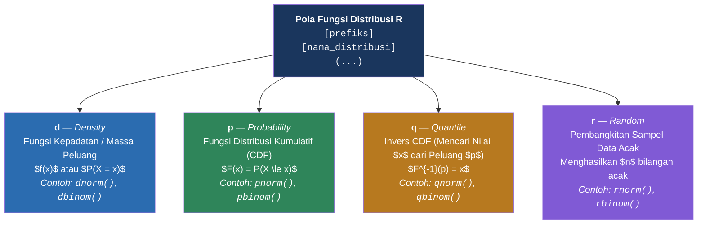

# Pertemuan 07: Pengelolaan Distribusi Probabilitas

* **Mata Kuliah:** Dasar Pemrograman R (`STIK4111`)
* **Program Studi:** Sistem Informasi — Universitas Terbuka
* **Topik:** Konvensi Fungsi Distribusi Probabilitas di R (`d`, `p`, `q`, `r`), Distribusi Kontinu (Distribusi Normal), dan Distribusi Diskrit (Distribusi Binomial)

---

## Daftar Isi

1. [Pola Konvensi Fungsi Distribusi Probabilitas di R](#1-pola-konvensi-fungsi-distribusi-probabilitas-di-r)
2. [Distribusi Kontinu: Distribusi Normal (`*norm`)](#2-distribusi-kontinu-distribusi-normal-norm)
   * [A. Perhitungan Kuantil (`qnorm`)](#a-perhitungan-kuantil-qnorm)
   * [B. Perhitungan Peluang Kumulatif (`pnorm`)](#b-perhitungan-peluang-kumulatif-pnorm)
   * [C. Plot Kepadatan & Distribusi Kumulatif Normal](#c-plot-kepadatan--distribusi-kumulatif-normal)
   * [D. Pembangkitan Bilangan Acak Normal (`rnorm`)](#d-pembangkitan-bilangan-acak-normal-rnorm)
3. [Distribusi Diskrit: Distribusi Binomial (`*binom`)](#3-distribusi-diskrit-distribusi-binomial-binom)
   * [A. Perhitungan Kuantil Binomial (`qbinom`)](#a-perhitungan-kuantil-binomial-qbinom)
   * [B. Perhitungan Peluang Tepat & Kumulatif (`dbinom` & `pbinom`)](#b-perhitungan-peluang-tepat--kumulatif-dbinom--pbinom)
   * [C. Plot Massa Peluang & Kumulatif Binomial](#c-plot-massa-peluang--kumulatif-binomial)
   * [D. Pembangkitan Bilangan Acak Binomial (`rbinom`)](#d-pembangkitan-bilangan-acak-binomial-rbinom)
4. [Referensi Resmi](#4-referensi-resmi)

---

## 1. Pola Konvensi Fungsi Distribusi Probabilitas di R

Salah satu keunggulan paket `stats` bawaan R adalah konsistensi penamaan fungsi distribusi statistik. Setiap nama distribusi (seperti `norm` untuk Normal, `binom` untuk Binomial, `pois` untuk Poisson, `t` untuk Student's t) selalu diawali oleh **satu dari empat huruf prefiks** berikut:



### Logika Argumen `lower.tail`

Pada fungsi `p*()` dan `q*()`, argumen `lower.tail` menentukan arah perhitungan luas area di bawah kurva distribusi:

* **`lower.tail = TRUE` (Default):** Menghitung luas ekor bawah / kiri, yaitu $P(X \le x)$.
* **`lower.tail = FALSE`:** Menghitung luas ekor atas / kanan, yaitu $P(X > x)$ (untuk diskrit) atau $P(X \ge x)$ (untuk kontinu).

---

## 2. Distribusi Kontinu: Distribusi Normal (`*norm`)

Peubah acak kontinu $X$ dikatakan berdistribusi Normal dengan rata-rata (*mean*) $\mu$ dan varians $\sigma^2$, dinotasikan $X \sim N(\mu, \sigma^2)$, apabila memiliki fungsi kepadatan probabilitas (*Probability Density Function* / PDF):

$$f(x) = \frac{1}{\sqrt{2\pi}\sigma} e^{-\frac{1}{2}\left(\frac{x-\mu}{\sigma}\right)^2}, \quad -\infty < x < \infty$$

* **Sifat Utama:** Kurva berbentuk lonceng simetris sehingga $\text{mean} = \text{median} = \text{modus}$.
* **Perhatian Penting di R:** Notasi matematis sering menulis $N(\mu, \sigma^2)$ menggunakan **varians ($\sigma^2$)**, sedangkan fungsi R (`dnorm`, `pnorm`, `qnorm`, `rnorm`) meminta parameter **simpangan baku / *standard deviation* (`sd` $= \sigma = \sqrt{\sigma^2}$)**.

### A. Perhitungan Kuantil (`qnorm`)

Digunakan untuk mencari nilai batas $Z_\alpha$ atau $X_\alpha$ apabila nilai peluangnya sudah diketahui.

```r
# 1. Kuantil alpha = 0.05 (5%) ekor bawah pada Normal Standar N(0, 1): P(Z <= z) = 0.05
qnorm(0.05, mean = 0, sd = 1, lower.tail = TRUE)
# Output: [1] -1.644854

# 2. Kuantil alpha = 0.05 (5%) ekor atas pada Normal Standar N(0, 1): P(Z >= z) = 0.05
qnorm(0.05, mean = 0, sd = 1, lower.tail = FALSE)
# Output: [1] 1.644854

# 3. Kuantil pada distribusi Normal dengan mean = 5 dan sd = 3
qnorm(0.05, mean = 5, sd = 3, lower.tail = TRUE)   # Output: [1] 0.06543912
qnorm(0.05, mean = 5, sd = 3, lower.tail = FALSE)  # Output: [1] 9.934561
```

### B. Perhitungan Peluang Kumulatif (`pnorm`)

Digunakan untuk menghitung probabilitas suatu kejadian berada pada interval tertentu di bawah kurva normal.

#### Ilustrasi Penyelesaian Soal

Diketahui ragam $\sigma^2 = 4 \implies \text{simpangan baku } (\sigma) = \sqrt{4} = 2$:

1. $X \sim N(0, 1)$, hitung $P(X \le -5)$
2. $X \sim N(10, 4)$, hitung $P(X \le 7.342)$
3. $X \sim N(0, 4)$, hitung $P(X \ge 6)$
4. $X \sim N(10, 4)$, hitung $P(X \ge 16.345)$

```r
# a. P(X <= -5) pada N(0, 1) -> ekor bawah (lower.tail = TRUE)
pnorm(-5, mean = 0, sd = 1, lower.tail = TRUE)
# Output: [1] 2.866516e-07

# b. P(X <= 7.342) pada N(10, 4) -> perhatikan sd = sqrt(4) = 2
pnorm(7.342, mean = 10, sd = 2, lower.tail = TRUE)
# Output: [1] 0.09192398

# c. P(X >= 6) pada N(0, 4) -> ekor atas (lower.tail = FALSE), sd = 2
pnorm(6, mean = 0, sd = 2, lower.tail = FALSE)
# Output: [1] 0.001349898

# d. P(X >= 16.345) pada N(10, 4) -> ekor atas (lower.tail = FALSE), sd = 2
pnorm(16.345, mean = 10, sd = 2, lower.tail = FALSE)
# Output: [1] 0.0007556628
```

### C. Plot Kepadatan & Distribusi Kumulatif Normal

```r
# 1. Plot Fungsi Kepadatan Probabilitas (PDF) Normal Standar
x <- seq(-4.275, 4.275, length.out = 100)
plot(x, dnorm(x, mean = 0, sd = 1),
     type = "l",
     xlab = "x",
     ylab = "Kerapatan",
     main = expression(paste("Distribusi Normal: ", mu, " = 0, ", sigma, " = 1")))
abline(h = 0, col = "black")

# 2. Plot Fungsi Distribusi Kumulatif (CDF) Normal Standar
x_cdf <- seq(-3, 3, length.out = 100)
plot(x_cdf, pnorm(x_cdf, mean = 0, sd = 1),
     type = "l",
     xlab = "x",
     ylab = "Peluang Kumulatif",
     main = expression(paste("CDF Distribusi Normal: ", mu, " = 0, ", sigma, " = 1")))
abline(h = 0, col = "black")
```

### D. Pembangkitan Bilangan Acak Normal (`rnorm`)

```r
# Membangkitkan 10 bilangan acak dari distribusi Normal Standar N(0, 1)
rnorm(10, mean = 0, sd = 1)

# Menyimpan hasil bangkitan acak ke dalam data.frame (2 baris x 5 kolom)
contoh <- as.data.frame(matrix(rnorm(10, mean = 0, sd = 1), ncol = 5))
print(contoh)
```

---

## 3. Distribusi Diskrit: Distribusi Binomial (`*binom`)

Peubah acak diskrit $X$ menyatakan banyaknya kejadian **sukses** dari $n$ kali percobaan Bernoulli yang saling bebas dengan peluang sukses $p$ pada setiap percobaan, dinotasikan $X \sim B(n, p)$.

Fungsi massa probabilitas (*Probability Mass Function* / PMF) distribusi Binomial adalah:

$$P(X = x) = \binom{n}{x} p^x (1 - p)^{n - x}, \quad x = 0, 1, 2, \dots, n$$

* **Parameter di R:** `size` menyatakan jumlah percobaan ($n$), dan `prob` menyatakan peluang sukses ($p$).

### A. Perhitungan Kuantil Binomial (`qbinom`)

```r
# Mencari nilai kuantil alpha = 0.25 (25%) untuk X ~ B(n = 20, p = 0.5)
qbinom(0.25, size = 20, prob = 0.5, lower.tail = TRUE)
# Output: [1] 8
```

### B. Perhitungan Peluang Tepat & Kumulatif (`dbinom` & `pbinom`)

```r
# 1. Peluang tepat X = 10 sukses dari 20 percobaan: P(X = 10)
dbinom(10, size = 20, prob = 0.5)
# Output: [1] 0.1761971

# 2. Peluang untuk beberapa nilai sekaligus: P(X = 0), P(X = 1), ..., P(X = 5)
dbinom(0:5, size = 20, prob = 0.5)

# 3. Peluang kumulatif ekor bawah: P(X <= 10)
pbinom(10, size = 20, prob = 0.5, lower.tail = TRUE)
# Output: [1] 0.5880985

# 4. Peluang kumulatif ekor atas: P(X > 10)
pbinom(10, size = 20, prob = 0.5, lower.tail = FALSE)
# Output: [1] 0.4119015

# 5. Peluang kumulatif ekor atas: P(X > 15)
pbinom(15, size = 20, prob = 0.5, lower.tail = FALSE)
# Output: [1] 0.005908966
```

> **Catatan Penting pada Distribusi Diskrit:** Untuk variabel acak diskrit seperti Binomial, `pbinom(k, ..., lower.tail = FALSE)` menghitung **$P(X > k)$** (strictly greater than $k$), bukan $P(X \ge k)$. Jika ingin menghitung $P(X \ge 15)$, gunakan `pbinom(14, size = 20, prob = 0.5, lower.tail = FALSE)`.

### C. Plot Massa Peluang & Kumulatif Binomial

```r
# 1. Plot Fungsi Massa Peluang (PMF) Binomial B(20, 0.5)
x <- 2:15
plot(x, dbinom(x, size = 20, prob = 0.5),
     type = "h",
     xlab = "Number of Successes (x)",
     ylab = "Probability Mass",
     main = "Binomial Distribution: Trials = 20, Prob. of success = 0.5")
points(x, dbinom(x, size = 20, prob = 0.5), pch = 16)
abline(h = 0, col = "black")

# 2. Plot Fungsi Distribusi Kumulatif (Step Function CDF) Binomial B(20, 0.5)
x_step <- 2:15
x_rep  <- rep(x_step, rep(2, length(x_step)))
plot(x_rep[-1], pbinom(x_rep, size = 20, prob = 0.5)[-length(x_rep)],
     type = "l",
     xlab = "Number of Successes (x)",
     ylab = "Cumulative Probability",
     main = "Binomial CDF: Trials = 20, Prob. of success = 0.5")
abline(h = 0, col = "black")
```

### D. Pembangkitan Bilangan Acak Binomial (`rbinom`)

```r
# Membangkitkan 15 data acak dari distribusi Binomial B(n = 20, p = 0.5)
rbinom(15, size = 20, prob = 0.5)

# Menyimpan 15 hasil simulasi Binomial ke dalam matriks 3x5
matrix(rbinom(15, size = 20, prob = 0.5), ncol = 5)
```

---

## 4. Referensi Resmi

1. **Modul UT:** Materi Inisiasi 7 — *Pengelolaan Distribusi Probabilitas*, Mata Kuliah Dasar Pemrograman R (`STIK4111`), Universitas Terbuka.
2. **R Core Team:** *An Introduction to R — Probability distributions*: <https://cran.r-project.org/doc/manuals/r-release/R-intro.html#Probability-distributions>
3. **R Documentation (`stats` Package):**
   * The Normal Distribution (`dnorm`, `pnorm`, `qnorm`, `rnorm`): <https://stat.ethz.ch/R-manual/R-devel/library/stats/html/Normal.html>
   * The Binomial Distribution (`dbinom`, `pbinom`, `qbinom`, `rbinom`): <https://stat.ethz.ch/R-manual/R-devel/library/stats/html/Binomial.html>
   * Distributions in the `stats` Package Overview: <https://stat.ethz.ch/R-manual/R-devel/library/stats/html/Distributions.html>