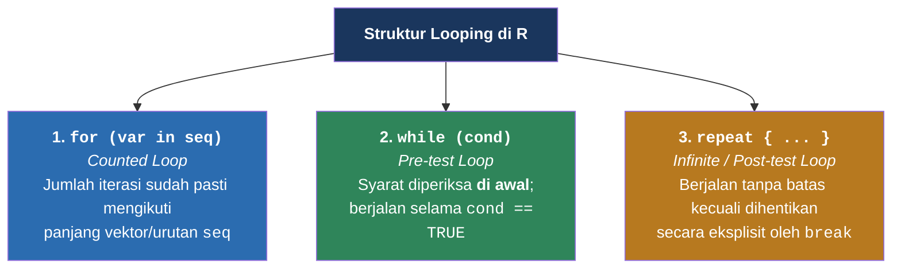
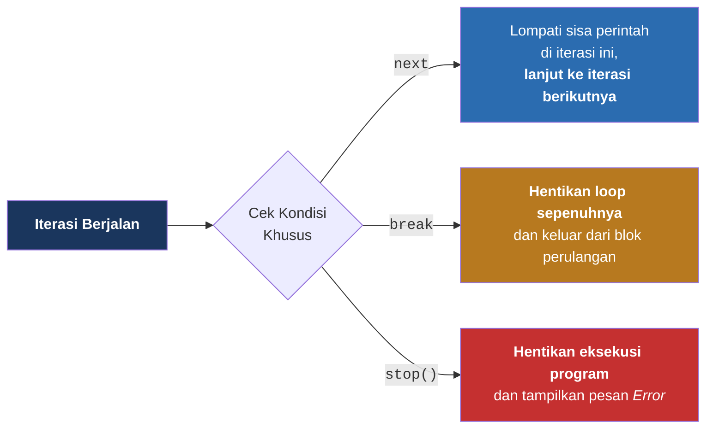
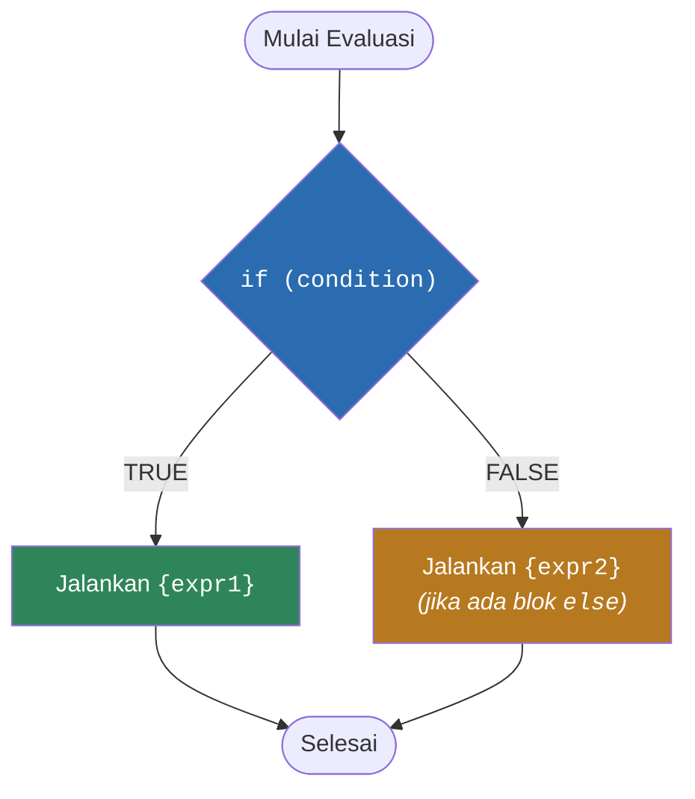

# Pertemuan 08: Pengendalian Eksekusi Program

* **Mata Kuliah:** Dasar Pemrograman R (`STIK4111`)

* **Program Studi:** Sistem Informasi — Universitas Terbuka

* **Topik:** Struktur Perulangan (*Looping*: `for`, `while`, `repeat`), Pengendali Alur Iterasi (`break`, `next`, `return`, `stop`), dan Struktur Percabangan Bersyarat (*Conditional*: `if`, `if ... else`, `ifelse`)

## Daftar Isi

1. [Prosedur Perulangan (*Looping*) dalam R](#1-prosedur-perulangan-looping-dalam-r)

   * [A. Perulangan `for`](#a-perulangan-for)

   * [B. Perulangan `while`](#b-perulangan-while)

   * [C. Perulangan `repeat`](#c-perulangan-repeat)

2. [Perintah Pengendali Iterasi & Eksekusi (`break`, `next`, `return`, `stop`)](#2-perintah-pengendali-iterasi--eksekusi-break-next-return-stop)

3. [Prosedur Bersyarat (*Conditional Statements*)](#3-prosedur-bersyarat-conditional-statements)

   * [A. Pernyataan `if`](#a-pernyataan-if)

   * [B. Pernyataan `if ... else`](#b-pernyataan-if--else)

   * [C. Fungsi Tervektorisasi `ifelse()`](#c-fungsi-tervektorisasi-ifelse)

4. [Referensi Resmi](#4-referensi-resmi)

## 1. Prosedur Perulangan (*Looping*) dalam R

Struktur perulangan digunakan untuk mengeksekusi blok instruksi secara berulang hingga kondisi berhenti tertentu tercapai. R menyediakan tiga mekanisme utama perulangan:



### A. Perulangan `for`

Digunakan ketika jumlah pengulangan sudah diketahui secara pasti berdasarkan elemen-elemen di dalam sebuah vektor atau urutan (`expr1`).

* **Sintaks Umum:**

  ```
  for (name in expr1) {
    expr2
  }
  
  ```

```
# Contoh 1: Menjumlahkan bilangan bulat dari 1 sampai dengan 5
f <- 0
for (i in 1:5) {
  f <- f + i
}
print(f) # Output: [1] 15

# Contoh 2: Menghitung dan menampilkan nilai faktorial dari 1! sampai 6!
f <- 1
for (i in 1:6) {
  f <- f * i
  print(f)
}
# Output berturut-turut: 1, 2, 6, 24, 120, 720

```

### B. Perulangan `while`

Digunakan ketika jumlah pengulangan bergantung pada suatu **syarat logika (`condition`)** yang diperiksa **sebelum** setiap iterasi dijalankan.

* **Sintaks Umum:**

  ```
  while (condition) {
    expr
  }
  
  ```

```
# Menjumlahkan angka 1 sampai dengan 5 menggunakan while
f <- 0
i <- 0

while (i <= 5) {
  f <- f + i
  i <- i + 1   # Pembaruan pencacah wajib ada agar tidak terjadi infinite loop
}
print(f) # Output: [1] 15

```

### C. Perulangan `repeat`

Perulangan `repeat` tidak memiliki kondisi berhenti bawaan di bagian awal. Blok perintah di dalamnya akan terus diulang tanpa henti (*infinite loop*) hingga menemui perintah **`break`** (biasanya dikombinasikan dengan pernyataan `if`).

* **Sintaks Umum:**

  ```
  repeat {
    expr
    if (condition) break
  }
  
  ```

```
# Menjumlahkan angka 1 sampai dengan 5 menggunakan repeat
f <- 0
i <- 0

repeat {
  i <- i + 1
  f <- f + i
  if (i == 5) break
}
print(f) # Output: [1] 15

```

## 2. Perintah Pengendali Iterasi & Eksekusi (`break`, `next`, `return`, `stop`)

Untuk mengatur alur lompatan di dalam perulangan maupun menghentikan eksekusi fungsi secara paksa, R menyediakan empat perintah kendali berikut:



| Perintah | Fungsi dan Perilaku | 
| ----- | ----- | 
| **`next`** | Menghentikan iterasi yang sedang berjalan saat ini dan langsung melompat ke iterasi berikutnya (ekuivalen `continue` di bahasa C/Python). | 
| **`break`** | Menghentikan seluruh proses perulangan secara seketika dan keluar dari blok loop. | 
| **`return(expr)`** | Menghentikan eksekusi sebuah fungsi (*user-defined function*) dan mengembalikan nilai `expr` ke pemanggilnya. | 
| **`stop("pesan")`** | Menghentikan evaluasi fungsi/skrip karena kondisi tidak valid dan menampilkan pesan galat (`Error: pesan`) ke konsol R. | 

### Ilustrasi `next`, `break`, dan `stop()`

```
# 1. Menggunakan 'next' untuk mencetak hanya bilangan ganjil antara 1 sampai 8
# Catatan: Operator '%%' adalah sisa bagi (modulo). !i %% 2 bernilai TRUE jika i genap.
for (i in 1:8) {
  if (!i %% 2) {
    next
  }
  print(i)
}
# Output: 1, 3, 5, 7

# 2. Menggunakan 'break' di dalam perulangan repeat
kata <- c("pernyataan", "pengulangan")
i <- 1
repeat {
  print(kata)
  i <- i + 1
  if (i > 4) {
    break
  }
}

# 3. Menggunakan 'stop()' untuk validasi batas iterasi
iterasi <- 15
if (iterasi > 16) stop("Iterasi terlalu banyak") # Tidak ada error karena 15 <= 16

iterasi <- 43
if (iterasi > 16) stop("Iterasi terlalu banyak")
# Output: Error: Iterasi terlalu banyak

```

## 3. Prosedur Bersyarat (*Conditional Statements*)

Pernyataan bersyarat memungkinkan program mengambil keputusan berdasarkan evaluasi ekspresi logika (`TRUE` atau `FALSE`).



### A. Pernyataan `if`

Mengeksekusi blok perintah hanya apabila kondisi bernilai `TRUE`. Jika `FALSE`, perintah dilewati.

```
# Karena 8 > 4 bernilai TRUE, objek p akan dibuat
if (8 > 4) p <- seq(1, 10, by = 2)
print(p) # Output: [1] 1 3 5 7 9

```

### B. Pernyataan `if ... else`

Menyediakan cabang alternatif (`expr2`) apabila kondisi utama (`condition`) bernilai `FALSE`.

> **Catatan Sintaks R:** Jika ditulis dalam beberapa baris, kata kunci `else` **wajib** berada pada baris yang sama tepat setelah kurung kurawal penutup `}` milik blok `if` (yakni `} else {`), agar R tidak menganggap pernyataan `if` sudah selesai.

```
# Evaluasi kondisi 4 < 8 (TRUE -> mengeksekusi cabang pertama)
if (4 < 8) {
  p <- seq(1, 10, by = 2)
} else {
  p <- seq(5, 15, by = 3)
}
print(p) # Output: [1] 1 3 5 7 9

```

### C. Fungsi Tervektorisasi `ifelse()`

Fungsi `ifelse(test, yes, no)` merupakan bentuk ringkas sekaligus **tervektorisasi** dari `if ... else`. Artinya, fungsi ini dapat mengevaluasi seluruh elemen di dalam sebuah vektor sekaligus tanpa memerlukan perulangan `for`.

* **Sintaks Umum:** `ifelse(condition, expr_jika_TRUE, expr_jika_FALSE)`

```
# Contoh 1: Evaluasi nilai tunggal
x <- 9
p <- ifelse(x < 8, "Yes", "No")
print(p) # Output: [1] "No"

# Contoh 2: Keunggulan vektorisasi ifelse() pada vektor nilai mahasiswa
nilai_ujian <- c(85, 62, 74, 90, 55)
status_lulus <- ifelse(nilai_ujian >= 70, "Lulus", "Remedial")
print(status_lulus)
# Output: [1] "Lulus" "Remedial" "Lulus" "Lulus" "Remedial"

```

## 4. Referensi Resmi

1. **Modul UT:** Materi Inisiasi 8 — *Pengendalian Eksekusi Program*, Mata Kuliah Dasar Pemrograman R (`STIK4111`), Universitas Terbuka.

2. **R Core Team:** *An Introduction to R — Grouping, loops and conditional execution*: <https://cran.r-project.org/doc/manuals/r-release/R-intro.html#Grouping_002c-loops-and-conditional-execution>

3. **R Language Definition:** *Control Structures (`if`, `for`, `while`, `repeat`, `break`, `next`)*: <https://cran.r-project.org/doc/manuals/r-release/R-lang.html#Control-structures>

4. **R Documentation (`base` Package):**

   * Control Flow (`Control`): <https://stat.ethz.ch/R-manual/R-devel/library/base/html/Control.html>

   * Conditional Element Selection (`ifelse`): <https://stat.ethz.ch/R-manual/R-devel/library/base/html/ifelse.html>

   * Stop Function Execution (`stop`): <https://stat.ethz.ch/R-manual/R-devel/library/base/html/stop.html>