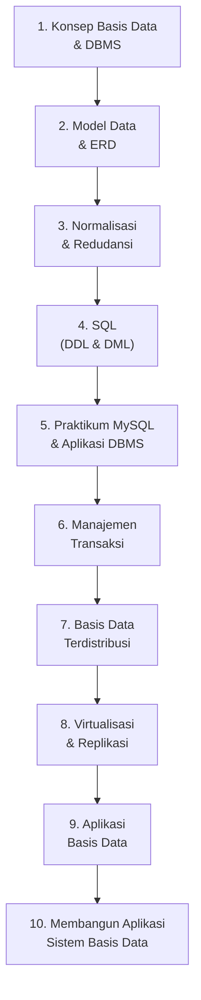

# Basis Data (STSI4105)

**Program Studi Sistem Informasi — Program Sarjana — Universitas Terbuka**

| | |
|---|---|
| **Kode Mata Kuliah** | STSI4105 |
| **Bobot SKS** | 3 |
| **Nama Pengembang** | Unggul Utan Sufandi |
| **Nama Penelaah** | Dwi Astuti Aprijani |
| **Tahun Pengembangan** | 2025 |

> Dokumen ini disusun berdasarkan **Rancangan Aktivitas Tutorial (RAT)** mata kuliah sebagai gambaran umum/preview materi yang dibahas di setiap pertemuan tutorial.

---

## Deskripsi Singkat Mata Kuliah

Mata kuliah **Basis Data/STSI4105** membahas konsep, pengembangan, dan penggunaan basis data secara menyeluruh. Materi yang dibahas meliputi **Model Data**, **Entity Relationship Diagram (ERD)**, **Normalisasi**, **Structured Query Language (SQL)**, **Manajemen Transaksi**, **Konsep Basis Data Terdistribusi**, dan **Aplikasi Sistem Basis Data**.

Praktikum menjadi komponen penting dalam mata kuliah ini — mahasiswa akan langsung menggunakan MySQL/MariaDB dalam paket XAMPP, membangun ERD, melakukan praktikum transaksi dan replikasi menggunakan VirtualBox, serta membangun aplikasi basis data menggunakan Microsoft Access yang terhubung ke MySQL melalui ODBC.

## Capaian Pembelajaran Mata Kuliah

Setelah mempelajari mata kuliah ini, mahasiswa mampu:

1. Memahami **konsep dasar basis data dan sistem basis data** (DBMS, abstraksi data, komponen sistem).
2. Merancang **model data dan Entity Relationship Diagram (ERD)** yang tepat untuk suatu kasus nyata.
3. Menerapkan **teknik normalisasi** untuk menghasilkan skema basis data yang bebas anomali.
4. Menggunakan **SQL (DDL dan DML)** untuk mendefinisikan dan memanipulasi data di DBMS.
5. Memahami dan menerapkan **manajemen transaksi** (ACID, COMMIT, ROLLBACK, SAVEPOINT, TRIGGER).
6. Memahami konsep **basis data terdistribusi** dan melakukan konfigurasi replikasi Master-Slave.
7. **Membangun aplikasi sistem basis data** yang terintegrasi antara front-end dan back-end database.

---

## Peta Kompetensi

> **CPU (Capaian Pembelajaran Umum):** setelah mengikuti mata kuliah ini, mahasiswa mampu mengorganisir data yang tersimpan secara elektronik pada sebuah sistem komputer sehingga menghasilkan informasi yang berguna.

---

## Rancangan Aktivitas Tutorial (RAT)

| Tutorial Ke- | Pokok Bahasan | Sub Pokok Bahasan | Tugas Tutorial | Daftar Pustaka |
|---|---|---|---|---|
| [1](pertemuan-01/README.md) | Orientasi Tutorial Online | Ruang Lingkup Materi; Tata Tertib Tutorial Online | — | — |
| [2](pertemuan-02/README.md) | Basis Data dan Sistem Basis Data | Basis Data; Sistem Basis Data | — | [1] |
| [3](pertemuan-03/README.md) | Model Data | Model Database dan Model Data; Relational Database Model dan ERD | — | [1] |
| [4](pertemuan-04/README.md) | Model Data | Model Data (Praktikum ERD) | √ (Tugas 1) | [1], [2] |
| [5](pertemuan-05/README.md) | Normalisasi | Normalisasi | — | [1] |
| [6](pertemuan-06/README.md) | Redudansi dan De-Normalisasi | Redudansi; De-Normalisasi | — | [1] |
| [7](pertemuan-07/README.md) | SQL dan DML | Structured Query Language (SQL); Data Manipulation Language (DML) | — | [1] |
| [8](pertemuan-08/README.md) | Praktikum SQL dan DML | Aplikasi Basis Data; MySQL/MariaDB (XAMPP) | √ (Tugas 2) | [1], [3] |
| [9](pertemuan-09/README.md) | Manajemen Transaksi | Manajemen Transaksi | — | [1] |
| [10](pertemuan-10/README.md) | Basis Data Terdistribusi | Basis Data Terdistribusi | — | [1] |
| [11](pertemuan-11/README.md) | Virtualisasi | Virtualisasi (Instalasi VirtualBox) | — | [1], [4] |
| [12](pertemuan-12/README.md) | Transaksi dan Basis Data Terdistribusi | Praktikum Transaksi; Praktikum Basis Data Terdistribusi | √ (Tugas 3) | [1], [5] |
| [13](pertemuan-13/README.md) | Aplikasi Basis Data | Aplikasi Basis Data | — | [1] |
| [14](pertemuan-14/README.md) | Dasar-dasar Organisasi Berkas dan Pengembangan Aplikasi Sistem Basis Data | Organisasi Berkas; Pengembangan Aplikasi Sistem Basis Data | — | [1] |
| [15](pertemuan-15/README.md) | Membangun Aplikasi Basis Data | Membangun Aplikasi Basis Data | — | [1] |

> Modus tutorial menggunakan **Tuton** (Tutorial Online) dengan tambahan **Praktikum** pada pertemuan ke-4, ke-8, ke-11, dan ke-12. Tugas Tutorial diberikan pada pertemuan ke-4, ke-8, dan ke-12 — masing-masing mencakup ERD (Tugas 1), SQL & MySQL (Tugas 2), dan Transaksi & Basis Data Terdistribusi (Tugas 3).

### Rincian Capaian Pembelajaran Khusus per Pertemuan

#### Pertemuan 1 — Orientasi Tutorial Online
1. Mahasiswa memahami cakupan materi yang dibahas dalam 15 sesi tutorial online.
2. Mahasiswa memahami tata tertib dan etika dalam mengikuti Tutorial Online (Tuton) Universitas Terbuka.

#### Pertemuan 2 — Basis Data dan Sistem Basis Data
1. Menjelaskan definisi basis data, tujuan, manfaat, kelebihan dan kekurangan basis data.
2. Menjelaskan operasi-operasi dasar pada basis data dan penerapan basis data di dunia nyata.
3. Menjelaskan pengertian sistem basis data dan komponen-komponen penyusunnya.
4. Menjelaskan konsep DBMS (*Database Management System*), abstraksi data, dan struktur sistem basis data secara keseluruhan.

#### Pertemuan 3 — Model Data dan ERD
1. Menjelaskan definisi model data serta perbedaan antara model data berbasis objek, berbasis record, dan berbasis fisik.
2. Membuat basis data relasi dan menjelaskan konsep *relational key* (primary key, foreign key, candidate key).
3. Menjelaskan konsep dasar pembentukan model ER (*Entity-Relationship*) dan cara membuat ER model.
4. Membuat varian entitas, varian relasi, spesialisasi, generalisasi, dan agregasi dalam diagram ERD.

#### Pertemuan 4 — Praktikum ERD *(Tugas Tutorial 1)*
1. Membuat *Entity Relationship Diagram* (ERD) yang benar sesuai 5 tahapan inti pembuatan ERD.
2. Mengimplementasikan hasil rancangan ERD menjadi skema relasional.

#### Pertemuan 5 — Normalisasi
1. Memahami dan menerapkan teknik normalisasi data (1NF, 2NF, 3NF, BCNF).
2. Menjelaskan proses normalisasi untuk menghilangkan anomali data (anomali insert, update, delete).
3. Menjelaskan konsep ketergantungan fungsi (*functional dependency*) sebagai dasar normalisasi.
4. Merancang basis data yang baik menggunakan teknik normalisasi.

#### Pertemuan 6 — Redudansi dan De-Normalisasi
1. Menjelaskan bentuk-bentuk redundansi data dan dampaknya terhadap integritas data.
2. Menjelaskan konsep dan bentuk-bentuk de-normalisasi serta alasan penggunaannya.
3. Menjelaskan atribut turunan (*derived attribute*) dan atribut yang berlebihan (*redundant attribute*).

#### Pertemuan 7 — SQL dan DML
1. Menerapkan konsep *Structured Query Language* (SQL) dalam pengelolaan basis data.
2. Menerapkan perintah *Data Definition Language* (DDL): CREATE, ALTER, DROP.
3. Menerapkan perintah *Data Manipulation Language* (DML): SELECT, INSERT, UPDATE, DELETE.

#### Pertemuan 8 — Praktikum SQL dan MySQL XAMPP *(Tugas Tutorial 2)*
1. Menjelaskan berbagai macam aplikasi basis data (DBMS) yang umum digunakan.
2. Melakukan praktikum basis data menggunakan MySQL/MariaDB dalam paket aplikasi XAMPP.
3. Mengimplementasikan DDL dan DML secara langsung melalui phpMyAdmin dan command line.

#### Pertemuan 9 — Manajemen Transaksi
1. Menjelaskan konsep manajemen transaksi dan sifat ACID (*Atomicity, Consistency, Isolation, Durability*).
2. Menerapkan perintah COMMIT, ROLLBACK, dan SAVEPOINT dalam skenario transaksi MySQL.
3. Menjelaskan konsep dan cara pembuatan TRIGGER pada basis data.

#### Pertemuan 10 — Basis Data Terdistribusi
1. Menjelaskan konsep dan karakteristik basis data terdistribusi.
2. Menjelaskan teknik fragmentasi dan replikasi dalam basis data terdistribusi.
3. Memahami keuntungan dan tantangan implementasi basis data terdistribusi.

#### Pertemuan 11 — Virtualisasi
1. Melakukan instalasi perangkat lunak virtualisasi VirtualBox.
2. Memahami konsep virtualisasi sebagai infrastruktur untuk simulasi jaringan komputer.
3. Mengonfigurasi jaringan *Host-Only* di VirtualBox untuk keperluan praktikum replikasi MySQL.

#### Pertemuan 12 — Praktikum Transaksi & Basis Data Terdistribusi *(Tugas Tutorial 3)*
1. Melakukan praktikum transaksi MySQL: COMMIT, ROLLBACK, SAVEPOINT, dan TRIGGER.
2. Melakukan praktikum basis data terdistribusi: konfigurasi replikasi Master-Slave MySQL.
3. Memverifikasi keberhasilan replikasi dengan menguji sinkronisasi data antara server Master dan Slave.

#### Pertemuan 13 — Aplikasi Basis Data
1. Menjelaskan pengertian dan fungsi aplikasi basis data (DBMS) dalam sistem informasi.
2. Membandingkan berbagai DBMS populer: MySQL, MariaDB, SQL Server, Oracle, dan PostgreSQL.
3. Menjelaskan arsitektur dan fungsi DBMS dalam konteks pengembangan aplikasi.

#### Pertemuan 14 — Organisasi Berkas dan Pengembangan Aplikasi
1. Menjelaskan konsep dasar organisasi berkas dan metode-metode penyimpanan data secara fisik.
2. Menjelaskan tahapan pengembangan aplikasi sistem basis data dari analisis hingga implementasi.
3. Menentukan kondisi-kondisi yang memerlukan penggunaan DBMS dalam pengembangan sistem informasi.

#### Pertemuan 15 — Membangun Aplikasi Basis Data
1. Membangun aplikasi sistem basis data perpustakaan menggunakan MySQL dan Microsoft Access 365.
2. Menghubungkan Microsoft Access ke MySQL menggunakan driver MySQL ODBC Connector.
3. Membuat Form, Query, Report, dan Switchboard dalam Microsoft Access sebagai antarmuka aplikasi.

---

## Daftar Pustaka/OER

1. **BMP – MSIM4206 – Basis Data – Edisi 1** *(referensi utama seluruh pertemuan)*
2. Panduan Praktikum Pembuatan Entity Relationship Diagram (ERD) *(pertemuan 4)*
3. Panduan Praktikum SQL *(pertemuan 8)*
4. Panduan Praktikum Instalasi Virtual Box *(pertemuan 11)*
5. Panduan Praktikum Transaksi dan Basis Data Terdistribusi *(pertemuan 12)*
