# Pertemuan 1 — Rancangan Aktivitas Tutorial (RAT)

**STSI4105 Basis Data**  
Program Studi Sistem Informasi — Universitas Terbuka

> Catatan: dokumen ini merupakan ekstraksi dan elaborasi dari *Rancangan Aktivitas Tutorial (RAT) STSI4105 Basis Data*. RAT adalah peta jalan keseluruhan mata kuliah — memuat capaian pembelajaran, pokok bahasan, dan jadwal tugas untuk 15 sesi tutorial. Setiap pokok bahasan dijabarkan lebih dalam agar memberi gambaran utuh tentang apa yang dipelajari sepanjang semester.

---

## Identitas Mata Kuliah

| Atribut | Detail |
|---|---|
| **Nama Mata Kuliah** | Basis Data |
| **Kode Mata Kuliah** | STSI4105 |
| **Jumlah SKS** | 3 SKS |
| **Pengembang** | Unggul Utan Sufandi |
| **Penelaah** | Dwi Astuti Aprijani |
| **Tahun Pengembangan** | 2025 |
| **Referensi Utama** | BMP – MSIM4206 – Basis Data – Edisi 1 |

---

## Deskripsi Mata Kuliah

Mata kuliah **Basis Data (STSI4105)** membahas secara menyeluruh konsep, perancangan, dan penggunaan basis data dalam sistem informasi. Topik yang dibahas meliputi:

- **Model Data** — cara merepresentasikan struktur data secara formal
- **Entity Relationship Diagram (ERD)** — alat perancangan skema basis data
- **Normalisasi** — teknik menghilangkan redundansi dan anomali data
- **SQL (Structured Query Language)** — bahasa standar untuk mengelola data di DBMS
- **Manajemen Transaksi** — menjamin integritas data saat operasi bersamaan
- **Basis Data Terdistribusi** — konsep penyebaran data di banyak lokasi
- **Aplikasi Sistem Basis Data** — membangun aplikasi nyata di atas MySQL

---

## Capaian Pembelajaran Mata Kuliah

> Setelah mempelajari mata kuliah ini, mahasiswa mampu **mengorganisir data yang tersimpan secara elektronik pada sebuah sistem komputer** sehingga menghasilkan informasi yang berguna.

Capaian ini mencakup kemampuan dari tingkat konseptual hingga praktis:

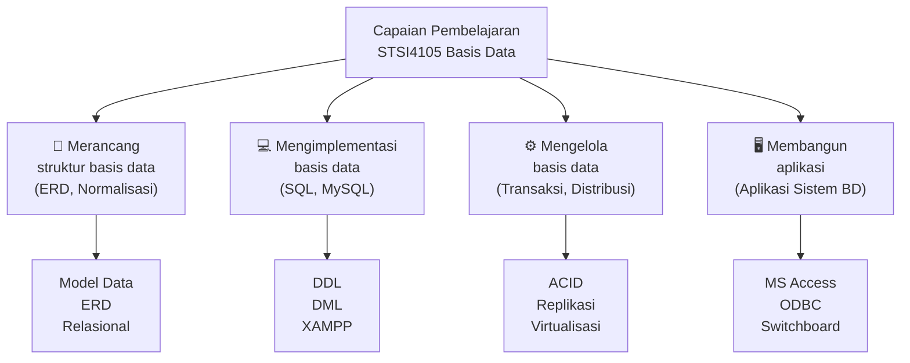

---

## Peta Topik Keseluruhan

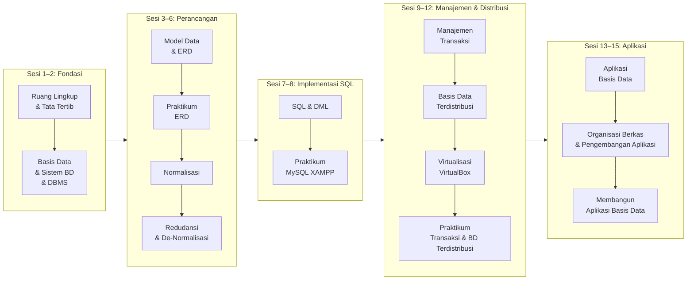

---

## Rancangan 15 Sesi Tutorial

### Sesi 1 — Orientasi dan Ruang Lingkup

**Capaian:** Memahami cakupan materi tutorial online dan tata tertib.

| Sub Topik | Isi |
|---|---|
| Ruang Lingkup Materi | Gambaran keseluruhan topik yang dibahas selama 15 sesi tutorial online |
| Tata Tertib Tutorial Online | Aturan partisipasi, etika akademik UT dalam mengikuti Tuton |

> **Konteks:** Sesi pertama adalah orientasi. Tidak ada materi teknis — ini adalah sesi pengenalan sistem tutorial UT (Tuton) dan roadmap semester. Gunakan sesi ini untuk memahami ekspektasi dosen tutor, jadwal tugas, dan cara berpartisipasi diskusi online.

---

### Sesi 2 — Basis Data dan Sistem Basis Data

**Capaian:** Menjelaskan definisi, tujuan, manfaat, kelebihan/kekurangan, operasi, dan penerapan basis data; serta pengertian sistem basis data, DBMS, abstraksi data, dan struktur sistem basis data.

**Referensi:** [1] BMP MSIM4206

#### Apa itu Basis Data?

Basis data (*database*) adalah kumpulan data yang **terorganisir, terintegrasi, dan dapat diakses bersama** oleh banyak pengguna secara efisien. Berbeda dari sistem berkas konvensional, basis data menghilangkan redundansi dan inkonsistensi data.

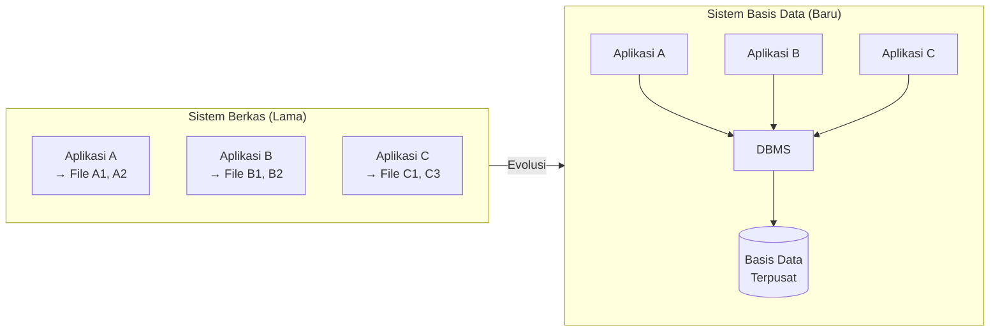

**Masalah sistem berkas yang diselesaikan basis data:**

| Masalah Sistem Berkas | Solusi Basis Data |
|---|---|
| Redundansi data (data ganda di banyak file) | Data tersimpan satu kali, diakses oleh banyak aplikasi |
| Inkonsistensi (update satu file, file lain tidak ter-update) | Satu sumber kebenaran (*single source of truth*) |
| Isolasi data (sulit menggabungkan data dari file berbeda) | Relasi antar tabel, JOIN query |
| Akses konkuren bermasalah | Manajemen transaksi, lock mechanism |
| Keamanan tidak terjamin | Kontrol akses berbasis hak (GRANT/REVOKE) |
| Tidak ada standar | SQL sebagai standar universal |

#### DBMS (Database Management System)

DBMS adalah perangkat lunak yang bertindak sebagai **antarmuka antara pengguna/aplikasi dan basis data fisik**. Contoh: MySQL, PostgreSQL, Oracle, SQL Server, MariaDB.

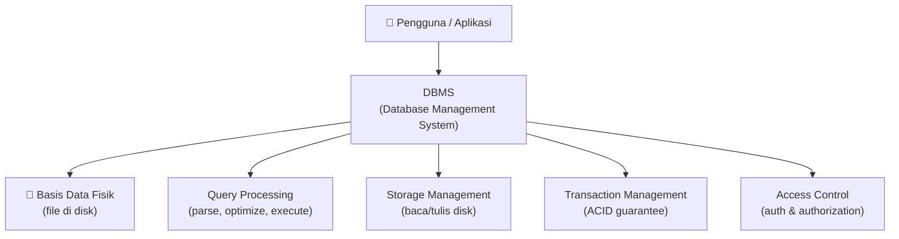

#### Tiga Level Abstraksi Data

DBMS menyembunyikan kompleksitas fisik melalui tiga level abstraksi:

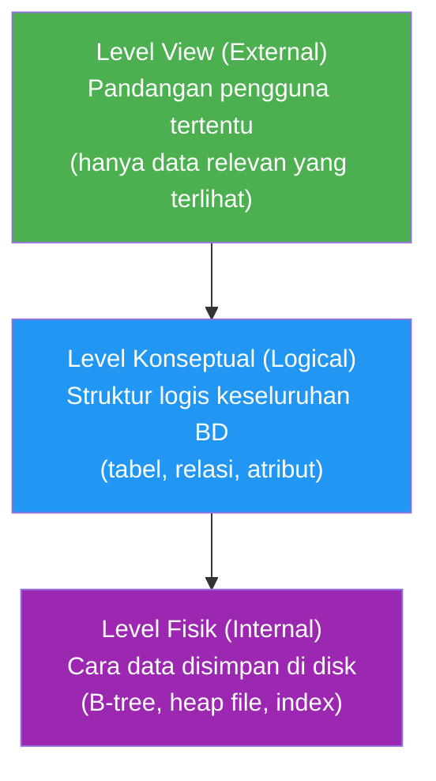

---

### Sesi 3 — Model Data dan ERD

**Capaian:** Menjelaskan model data (berbasis objek, record, fisik); membuat basis data relasi, relational key; menjelaskan ERD dan varian-variannya.

**Referensi:** [1] BMP MSIM4206

#### Model Data

Model data adalah **kerangka formal untuk mendeskripsikan struktur, batasan, dan operasi** pada data.

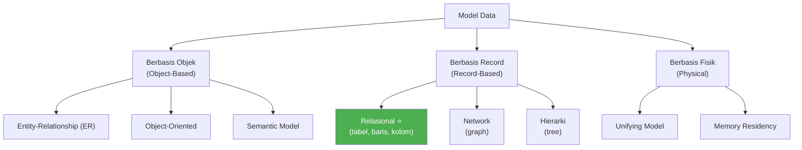

**Model Relasional** adalah yang paling dominan — data direpresentasikan sebagai **tabel (relasi)** dengan baris (*tuple*) dan kolom (*atribut*).

#### Relational Key

| Jenis Key | Definisi | Contoh |
|---|---|---|
| **Super Key** | Atribut/set atribut yang unik mengidentifikasi tuple | {nim, nama}, {nim} |
| **Candidate Key** | Super key minimal (tidak ada subset yang juga super key) | {nim} |
| **Primary Key (PK)** | Candidate key yang dipilih sebagai identifier utama | `nim` |
| **Foreign Key (FK)** | Atribut yang merujuk PK di tabel lain | `id_mahasiswa` di tabel nilai |
| **Alternate Key** | Candidate key yang tidak dipilih jadi PK | email (jika nim = PK) |

#### Entity Relationship Diagram (ERD)

ERD adalah notasi grafis untuk memodelkan entitas (objek) dan relasi antar entitas sebelum diimplementasikan ke database fisik.

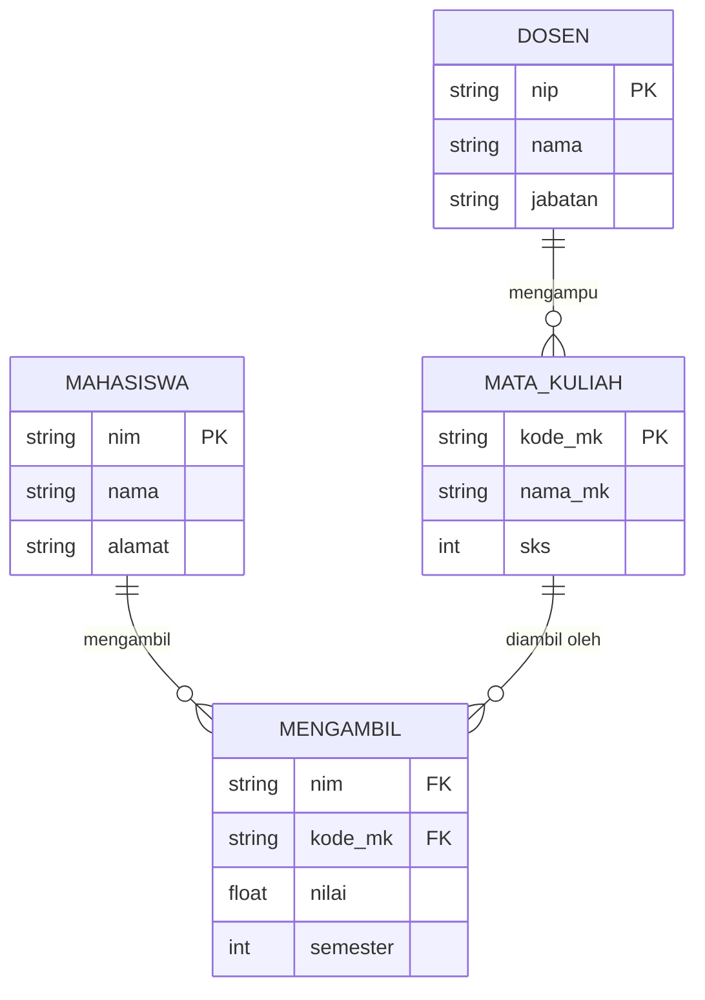

**Varian-varian dalam ERD:**

| Konsep | Penjelasan |
|---|---|
| **Entitas Lemah** (*Weak Entity*) | Entitas yang tidak memiliki PK sendiri, bergantung pada entitas lain |
| **Spesialisasi** | Entitas induk dipecah menjadi sub-entitas (IS-A relationship, top-down) |
| **Generalisasi** | Sub-entitas digabung menjadi entitas induk (bottom-up) |
| **Agregasi** | Relasi diperlakukan sebagai entitas baru untuk membentuk relasi tingkat lebih tinggi |

---

### Sesi 4 — Praktikum ERD ⭐ *(Ada Tugas Tutorial)*

**Capaian:** Membuat ERD sesuai 5 tahapan inti pembuatan ERD.

**Referensi:** [1] BMP MSIM4206, [2] Panduan Praktikum ERD  
**Modus:** Tuton + Praktikum  
**Tugas Tutorial:** ✅ Ada

#### 5 Tahapan Inti Pembuatan ERD

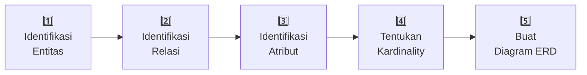

| Tahap | Aktivitas | Tips |
|---|---|---|
| **1. Identifikasi Entitas** | Tentukan objek/benda yang perlu disimpan datanya | Cari kata benda dalam narasi bisnis |
| **2. Identifikasi Relasi** | Tentukan hubungan antar entitas | Cari kata kerja yang menghubungkan entitas |
| **3. Identifikasi Atribut** | Tentukan properti/data yang disimpan tiap entitas | Apa yang perlu diketahui tentang entitas ini? |
| **4. Tentukan Kardinality** | 1:1, 1:N, atau M:N? | Tanya: "satu X berapa Y?" dan sebaliknya |
| **5. Buat Diagram** | Gambar ERD menggunakan notasi standar | Gunakan tool seperti draw.io, dbdiagram.io |

---

### Sesi 5 — Normalisasi

**Capaian:** Melakukan teknik normalisasi data, proses normalisasi anomali, ketergantungan fungsi, dan merancang basis data dengan teknik normalisasi.

**Referensi:** [1] BMP MSIM4206

#### Mengapa Normalisasi?

Tabel yang tidak dinormalisasi mengandung **anomali data**:

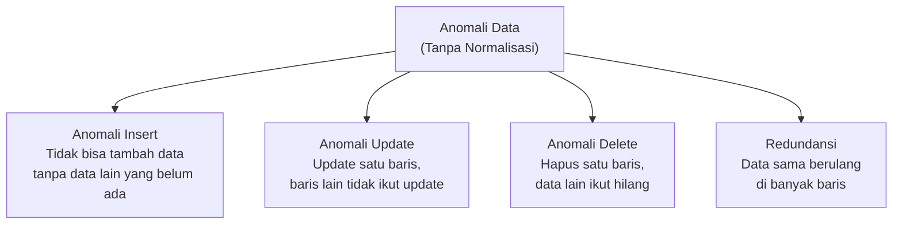

#### Tahapan Normalisasi

Normalisasi adalah proses **pemecahan tabel** menggunakan aturan bentuk normal (*normal form*) untuk menghilangkan redundansi dan anomali.

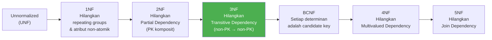

> Dalam praktik, normalisasi sampai **3NF** sudah cukup untuk sebagian besar kasus. BCNF dan di atasnya digunakan untuk kasus khusus yang memerlukan integritas sangat ketat.

---

### Sesi 6 — Redudansi dan De-Normalisasi

**Capaian:** Menjelaskan bentuk-bentuk redundansi dan de-normalisasi, atribut turunan, serta atribut yang berlebihan.

**Referensi:** [1] BMP MSIM4206

#### Redundansi

Redundansi adalah **penyimpanan data yang sama di lebih dari satu tempat**. Ada dua jenis:

| Jenis | Penjelasan | Dampak |
|---|---|---|
| **Redundansi Tidak Terkontrol** | Data duplikat tanpa alasan, hasil desain buruk | Harus dihilangkan |
| **Redundansi Terkontrol** (*De-normalisasi*) | Data duplikat disengaja untuk tujuan performa | Diizinkan dengan pertimbangan |

#### De-Normalisasi

De-normalisasi adalah **penggabungan kembali tabel** yang telah dinormalisasi untuk meningkatkan performa baca (*read performance*).

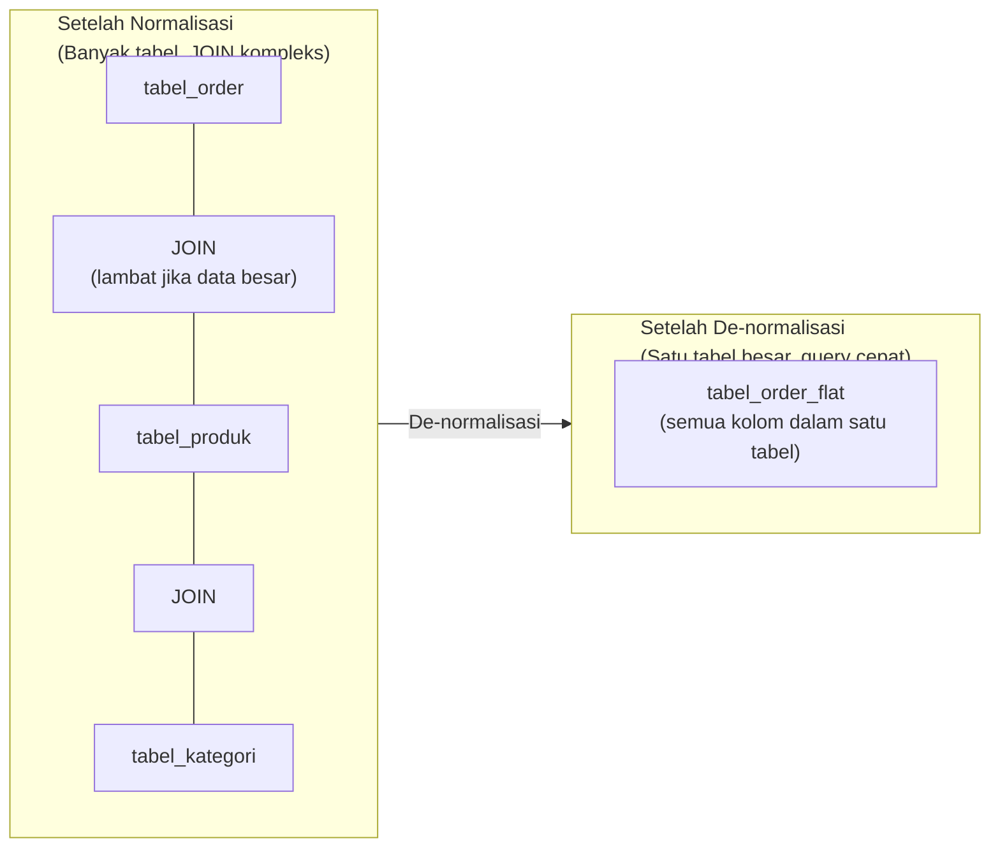

**Kapan de-normalisasi masuk akal?**
- Sistem **read-heavy** (lebih banyak baca daripada tulis), seperti data warehouse
- Query yang sering melibatkan banyak JOIN sangat lambat
- Performa adalah prioritas utama

**Atribut turunan** = atribut yang nilainya bisa dihitung dari atribut lain (contoh: `umur` dari `tanggal_lahir`). Umumnya tidak disimpan; dihitung saat query.

---

### Sesi 7 — SQL dan DML

**Capaian:** Menerapkan konsep SQL; menerapkan DDL dan DML.

**Referensi:** [1] BMP MSIM4206

#### Klasifikasi Perintah SQL

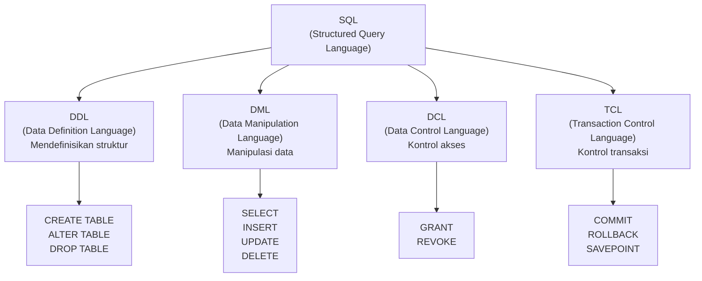

#### Contoh DDL

```sql
CREATE TABLE mahasiswa (
    nim         VARCHAR(14)  PRIMARY KEY,
    nama        VARCHAR(100) NOT NULL,
    alamat      TEXT,
    tgl_lahir   DATE,
    id_prodi    INT,
    FOREIGN KEY (id_prodi) REFERENCES prodi(id_prodi)
) ENGINE=InnoDB;

ALTER TABLE mahasiswa ADD COLUMN email VARCHAR(100);
```

#### Contoh DML

```sql
-- SELECT dengan JOIN
SELECT m.nim, m.nama, mk.nama_mk, n.nilai
FROM mahasiswa m
JOIN nilai n ON m.nim = n.nim
JOIN mata_kuliah mk ON n.kode_mk = mk.kode_mk
WHERE n.nilai >= 70
ORDER BY m.nama ASC;

-- INSERT
INSERT INTO mahasiswa (nim, nama, alamat) VALUES ('14021001', 'Budi Santoso', 'Jakarta');

-- UPDATE
UPDATE mahasiswa SET alamat = 'Bandung' WHERE nim = '14021001';

-- DELETE
DELETE FROM mahasiswa WHERE nim = '14021001';
```

---

### Sesi 8 — Praktikum SQL dan MySQL XAMPP ⭐ *(Ada Tugas Tutorial)*

**Capaian:** Menjelaskan aplikasi basis data; melakukan praktikum MySQL/MariaDB di XAMPP.

**Referensi:** [1] BMP MSIM4206, [3] Panduan Praktikum SQL  
**Modus:** Tuton + Praktikum  
**Tugas Tutorial:** ✅ Ada

#### Stack Praktikum

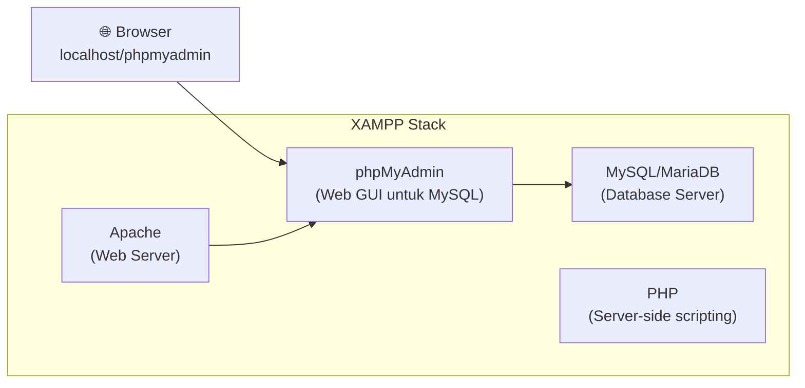

**Workflow Praktikum:**
1. Start XAMPP Control Panel → klik Start Apache & MySQL
2. Buka browser → `http://localhost/phpmyadmin`
3. Buat database baru
4. Jalankan skrip SQL untuk membuat tabel
5. Insert data, jalankan query SELECT, UPDATE, DELETE
6. Praktikkan JOIN, agregasi (COUNT, SUM, AVG), subquery

---

### Sesi 9 — Manajemen Transaksi

**Capaian:** Menjelaskan konsep manajemen transaksi.

**Referensi:** [1] BMP MSIM4206

#### Apa itu Transaksi?

Transaksi adalah **serangkaian operasi database yang diperlakukan sebagai satu unit kerja yang tidak dapat dipisahkan**. Contoh klasik: transfer uang — debet rekening A dan kredit rekening B harus terjadi bersama-sama atau tidak sama sekali.

#### Sifat ACID

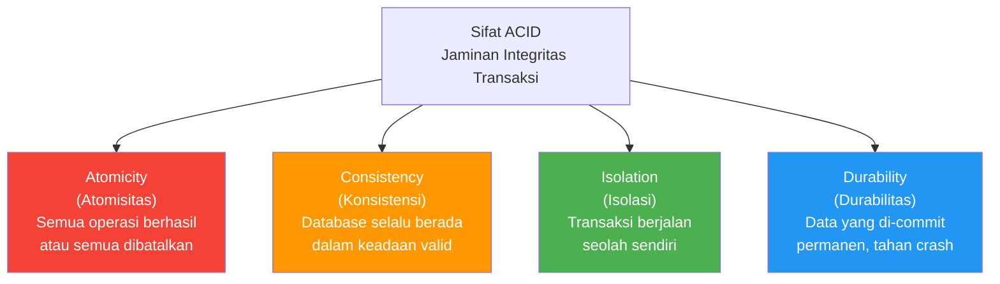

#### COMMIT dan ROLLBACK

```sql
START TRANSACTION;

UPDATE rekening SET saldo = saldo - 1000000 WHERE id = 1; -- debet A
UPDATE rekening SET saldo = saldo + 1000000 WHERE id = 2; -- kredit B

-- Jika semua berhasil:
COMMIT;

-- Jika ada yang gagal:
-- ROLLBACK;
```

**SAVEPOINT** memungkinkan rollback sebagian transaksi:

```sql
START TRANSACTION;
INSERT INTO log VALUES (1, 'start');
SAVEPOINT titik1;
INSERT INTO log VALUES (2, 'step2');
SAVEPOINT titik2;
INSERT INTO log VALUES (3, 'step3'); -- gagal
ROLLBACK TO titik2;                  -- kembali ke titik2, titik1 tetap ada
COMMIT;
```

---

### Sesi 10 — Basis Data Terdistribusi

**Capaian:** Menjelaskan konsep basis data terdistribusi.

**Referensi:** [1] BMP MSIM4206

#### Konsep Basis Data Terdistribusi

Basis data terdistribusi adalah sistem di mana **data tersimpan di beberapa lokasi fisik yang terhubung jaringan**, namun terlihat sebagai satu basis data tunggal dari sudut pandang pengguna.

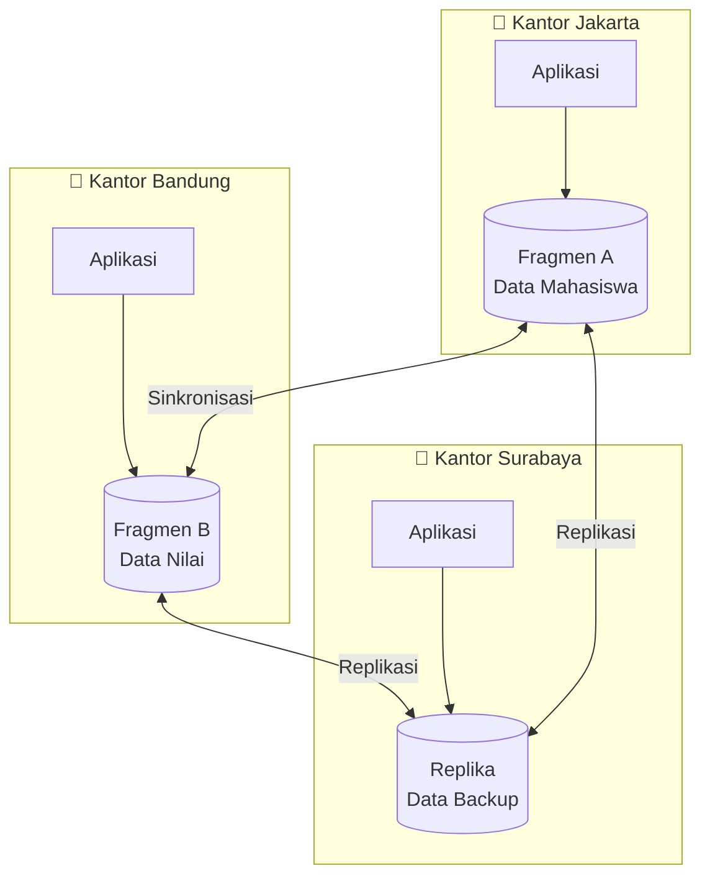

**Dua teknik utama:**

| Teknik | Penjelasan | Contoh |
|---|---|---|
| **Fragmentasi** | Data dipecah dan disimpan di lokasi berbeda | Data mahasiswa Jakarta di server Jakarta, Bandung di server Bandung |
| **Replikasi** | Data dikopi ke beberapa lokasi (Master-Slave) | Master MySQL di pusat, Slave di cabang untuk read-only |

---

### Sesi 11 — Virtualisasi dan VirtualBox

**Capaian:** Melakukan praktikum instalasi perangkat lunak virtualisasi VirtualBox.

**Referensi:** [1] BMP MSIM4206, [4] Panduan Praktikum Instalasi VirtualBox  
**Modus:** Tuton + Praktikum

#### Mengapa Virtualisasi untuk Praktikum BD Terdistribusi?

Basis data terdistribusi membutuhkan **minimal dua mesin yang terpisah** (server master dan slave). Virtualisasi memungkinkan kita mensimulasikan dua komputer hanya dengan satu laptop.

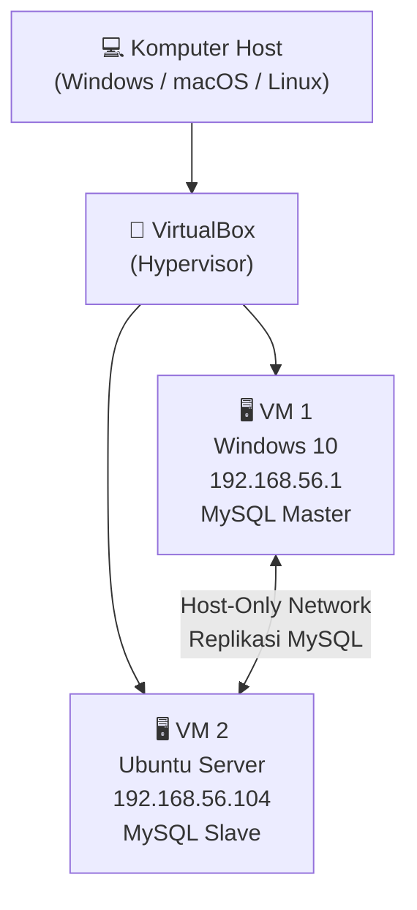

**Lingkungan praktikum replikasi:**

| Komputer | OS | IP Address | Peran |
|---|---|---|---|
| Komputer 1 (Host) | Windows 10 | 192.168.56.1 | MySQL Master |
| Komputer 2 (VM) | Ubuntu | 192.168.56.104 | MySQL Slave |

---

### Sesi 12 — Praktikum Transaksi & Basis Data Terdistribusi ⭐ *(Ada Tugas Tutorial)*

**Capaian:** Melakukan praktikum transaksi; melakukan praktikum basis data terdistribusi.

**Referensi:** [1] BMP MSIM4206, [5] Panduan Praktikum Transaksi dan Basis Data Terdistribusi  
**Modus:** Tuton + Praktikum  
**Tugas Tutorial:** ✅ Ada

#### Lingkup Praktikum

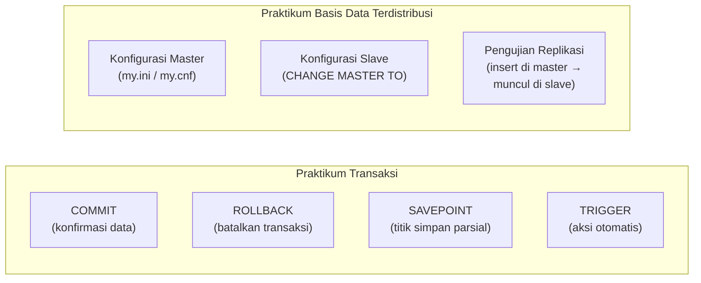

---

### Sesi 13 — Aplikasi Basis Data

**Capaian:** Menjelaskan aplikasi basis data (DBMS).

**Referensi:** [1] BMP MSIM4206

#### Aplikasi Basis Data Populer

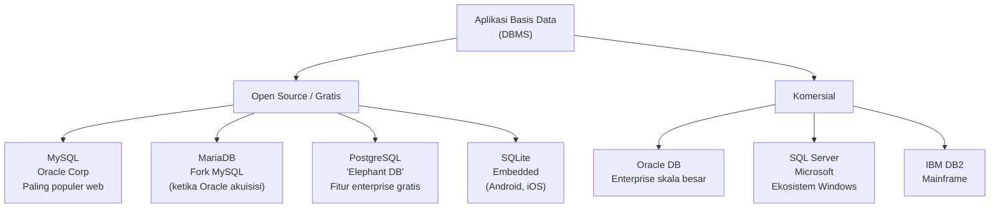

**Perbandingan singkat:**

| DBMS | Keunggulan | Penggunaan Umum |
|---|---|---|
| **MySQL** | Cepat, ringan, ekosistem besar | Web app, XAMPP/LAMP stack |
| **MariaDB** | Kompatibel MySQL, fully open source | Pengganti drop-in MySQL |
| **PostgreSQL** | Fitur advanced (JSON, full-text search), ACID ketat | Aplikasi enterprise, GIS |
| **SQL Server** | Integrasi Windows, tools visual | Aplikasi korporat Microsoft |
| **Oracle** | Performa ekstrem, high availability | Bank, telco, pemerintah |

---

### Sesi 14 — Organisasi Berkas & Pengembangan Aplikasi

**Capaian:** Menjelaskan dasar-dasar organisasi berkas dan pengembangan aplikasi sistem basis data.

**Referensi:** [1] BMP MSIM4206

#### Organisasi Berkas

Cara data disusun secara fisik di media penyimpanan memengaruhi kecepatan akses:

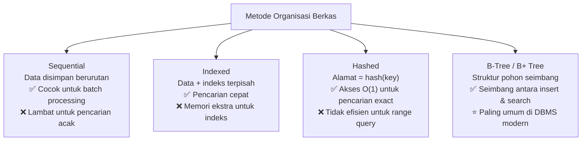

#### Tahapan Pengembangan Aplikasi Sistem Basis Data

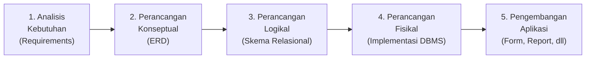

---

### Sesi 15 — Membangun Aplikasi Basis Data

**Capaian:** Menjelaskan materi membangun aplikasi basis data.

**Referensi:** [1] BMP MSIM4206

#### Studi Kasus: Aplikasi Perpustakaan

Sesi terakhir mengintegrasikan semua yang dipelajari — membangun aplikasi perpustakaan lengkap menggunakan **MySQL + Microsoft Access 365** yang terhubung via **ODBC**.

```mermaid
flowchart LR
    ERD["ERD\nPerancangan"] --> SQL["SQL\nImplementasi\nMySQL"] --> ODBC["ODBC\nKoneksi\nAccess↔MySQL"] --> FORM["Form\nInput Data"] --> QUERY["Query\nPengolahan Data"] --> REPORT["Report\nLaporan"] --> SW["Switchboard\nMenu Utama"]
```

**Komponen aplikasi yang dibangun:**

| Komponen | Detail |
|---|---|
| **Database** | MySQL: 4 tabel (anggota, buku, tempat_buku, pinjam) dengan FK dan CASCADE |
| **Form** | 4 form input dengan combo box dan tombol navigasi (Simpan, Hapus, Baru, Prev, Next) |
| **Query** | 4 query termasuk query pinjam dengan kalkulasi waktu pinjam |
| **Report** | 4 laporan dari query (anggota, buku, tempat buku, pinjam) |
| **Switchboard** | Menu navigasi 2 level (Input Data + Laporan) |

---

## Jadwal Tugas Tutorial

```mermaid
gantt
    title Jadwal Tugas Tutorial STSI4105
    dateFormat  X
    axisFormat  Sesi %s

    section Tugas Tutorial
    Tugas 1 - Praktikum ERD        :milestone, 4, 4
    Tugas 2 - Praktikum SQL & DML  :milestone, 8, 8
    Tugas 3 - Transaksi & BD Terdistribusi :milestone, 12, 12
```

| Tugas | Sesi | Topik | Referensi |
|---|---|---|---|
| **Tugas Tutorial 1** | Sesi 4 | Pembuatan ERD (5 tahapan inti) | [1], [2] |
| **Tugas Tutorial 2** | Sesi 8 | Praktikum SQL dan MySQL/MariaDB XAMPP | [1], [3] |
| **Tugas Tutorial 3** | Sesi 12 | Praktikum Transaksi & Basis Data Terdistribusi | [1], [5] |

> **Tips:** Tiga tugas tutorial ini biasanya berkontribusi signifikan pada nilai akhir. Mulai dari sesi 3–4 untuk memahami ERD dengan baik karena menjadi fondasi tugas pertama.

---

## Modus Belajar

```mermaid
flowchart LR
    subgraph Tuton["Tuton (Tutorial Online)\nSemua sesi"]
        TU["Diskusi online\ndi platform UT"]
    end
    subgraph Praktikum["Praktikum\nSesi 4, 8, 11, 12"]
        PR["Mengerjakan tugas\npraktik mandiri"]
    end

    TU --> PR
```

| Modus | Sesi | Keterangan |
|---|---|---|
| **Tuton** | 1–15 (semua) | Mempelajari materi modul + diskusi online aktif |
| **Praktikum** | 4, 8, 11, 12 | Mengerjakan tugas praktik (ERD, SQL, VirtualBox, Transaksi) |

---

## Daftar Pustaka

| No | Referensi |
|---|---|
| [1] | **BMP – MSIM4206 – Basis Data – Edisi 1** *(referensi utama untuk semua sesi)* |
| [2] | Panduan Praktikum Pembuatan Entity Relationship Diagram (ERD) *(sesi 4)* |
| [3] | Panduan Praktikum SQL *(sesi 8)* |
| [4] | Panduan Praktikum Instalasi Virtual Box *(sesi 11)* |
| [5] | Panduan Praktikum Transaksi dan Basis Data Terdistribusi *(sesi 12)* |

---

## Peta Keterhubungan Antar Topik

```mermaid
flowchart TD
    BD["Basis Data\n& DBMS"] --> MD["Model Data"]
    MD --> ERD["ERD\nPerancangan"]
    ERD --> NORM["Normalisasi\n& Redudansi"]
    NORM --> IMPL["Implementasi\nSQL DDL/DML"]
    IMPL --> TXN["Manajemen\nTransaksi"]
    TXN --> DIST["Basis Data\nTerdistribusi"]
    DIST --> VIRT["Virtualisasi\n(simulasi distribusi)"]
    VIRT --> PRAKT["Praktikum\nTransaksi + Distribusi"]

    IMPL --> APP["Aplikasi Basis Data\n(DBMS populer)"]
    APP --> ORG["Organisasi Berkas\n& Pengembangan"]
    ORG --> BUILD["Membangun Aplikasi\nMySQL + MS Access"]

    style ERD fill:#FF9800,color:#fff
    style IMPL fill:#4CAF50,color:#fff
    style TXN fill:#2196F3,color:#fff
    style BUILD fill:#9C27B0,color:#fff
```

**Inti dari mata kuliah ini:** basis data bukan sekadar menyimpan data — ini tentang **mengorganisir data dengan baik** agar sistem informasi dapat berjalan efisien, konsisten, dan andal. Dari ERD yang baik → normalisasi yang bersih → SQL yang tepat → transaksi yang aman → distribusi yang terkelola → aplikasi yang berguna bagi pengguna.
