# Sesi 2 — Konsep Basis Data

**STSI4105 Basis Data**
Program Studi Sistem Informasi — Universitas Terbuka

> Catatan: dokumen ini merupakan ekstraksi sekaligus elaborasi dari materi *Aktivitas 2 — Konsep Basis Data*. Setiap poin dijelaskan lebih dalam dengan konteks, analogi, dan contoh nyata agar lebih mudah dipahami secara utuh. Diagram konseptual digambarkan ulang menggunakan mermaid.

---

## 1. Pengertian Basis Data

### Definisi Komponen Utama

Sebelum mendefinisikan basis data secara utuh, penting memahami dua kata pembentuknya:

> **Basis** dapat diartikan sebagai markas, gudang, tempat bersarang, atau tempat berkumpul.

> **Data** adalah representasi fakta dunia nyata yang mewakili suatu objek — seperti manusia (pegawai, siswa, pembeli, pelanggan), barang, hewan, peristiwa, konsep, keadaan, dan sebagainya — yang direkam dalam bentuk angka, huruf, simbol, teks, gambar, bunyi, atau kombinasinya.

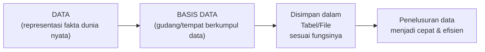

### Definisi Basis Data

> **Basis data** (*database*) adalah kumpulan data yang disimpan dalam *table/file* sesuai dengan fungsinya masing-masing, sehingga penelusuran data dapat dilakukan dengan cepat dan efisien.

Konsep kuncinya: data tidak diletakkan sembarangan, melainkan **diorganisir berdasarkan entitas/fungsinya** — tabel mahasiswa, tabel mata kuliah, tabel nilai — sehingga ketika dibutuhkan, sistem bisa langsung menuju tabel yang tepat tanpa harus membaca seluruh data.

---

## 2. Manfaat Basis Data

> **Manfaat utama basis data** adalah untuk pengelolaan data dalam memudahkan atau menemukan kembali data yang dicari dengan cepat.

Secara lebih luas, manfaat basis data dapat dirasakan di berbagai aspek:

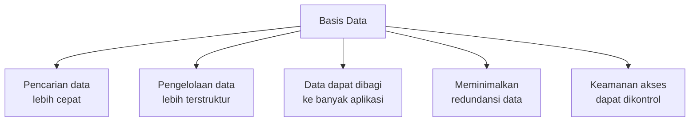

> Bayangkan sebuah perpustakaan tanpa sistem katalog: menemukan satu buku memerlukan pencarian manual rak per rak. Basis data adalah sistem katalog digital yang membuat pencarian menjadi instan.

---

## 3. Tujuan Basis Data

Terdapat **sembilan tujuan** yang ingin dicapai dengan penggunaan basis data:

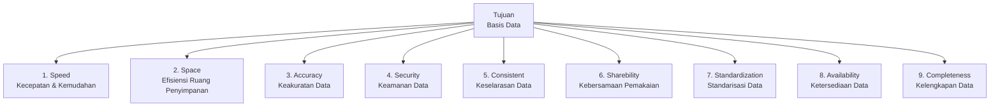

| # | Tujuan | Penjelasan |
|---|---|---|
| 1 | **Speed** (Kecepatan & Kemudahan) | Basis data memungkinkan penyimpanan, perubahan, penghapusan, penambahan, dan pemanggilan kembali data dengan cepat dan mudah. |
| 2 | **Space** (Efisiensi Ruang) | Penggunaan ruang penyimpanan diminimalkan dengan menekan pengulangan data dan jumlah pengkodean yang redundan. |
| 3 | **Accuracy** (Keakuratan) | Pengkodean, pembentukan relasi antar data, dan penerapan aturan/batasan tipe data memastikan data yang masuk akurat. |
| 4 | **Security** (Keamanan) | Sistem dapat menentukan siapa yang boleh mengakses basis data dan jenis operasi apa saja yang diizinkan — penting untuk sistem skala besar dan kritis. |
| 5 | **Consistent** (Keselarasan) | Perubahan data pada satu aplikasi otomatis berlaku untuk seluruh aplikasi lain yang menggunakan basis data yang sama. |
| 6 | **Sharebility** (Kebersamaan) | Data dapat dipakai secara bersamaan oleh beberapa program aplikasi pada saat yang sama tanpa konflik. |
| 7 | **Standardization** (Standarisasi) | Pengontrolan terpusat memungkinkan penerapan standar penyimpanan data, memudahkan distribusi dan pertukaran data antar sistem. |
| 8 | **Availability** (Ketersediaan) | Basis data dapat memilah data utama, data transaksi, data *history*, hingga data kedaluwarsa — data lama dapat diarsipkan terpisah dari sistem aktif. |
| 9 | **Completeness** (Kelengkapan) | Kelengkapan data bersifat relatif tergantung kebutuhan pengguna; basis data memungkinkan penambahan struktur data sesuai kebutuhan yang berkembang. |

---

## 4. Kelebihan Basis Data

Dibanding sistem penyimpanan data tradisional berbasis file terpisah, basis data menawarkan **delapan kelebihan** utama:

| # | Kelebihan | Penjelasan |
|---|---|---|
| 1 | **Kemandirian Data** | Sebuah basis data dapat digunakan oleh bermacam-macam program aplikasi tanpa harus mengubah format data yang sudah ada. |
| 2 | **Konsistensi Data** | Data disimpan hanya sekali; jika ada perubahan nilai, perubahan dilakukan satu kali dan nilai baru langsung tersedia untuk semua pengguna. |
| 3 | **Aksesibilitas Lebih Baik** | Integrasi data yang melampaui batasan departemen memungkinkan pengguna mengakses data lintas divisi secara langsung. |
| 4 | **Kendali Kerangkapan** | Data disimpan hanya satu kali, mengurangi duplikasi (*redundancy*) dan menghemat biaya penyimpanan. |
| 5 | **Keamanan Data** | Basis data dapat menentukan batasan akses melalui mekanisme *password* dan hak akses per operasi (*update*, *delete*, *insert*, *select*). |
| 6 | **Integritas Data** | Integritas diekspresikan melalui *constraints* — aturan yang konsisten dan tidak dapat dilanggar — menjaga validitas dan konsistensi data. |
| 7 | **Pemakaian Bersama** | Data milik seluruh organisasi dapat dipakai bersama oleh semua pengguna yang berwenang secara bersamaan. |
| 8 | **Informasi Lebih Kaya** | Karena semua data ada dalam satu tempat, pengguna dapat mengekstrak informasi lintas entitas yang tidak mungkin dilakukan pada sistem file terpisah. |

---

## 5. Kekurangan Basis Data

Penggunaan basis data bukan tanpa tantangan. Terdapat **tiga kekurangan** utama yang perlu dipertimbangkan:

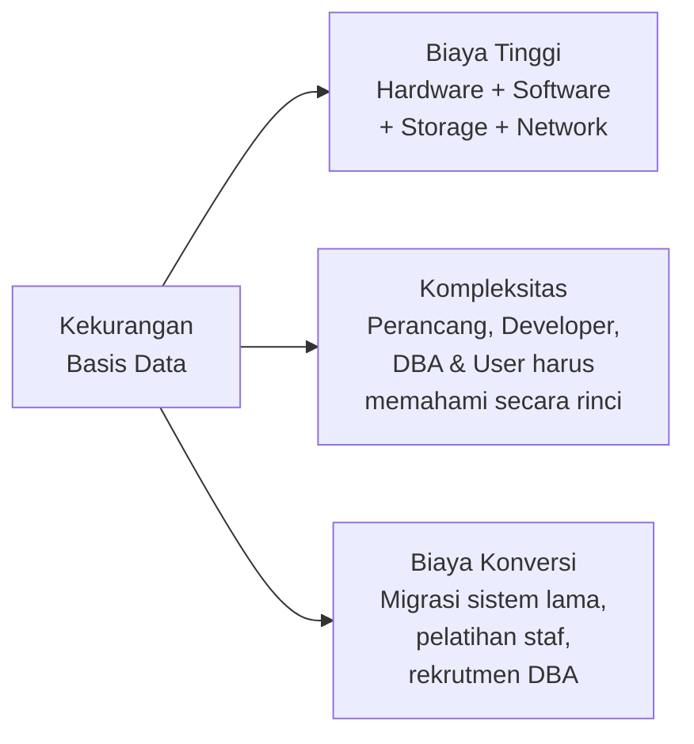

| # | Kekurangan | Detail |
|---|---|---|
| 1 | **Biaya Tinggi** | Mencakup biaya pembelian sekaligus perawatan *hardware* dan *software*, ditambah biaya penyimpanan (*storage*), jaringan (*network*), dan lain-lain. |
| 2 | **Kompleksitas** | Perancang, pengembang, DBA (*Database Administrator*), dan pengguna akhir harus memahami fungsi basis data secara rinci dan mendalam. Kegagalan memanfaatkannya dapat menyebabkan kerugian besar. |
| 3 | **Biaya Konversi** | Diperlukan biaya besar untuk berpindah dari sistem lama ke basis data baru: biaya migrasi data, pelatihan staf menggunakan sistem baru, dan rekrutmen staf khusus seperti DBA. |

> **DBA (Database Administrator)** adalah peran krusial yang bertanggung jawab atas desain, pemeliharaan, keamanan, dan performa basis data. Rekrutmen DBA yang kompeten adalah investasi penting, bukan biaya yang bisa dihindari.

---

## 6. Tingkatan Data dalam Database Relasi

Dalam database relasi, data diorganisir dalam **hierarki empat tingkatan** — dari yang paling besar hingga yang paling kecil:

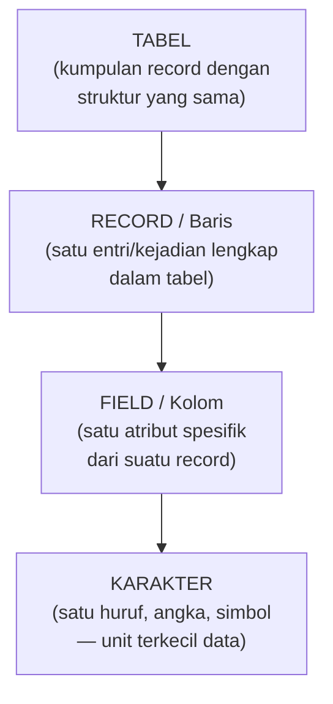

| Tingkatan | Istilah Lain | Contoh (Tabel Mahasiswa) |
|---|---|---|
| **Tabel** | Relasi, Entity | Tabel `mahasiswa` |
| **Record** | Baris (*Row*), Tuple | Data 1 mahasiswa: `(12345, Budi, Sistem Informasi)` |
| **Field** | Kolom (*Column*), Atribut | `nim`, `nama`, `prodi` |
| **Karakter** | Byte, Karakter | `B`, `u`, `d`, `i` (satu per satu huruf) |

> Pemahaman hierarki ini penting karena ketika menulis query SQL, kita selalu bekerja di level yang berbeda: `SELECT` mengambil *field*, `WHERE` memfilter *record*, dan `FROM` menentukan *tabel*.

---

## 7. Operasi Dasar Basis Data

Semua interaksi dengan basis data dilakukan melalui **delapan operasi dasar** — yang dalam SQL dibagi menjadi dua kelompok besar:

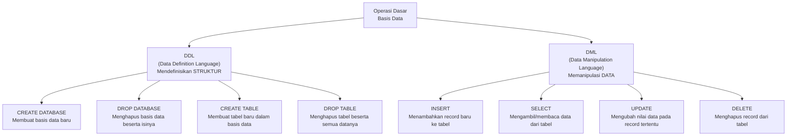

| Kelompok | Operasi | Fungsi |
|---|---|---|
| **DDL** | `CREATE DATABASE` | Membuat basis data baru. |
| **DDL** | `DROP DATABASE` | Menghapus seluruh basis data beserta semua tabel dan datanya. |
| **DDL** | `CREATE TABLE` | Mendefinisikan struktur tabel baru (nama kolom, tipe data, constraints). |
| **DDL** | `DROP TABLE` | Menghapus tabel beserta seluruh data yang tersimpan di dalamnya. |
| **DML** | `INSERT` | Menambahkan satu atau lebih record baru ke dalam tabel. |
| **DML** | `SELECT` | Mengambil/menampilkan data dari satu atau lebih tabel. |
| **DML** | `UPDATE` | Mengubah nilai field tertentu pada record yang memenuhi kondisi. |
| **DML** | `DELETE` | Menghapus record yang memenuhi kondisi dari tabel. |

> Keempat operasi DML (`INSERT`, `SELECT`, `UPDATE`, `DELETE`) sering disingkat **CRUD** (*Create, Read, Update, Delete*) dalam konteks pengembangan aplikasi — terminologi yang akan terus dijumpai sepanjang karier sebagai developer.

---

## 8. Penerapan Basis Data

Basis data digunakan hampir di setiap sektor industri. Beberapa domain penerapan yang paling umum:

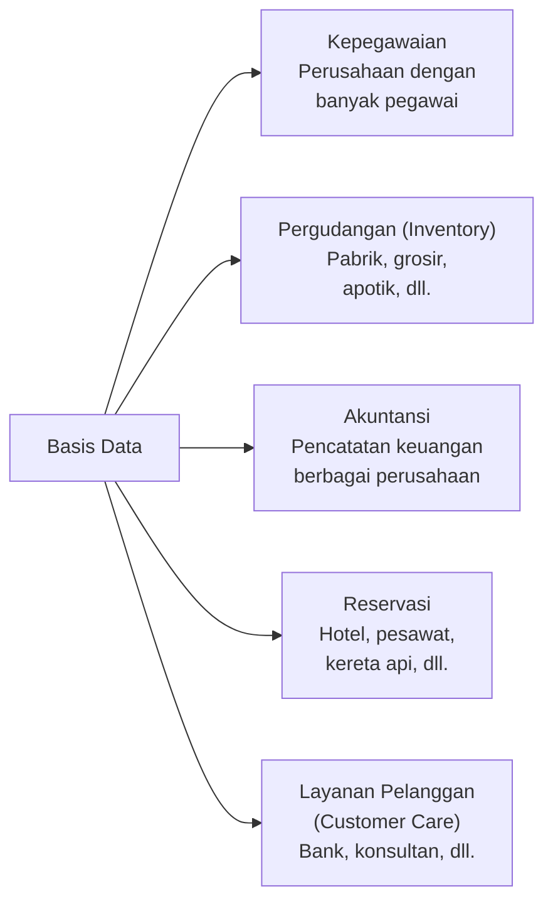

| Domain | Contoh Penggunaan |
|---|---|
| **Kepegawaian** | Menyimpan data karyawan, absensi, penggajian, riwayat jabatan. |
| **Pergudangan (*Inventory*)** | Mencatat stok barang masuk-keluar, data pemasok, dan posisi barang di gudang. |
| **Akuntansi** | Mencatat transaksi keuangan, menghasilkan laporan keuangan, mengelola piutang dan utang. |
| **Reservasi** | Mengelola ketersediaan kursi/kamar, pemesanan, pembatalan, dan pembayaran secara real-time. |
| **Layanan Pelanggan** | Menyimpan riwayat interaksi pelanggan, tiket pengaduan, dan profil pelanggan untuk layanan yang personal. |

---

## 9. Klasifikasi DBMS

**DBMS (Database Management System)** adalah perangkat lunak yang mengelola, mengakses, dan mengontrol basis data. DBMS dapat diklasifikasikan berdasarkan tiga kriteria:

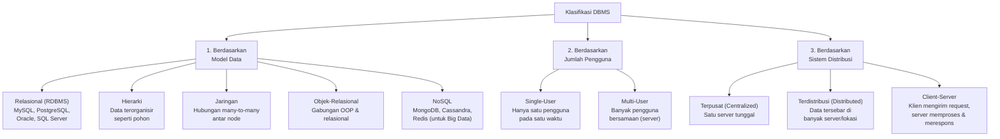

| Klasifikasi | Jenis | Keterangan |
|---|---|---|
| **Model Data** | Relasional | Model paling populer — data disimpan dalam tabel dengan baris dan kolom; hubungan antar tabel via *foreign key*. |
| | Hierarki | Data terstruktur seperti pohon (*tree*); setiap *node* anak hanya punya satu *node* induk. |
| | Jaringan | Pengembangan model hierarki yang memungkinkan satu *node* anak memiliki banyak *node* induk (*many-to-many*). |
| | NoSQL | Dirancang untuk data skala besar (*Big Data*) yang tidak terstruktur; fleksibel dan sangat skalabel. |
| **Jumlah Pengguna** | *Single-User* | Hanya satu pengguna aktif pada satu waktu — umum untuk aplikasi *desktop* lokal. |
| | *Multi-User* | Mendukung banyak pengguna secara bersamaan — standar untuk aplikasi *web* dan *enterprise*. |
| **Sistem Distribusi** | Terpusat | Seluruh data dan DBMS berada dalam satu server tunggal; sederhana namun rawan jadi *single point of failure*. |
| | Terdistribusi | Data tersebar di banyak server/lokasi yang terhubung jaringan; lebih tangguh dan skalabel. |
| | *Client-Server* | Klien mengirim *request* ke server; server memproses dan mengembalikan hasil — arsitektur paling umum untuk aplikasi modern. |

---

## 10. Abstraksi Data

Abstraksi data adalah cara DBMS menyembunyikan kerumitan teknis penyimpanan data dari pengguna. Terdapat **tiga level abstraksi**:

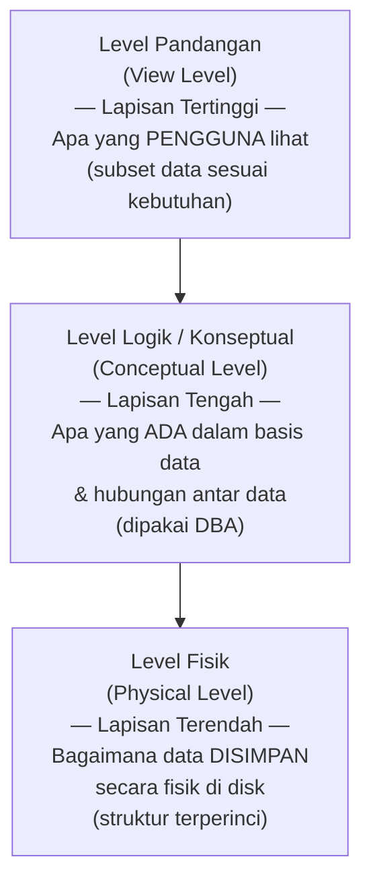

| Level | Pertanyaan Kunci | Pengguna | Contoh |
|---|---|---|---|
| **Level Fisik** (*Physical Level*) | *How* — bagaimana data disimpan? | Pengembang DBMS, sistem operasi | Indeks B-Tree, blok disk, byte offset. |
| **Level Konseptual** (*Conceptual Level*) | *What* — data apa yang ada & bagaimana hubungannya? | DBA (*Database Administrator*) | "Data mahasiswa ada di tabel `mahasiswa`, terhubung ke tabel `KRS` via kolom `nim`." |
| **Level Pandangan** (*View Level*) | *Who sees what* — siapa boleh melihat apa? | Pengguna akhir, aplikasi | Bagian keuangan hanya melihat data keuangan; bagian akademik hanya melihat data nilai. |

> Konsep tiga level ini dikenal sebagai **Arsitektur ANSI/SPARC** — standar yang memastikan **independensi data**: perubahan di level fisik (misalnya mengganti mesin server) tidak mempengaruhi aplikasi di level pandangan. Inilah yang membuat basis data jauh lebih fleksibel dibanding sistem file tradisional.

---

## 11. Basis Data dalam Sistem Informasi

> **Sistem informasi** merupakan kombinasi teratur dari manusia, *hardware*, *software*, jaringan komunikasi, dan sumber daya data, yang mengumpulkan, mengubah, dan menyebarkan informasi dalam sebuah organisasi.

Dalam ekosistem sistem informasi, basis data berperan sebagai **tulang punggung penyimpanan data**:

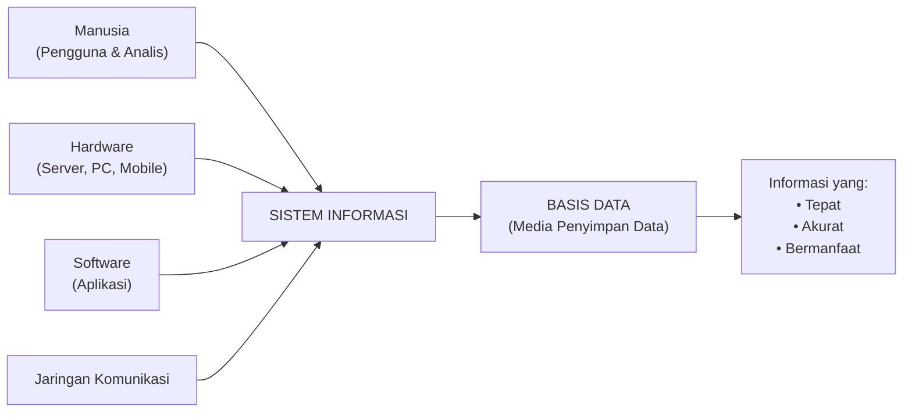

> Tanpa basis data, sistem informasi hanya bisa mengolah data sementara di memori — informasi yang dihasilkan tidak persisten dan tidak bisa dibagi. Basis data adalah yang membuat sistem informasi benar-benar *berguna* untuk pengambilan keputusan organisasi.

---

## 12. DBMS: Traditional File Base System vs Database Management System

Memahami perbedaan dua pendekatan ini membantu menjelaskan *mengapa* basis data lahir:

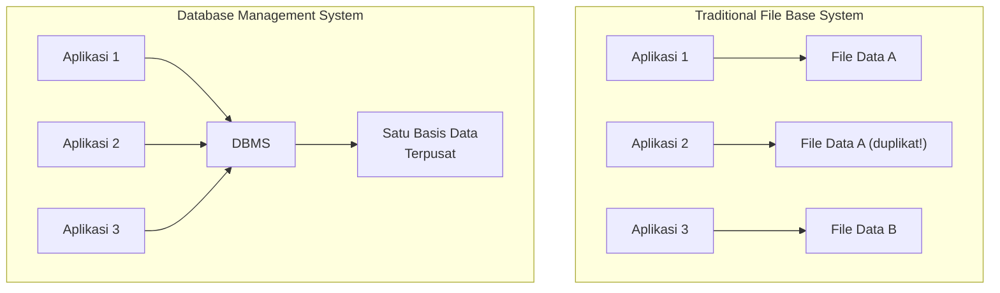

| Aspek | Traditional File Base System | Database Management System |
|---|---|---|
| **Penyimpanan** | Data tersebar dalam banyak file terpisah per aplikasi. | Data terpusat dalam satu basis data yang dibagi bersama. |
| **Redundansi** | Tinggi — data yang sama muncul di banyak file. | Minimal — data disimpan satu kali, diakses banyak aplikasi. |
| **Konsistensi** | Rendah — perubahan di satu file tidak otomatis update file lain. | Tinggi — perubahan di satu titik langsung berlaku ke seluruh sistem. |
| **Keamanan** | Terbatas pada keamanan file OS (*read/write*). | Granular — hak akses per tabel, per kolom, per operasi. |
| **Integritas** | Harus dijaga manual oleh programmer. | Dijaga oleh DBMS melalui *constraints* dan *transactions*. |
| **Contoh** | Penyimpanan data dalam file `.csv`, `.txt`, spreadsheet Excel terpisah. | MySQL, PostgreSQL, Oracle, SQL Server, MongoDB. |

---

## Ringkasan Keterkaitan Antar Konsep

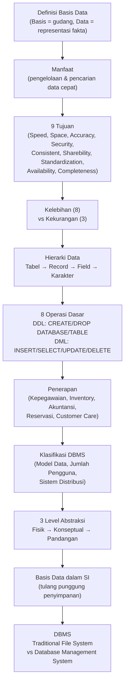

Inti dari sesi ini: **basis data** adalah solusi terstruktur untuk menyimpan dan mengelola data yang terus tumbuh. Dibanding sistem file tradisional, basis data unggul dalam kecepatan akses, konsistensi, keamanan, dan kemampuan berbagi data. Namun, keunggulan ini datang dengan biaya — baik finansial (hardware, software, DBA) maupun teknis (kompleksitas desain). Memahami hierarki data (tabel→record→field→karakter), operasi dasar (DDL & DML), tiga level abstraksi (fisik→konseptual→pandangan), dan berbagai klasifikasi DBMS adalah fondasi yang harus kokoh sebelum melangkah ke desain dan implementasi basis data yang lebih kompleks.

---

*Selamat Belajar...*
