# Sesi 3 — Model Data

**STSI4105 Basis Data**
Program Studi Sistem Informasi — Universitas Terbuka

> Catatan: dokumen ini merupakan ekstraksi sekaligus elaborasi dari materi *Aktivitas 3 — Model Data*. Setiap poin dijelaskan lebih dalam dengan konteks, analogi, dan contoh nyata agar lebih mudah dipahami secara utuh. Diagram konseptual digambarkan ulang menggunakan mermaid.

---

## 1. Pengertian Model Data

> **Model data** adalah sekumpulan konsep yang terintegrasi untuk mendeskripsikan data, hubungan antar data, dan batasan-batasannya.

Model data bukan sekadar "cara menyimpan data" — ia adalah **bahasa komunikasi** antara perancang basis data dan pengguna. Model data harus menyediakan konsep dasar dan notasi yang memungkinkan kedua pihak mengkomunikasikan pemahamannya mengenai **organisasi data**.

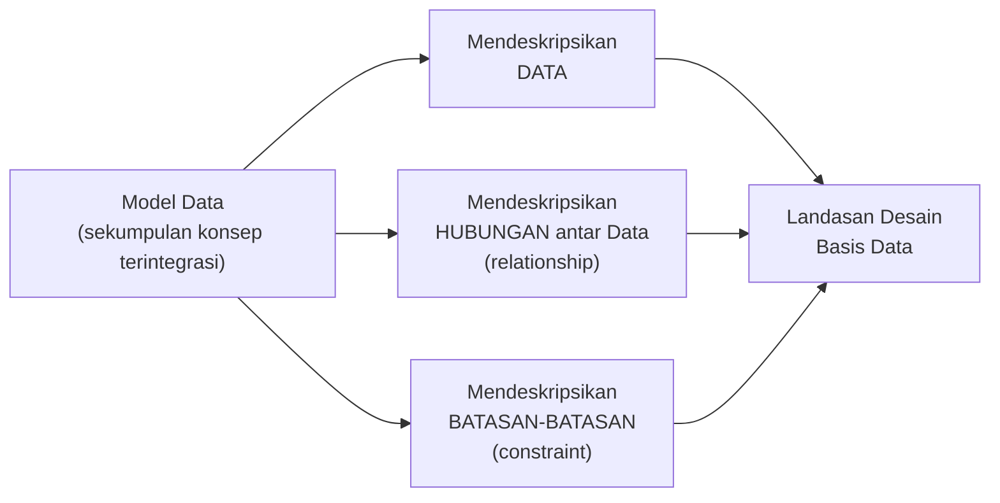

> Analogi terbaik: model data seperti **denah/blueprint bangunan** — ia bukan bangunan itu sendiri, melainkan representasi terstruktur yang digunakan arsitek (perancang BD) dan klien (pengguna) untuk berdiskusi dan bersepakat tentang bagaimana bangunan itu akan dibangun.

---

## 2. Model Database

> **Model database** adalah suatu konsep yang terintegrasi dalam menggambarkan hubungan (*relationship*) antar data dan batasan-batasan (*constraint*) data dalam suatu sistem *database*.

Terdapat tiga model database utama:

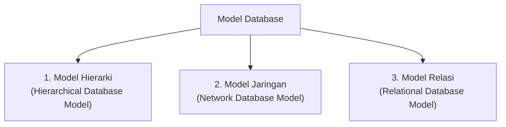

---

## 3. Model Database Hierarki (*Hierarchical Database Model*)

Model hierarki adalah model database paling awal, dikembangkan pada era 1960-an. Data diorganisir seperti **struktur pohon** (*tree*): setiap *node* memiliki tepat **satu induk (*parent*)**, kecuali *root* (simpul teratas) yang tidak memiliki induk.

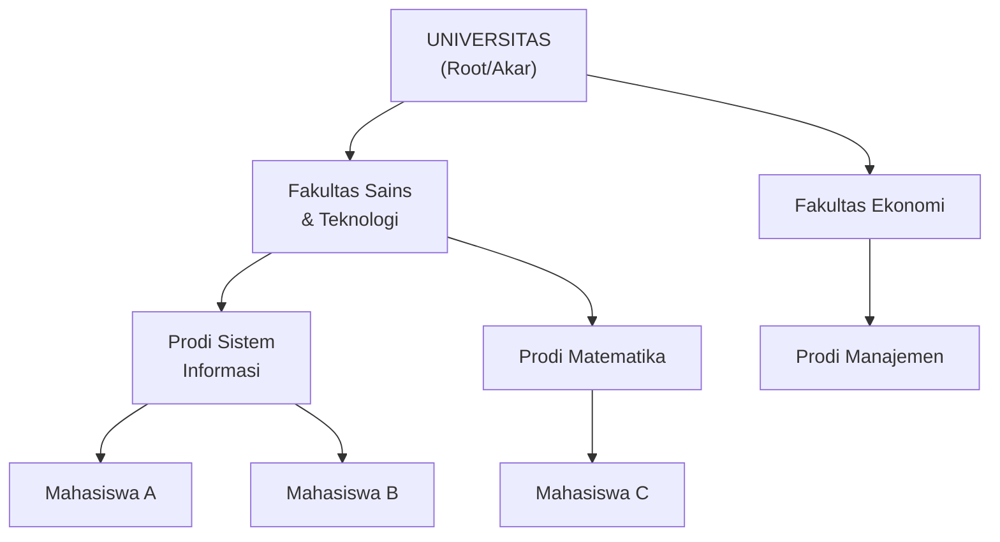

| Aspek | Detail |
|---|---|
| **Struktur** | Pohon (*tree*) — satu *root*, bercabang ke *node* anak. |
| **Relasi** | Hanya **One-to-Many** dari induk ke anak; setiap anak hanya punya satu induk. |
| **Kelebihan** | Sederhana dan akses data cepat untuk jalur yang sudah ditentukan sebelumnya. |
| **Kelemahan** | Kaku — tidak bisa merepresentasikan hubungan *many-to-many*; penghapusan *node* induk menghapus semua anaknya. |
| **Contoh DBMS** | IBM Information Management System (IMS), Windows Registry. |

> Kelemahan utama: dalam dunia nyata banyak hubungan yang bersifat **many-to-many** (satu mahasiswa mengambil banyak mata kuliah; satu mata kuliah diambil banyak mahasiswa) — hal yang tidak bisa direpresentasikan secara natural dalam model pohon.

---

## 4. Model Database Jaringan (*Network Database Model*)

Model jaringan adalah penyempurnaan model hierarki. Perbedaan kuncinya: sebuah *node* anak **boleh memiliki lebih dari satu induk**, sehingga hubungan *many-to-many* dapat direpresentasikan.

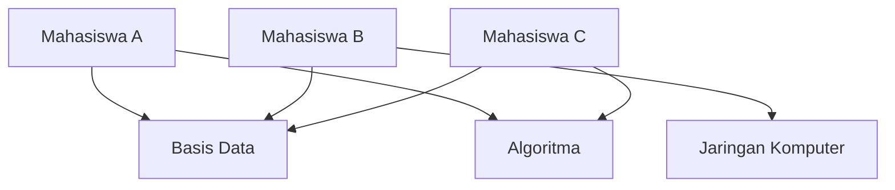

| Aspek | Detail |
|---|---|
| **Struktur** | Jaringan/Graf (*graph*) — *node* dapat memiliki banyak induk dan banyak anak. |
| **Relasi** | **One-to-Many** dan **Many-to-Many** dapat direpresentasikan. |
| **Kelebihan** | Lebih fleksibel dari hierarki; mampu merepresentasikan hubungan kompleks. |
| **Kelemahan** | Kompleks dalam implementasi; struktur data sulit diubah setelah dibuat. |
| **Contoh DBMS** | Integrated Data Store (IDS), IDMS (Integrated Database Management System). |

---

## 5. Model Database Relasi (*Relational Database Model*)

Model relasi adalah yang paling populer hingga saat ini. Dikembangkan oleh **E.F. Codd** pada 1970, model ini merepresentasikan data dalam **tabel** (*relasi*) dua dimensi — baris dan kolom — yang saling dihubungkan melalui kunci (*key*).

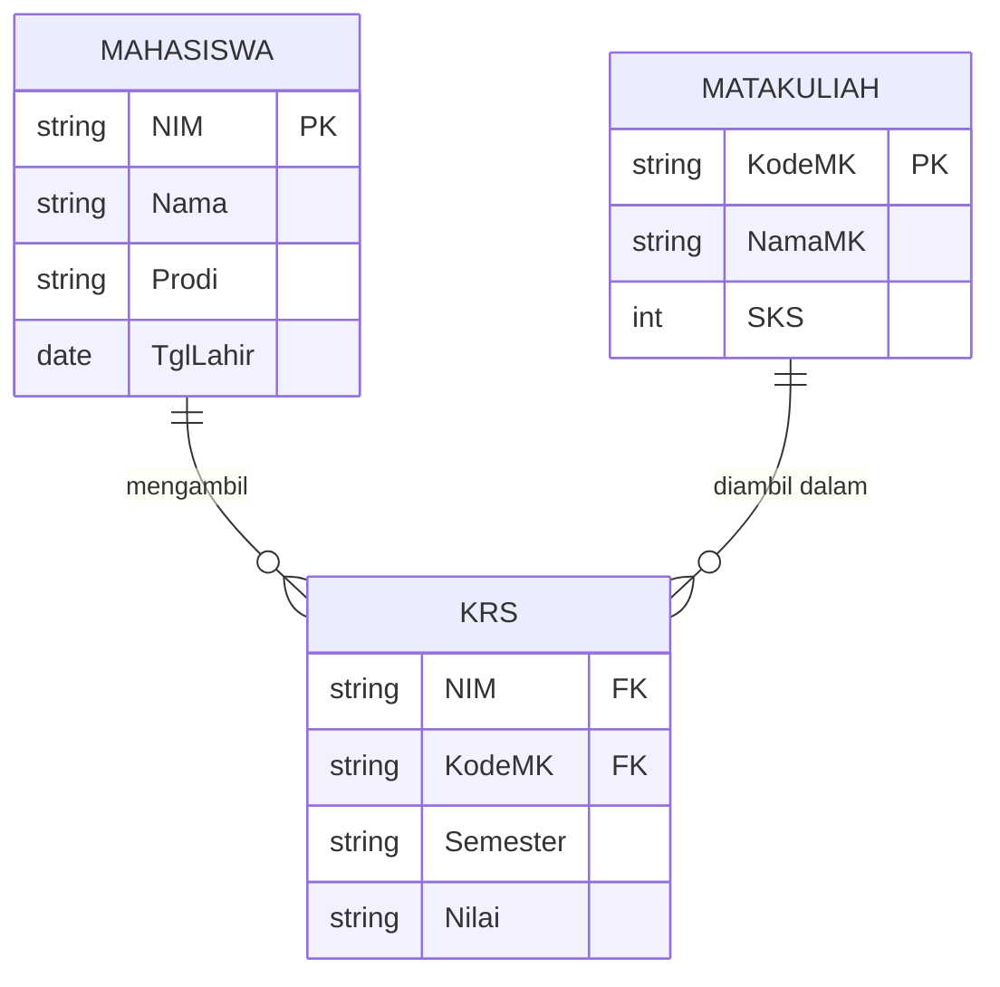

| Aspek | Detail |
|---|---|
| **Struktur** | Tabel dua dimensi: baris = *record/tuple*, kolom = atribut/field. |
| **Relasi** | Dihubungkan melalui **Primary Key** dan **Foreign Key**. |
| **Kelebihan** | Sederhana, intuitif, fleksibel, standar industri, mudah di-*query* dengan SQL. |
| **Kelemahan** | Kurang efisien untuk data sangat tidak terstruktur atau volume sangat besar (*Big Data*). |
| **Contoh DBMS** | MySQL, PostgreSQL, Oracle, Microsoft SQL Server, SQLite. |

> Kekuatan model relasi terletak pada **independensi data** dan **bahasa query standar (SQL)** — siapapun yang tahu SQL bisa bekerja dengan DBMS relasional manapun karena standarnya sama. Inilah yang menjadikannya dominan selama lebih dari 50 tahun.

---

## 6. Entity Relationship Model (ERM) dan ERD

### Definisi

> **Entity Relationship Model (ERM)** adalah model konseptual tingkat tinggi pada proses perancangan basis data. Model data konseptual adalah himpunan konsep yang mendeskripsikan struktur basis data, transaksi pengambilan, dan pembaruan basis data.

ERM diwujudkan dalam bentuk **Entity Relationship Diagram (ERD)** — diagram visual yang menggambarkan entitas, atribut, dan relasi antar entitas sebelum basis data diimplementasikan.

> ERD adalah **cetak biru** (*blueprint*) basis data. Seperti arsitek yang menggambar denah sebelum membangun gedung, perancang basis data membuat ERD sebelum menuliskan satu baris pun perintah SQL.

### Simbol-Simbol dalam ERD

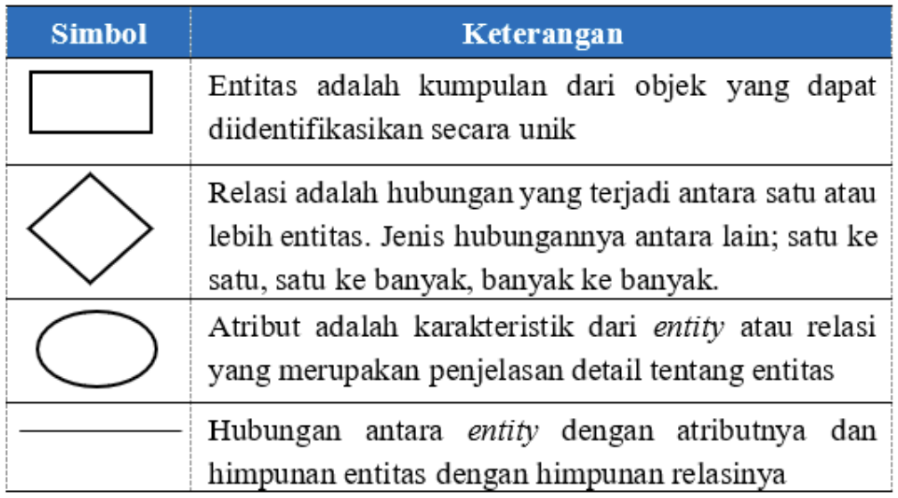

| Simbol | Nama | Fungsi |
|---|---|---|
| Persegi Panjang □ | **Entitas** (*Entity*) | Kumpulan objek yang dapat diidentifikasikan secara unik. Contoh: `Mahasiswa`, `Dosen`, `MataKuliah`. |
| Belah Ketupat ◇ | **Relasi** (*Relationship*) | Hubungan yang terjadi antara satu atau lebih entitas. Jenisnya: satu ke satu, satu ke banyak, banyak ke banyak. |
| Elips ○ | **Atribut** (*Attribute*) | Karakteristik dari entitas atau relasi yang merupakan penjelasan detail. Contoh: `NIM`, `Nama`, `TanggalLahir`. |
| Garis — | **Penghubung** | Menghubungkan entitas dengan atributnya dan himpunan entitas dengan himpunan relasinya. |

### Derajat Relasi (*Degree of Relationship*)

Salah satu hal terpenting dalam ERD adalah menentukan **derajat relasi** — berapa banyak *instance* dari satu entitas yang dapat berhubungan dengan *instance* dari entitas lain.

| Derajat | Notasi | Penjelasan | Contoh |
|---|---|---|---|
| **Satu ke Satu** | 1:1 | Satu instance A berhubungan dengan tepat satu instance B, dan sebaliknya. | Satu karyawan memegang satu jabatan; satu jabatan dipegang satu karyawan. |
| **Satu ke Banyak** | 1:N | Satu instance A berhubungan dengan banyak instance B, tapi satu B hanya punya satu A. | Satu dosen mengampu banyak mata kuliah; tiap mata kuliah hanya diampu satu dosen. |
| **Banyak ke Banyak** | N:M | Banyak instance A berhubungan dengan banyak instance B. | Seorang mahasiswa mengambil banyak mata kuliah; satu mata kuliah diambil banyak mahasiswa. |

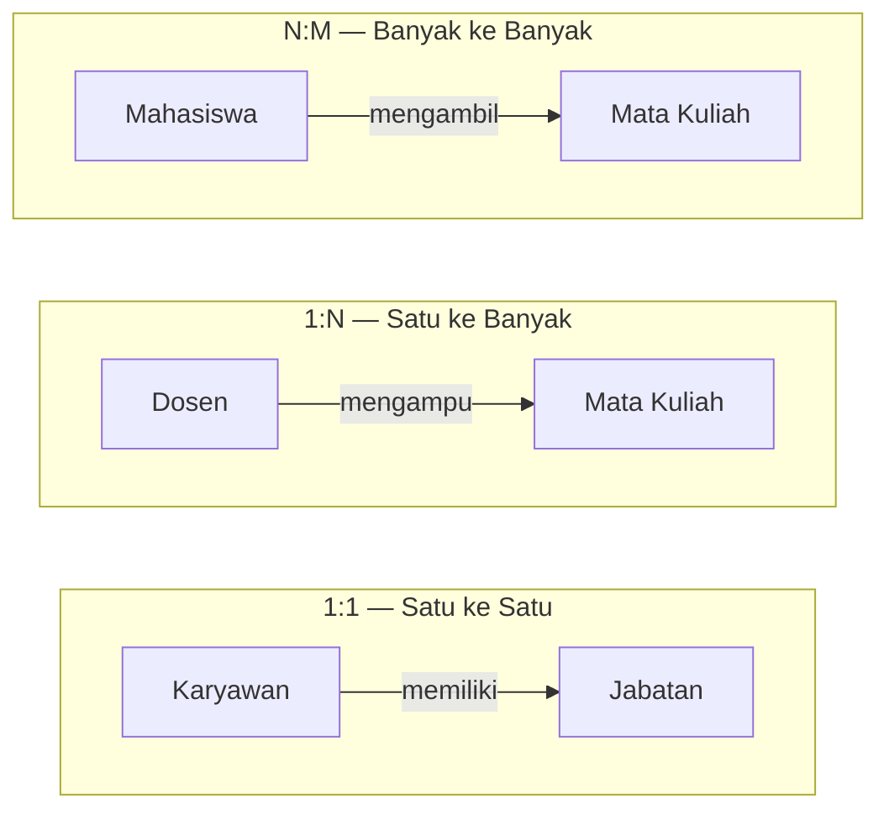

> Relasi **N:M** dalam implementasi basis data relasional **harus dipecah** menjadi dua relasi 1:N melalui **tabel antara** (*junction table*) — misalnya tabel `KRS` yang menghubungkan `Mahasiswa` dan `MataKuliah`. Ini adalah konsep fundamental yang terus digunakan dalam desain basis data.

### Konsep Kunci: Primary Key dan Foreign Key

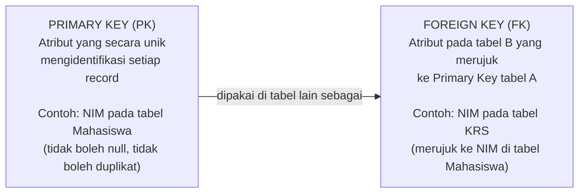

| Konsep | Penjelasan |
|---|---|
| **Primary Key (PK)** | Atribut yang secara unik mengidentifikasi setiap *record* dalam tabel. Nilai PK tidak boleh null dan tidak boleh duplikat. |
| **Foreign Key (FK)** | Atribut pada suatu tabel yang merujuk ke *Primary Key* tabel lain. FK adalah mekanisme utama membangun relasi antar tabel dalam model relasional. |
| **Composite Key** | Kunci primer yang terdiri dari lebih dari satu atribut, digunakan ketika tidak ada satu atribut tunggal yang cukup unik sendiri. |

---

## 7. Tahapan Pembuatan ERD

Pembuatan ERD yang baik mengikuti **tujuh tahapan** sistematis:

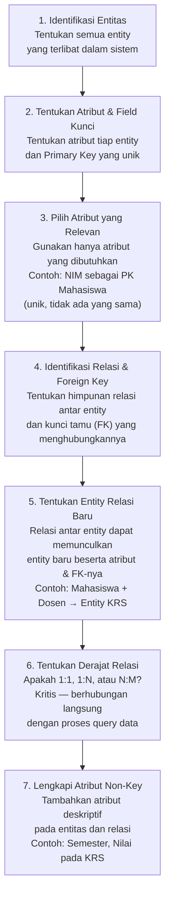

### Penjelasan Detail per Tahap

**Tahap 1 — Identifikasi Entitas**

Tentukan semua objek/benda yang perlu disimpan datanya dalam sistem. Entitas biasanya berupa **kata benda** yang dapat diidentifikasikan secara unik.

*Contoh untuk sistem akademik*: `Mahasiswa`, `Dosen`, `MataKuliah`, `Ruangan`, `Jadwal`.

---

**Tahap 2 & 3 — Tentukan Atribut dan Primary Key**

Untuk setiap entitas, tentukan atribut yang relevan, lalu pilih satu sebagai **Primary Key** — nilai yang unik dan tidak pernah kosong.

| Atribut Mahasiswa | Digunakan? | Keterangan |
|---|---|---|
| NIM | ✓ — **Primary Key** | Unik per mahasiswa, tidak ada yang sama. |
| Nama | ✓ | Nama lengkap mahasiswa. |
| TanggalLahir | ✓ | Data identitas. |
| Prodi | ✓ | Program studi yang diambil. |
| NomorHP | ✓ | Kontak mahasiswa. |
| NamaOrangTua | ✗ | Tidak dibutuhkan sistem akademik dasar. |
| PekerjaanOrangTua | ✗ | Tidak relevan untuk konteks ini. |

> Pilih atribut yang **memang dibutuhkan sistem**, bukan semua atribut yang mungkin ada. Atribut berlebih memperbesar basis data tanpa manfaat nyata.

---

**Tahap 4 & 5 — Identifikasi Relasi dan Entitas Baru**

Tentukan hubungan antar entitas beserta *foreign key*-nya. Relasi antar entitas sering memunculkan **entitas baru**:

*Contoh*: Mahasiswa ↔ Dosen → relasi proses **Mengajar** → `KRS` menjadi entitas baru dengan atribut `Semester` dan `Nilai`, serta dua FK: `NIM` (dari Mahasiswa) dan `KodeMK` (dari MataKuliah).

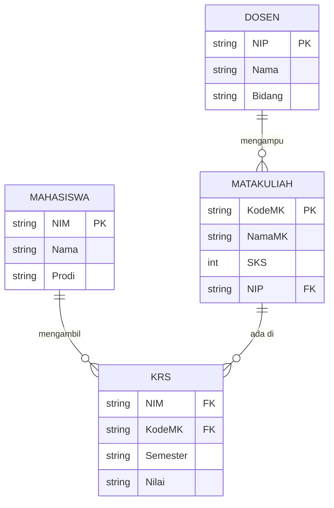

---

**Tahap 6 — Tentukan Derajat Relasi**

Ini tahap paling kritis — derajat relasi yang salah berdampak langsung pada hasil *query*.

| Pertanyaan Panduan | Jawaban → Derajat |
|---|---|
| Bisakah A memiliki lebih dari satu B? | Tidak → 1:1 atau bukan sisi "many" |
| Bisakah B memiliki lebih dari satu A? | Tidak → 1:N (dari A ke B) |
| Keduanya bisa "banyak"? | Ya → N:M (butuh tabel antara) |

---

**Tahap 7 — Lengkapi Atribut Non-Key**

Setelah semua entitas dan relasi terdefinisi, tambahkan atribut deskriptif (*non-key*) yang melengkapi informasi. Contoh: tabel `KRS` memiliki atribut non-key `Semester` dan `Nilai` — bukan kunci, tetapi informasi penting yang melekat pada relasi Mahasiswa–MataKuliah.

---

## Ringkasan Keterkaitan Antar Konsep

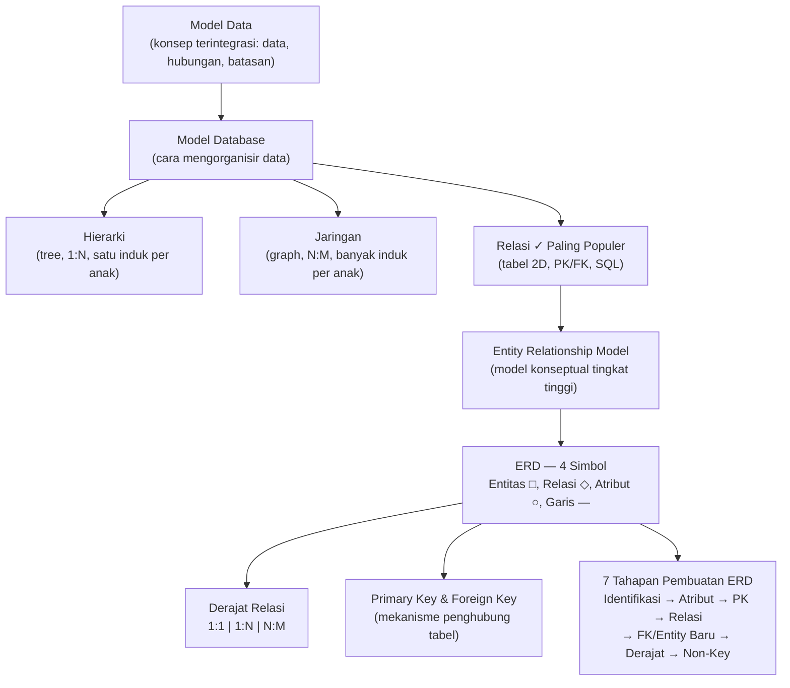

Inti dari sesi ini: **model data** adalah representasi konseptual yang menjembatani dunia nyata dengan struktur basis data. Dari tiga model utama — hierarki, jaringan, dan relasi — **model relasi** mendominasi karena kesederhanaannya, fleksibilitasnya, dan kekuatan SQL sebagai bahasa standar. Implementasi model relasi dimulai dari perancangan **ERD** menggunakan empat simbol dasar, dengan perhatian cermat pada derajat relasi (1:1, 1:N, N:M) dan penggunaan *Primary Key* serta *Foreign Key* sebagai mekanisme penghubung antar tabel — semuanya dilakukan melalui tujuh tahapan pembuatan ERD yang sistematis.

---

*Selamat Belajar...*
