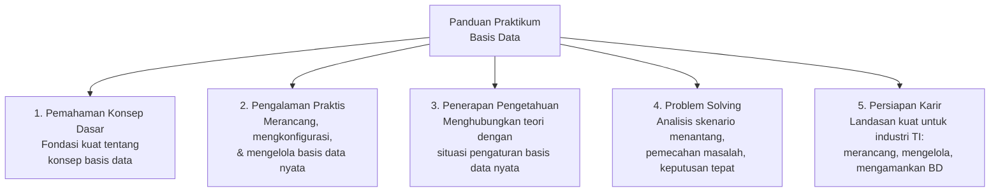
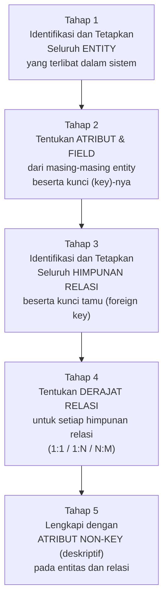
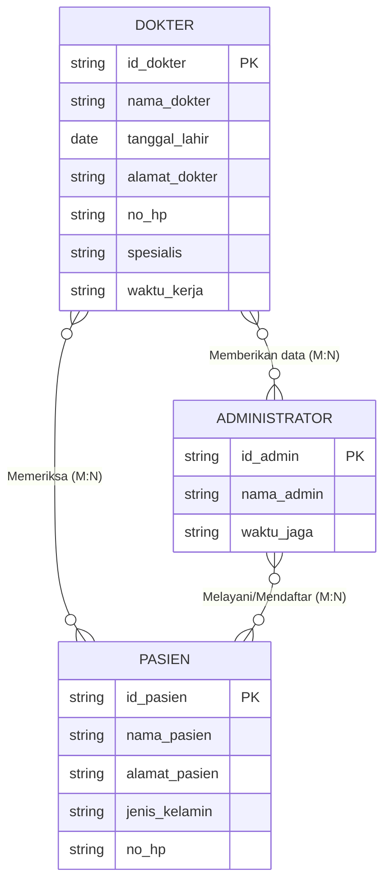
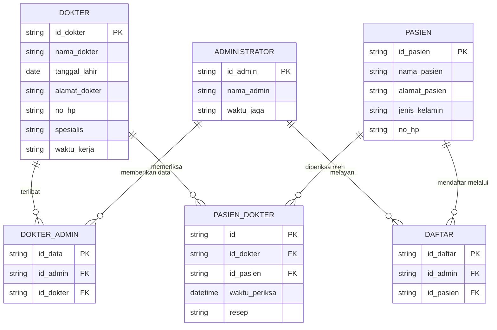
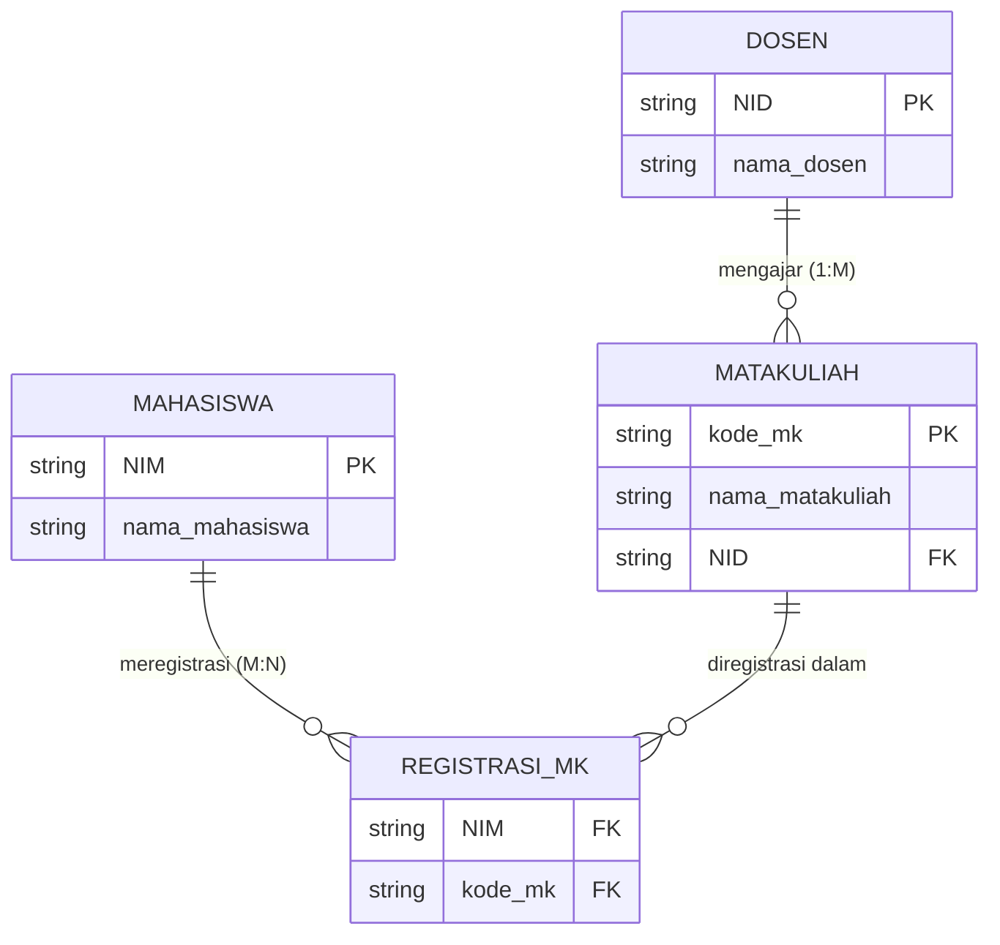
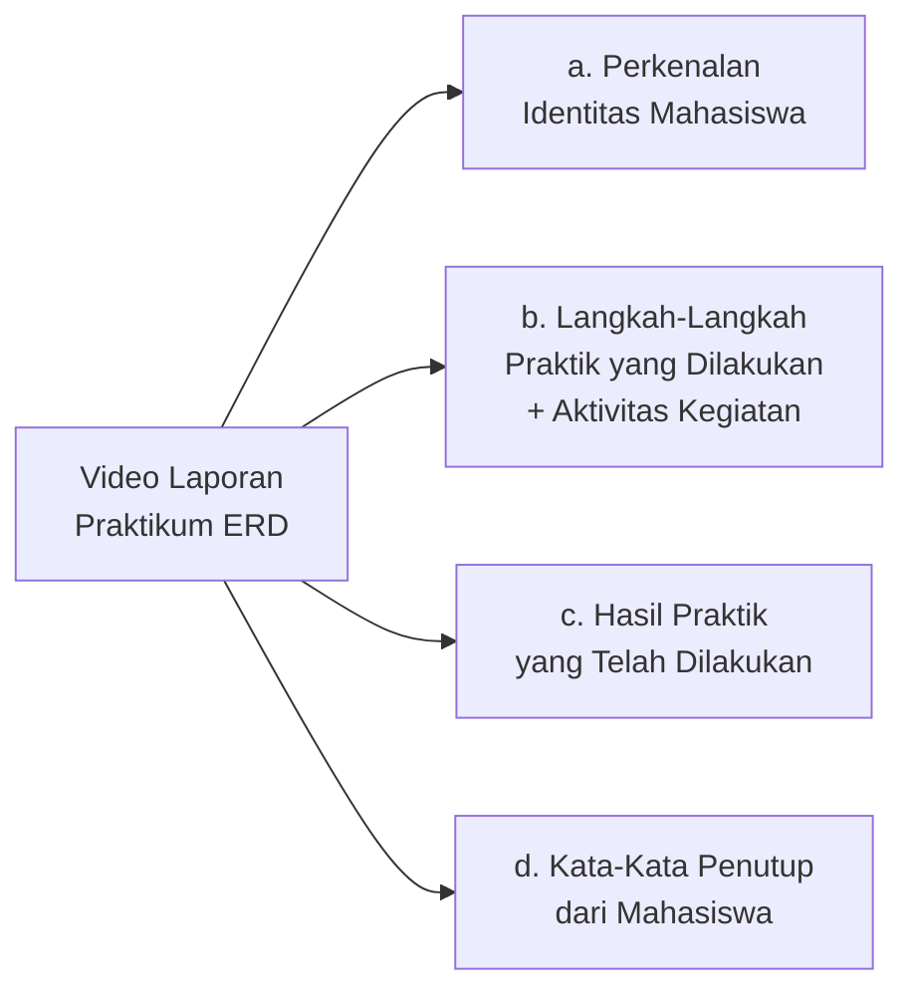
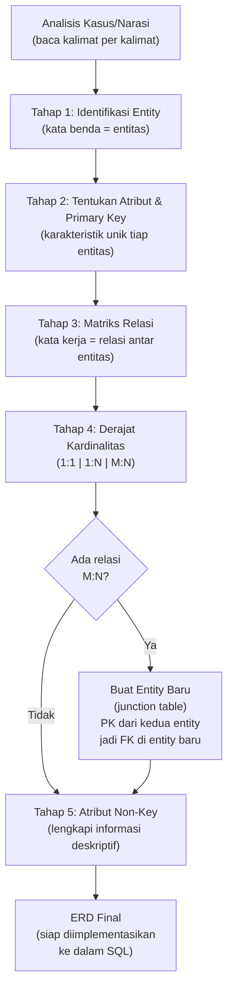

# Sesi 4 — Panduan Praktikum Pembuatan Entity Relationship Diagram (ERD)

**STSI4105 Basis Data**
Program Studi Sistem Informasi — Universitas Terbuka

> Catatan: dokumen ini merupakan ekstraksi sekaligus elaborasi dari *Panduan Praktikum Pembuatan Entity Relationship Diagram (ERD)* (MSIM4206P, Edisi 1). Penulis: Andri Suryadi, S.Kom., M.Kom. Penelaah: Unggul Utan Sufandi, S.Kom., M.Si. Setiap tahapan dilengkapi dengan penjelasan komprehensif dan diagram ERD yang digambarkan ulang menggunakan mermaid.

---

## 1. Latar Belakang dan Tujuan Praktikum

Mata kuliah Basis Data memberikan pengetahuan dan pengalaman praktis agar mahasiswa mampu mengorganisir data yang tersimpan secara elektronik pada sebuah sistem komputer sehingga menghasilkan informasi yang berguna.

Panduan ini menggabungkan materi esensial, petunjuk praktik langkah demi langkah, serta skenario tugas praktis yang menguji kemampuan dalam merancang, mengkonfigurasi, dan mengatasi masalah terkait basis data.

### Lima Tujuan Praktikum

### Ruang Lingkup Praktikum

| Praktik | Topik |
|---|---|
| **Praktik 1** | Pembuatan Entity Relationship Diagram (ERD) |
| **Praktik 2** | SQL dan Data Manipulation Language (DML) |
| **Praktik 3** | Virtual Box, Transaksi, dan Basis Data Terdistribusi |

---

## 2. Tahap Pembuatan ERD

Berdasarkan Modul 2, terdapat **5 (lima) tahap inti** dalam pembuatan ERD:

> **Kunci sukses pembuatan ERD**: bacalah kasus secara cermat kalimat per kalimat. Setiap kata benda berpotensi menjadi entitas, setiap kata kerja berpotensi menjadi relasi, dan setiap sifat/karakteristik berpotensi menjadi atribut.

---

## 3. Simbol-Simbol dalam ERD

Terdapat **16 simbol** standar yang digunakan dalam pembuatan ERD:

| No | Simbol | Keterangan |
|---|---|---|
| 1 | Persegi panjang + daftar atribut | Entity **dengan atribut** (notasi crow's foot / ERD modern) |
| 2 | Persegi panjang □ | **Entity** — kumpulan objek yang dapat diidentifikasikan secara unik |
| 3 | Persegi panjang garis ganda | **Entity lemah** — entity yang keberadaannya bergantung pada entity lain |
| 4 | Belah ketupat ◇ | **Relationship** — hubungan antara dua atau lebih entity |
| 5 | Belah ketupat garis ganda | **Relationship lemah** — relasi yang terkait dengan entity lemah |
| 6 | Elips ○ | **Atribut** — karakteristik dari entity |
| 7 | Elips ganda | **Multi-value Atribut** — atribut yang bisa memiliki lebih dari satu nilai |
| 8 | Elips bergaris bawah tebal | **Atribut Primary Key** — atribut yang menjadi kunci utama |
| 9 | Elips garis putus-putus | **Derived Atribut** — atribut yang nilainya diturunkan dari atribut lain |
| 10 | Garis lurus — | **Tidak spesifik** — hubungan tanpa keterangan kardinalitas |
| 11 | Garis + satu garis tegak `\|` | **1 – tidak spesifik** — sisi "satu" dalam relasi |
| 12 | Garis + tanda panah `>` | **N – tidak spesifik** — sisi "banyak" dalam relasi |
| 13 | Garis + lingkaran + garis tegak `o\|` | **(0,1)** — nol atau satu (*zero or one*) |
| 14 | Garis + dua garis tegak `\|\|` | **(1,1)** — tepat satu (*one and only one*) |
| 15 | Garis + lingkaran + panah `o>` | **(0,N)** — nol atau banyak (*zero or many*) |
| 16 | Garis + garis tegak + panah `\|>` | **(1,N)** — satu atau banyak (*one or many*) |

> Simbol **entity lemah** muncul ketika suatu entitas tidak bisa diidentifikasikan secara unik tanpa bergantung pada entitas lain. Contoh: entitas `Anggota_Keluarga` tidak punya kunci sendiri — ia hanya bermakna dalam konteks entitas `Karyawan`. **Multi-value atribut** muncul ketika satu atribut bisa bernilai lebih dari satu — contoh: atribut `NoTelepon` seorang karyawan bisa lebih dari satu nomor.

---

## 4. Studi Kasus 1: ERD Sistem Rumah Sakit

### Deskripsi Kasus

> Sebuah rumah sakit memiliki banyak dokter. Setiap dokter mempunyai banyak pasien yang harus ditangani. Pasien harus terlebih dahulu mendaftar pada bagian administrasi dengan menyerahkan data dirinya. Data pasien yang telah terdaftar akan diserahkan kepada dokter untuk diperiksa. Pasien dapat diperiksa oleh beberapa dokter sesuai situasi dan kondisi pasien. Setelah pasien selesai diperiksa, dokter akan membuat resep obat dan diserahkan kepada pasien.

### Tahap 1 — Identifikasi Entity

Baca kasus kalimat per kalimat untuk menemukan **kata benda** yang merepresentasikan objek utama sistem:

| Entity | Ditemukan dari kalimat |
|---|---|
| **Dokter** | "rumah sakit memiliki banyak dokter" |
| **Pasien** | "setiap dokter mempunyai banyak pasien" |
| **Administrator** | "mendaftar pada bagian administrasi" |

### Tahap 2 — Tentukan Atribut dan Kunci Utama

Karena kasus tidak merinci atribut, gunakan penalaran berdasarkan kehidupan nyata:

| Entity | Atribut (Primary Key digarisbawahi) |
|---|---|
| **Dokter** | **id_dokter** (PK), nama_dokter, tanggal_lahir, alamat_dokter, no_hp, spesialis, waktu_kerja |
| **Pasien** | **id_pasien** (PK), nama_pasien, alamat_pasien, jenis_kelamin, no_hp |
| **Administrator** | **id_admin** (PK), nama_admin, waktu_jaga |

### Tahap 3 — Identifikasi Relasi (Matriks Relasi)

Gunakan **matriks relasi** untuk memetakan semua kemungkinan hubungan antar entitas. Cara membaca: dari baris ke kolom (kiri ke kanan).

| *Entity* | Dokter | Pasien | Administrator |
|---|---|---|---|
| **Dokter** | — | Memeriksa | Simpan data |
| **Pasien** | Diperiksa | — | Mendaftar |
| **Administrator** | Menyerahkan data | Melayani | — |

> **Cara membaca matriks**: "Dokter → Pasien = Memeriksa" artinya Dokter *memeriksa* Pasien. "Pasien → Administrator = Mendaftar" artinya Pasien *mendaftar* ke Administrator.

### Tahap 4 — Tentukan Derajat Kardinalitas

Baca ulang kasus untuk menentukan apakah setiap relasi bersifat 1:1, 1:N, atau N:M:

| Temuan dari Kasus | Kesimpulan Kardinalitas |
|---|---|
| "Banyak Dokter memiliki Banyak Pasien" | Dokter ↔ Pasien = **M:N** |
| "Banyak Pasien mendaftar pada Banyak Administrator" | Pasien ↔ Administrator = **M:N** |
| "Banyak Administrator menyerahkan data kepada Banyak Dokter" | Administrator ↔ Dokter = **M:N** |

**ERD awal setelah derajat kardinalitas ditambahkan:**

### Tahap 5 — Pecah Relasi M:N menjadi Entity Baru

> **Aturan penting**: Jika relasi antara dua entity memiliki kardinalitas **M:N (banyak ke banyak)**, maka relasi tersebut **harus diubah menjadi entity baru**. Atribut entity baru tersebut adalah *primary key dari kedua entity yang terhubung* (sebagai foreign key), ditambah atribut deskriptif relasi itu sendiri.

| Relasi M:N | Entity Baru | Atribut |
|---|---|---|
| Dokter ↔ Administrator | **dokter_admin** | id_admin (FK), id_dokter (FK), id_data |
| Dokter ↔ Pasien | **pasien_dokter** | id (PK), id_dokter (FK), id_pasien (FK), waktu_periksa, resep |
| Administrator ↔ Pasien | **daftar** | id_daftar (PK), id_admin (FK), id_pasien (FK) |

**ERD Final Rumah Sakit (setelah pemecahan M:N):**

---

## 5. Studi Kasus 2: ERD Sistem Perguruan Tinggi

### Deskripsi Kasus

> Pada sebuah perguruan tinggi, mahasiswa akan mengambil matakuliah-matakuliah yang ditawarkan. Setiap mahasiswa minimal mengambil 1 namun dapat mengambil beberapa matakuliah dalam satu semester. Setiap matakuliah hanya bisa diajar oleh 1 (satu) orang dosen. Dan setiap dosen dapat mengampu/mengajar minimal 1 (satu) matakuliah.

### Tahap 1 — Identifikasi Entity

| Entity | Ditemukan dari kalimat |
|---|---|
| **Mahasiswa** | "mahasiswa akan mengambil matakuliah" |
| **Matakuliah** | "matakuliah-matakuliah yang ditawarkan" |
| **Dosen** | "setiap matakuliah hanya bisa diajar oleh 1 orang dosen" |

### Tahap 2 — Tentukan Atribut dan Kunci Utama

| Entity | Atribut |
|---|---|
| **Mahasiswa** | **NIM** (PK), nama_mahasiswa |
| **Matakuliah** | **kode_mk** (PK), nama_matakuliah |
| **Dosen** | **NID** (PK), nama_dosen |

### Tahap 3 — Identifikasi Relasi (Matriks Relasi)

| *Entity* | Mahasiswa | Matakuliah | Dosen |
|---|---|---|---|
| **Mahasiswa** | — | Meregistrasi | — |
| **Matakuliah** | Diregistrasi | — | Diajarkan |
| **Dosen** | — | Mengajar | — |

### Tahap 4 — Tentukan Derajat Kardinalitas

| Temuan dari Kasus | Kesimpulan Kardinalitas |
|---|---|
| "Banyak Mahasiswa meregistrasi Banyak Matakuliah" | Mahasiswa ↔ Matakuliah = **M:N** |
| "1 Matakuliah hanya bisa diajar 1 Dosen; setiap Dosen mengajar minimal 1 MK" | Dosen ↔ Matakuliah = **1:M** |

**Cara membaca ERD setelah derajat ditambahkan:**
- **Mahasiswa ↔ Matakuliah**: Banyak mahasiswa meregistrasi banyak matakuliah (minimal 1 matakuliah).
- **Dosen ↔ Matakuliah**: 1 dosen mengajar banyak matakuliah, namun 1 matakuliah hanya diajar oleh 1 dosen.

### Tahap 5 — Pecah Relasi M:N menjadi Entity Baru

Hanya relasi **Mahasiswa ↔ Matakuliah** yang bersifat M:N — sehingga dipecah menjadi entity baru **Registrasi_MK** dengan dua foreign key: `NIM` dan `kode_mk`.

Relasi **Dosen ↔ Matakuliah** bersifat **1:M** — tidak perlu dipecah, cukup tambahkan `NID` sebagai foreign key pada tabel `MATAKULIAH`.

**ERD Final Perguruan Tinggi:**

---

## 6. Perbandingan Dua Studi Kasus

| Aspek | Rumah Sakit | Perguruan Tinggi |
|---|---|---|
| **Jumlah Entity** | 3 (Dokter, Pasien, Administrator) | 3 (Mahasiswa, Matakuliah, Dosen) |
| **Relasi M:N** | 3 relasi (semua M:N) | 1 relasi (Mahasiswa–MK) |
| **Relasi 1:M** | Tidak ada | 1 relasi (Dosen–MK) |
| **Entity baru dari M:N** | 3 (dokter_admin, pasien_dokter, daftar) | 1 (Registrasi_MK) |
| **Kompleksitas** | Tinggi — semua relasi M:N | Sedang — campuran M:N dan 1:M |

> **Pelajaran kunci**: Semakin banyak relasi **M:N** dalam sistem, semakin banyak entity tambahan (*junction table*) yang harus dibuat. Ini adalah alasan mengapa analisis kasus secara cermat di Tahap 4 sangat menentukan kompleksitas akhir basis data.

---

## 7. Pelaporan dan Penilaian Praktikum

Setelah menyelesaikan praktikum ERD, mahasiswa wajib menyusun laporan dalam bentuk **rekaman video** yang menampilkan:

---

## Ringkasan Keterkaitan Antar Konsep

Inti dari sesi praktikum ini: pembuatan ERD adalah proses **analitik dan sistematis** — dimulai dari membaca narasi kasus secara cermat, mengidentifikasi entitas dan atributnya, memetakan relasi melalui matriks relasi, menentukan derajat kardinalitas, dan yang paling kritis: **mengubah setiap relasi M:N menjadi entity baru** dengan foreign key dari kedua entitas yang terhubung. Dua studi kasus (Rumah Sakit dan Perguruan Tinggi) menunjukkan bahwa sistem dengan banyak relasi M:N akan menghasilkan lebih banyak tabel junction — sehingga analisis derajat relasi yang teliti adalah fondasi dari basis data yang baik.

---

*Selamat Belajar dan Semangat Berkarya!*
